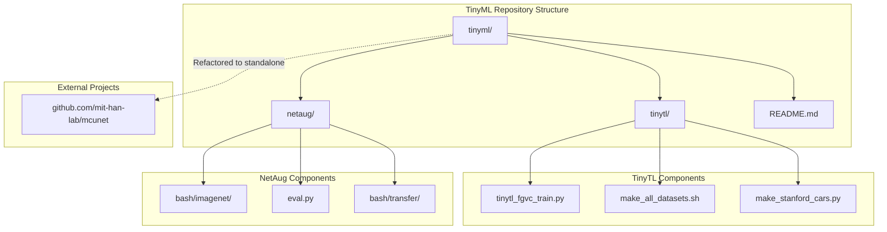
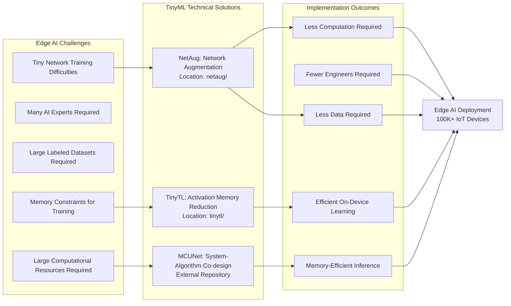
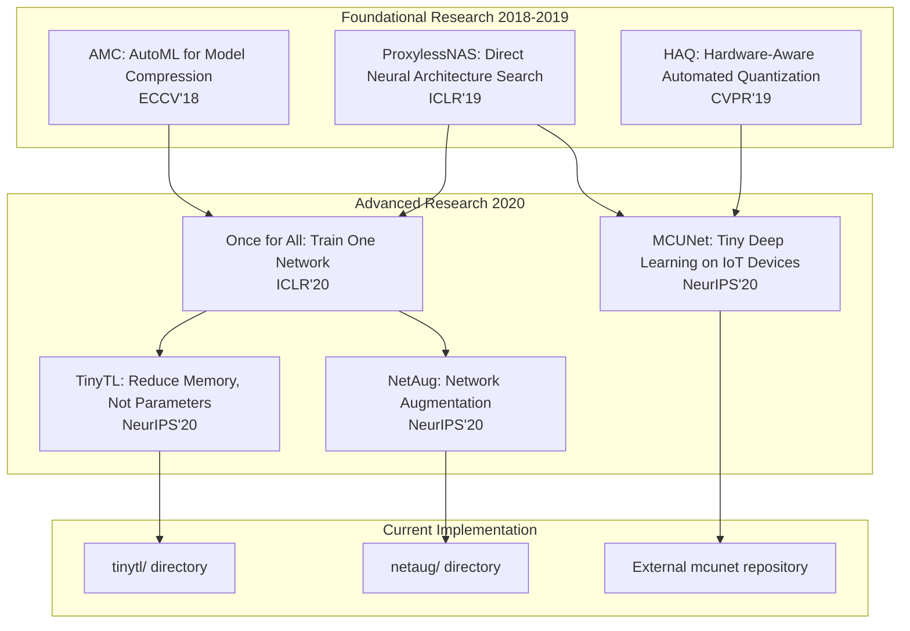

<!-- source: DeepWiki mcp.deepwiki.com · repo mit-han-lab/tinyml · page 1 TinyML Project Overview · fetched 2026-10-30 -->

# TinyML Project Overview

Relevant source files

The following files were used as context for generating this wiki page:

- [README.md](README.md)

## Purpose and Scope

This document provides an overview of the TinyML umbrella project, which aims to enable efficient deep learning on resource-constrained edge devices. The TinyML project addresses the fundamental challenge of deploying AI systems that traditionally require large computational resources, extensive labeled datasets, and significant engineering expertise onto billions of mobile phones and IoT devices.

This overview covers the project's three main sub-projects, their technical approaches, and deployment outcomes. For detailed implementation guides, see [Getting Started Guide](#5). For specific sub-project documentation, see [TinyTL: On-Device Learning](#2) and [NetAug: Network Augmentation for Tiny Networks](#3).

Sources: [README.md:23-32]()

## Project Architecture and Sub-Projects

The TinyML project consists of three core sub-projects, each addressing different aspects of efficient edge AI deployment:

### TinyML Sub-Project Structure

Sources: [README.md:15-21](), [README.md:3]()

### Sub-Project Technical Focus

| Project | Directory | Keywords | Primary Focus |
|---------|-----------|----------|---------------|
| TinyTL | `tinytl/` | On-device learning, Memory-efficient transfer learning | Activation memory optimization |
| NetAug | `netaug/` | Training technique for tiny neural networks | Network augmentation during training |
| MCUNet | External repo | Memory-efficient inference, System-algorithm co-design | Inference optimization |

Sources: [README.md:16-20]()

## Technical Problem-Solution Mapping

The TinyML project addresses specific challenges in deploying deep learning on edge devices through targeted technical solutions:

### Challenge-Solution Architecture

Sources: [README.md:24-32](), [README.md:5]()

## Deployment Impact and Industrial Collaboration

The TinyML project has achieved significant real-world deployment success:

### Deployment Statistics

- **Scale**: Over 100,000 IoT devices deployed
- **Industrial Partners**: Active collaboration with industry for real-world applications
- **Applications**: Smart home, smart retail, autonomous driving, and AIoT systems

### Media Coverage and Recognition

The project has received coverage from major technology publications:
- MIT News, WIRED, Morning Brew
- Stacey on IoT, Analytics Insight, Techable

Sources: [README.md:5](), [README.md:7-13](), [README.md:24-32]()

## Research Foundation and Publication History

The TinyML project builds upon a foundation of research spanning 2018-2020:

### Research Timeline and Dependencies

Sources: [README.md:44-58]()

## Technology Stack and Dependencies

The TinyML project relies on several key technologies:

### Core Dependencies

- **PyTorch Framework**: Primary deep learning framework
- **Python 3.6+**: Runtime environment
- **torchpack**: Distributed training support
- **torchprofile**: Model profiling capabilities

### System Requirements

Each sub-project has specific system requirements and installation procedures detailed in their respective documentation. For complete setup instructions, see [Getting Started Guide](#5).

Sources: [README.md:1-59]()

## Project Status and Future Development

### Current Status

- **MCUNet**: Refactored into standalone repository at `github.com/mit-han-lab/mcunet`
- **TinyTL**: Active development in `tinytl/` directory
- **NetAug**: Active development in `netaug/` directory

### Development Focus

The project continues to evolve with focus on:
- Industrial partnership expansion
- Real-world deployment optimization
- Technology transfer to production environments

For detailed implementation information on specific sub-projects, see [TinyTL: On-Device Learning](#2) and [NetAug: Network Augmentation for Tiny Networks](#3).

Sources: [README.md:3](), [README.md:5]()

---

