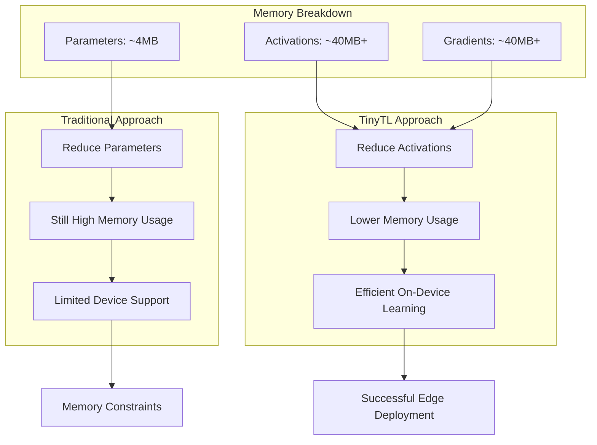
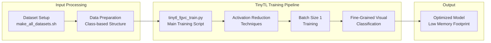
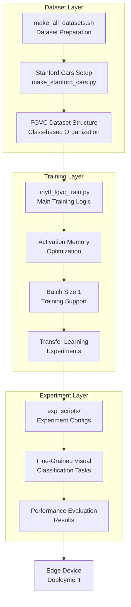
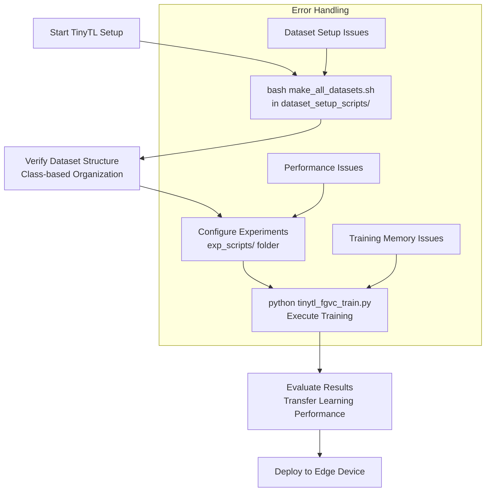

<!-- source: DeepWiki mcp.deepwiki.com · repo mit-han-lab/tinyml · page 2 TinyTL: On-Device Learning · fetched 2026-10-30 -->

# TinyTL: On-Device Learning

Relevant source files

The following files were used as context for generating this wiki page:

- [tinytl/README.md](tinytl/README.md)

## Purpose and Scope

This document covers the TinyTL sub-project within the TinyML ecosystem, which focuses on enabling efficient transfer learning directly on edge devices. TinyTL addresses the memory bottleneck in on-device learning by reducing activation memory consumption rather than model parameters, making fine-tuning feasible on resource-constrained devices.

For information about the broader TinyML project context and related sub-projects, see [TinyML Project Overview](#1). For dataset preparation procedures, see [Dataset Setup and Preparation](#2.1).

## Core Methodology

TinyTL's fundamental insight is that **activation memory, not model parameters, is the primary bottleneck for on-device learning**. Traditional approaches focus on reducing the number of trainable parameters, but TinyTL demonstrates that activation tensors consume significantly more memory during the forward and backward passes.

### Memory Analysis: Activations vs Parameters

**TinyTL Memory Optimization Strategy**

Sources: [tinytl/README.md:19-22]()

### Transfer Learning Architecture

TinyTL implements a specialized transfer learning pipeline that combines activation reduction with batch size 1 training for maximum memory efficiency:

**TinyTL System Architecture**

Sources: [tinytl/README.md:39-48]()

## System Components

### Core Training Infrastructure

The TinyTL system consists of several key components that work together to enable efficient on-device learning:

| Component | File Path | Purpose |
|-----------|-----------|---------|
| Dataset Setup | `dataset_setup_scripts/make_all_datasets.sh` | Prepares all required datasets |
| Training Script | `tinytl_fgvc_train.py` | Main training entry point |
| Experiment Scripts | `exp_scripts/` | Pre-configured experiment workflows |

### Implementation Architecture

**TinyTL Implementation Components**

Sources: [tinytl/README.md:39-48]()

## Usage Workflow

### System Requirements

TinyTL requires a minimal but specific environment setup:

- **Python**: 3.6 or higher
- **PyTorch**: 1.4.0 or higher
- **Memory**: Optimized for low-memory devices

Sources: [tinytl/README.md:42-44]()

### Execution Pipeline

The typical workflow for using TinyTL follows this sequence:

**TinyTL Execution Workflow**

Sources: [tinytl/README.md:39-48]()

## Key Features and Optimizations

### Activation Memory Reduction

TinyTL's core innovation lies in targeting activation memory rather than model parameters. This approach yields significant memory savings during both forward and backward passes:

- **Forward Pass**: Reduced intermediate activation storage
- **Backward Pass**: Optimized gradient computation memory
- **Batch Processing**: Support for batch size 1 training

### Fine-Grained Visual Classification (FGVC)

The system specializes in fine-grained visual classification tasks, which are particularly challenging for edge devices due to subtle inter-class differences requiring detailed feature representations.

### Batch Size 1 Training Support

TinyTL provides specialized support for batch size 1 training, which is crucial for memory-constrained devices but presents unique challenges for gradient stability and batch normalization.

Sources: [tinytl/README.md:34-37]()

## Research Context and Performance

TinyTL was published at NeurIPS 2020 and represents a significant advancement in on-device learning capabilities. The system demonstrates substantial improvements in memory efficiency while maintaining competitive accuracy on transfer learning benchmarks.

The approach builds upon foundational work in neural architecture search and model compression, extending these techniques specifically for the on-device learning scenario.

Sources: [tinytl/README.md:3-11](), [tinytl/README.md:55-67]()

## Current Status and Future Work

### Implementation Status

The current TinyTL implementation provides:
- Complete dataset setup automation
- Transfer learning experiment framework
- Memory-optimized training pipeline
- FGVC task support

### Planned Enhancements

According to the project roadmap, future work includes:
- Enhanced system support for TinyTL deployment
- Additional optimization techniques
- Extended device compatibility

Sources: [tinytl/README.md:50-52]()

---

