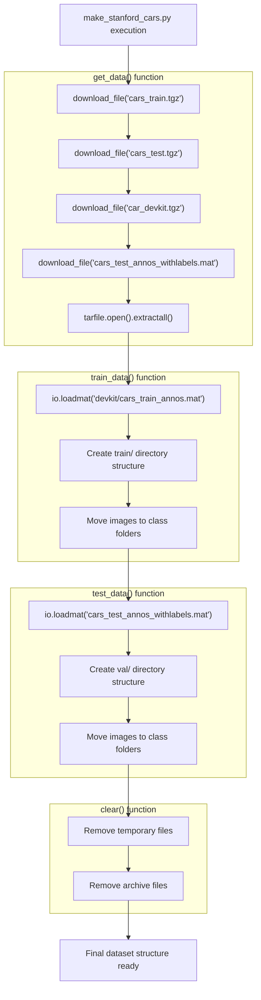
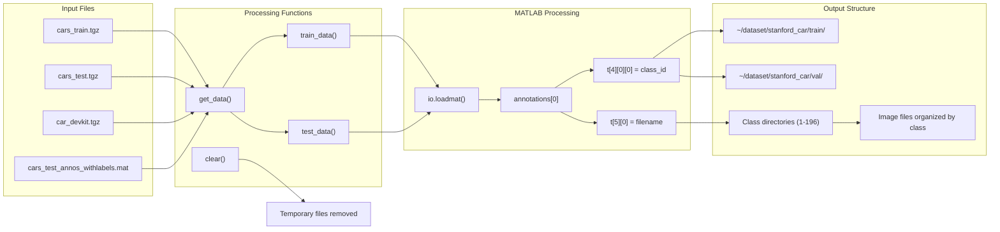

<!-- source: DeepWiki mcp.deepwiki.com · repo mit-han-lab/tinyml · page 2.1 Dataset Setup and Preparation · fetched 2026-10-30 -->

# Dataset Setup and Preparation

Relevant source files

The following files were used as context for generating this wiki page:

- [tinytl/dataset_setup_scripts/make_stanford_cars.py](tinytl/dataset_setup_scripts/make_stanford_cars.py)

## Purpose and Scope

This document covers the dataset setup and preparation process for TinyTL experiments, focusing on the automated scripts and procedures for downloading, organizing, and structuring datasets into the required format. The primary example demonstrates the Stanford Cars dataset preparation workflow, which serves as a template for other fine-grained visual classification (FGVC) datasets used in TinyTL.

For information about the actual TinyTL training experiments and model optimization, see [TinyTL: On-Device Learning](#2). For general project setup and installation requirements, see [Getting Started Guide](#5).

## Dataset Requirements Overview

TinyTL experiments require datasets to be organized in a specific class-based directory structure to support efficient on-device learning and memory optimization. The preparation process involves:

- Downloading raw dataset files from official sources
- Extracting annotation metadata from MATLAB files
- Reorganizing images into class-specific directories
- Creating separate train/validation directory structures
- Cleaning up temporary files and archives

## Stanford Cars Dataset Setup Process

The Stanford Cars dataset preparation is handled by the `make_stanford_cars.py` script, which automates the entire download-to-organization pipeline.

### Dataset Download and Extraction Workflow

**Sources:** [tinytl/dataset_setup_scripts/make_stanford_cars.py:82-90]()

### File Processing and Organization Logic

The script processes annotation files to extract class labels and organize images accordingly:

**Sources:** [tinytl/dataset_setup_scripts/make_stanford_cars.py:35-67]()

## Dataset Directory Structure

The final organized dataset follows this structure:

| Directory | Purpose | Contents |
|-----------|---------|----------|
| `~/dataset/stanford_car/train/` | Training data | Class directories (1-196) with training images |
| `~/dataset/stanford_car/val/` | Validation data | Class directories (1-196) with test images |
| `~/dataset/stanford_car/train/{class_id}/` | Individual class training | Images belonging to specific car model class |
| `~/dataset/stanford_car/val/{class_id}/` | Individual class validation | Test images for specific car model class |

**Sources:** [tinytl/dataset_setup_scripts/make_stanford_cars.py:36-66]()

## Configuration and Paths

The script uses the following key configuration:

- **Dataset Root Path**: `~/dataset/stanford_car` (expandable home directory path)
- **Download Function**: `download_file()` with wget command execution
- **Annotation Processing**: MATLAB file parsing using `scipy.io.loadmat()`
- **File Organization**: `shutil.move()` for relocating images to class directories

The `dataset_path` variable is set at [tinytl/dataset_setup_scripts/make_stanford_cars.py:7-8]() and expanded using `os.path.expanduser()`.

**Sources:** [tinytl/dataset_setup_scripts/make_stanford_cars.py:7-11]()

## Download Sources and File Handling

The script downloads four essential files from Stanford AI servers:

| File | Source URL | Purpose |
|------|-----------|---------|
| `cars_train.tgz` | `http://ai.stanford.edu/~jkrause/car196/cars_train.tgz` | Training images archive |
| `cars_test.tgz` | `http://ai.stanford.edu/~jkrause/car196/cars_test.tgz` | Test images archive |
| `car_devkit.tgz` | `https://ai.stanford.edu/~jkrause/cars/car_devkit.tgz` | Development kit with annotations |
| `cars_test_annos_withlabels.mat` | `http://ai.stanford.edu/~jkrause/car196/cars_test_annos_withlabels.mat` | Test annotations with labels |

The `download_file()` function at [tinytl/dataset_setup_scripts/make_stanford_cars.py:14-23]() handles URL downloads using wget and checks for existing files to avoid redundant downloads.

**Sources:** [tinytl/dataset_setup_scripts/make_stanford_cars.py:25-33]()

## Cleanup and Temporary File Management

After processing, the `clear()` function removes temporary files and archives to maintain a clean dataset directory:

- Archive files: `cars_train.tgz`, `cars_test.tgz`, `car_devkit.tgz`
- Temporary directories: `cars_test/`, `cars_train/`, `devkit/`
- Intermediate files: `cars_test.txt`, `cars_train.txt`, `cars_test_annos_withlabels.mat`

The cleanup process is defined at [tinytl/dataset_setup_scripts/make_stanford_cars.py:69-80]() and ensures only the final organized dataset structure remains.

**Sources:** [tinytl/dataset_setup_scripts/make_stanford_cars.py:69-86]()

---

