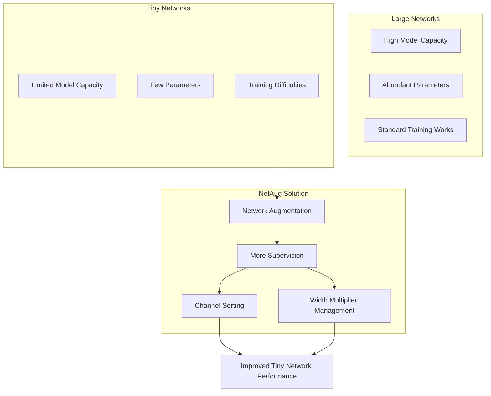
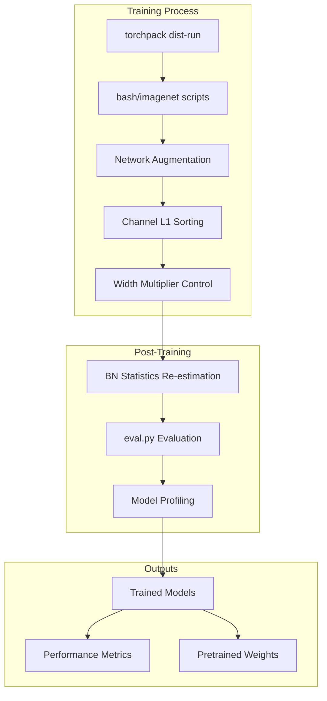
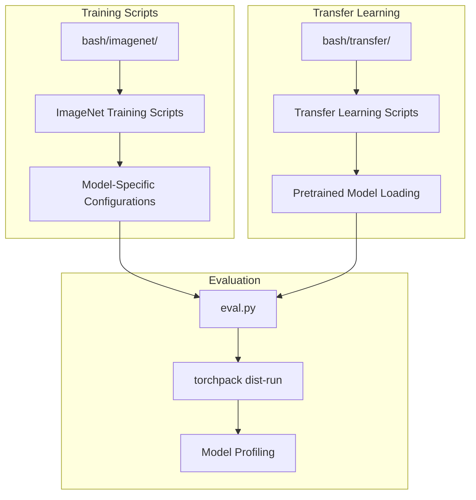
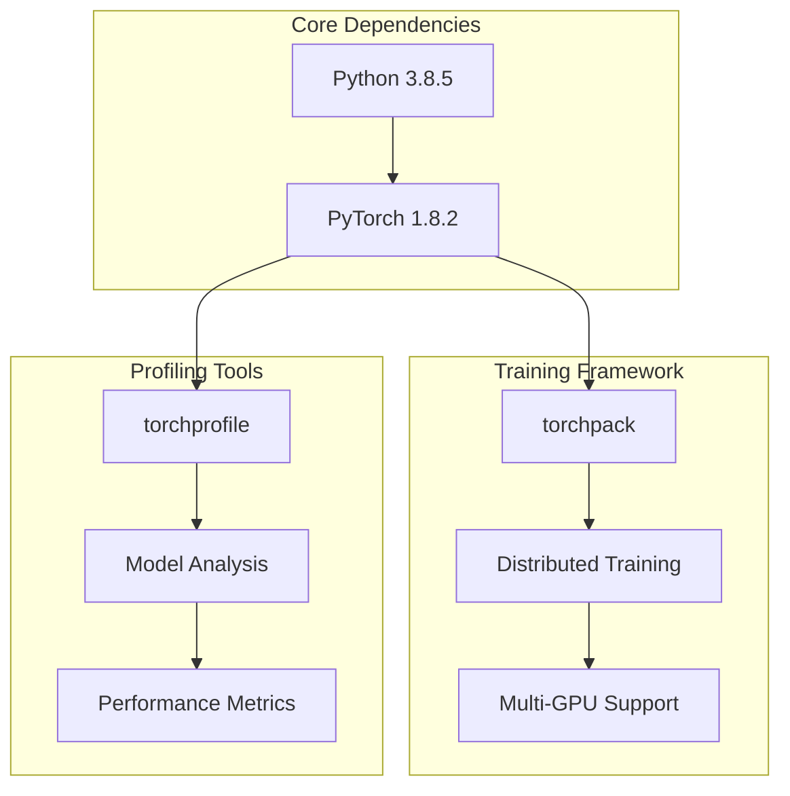
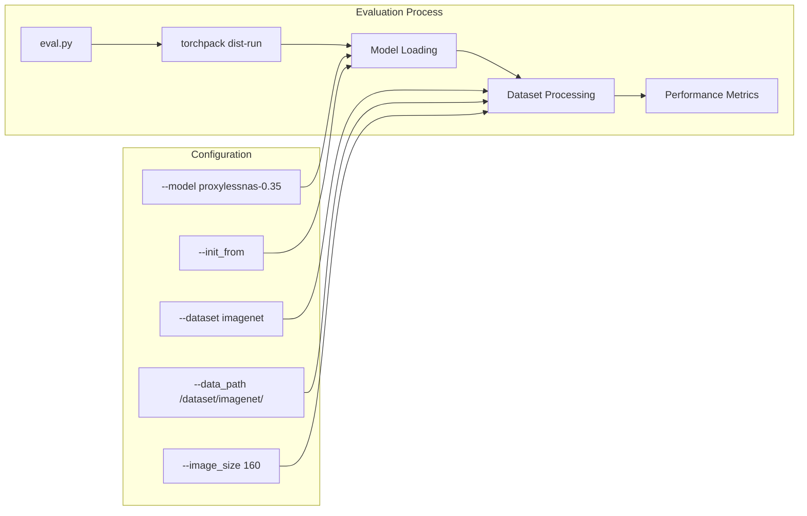
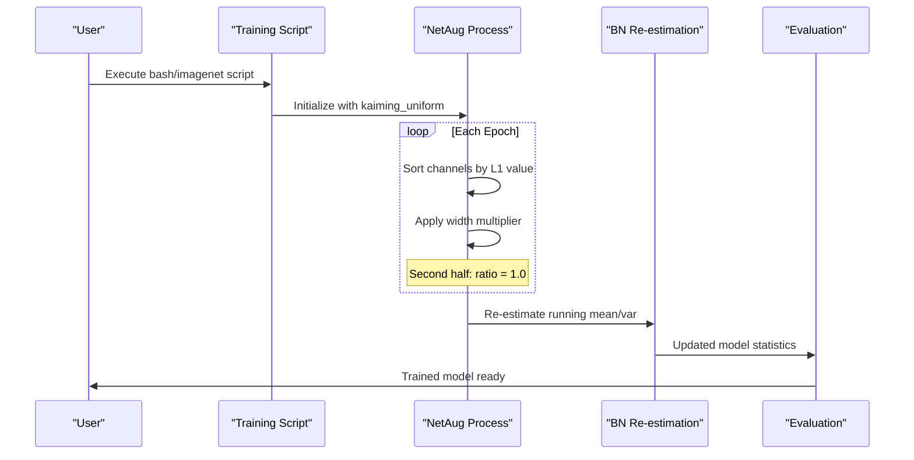
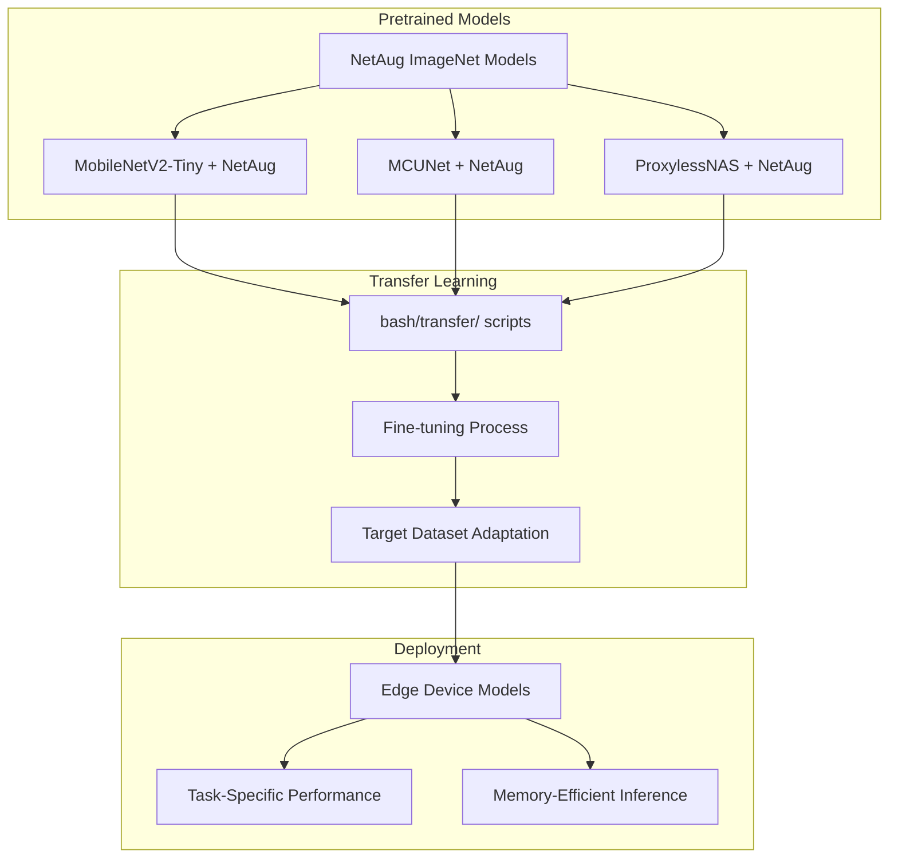
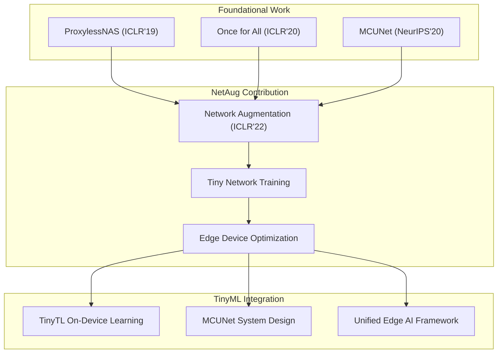

<!-- source: DeepWiki mcp.deepwiki.com · repo mit-han-lab/tinyml · page 3 NetAug: Network Augmentation for Tiny Networks · fetched 2026-10-30 -->

# NetAug: Network Augmentation for Tiny Networks

Relevant source files

The following files were used as context for generating this wiki page:

- [netaug/README.md](netaug/README.md)

## Purpose and Scope

NetAug is a training technique designed specifically for tiny neural networks that addresses the fundamental challenge that training tiny networks is different from training large networks. The system provides network augmentation during the training process to give tiny networks more supervision, ultimately improving their performance on resource-constrained edge devices.

This page covers the NetAug methodology, training procedures, evaluation framework, and pretrained models. For on-device learning techniques that complement NetAug, see [TinyTL: On-Device Learning](#2). For broader project context and setup instructions, see [Getting Started Guide](#5).

**Sources:** [netaug/README.md:1-87]()

## Core Methodology

NetAug addresses the key insight that tiny neural networks require different training strategies than large networks. The approach augments tiny networks during training to provide additional supervision signals that help overcome the limitations of reduced model capacity.

### Training Challenges for Tiny Networks

### NetAug Training Pipeline

**Sources:** [netaug/README.md:19-27](), [netaug/README.md:66-74]()

## Technical Implementation Details

### Key Implementation Considerations

NetAug includes several critical technical modifications for training tiny networks effectively:

| Component | Implementation Detail | Rationale |
|-----------|----------------------|-----------|
| Initialization | `nn.init.kaiming_uniform` | `fout` initialization fails for high expand ratios |
| Channel Sorting | L1 value sorting per epoch | Forces target model to use most important channels |
| Width Multiplier | Ratio = 1.0 in second half | Improves results in later training phases |
| BN Statistics | Re-estimation with training subset | Running mean/var become inaccurate during augmentation |

### Training Script Organization

**Sources:** [netaug/README.md:66-74](), [netaug/README.md:75-76]()

## Environment and Dependencies

### System Requirements

The NetAug system requires specific environment configurations:

- **Python**: 3.8.5
- **PyTorch**: 1.8.2
- **torchpack**: Distributed training framework
- **torchprofile**: Model profiling utilities

### Dependency Integration

**Sources:** [netaug/README.md:40-44]()

## Pretrained Models

### Available Model Configurations

NetAug provides pretrained models for various tiny network architectures:

| Model Architecture | Parameters | MACs | ImageNet Top1 | Pretrained Weights |
|-------------------|------------|------|---------------|-------------------|
| MobileNetV2-Tiny + NetAug | 0.75M | 23.5M | 53.3% | Google Drive |
| MCUNet + NetAug | 0.74M | 81.8M | 62.7% | Google Drive |
| ProxylessNAS-Mobile + NetAug | 1.8M | 35.7M | 60.8% | Google Drive |

### Model Evaluation Framework

**Sources:** [netaug/README.md:46-64]()

## Training Procedures

### ImageNet Training

Training scripts for NetAug models are organized under `bash/imagenet/` and utilize the `torchpack` distributed training framework. The training process incorporates the key NetAug techniques:

1. **Channel Sorting**: Channels are sorted by L1 value at the beginning of each epoch
2. **Width Multiplier Management**: Augmentation ratio is set to 1.0 in the second half of training
3. **Initialization Strategy**: Uses `nn.init.kaiming_uniform` instead of `fout` initialization
4. **BN Statistics Correction**: Post-training re-estimation using training subset

### Training Workflow

**Sources:** [netaug/README.md:66-74]()

## Transfer Learning Capabilities

### Transfer Learning Pipeline

NetAug-trained models can be fine-tuned for downstream tasks using transfer learning. The system provides scripts under `bash/transfer/` for this purpose.

**Sources:** [netaug/README.md:75-76]()

## Integration with TinyML Ecosystem

### Related Projects

NetAug is part of the broader TinyML ecosystem and works in conjunction with:

- **TinyTL**: Focuses on reducing activations for on-device learning
- **MCUNet**: Provides system-algorithm co-design for IoT deployment
- **Once for All**: Train-once-deploy-everywhere approach
- **ProxylessNAS**: Direct neural architecture search framework

### Research Foundation

**Sources:** [netaug/README.md:78-86]()

---

