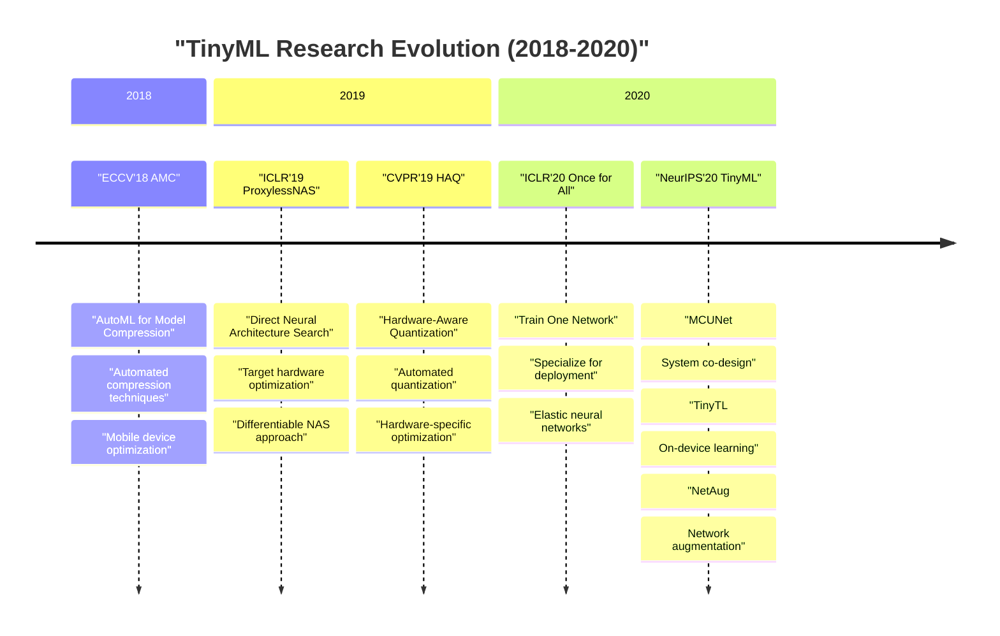
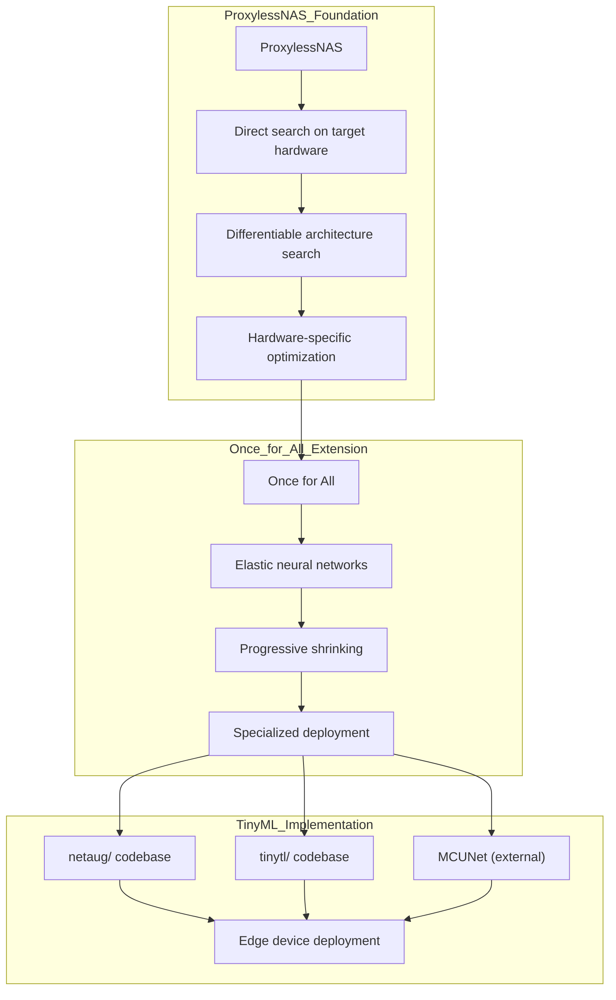
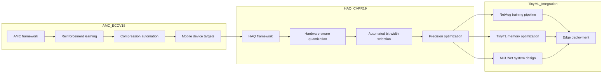
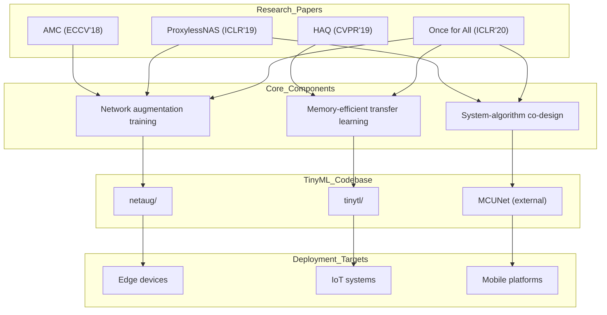
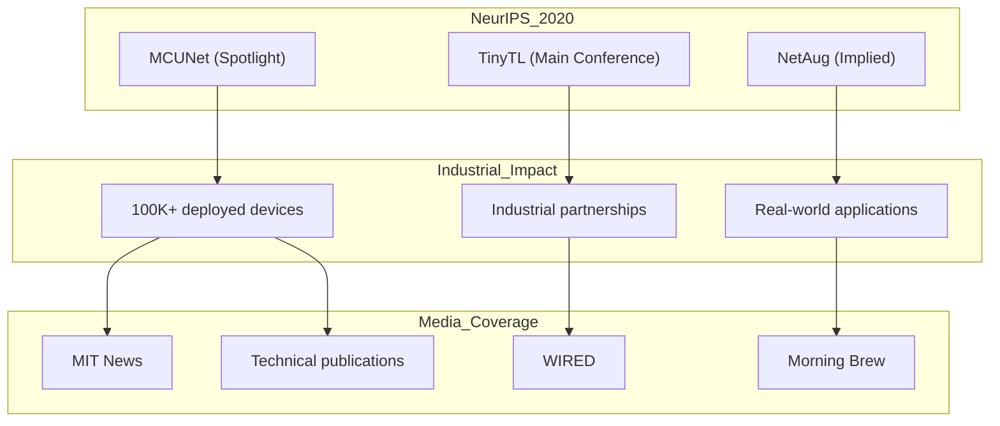

<!-- source: DeepWiki mcp.deepwiki.com · repo mit-han-lab/tinyml · page 4 Research Foundation and Related Work · fetched 2026-10-30 -->

# Research Foundation and Related Work

Relevant source files

The following files were used as context for generating this wiki page:

- [README.md](README.md)

This page provides comprehensive context on the research ecosystem surrounding TinyML, documenting the foundational papers, related projects, and evolution of techniques from 2018-2020 that led to current implementations. It establishes the theoretical and practical foundations that enable efficient deep learning on edge devices.

For practical usage of the TinyML systems, see [Getting Started Guide](#5). For detailed documentation of individual sub-projects, see [TinyTL: On-Device Learning](#2) and [NetAug: Network Augmentation for Tiny Networks](#3).

## Research Timeline and Evolution

The TinyML project represents the culmination of several years of research in efficient deep learning, building systematically on foundational work in neural architecture search, model compression, and hardware-aware optimization.

**Sources:** [README.md:46-58]()

## Foundational Techniques and Their Influence

The current TinyML implementations directly leverage and extend several key research contributions, each addressing specific challenges in efficient deep learning deployment.

### Neural Architecture Search Foundation

**Sources:** [README.md:50-52]()

### Model Compression and Quantization Pipeline

The progression from AMC to HAQ to current TinyML implementations demonstrates systematic advancement in automated model optimization techniques.

**Sources:** [README.md:56-58]()

## Current Implementation Landscape

The TinyML umbrella project represents a systematic approach to addressing three critical challenges in edge AI deployment, each tackled by a specialized sub-project building on the foundational research.

### Problem-Solution Mapping

| Challenge | Foundational Research | TinyML Solution | Implementation |
|-----------|----------------------|-----------------|----------------|
| Tiny network training difficulties | ProxylessNAS, Once for All | NetAug | `netaug/` codebase |
| Memory constraints for on-device learning | AMC, HAQ | TinyTL | `tinytl/` codebase |
| System-level inference optimization | ProxylessNAS, Once for All | MCUNet | External repository |

### Technical Integration Architecture

**Sources:** [README.md:15-21](), [README.md:46-58]()

## Technical Contributions and Innovations

### Memory Optimization Techniques

The TinyML project introduces several novel approaches to memory optimization that build directly on foundational research:

- **Activation Memory Reduction (TinyTL)**: Unlike traditional approaches that focus on parameter reduction, TinyTL reduces activation memory during training, enabling on-device learning with minimal memory footprint.

- **Network Augmentation (NetAug)**: Extends the Once for All training methodology to specifically address challenges in tiny neural network training through systematic network augmentation techniques.

- **System-Algorithm Co-design (MCUNet)**: Integrates insights from ProxylessNAS and hardware-aware optimization to achieve optimal deployment on microcontroller units.

### Publication Impact and Recognition

The TinyML project has achieved significant recognition in the research community:

**Sources:** [README.md:5-13](), [README.md:46-48]()

## Research Ecosystem Context

The TinyML project operates within a broader ecosystem of efficient deep learning research, representing a systematic approach to translating theoretical advances into practical edge AI solutions.

### Relationship to Broader Research Community

The foundational papers cited in the TinyML project have established key principles that extend beyond the specific implementations:

- **Automated Model Optimization**: AMC and HAQ demonstrated the feasibility of automated compression and quantization techniques
- **Hardware-Aware Design**: ProxylessNAS established the paradigm of direct optimization for target hardware
- **Elastic Neural Networks**: Once for All introduced the concept of training one network for multiple deployment scenarios

### Future Research Directions

Based on the foundational work and current implementations, several research directions emerge:

1. **Extended On-Device Learning**: Building on TinyTL's memory optimization techniques for more complex learning scenarios
2. **Advanced Network Augmentation**: Extending NetAug methodologies to additional neural network architectures
3. **Integrated System Design**: Further development of MCUNet-style co-design approaches for emerging edge hardware

**Sources:** [README.md:23-32](), [README.md:54-58]()

---

