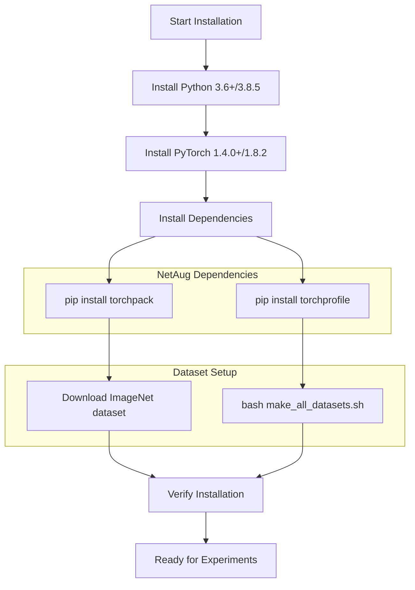
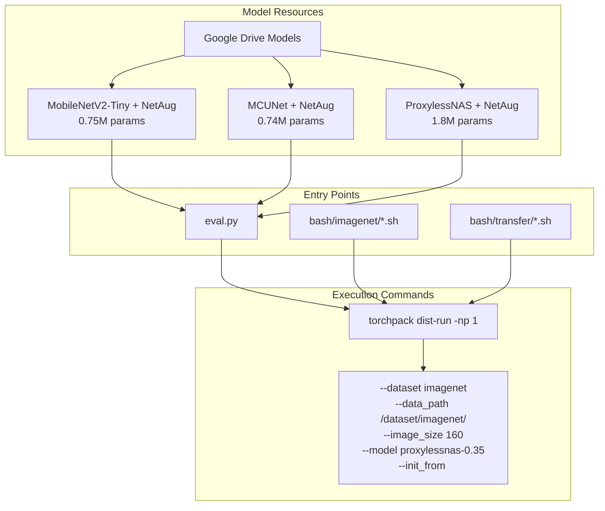
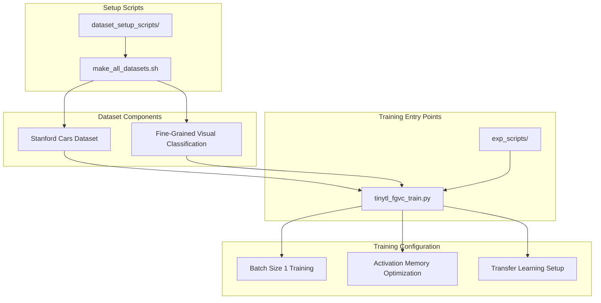

<!-- source: DeepWiki mcp.deepwiki.com · repo mit-han-lab/tinyml · page 5 Getting Started Guide · fetched 2026-10-30 -->

# Getting Started Guide

<details>
<summary>Relevant source files</summary>

The following files were used as context for generating this wiki page:

- [netaug/README.md](netaug/README.md)
- [tinytl/README.md](tinytl/README.md)

</details>


## Purpose and Scope

This guide provides step-by-step instructions for new users to set up and run experiments with the TinyML codebase. It covers system requirements, installation procedures, and basic usage workflows for both TinyTL and NetAug sub-projects.

For detailed information about TinyTL methodology and implementation, see [TinyTL: On-Device Learning](#2). For comprehensive NetAug documentation, see [NetAug: Network Augmentation for Tiny Networks](#3). For project background and research context, see [TinyML Project Overview](#1).

## System Requirements

The TinyML codebase has different requirements for its two main sub-projects:

### NetAug Requirements
| Component | Version |
|-----------|---------|
| Python | 3.8.5 |
| PyTorch | 1.8.2 |
| torchpack | Latest |
| torchprofile | Latest |

### TinyTL Requirements
| Component | Version |
|-----------|---------|
| Python | 3.6+ |
| PyTorch | 1.4.0+ |

**Sources:** [netaug/README.md:40-44](), [tinytl/README.md:42-44]()

## Installation and Setup

### Environment Setup Workflow



**Sources:** [netaug/README.md:40-44](), [tinytl/README.md:42-44]()

### Dataset Preparation

For TinyTL experiments, run the dataset setup script:

```bash
cd tinytl/dataset_setup_scripts
bash make_all_datasets.sh
```

This script sets up all required datasets including Stanford Cars and other fine-grained visual classification datasets.

**Sources:** [tinytl/README.md:40]()

## Quick Start Workflows

### NetAug Workflow: Code Entity Mapping



**Sources:** [netaug/README.md:46-64](), [netaug/README.md:66-77]()

### TinyTL Workflow: Code Entity Mapping



**Sources:** [tinytl/README.md:40](), [tinytl/README.md:46-48]()

## Basic Usage Patterns

### Running NetAug Model Evaluation

To evaluate a pretrained NetAug model:

```bash
torchpack dist-run -np 1 python eval.py \
    --dataset imagenet --data_path /dataset/imagenet/ \
    --image_size 160 \
    --model proxylessnas-0.35 \
    --init_from <path_of_pretrained_weight>
```

Available pretrained models:

| Model | Parameters | MACs | ImageNet Top1 | Download |
|-------|------------|------|---------------|----------|
| MobileNetV2-Tiny + NetAug | 0.75M | 23.5M | 53.3% | Google Drive |
| MCUNet + NetAug | 0.74M | 81.8M | 62.7% | Google Drive |
| ProxylessNAS + NetAug | 1.8M | 35.7M | 60.8% | Google Drive |

**Sources:** [netaug/README.md:55-64](), [netaug/README.md:46-53]()

### Running TinyTL Transfer Learning

After dataset setup, run TinyTL experiments:

```bash
cd tinytl
python tinytl_fgvc_train.py
```

Training scripts with specific configurations are available in the `exp_scripts/` directory.

**Sources:** [tinytl/README.md:46-48]()

### NetAug Training Considerations

When training with NetAug, several important implementation details must be considered:

1. **Initialization Strategy**: Use `nn.init.kaiming_uniform` instead of `fout` initialization due to large expand ratios
2. **Channel Sorting**: Channels are sorted by L1 value at each epoch start
3. **Width Multiplier**: Augmentation stops in the second half of training epochs
4. **Batch Normalization**: Running statistics are re-estimated after training using training subset

**Sources:** [netaug/README.md:69-73]()

## Common Commands Reference

### NetAug Commands
```bash
# Evaluate pretrained model
torchpack dist-run -np 1 python eval.py --dataset imagenet --data_path /path/to/data

# Train with NetAug (see bash/imagenet/ for specific scripts)
bash bash/imagenet/train_script.sh

# Transfer learning (see bash/transfer/ for specific scripts)
bash bash/transfer/transfer_script.sh
```

### TinyTL Commands
```bash
# Setup datasets
bash make_all_datasets.sh

# Run transfer learning experiments
python tinytl_fgvc_train.py

# Use experiment scripts
bash exp_scripts/experiment_script.sh
```

**Sources:** [netaug/README.md:55-77](), [tinytl/README.md:40](), [tinytl/README.md:46-48]()

## Next Steps

After completing this setup guide:

1. **For NetAug users**: Explore training scripts in `bash/imagenet/` and `bash/transfer/` directories
2. **For TinyTL users**: Review experiment scripts in `exp_scripts/` and customize for your datasets
3. **For both**: Download pretrained models from Google Drive links for immediate evaluation

For detailed methodology and implementation details, refer to the respective project documentation: [TinyTL: On-Device Learning](#2) and [NetAug: Network Augmentation for Tiny Networks](#3).

**Sources:** [netaug/README.md:66-77](), [tinytl/README.md:46-48]()