# Page: TinyML Project Overview

# TinyML Project Overview

<details>
<summary>Relevant source files</summary>

The following files were used as context for generating this wiki page:

- [README.md](README.md)

</details>


## Purpose and Scope

This document provides an overview of the TinyML umbrella project, which aims to enable efficient deep learning on resource-constrained edge devices. The TinyML project addresses the fundamental challenge of deploying AI systems that traditionally require large computational resources, extensive labeled datasets, and significant engineering expertise onto billions of mobile phones and IoT devices.

This overview covers the project's three main sub-projects, their technical approaches, and deployment outcomes. For detailed implementation guides, see [Getting Started Guide](#5). For specific sub-project documentation, see [TinyTL: On-Device Learning](#2) and [NetAug: Network Augmentation for Tiny Networks](#3).

Sources: [README.md:23-32]()

## Project Architecture and Sub-Projects

The TinyML project consists of three core sub-projects, each addressing different aspects of efficient edge AI deployment:

### TinyML Sub-Project Structure

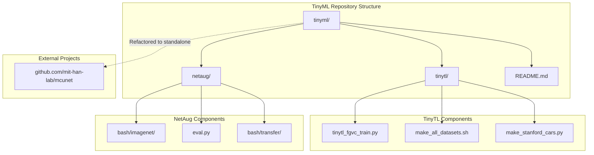

Sources: [README.md:15-21](), [README.md:3]()

### Sub-Project Technical Focus

| Project | Directory | Keywords | Primary Focus |
|---------|-----------|----------|---------------|
| TinyTL | `tinytl/` | On-device learning, Memory-efficient transfer learning | Activation memory optimization |
| NetAug | `netaug/` | Training technique for tiny neural networks | Network augmentation during training |
| MCUNet | External repo | Memory-efficient inference, System-algorithm co-design | Inference optimization |

Sources: [README.md:16-20]()

## Technical Problem-Solution Mapping

The TinyML project addresses specific challenges in deploying deep learning on edge devices through targeted technical solutions:

### Challenge-Solution Architecture

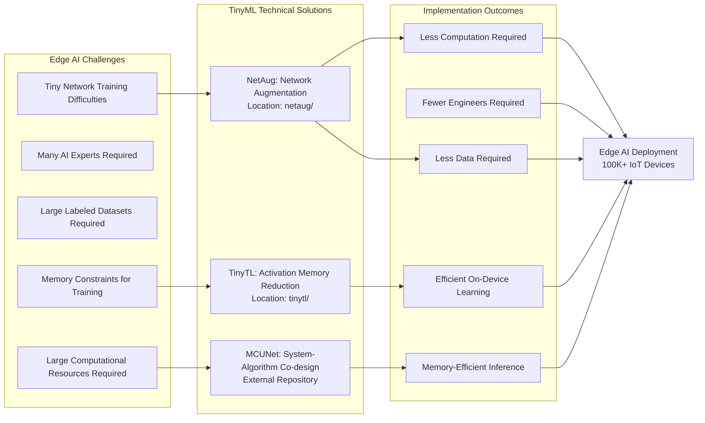

Sources: [README.md:24-32](), [README.md:5]()

## Deployment Impact and Industrial Collaboration

The TinyML project has achieved significant real-world deployment success:

### Deployment Statistics

- **Scale**: Over 100,000 IoT devices deployed
- **Industrial Partners**: Active collaboration with industry for real-world applications
- **Applications**: Smart home, smart retail, autonomous driving, and AIoT systems

### Media Coverage and Recognition

The project has received coverage from major technology publications:
- MIT News, WIRED, Morning Brew
- Stacey on IoT, Analytics Insight, Techable

Sources: [README.md:5](), [README.md:7-13](), [README.md:24-32]()

## Research Foundation and Publication History

The TinyML project builds upon a foundation of research spanning 2018-2020:

### Research Timeline and Dependencies

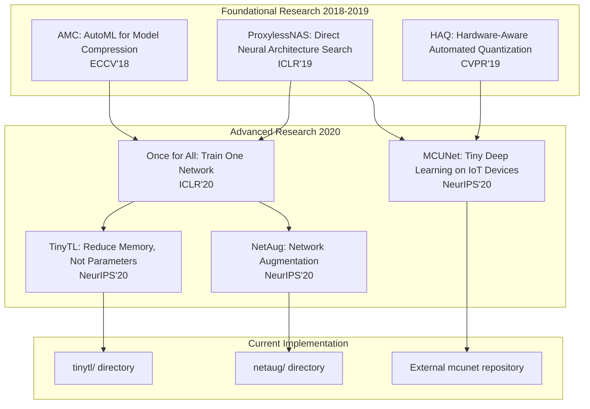

Sources: [README.md:44-58]()

## Technology Stack and Dependencies

The TinyML project relies on several key technologies:

### Core Dependencies

- **PyTorch Framework**: Primary deep learning framework
- **Python 3.6+**: Runtime environment
- **torchpack**: Distributed training support
- **torchprofile**: Model profiling capabilities

### System Requirements

Each sub-project has specific system requirements and installation procedures detailed in their respective documentation. For complete setup instructions, see [Getting Started Guide](#5).

Sources: [README.md:1-59]()

## Project Status and Future Development

### Current Status

- **MCUNet**: Refactored into standalone repository at `github.com/mit-han-lab/mcunet`
- **TinyTL**: Active development in `tinytl/` directory
- **NetAug**: Active development in `netaug/` directory

### Development Focus

The project continues to evolve with focus on:
- Industrial partnership expansion
- Real-world deployment optimization
- Technology transfer to production environments

For detailed implementation information on specific sub-projects, see [TinyTL: On-Device Learning](#2) and [NetAug: Network Augmentation for Tiny Networks](#3).

Sources: [README.md:3](), [README.md:5]()

---

# Page: TinyTL: On-Device Learning

# TinyTL: On-Device Learning

<details>
<summary>Relevant source files</summary>

The following files were used as context for generating this wiki page:

- [tinytl/README.md](tinytl/README.md)

</details>


## Purpose and Scope

This document covers the TinyTL sub-project within the TinyML ecosystem, which focuses on enabling efficient transfer learning directly on edge devices. TinyTL addresses the memory bottleneck in on-device learning by reducing activation memory consumption rather than model parameters, making fine-tuning feasible on resource-constrained devices.

For information about the broader TinyML project context and related sub-projects, see [TinyML Project Overview](#1). For dataset preparation procedures, see [Dataset Setup and Preparation](#2.1).

## Core Methodology

TinyTL's fundamental insight is that **activation memory, not model parameters, is the primary bottleneck for on-device learning**. Traditional approaches focus on reducing the number of trainable parameters, but TinyTL demonstrates that activation tensors consume significantly more memory during the forward and backward passes.

### Memory Analysis: Activations vs Parameters

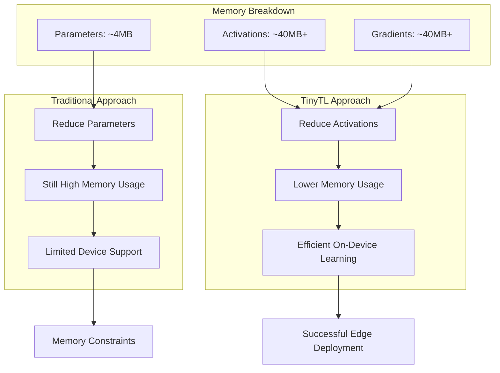

**TinyTL Memory Optimization Strategy**

Sources: [tinytl/README.md:19-22]()

### Transfer Learning Architecture

TinyTL implements a specialized transfer learning pipeline that combines activation reduction with batch size 1 training for maximum memory efficiency:

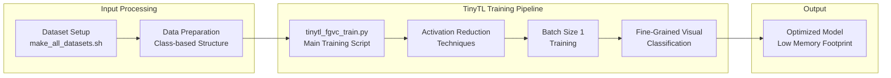

**TinyTL System Architecture**

Sources: [tinytl/README.md:39-48]()

## System Components

### Core Training Infrastructure

The TinyTL system consists of several key components that work together to enable efficient on-device learning:

| Component | File Path | Purpose |
|-----------|-----------|---------|
| Dataset Setup | `dataset_setup_scripts/make_all_datasets.sh` | Prepares all required datasets |
| Training Script | `tinytl_fgvc_train.py` | Main training entry point |
| Experiment Scripts | `exp_scripts/` | Pre-configured experiment workflows |

### Implementation Architecture

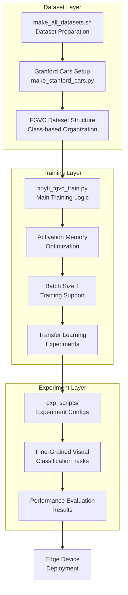

**TinyTL Implementation Components**

Sources: [tinytl/README.md:39-48]()

## Usage Workflow

### System Requirements

TinyTL requires a minimal but specific environment setup:

- **Python**: 3.6 or higher
- **PyTorch**: 1.4.0 or higher
- **Memory**: Optimized for low-memory devices

Sources: [tinytl/README.md:42-44]()

### Execution Pipeline

The typical workflow for using TinyTL follows this sequence:

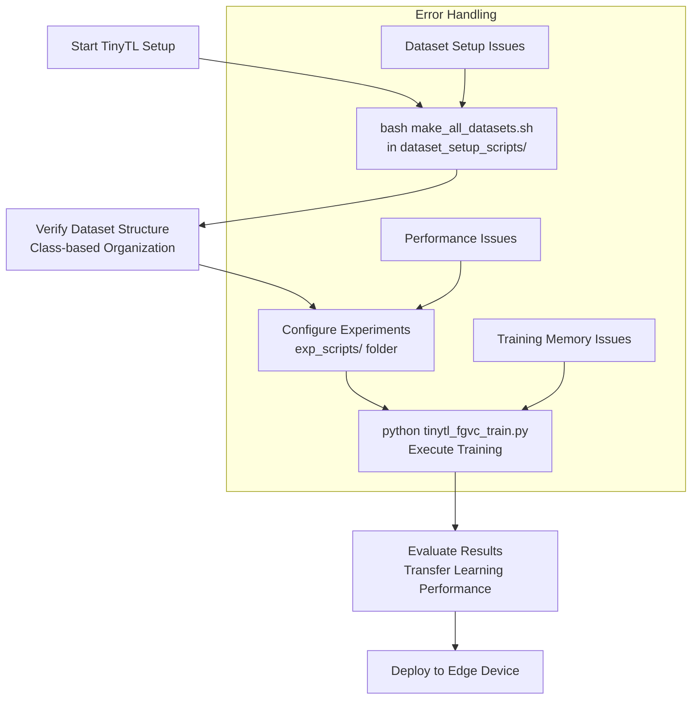

**TinyTL Execution Workflow**

Sources: [tinytl/README.md:39-48]()

## Key Features and Optimizations

### Activation Memory Reduction

TinyTL's core innovation lies in targeting activation memory rather than model parameters. This approach yields significant memory savings during both forward and backward passes:

- **Forward Pass**: Reduced intermediate activation storage
- **Backward Pass**: Optimized gradient computation memory
- **Batch Processing**: Support for batch size 1 training

### Fine-Grained Visual Classification (FGVC)

The system specializes in fine-grained visual classification tasks, which are particularly challenging for edge devices due to subtle inter-class differences requiring detailed feature representations.

### Batch Size 1 Training Support

TinyTL provides specialized support for batch size 1 training, which is crucial for memory-constrained devices but presents unique challenges for gradient stability and batch normalization.

Sources: [tinytl/README.md:34-37]()

## Research Context and Performance

TinyTL was published at NeurIPS 2020 and represents a significant advancement in on-device learning capabilities. The system demonstrates substantial improvements in memory efficiency while maintaining competitive accuracy on transfer learning benchmarks.

The approach builds upon foundational work in neural architecture search and model compression, extending these techniques specifically for the on-device learning scenario.

Sources: [tinytl/README.md:3-11](), [tinytl/README.md:55-67]()

## Current Status and Future Work

### Implementation Status

The current TinyTL implementation provides:
- Complete dataset setup automation
- Transfer learning experiment framework
- Memory-optimized training pipeline
- FGVC task support

### Planned Enhancements

According to the project roadmap, future work includes:
- Enhanced system support for TinyTL deployment
- Additional optimization techniques
- Extended device compatibility

Sources: [tinytl/README.md:50-52]()

---

# Page: Dataset Setup and Preparation

# Dataset Setup and Preparation

<details>
<summary>Relevant source files</summary>

The following files were used as context for generating this wiki page:

- [tinytl/dataset_setup_scripts/make_stanford_cars.py](tinytl/dataset_setup_scripts/make_stanford_cars.py)

</details>


## Purpose and Scope

This document covers the dataset setup and preparation process for TinyTL experiments, focusing on the automated scripts and procedures for downloading, organizing, and structuring datasets into the required format. The primary example demonstrates the Stanford Cars dataset preparation workflow, which serves as a template for other fine-grained visual classification (FGVC) datasets used in TinyTL.

For information about the actual TinyTL training experiments and model optimization, see [TinyTL: On-Device Learning](#2). For general project setup and installation requirements, see [Getting Started Guide](#5).

## Dataset Requirements Overview

TinyTL experiments require datasets to be organized in a specific class-based directory structure to support efficient on-device learning and memory optimization. The preparation process involves:

- Downloading raw dataset files from official sources
- Extracting annotation metadata from MATLAB files
- Reorganizing images into class-specific directories
- Creating separate train/validation directory structures
- Cleaning up temporary files and archives

## Stanford Cars Dataset Setup Process

The Stanford Cars dataset preparation is handled by the `make_stanford_cars.py` script, which automates the entire download-to-organization pipeline.

### Dataset Download and Extraction Workflow

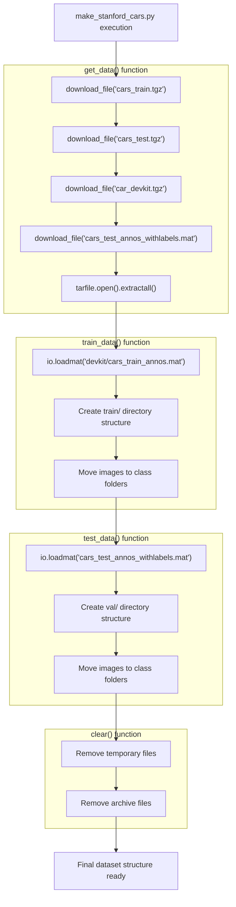

**Sources:** [tinytl/dataset_setup_scripts/make_stanford_cars.py:82-90]()

### File Processing and Organization Logic

The script processes annotation files to extract class labels and organize images accordingly:

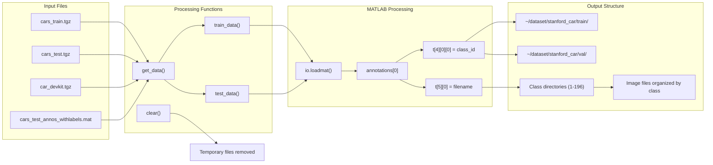

**Sources:** [tinytl/dataset_setup_scripts/make_stanford_cars.py:35-67]()

## Dataset Directory Structure

The final organized dataset follows this structure:

| Directory | Purpose | Contents |
|-----------|---------|----------|
| `~/dataset/stanford_car/train/` | Training data | Class directories (1-196) with training images |
| `~/dataset/stanford_car/val/` | Validation data | Class directories (1-196) with test images |
| `~/dataset/stanford_car/train/{class_id}/` | Individual class training | Images belonging to specific car model class |
| `~/dataset/stanford_car/val/{class_id}/` | Individual class validation | Test images for specific car model class |

**Sources:** [tinytl/dataset_setup_scripts/make_stanford_cars.py:36-66]()

## Configuration and Paths

The script uses the following key configuration:

- **Dataset Root Path**: `~/dataset/stanford_car` (expandable home directory path)
- **Download Function**: `download_file()` with wget command execution
- **Annotation Processing**: MATLAB file parsing using `scipy.io.loadmat()`
- **File Organization**: `shutil.move()` for relocating images to class directories

The `dataset_path` variable is set at [tinytl/dataset_setup_scripts/make_stanford_cars.py:7-8]() and expanded using `os.path.expanduser()`.

**Sources:** [tinytl/dataset_setup_scripts/make_stanford_cars.py:7-11]()

## Download Sources and File Handling

The script downloads four essential files from Stanford AI servers:

| File | Source URL | Purpose |
|------|-----------|---------|
| `cars_train.tgz` | `http://ai.stanford.edu/~jkrause/car196/cars_train.tgz` | Training images archive |
| `cars_test.tgz` | `http://ai.stanford.edu/~jkrause/car196/cars_test.tgz` | Test images archive |
| `car_devkit.tgz` | `https://ai.stanford.edu/~jkrause/cars/car_devkit.tgz` | Development kit with annotations |
| `cars_test_annos_withlabels.mat` | `http://ai.stanford.edu/~jkrause/car196/cars_test_annos_withlabels.mat` | Test annotations with labels |

The `download_file()` function at [tinytl/dataset_setup_scripts/make_stanford_cars.py:14-23]() handles URL downloads using wget and checks for existing files to avoid redundant downloads.

**Sources:** [tinytl/dataset_setup_scripts/make_stanford_cars.py:25-33]()

## Cleanup and Temporary File Management

After processing, the `clear()` function removes temporary files and archives to maintain a clean dataset directory:

- Archive files: `cars_train.tgz`, `cars_test.tgz`, `car_devkit.tgz`
- Temporary directories: `cars_test/`, `cars_train/`, `devkit/`
- Intermediate files: `cars_test.txt`, `cars_train.txt`, `cars_test_annos_withlabels.mat`

The cleanup process is defined at [tinytl/dataset_setup_scripts/make_stanford_cars.py:69-80]() and ensures only the final organized dataset structure remains.

**Sources:** [tinytl/dataset_setup_scripts/make_stanford_cars.py:69-86]()

---

# Page: NetAug: Network Augmentation for Tiny Networks

# NetAug: Network Augmentation for Tiny Networks

<details>
<summary>Relevant source files</summary>

The following files were used as context for generating this wiki page:

- [netaug/README.md](netaug/README.md)

</details>


## Purpose and Scope

NetAug is a training technique designed specifically for tiny neural networks that addresses the fundamental challenge that training tiny networks is different from training large networks. The system provides network augmentation during the training process to give tiny networks more supervision, ultimately improving their performance on resource-constrained edge devices.

This page covers the NetAug methodology, training procedures, evaluation framework, and pretrained models. For on-device learning techniques that complement NetAug, see [TinyTL: On-Device Learning](#2). For broader project context and setup instructions, see [Getting Started Guide](#5).

**Sources:** [netaug/README.md:1-87]()

## Core Methodology

NetAug addresses the key insight that tiny neural networks require different training strategies than large networks. The approach augments tiny networks during training to provide additional supervision signals that help overcome the limitations of reduced model capacity.

### Training Challenges for Tiny Networks

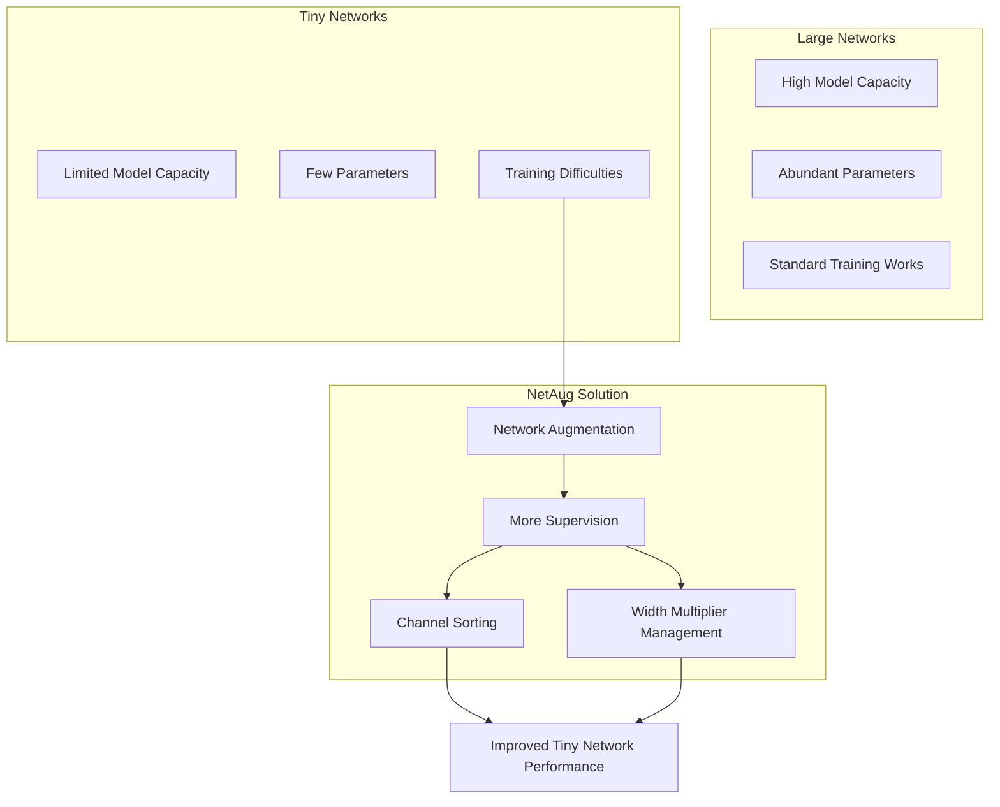

### NetAug Training Pipeline

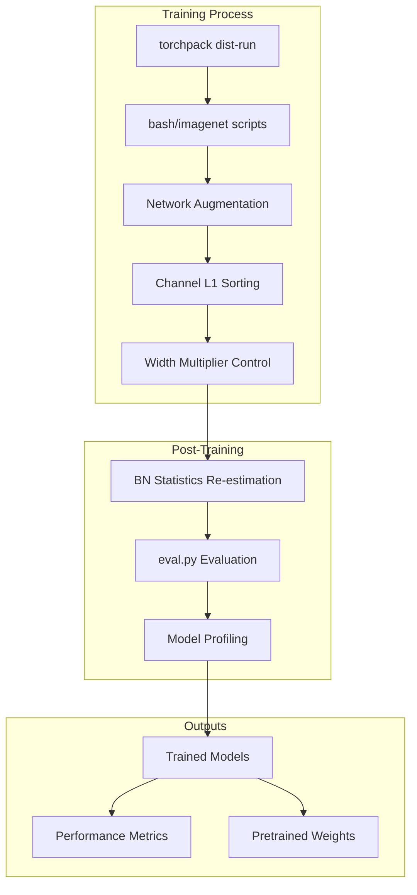

**Sources:** [netaug/README.md:19-27](), [netaug/README.md:66-74]()

## Technical Implementation Details

### Key Implementation Considerations

NetAug includes several critical technical modifications for training tiny networks effectively:

| Component | Implementation Detail | Rationale |
|-----------|----------------------|-----------|
| Initialization | `nn.init.kaiming_uniform` | `fout` initialization fails for high expand ratios |
| Channel Sorting | L1 value sorting per epoch | Forces target model to use most important channels |
| Width Multiplier | Ratio = 1.0 in second half | Improves results in later training phases |
| BN Statistics | Re-estimation with training subset | Running mean/var become inaccurate during augmentation |

### Training Script Organization

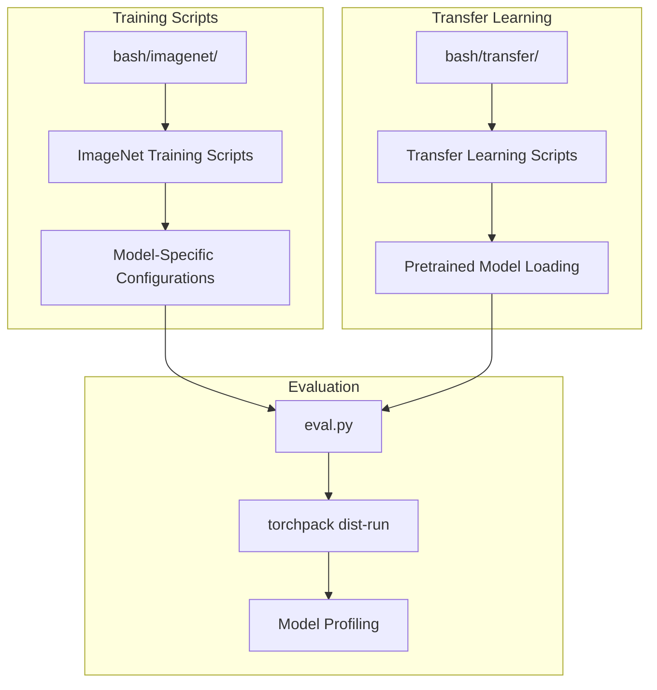

**Sources:** [netaug/README.md:66-74](), [netaug/README.md:75-76]()

## Environment and Dependencies

### System Requirements

The NetAug system requires specific environment configurations:

- **Python**: 3.8.5
- **PyTorch**: 1.8.2
- **torchpack**: Distributed training framework
- **torchprofile**: Model profiling utilities

### Dependency Integration

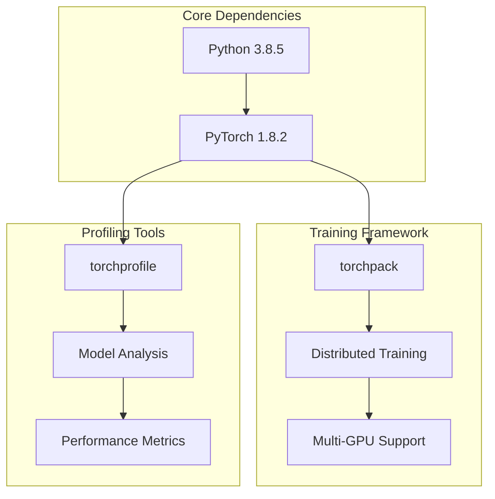

**Sources:** [netaug/README.md:40-44]()

## Pretrained Models

### Available Model Configurations

NetAug provides pretrained models for various tiny network architectures:

| Model Architecture | Parameters | MACs | ImageNet Top1 | Pretrained Weights |
|-------------------|------------|------|---------------|-------------------|
| MobileNetV2-Tiny + NetAug | 0.75M | 23.5M | 53.3% | Google Drive |
| MCUNet + NetAug | 0.74M | 81.8M | 62.7% | Google Drive |
| ProxylessNAS-Mobile + NetAug | 1.8M | 35.7M | 60.8% | Google Drive |

### Model Evaluation Framework

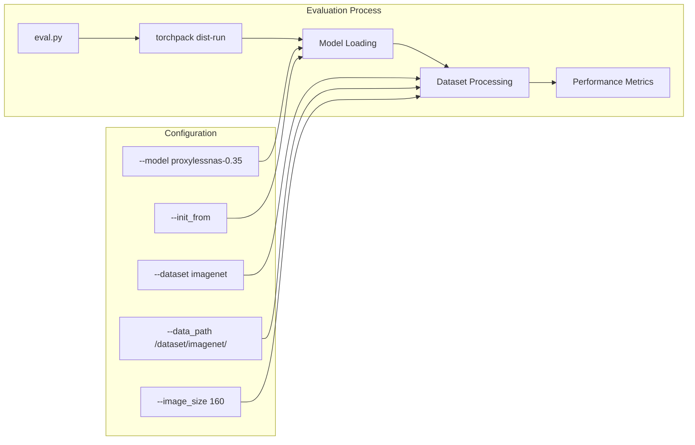

**Sources:** [netaug/README.md:46-64]()

## Training Procedures

### ImageNet Training

Training scripts for NetAug models are organized under `bash/imagenet/` and utilize the `torchpack` distributed training framework. The training process incorporates the key NetAug techniques:

1. **Channel Sorting**: Channels are sorted by L1 value at the beginning of each epoch
2. **Width Multiplier Management**: Augmentation ratio is set to 1.0 in the second half of training
3. **Initialization Strategy**: Uses `nn.init.kaiming_uniform` instead of `fout` initialization
4. **BN Statistics Correction**: Post-training re-estimation using training subset

### Training Workflow

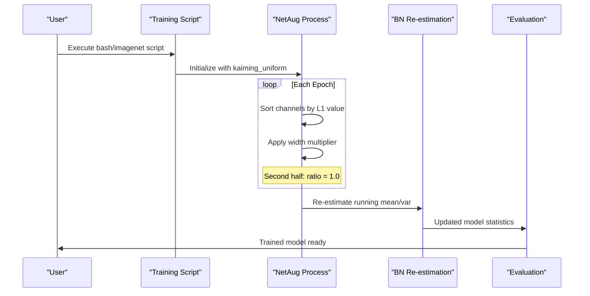

**Sources:** [netaug/README.md:66-74]()

## Transfer Learning Capabilities

### Transfer Learning Pipeline

NetAug-trained models can be fine-tuned for downstream tasks using transfer learning. The system provides scripts under `bash/transfer/` for this purpose.

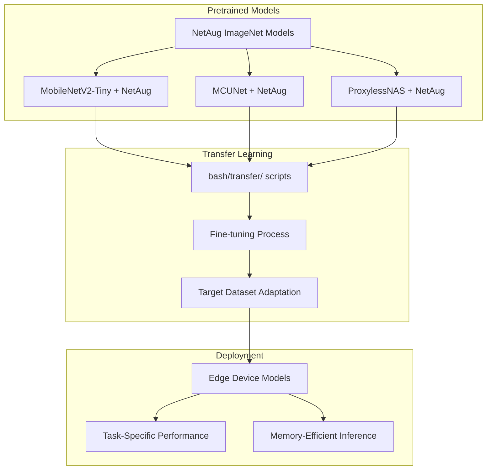

**Sources:** [netaug/README.md:75-76]()

## Integration with TinyML Ecosystem

### Related Projects

NetAug is part of the broader TinyML ecosystem and works in conjunction with:

- **TinyTL**: Focuses on reducing activations for on-device learning
- **MCUNet**: Provides system-algorithm co-design for IoT deployment
- **Once for All**: Train-once-deploy-everywhere approach
- **ProxylessNAS**: Direct neural architecture search framework

### Research Foundation

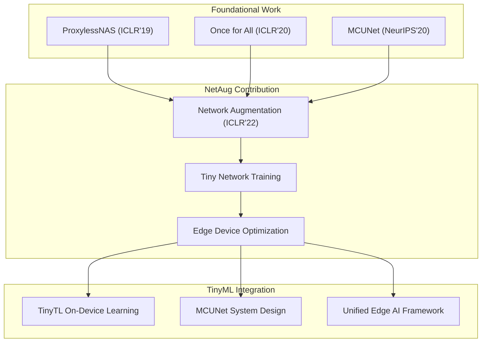

**Sources:** [netaug/README.md:78-86]()

---

# Page: Research Foundation and Related Work

# Research Foundation and Related Work

<details>
<summary>Relevant source files</summary>

The following files were used as context for generating this wiki page:

- [README.md](README.md)

</details>


This page provides comprehensive context on the research ecosystem surrounding TinyML, documenting the foundational papers, related projects, and evolution of techniques from 2018-2020 that led to current implementations. It establishes the theoretical and practical foundations that enable efficient deep learning on edge devices.

For practical usage of the TinyML systems, see [Getting Started Guide](#5). For detailed documentation of individual sub-projects, see [TinyTL: On-Device Learning](#2) and [NetAug: Network Augmentation for Tiny Networks](#3).

## Research Timeline and Evolution

The TinyML project represents the culmination of several years of research in efficient deep learning, building systematically on foundational work in neural architecture search, model compression, and hardware-aware optimization.

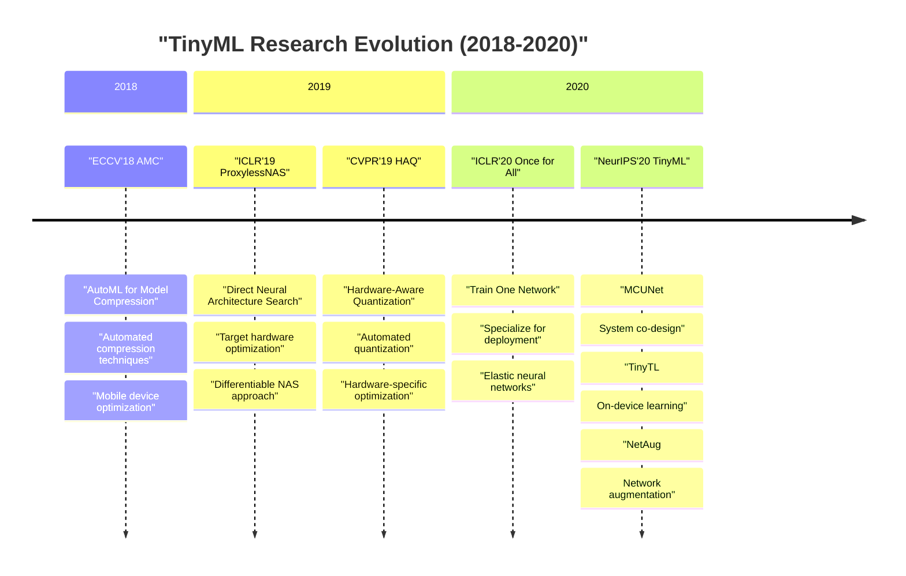

**Sources:** [README.md:46-58]()

## Foundational Techniques and Their Influence

The current TinyML implementations directly leverage and extend several key research contributions, each addressing specific challenges in efficient deep learning deployment.

### Neural Architecture Search Foundation

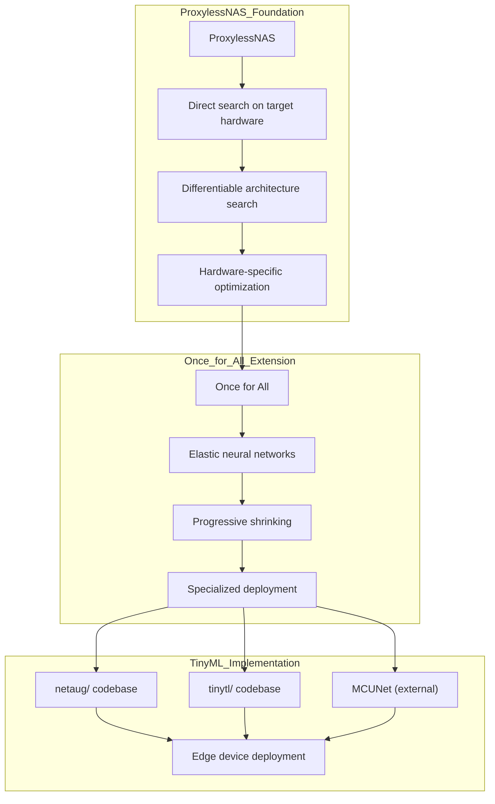

**Sources:** [README.md:50-52]()

### Model Compression and Quantization Pipeline

The progression from AMC to HAQ to current TinyML implementations demonstrates systematic advancement in automated model optimization techniques.

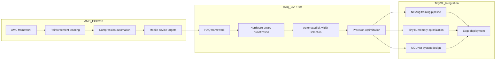

**Sources:** [README.md:56-58]()

## Current Implementation Landscape

The TinyML umbrella project represents a systematic approach to addressing three critical challenges in edge AI deployment, each tackled by a specialized sub-project building on the foundational research.

### Problem-Solution Mapping

| Challenge | Foundational Research | TinyML Solution | Implementation |
|-----------|----------------------|-----------------|----------------|
| Tiny network training difficulties | ProxylessNAS, Once for All | NetAug | `netaug/` codebase |
| Memory constraints for on-device learning | AMC, HAQ | TinyTL | `tinytl/` codebase |
| System-level inference optimization | ProxylessNAS, Once for All | MCUNet | External repository |

### Technical Integration Architecture

```mermaid
graph TB
    subgraph "Research_Papers"
        RP1["AMC (ECCV'18)"]
        RP2["ProxylessNAS (ICLR'19)"]
        RP3["HAQ (CVPR'19)"]
        RP4["Once for All (ICLR'20)"]
    end
    
    subgraph "TinyML_Codebase"
        TC1["netaug/"]
        TC2["tinytl/"]
        TC3["MCUNet (external)"]
    end
    
    subgraph "Core_Components"
        CC1["Network augmentation training"]
        CC2["Memory-efficient transfer learning"]
        CC3["System-algorithm co-design"]
    end
    
    subgraph "Deployment_Targets"
        DT1["Edge devices"]
        DT2["IoT systems"]
        DT3["Mobile platforms"]
    end
    
    RP1 --> CC1
    RP2 --> CC1
    RP2 --> CC3
    RP3 --> CC2
    RP4 --> CC1
    RP4 --> CC2
    RP4 --> CC3
    
    CC1 --> TC1
    CC2 --> TC2
    CC3 --> TC3
    
    TC1 --> DT1
    TC2 --> DT2
    TC3 --> DT3
```

**Sources:** [README.md:15-21](), [README.md:46-58]()

## Technical Contributions and Innovations

### Memory Optimization Techniques

The TinyML project introduces several novel approaches to memory optimization that build directly on foundational research:

- **Activation Memory Reduction (TinyTL)**: Unlike traditional approaches that focus on parameter reduction, TinyTL reduces activation memory during training, enabling on-device learning with minimal memory footprint.

- **Network Augmentation (NetAug)**: Extends the Once for All training methodology to specifically address challenges in tiny neural network training through systematic network augmentation techniques.

- **System-Algorithm Co-design (MCUNet)**: Integrates insights from ProxylessNAS and hardware-aware optimization to achieve optimal deployment on microcontroller units.

### Publication Impact and Recognition

The TinyML project has achieved significant recognition in the research community:

```mermaid
graph TB
    subgraph "NeurIPS_2020"
        N1["MCUNet (Spotlight)"]
        N2["TinyTL (Main Conference)"]
        N3["NetAug (Implied)"]
    end
    
    subgraph "Industrial_Impact"
        I1["100K+ deployed devices"]
        I2["Industrial partnerships"]
        I3["Real-world applications"]
    end
    
    subgraph "Media_Coverage"
        M1["MIT News"]
        M2["WIRED"]
        M3["Morning Brew"]
        M4["Technical publications"]
    end
    
    N1 --> I1
    N2 --> I2
    N3 --> I3
    
    I1 --> M1
    I2 --> M2
    I3 --> M3
    I1 --> M4
```

**Sources:** [README.md:5-13](), [README.md:46-48]()

## Research Ecosystem Context

The TinyML project operates within a broader ecosystem of efficient deep learning research, representing a systematic approach to translating theoretical advances into practical edge AI solutions.

### Relationship to Broader Research Community

The foundational papers cited in the TinyML project have established key principles that extend beyond the specific implementations:

- **Automated Model Optimization**: AMC and HAQ demonstrated the feasibility of automated compression and quantization techniques
- **Hardware-Aware Design**: ProxylessNAS established the paradigm of direct optimization for target hardware
- **Elastic Neural Networks**: Once for All introduced the concept of training one network for multiple deployment scenarios

### Future Research Directions

Based on the foundational work and current implementations, several research directions emerge:

1. **Extended On-Device Learning**: Building on TinyTL's memory optimization techniques for more complex learning scenarios
2. **Advanced Network Augmentation**: Extending NetAug methodologies to additional neural network architectures
3. **Integrated System Design**: Further development of MCUNet-style co-design approaches for emerging edge hardware

**Sources:** [README.md:23-32](), [README.md:54-58]()

---

# Page: Getting Started Guide

# Getting Started Guide

<details>
<summary>Relevant source files</summary>

The following files were used as context for generating this wiki page:

- [netaug/README.md](netaug/README.md)
- [tinytl/README.md](tinytl/README.md)

</details>


## Purpose and Scope

This guide provides step-by-step instructions for new users to set up and run experiments with the TinyML codebase. It covers system requirements, installation procedures, and basic usage workflows for both TinyTL and NetAug sub-projects.

For detailed information about TinyTL methodology and implementation, see [TinyTL: On-Device Learning](#2). For comprehensive NetAug documentation, see [NetAug: Network Augmentation for Tiny Networks](#3). For project background and research context, see [TinyML Project Overview](#1).

## System Requirements

The TinyML codebase has different requirements for its two main sub-projects:

### NetAug Requirements
| Component | Version |
|-----------|---------|
| Python | 3.8.5 |
| PyTorch | 1.8.2 |
| torchpack | Latest |
| torchprofile | Latest |

### TinyTL Requirements
| Component | Version |
|-----------|---------|
| Python | 3.6+ |
| PyTorch | 1.4.0+ |

**Sources:** [netaug/README.md:40-44](), [tinytl/README.md:42-44]()

## Installation and Setup

### Environment Setup Workflow

```mermaid
flowchart TD
    START["Start Installation"]
    PYTHON["Install Python 3.6+/3.8.5"]
    PYTORCH["Install PyTorch 1.4.0+/1.8.2"]
    DEPS["Install Dependencies"]
    
    subgraph "NetAug Dependencies"
        TORCHPACK["pip install torchpack"]
        TORCHPROFILE["pip install torchprofile"]
    end
    
    subgraph "Dataset Setup"
        IMAGENET["Download ImageNet dataset"]
        TINYTL_DATA["bash make_all_datasets.sh"]
    end
    
    VERIFY["Verify Installation"]
    READY["Ready for Experiments"]
    
    START --> PYTHON
    PYTHON --> PYTORCH
    PYTORCH --> DEPS
    DEPS --> TORCHPACK
    DEPS --> TORCHPROFILE
    TORCHPACK --> IMAGENET
    TORCHPROFILE --> TINYTL_DATA
    IMAGENET --> VERIFY
    TINYTL_DATA --> VERIFY
    VERIFY --> READY
```

**Sources:** [netaug/README.md:40-44](), [tinytl/README.md:42-44]()

### Dataset Preparation

For TinyTL experiments, run the dataset setup script:

```bash
cd tinytl/dataset_setup_scripts
bash make_all_datasets.sh
```

This script sets up all required datasets including Stanford Cars and other fine-grained visual classification datasets.

**Sources:** [tinytl/README.md:40]()

## Quick Start Workflows

### NetAug Workflow: Code Entity Mapping

```mermaid
flowchart TD
    subgraph "Entry Points"
        EVAL["eval.py"]
        TRAIN_SCRIPTS["bash/imagenet/*.sh"]
        TRANSFER_SCRIPTS["bash/transfer/*.sh"]
    end
    
    subgraph "Model Resources"
        PRETRAINED["Google Drive Models"]
        MOBILENET["MobileNetV2-Tiny + NetAug<br/>0.75M params"]
        MCUNET["MCUNet + NetAug<br/>0.74M params"]
        PROXYLESS["ProxylessNAS + NetAug<br/>1.8M params"]
    end
    
    subgraph "Execution Commands"
        TORCHPACK["torchpack dist-run -np 1"]
        EVAL_CMD["--dataset imagenet<br/>--data_path /dataset/imagenet/<br/>--image_size 160<br/>--model proxylessnas-0.35<br/>--init_from <path>"]
    end
    
    PRETRAINED --> MOBILENET
    PRETRAINED --> MCUNET
    PRETRAINED --> PROXYLESS
    
    MOBILENET --> EVAL
    MCUNET --> EVAL
    PROXYLESS --> EVAL
    
    EVAL --> TORCHPACK
    TORCHPACK --> EVAL_CMD
    
    TRAIN_SCRIPTS --> TORCHPACK
    TRANSFER_SCRIPTS --> TORCHPACK
```

**Sources:** [netaug/README.md:46-64](), [netaug/README.md:66-77]()

### TinyTL Workflow: Code Entity Mapping

```mermaid
flowchart TD
    subgraph "Setup Scripts"
        MAKE_ALL["make_all_datasets.sh"]
        DATASET_SETUP["dataset_setup_scripts/"]
    end
    
    subgraph "Training Entry Points"
        TINYTL_TRAIN["tinytl_fgvc_train.py"]
        EXP_SCRIPTS["exp_scripts/"]
    end
    
    subgraph "Dataset Components"
        STANFORD_CARS["Stanford Cars Dataset"]
        FGVC_DATASETS["Fine-Grained Visual Classification"]
    end
    
    subgraph "Training Configuration"
        BATCH_SIZE_1["Batch Size 1 Training"]
        ACTIVATION_OPT["Activation Memory Optimization"]
        TRANSFER_LEARNING["Transfer Learning Setup"]
    end
    
    MAKE_ALL --> STANFORD_CARS
    MAKE_ALL --> FGVC_DATASETS
    DATASET_SETUP --> MAKE_ALL
    
    STANFORD_CARS --> TINYTL_TRAIN
    FGVC_DATASETS --> TINYTL_TRAIN
    
    TINYTL_TRAIN --> BATCH_SIZE_1
    TINYTL_TRAIN --> ACTIVATION_OPT
    TINYTL_TRAIN --> TRANSFER_LEARNING
    
    EXP_SCRIPTS --> TINYTL_TRAIN
```

**Sources:** [tinytl/README.md:40](), [tinytl/README.md:46-48]()

## Basic Usage Patterns

### Running NetAug Model Evaluation

To evaluate a pretrained NetAug model:

```bash
torchpack dist-run -np 1 python eval.py \
    --dataset imagenet --data_path /dataset/imagenet/ \
    --image_size 160 \
    --model proxylessnas-0.35 \
    --init_from <path_of_pretrained_weight>
```

Available pretrained models:

| Model | Parameters | MACs | ImageNet Top1 | Download |
|-------|------------|------|---------------|----------|
| MobileNetV2-Tiny + NetAug | 0.75M | 23.5M | 53.3% | Google Drive |
| MCUNet + NetAug | 0.74M | 81.8M | 62.7% | Google Drive |
| ProxylessNAS + NetAug | 1.8M | 35.7M | 60.8% | Google Drive |

**Sources:** [netaug/README.md:55-64](), [netaug/README.md:46-53]()

### Running TinyTL Transfer Learning

After dataset setup, run TinyTL experiments:

```bash
cd tinytl
python tinytl_fgvc_train.py
```

Training scripts with specific configurations are available in the `exp_scripts/` directory.

**Sources:** [tinytl/README.md:46-48]()

### NetAug Training Considerations

When training with NetAug, several important implementation details must be considered:

1. **Initialization Strategy**: Use `nn.init.kaiming_uniform` instead of `fout` initialization due to large expand ratios
2. **Channel Sorting**: Channels are sorted by L1 value at each epoch start
3. **Width Multiplier**: Augmentation stops in the second half of training epochs
4. **Batch Normalization**: Running statistics are re-estimated after training using training subset

**Sources:** [netaug/README.md:69-73]()

## Common Commands Reference

### NetAug Commands
```bash
# Evaluate pretrained model
torchpack dist-run -np 1 python eval.py --dataset imagenet --data_path /path/to/data

# Train with NetAug (see bash/imagenet/ for specific scripts)
bash bash/imagenet/train_script.sh

# Transfer learning (see bash/transfer/ for specific scripts)
bash bash/transfer/transfer_script.sh
```

### TinyTL Commands
```bash
# Setup datasets
bash make_all_datasets.sh

# Run transfer learning experiments
python tinytl_fgvc_train.py

# Use experiment scripts
bash exp_scripts/experiment_script.sh
```

**Sources:** [netaug/README.md:55-77](), [tinytl/README.md:40](), [tinytl/README.md:46-48]()

## Next Steps

After completing this setup guide:

1. **For NetAug users**: Explore training scripts in `bash/imagenet/` and `bash/transfer/` directories
2. **For TinyTL users**: Review experiment scripts in `exp_scripts/` and customize for your datasets
3. **For both**: Download pretrained models from Google Drive links for immediate evaluation

For detailed methodology and implementation details, refer to the respective project documentation: [TinyTL: On-Device Learning](#2) and [NetAug: Network Augmentation for Tiny Networks](#3).

**Sources:** [netaug/README.md:66-77](), [tinytl/README.md:46-48]()