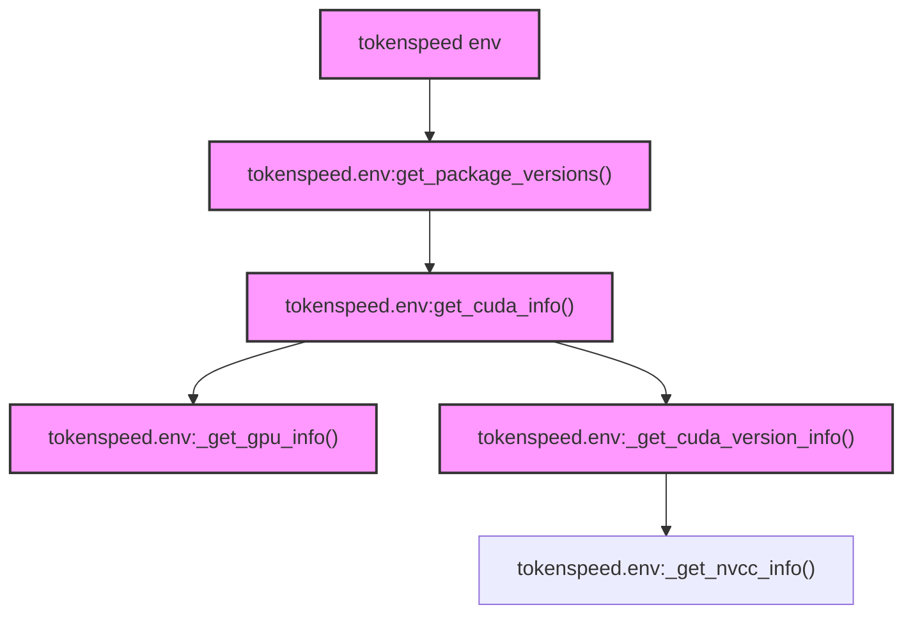
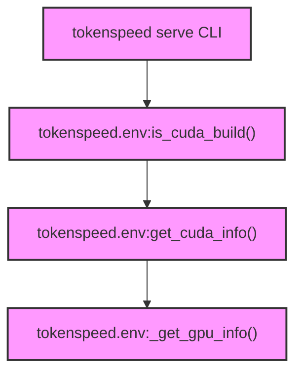

<!-- source: DeepWiki mcp.deepwiki.com · repo lightseekorg/tokenspeed · page 1.1 Getting Started · fetched 2026-10-21 -->

# Getting Started

<details>
<summary>Relevant source files</summary>

The following files were used as context for generating this wiki page:

- [.github/scripts/prepare-kernel-amd-nightly.py](.github/scripts/prepare-kernel-amd-nightly.py)
- [.github/scripts/prepare-tokenspeed-nightly.py](.github/scripts/prepare-tokenspeed-nightly.py)
- [.github/scripts/update-nightly-index.py](.github/scripts/update-nightly-index.py)
- [.github/workflows/nvidia-kernel-library-tests.yml](.github/workflows/nvidia-kernel-library-tests.yml)
- [.github/workflows/release-pypi.yml](.github/workflows/release-pypi.yml)
- [.github/workflows/release-tokenspeed-kernel-amd-nightly.yml](.github/workflows/release-tokenspeed-kernel-amd-nightly.yml)
- [.github/workflows/release-tokenspeed-kernel-rocm.yml](.github/workflows/release-tokenspeed-kernel-rocm.yml)
- [.github/workflows/release-tokenspeed-kernel.yml](.github/workflows/release-tokenspeed-kernel.yml)
- [.github/workflows/update-tokenspeed-kernel-flashinfer.yml](.github/workflows/update-tokenspeed-kernel-flashinfer.yml)
- [docs/guides/getting-started.md](docs/guides/getting-started.md)
- [python/tokenspeed/env.py](python/tokenspeed/env.py)
- [test/ci/run_slurm.sh](test/ci/run_slurm.sh)
- [test/ci_system/test_cuda_install_validation.py](test/ci_system/test_cuda_install_validation.py)
- [test/ci_system/test_nightly_release.py](test/ci_system/test_nightly_release.py)
- [test/runtime/test_draft_advance_seqlens.py](test/runtime/test_draft_advance_seqlens.py)
- [tokenspeed-kernel/python/pyproject.toml](tokenspeed-kernel/python/pyproject.toml)
- [tokenspeed-kernel/python/requirements/cuda-thirdparty.txt](tokenspeed-kernel/python/requirements/cuda-thirdparty.txt)
- [tokenspeed-kernel/python/requirements/cuda.txt](tokenspeed-kernel/python/requirements/cuda.txt)
- [tokenspeed-kernel/python/requirements/rocm-thirdparty.txt](tokenspeed-kernel/python/requirements/rocm-thirdparty.txt)
- [tokenspeed-kernel/python/setup.py](tokenspeed-kernel/python/setup.py)
- [tokenspeed-kernel/python/tokenspeed_kernel/thirdparty/cute_dsl/argmax.py](tokenspeed-kernel/python/tokenspeed_kernel/thirdparty/cute_dsl/argmax.py)
- [tokenspeed-kernel/python/tokenspeed_kernel/thirdparty/flashinfer/mxfp8.py](tokenspeed-kernel/python/tokenspeed_kernel/thirdparty/flashinfer/mxfp8.py)
- [tokenspeed-kernel/python/tokenspeed_kernel/thirdparty/msa/README.md](tokenspeed-kernel/python/tokenspeed_kernel/thirdparty/msa/README.md)
- [tokenspeed-kernel/python/tokenspeed_kernel/thirdparty/msa/cute/requirements.txt](tokenspeed-kernel/python/tokenspeed_kernel/thirdparty/msa/cute/requirements.txt)
- [tokenspeed-kernel/python/tokenspeed_kernel/thirdparty/msa/cute/src/common/utils.py](tokenspeed-kernel/python/tokenspeed_kernel/thirdparty/msa/cute/src/common/utils.py)
- [tokenspeed-kernel/test/test_nightly_index.py](tokenspeed-kernel/test/test_nightly_index.py)
- [tokenspeed-kernel/test/test_setup.py](tokenspeed-kernel/test/test_setup.py)

</details>


## Purpose and Scope

This page provides a comprehensive guide for setting up a TokenSpeed development environment, installing all required monorepo packages (`tokenspeed`, `tokenspeed-kernel`, `tokenspeed-kernel-amd`, `tokenspeed-mla`, and `tokenspeed-scheduler`), verifying system configuration via `tokenspeed env`, and launching your first high-performance inference server using the serving orchestration CLI.

Sources: [python/tokenspeed/env.py:42-115](), [docs/guides/getting-started.md:1-12]()

---

## Prerequisites

Before setting up your workspace, ensure your target hardware and software environment satisfy TokenSpeed's dependencies:
*   **Hardware**: NVIDIA accelerators (H100, H200, B200, B300, GB200, GB300) or AMD accelerators (MI350X, MI355X) with compatible device drivers [docs/guides/getting-started.md:8-11]().
*   **Software**: Docker configured with the NVIDIA Container Toolkit or ROCm container runtimes [docs/guides/getting-started.md:9-9]().
*   **Python/PyTorch**: TokenSpeed targets PyTorch 2.14.0 for optimized execution contexts [tokenspeed-kernel/python/requirements/cuda.txt:6-6]().

Sources: [tokenspeed-kernel/python/requirements/cuda.txt:6-6](), [docs/guides/getting-started.md:6-12]()

---

## Environment Setup and Monorepo Layout

The recommended development environment runs inside the official runner container, which provisions the underlying CUDA toolchains, compilers, and system libraries [docs/guides/getting-started.md:13-36]().

### 1. Start the Runner Container
Launch the environment container with host IPC, networking, and privileged device access to support multi-node and multi-GPU distributed communication [docs/guides/getting-started.md:18-29]():

```bash
docker pull lightseekorg/tokenspeed-runner:latest

docker run -itd \
  --shm-size 32g \
  --gpus all \
  -v /raid/cache:/home/runner/.cache \
  --ipc=host \
  --network=host \
  --pid=host \
  --privileged \
  --name tokenspeed \
  lightseekorg/tokenspeed-runner:latest \
  /bin/bash
```

### 2. Clone the Repository
Inside the container, clone the TokenSpeed repository [docs/guides/getting-started.md:33-36]():
```bash
git clone https://github.com/lightseekorg/tokenspeed.git
cd tokenspeed
```

Sources: [docs/guides/getting-started.md:13-36]()

---

## Package Installation

TokenSpeed is organized into multiple discrete packages. For development, they must be installed in a specific order, leveraging editable installs (`-e`) where applicable [docs/guides/getting-started.md:105-135]().

| Package Name | Source Path | Description |
| :--- | :--- | :--- |
| **tokenspeed** | `./python` | Core Python runtime, orchestration logic, and CLI wrapper [docs/guides/getting-started.md:121-121]() |
| **tokenspeed-kernel** | `./tokenspeed-kernel/python/` | Portable multi-silicon kernel library (CUDA/Triton/FlashInfer shims) [docs/guides/getting-started.md:128-128]() |
| **tokenspeed-kernel-amd** | `./tokenspeed-kernel-amd` | AMD-specific high-performance kernels (GFX950/GFX1250) [tokenspeed-kernel/python/requirements/rocm-thirdparty.txt:2-2]() |
| **tokenspeed-mla** | `./tokenspeed-mla` | Multi-Head Latent Attention library for NVIDIA Blackwell (SM100/SM103) [tokenspeed-kernel/python/requirements/cuda-thirdparty.txt:5-5]() |
| **tokenspeed-scheduler** | `./tokenspeed-scheduler/` | C++ request scheduler, radix-tree prefix cache, and nanobind Python bindings [docs/guides/getting-started.md:134-134]() |

### Installation Commands

Execute the following commands to install the complete workspace environment [docs/guides/getting-started.md:120-135]():

```bash
export PIP_BREAK_SYSTEM_PACKAGES=1

# 1. Install Platform-Specific Kernels
# For NVIDIA:
TOKENSPEED_KERNEL_BACKEND=cuda pip install -e tokenspeed-kernel/python/ --no-build-isolation
# For AMD ROCm:
TOKENSPEED_KERNEL_BACKEND=rocm pip install -e tokenspeed-kernel/python/ --no-build-isolation
pip install -e tokenspeed-kernel-amd/ --no-build-isolation

# 2. Install MLA Library (Blackwell SM100+)
pip install -e tokenspeed-mla/ --no-build-isolation

# 3. Install C++ Scheduler
pip install -e tokenspeed-scheduler/

# 4. Install Core Python Runtime
pip install -e "./python" --no-build-isolation
```

Sources: [tokenspeed-kernel/python/requirements/cuda-thirdparty.txt:5-5](), [tokenspeed-kernel/python/requirements/rocm-thirdparty.txt:2-2](), [docs/guides/getting-started.md:117-135]()

---

## Verification with `tokenspeed env`

To verify that your installation is correct and all required packages, hardware drivers, and third-party bindings are accessible, TokenSpeed provides an environment diagnostic tool [python/tokenspeed/env.py:21-21]().

### Running the Diagnostic
```bash
tokenspeed env
```

This command invokes `tokenspeed.env` routines to inspect package availability, device topologies, and compiler versions [python/tokenspeed/env.py:118-148]().

**Diagram: Verification Subsystem Code Flow**

Sources: [python/tokenspeed/env.py:118-218]()

---

## Launching Your First Server

TokenSpeed provides the `tokenspeed serve` CLI command to launch high-performance inference instances [docs/guides/getting-started.md:144-151]().

### Minimal Launch Command
```bash
tokenspeed serve openai/gpt-oss-20b \
  --host 0.0.0.0 \
  --port 8000 \
  --tensor-parallel-size 1
```

### Server Initialization Data Flow

When `tokenspeed serve` executes, the runtime initializes configuration args, boots up the model engine worker pool, and opens the gRPC/HTTP serving interface [docs/guides/getting-started.md:144-151]().

**Diagram: Serving Initialization Flow**

Sources: [python/tokenspeed/env.py:33-148](), [docs/guides/getting-started.md:144-151]()

### Interacting with the Server
Once the initialization sequence completes, you can query the OpenAI-compatible endpoint [docs/guides/getting-started.md:144-151]():
```python
from openai import OpenAI

client = OpenAI(api_key="EMPTY", base_url="http://localhost:8000/v1")
response = client.chat.completions.create(
    model="openai/gpt-oss-20b",
    messages=[{"role": "user", "content": "Hello TokenSpeed!"}],
)
print(response.choices[0].message.content)
```

Sources: [docs/guides/getting-started.md:144-151]()

---

