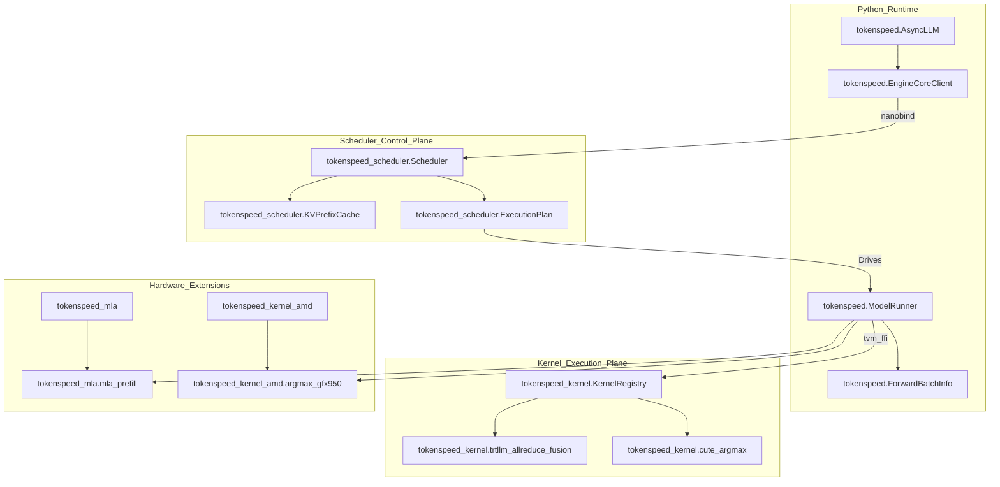
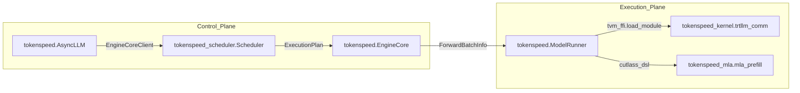

<!-- source: DeepWiki mcp.deepwiki.com · repo lightseekorg/tokenspeed · page 1.2 Project Structure and Monorepo Layout · fetched 2026-10-21 -->

# Project Structure and Monorepo Layout

Relevant source files

The following files were used as context for generating this wiki page:

- [.github/workflows/release-tokenspeed-scheduler.yml](.github/workflows/release-tokenspeed-scheduler.yml)
- [.github/workflows/scheduler-cpp-test.yml](.github/workflows/scheduler-cpp-test.yml)
- [.github/workflows/update-tokenspeed-kernel-amd-dependency.yml](.github/workflows/update-tokenspeed-kernel-amd-dependency.yml)
- [.github/workflows/update-tokenspeed-kernel-amd-version.yml](.github/workflows/update-tokenspeed-kernel-amd-version.yml)
- [python/pyproject.toml](python/pyproject.toml)
- [python/tokenspeed/cli/serve_smg.py](python/tokenspeed/cli/serve_smg.py)
- [python/tokenspeed/version.py](python/tokenspeed/version.py)
- [test/ci_system/install_deps.sh](test/ci_system/install_deps.sh)
- [test/ci_system/install_deps_rocm.sh](test/ci_system/install_deps_rocm.sh)
- [test/ci_system/package_cache.sh](test/ci_system/package_cache.sh)
- [test/ci_system/test_package_cache.py](test/ci_system/test_package_cache.py)
- [test/cli/test_serve_smg_unit.py](test/cli/test_serve_smg_unit.py)
- [test/runtime/test_scheduler_config_guard.py](test/runtime/test_scheduler_config_guard.py)
- [tokenspeed-kernel-amd/pyproject.toml](tokenspeed-kernel-amd/pyproject.toml)
- [tokenspeed-kernel/python/requirements/rocm.txt](tokenspeed-kernel/python/requirements/rocm.txt)
- [tokenspeed-kernel/test/nvidia/ops/test_tokenspeed_mla.py](tokenspeed-kernel/test/nvidia/ops/test_tokenspeed_mla.py)
- [tokenspeed-mla/pyproject.toml](tokenspeed-mla/pyproject.toml)
- [tokenspeed-mla/python/tokenspeed_mla/__init__.py](tokenspeed-mla/python/tokenspeed_mla/__init__.py)
- [tokenspeed-mla/python/tokenspeed_mla/mla_prefill.py](tokenspeed-mla/python/tokenspeed_mla/mla_prefill.py)
- [tokenspeed-scheduler/pyproject.toml](tokenspeed-scheduler/pyproject.toml)
- [tokenspeed-scheduler/python/tests/test_cache_group_admission.py](tokenspeed-scheduler/python/tests/test_cache_group_admission.py)
- [tokenspeed-scheduler/python/tests/test_d_role_state_reserve.py](tokenspeed-scheduler/python/tests/test_d_role_state_reserve.py)
- [tokenspeed-scheduler/python/tests/test_local_state_growth_reserve.py](tokenspeed-scheduler/python/tests/test_local_state_growth_reserve.py)

This page provides a detailed breakdown of the TokenSpeed monorepo layout, explaining the top-level packages (`python/`, `tokenspeed-kernel/`, `tokenspeed-kernel-amd/`, `tokenspeed-kernel-npu/`, `tokenspeed-mla/`, `tokenspeed-scheduler/`), their strict ownership boundaries, build systems, and inter-package dependency relationships. TokenSpeed is structured as a monorepo to ensure tight coupling between the high-level Python inference runtime, the low-level C++ FSM control plane, and hardware-specific kernel libraries optimized for agentic workloads [python/pyproject.toml:26-89](), [tokenspeed-scheduler/pyproject.toml:11-19]().

## Top-Level Packages and Ownership Boundaries

The TokenSpeed repository is partitioned into distinct functional directories, each corresponding to a specific layer of the inference stack.

| Package | Directory | Language | Primary Responsibility |
| :--- | :--- | :--- | :--- |
| **Python Runtime** | `python/` | Python | Endpoints, `AsyncLLM` frontend, `EngineCore` IPC, execution plane, and SPMD model layers [python/pyproject.toml:26-89](). |
| **TokenSpeed Kernel** | `tokenspeed-kernel/` | Python/C++/Triton | Portable multi-silicon operator library, centralized registry, and auto-tuning [test/ci_system/install_deps.sh:170-174](). |
| **TokenSpeed Kernel AMD** | `tokenspeed-kernel-amd/` | Python/C++ | AMD-specific hardware optimizations (`GFX950`/`GFX1250`), Gluon MHA, and MXFP4 MoE pipelines [tokenspeed-kernel-amd/pyproject.toml:5-15](). |
| **TokenSpeed Kernel NPU** | `tokenspeed-kernel-npu/` | Python/C++ | NPU integration layer for heterogeneous accelerator execution. |
| **TokenSpeed MLA** | `tokenspeed-mla/` | Python/C++/CuTe | Specialized Multi-Head Latent Attention for NVIDIA Blackwell (`SM100`/`SM103`) [tokenspeed-mla/pyproject.toml:5-17](). |
| **TokenSpeed Scheduler** | `tokenspeed-scheduler/` | C++/Python | C++ FSM control plane, KV cache radix tree, block table, and `nanobind` bindings [tokenspeed-scheduler/pyproject.toml:11-19](). |

### Package Boundaries and Responsibilities

- **`python/` (`tokenspeed`)**: Implements high-level orchestration, the `AsyncLLM` service entrypoint, request input processors, weight loading, distributed communication primitives (Tensor/Pipeline/Expert Parallelism), and model architectures [python/pyproject.toml:26-89]().
- **`tokenspeed-kernel/`**: Provides the portable kernel abstraction layer. It features the `@register_kernel` decorator, signature validation, numerics verification, and compilation shims for CUDA and ROCm backends [test/ci_system/install_deps.sh:170-174]().
- **`tokenspeed-kernel-amd/`**: Houses AMD-specific operator implementations and tuning caches targeted at CDNA architectures utilizing Gluon JIT and custom ROCm kernels [tokenspeed-kernel-amd/pyproject.toml:5-15]().
- **`tokenspeed-kernel-npu/`**: Manages runtime registration, device mapping, and operator shims for neural processing units.
- **`tokenspeed-mla/`**: Dedicated entirely to high-performance Multi-Head Latent Attention decode and prefill primitives using NVIDIA CUTLASS DSL (`CuTe`) for Blackwell architectures [tokenspeed-mla/pyproject.toml:5-17]().
- **`tokenspeed-scheduler/`**: Implements the C++ scheduler core. It governs request lifecycles, KV cache allocation, and FSM transition rules, exposing them to Python via `nanobind` [tokenspeed-scheduler/pyproject.toml:4-19]().

Sources: [python/pyproject.toml:26-89](), [tokenspeed-scheduler/pyproject.toml:4-19](), [tokenspeed-mla/pyproject.toml:5-17](), [tokenspeed-kernel-amd/pyproject.toml:5-15](), [test/ci_system/install_deps.sh:170-174]()

## Dependency Relationships and Build Systems

The monorepo employs heterogeneous build systems tailored to each package's runtime and compilation requirements:
1. **`python/` and `tokenspeed-kernel/`**: Standard `setuptools` packages governed by `pyproject.toml` configurations that declare runtime dependencies on accelerator runtimes, `torch`, and IPC helpers [python/pyproject.toml:21-89]().
2. **`tokenspeed-scheduler/`**: Built via `scikit-build-core`, `CMake`, and `Ninja`, compiling C++ sources into shared objects wrapped by `nanobind` [tokenspeed-scheduler/pyproject.toml:1-9]().
3. **`tokenspeed-kernel-amd/` and `tokenspeed-mla/`**: Vendor-specific extension packages that depend upon base kernel interfaces, `tokenspeed-triton`, and `nvidia-cutlass-dsl` [tokenspeed-mla/pyproject.toml:12-17](), [tokenspeed-kernel-amd/pyproject.toml:12-15]().

### Monorepo Dependency and Code Entity Architecture

Sources: [python/pyproject.toml:26-89](), [tokenspeed-scheduler/pyproject.toml:1-19](), [tokenspeed-mla/pyproject.toml:12-17](), [tokenspeed-kernel-amd/pyproject.toml:12-15]()

## Data Flow and Inter-Package Communication

The execution flow spans the Python execution layer, the C++ FSM scheduler, and hardware-accelerated kernels:
1. **Request Ingestion**: Incoming client requests are parsed by `tokenspeed.cli.serve_smg` and routed to the `AsyncLLM` execution frontend [python/tokenspeed/cli/serve_smg.py:21-32]().
2. **Control Scheduling**: `EngineCore` communicates with the C++ `tokenspeed_scheduler.Scheduler` via zero-copy IPC and `nanobind` bindings [tokenspeed-scheduler/pyproject.toml:4-9](). The scheduler manages the radix tree (`KVPrefixCache`) and yields an `ExecutionPlan` [tokenspeed-scheduler/pyproject.toml:11-19]().
3. **Model Execution**: `ModelRunner` consumes the execution plan, allocating tensors and dispatching operator calls through `tokenspeed-kernel` or hardware-specific extensions (`tokenspeed-mla`, `tokenspeed-kernel-amd`) using `tvm_ffi` and custom shims [tokenspeed-mla/pyproject.toml:5-17](), [tokenspeed-kernel-amd/pyproject.toml:5-15]().

### Code Entity Execution Flow

Sources: [python/tokenspeed/cli/serve_smg.py:21-32](), [tokenspeed-scheduler/pyproject.toml:4-19](), [tokenspeed-mla/pyproject.toml:5-17](), [tokenspeed-kernel-amd/pyproject.toml:5-15]()

---

