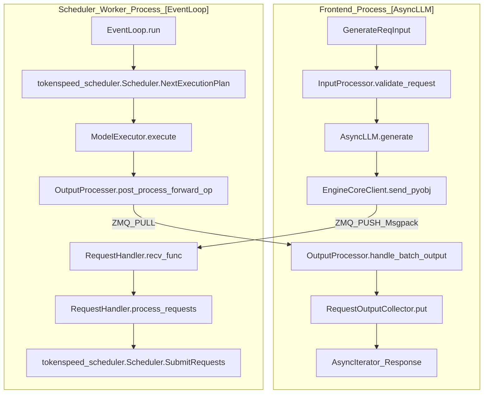
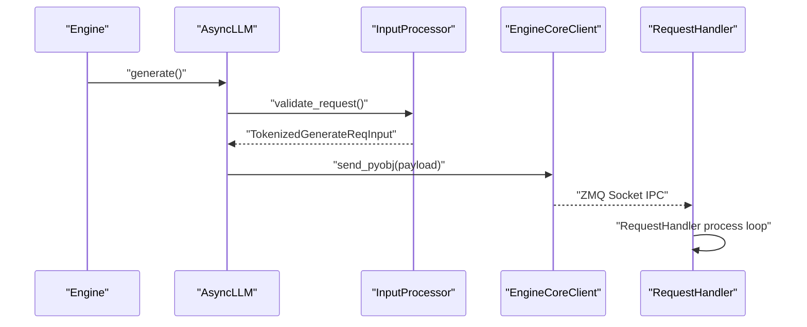

<!-- source: DeepWiki mcp.deepwiki.com · repo lightseekorg/tokenspeed · page 2.1 Engine and Request Lifecycle · fetched 2026-10-21 -->

# Engine and Request Lifecycle

Relevant source files

The following files were used as context for generating this wiki page:

- [python/tokenspeed/cli/__main__.py](python/tokenspeed/cli/__main__.py)
- [python/tokenspeed/cli/_proc.py](python/tokenspeed/cli/_proc.py)
- [python/tokenspeed/cli/trace_merge.py](python/tokenspeed/cli/trace_merge.py)
- [python/tokenspeed/runtime/engine/async_llm.py](python/tokenspeed/runtime/engine/async_llm.py)
- [python/tokenspeed/runtime/engine/collector.py](python/tokenspeed/runtime/engine/collector.py)
- [python/tokenspeed/runtime/engine/data_parallel_controller.py](python/tokenspeed/runtime/engine/data_parallel_controller.py)
- [python/tokenspeed/runtime/engine/generation_output_processor.py](python/tokenspeed/runtime/engine/generation_output_processor.py)
- [python/tokenspeed/runtime/engine/input_processor.py](python/tokenspeed/runtime/engine/input_processor.py)
- [python/tokenspeed/runtime/engine/io_struct.py](python/tokenspeed/runtime/engine/io_struct.py)
- [python/tokenspeed/runtime/engine/load_snapshot.py](python/tokenspeed/runtime/engine/load_snapshot.py)
- [python/tokenspeed/runtime/engine/logprobs.py](python/tokenspeed/runtime/engine/logprobs.py)
- [python/tokenspeed/runtime/engine/output_processor.py](python/tokenspeed/runtime/engine/output_processor.py)
- [python/tokenspeed/runtime/engine/parallel_sampling.py](python/tokenspeed/runtime/engine/parallel_sampling.py)
- [python/tokenspeed/runtime/engine/protocol.py](python/tokenspeed/runtime/engine/protocol.py)
- [python/tokenspeed/runtime/engine/request_handler.py](python/tokenspeed/runtime/engine/request_handler.py)
- [python/tokenspeed/runtime/engine/request_stats.py](python/tokenspeed/runtime/engine/request_stats.py)
- [python/tokenspeed/runtime/engine/scheduler_communicator.py](python/tokenspeed/runtime/engine/scheduler_communicator.py)
- [python/tokenspeed/runtime/engine/scheduler_control_client.py](python/tokenspeed/runtime/engine/scheduler_control_client.py)
- [python/tokenspeed/runtime/engine/zmq_msgpack.py](python/tokenspeed/runtime/engine/zmq_msgpack.py)
- [python/tokenspeed/runtime/entrypoints/engine.py](python/tokenspeed/runtime/entrypoints/engine.py)
- [python/tokenspeed/runtime/entrypoints/engine_base.py](python/tokenspeed/runtime/entrypoints/engine_base.py)
- [python/tokenspeed/runtime/multimodal/mrope.py](python/tokenspeed/runtime/multimodal/mrope.py)
- [python/tokenspeed/runtime/sampling/sampling_params.py](python/tokenspeed/runtime/sampling/sampling_params.py)
- [python/tokenspeed/runtime/utils/common.py](python/tokenspeed/runtime/utils/common.py)
- [python/tokenspeed/runtime/utils/launcher.py](python/tokenspeed/runtime/utils/launcher.py)
- [test/cli/test_trace_merge.py](test/cli/test_trace_merge.py)
- [test/runners.py](test/runners.py)
- [test/runtime/layers/test_moe_layer_activation_flag.py](test/runtime/layers/test_moe_layer_activation_flag.py)
- [test/runtime/layers/test_moe_layer_plan_traits.py](test/runtime/layers/test_moe_layer_plan_traits.py)
- [test/runtime/test_generation_output_processor.py](test/runtime/test_generation_output_processor.py)
- [test/runtime/test_inline_detokenizer_e2e.py](test/runtime/test_inline_detokenizer_e2e.py)
- [test/runtime/test_inline_detokenizer_receiver.py](test/runtime/test_inline_detokenizer_receiver.py)
- [test/runtime/test_io_struct_codec.py](test/runtime/test_io_struct_codec.py)
- [test/runtime/test_launcher_topology.py](test/runtime/test_launcher_topology.py)
- [test/runtime/test_load_snapshot.py](test/runtime/test_load_snapshot.py)
- [test/runtime/test_multimodal_mrope.py](test/runtime/test_multimodal_mrope.py)
- [test/runtime/test_parallel_sampling.py](test/runtime/test_parallel_sampling.py)
- [test/runtime/test_request_handler_profile.py](test/runtime/test_request_handler_profile.py)
- [test/runtime/test_scheduler_communicator.py](test/runtime/test_scheduler_communicator.py)
- [test/runtime/test_zmq_msgpack.py](test/runtime/test_zmq_msgpack.py)
- [tokenspeed-kernel/python/tokenspeed_kernel/profiling.py](tokenspeed-kernel/python/tokenspeed_kernel/profiling.py)
- [tokenspeed-kernel/test/test_profiling.py](tokenspeed-kernel/test/test_profiling.py)

## Purpose and Scope

This page covers the core runtime architecture of TokenSpeed, detailing the end-to-end flow of requests from the asynchronous frontend (`AsyncLLM`) through ZeroMQ (ZMQ) message-packed IPC to the backend scheduler worker process, model execution loop, and incremental detokenization output processor.

Sources: [python/tokenspeed/runtime/entrypoints/engine.py:98-110](), [python/tokenspeed/runtime/engine/async_llm.py:118-125]()

## Architectural Overview

The runtime architecture divides responsibilities across distinct processes and classes:
1. **AsyncLLM**: The main-process asynchronous frontend that handles request intake, state management, scheduler IPC, and output dispatching [python/tokenspeed/runtime/engine/async_llm.py:118-125]().
2. **RequestHandler**: The coordinator inside the scheduler process that receives ZMQ requests, manages sessions, and handles control signals [python/tokenspeed/runtime/engine/request_handler.py:96-115]().
3. **EventLoop**: The backend execution loop that polls the C++ scheduler (`tokenspeed_scheduler`), drives model forward passes, and processes execution results [python/tokenspeed/runtime/entrypoints/engine.py:68-68]().

### System Component Interaction
This diagram maps natural language roles to explicit codebase entities and C++ bindings.

Sources: [python/tokenspeed/runtime/entrypoints/engine.py:68-110](), [python/tokenspeed/runtime/engine/request_handler.py:96-115](), [python/tokenspeed/runtime/engine/async_llm.py:118-125](), [python/tokenspeed/runtime/engine/io_struct.py:60-91]()

## Request Intake, Validation, and Tokenization

Requests enter the engine via high-level APIs like `Engine` or `AsyncLLM`, encapsulated within `GenerateReqInput` or `EmbeddingReqInput` data structures [python/tokenspeed/runtime/engine/io_struct.py:120-160]().

1. **Validation**: The `InputProcessor.validate_request` method rejects unsupported cross-type requests (e.g., embedding requests arriving at a generation-only engine) and checks data-parallel rank bindings [python/tokenspeed/runtime/engine/input_processor.py:85-118]().
2. **Tokenization and M-RoPE**: Text prompts are tokenized into `TokenizedGenerateReqInput` objects [python/tokenspeed/runtime/engine/input_processor.py:30-36](). For multimodal inputs, 3-axis M-RoPE position IDs are computed using helper utilities [python/tokenspeed/runtime/multimodal/mrope.py:21-32]().
3. **Reasoning Schema Wrapping**: If a reasoning parser is active, JSON schemas in sampling parameters are automatically wrapped with structural tags to ensure correct reasoning marker generation [python/tokenspeed/runtime/engine/input_processor.py:59-84]().

Sources: [python/tokenspeed/runtime/engine/input_processor.py:48-118](), [python/tokenspeed/runtime/engine/io_struct.py:120-160]()

## IPC and ZMQ Msgpack Serialization

Inter-process communication between the frontend and the scheduler process relies on ZeroMQ sockets using `msgspec.Struct` definitions derived from `BaseReq` and `BaseBatchReq` [python/tokenspeed/runtime/engine/io_struct.py:21-91]().

- **Array-Encoded Structs**: Payloads utilize `array_like=True` and `tag=True` for efficient positional serialization without pickle overhead [python/tokenspeed/runtime/engine/io_struct.py:60-91]().
- **Data Parallel Routing**: In data-parallel configurations, `DataParallelController` manages load balancing across multiple worker ranks [python/tokenspeed/runtime/engine/data_parallel_controller.py:58-162]().

### Request Data Flow Detail

Sources: [python/tokenspeed/runtime/engine/async_llm.py:118-139](), [python/tokenspeed/runtime/engine/input_processor.py:85-95](), [python/tokenspeed/runtime/engine/io_struct.py:60-91](), [python/tokenspeed/runtime/engine/request_handler.py:96-115]()

## Scheduler Core and Request Handler

The `RequestHandler` processes incoming ZMQ messages within the scheduler worker process [python/tokenspeed/runtime/engine/request_handler.py:96-115](). It maintains broadcast groups using `PipelinedPyobjBroadcaster` when tensor/pipeline parallelism requires synchronization [python/tokenspeed/runtime/engine/request_handler.py:102-105](). Control requests such as `ProfileReq`, `FlushCacheReqInput`, and weight synchronization requests are dispatched through type-based handlers [python/tokenspeed/runtime/engine/request_handler.py:43-80]().

Sources: [python/tokenspeed/runtime/engine/request_handler.py:39-178]()

## Generation Output Processing and Detokenization

The backend `OutputProcessor` and per-request `RequestState` classes manage incremental streaming, token accumulation, and finish reason materialization [python/tokenspeed/runtime/engine/generation_output_processor.py:64-129](), [python/tokenspeed/runtime/engine/output_processor.py:96-105]().

- **RequestState**: Tracks immutable prompt inputs and mutable generation state including `output_ids`, `finished_reason`, `cached_tokens`, and incremental detokenization offsets [python/tokenspeed/runtime/engine/generation_output_processor.py:64-129]().
- **Error Handling and Aborts**: When numerical instabilities are detected (e.g., via NaN guards), the request is flagged with `ABORT_CODE.NumericalError`, generating an abort event that bypasses host-KV writeback to protect the cache pool from corruption [python/tokenspeed/runtime/engine/generation_output_processor.py:159-164]().

Sources: [python/tokenspeed/runtime/engine/generation_output_processor.py:26-168](), [python/tokenspeed/runtime/engine/output_processor.py:96-172]()

## The Backend Event Loop

The `EventLoop` coordinates execution cycles by interfacing with the C++ `tokenspeed_scheduler` and PyTorch model execution infrastructure [python/tokenspeed/runtime/engine/event_loop.py:63-63](). It repeatedly retrieves execution plans, invokes model executors for prefill, extend, or decode phases, and feeds generated tokens back into the output processors.

Sources: [python/tokenspeed/runtime/engine/event_loop.py:60-76]()

---

