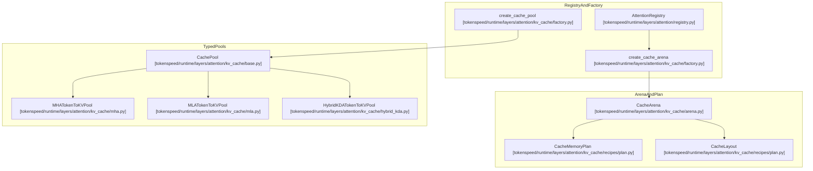
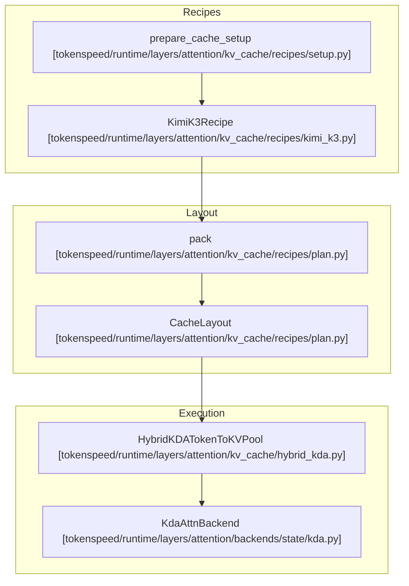

<!-- source: DeepWiki mcp.deepwiki.com · repo lightseekorg/tokenspeed · page 2.2 KV Cache and Memory Management · fetched 2026-10-21 -->

# KV Cache and Memory Management

Relevant source files

The following files were used as context for generating this wiki page:

- [docs/design/cache-concepts.md](docs/design/cache-concepts.md)
- [docs/design/unified_path.md](docs/design/unified_path.md)
- [python/tokenspeed/runtime/layers/attention/backends/base.py](python/tokenspeed/runtime/layers/attention/backends/base.py)
- [python/tokenspeed/runtime/layers/attention/backends/hybrid/linear.py](python/tokenspeed/runtime/layers/attention/backends/hybrid/linear.py)
- [python/tokenspeed/runtime/layers/attention/backends/specific/inkling.py](python/tokenspeed/runtime/layers/attention/backends/specific/inkling.py)
- [python/tokenspeed/runtime/layers/attention/backends/specific/qwen4_exp.py](python/tokenspeed/runtime/layers/attention/backends/specific/qwen4_exp.py)
- [python/tokenspeed/runtime/layers/attention/backends/state/kda.py](python/tokenspeed/runtime/layers/attention/backends/state/kda.py)
- [python/tokenspeed/runtime/layers/attention/configs/base.py](python/tokenspeed/runtime/layers/attention/configs/base.py)
- [python/tokenspeed/runtime/layers/attention/configs/mla.py](python/tokenspeed/runtime/layers/attention/configs/mla.py)
- [python/tokenspeed/runtime/layers/attention/deepseek_v4_geometry.py](python/tokenspeed/runtime/layers/attention/deepseek_v4_geometry.py)
- [python/tokenspeed/runtime/layers/attention/kv_cache/arena.py](python/tokenspeed/runtime/layers/attention/kv_cache/arena.py)
- [python/tokenspeed/runtime/layers/attention/kv_cache/base.py](python/tokenspeed/runtime/layers/attention/kv_cache/base.py)
- [python/tokenspeed/runtime/layers/attention/kv_cache/factory.py](python/tokenspeed/runtime/layers/attention/kv_cache/factory.py)
- [python/tokenspeed/runtime/layers/attention/kv_cache/hybrid_deepseek_v4.py](python/tokenspeed/runtime/layers/attention/kv_cache/hybrid_deepseek_v4.py)
- [python/tokenspeed/runtime/layers/attention/kv_cache/hybrid_kda.py](python/tokenspeed/runtime/layers/attention/kv_cache/hybrid_kda.py)
- [python/tokenspeed/runtime/layers/attention/kv_cache/hybrid_mha.py](python/tokenspeed/runtime/layers/attention/kv_cache/hybrid_mha.py)
- [python/tokenspeed/runtime/layers/attention/kv_cache/mha.py](python/tokenspeed/runtime/layers/attention/kv_cache/mha.py)
- [python/tokenspeed/runtime/layers/attention/kv_cache/recipes/deepseek_v4.py](python/tokenspeed/runtime/layers/attention/kv_cache/recipes/deepseek_v4.py)
- [python/tokenspeed/runtime/layers/attention/kv_cache/recipes/glm53_flash.py](python/tokenspeed/runtime/layers/attention/kv_cache/recipes/glm53_flash.py)
- [python/tokenspeed/runtime/layers/attention/kv_cache/recipes/inkling.py](python/tokenspeed/runtime/layers/attention/kv_cache/recipes/inkling.py)
- [python/tokenspeed/runtime/layers/attention/kv_cache/recipes/kimi_k3.py](python/tokenspeed/runtime/layers/attention/kv_cache/recipes/kimi_k3.py)
- [python/tokenspeed/runtime/layers/attention/kv_cache/recipes/plan.py](python/tokenspeed/runtime/layers/attention/kv_cache/recipes/plan.py)
- [python/tokenspeed/runtime/layers/attention/kv_cache/recipes/setup.py](python/tokenspeed/runtime/layers/attention/kv_cache/recipes/setup.py)
- [python/tokenspeed/runtime/layers/attention/kv_cache/recipes/spec.py](python/tokenspeed/runtime/layers/attention/kv_cache/recipes/spec.py)
- [python/tokenspeed/runtime/layers/attention/registry.py](python/tokenspeed/runtime/layers/attention/registry.py)
- [test/runtime/conftest.py](test/runtime/conftest.py)
- [test/runtime/test_cache_memory_plan.py](test/runtime/test_cache_memory_plan.py)
- [test/runtime/test_cache_pool.py](test/runtime/test_cache_pool.py)
- [test/runtime/test_cache_setup.py](test/runtime/test_cache_setup.py)
- [test/runtime/test_group_specs_from_layer_types.py](test/runtime/test_group_specs_from_layer_types.py)
- [test/runtime/test_group_write_locations.py](test/runtime/test_group_write_locations.py)
- [test/runtime/test_kimi_k3_cache_pool.py](test/runtime/test_kimi_k3_cache_pool.py)
- [test/runtime/test_kimi_k3_cache_spec.py](test/runtime/test_kimi_k3_cache_spec.py)
- [test/runtime/test_kimi_k3_kda_eager_commit.py](test/runtime/test_kimi_k3_kda_eager_commit.py)
- [test/runtime/test_mha_pool_spec_decode_groups.py](test/runtime/test_mha_pool_spec_decode_groups.py)
- [test/runtime/test_page_zeroing_contract.py](test/runtime/test_page_zeroing_contract.py)
- [test/runtime/test_qwen4_backend_composition.py](test/runtime/test_qwen4_backend_composition.py)
- [test/runtime/test_qwen4_exp.py](test/runtime/test_qwen4_exp.py)
- [test/runtime/test_server_args_attention_backends.py](test/runtime/test_server_args_attention_backends.py)
- [test/runtime/test_trtllm_cache_groups.py](test/runtime/test_trtllm_cache_groups.py)
- [test/runtime/test_unified_kv_slab_pool.py](test/runtime/test_unified_kv_slab_pool.py)
- [test/runtime/test_v4_sliding_window_groups_smoke.py](test/runtime/test_v4_sliding_window_groups_smoke.py)
- [tokenspeed-kernel/python/tokenspeed_kernel/ops/kvcache/triton.py](tokenspeed-kernel/python/tokenspeed_kernel/ops/kvcache/triton.py)
- [tokenspeed-kernel/test/ops/test_kvcache.py](tokenspeed-kernel/test/ops/test_kvcache.py)

This page details the TokenSpeed KV cache subsystem, which manages the lifecycle of Key-Value (KV) tensors across device, host, and remote tiers, as well as specialized cache recipes for diverse architectures (MHA, MLA, hybrid KDA/GDN, Qwen3.5, Kimi K3, Inkling, and Qwen4-exp), unified slab pools, cache memory planning, scheduler coordination clients, and cache pool binding/rebinding invariants.

## Attention KV Cache Registry, Factory, and Arena

The KV cache infrastructure decouples physical memory allocations from model layer views via `CacheArena` and `CachePool` abstractions `[python/tokenspeed/runtime/layers/attention/kv_cache/base.py:142-152]()`.

### Component Relationship Diagram
This diagram bridges natural language concepts to code entities for cache creation, registry, and pooling.

**Sources:** `[python/tokenspeed/runtime/layers/attention/registry.py:46-58]`, `[python/tokenspeed/runtime/layers/attention/kv_cache/base.py:142-152]`, `[python/tokenspeed/runtime/layers/attention/kv_cache/recipes/setup.py:54-58]`

- **`CacheArena`**: Manages the single contiguous memory buffer allocated for a model's cache and holds the `CacheMemoryPlan` geometry `[python/tokenspeed/runtime/layers/attention/registry.py:113-119]()`.
- **`CachePool`**: Represents a typed layer window onto a shared cache arena, defining dtypes and per-layer buffers `[python/tokenspeed/runtime/layers/attention/kv_cache/base.py:142-152]()`.
- **`create_cache_arena` / `create_cache_pool`**: Factory functions that construct arenas and concrete token-to-KV pools from cache recipes `[python/tokenspeed/runtime/layers/attention/registry.py:50-53]()`.

---

## Cache Recipes and Model Families

Cache recipes standardize how different architectures configure their memory groups, prefixes, and state fields `[python/tokenspeed/runtime/layers/attention/kv_cache/recipes/spec.py:1-50]()`.

### Supported Cache Recipes
| Recipe / Family | Target Architectures | Key Characteristics |
| :--- | :--- | :--- |
| **MHA** | Standard Llama, Mistral, GPT-OSS | Standard Key-Value head separation with uniform prefix granularity `[test/runtime/test_cache_setup.py:70-80]()` |
| **MLA** | DeepSeek V3, Kimi K2.5 | Compresses keys and values into low-rank latents plus RoPE dimensions `[test/runtime/test_cache_setup.py:82-96]()` |
| **Hybrid KDA / GDN** | Kimi K3, Qwen3.5, Qwen4-exp | Combines full attention with recurrent/conv state groups (`CacheGroupSpec`) in a single arena `[test/runtime/test_kimi_k3_cache_spec.py:22-31]()` |
| **Inkling / MSA** | Sparse & Custom Architectures | Supports sparse attention layers and layer-external state columns `[test/runtime/test_cache_setup.py:99-114]`, `[test/runtime/test_cache_setup.py:185-198]()` |

### Architectural Integration Diagram

**Sources:** `[python/tokenspeed/runtime/layers/attention/registry.py:54-58]`, `[python/tokenspeed/runtime/layers/attention/kv_cache/recipes/kimi_k3.py:80-87]`, `[python/tokenspeed/runtime/layers/attention/backends/state/kda.py:131-143]`

---

## Unified Slab Pool, Logical/Physical Separation, and Memory Planning

TokenSpeed separates cache concepts into a logical world (token units, storage-agnostic) and a physical world (storage units, allocation, refcounting) `[docs/design/cache-concepts.md:9-15]`.

### Logical vs. Physical Vocabulary
- **`prefix_granularity`**: The granularity at which prefixes are hashed and matched for cache reuse `[docs/design/cache-concepts.md:20-25]`.
- **`block_granularity`**: The number of tokens covered by one block-table slot (`CacheBlock`) of a cache group `[docs/design/cache-concepts.md:20-25]`.
- **`CacheBlock` & LCM Blocks**: The unit of physical storage. Allocation, eviction, and tiering operate on physical blocks. For hybrid models (such as Kimi K3 with 69 KDA layers and 24 MLA layers), TokenSpeed relies on Least Common Multiple (LCM) block geometry where fixed-size LCM blocks (`lcm_block_bytes`) contain exact integer multiples of cache blocks for each group `[python/tokenspeed/runtime/layers/attention/kv_cache/recipes/kimi_k3.py:60-62]`, `[docs/design/cache-concepts.md:80-90]`.
- **Fixed Workspace Reservation**: Reserves non-arena scratchpads (such as speculative verification buffers and KDA replay states) outside the main arena `[test/runtime/test_kimi_k3_cache_spec.py:136-162]`.
- **Zeroing & Packing**: Employs Triton-based `zero_byte_ranges` to prevent poisoned tails when pages are reused across hybrid states `[tokenspeed-kernel/python/tokenspeed_kernel/ops/kvcache/triton.py:72-74]`.

**Sources:** `[docs/design/cache-concepts.md:9-110]`, `[test/runtime/test_kimi_k3_cache_spec.py:18-114]`, `[tokenspeed-kernel/python/tokenspeed_kernel/ops/kvcache/triton.py:70-74]`

---

## Cache Pool Binding, Rebinding, and Unified Decode Invariants

`CachePoolBinding` manages how backends interact with pool instances, supporting dynamic rebinds for memory probing and graph compilation `[python/tokenspeed/runtime/layers/attention/backends/base.py:108-141]`.

- **Rebinding Contract**: `set_cache_pool` executes a two-phase validation and publishing sequence across the backend tree. Nodes validate geometry via `validate_cache_pool` before any mutation occurs. Rebinding drops pool-derived latches (pointer tables, scratch views, paged leaf graph buffers) while retaining pool-independent state index buffers `[docs/design/unified_path.md:82-119]`.

**Sources:** `[python/tokenspeed/runtime/layers/attention/backends/base.py:108-141]`, `[docs/design/unified_path.md:82-119]`

---

## Scheduler Control and Cache Coordination Clients

The runtime control plane interfaces between `AsyncLLM`, engine core clients, and the scheduler to handle cache flushing, state updates, and memory occupation `[python/tokenspeed/runtime/engine/scheduler_control_client.py:1-50]()`.

- **`SchedulerControlClient`**: Manages asynchronous communication channels for cache flush requests, weight updates, pause/resume commands, and internal state inspection `[python/tokenspeed/runtime/engine/scheduler_control_client.py:79-132]()`.
- **Cache Coordination**: Coordinates distributed cache operations across data-parallel ranks (`dp_size`) through typed request-response message structures `[python/tokenspeed/runtime/engine/scheduler_control_client.py:82-132]()`.

**Sources:** `[python/tokenspeed/runtime/engine/scheduler_control_client.py:79-132]`, `[python/tokenspeed/runtime/engine/scheduler_communicator.py:1-30]`

---

