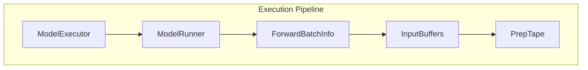
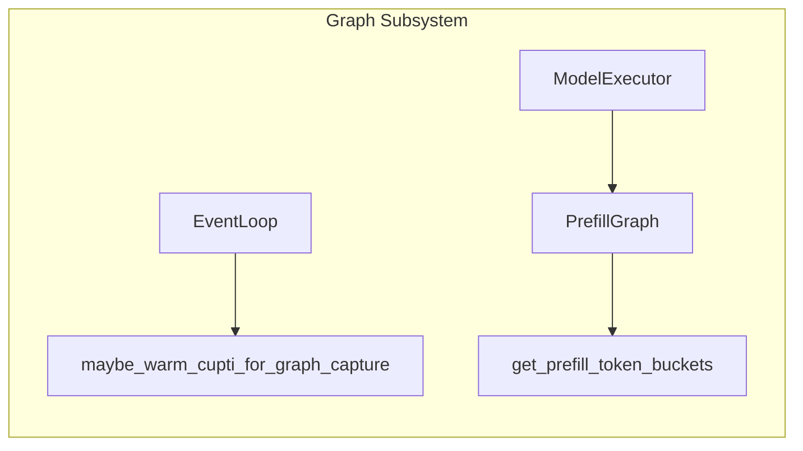

<!-- source: DeepWiki mcp.deepwiki.com · repo lightseekorg/tokenspeed · page 2.3 Model Execution and Layers · fetched 2026-10-21 -->

# Model Execution and Layers

Relevant source files

The following files were used as context for generating this wiki page:

- [docs/.vitepress/config.mts](docs/.vitepress/config.mts)
- [docs/design/kda-prefill-subgraphs.md](docs/design/kda-prefill-subgraphs.md)
- [docs/guides/instanttensor.md](docs/guides/instanttensor.md)
- [python/tokenspeed/runtime/cache/l2/executor.py](python/tokenspeed/runtime/cache/l2/executor.py)
- [python/tokenspeed/runtime/configs/load_config.py](python/tokenspeed/runtime/configs/load_config.py)
- [python/tokenspeed/runtime/engine/event_loop.py](python/tokenspeed/runtime/engine/event_loop.py)
- [python/tokenspeed/runtime/engine/scheduler_utils.py](python/tokenspeed/runtime/engine/scheduler_utils.py)
- [python/tokenspeed/runtime/execution/breakable_cuda_graph.py](python/tokenspeed/runtime/execution/breakable_cuda_graph.py)
- [python/tokenspeed/runtime/execution/cache_loc_kernel.py](python/tokenspeed/runtime/execution/cache_loc_kernel.py)
- [python/tokenspeed/runtime/execution/cudagraph_memory.py](python/tokenspeed/runtime/execution/cudagraph_memory.py)
- [python/tokenspeed/runtime/execution/device.py](python/tokenspeed/runtime/execution/device.py)
- [python/tokenspeed/runtime/execution/forward_step.py](python/tokenspeed/runtime/execution/forward_step.py)
- [python/tokenspeed/runtime/execution/input_buffer.py](python/tokenspeed/runtime/execution/input_buffer.py)
- [python/tokenspeed/runtime/execution/model_executor.py](python/tokenspeed/runtime/execution/model_executor.py)
- [python/tokenspeed/runtime/execution/prefill_graph.py](python/tokenspeed/runtime/execution/prefill_graph.py)
- [python/tokenspeed/runtime/execution/runtime_states.py](python/tokenspeed/runtime/execution/runtime_states.py)
- [python/tokenspeed/runtime/layers/attention/deepseek_v4_ops.py](python/tokenspeed/runtime/layers/attention/deepseek_v4_ops.py)
- [python/tokenspeed/runtime/layers/attention/utils.py](python/tokenspeed/runtime/layers/attention/utils.py)
- [python/tokenspeed/runtime/model_loader/loader.py](python/tokenspeed/runtime/model_loader/loader.py)
- [python/tokenspeed/runtime/model_loader/weight_utils.py](python/tokenspeed/runtime/model_loader/weight_utils.py)
- [python/tokenspeed/runtime/models/deepseek_v4.py](python/tokenspeed/runtime/models/deepseek_v4.py)
- [python/tokenspeed/runtime/models/gpt_oss.py](python/tokenspeed/runtime/models/gpt_oss.py)
- [python/tokenspeed/runtime/utils/env.py](python/tokenspeed/runtime/utils/env.py)
- [test/agentic_benchmark/minimax_m3/tokenspeed/configs/attn_tp4_moe_ep4.sh](test/agentic_benchmark/minimax_m3/tokenspeed/configs/attn_tp4_moe_ep4.sh)
- [test/agentic_benchmark/minimax_m3/tokenspeed/configs/attn_tp4_moe_tp4.sh](test/agentic_benchmark/minimax_m3/tokenspeed/configs/attn_tp4_moe_tp4.sh)
- [test/ci/eval/minimax-m3-nvfp4-dspark-evalscope-aime26.yaml](test/ci/eval/minimax-m3-nvfp4-dspark-evalscope-aime26.yaml)
- [test/ci/eval/minimax-m3-nvfp4-evalscope-aime25.yaml](test/ci/eval/minimax-m3-nvfp4-evalscope-aime25.yaml)
- [test/runtime/execution/test_breakable_cuda_graph.py](test/runtime/execution/test_breakable_cuda_graph.py)
- [test/runtime/execution/test_kda_prefill_graph_cache.py](test/runtime/execution/test_kda_prefill_graph_cache.py)
- [test/runtime/test_aligned_max_scheduled_tokens.py](test/runtime/test_aligned_max_scheduled_tokens.py)
- [test/runtime/test_cache_pd_shutdown.py](test/runtime/test_cache_pd_shutdown.py)
- [test/runtime/test_cudagraph_memory_projection.py](test/runtime/test_cudagraph_memory_projection.py)
- [test/runtime/test_cudagraph_probe_arena.py](test/runtime/test_cudagraph_probe_arena.py)
- [test/runtime/test_cudagraph_probe_ladder.py](test/runtime/test_cudagraph_probe_ladder.py)
- [test/runtime/test_deepseek_v41_inputs.py](test/runtime/test_deepseek_v41_inputs.py)
- [test/runtime/test_deepseek_v4_config.py](test/runtime/test_deepseek_v4_config.py)
- [test/runtime/test_device_handle.py](test/runtime/test_device_handle.py)
- [test/runtime/test_draft_page_table_scrub.py](test/runtime/test_draft_page_table_scrub.py)
- [test/runtime/test_dspark_config.py](test/runtime/test_dspark_config.py)
- [test/runtime/test_eagle3_d2t_device.py](test/runtime/test_eagle3_d2t_device.py)
- [test/runtime/test_executor_rebind.py](test/runtime/test_executor_rebind.py)
- [test/runtime/test_gpt_oss_mxfp4_streaming.py](test/runtime/test_gpt_oss_mxfp4_streaming.py)
- [test/runtime/test_host_executor.py](test/runtime/test_host_executor.py)
- [test/runtime/test_instanttensor_loader.py](test/runtime/test_instanttensor_loader.py)
- [test/runtime/test_l3_storage_hits.py](test/runtime/test_l3_storage_hits.py)
- [test/runtime/test_prefill_graph.py](test/runtime/test_prefill_graph.py)
- [test/runtime/test_runtime_states.py](test/runtime/test_runtime_states.py)
- [test/runtime/test_weight_loader_prefetch.py](test/runtime/test_weight_loader_prefetch.py)
- [test/runtime/test_zero_output_prefill.py](test/runtime/test_zero_output_prefill.py)
- [tokenspeed-scheduler/CMakeLists.txt](tokenspeed-scheduler/CMakeLists.txt)
- [tokenspeed-scheduler/bindings/python_module.cpp](tokenspeed-scheduler/bindings/python_module.cpp)
- [tokenspeed-scheduler/csrc/cache/tier/transfer.h](tokenspeed-scheduler/csrc/cache/tier/transfer.h)
- [tokenspeed-scheduler/csrc/cache/tier/transfer_manager.cpp](tokenspeed-scheduler/csrc/cache/tier/transfer_manager.cpp)
- [tokenspeed-scheduler/csrc/cache/tier/transfer_manager.h](tokenspeed-scheduler/csrc/cache/tier/transfer_manager.h)
- [tokenspeed-scheduler/csrc/scheduler/types.h](tokenspeed-scheduler/csrc/scheduler/types.h)
- [tokenspeed-scheduler/python/tests/test_kv_cache.py](tokenspeed-scheduler/python/tests/test_kv_cache.py)

This page provides a high-level overview of the execution orchestration layer in TokenSpeed, residing primarily under `python/tokenspeed/runtime/execution/`. It covers the coordination duties of `ModelExecutor` and `ModelRunner`, forward context management, pre-allocated input buffers (`InputBuffers`), CUDA graph capture mechanics (including `PrefillGraph`), weight loading pipelines, and the core layer abstractions.

For deep-dives into concrete model implementations (such as DeepSeek, Kimi, Qwen, and others), see [Supported Model Architectures](#2.3.1). For details on expert routing stacks, latent MoE tiers, quantization configs (FP8, NVFP4, MXFP4), and dense linear backends, see [MoE Layers and Quantization](#2.3.2).

---

## Model Runner, Executor, and Forward Context

The execution pipeline bridges high-level scheduler demands and low-silicon hardware primitives. `ModelExecutor` and `ModelRunner` coordinate the execution lifecycle of a forward pass [python/tokenspeed/runtime/execution/model_executor.py:143-167](). They ingest request batches formatted via `ForwardBatchInfo` and manage tensor state across execution iterations.

To prevent dynamic memory allocation overhead during generation, `InputBuffers` pre-allocates static GPU tensors such as `input_ids_buf`, `positions_buf`, `req_pool_indices_buf`, and `seq_lens_buf` [python/tokenspeed/runtime/execution/input_buffer.py:41-98](). Furthermore, `PrepTape` records and replays padding-tail clearing operations as an optimized batch kernel sequence [python/tokenspeed/runtime/execution/input_buffer.py:99-121]().

Title: Execution Orchestration and Input Buffer Architecture

**Sources:**
- `python/tokenspeed/runtime/execution/model_executor.py:143-167`()
- `python/tokenspeed/runtime/execution/input_buffer.py:41-121`()

---

## CUDA Graph Capture: Decode and Prefill Graphs

To bypass host-side CPU dispatch bottlenecks during auto-regressive decoding, TokenSpeed leverages CUDA graph capture for static batch patterns.

- **Decode Graphs**: Captured across predefined batch-size buckets (`cudagraph_capture_sizes`) for rapid steady-state decoding replays.
- **Prefill (Extend) Graphs**: Managed via `PrefillGraph` and `get_prefill_token_buckets`, capturing token-shaped compute keyed by total token count rather than request batch size [python/tokenspeed/runtime/execution/prefill_graph.py:93-148]().
- **CUPTI Warmup**: Profile initialization hazards post-capture are mitigated optionally via `maybe_warm_cupti_for_graph_capture` [python/tokenspeed/runtime/engine/event_loop.py:96-130]().

Title: CUDA Graph Capture Subsystem

**Sources:**
- `python/tokenspeed/runtime/execution/prefill_graph.py:93-148`()
- `python/tokenspeed/runtime/engine/event_loop.py:96-130`()

---

## Weight Loading and Device Placement

The weight loading subsystem manages streaming safetensors checkpoints from storage into device memory, configuring appropriate quantization strategies and handling memory contexts safely.

Loaders implement base abstractions to discover files, parse weight maps, and allocate shards across tensor-parallel and pipeline-parallel process groups. Quantization configs verify hardware constraints and datatype compatibility prior to layer initialization.

**Sources:**
- `python/tokenspeed/runtime/model_loader/loader.py:69-172`()

---

## Layer Library and Architecture Abstractions

The layer library under `tokenspeed.runtime.layers` provides standard and specialized primitives for constructing high-performance transformer models:

- **Attention Backends**: Implements the `AttentionBackend` protocol (such as paged attention and composite routers) governing block tables, KV cache bindings, and sequence metadata [python/tokenspeed/runtime/layers/attention/backends/base.py:114-138]().
- **Linear and Normalization**: Exposes parallel linear projections (`ColumnParallelLinear`, `RowParallelLinear`) and high-throughput normalization layers (`RMSNorm`, `FusedRMSNorm`).
- **Quantization & Hyperconnections**: Integrates weight formats, scaling configs, and residue/hyperconnection operations for advanced models.

For a comprehensive breakdown of model definitions like DeepSeek V3/V4, Kimi, Qwen, and others, refer to [Supported Model Architectures](#2.3.1). For details on MoE expert routing stacks and dense linear backends, see [MoE Layers and Quantization](#2.3.2).

**Sources:**
- `python/tokenspeed/runtime/layers/attention/backends/base.py:114-138`()
- `python/tokenspeed/runtime/execution/cache_loc_kernel.py:36-77`()

---

