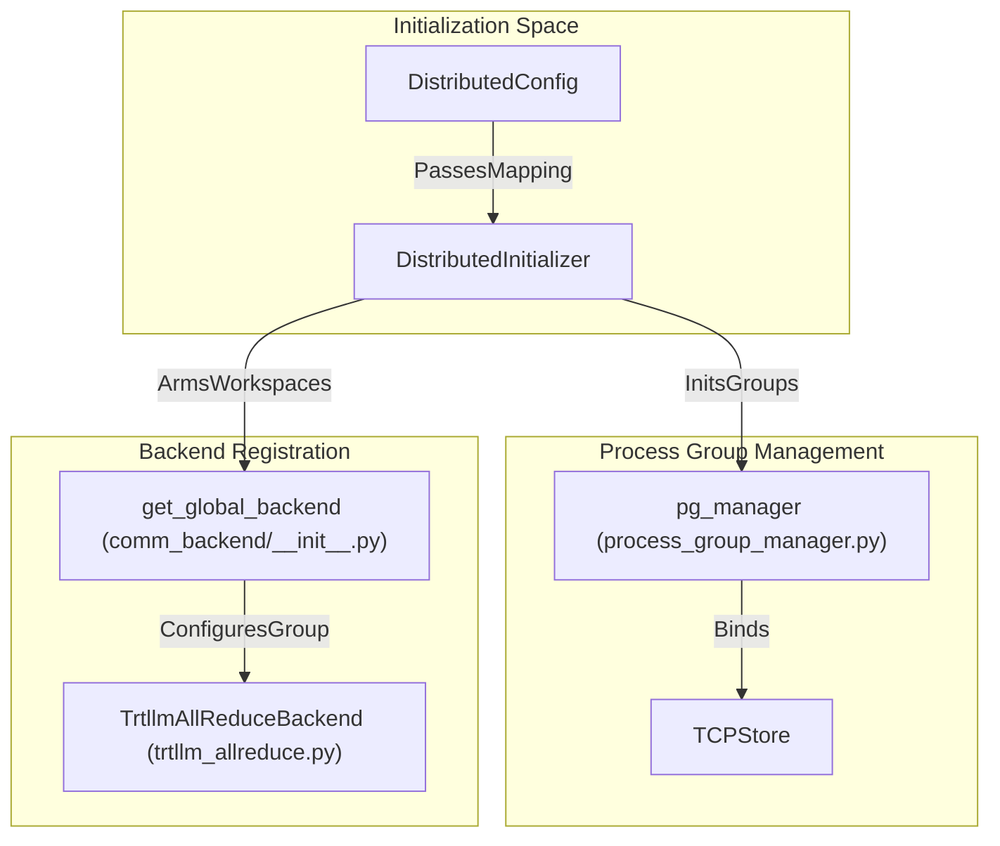
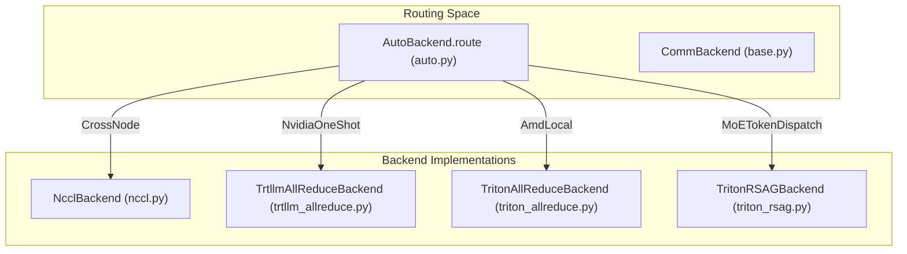
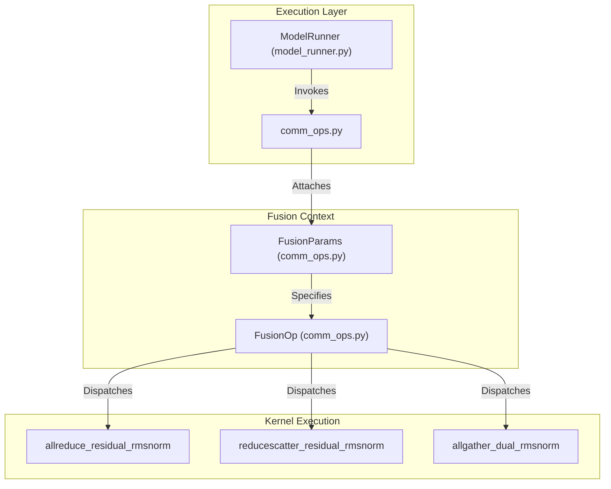
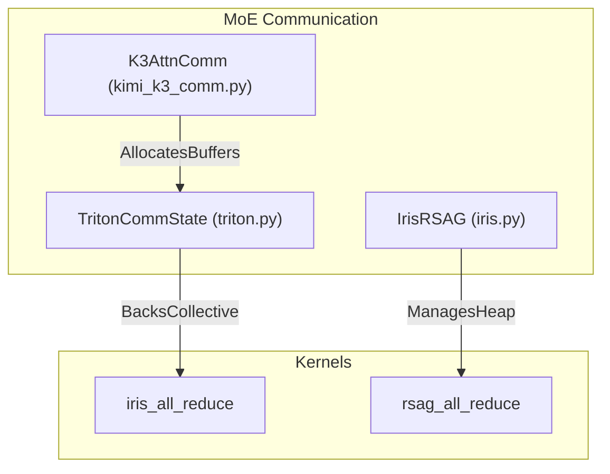

<!-- source: DeepWiki mcp.deepwiki.com · repo lightseekorg/tokenspeed · page 2.4 Distributed Communication · fetched 2026-10-21 -->

# Distributed Communication

Relevant source files

The following files were used as context for generating this wiki page:

- [python/tokenspeed/runtime/distributed/comm_backend/auto.py](python/tokenspeed/runtime/distributed/comm_backend/auto.py)
- [python/tokenspeed/runtime/distributed/comm_backend/base.py](python/tokenspeed/runtime/distributed/comm_backend/base.py)
- [python/tokenspeed/runtime/distributed/comm_backend/nccl.py](python/tokenspeed/runtime/distributed/comm_backend/nccl.py)
- [python/tokenspeed/runtime/distributed/comm_backend/projection.py](python/tokenspeed/runtime/distributed/comm_backend/projection.py)
- [python/tokenspeed/runtime/distributed/comm_backend/registry.py](python/tokenspeed/runtime/distributed/comm_backend/registry.py)
- [python/tokenspeed/runtime/distributed/comm_backend/triton_allreduce.py](python/tokenspeed/runtime/distributed/comm_backend/triton_allreduce.py)
- [python/tokenspeed/runtime/distributed/comm_backend/triton_rsag.py](python/tokenspeed/runtime/distributed/comm_backend/triton_rsag.py)
- [python/tokenspeed/runtime/distributed/comm_backend/trtllm_allreduce.py](python/tokenspeed/runtime/distributed/comm_backend/trtllm_allreduce.py)
- [python/tokenspeed/runtime/distributed/comm_ops.py](python/tokenspeed/runtime/distributed/comm_ops.py)
- [python/tokenspeed/runtime/distributed/process_group_manager.py](python/tokenspeed/runtime/distributed/process_group_manager.py)
- [python/tokenspeed/runtime/execution/distributed_initializer.py](python/tokenspeed/runtime/execution/distributed_initializer.py)
- [python/tokenspeed/runtime/execution/drafter/mtp.py](python/tokenspeed/runtime/execution/drafter/mtp.py)
- [python/tokenspeed/runtime/execution/model_runner.py](python/tokenspeed/runtime/execution/model_runner.py)
- [python/tokenspeed/runtime/models/inkling_nextn.py](python/tokenspeed/runtime/models/inkling_nextn.py)
- [python/tokenspeed/runtime/models/kimi_k3_comm.py](python/tokenspeed/runtime/models/kimi_k3_comm.py)
- [python/tokenspeed/runtime/models/kimi_k3_dspark.py](python/tokenspeed/runtime/models/kimi_k3_dspark.py)
- [python/tokenspeed/runtime/models/kimi_k3_nextn.py](python/tokenspeed/runtime/models/kimi_k3_nextn.py)
- [test/ci/eval/kimi-k3-eagle3-mxfp4-tp8ep1-evalscope-aime26-amd.yaml](test/ci/eval/kimi-k3-eagle3-mxfp4-tp8ep1-evalscope-aime26-amd.yaml)
- [test/ci_system/run_kernel_gpu_ut.sh](test/ci_system/run_kernel_gpu_ut.sh)
- [test/runtime/distributed/test_auto_backend.py](test/runtime/distributed/test_auto_backend.py)
- [test/runtime/distributed/test_comm_ops.py](test/runtime/distributed/test_comm_ops.py)
- [test/runtime/distributed/test_dp_parallel_linear.py](test/runtime/distributed/test_dp_parallel_linear.py)
- [test/runtime/test_drafter_accept_indexing.py](test/runtime/test_drafter_accept_indexing.py)
- [test/runtime/test_kimi_k3_attn_res.py](test/runtime/test_kimi_k3_attn_res.py)
- [test/runtime/test_kimi_k3_comm_arming.py](test/runtime/test_kimi_k3_comm_arming.py)
- [test/runtime/test_kimi_k3_dspark_capture.py](test/runtime/test_kimi_k3_dspark_capture.py)
- [test/runtime/test_kimi_k3_dspark_model.py](test/runtime/test_kimi_k3_dspark_model.py)
- [test/runtime/test_port_args.py](test/runtime/test_port_args.py)
- [tokenspeed-kernel/python/tokenspeed_kernel/ops/communication/_cuda/a2a_fp8.cuh](tokenspeed-kernel/python/tokenspeed_kernel/ops/communication/_cuda/a2a_fp8.cuh)
- [tokenspeed-kernel/python/tokenspeed_kernel/ops/communication/_cuda/chunk_a2a.cu](tokenspeed-kernel/python/tokenspeed_kernel/ops/communication/_cuda/chunk_a2a.cu)
- [tokenspeed-kernel/python/tokenspeed_kernel/ops/communication/_cuda/lamport_a2a.cu](tokenspeed-kernel/python/tokenspeed_kernel/ops/communication/_cuda/lamport_a2a.cu)
- [tokenspeed-kernel/python/tokenspeed_kernel/ops/communication/_cuda/lamport_a2a.py](tokenspeed-kernel/python/tokenspeed_kernel/ops/communication/_cuda/lamport_a2a.py)
- [tokenspeed-kernel/python/tokenspeed_kernel/ops/communication/allreduce_fusion.py](tokenspeed-kernel/python/tokenspeed_kernel/ops/communication/allreduce_fusion.py)
- [tokenspeed-kernel/python/tokenspeed_kernel/ops/communication/cuda.py](tokenspeed-kernel/python/tokenspeed_kernel/ops/communication/cuda.py)
- [tokenspeed-kernel/python/tokenspeed_kernel/ops/communication/deep_ep.py](tokenspeed-kernel/python/tokenspeed_kernel/ops/communication/deep_ep.py)
- [tokenspeed-kernel/python/tokenspeed_kernel/ops/communication/iris.py](tokenspeed-kernel/python/tokenspeed_kernel/ops/communication/iris.py)
- [tokenspeed-kernel/python/tokenspeed_kernel/ops/communication/tokenspeed_a2a_lamport.md](tokenspeed-kernel/python/tokenspeed_kernel/ops/communication/tokenspeed_a2a_lamport.md)
- [tokenspeed-kernel/python/tokenspeed_kernel/ops/communication/triton.py](tokenspeed-kernel/python/tokenspeed_kernel/ops/communication/triton.py)
- [tokenspeed-kernel/python/tokenspeed_kernel/ops/communication/trtllm.py](tokenspeed-kernel/python/tokenspeed_kernel/ops/communication/trtllm.py)
- [tokenspeed-kernel/python/tokenspeed_kernel/ops/moe/deep_gemm/ue8m0.py](tokenspeed-kernel/python/tokenspeed_kernel/ops/moe/deep_gemm/ue8m0.py)
- [tokenspeed-kernel/python/tokenspeed_kernel/thirdparty/cuda/csrc/include/flashinfer/comm/trtllm_mnnvl_allreduce_fusion.cuh](tokenspeed-kernel/python/tokenspeed_kernel/thirdparty/cuda/csrc/include/flashinfer/comm/trtllm_mnnvl_allreduce_fusion.cuh)
- [tokenspeed-kernel/python/tokenspeed_kernel/thirdparty/cuda/csrc/trtllm_mnnvl_allreduce_fusion.cu](tokenspeed-kernel/python/tokenspeed_kernel/thirdparty/cuda/csrc/trtllm_mnnvl_allreduce_fusion.cu)
- [tokenspeed-kernel/python/tokenspeed_kernel/thirdparty/cuda/trtllm.py](tokenspeed-kernel/python/tokenspeed_kernel/thirdparty/cuda/trtllm.py)
- [tokenspeed-kernel/python/tokenspeed_kernel/thirdparty/flashinfer/allreduce_fusion.py](tokenspeed-kernel/python/tokenspeed_kernel/thirdparty/flashinfer/allreduce_fusion.py)
- [tokenspeed-kernel/test/amd/ops/test_iris_communication.py](tokenspeed-kernel/test/amd/ops/test_iris_communication.py)
- [tokenspeed-kernel/test/amd/ops/test_iris_moe_tail.py](tokenspeed-kernel/test/amd/ops/test_iris_moe_tail.py)
- [tokenspeed-kernel/test/nvidia/ops/communication/test_allreduce_fusion.py](tokenspeed-kernel/test/nvidia/ops/communication/test_allreduce_fusion.py)
- [tokenspeed-kernel/test/nvidia/ops/communication/test_projection_tp.py](tokenspeed-kernel/test/nvidia/ops/communication/test_projection_tp.py)
- [tokenspeed-kernel/test/ops/test_communcation.py](tokenspeed-kernel/test/ops/test_communcation.py)

The distributed communication subsystem in TokenSpeed orchestrates tensor, expert, data, and pipeline parallelism across single and multi-node clusters. It features a pluggable backend architecture that dynamically routes collectives across NCCL, TRT-LLM allreduce, Triton allreduce, MNNVL, and Iris based on payload size, hardware capabilities, and model layer requirements [python/tokenspeed/runtime/distributed/comm_backend/auto.py:21-27]().

Sources: [python/tokenspeed/runtime/distributed/comm_backend/auto.py:21-27]()

---

## Parallelism Mapping and Initialization

Parallelism topologies are defined via the `Mapping` abstraction and initialized through `DistributedInitializer` and `DistributedConfig`, which capture network topology, device configuration, and parallelism dimensions [python/tokenspeed/runtime/execution/distributed_initializer.py](). 

Process groups are established via `pg_manager` (`ProcessGroupManager`) for attention tensor parallelism (TP), dense TP, MoE TP+EP, and pipeline parallelism stages [python/tokenspeed/runtime/distributed/process_group_manager.py]().

*Figure 1: Initialization and Process Group Binding Workflow.*

Sources: [python/tokenspeed/runtime/execution/distributed_initializer.py](), [python/tokenspeed/runtime/distributed/process_group_manager.py]()

---

## Pluggable Communication Backends and Auto Selection

The abstract base class `CommBackend` [python/tokenspeed/runtime/distributed/comm_backend/base.py:38-43]() defines the required interface for all collective operations. `AutoBackend` acts as a composite router that selects the optimal backend strategy per-call depending on group scope, payload size, and hardware features [python/tokenspeed/runtime/distributed/comm_backend/auto.py:101-114]().

### Backend Routing Matrix

| Backend Class | Primary Operation | Scope & Hardware Condition |
| :--- | :--- | :--- |
| `NcclBackend` | All Collectives | Cross-node or general fallback [python/tokenspeed/runtime/distributed/comm_backend/auto.py:105]() |
| `TrtllmAllReduceBackend` | `all_reduce` (SUM) | NVIDIA Hopper/Blackwell, one-shot IPC/MNNVL [python/tokenspeed/runtime/distributed/comm_backend/trtllm_allreduce.py:21-50]() |
| `TritonAllReduceBackend` | `all_reduce` | AMD CDNA / Triton-accelerated node-local [python/tokenspeed/runtime/distributed/comm_backend/triton_allreduce.py:21-38]() |
| `TritonRSAGBackend` | Token AllGather / ReduceScatter | Node-local MoE token dispatch [python/tokenspeed/runtime/distributed/comm_backend/auto.py:108]() |

*Figure 2: AutoBackend Collective Routing Architecture.*

Sources: [python/tokenspeed/runtime/distributed/comm_backend/base.py:38-43](), [python/tokenspeed/runtime/distributed/comm_backend/auto.py:101-114](), [python/tokenspeed/runtime/distributed/comm_backend/trtllm_allreduce.py:21-50](), [python/tokenspeed/runtime/distributed/comm_backend/triton_allreduce.py:21-38]()

---

## Communication Patterns, CommOps, and Fusions

Communication inside decoder layers is coordinated via `comm_ops.py`, which supports fused communication and elementwise normalization operations using `FusionOp` and `FusionParams` [python/tokenspeed/runtime/distributed/comm_ops.py:73-121]().

### Supported Fusion Types
* **`RESIDUAL_RMS_NORM`**: Fuses `all_reduce` + residual add + `RMSNorm` [python/tokenspeed/runtime/distributed/comm_ops.py:77-78]().
* **`RS_RESIDUAL_RMS_NORM`**: Fuses `reduce_scatter` + residual add + `RMSNorm` [python/tokenspeed/runtime/distributed/comm_ops.py:79-80]().
* **`AG_DUAL_RMS_NORM`**: Fuses `all_gather` + dual RMSNorm for Multi-Head Latent Attention (MLA) [python/tokenspeed/runtime/distributed/comm_ops.py:81-82]().

*Figure 3: Communication Fusion Data Flow.*

Sources: [python/tokenspeed/runtime/distributed/comm_ops.py:73-121](), [python/tokenspeed/runtime/execution/model_runner.py]()

---

## MoE, Expert Parallelism, and Token-Aware Operations (Iris & Triton RSAG)

Expert Parallelism (EP) distributes sparse Mixture-of-Experts blocks across devices, resulting in variable token counts per rank. `TritonCommState` and `IrisRSAG` manage symmetric-heap allocations, producer-direct buffers, and synchronization flags for high-throughput token gathering and scattering [tokenspeed-kernel/python/tokenspeed_kernel/ops/communication/triton.py:133-148](), [tokenspeed-kernel/python/tokenspeed_kernel/ops/communication/iris.py:71-90]().

For complex models like Kimi-K3, specialized communication modules (`kimi_k3_comm.py`) manage attention reduce workspaces, routed all-reduces, and residual mixing (`AttnRes`) [python/tokenspeed/runtime/models/kimi_k3_comm.py:110-176]().

*Figure 4: MoE and Token-Aware Communication Routing.*

Sources: [tokenspeed-kernel/python/tokenspeed_kernel/ops/communication/triton.py:133-148](), [tokenspeed-kernel/python/tokenspeed_kernel/ops/communication/iris.py:71-90](), [python/tokenspeed/runtime/models/kimi_k3_comm.py:110-176]()

---

## Multi-Node and Fabric Topologies (MNNVL and Trtllm Allreduce)

When clusters scale across multiple nodes, communication groups span physical host boundaries. `AutoBackend` detects multi-node layouts and routes payloads through `NcclBackend` unless accelerated fabric layers like MNNVL (Multi-Node NVLink) are armed [python/tokenspeed/runtime/distributed/comm_backend/trtllm_allreduce.py:135-169]().

The MNNVL two-shot all-reduce workspace allocates symmetric memory utilizing NVLink fabric adapters, bypassing socket-based interconnect bottlenecks for low-latency inference on NVIDIA Blackwell and Hopper architectures [tokenspeed-kernel/python/tokenspeed_kernel/thirdparty/cuda/trtllm.py:116-169]().

Sources: [python/tokenspeed/runtime/distributed/comm_backend/trtllm_allreduce.py:135-169](), [tokenspeed-kernel/python/tokenspeed_kernel/thirdparty/cuda/trtllm.py:116-169]()

---

