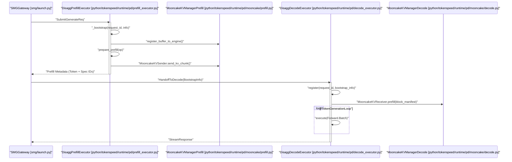
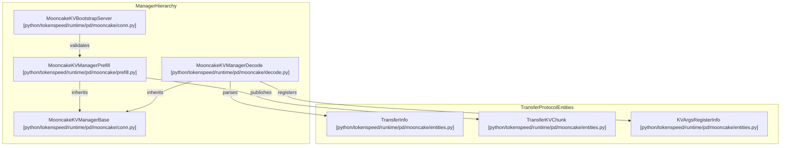

<!-- source: DeepWiki mcp.deepwiki.com · repo lightseekorg/tokenspeed · page 2.5 Prefill-Decode Disaggregation (PD/EPD) · fetched 2026-10-21 -->

# Prefill-Decode Disaggregation (PD/EPD)

Relevant source files

The following files were used as context for generating this wiki page:

- [python/tokenspeed/runtime/epd/encode_executor.py](python/tokenspeed/runtime/epd/encode_executor.py)
- [python/tokenspeed/runtime/epd/encode_loop.py](python/tokenspeed/runtime/epd/encode_loop.py)
- [python/tokenspeed/runtime/layers/attention/kv_cache/recipes/cache_runtime.py](python/tokenspeed/runtime/layers/attention/kv_cache/recipes/cache_runtime.py)
- [python/tokenspeed/runtime/layers/attention/kv_cache/recipes/ordinary.py](python/tokenspeed/runtime/layers/attention/kv_cache/recipes/ordinary.py)
- [python/tokenspeed/runtime/layers/attention/kv_cache/virtual_blocks.py](python/tokenspeed/runtime/layers/attention/kv_cache/virtual_blocks.py)
- [python/tokenspeed/runtime/layers/attention/mm_encoder_attention.py](python/tokenspeed/runtime/layers/attention/mm_encoder_attention.py)
- [python/tokenspeed/runtime/models/kimi_k25.py](python/tokenspeed/runtime/models/kimi_k25.py)
- [python/tokenspeed/runtime/models/moonvit.py](python/tokenspeed/runtime/models/moonvit.py)
- [python/tokenspeed/runtime/models/qwen3_asr.py](python/tokenspeed/runtime/models/qwen3_asr.py)
- [python/tokenspeed/runtime/models/qwen3_audio.py](python/tokenspeed/runtime/models/qwen3_audio.py)
- [python/tokenspeed/runtime/models/qwen3_omni.py](python/tokenspeed/runtime/models/qwen3_omni.py)
- [python/tokenspeed/runtime/pd/cache_protocol.py](python/tokenspeed/runtime/pd/cache_protocol.py)
- [python/tokenspeed/runtime/pd/decode_executor.py](python/tokenspeed/runtime/pd/decode_executor.py)
- [python/tokenspeed/runtime/pd/factory.py](python/tokenspeed/runtime/pd/factory.py)
- [python/tokenspeed/runtime/pd/mooncake/conn.py](python/tokenspeed/runtime/pd/mooncake/conn.py)
- [python/tokenspeed/runtime/pd/mooncake/decode.py](python/tokenspeed/runtime/pd/mooncake/decode.py)
- [python/tokenspeed/runtime/pd/mooncake/entities.py](python/tokenspeed/runtime/pd/mooncake/entities.py)
- [python/tokenspeed/runtime/pd/mooncake/prefill.py](python/tokenspeed/runtime/pd/mooncake/prefill.py)
- [python/tokenspeed/runtime/pd/mooncake/receiver.py](python/tokenspeed/runtime/pd/mooncake/receiver.py)
- [python/tokenspeed/runtime/pd/mooncake/sender.py](python/tokenspeed/runtime/pd/mooncake/sender.py)
- [python/tokenspeed/runtime/pd/prefill_executor.py](python/tokenspeed/runtime/pd/prefill_executor.py)
- [python/tokenspeed/runtime/pd/transfer_plan.py](python/tokenspeed/runtime/pd/transfer_plan.py)
- [test/ci/eval/qwen3.5-122b-a10b-nvfp4-epd-1e1p2d-evalscope-ocr-bench.yaml](test/ci/eval/qwen3.5-122b-a10b-nvfp4-epd-1e1p2d-evalscope-ocr-bench.yaml)
- [test/ci/eval/qwen3.5-35b-a3b-fp8-deepep-tp2dp2ep4-evalscope-gsm8k.yaml](test/ci/eval/qwen3.5-35b-a3b-fp8-deepep-tp2dp2ep4-evalscope-gsm8k.yaml)
- [test/ci/ut/qwen3.5-122b-a10b-nvfp4-epd-1e1p2d.yaml](test/ci/ut/qwen3.5-122b-a10b-nvfp4-epd-1e1p2d.yaml)
- [test/ci/ut/qwen3.5-397b-a17b-nvfp4-pd-1p1d.yaml](test/ci/ut/qwen3.5-397b-a17b-nvfp4-pd-1p1d.yaml)
- [test/ci_system/serve_qwen35_122b_nvfp4_epd_1e1p2d.sh](test/ci_system/serve_qwen35_122b_nvfp4_epd_1e1p2d.sh)
- [test/ci_system/serve_qwen35_397b_nvfp4_pd_1p1d.sh](test/ci_system/serve_qwen35_397b_nvfp4_pd_1p1d.sh)
- [test/ci_system/test_worker_cleanup.py](test/ci_system/test_worker_cleanup.py)
- [test/ci_system/worker_cleanup.sh](test/ci_system/worker_cleanup.sh)
- [test/runtime/cache_pd_test_utils.py](test/runtime/cache_pd_test_utils.py)
- [test/runtime/distributed/test_cache_pd_executors.py](test/runtime/distributed/test_cache_pd_executors.py)
- [test/runtime/distributed/test_cache_pd_layerwise.py](test/runtime/distributed/test_cache_pd_layerwise.py)
- [test/runtime/distributed/test_cache_pd_manifest.py](test/runtime/distributed/test_cache_pd_manifest.py)
- [test/runtime/distributed/test_epd_encode.py](test/runtime/distributed/test_epd_encode.py)
- [test/runtime/distributed/test_pd_transfer_plan.py](test/runtime/distributed/test_pd_transfer_plan.py)
- [test/runtime/distributed/test_qwen35_epd_1e1p2d.py](test/runtime/distributed/test_qwen35_epd_1e1p2d.py)
- [test/runtime/distributed/test_qwen35_pd_1p1d.py](test/runtime/distributed/test_qwen35_pd_1p1d.py)
- [test/runtime/test_dcp_cache_contract.py](test/runtime/test_dcp_cache_contract.py)
- [test/runtime/test_input_logprobs.py](test/runtime/test_input_logprobs.py)
- [tokenspeed-kernel/python/tokenspeed_kernel/ops/attention/prologue/triton.py](tokenspeed-kernel/python/tokenspeed_kernel/ops/attention/prologue/triton.py)

## Purpose and Scope
This page details the Prefill-Decode Disaggregation (PD) and Encode-Prefill-Decode (EPD) architectures in TokenSpeed. Disaggregation separates the compute-bound prefill phase and the vision encoding phase from the memory-bandwidth-bound decode phase, enabling independent cluster scaling and reducing interference. This document covers the prefill and decode executors, Mooncake distributed KV transfer, transfer planning across heterogeneous tensor parallelism (TP) layouts, factory wiring, and the EPD multimodal encode pipeline.

Sources: `[python/tokenspeed/runtime/pd/prefill_executor.py:41-50]()`, `[python/tokenspeed/runtime/pd/decode_executor.py:35-42]()`

---

## Prefill and Decode Executors

TokenSpeed divides execution roles into `DisaggPrefillExecutor` and `DisaggDecodeExecutor`, orchestrating chunked prefill, block manifests, and cross-node cache handoffs.

### DisaggPrefillExecutor
`DisaggPrefillExecutor` `[python/tokenspeed/runtime/pd/prefill_executor.py:41-]` manages prompt ingestion and streams generated KV cache segments to decode workers via Mooncake `[python/tokenspeed/runtime/pd/mooncake/prefill.py:76-]()`.
*   **Initialization & Buffer Registration**: Instantiates `MooncakeKVManagerPrefill` and binds local KV arena pointers `[python/tokenspeed/runtime/pd/prefill_executor.py:42-45]()`.
*   **Layer-wise Transfer**: Supports asynchronous layer-wise step counters via `register_layerwise_step_counter()` to overlap communication with execution `[python/tokenspeed/runtime/pd/prefill_executor.py:51-56]()`.
*   **Request Teardown**: Cleans up sender states and discards bootstrap rooms via `_drop_request_state()` `[python/tokenspeed/runtime/pd/prefill_executor.py:65-74]()`.

### DisaggDecodeExecutor
`DisaggDecodeExecutor` `[python/tokenspeed/runtime/pd/decode_executor.py:35-]` handles low-latency token generation on decode workers.
*   **Bootstrap Registration**: Registers incoming request identifiers and establishes rendezvous sockets through `register()` `[python/tokenspeed/runtime/pd/decode_executor.py:87-93]()`.
*   **Cache Preamble**: Injects block manifests via `_cache_prefill()` to configure remote receiver slots before batch execution `[python/tokenspeed/runtime/pd/decode_executor.py:53-85]()`.
*   **Event Generation**: Polls transfer completion statuses and emits scheduler-compatible events (`BootstrappedEvent`, `FailedEvent`) via `generate_events()` `[python/tokenspeed/runtime/pd/decode_executor.py:106-152]()`.

**Figure 1: PD Execution Flow and Code Entity Mapping**

Sources: `[python/tokenspeed/runtime/pd/prefill_executor.py:41-63]()`, `[python/tokenspeed/runtime/pd/decode_executor.py:35-105]()`, `[python/tokenspeed/runtime/pd/mooncake/prefill.py:76-121]()`

---

## Mooncake KV Transfer Subsystem

The data plane relies on the Mooncake engine, wrapped by `MooncakeKVManagerBase` `[python/tokenspeed/runtime/pd/mooncake/conn.py:37-]` and specialized subclasses.

### Core Manager Classes
*   `MooncakeKVManagerBase`: Initializes the underlying `MooncakeTransferEngine`, binds host/GPU arenas, and hooks metrics collection `[python/tokenspeed/runtime/pd/mooncake/conn.py:37-75]()`.
*   `MooncakeKVManagerPrefill`: Manages send queues, transfer worker threads, and prefill metadata publishing `[python/tokenspeed/runtime/pd/mooncake/prefill.py:76-121]()`.
*   `MooncakeKVManagerDecode`: Coordinates decode-side slab mapping, receiver pools, and ZMQ synchronization channels.
*   `MooncakeKVBootstrapServer`: HTTP rendezvous bootstrap server managing layout validation and endpoint routing `[python/tokenspeed/runtime/pd/mooncake/conn.py:84-109]()`.

**Figure 2: Mooncake Manager and Entity Code Mapping**

Sources: `[python/tokenspeed/runtime/pd/mooncake/conn.py:37-109]()`, `[python/tokenspeed/runtime/pd/mooncake/entities.py:53-180]()`

---

## Transfer Planning and Layout Protocols

When prefill and decode ranks operate with unequal tensor-parallelism (TP) sizes or partitioned pipeline stages, `CacheTransferPlanner` `[python/tokenspeed/runtime/pd/transfer_plan.py:95-]` computes explicit memory copy fragments.

### Key Data Structures
*   `CacheTransferFragment`: Describes a field-relative sub-page row fragment copied between source and destination slabs `[python/tokenspeed/runtime/pd/transfer_plan.py:40-58]()`.
*   `RankTransferPlan`: Aggregates mapping collections from prefill ranks to decode ranks `[python/tokenspeed/runtime/pd/transfer_plan.py:63-70]()`.
*   `TransferKVChunk`: Payload structure tracking chunk boundaries, step counters, and block manifests `[python/tokenspeed/runtime/pd/mooncake/entities.py:95-108]()`.
*   `TransferInfo`: Request manifest associated with a registered decode session `[python/tokenspeed/runtime/pd/mooncake/entities.py:112-122]()`.

Sources: `[python/tokenspeed/runtime/pd/transfer_plan.py:40-70]()`, `[python/tokenspeed/runtime/pd/mooncake/entities.py:95-122]()`

---

## EPD (Encode-Prefill-Decode) Pipeline

For multimodal models (e.g., Qwen3.5-VL), TokenSpeed introduces an **Encode** role (`encode`) preceding prefill.

### Pipeline Architecture
*   `EncodeWorker`: Runs independently as an LM-free process, executing only vision encoders and multimodal embedding extractors.
*   **Embedding Transport**: Encoded visual features are shipped directly over Mooncake to prefill workers, while raw image pixels are transported inline via gRPC messages (`TOKENSPEED_GRPC_MAX_MESSAGE_BYTES`) `[test/ci_system/serve_qwen35_122b_nvfp4_epd_1e1p2d.sh:54-56]()`.
*   **Topology Wiring**: Supports multi-replica decode dispatch (e.g., `1E-1P-2D` topologies) where gateways balance requests across decode instances `[test/ci_system/serve_qwen35_122b_nvfp4_epd_1e1p2d.sh:10-14]()`.

Sources: `[test/ci_system/serve_qwen35_122b_nvfp4_epd_1e1p2d.sh:1-60]()`

---

## Lifecycle Status States

Transfer lifecycles are governed by the `TransferPoll` status machine:

| Status State | Description | Code Reference |
| :--- | :--- | :--- |
| `Bootstrapping` | Establishing sockets, exchanging metadata and route headers. | `[python/tokenspeed/runtime/pd/base/status.py]()`, `[python/tokenspeed/runtime/pd/decode_executor.py:114-122]()` |
| `Bootstrapped` | Connection verified; ready for KV chunk transmission. | `[python/tokenspeed/runtime/pd/decode_executor.py:116-121]()` |
| `Transferring` | Mooncake RDMA data movement in progress. | `[python/tokenspeed/runtime/pd/base/status.py]()` |
| `Success` | KV cache successfully transferred and loaded on decode node. | `[python/tokenspeed/runtime/pd/decode_executor.py:133-141]()` |
| `Failed` | Timeout or unrecoverable error during transfer or bootstrap. | `[python/tokenspeed/runtime/pd/decode_executor.py:123-131]()` |

Sources: `[python/tokenspeed/runtime/pd/base/status.py]()`, `[python/tokenspeed/runtime/pd/decode_executor.py:113-145]()`

---

