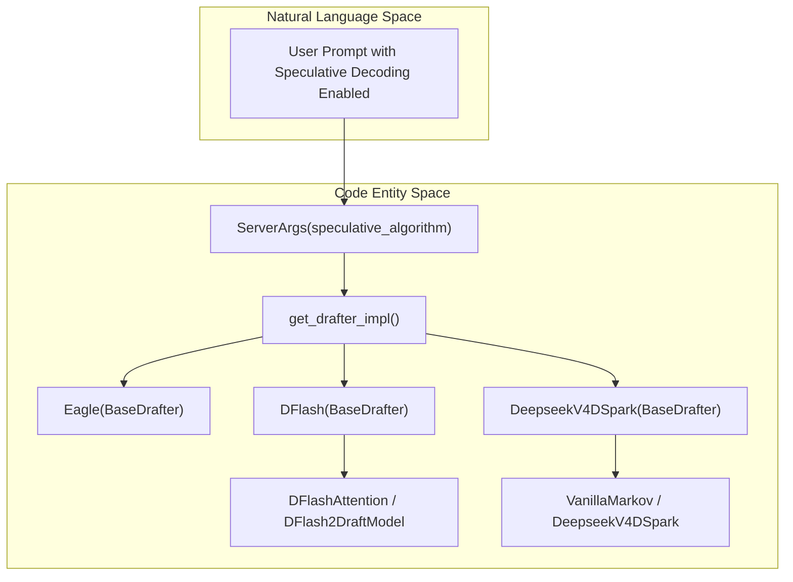
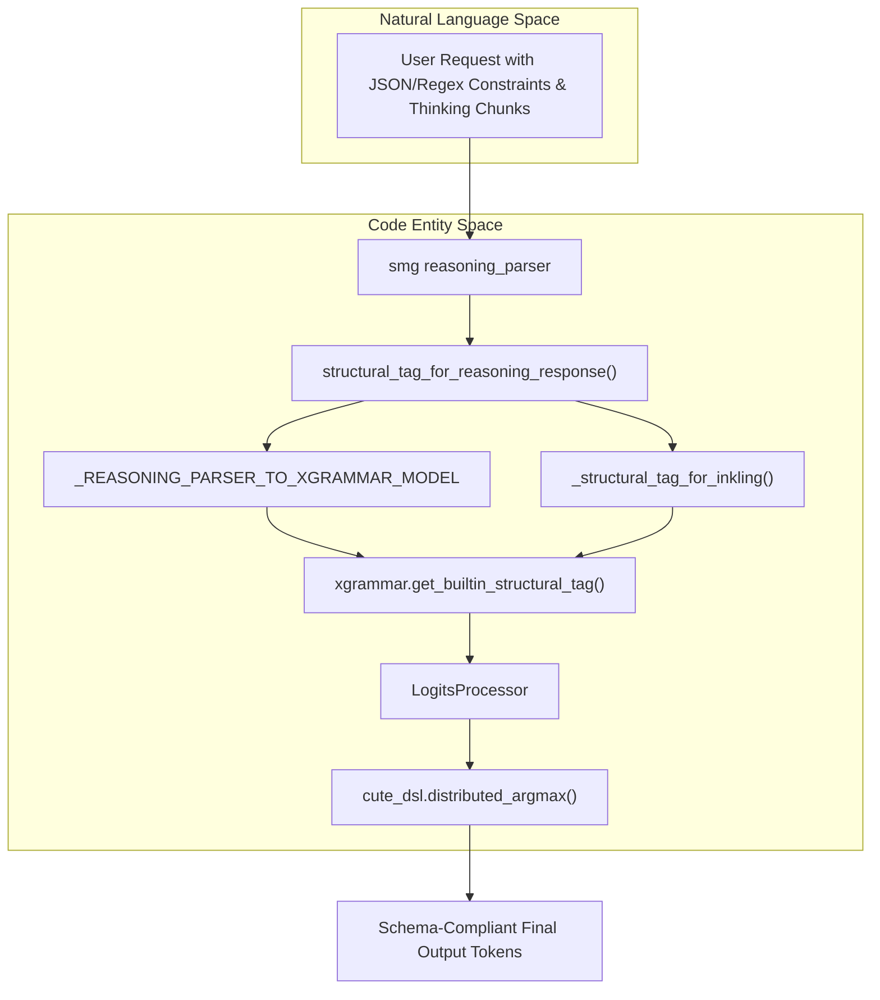

<!-- source: DeepWiki mcp.deepwiki.com · repo lightseekorg/tokenspeed · page 2.6 Speculative Decoding and Grammar · fetched 2026-10-21 -->

# Speculative Decoding and Grammar

Relevant source files

The following files were used as context for generating this wiki page:

- [python/tokenspeed/runtime/configs/deepseek_v41_config.py](python/tokenspeed/runtime/configs/deepseek_v41_config.py)
- [python/tokenspeed/runtime/execution/drafter/__init__.py](python/tokenspeed/runtime/execution/drafter/__init__.py)
- [python/tokenspeed/runtime/execution/drafter/base.py](python/tokenspeed/runtime/execution/drafter/base.py)
- [python/tokenspeed/runtime/execution/drafter/deepseek_v4_dspark.py](python/tokenspeed/runtime/execution/drafter/deepseek_v4_dspark.py)
- [python/tokenspeed/runtime/execution/drafter/dflash.py](python/tokenspeed/runtime/execution/drafter/dflash.py)
- [python/tokenspeed/runtime/execution/drafter/dflash2.py](python/tokenspeed/runtime/execution/drafter/dflash2.py)
- [python/tokenspeed/runtime/execution/drafter/dspark.py](python/tokenspeed/runtime/execution/drafter/dspark.py)
- [python/tokenspeed/runtime/grammar/reasoning_structural_tag.py](python/tokenspeed/runtime/grammar/reasoning_structural_tag.py)
- [python/tokenspeed/runtime/layers/attention/backends/paged/trtllm.py](python/tokenspeed/runtime/layers/attention/backends/paged/trtllm.py)
- [python/tokenspeed/runtime/layers/attention/configs/mha.py](python/tokenspeed/runtime/layers/attention/configs/mha.py)
- [python/tokenspeed/runtime/models/deepseek_v41_vision.py](python/tokenspeed/runtime/models/deepseek_v41_vision.py)
- [python/tokenspeed/runtime/models/dflash.py](python/tokenspeed/runtime/models/dflash.py)
- [python/tokenspeed/runtime/models/dflash2.py](python/tokenspeed/runtime/models/dflash2.py)
- [python/tokenspeed/runtime/models/dspark.py](python/tokenspeed/runtime/models/dspark.py)
- [test/cli/test_serve_smg_deepseek_v41.py](test/cli/test_serve_smg_deepseek_v41.py)
- [test/runtime/test_deepseek_v41_vision.py](test/runtime/test_deepseek_v41_vision.py)
- [test/runtime/test_dflash2.py](test/runtime/test_dflash2.py)
- [test/runtime/test_dspark_proposal.py](test/runtime/test_dspark_proposal.py)
- [test/runtime/test_encoder_batching.py](test/runtime/test_encoder_batching.py)
- [test/runtime/test_reasoning_structural_tag.py](test/runtime/test_reasoning_structural_tag.py)
- [test/runtime/test_tree_attention_cascade.py](test/runtime/test_tree_attention_cascade.py)
- [test/runtime/test_tree_support_resolution.py](test/runtime/test_tree_support_resolution.py)
- [test/runtime/test_trtllm_kv_counter_buffer.py](test/runtime/test_trtllm_kv_counter_buffer.py)
- [tokenspeed-kernel/python/tokenspeed_kernel/ops/attention/mha/flashinfer.py](tokenspeed-kernel/python/tokenspeed_kernel/ops/attention/mha/flashinfer.py)
- [tokenspeed-kernel/python/tokenspeed_kernel/ops/attention/tree/__init__.py](tokenspeed-kernel/python/tokenspeed_kernel/ops/attention/tree/__init__.py)
- [tokenspeed-kernel/python/tokenspeed_kernel/ops/attention/tree/triton.py](tokenspeed-kernel/python/tokenspeed_kernel/ops/attention/tree/triton.py)
- [tokenspeed-kernel/python/tokenspeed_kernel/ops/sampling/__init__.py](tokenspeed-kernel/python/tokenspeed_kernel/ops/sampling/__init__.py)
- [tokenspeed-kernel/python/tokenspeed_kernel/ops/sampling/cute_dsl.py](tokenspeed-kernel/python/tokenspeed_kernel/ops/sampling/cute_dsl.py)
- [tokenspeed-kernel/test/ops/test_tree_speculative.py](tokenspeed-kernel/test/ops/test_tree_speculative.py)

The Speculative Decoding and Grammar subsystem in TokenSpeed provides high-performance inference optimizations through multi-algorithm drafting (EAGLE/EAGLE3, MTP/NextN, DFLASH, DFLASH2, DSPARK), tight draft/target wiring, tree speculation support, acceptance indexing, and grammar-constrained reasoning generation.

## Drafter Registry and Implementations

TokenSpeed maintains a pluggable drafter registry supporting diverse speculative execution paradigms. These include traditional feature-tree estimators (EAGLE, EAGLE3), native next-token predictors integrated into the main model trunk (MTP/NextN), and block-drafting architectures (DFLASH, DFLASH2, DSPARK). All drafters inherit from `BaseDrafter` defined in `[python/tokenspeed/runtime/execution/drafter/base.py:46-100]()`.

### EAGLE and EAGLE3
The `Eagle` drafter class implements multi-step speculative drafting using hidden states from the target model `[python/tokenspeed/runtime/execution/drafter/eagle.py:70-100]()`. EAGLE3 variants incorporate specialized attention corrections and KV cache sharing with the base model runner.

### MTP / NextN
Next-token prediction (MTP) architectures, such as DeepSeek V4 and Qwen 4, embed speculative prediction heads directly into model layers via classes like `DeepseekV4MultiTokenPredictorLayer` `[python/tokenspeed/runtime/models/deepseek_v4_mtp.py:142-202]()` and associated compressor blocks `[python/tokenspeed/runtime/models/deepseek_v4_mtp.py:49-56]()`.

### DFLASH, DFLASH2, and DSPARK
Block-drafting algorithms like `DFlash` `[python/tokenspeed/runtime/execution/drafter/dflash.py:112-169]()` and `DeepseekV4DSpark` `[python/tokenspeed/runtime/execution/drafter/deepseek_v4_dspark.py:85-130]()` enable multi-token block prediction by consuming target residual streams from specified layers (`dflash_config.target_layer_ids`) `[python/tokenspeed/runtime/execution/drafter/dflash.py:150-155]()`. DFLASH2 extends this with refined fused KV scatter primitives and dual-stream auxiliary integration.

**Natural Language to Drafter Code Entity Mapping**

Sources: [python/tokenspeed/runtime/execution/drafter/base.py:46-100](), [python/tokenspeed/runtime/execution/drafter/dflash.py:112-169](), [python/tokenspeed/runtime/execution/drafter/deepseek_v4_dspark.py:85-130](), [python/tokenspeed/runtime/models/deepseek_v4_mtp.py:49-202]()

Sources: [python/tokenspeed/runtime/execution/drafter/base.py:46-100](), [python/tokenspeed/runtime/execution/drafter/dflash.py:112-169](), [python/tokenspeed/runtime/execution/drafter/deepseek_v4_dspark.py:85-130](), [python/tokenspeed/runtime/models/deepseek_v4_mtp.py:49-202]()

## Draft and Target Wiring & Tree Speculation

Speculative execution requires coordinating memory spaces, KV cache allocations, state buffers, and attention backends between the primary target model and the draft model runner.

### KV Cache Sharing and Overshoot Management
Draft models often write directly into the target model's KV cache pool or share underlying page tables. To absorb speculative overshoot past the logical context length, TokenSpeed configures runtime buffers to accommodate spec-decode overshoot spans (`_SPEC_OVERSHOOT_SPANS = 3`) `[python/tokenspeed/runtime/utils/server_args.py:52-64]()`.

### Input Buffers and Runtime States
The `InputBuffers` and `ForwardContext` classes manage sequence lengths (`draft_seq_lens_buf`) and cache location pointers (`draft_out_cache_loc_buf`) `[python/tokenspeed/runtime/execution/drafter/eagle.py:116-123]()`. Triton and CUDA kernels such as `dflash_prepare_decode` translate scheduler page tables into physical memory addresses for both target and draft execution phases `[python/tokenspeed/runtime/execution/cache_loc_kernel.py:31-82]()`.

### Tree Speculation Support and Window Attention
Tree-based speculative decoding uses `resolve_tree_support` to compose capabilities across target and draft backend hierarchies at startup `[python/tokenspeed/runtime/layers/attention/backends/support.py:58-60]()` (verified via tests in `[test/runtime/test_tree_support_resolution.py:96-123]()`). The `tree_window_attention` primitive executes draft-tree attention topologies over paged memory `[tokenspeed-kernel/python/tokenspeed_kernel/ops/attention/tree/__init__.py]()`.

Sources: [python/tokenspeed/runtime/utils/server_args.py:52-64](), [python/tokenspeed/runtime/execution/drafter/eagle.py:116-123](), [python/tokenspeed/runtime/execution/cache_loc_kernel.py:31-82](), [python/tokenspeed/runtime/layers/attention/backends/support.py:58-60](), [test/runtime/test_tree_support_resolution.py:96-123]()

## Acceptance Indexing and Sampling

Verification and acceptance indexing map flat token outputs back to sequence rows following speculative draft evaluation.

### Acceptance Lengths and Flat Indices
The acceptance mechanism computes safe flat token offsets based on `accept_lengths` returned by the verification step `[python/tokenspeed/runtime/execution/drafter/eagle.py:142-164]()`. 
*   **Zero-Accept Fallback**: When context length caps force zero accepted tokens for a sequence row, the verifier uses the row's initial verify output as a dummy source to preserve CUDA graph tensor shapes `[python/tokenspeed/runtime/execution/drafter/eagle.py:153-158]()`.
*   **Correction Trimming**: Attention decoders apply correction steps (e.g., trimming `cache_seqlens` in draft sequence length buffers by `spec_num_tokens - accept_lengths`) to maintain accurate history windows `[python/tokenspeed/runtime/models/llama_eagle3.py:129-143]()`.

### CuTe DSL Distributed Argmax
For Hopper/Blackwell architectures, high-performance kernels such as `tokenspeed_kernel.ops.sampling.cute_dsl.distributed_argmax` optimize greedy verification and speculative candidate selection across tensor-parallel ranks `[tokenspeed-kernel/python/tokenspeed_kernel/ops/sampling/cute_dsl.py:47-70]()`.

Sources: [python/tokenspeed/runtime/execution/drafter/eagle.py:142-164](), [python/tokenspeed/runtime/models/llama_eagle3.py:129-143](), [tokenspeed-kernel/python/tokenspeed_kernel/ops/sampling/cute_dsl.py:47-70]()

## Grammar and Reasoning Structural Tags

TokenSpeed integrates grammar-constrained generation backends (such as `xgrammar`) with reasoning models to enforce structured outputs without breaking special reasoning tokens.

### Reasoning Structural Tags
To prevent grammar parsers from rejecting reasoning markers (such as DeepSeek's `<think>` blocks), the system wraps user constraints using model-specific structural tags defined in `[python/tokenspeed/runtime/grammar/reasoning_structural_tag.py:21-44]()`. The function `structural_tag_for_reasoning_response` isolates the response channel and applies the requested schema `[python/tokenspeed/runtime/grammar/reasoning_structural_tag.py:105-116]()`. Model families are mapped via `_REASONING_PARSER_TO_XGRAMMAR_MODEL` `[python/tokenspeed/runtime/grammar/reasoning_structural_tag.py:56-66]()`, with custom formatting helpers such as `_structural_tag_for_inkling` handling specialized multi-block reasoning structures `[python/tokenspeed/runtime/grammar/reasoning_structural_tag.py:69-102]()`.

### Logits Processing and Sampling Integration
The `LogitsProcessor` manages logprob calculation, temperature scaling, and distributed argmax operations `[python/tokenspeed/runtime/layers/logits_processor.py:71-134]()`. Draft proposal sampling is coordinated via `DraftProposalSampler` when `--enable-speculative-sampling` is active `[python/tokenspeed/runtime/execution/drafter/base.py:103-139]()`.

**Natural Language to Grammar & Sampling Code Entity Mapping**

Sources: [python/tokenspeed/runtime/grammar/reasoning_structural_tag.py:21-116](), [python/tokenspeed/runtime/layers/logits_processor.py:71-134](), [tokenspeed-kernel/python/tokenspeed_kernel/ops/sampling/cute_dsl.py:47-70](), [python/tokenspeed/runtime/execution/drafter/base.py:103-139]()

---

