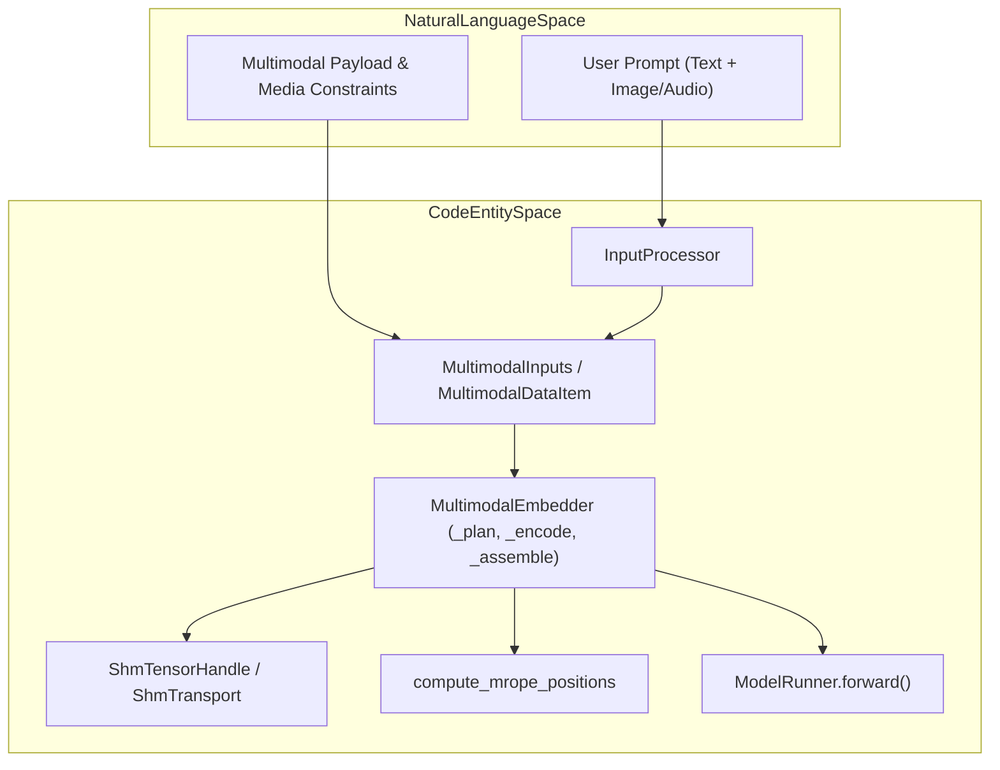
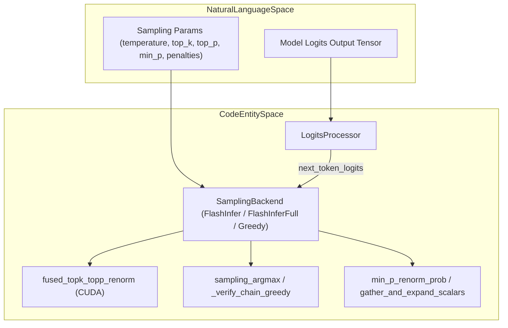

<!-- source: DeepWiki mcp.deepwiki.com · repo lightseekorg/tokenspeed · page 2.7 Multimodal and Sampling · fetched 2026-10-21 -->

# Multimodal and Sahmpling

Relevant source files

The following files were used as context for generating this wiki page:

- [python/tokenspeed/runtime/engine/zmq_wire.py](python/tokenspeed/runtime/engine/zmq_wire.py)
- [python/tokenspeed/runtime/execution/nan_guard.py](python/tokenspeed/runtime/execution/nan_guard.py)
- [python/tokenspeed/runtime/multimodal/embedder.py](python/tokenspeed/runtime/multimodal/embedder.py)
- [python/tokenspeed/runtime/multimodal/encoder_batching.py](python/tokenspeed/runtime/multimodal/encoder_batching.py)
- [python/tokenspeed/runtime/multimodal/encoder_feature_transport.py](python/tokenspeed/runtime/multimodal/encoder_feature_transport.py)
- [python/tokenspeed/runtime/multimodal/inputs.py](python/tokenspeed/runtime/multimodal/inputs.py)
- [python/tokenspeed/runtime/multimodal/shm_transport.py](python/tokenspeed/runtime/multimodal/shm_transport.py)
- [python/tokenspeed/runtime/sampling/backends/base.py](python/tokenspeed/runtime/sampling/backends/base.py)
- [python/tokenspeed/runtime/sampling/backends/flashinfer.py](python/tokenspeed/runtime/sampling/backends/flashinfer.py)
- [python/tokenspeed/runtime/sampling/backends/flashinfer_full.py](python/tokenspeed/runtime/sampling/backends/flashinfer_full.py)
- [python/tokenspeed/runtime/sampling/backends/greedy.py](python/tokenspeed/runtime/sampling/backends/greedy.py)
- [python/tokenspeed/runtime/sampling/utils.py](python/tokenspeed/runtime/sampling/utils.py)
- [test/runtime/distributed/test_multimodal_encoder_parallelism.py](test/runtime/distributed/test_multimodal_encoder_parallelism.py)
- [test/runtime/distributed/test_multimodal_shm_multinode.py](test/runtime/distributed/test_multimodal_shm_multinode.py)
- [test/runtime/models/test_qwen3_omni.py](test/runtime/models/test_qwen3_omni.py)
- [test/runtime/sampling/test_dp_sampling_logits_verify.py](test/runtime/sampling/test_dp_sampling_logits_verify.py)
- [test/runtime/sampling/test_flashinfer_verify_dp.py](test/runtime/sampling/test_flashinfer_verify_dp.py)
- [test/runtime/sampling/test_nan_guard.py](test/runtime/sampling/test_nan_guard.py)
- [test/runtime/test_multimodal_encoded_offload.py](test/runtime/test_multimodal_encoded_offload.py)
- [test/runtime/test_multimodal_encoder_dtype.py](test/runtime/test_multimodal_encoder_dtype.py)
- [test/runtime/test_multimodal_shm_transport.py](test/runtime/test_multimodal_shm_transport.py)
- [test/runtime/test_multimodal_tp_broadcast.py](test/runtime/test_multimodal_tp_broadcast.py)
- [tokenspeed-kernel/python/tokenspeed_kernel/ops/sampling/cuda.py](tokenspeed-kernel/python/tokenspeed_kernel/ops/sampling/cuda.py)
- [tokenspeed-kernel/python/tokenspeed_kernel/thirdparty/cuda/csrc/fused_topk_topp/air_top_p.cuh](tokenspeed-kernel/python/tokenspeed_kernel/thirdparty/cuda/csrc/fused_topk_topp/air_top_p.cuh)
- [tokenspeed-kernel/python/tokenspeed_kernel/thirdparty/cuda/csrc/fused_topk_topp/air_topk_stable.cuh](tokenspeed-kernel/python/tokenspeed_kernel/thirdparty/cuda/csrc/fused_topk_topp/air_topk_stable.cuh)
- [tokenspeed-kernel/python/tokenspeed_kernel/thirdparty/cuda/csrc/fused_topk_topp/fused_topk_topp.cu](tokenspeed-kernel/python/tokenspeed_kernel/thirdparty/cuda/csrc/fused_topk_topp/fused_topk_topp.cu)
- [tokenspeed-kernel/python/tokenspeed_kernel/thirdparty/cuda/csrc/fused_topk_topp/fused_topk_topp.h](tokenspeed-kernel/python/tokenspeed_kernel/thirdparty/cuda/csrc/fused_topk_topp/fused_topk_topp.h)
- [tokenspeed-kernel/python/tokenspeed_kernel/thirdparty/cuda/csrc/fused_topk_topp/fused_topk_topp_binding.cu](tokenspeed-kernel/python/tokenspeed_kernel/thirdparty/cuda/csrc/fused_topk_topp/fused_topk_topp_binding.cu)
- [tokenspeed-kernel/python/tokenspeed_kernel/thirdparty/cuda/fused_topk_topp.py](tokenspeed-kernel/python/tokenspeed_kernel/thirdparty/cuda/fused_topk_topp.py)
- [tokenspeed-kernel/test/ops/test_sampling.py](tokenspeed-kernel/test/ops/test_sampling.py)

Purpose and Scope: This section covers the architecture and implementation of the multimodal input pipeline and the sampling subsystem. The multimodal pipeline handles the ingestion, encoding, and splicing of non-text data (images, video, audio) into the LLM embedding space. The sampling subsystem provides high-performance backends for stochastic and greedy token generation, including support for speculative decoding verification and distributed parallel sampling.

## Multimodal Input Pipeline

TokenSpeed employs an **EPD (Encode-Prefill-Decode)** pipeline for multimodal requests. Multimodal data is processed in three distinct phases: planning, encoding, and assembly [python/tokenspeed/runtime/multimodal/embedder.py:23-41]().

### Data Flow and Representation
Multimodal inputs are encapsulated in `MultimodalDataItem` objects [python/tokenspeed/runtime/multimodal/inputs.py:155-162]() and `MultimodalInputs` structures. These items carry raw features, modality types, and spatial information like `grid_thw` for vision models.

To maintain compatibility with the prefix cache, placeholder tokens in the `input_ids` are rewritten to hash-derived "pad values" [python/tokenspeed/runtime/multimodal/inputs.py:39-51](). This ensures that two different images result in different prefix keys even if they use the same number of placeholder tokens.

### Natural Language Space to Code Entity Space: Multimodal Pipeline

Sources: [python/tokenspeed/runtime/multimodal/embedder.py:21-53](), [python/tokenspeed/runtime/multimodal/inputs.py:39-162](), [python/tokenspeed/runtime/multimodal/shm_transport.py:21-27]()

### Shared-Memory Transport
For efficient inter-process communication (IPC) of large multimodal features, TokenSpeed uses `ShmTensorHandle` [python/tokenspeed/runtime/multimodal/shm_transport.py:45-52]() and `EncoderFeatureTransport`. 
* **Publishing**: Tensors are written into POSIX shared memory segments [python/tokenspeed/runtime/multimodal/shm_transport.py:71-82]().
* **Reachability**: The discovery function determines which ranks can open each producer-side segment, handling cross-node transport if necessary [python/tokenspeed/runtime/multimodal/shm_transport.py:128-161]().

### Multimodal RoPE (M-RoPE) and Qwen3 Omni/ASR/Audio
For models like Qwen-VL, Qwen3-Omni, Qwen3-ASR, and Qwen3-Audio, the engine computes 3-axis position IDs (Temporal, Height, Width) [python/tokenspeed/runtime/multimodal/mrope.py]().
* **Vision**: Uses T/H/W axes based on `spatial_merge_size` [test/runtime/models/test_qwen3_omni.py:35-42]().
* **Audio/ASR**: Handles streaming audio features, advancing time dimensions across audio tokens.
* **Qwen3-Omni**: Specifically coordinates independent image, audio, and video streams where video time is expressed on a clock [test/runtime/models/test_qwen3_omni.py:37-42]().

### The Embedding Assembler
The `MultimodalEmbedder` class orchestrates the splicing of encoded tokens into the text embedding stream [python/tokenspeed/runtime/multimodal/embedder.py:87]().

| Phase | Entity | Responsibility |
| :--- | :--- | :--- |
| **Plan** | `_plan` | Walks active inputs, de-duplicates by content hash, and creates `ScatterRange` records [python/tokenspeed/runtime/multimodal/embedder.py:25-30](). |
| **Encode** | `_encode` | Invokes modality-specific encoders. Results are cached on the `MultimodalDataItem` and reused across chunked prefill [python/tokenspeed/runtime/multimodal/embedder.py:31-37](). |
| **Assemble** | `_assemble` | Performs text embedding lookup and uses `ScatterRange` to overwrite placeholders with encoder outputs [python/tokenspeed/runtime/multimodal/embedder.py:38-41](). |

Sources: [python/tokenspeed/runtime/multimodal/embedder.py:21-166](), [python/tokenspeed/runtime/multimodal/inputs.py:39-162](), [python/tokenspeed/runtime/multimodal/shm_transport.py:21-172]()

---

## Sampling Subsystem

The sampling system converts model logits into discrete token IDs. It supports greedy search, stochastic sampling (Top-K, Top-P, Min-P), and speculative decoding verification.

### Natural Language Space to Code Entity Space: Sampling Subsystem

Sources: [python/tokenspeed/runtime/sampling/backends/flashinfer.py:85-168](), [python/tokenspeed/runtime/sampling/backends/flashinfer_full.py:69-100](), [python/tokenspeed/runtime/sampling/backends/greedy.py:123-134]()

### Sampling Backends

#### 1. FlashInfer (Stochastic)
The `FlashInferSamplingBackend` is the primary path for stochastic sampling [python/tokenspeed/runtime/sampling/backends/flashinfer.py:152-166]().
* **Single-step**: Fuses `softmax` with `top_k_top_p_sampling_from_probs` [python/tokenspeed/runtime/sampling/backends/flashinfer.py:37-42]().
* **Multi-step (Speculative)**: Uses `chain_speculative_sampling_target_only` for verification [python/tokenspeed/runtime/sampling/backends/flashinfer.py:27-29]().
* **DP Sampling**: Supports Data Parallel sampling via `DpSamplingComm` where logits are distributed across ranks [python/tokenspeed/runtime/sampling/backends/flashinfer.py:50]().

#### 2. FlashInferFull (Advanced Penalties)
A superset of the FlashInfer backend that adds support for [python/tokenspeed/runtime/sampling/backends/flashinfer_full.py:69-99]():
* **Min-P Sampling**: `min_p_sampling_from_probs` [python/tokenspeed/runtime/sampling/backends/flashinfer_full.py:36]().
* **Logit Bias**: Per-token additive bias stored in a dedicated pool buffer [python/tokenspeed/runtime/sampling/backends/flashinfer_full.py:126-130]().
* **Penalties**: Frequency, presence, and repetition penalties applied before softmax [python/tokenspeed/runtime/sampling/backends/flashinfer_full.py:88-94]().

#### 3. Greedy
The `GreedySamplingBackend` provides a simplified path for deterministic generation [python/tokenspeed/runtime/sampling/backends/greedy.py:123-132](). It utilizes `sampling_argmax` for high-performance selection [python/tokenspeed/runtime/sampling/backends/greedy.py:26]().

### Fused Kernels and Performance

#### Fused Top-K / Top-P Renorm
TokenSpeed implements a fused CUDA kernel for Top-K and Top-P renormalization [tokenspeed-kernel/python/tokenspeed_kernel/thirdparty/cuda/csrc/fused_topk_topp/fused_topk_topp.cu:21-36]().
* **Deterministic**: Designed for CUDA-graph compatibility [tokenspeed-kernel/python/tokenspeed_kernel/thirdparty/cuda/csrc/fused_topk_topp/fused_topk_topp.cu:21-25]().
* **Workspace Management**: Requires explicit preparation via `fused_topk_topp_prepare` [python/tokenspeed/runtime/sampling/backends/flashinfer.py:33-36]().

Sources: [python/tokenspeed/runtime/sampling/backends/flashinfer.py:25-168](), [python/tokenspeed/runtime/sampling/backends/flashinfer_full.py:21-166](), [python/tokenspeed/runtime/sampling/backends/greedy.py:21-150](), [tokenspeed-kernel/python/tokenspeed_kernel/thirdparty/cuda/csrc/fused_topk_topp/fused_topk_topp.cu:21-143]()

---

## Logits Processor

The `LogitsProcessor` handles the final transformation of hidden states into logits, managing vocabulary parallelism across tensor-parallel ranks and applying model-specific adjustments.

### Output and Metadata Structures
* **`LogitsProcessorOutput`**: Encapsulates next-token logits, selected token IDs, hidden states, layout plans, and optional input/output logprobs for requests requiring granular probability reporting.
* **`LogitsMetadata`**: Tracks forward modes, capture hidden modes, sequence lengths, and sampling post-processing parameters such as scaled logprobs and top-p normalized configurations.

Sources: [python/tokenspeed/runtime/sampling/utils.py:47-105]()

---

