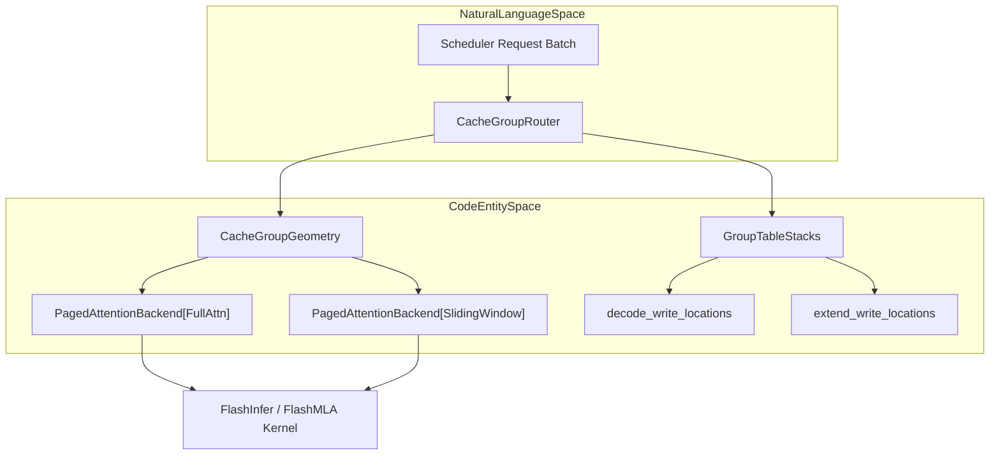
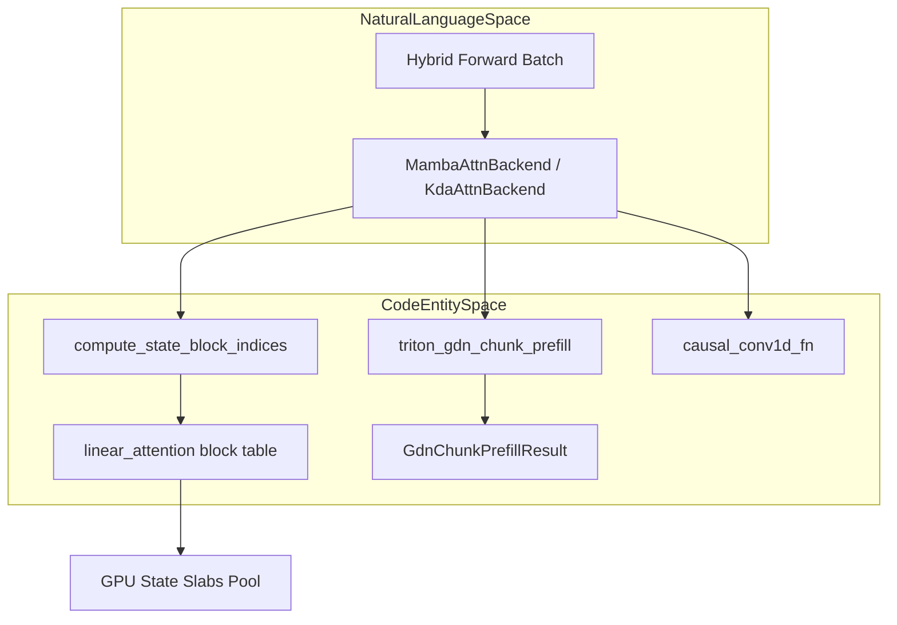
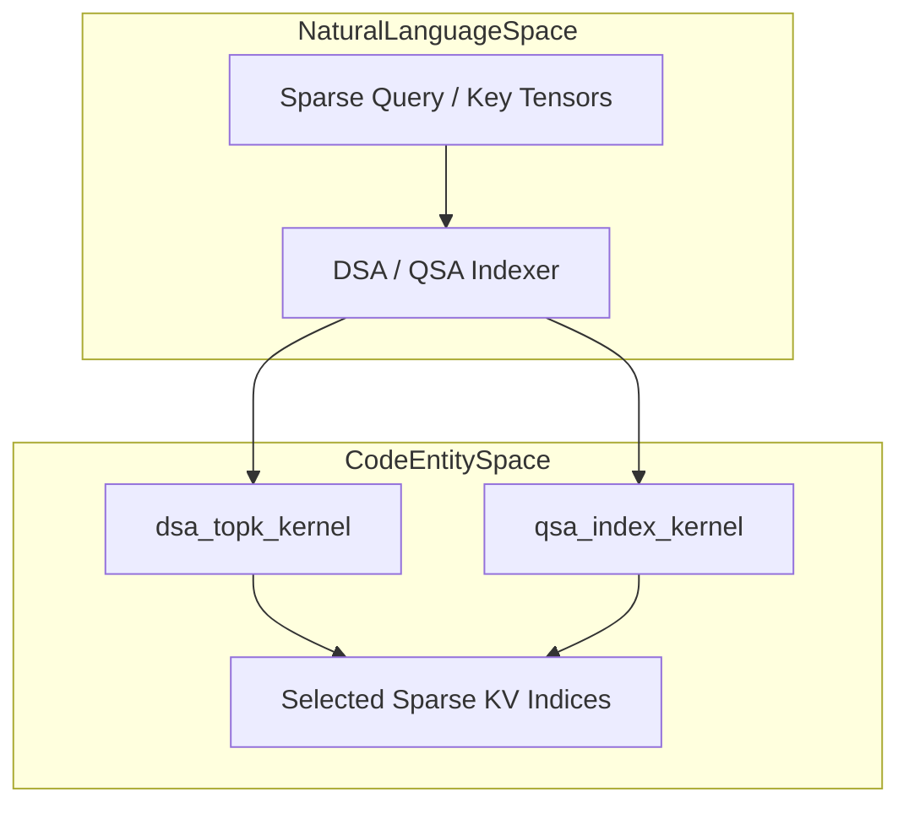
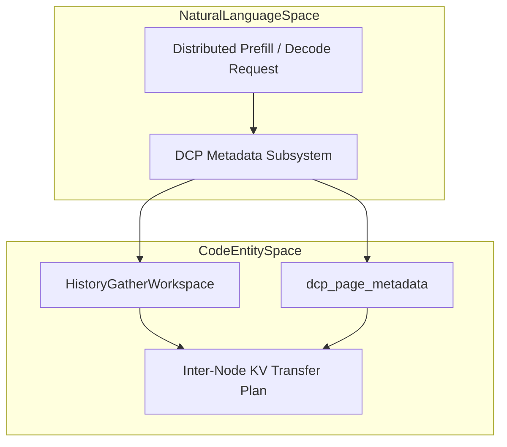

<!-- source: DeepWiki mcp.deepwiki.com · repo lightseekorg/tokenspeed · page 2.8 Attention Backends and Hybrid State Layers · fetched 2026-10-21 -->

# Attention Backends and Hybrid State Layers

<details>
<summary>Relevant source files</summary>

The following files were used as context for generating this wiki page:

- [docs/design/tree-speculation.md](docs/design/tree-speculation.md)
- [python/tokenspeed/runtime/layers/attention/backends/paged/base.py](python/tokenspeed/runtime/layers/attention/backends/paged/base.py)
- [python/tokenspeed/runtime/layers/attention/backends/paged/flashmla.py](python/tokenspeed/runtime/layers/attention/backends/paged/flashmla.py)
- [python/tokenspeed/runtime/layers/attention/backends/paged/group_tables.py](python/tokenspeed/runtime/layers/attention/backends/paged/group_tables.py)
- [python/tokenspeed/runtime/layers/attention/backends/paged/qsa.py](python/tokenspeed/runtime/layers/attention/backends/paged/qsa.py)
- [python/tokenspeed/runtime/layers/attention/backends/paged/router.py](python/tokenspeed/runtime/layers/attention/backends/paged/router.py)
- [python/tokenspeed/runtime/layers/attention/backends/paged/write_locations.py](python/tokenspeed/runtime/layers/attention/backends/paged/write_locations.py)
- [python/tokenspeed/runtime/layers/attention/backends/specific/qsa_indexer.py](python/tokenspeed/runtime/layers/attention/backends/specific/qsa_indexer.py)
- [python/tokenspeed/runtime/layers/attention/backends/specific/qwen4_exp_ple.py](python/tokenspeed/runtime/layers/attention/backends/specific/qwen4_exp_ple.py)
- [python/tokenspeed/runtime/layers/attention/backends/state/checkpoint.py](python/tokenspeed/runtime/layers/attention/backends/state/checkpoint.py)
- [python/tokenspeed/runtime/layers/attention/backends/state/mamba.py](python/tokenspeed/runtime/layers/attention/backends/state/mamba.py)
- [python/tokenspeed/runtime/layers/attention/backends/state/mamba2.py](python/tokenspeed/runtime/layers/attention/backends/state/mamba2.py)
- [python/tokenspeed/runtime/layers/attention/configs/dsa.py](python/tokenspeed/runtime/layers/attention/configs/dsa.py)
- [python/tokenspeed/runtime/layers/attention/configs/linear_attn.py](python/tokenspeed/runtime/layers/attention/configs/linear_attn.py)
- [python/tokenspeed/runtime/layers/attention/dcp/metadata.py](python/tokenspeed/runtime/layers/attention/dcp/metadata.py)
- [python/tokenspeed/runtime/layers/attention/kv_cache/dsa.py](python/tokenspeed/runtime/layers/attention/kv_cache/dsa.py)
- [python/tokenspeed/runtime/layers/attention/kv_cache/recipes/base.py](python/tokenspeed/runtime/layers/attention/kv_cache/recipes/base.py)
- [python/tokenspeed/runtime/layers/attention/kv_cache/recipes/qwen35.py](python/tokenspeed/runtime/layers/attention/kv_cache/recipes/qwen35.py)
- [python/tokenspeed/runtime/layers/attention/kv_cache/recipes/qwen4_exp.py](python/tokenspeed/runtime/layers/attention/kv_cache/recipes/qwen4_exp.py)
- [python/tokenspeed/runtime/layers/attention/linear/causal_conv1d.py](python/tokenspeed/runtime/layers/attention/linear/causal_conv1d.py)
- [python/tokenspeed/runtime/layers/attention/qsa/indexer.py](python/tokenspeed/runtime/layers/attention/qsa/indexer.py)
- [python/tokenspeed/runtime/layers/attention/qsa/metadata.py](python/tokenspeed/runtime/layers/attention/qsa/metadata.py)
- [test/runtime/dsa_index_k_test_utils.py](test/runtime/dsa_index_k_test_utils.py)
- [test/runtime/layers/test_gdn_qkv_split_fused.py](test/runtime/layers/test_gdn_qkv_split_fused.py)
- [test/runtime/test_cache_group_router.py](test/runtime/test_cache_group_router.py)
- [test/runtime/test_causal_conv1d_tree.py](test/runtime/test_causal_conv1d_tree.py)
- [test/runtime/test_dcp_page_metadata.py](test/runtime/test_dcp_page_metadata.py)
- [test/runtime/test_flashmla_dcp.py](test/runtime/test_flashmla_dcp.py)
- [test/runtime/test_gdn_pdl.py](test/runtime/test_gdn_pdl.py)
- [test/runtime/test_gdn_state_paging.py](test/runtime/test_gdn_state_paging.py)
- [test/runtime/test_kimi_k3_kda.py](test/runtime/test_kimi_k3_kda.py)
- [test/runtime/test_nemotron_h.py](test/runtime/test_nemotron_h.py)
- [test/runtime/test_qsa_backend.py](test/runtime/test_qsa_backend.py)
- [test/runtime/test_qwen35_gdn_replay.py](test/runtime/test_qwen35_gdn_replay.py)
- [test/runtime/test_qwen4_exp_ple_backend.py](test/runtime/test_qwen4_exp_ple_backend.py)
- [test/runtime/test_tree_spec.py](test/runtime/test_tree_spec.py)
- [tokenspeed-kernel/python/tokenspeed_kernel/ops/attention/_triton/prefill_state_checkpoints.py](tokenspeed-kernel/python/tokenspeed_kernel/ops/attention/_triton/prefill_state_checkpoints.py)
- [tokenspeed-kernel/python/tokenspeed_kernel/ops/attention/dsa/_triton/topk.py](tokenspeed-kernel/python/tokenspeed_kernel/ops/attention/dsa/_triton/topk.py)
- [tokenspeed-kernel/python/tokenspeed_kernel/ops/attention/dsa/deep_gemm.py](tokenspeed-kernel/python/tokenspeed_kernel/ops/attention/dsa/deep_gemm.py)
- [tokenspeed-kernel/python/tokenspeed_kernel/ops/attention/dsa/triton.py](tokenspeed-kernel/python/tokenspeed_kernel/ops/attention/dsa/triton.py)
- [tokenspeed-kernel/python/tokenspeed_kernel/ops/attention/dsv4/deep_gemm.py](tokenspeed-kernel/python/tokenspeed_kernel/ops/attention/dsv4/deep_gemm.py)
- [tokenspeed-kernel/python/tokenspeed_kernel/ops/attention/gdn/__init__.py](tokenspeed-kernel/python/tokenspeed_kernel/ops/attention/gdn/__init__.py)
- [tokenspeed-kernel/python/tokenspeed_kernel/ops/attention/gdn/_triton/qkv_split.py](tokenspeed-kernel/python/tokenspeed_kernel/ops/attention/gdn/_triton/qkv_split.py)
- [tokenspeed-kernel/python/tokenspeed_kernel/ops/attention/gdn/flashinfer.py](tokenspeed-kernel/python/tokenspeed_kernel/ops/attention/gdn/flashinfer.py)
- [tokenspeed-kernel/python/tokenspeed_kernel/ops/attention/gdn/triton.py](tokenspeed-kernel/python/tokenspeed_kernel/ops/attention/gdn/triton.py)
- [tokenspeed-kernel/python/tokenspeed_kernel/ops/attention/qsa/triton.py](tokenspeed-kernel/python/tokenspeed_kernel/ops/attention/qsa/triton.py)
- [tokenspeed-kernel/test/nvidia/ops/bench_pdl_attention.py](tokenspeed-kernel/test/nvidia/ops/bench_pdl_attention.py)
- [tokenspeed-kernel/test/nvidia/ops/test_qsa_pdl.py](tokenspeed-kernel/test/nvidia/ops/test_qsa_pdl.py)
- [tokenspeed-kernel/test/ops/attention/test_gdn_replay_commit.py](tokenspeed-kernel/test/ops/attention/test_gdn_replay_commit.py)
- [tokenspeed-kernel/test/ops/attention/test_prefill_state_checkpoints.py](tokenspeed-kernel/test/ops/attention/test_prefill_state_checkpoints.py)
- [tokenspeed-kernel/test/ops/test_attention_gdn.py](tokenspeed-kernel/test/ops/test_attention_gdn.py)
- [tokenspeed-kernel/test/ops/test_longcat_lsa_topk.py](tokenspeed-kernel/test/ops/test_longcat_lsa_topk.py)
- [tokenspeed-kernel/test/ops/test_qwen4_exp_qsa.py](tokenspeed-kernel/test/ops/test_qwen4_exp_qsa.py)

</details>


## Purpose and Scope
This page details the attention routing subsystem, hybrid linear/recurrent state backends (GDN, KDA, Mamba2, causal conv1d), sparse attention indexers (DSA/QSA), and distributed cache parallelism (DCP) metadata management in TokenSpeed. It covers how the runtime routes attention requests through the `CacheGroupRouter`, manages dual-index paged states for recurrent models like Qwen3.5 and Kimi K3, and interfaces with hardware-accelerated kernels.

---

## 1. Attention Backend Routing and Paged Router

The attention subsystem uses a cache-group router architecture (`CacheGroupRouter`) which acts as the runner-facing attention backend for models utilizing paged KV history and hybrid layers [python/tokenspeed/runtime/layers/attention/backends/paged/router.py:21-43]().

### Cache Group Router Architecture
`CacheGroupRouter` holds one `PagedAttentionBackend` leaf per history-family cache group. It is responsible for expanding raw per-group block tables into kernel-specific page tables, deriving write locations (extend spans, decode windows, and speculative draft steps), and dispatching layer forwards to the appropriate group leaf [python/tokenspeed/runtime/layers/attention/backends/paged/router.py:21-43]().


*Sources: [python/tokenspeed/runtime/layers/attention/backends/paged/router.py:21-163](), [test/runtime/test_cache_group_router.py:1-46]()*

### Key Routing Classes and Functions

| Class / Function | File Path | Role |
| :--- | :--- | :--- |
| `CacheGroupRouter` | `python/tokenspeed/runtime/layers/attention/backends/paged/router.py:129()` | Manages multi-group paged attention routing and kernel page expansions. |
| `CacheGroupGeometry` | `python/tokenspeed/runtime/layers/attention/backends/paged/cache_group_geometry.py:1()` | Learns block granularities and group mappings from cache pool specs. |
| `GroupTableStacks` | `python/tokenspeed/runtime/layers/attention/backends/paged/group_tables.py:1()` | Manages contiguous address-stable kernel page tables across groups. |
| `decode_write_locations` | `python/tokenspeed/runtime/layers/attention/backends/paged/write_locations.py:1()` | Computes per-group decode write-slot views for batched execution. |

*Sources: [python/tokenspeed/runtime/layers/attention/backends/paged/router.py:129-163](), [test/runtime/test_cache_group_router.py:30-46]()*

---

## 2. Hybrid Linear and Recurrent State Backends

For hybrid architectures combining causal attention with linear/recurrent state layers (e.g., Qwen3.5 Gated Delta Net, Kimi K3 KDA, Mamba2), TokenSpeed implements paged state backends that manage recurrent hidden states and causal convolutions alongside traditional KV caches.

### GDN and KDA State Management
Recurrent-state attention backends support chunked prefill, decoding, and tree verification. For instance, `mamba.py` handles Qwen3.5 GDN and KDA base structures [python/tokenspeed/runtime/layers/attention/backends/state/mamba.py:21-23](). State updates are computed via specialized Triton kernels (`tokenspeed_kernel.ops.attention.gdn.triton`) and paged memory slabs.


*Sources: [python/tokenspeed/runtime/layers/attention/backends/state/mamba.py:21-96](), [test/runtime/test_gdn_state_paging.py:1-8]*

### Dual-Index State Paging
Recurrent state paging maps per-request sequence lengths (`seq_len_before`, `seq_len_after`) to `(in, out)` state page IDs over the `linear_attention` block table via `compute_state_block_indices` [test/runtime/test_gdn_state_paging.py:1-8]().

```python
# Conceptual dual-index state allocation flow
state_in, state_out = compute_state_block_indices(
    rows, page_size, seq_len_before, seq_len_after, validate=True, group_id="linear_attention"
)
```
*Sources: [test/runtime/test_gdn_state_paging.py:137-162]*

### Causal Convolution Implementation
Linear layers maintain short temporal context windows via causal 1D convolutions (`causal_conv1d_fn`). The Triton kernel handles continuous batching, chunk offsets, and state updates [python/tokenspeed/runtime/layers/attention/linear/causal_conv1d.py:42-84]().

*Sources: [python/tokenspeed/runtime/layers/attention/linear/causal_conv1d.py:38-84](), [tokenspeed-kernel/python/tokenspeed_kernel/ops/attention/gdn/triton.py:78-106]*

---

## 3. DSA and QSA Indexers

Dynamic Sparse Attention (DSA) and Quantized Sparse Attention (QSA) indexers select subset token paths for sparse model variants (such as DeepSeek-V4 and Qwen4-exp).

### Indexer Mechanics
* **DSA Indexers**: Utilize deep GEMM or Triton kernels to evaluate routing top-k scores over latent KV representations [tokenspeed-kernel/python/tokenspeed_kernel/ops/attention/dsa/triton.py:1]().
* **QSA Indexers**: Provide quantized score evaluation to index attention blocks efficiently under memory constraints [tokenspeed-kernel/python/tokenspeed_kernel/ops/attention/qsa/triton.py:1]().


*Sources: [tokenspeed-kernel/python/tokenspeed_kernel/ops/attention/dsa/triton.py:1](), [tokenspeed-kernel/python/tokenspeed_kernel/ops/attention/qsa/triton.py:1()]*

---

## 4. DCP (Distributed Cache Parallelism) Metadata

Distributed Cache Parallelism (DCP) coordinates KV cache distribution across tensor and pipeline parallel ranks.

### Metadata Slabs and Workspaces
* **`HistoryGatherWorkspace`**: Manages cross-rank history gathering for disaggregated prefill/decode setups [python/tokenspeed/runtime/layers/attention/dcp/metadata.py:1]().
* **Page Metadata**: Coordinates physical page allocation indices and synchronization barriers across nodes to support remote KV transfer (e.g., Mooncake transfer plans).


*Sources: [python/tokenspeed/runtime/layers/attention/dcp/metadata.py:1](), [test/runtime/test_dcp_page_metadata.py:1()]*

---

