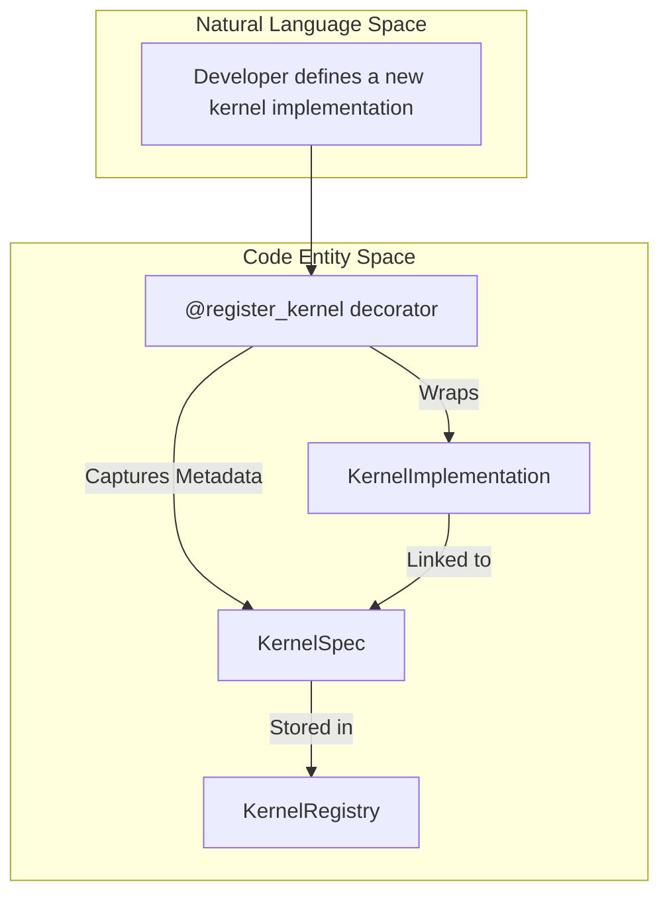
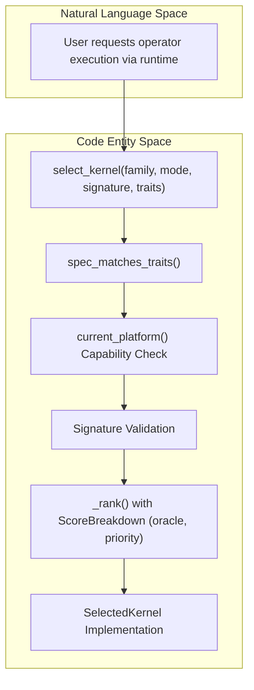
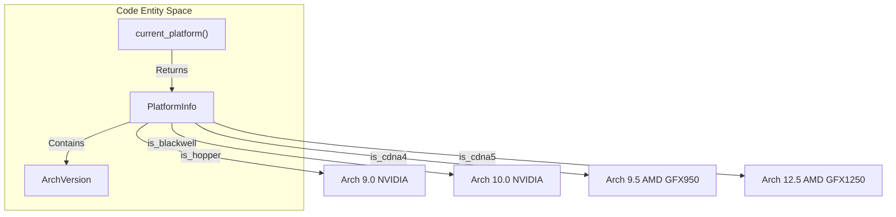

<!-- source: DeepWiki mcp.deepwiki.com · repo lightseekorg/tokenspeed · page 3.1 Kernel Registry and Selection · fetched 2026-10-21 -->

# Kernel Registry and Selection

Relevant source files

The following files were used as context for generating this wiki page:

- [test/ci_system/kernel_benchmark_ci.py](test/ci_system/kernel_benchmark_ci.py)
- [test/ci_system/test_kernel_benchmark_ci.py](test/ci_system/test_kernel_benchmark_ci.py)
- [tokenspeed-kernel-amd/python/tokenspeed_kernel_amd/_triton.py](tokenspeed-kernel-amd/python/tokenspeed_kernel_amd/_triton.py)
- [tokenspeed-kernel-amd/python/tokenspeed_kernel_amd/ops/gfx950/attention/mla/prefill.py](tokenspeed-kernel-amd/python/tokenspeed_kernel_amd/ops/gfx950/attention/mla/prefill.py)
- [tokenspeed-kernel-amd/python/tokenspeed_kernel_amd/ops/gfx950/attention/mla/prefill_8wave.py](tokenspeed-kernel-amd/python/tokenspeed_kernel_amd/ops/gfx950/attention/mla/prefill_8wave.py)
- [tokenspeed-kernel/benchmarks/README.md](tokenspeed-kernel/benchmarks/README.md)
- [tokenspeed-kernel/benchmarks/amd/gfx950.json](tokenspeed-kernel/benchmarks/amd/gfx950.json)
- [tokenspeed-kernel/benchmarks/amd/gfx950/dsv41_flash/gemm.json](tokenspeed-kernel/benchmarks/amd/gfx950/dsv41_flash/gemm.json)
- [tokenspeed-kernel/benchmarks/amd/gfx950/glm53_flash/dsa.json](tokenspeed-kernel/benchmarks/amd/gfx950/glm53_flash/dsa.json)
- [tokenspeed-kernel/benchmarks/amd/gfx950/glm53_flash/kda.json](tokenspeed-kernel/benchmarks/amd/gfx950/glm53_flash/kda.json)
- [tokenspeed-kernel/benchmarks/amd/gfx950/glm53_flash/moe.json](tokenspeed-kernel/benchmarks/amd/gfx950/glm53_flash/moe.json)
- [tokenspeed-kernel/benchmarks/amd/gfx950/kimi_k3/kda.json](tokenspeed-kernel/benchmarks/amd/gfx950/kimi_k3/kda.json)
- [tokenspeed-kernel/benchmarks/amd/gfx950/kimi_k3/mla.json](tokenspeed-kernel/benchmarks/amd/gfx950/kimi_k3/mla.json)
- [tokenspeed-kernel/benchmarks/amd/gfx950/kimi_k3/moe.json](tokenspeed-kernel/benchmarks/amd/gfx950/kimi_k3/moe.json)
- [tokenspeed-kernel/benchmarks/amd/gfx950/kimi_k3/residual.json](tokenspeed-kernel/benchmarks/amd/gfx950/kimi_k3/residual.json)
- [tokenspeed-kernel/python/tokenspeed_kernel/benchmark/ci.py](tokenspeed-kernel/python/tokenspeed_kernel/benchmark/ci.py)
- [tokenspeed-kernel/python/tokenspeed_kernel/benchmark/cli.py](tokenspeed-kernel/python/tokenspeed_kernel/benchmark/cli.py)
- [tokenspeed-kernel/python/tokenspeed_kernel/benchmark/generators/dsa.py](tokenspeed-kernel/python/tokenspeed_kernel/benchmark/generators/dsa.py)
- [tokenspeed-kernel/python/tokenspeed_kernel/benchmark/generators/gemm.py](tokenspeed-kernel/python/tokenspeed_kernel/benchmark/generators/gemm.py)
- [tokenspeed-kernel/python/tokenspeed_kernel/benchmark/generators/kda.py](tokenspeed-kernel/python/tokenspeed_kernel/benchmark/generators/kda.py)
- [tokenspeed-kernel/python/tokenspeed_kernel/benchmark/generators/mla.py](tokenspeed-kernel/python/tokenspeed_kernel/benchmark/generators/mla.py)
- [tokenspeed-kernel/python/tokenspeed_kernel/benchmark/graph.py](tokenspeed-kernel/python/tokenspeed_kernel/benchmark/graph.py)
- [tokenspeed-kernel/python/tokenspeed_kernel/benchmark/harness.py](tokenspeed-kernel/python/tokenspeed_kernel/benchmark/harness.py)
- [tokenspeed-kernel/python/tokenspeed_kernel/numerics/cli.py](tokenspeed-kernel/python/tokenspeed_kernel/numerics/cli.py)
- [tokenspeed-kernel/python/tokenspeed_kernel/selection.py](tokenspeed-kernel/python/tokenspeed_kernel/selection.py)
- [tokenspeed-kernel/python/tokenspeed_kernel/signature.py](tokenspeed-kernel/python/tokenspeed_kernel/signature.py)
- [tokenspeed-kernel/test/amd/ops/attention/test_gluon_mla_prefill_gfx950.py](tokenspeed-kernel/test/amd/ops/attention/test_gluon_mla_prefill_gfx950.py)
- [tokenspeed-kernel/test/conftest.py](tokenspeed-kernel/test/conftest.py)
- [tokenspeed-kernel/test/test_benchmark_ci.py](tokenspeed-kernel/test/test_benchmark_ci.py)
- [tokenspeed-kernel/test/test_benchmark_dsa_generator.py](tokenspeed-kernel/test/test_benchmark_dsa_generator.py)
- [tokenspeed-kernel/test/test_benchmark_graph.py](tokenspeed-kernel/test/test_benchmark_graph.py)
- [tokenspeed-kernel/test/test_benchmark_harness.py](tokenspeed-kernel/test/test_benchmark_harness.py)
- [tokenspeed-kernel/test/test_benchmark_kda_generator.py](tokenspeed-kernel/test/test_benchmark_kda_generator.py)
- [tokenspeed-kernel/test/test_benchmark_mla_generator.py](tokenspeed-kernel/test/test_benchmark_mla_generator.py)
- [tokenspeed-kernel/test/test_registry.py](tokenspeed-kernel/test/test_registry.py)
- [tokenspeed-kernel/test/test_selection.py](tokenspeed-kernel/test/test_selection.py)

The purpose and scope of this section cover the tiered kernel management system implemented in `tokenspeed-kernel`. This system provides portability across diverse hardware backends while maintaining high performance through a centralized registry, priority-banded ranking, an extensible selection oracle, signature validation, numerics verification, a benchmarking CLI, and a robust tuning cache with offline tactic sweeps.

## Kernel Registry Architecture

The registry system centers around `KernelRegistry` and the `@register_kernel` decorator [tokenspeed-kernel/python/tokenspeed_kernel/registry.py:42-135](). This architecture permits developers to define multiple implementations for a single operation (such as attention, GEMM, or quantization) and tag them with hardware capabilities and metadata.

### Priority Bands

Implementations are categorized into priority bands that selection logic uses to rank candidates. These bands are represented in the `Priority` enum:

| Priority Band | Value | Description |
| :--- | :--- | :--- |
| `REFERENCE` | 0 | Correctness reference. Useful for numeric ground truth in tests; never auto-selected if a real implementation exists. |
| `PORTABLE` | 5 | In-tree generic implementations (e.g., default Triton or PyTorch references) with broad coverage. |
| `PERFORMANT` | 10 | Generally optimized kernels (e.g., optimized Triton for Hopper+). The default winner on supported vendors. |
| `SPECIALIZED` | 15 | Highly optimized kernels narrowly gated on architecture and shape (e.g., CuTe DSL for Blackwell or Gluon for AMD GFX950). |
| `VENDOR` | 20 | Optimized libraries provided by hardware vendors (e.g., `flashinfer`, `flash-attn`). |

Sources: [tokenspeed-kernel/python/tokenspeed_kernel/registry.py:28-40]()

### Registration Data Flow

The following diagram illustrates how a kernel implementation moves from developer specification to the global registry structures in code.

**Kernel Registration Flow**

Sources: [tokenspeed-kernel/python/tokenspeed_kernel/registry.py:42-108](), [tokenspeed-kernel/python/tokenspeed_kernel/registry.py:115-135]()

## Runtime Kernel Selection

When the runtime requests an operation via `select_kernel`, the selection engine executes a filtering and ranking process to choose the optimal kernel implementation compatible with `PlatformInfo` and specific operation `traits` [tokenspeed-kernel/python/tokenspeed_kernel/selection.py:270-330]().

### Selection Strategies and Policies

Selection is governed by `SelectionStrategy` and `SelectionPolicy` [tokenspeed-kernel/python/tokenspeed_kernel/selection.py:79-145]():
*   **Strategies**: `HEURISTIC` (instant score-based ranking) or `AUTOTUNE` (runtime benchmarking).
*   **Policies**: `SelectionPolicy` manages per-op overrides mapping `(family, mode)` tuples to specific `SelectionStrategy` instances, alongside global defaults and autotune configuration parameters [tokenspeed-kernel/python/tokenspeed_kernel/selection.py:129-145]().

Sources: [tokenspeed-kernel/python/tokenspeed_kernel/selection.py:79-145]()

### Selection Logic Workflow

1.  **Platform Capability Check**: Queries `current_platform()` (detected via `Platform.detect()`) to ensure hardware satisfies the kernel's `CapabilityRequirement` [tokenspeed-kernel/python/tokenspeed_kernel/platform.py:120-122](), [tokenspeed-kernel/python/tokenspeed_kernel/registry.py:65-70]().
2.  **Trait Filtering**: Filters out kernels using `spec_matches_traits`, verifying that runtime request parameters (such as `head_dim`, `page_size`, or `topk`) match the `frozenset` of supported values defined during registration [tokenspeed-kernel/python/tokenspeed_kernel/selection.py:430-447]().
3.  **Signature Matching**: Verifies input tensor dtypes against registered `signatures` (e.g., `torch.bfloat16` or `torch.float8_e4m3fn`) [tokenspeed-kernel/python/tokenspeed_kernel/selection.py:408-414]().
4.  **Scoring and Ranking**: Ranks candidates using a `ScoreBreakdown` based on lexicographic comparison of `(oracle, priority)` [tokenspeed-kernel/python/tokenspeed_kernel/selection.py:84-98]().

**Kernel Selection Flow**

Sources: [tokenspeed-kernel/python/tokenspeed_kernel/selection.py:270-330](), [tokenspeed-kernel/python/tokenspeed_kernel/registry.py:42-80]()

### Selection Oracles

A `SelectionOracle` provides per-family custom scoring logic to break ties or prefer specific solutions based on runtime traits. Oracles return a score in `[0, 20)` where `10` is neutral, and are registered via `register_oracle(family, oracle)` [tokenspeed-kernel/python/tokenspeed_kernel/selection.py:104-175]().

Sources: [tokenspeed-kernel/python/tokenspeed_kernel/selection.py:104-175]()

## Key Components

| Class/Function | Role |
| :--- | :--- |
| `KernelRegistry` | Global registry holding all registered `KernelSpec` metadata [tokenspeed-kernel/python/tokenspeed_kernel/registry.py:115-135]() |
| `PlatformInfo` | Complete description of a compute platform (vendor, arch, memory, features) [tokenspeed-kernel/platform.py] |
| `register_kernel` | Decorator used to add a function to the registry with metadata [tokenspeed-kernel/python/tokenspeed_kernel/registry.py:42-108]() |
| `select_kernel` | Primary entry point for retrieving a kernel based on runtime traits [tokenspeed-kernel/python/tokenspeed_kernel/selection.py:270-330]() |
| `SelectedKernel` | Wrapper containing the kernel name and callable implementation [tokenspeed-kernel/python/tokenspeed_kernel/selection.py:63-77]() |

Sources: [tokenspeed-kernel/python/tokenspeed_kernel/registry.py:42-108](), [tokenspeed-kernel/python/tokenspeed_kernel/selection.py:270-330]()

## Numerics Verification and Benchmarking Harness

To validate kernel correctness and performance across platforms, `tokenspeed-kernel` provides standalone tools under `tokenspeed_kernel.benchmark` and `tokenspeed_kernel.numerics`.

*   **Benchmarking Harness (`KernelBenchmarkHarness`)**: Manages `BenchmarkRequest` objects, executes preparation generators (`BenchmarkGenerator`), captures timings via graph-based timers, and validates outputs using `PreparedValidation` [tokenspeed-kernel/python/tokenspeed_kernel/benchmark/harness.py:52-150]().
*   **Benchmarking Suites**: JSON suite specifications (such as `gfx950.json`) declare environment requirements, timer iterations, and parameterized case fragments for CI testing [tokenspeed-kernel/benchmarks/amd/gfx950.json:1-25]().

Sources: [tokenspeed-kernel/python/tokenspeed_kernel/benchmark/harness.py:52-150](), [tokenspeed-kernel/benchmarks/amd/gfx950.json:1-25]()

## Tuning Cache and Tactic Sweeps

Tunable kernels profile candidate tactics only while the tuning window is open, defaulting to heuristic tactics otherwise [tokenspeed-kernel/python/tokenspeed_kernel/ops/tuning.py](). 

### Autotuning Lifecycle

1.  **Startup Window**: The runtime opens exactly one tuning window during engine startup around a dummy forward pass, closing it before CUDA-graph capture [tokenspeed-kernel/python/tokenspeed_kernel/ops/tuning.py]().
2.  **Tuning Cache Loading**: Seeds the autotuner from a pre-swept tactic table. Loaded entries win over live profiling to eliminate rank divergence in distributed settings [tokenspeed-kernel/python/tokenspeed_kernel/ops/tuning.py]().
3.  **Process Group Synchronization**: Averages per-tactic profile timings across ranks during the window so that live-tuned shapes converge on a single optimal tactic [tokenspeed-kernel/python/tokenspeed_kernel/ops/tuning.py]().

Sources: [tokenspeed-kernel/python/tokenspeed_kernel/ops/tuning.py]()

## Platform Detection and Dispatch

The `PlatformInfo` class and singleton access via `current_platform()` provide detailed introspection of the compute environment, distinguishing between NVIDIA and AMD architectures [tokenspeed-kernel/python/tokenspeed_kernel/platform.py]().

**Platform Hierarchy**

Sources: [tokenspeed-kernel/python/tokenspeed_kernel/platform.py]()

---

