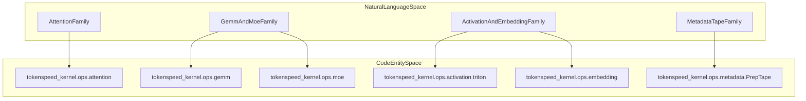
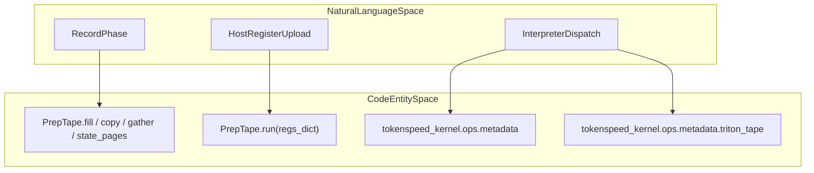

<!-- source: DeepWiki mcp.deepwiki.com · repo lightseekorg/tokenspeed · page 3.2 Kernel Operation Families · fetched 2026-10-21 -->

# Kernel Operation Families

Relevant source files

The following files were used as context for generating this wiki page:

- [python/tokenspeed/runtime/layers/attention/kv_cache/mla.py](python/tokenspeed/runtime/layers/attention/kv_cache/mla.py)
- [python/tokenspeed/runtime/layers/dense/w8a8_fp8.py](python/tokenspeed/runtime/layers/dense/w8a8_fp8.py)
- [python/tokenspeed/runtime/layers/moe/weights/loaders.py](python/tokenspeed/runtime/layers/moe/weights/loaders.py)
- [python/tokenspeed/runtime/layers/rotary_embedding.py](python/tokenspeed/runtime/layers/rotary_embedding.py)
- [python/tokenspeed/runtime/models/utils.py](python/tokenspeed/runtime/models/utils.py)
- [test/runtime/cache/test_mla_kv_buffer.py](test/runtime/cache/test_mla_kv_buffer.py)
- [test/runtime/layers/test_situ_activation.py](test/runtime/layers/test_situ_activation.py)
- [test/runtime/models/test_kimi_k3_attnres_hoist.py](test/runtime/models/test_kimi_k3_attnres_hoist.py)
- [test/runtime/test_fp8_linear_blockscale_flashinfer.py](test/runtime/test_fp8_linear_blockscale_flashinfer.py)
- [test/runtime/test_fp8_pb_wo_loading.py](test/runtime/test_fp8_pb_wo_loading.py)
- [test/runtime/test_hybrid_mla_kv_nan_sanitize.py](test/runtime/test_hybrid_mla_kv_nan_sanitize.py)
- [test/runtime/test_kda_fp8_w8a8.py](test/runtime/test_kda_fp8_w8a8.py)
- [test/runtime/test_mla_project_value_layout_dispatch.py](test/runtime/test_mla_project_value_layout_dispatch.py)
- [tokenspeed-kernel/python/tokenspeed_kernel/ops/activation/__init__.py](tokenspeed-kernel/python/tokenspeed_kernel/ops/activation/__init__.py)
- [tokenspeed-kernel/python/tokenspeed_kernel/ops/activation/triton.py](tokenspeed-kernel/python/tokenspeed_kernel/ops/activation/triton.py)
- [tokenspeed-kernel/python/tokenspeed_kernel/ops/embedding/__init__.py](tokenspeed-kernel/python/tokenspeed_kernel/ops/embedding/__init__.py)
- [tokenspeed-kernel/python/tokenspeed_kernel/ops/embedding/cuda.py](tokenspeed-kernel/python/tokenspeed_kernel/ops/embedding/cuda.py)
- [tokenspeed-kernel/python/tokenspeed_kernel/ops/embedding/triton.py](tokenspeed-kernel/python/tokenspeed_kernel/ops/embedding/triton.py)
- [tokenspeed-kernel/python/tokenspeed_kernel/ops/gemm/triton.py](tokenspeed-kernel/python/tokenspeed_kernel/ops/gemm/triton.py)
- [tokenspeed-kernel/python/tokenspeed_kernel/ops/metadata/ngram_history.py](tokenspeed-kernel/python/tokenspeed_kernel/ops/metadata/ngram_history.py)
- [tokenspeed-kernel/python/tokenspeed_kernel/registry.py](tokenspeed-kernel/python/tokenspeed_kernel/registry.py)
- [tokenspeed-kernel/python/tokenspeed_kernel/thirdparty/cuda/csrc/routing_flash.cu](tokenspeed-kernel/python/tokenspeed_kernel/thirdparty/cuda/csrc/routing_flash.cu)
- [tokenspeed-kernel/test/nvidia/ops/test_activation_pdl.py](tokenspeed-kernel/test/nvidia/ops/test_activation_pdl.py)
- [tokenspeed-kernel/test/ops/activation/test_attnres_split.py](tokenspeed-kernel/test/ops/activation/test_attnres_split.py)
- [tokenspeed-kernel/test/ops/metadata/test_ngram_history.py](tokenspeed-kernel/test/ops/metadata/test_ngram_history.py)
- [tokenspeed-kernel/test/ops/test_activation.py](tokenspeed-kernel/test/ops/test_activation.py)
- [tokenspeed-kernel/test/ops/test_embedding.py](tokenspeed-kernel/test/ops/test_embedding.py)
- [tokenspeed-kernel/test/ops/test_layernorm_dispatch.py](tokenspeed-kernel/test/ops/test_layernorm_dispatch.py)
- [tokenspeed-kernel/test/test_benchmark_gemm_generator.py](tokenspeed-kernel/test/test_benchmark_gemm_generator.py)
- [tokenspeed-kernel/test/utils.py](tokenspeed-kernel/test/utils.py)

The `tokenspeed-kernel` library provides a portable, multi-silicon collection of optimized operator implementations designed for high-performance LLM inference. This page serves as a high-level parent overview of the operator families managed by the kernel registry (`KernelRegistry`), including attention, GEMM, Mixture-of-Experts (MoE), quantization, activation, embedding, KV cache, and declarative metadata tapes.

As a parent wiki page, this overview outlines the major operator groups and directs readers to dedicated child pages for in-depth technical specifications:
* For attention architectures, MHA/MLA facades, and linear attention, see [Attention Kernels](#3.2.1).
* For GEMM backends, MoE routing tiers, and quantization formats, see [GEMM and MoE Kernels](#3.2.2).
* For native CUDA/CuTe-DSL sources, custom fusions, and third-party primitives, see [Fusion and Third-Party CUDA Kernels](#3.2.3).

Sources: [tokenspeed-kernel/python/tokenspeed_kernel/registry.py:40-42]()

---

## High-Level Architecture and Op Family Mapping

Operators within `tokenspeed-kernel` are registered via the `@register_kernel` decorator and selected dynamically at runtime through the `select_kernel` oracle based on input signatures, hardware capabilities, and execution traits.

Diagram: "Op Family to Code Entity Mapping"

Sources: [tokenspeed-kernel/python/tokenspeed_kernel/registry.py:40-44](), [tokenspeed-kernel/python/tokenspeed_kernel/ops/embedding/__init__.py:25-27]()

---

## Attention Operation Family

The attention family unifies multi-head attention (MHA), group-query attention (GQA), relative-position attention, and Multi-Head Latent Attention (MLA) under a common dispatch facade. It supports prefill, extend, and decode execution modes across hardware backends including FlashAttention, FlashInfer, Triton, and custom CUDA/CuTe-DSL sources.

For comprehensive details on attention plans, backend shims, DSA/QSA indexing, MSA, KDA, and gated-delta-rule linear attention, see [Attention Kernels](#3.2.1).

Sources: [tokenspeed-kernel/python/tokenspeed_kernel/ops/attention/__init__.py:31-35]()

---

## GEMM and Mixture-of-Experts (MoE) Families

GEMM operations form the backbone of dense projections, MLPs, and attention key-value-query linear transformations, integrating optimized backends for FP16, BF16, FP8 (`float8_e4m3fn`, `float8_e5m2`), and block-scaled formats (`nvfp4`, `mxfp4`, `mxfp8`).

The MoE family manages expert routing (sigmoid/softmax top-k), expert-parallel communication (DeepEP), and specialized execution tiers such as latent decode/tail compute and Kimi3-specific projections.

For full technical details on GEMM backends, MoE routing stacks, and quantization formats, see [GEMM and MoE Kernels](#3.2.2).

Sources: [tokenspeed-kernel/python/tokenspeed_kernel/ops/gemm/triton.py:41-88](), [tokenspeed-kernel/python/tokenspeed_kernel/ops/embedding/__init__.py:38-48]()

---

## Activation and Normalization Family

The activation family provides fused Triton and CUDA kernels designed for gated linear units (GLUs) and model-specific activation variants. Key functions include:
* `silu_and_mul`: Fused SwiGLU computation with optional clamping and limit thresholds [tokenspeed-kernel/python/tokenspeed_kernel/ops/activation/triton.py:38-38]().
* `sigmoid_mul`: In-place element-wise product `x *= sigmoid(gate)` supporting 2D and strided 3D views from packed QKV chunks [tokenspeed-kernel/python/tokenspeed_kernel/ops/activation/triton.py:37-37](), [tokenspeed-kernel/python/tokenspeed_kernel/ops/activation/triton.py:168-178]().
* `fused_gate_sigmoid_mul_add`: Fused reduction and addition for shared-expert MoE paths (`final_hidden_states += sigmoid(hidden_states @ gate_weight) * shared_output`) [tokenspeed-kernel/python/tokenspeed_kernel/ops/activation/triton.py:33-33](), [tokenspeed-kernel/python/tokenspeed_kernel/ops/activation/triton.py:83-92]().

Sources: [tokenspeed-kernel/python/tokenspeed_kernel/ops/activation/triton.py:31-41]()

---

## Embedding and Rotary Positional Embedding Family

The embedding family manages token embedding lookups and rotary positional embeddings (RoPE). The core entrypoint `apply_rope` supports both NEOX half-split and GPT-J interleaved-pair rotation formats across Triton and CUDA implementations [tokenspeed-kernel/python/tokenspeed_kernel/ops/embedding/__init__.py:50-89]().
* **Fused KV Cache Writing**: `_rope_apply_kernel` and associated buffer argument dataclasses (`FusedSetKVBufferArg`, `FusedMLASetKVBufferArg`) permit writing rotated K (or MLA latent components) directly into paged KV buffers during RoPE execution, minimizing memory roundtrips [tokenspeed-kernel/python/tokenspeed_kernel/ops/embedding/triton.py:48-96](), [tokenspeed-kernel/python/tokenspeed_kernel/ops/embedding/__init__.py:29-48]().

Sources: [tokenspeed-kernel/python/tokenspeed_kernel/ops/embedding/__init__.py:29-65](), [tokenspeed-kernel/python/tokenspeed_kernel/ops/embedding/triton.py:48-96]()

---

## Quantization and Conversion Family

Quantization routines handle online and offline weight/activation conversions for reduced-precision inference.
* `quantize_fp8`: Casts BF16/FP16 tensors to `torch.float8_e4m3fn` or `torch.float8_e5m2` with optional per-tensor or per-block scaling factors, supporting Hopper+ Programmatic Dependent Launch.
* Block-scaled formats (`nvfp4`, `mxfp4`, `mxfp8`) are integrated directly into the GEMM dispatcher and quantization module registry [tokenspeed-kernel/python/tokenspeed_kernel/ops/gemm/triton.py:41-88]().

Sources: [tokenspeed-kernel/python/tokenspeed_kernel/ops/gemm/triton.py:41-88]()

---

## Metadata Tapes and Declarative Replay Family

To eliminate host-side CPU launch overhead during CUDA graph replays, `tokenspeed-kernel` provides declarative metadata tapes.

Diagram: "Metadata Tape Execution Flow"

Sources: [tokenspeed-kernel/python/tokenspeed_kernel/registry.py:40-44]()

* **Operation Mechanics**: Instead of issuing tens of individual tiny CUDA fills, copies, and gathers before every graph replay, a metadata tape records the descriptor chain once against persistent buffer pointers.
* **Execution**: Each step uploads register states via small host-to-device transfers and launches a lightweight portable interpreter kernel that processes operations (`FILL`, `COPY`, `GATHER`, `COPY2D`, `FILLTAIL`, `STATE_PAGES`) independently across stages separated by explicit barriers.

Sources: [tokenspeed-kernel/python/tokenspeed_kernel/registry.py:40-44]()

---

## Fusion and Third-Party Kernels

The library houses custom CUDA/CuTe-DSL source extensions under `tokenspeed-kernel/python/tokenspeed_kernel/thirdparty/cuda/csrc/` for advanced model architectures.

For full technical coverage of fused operations (such as `attn_res` forward, DeepSeek router GEMMs and top-k operators, fused top-k/top-p sampling, MNNVL allreduce fusions, hyperconnections, and latent MoE tail primitives), see [Fusion and Third-Party CUDA Kernels](#3.2.3).

Sources: [tokenspeed-kernel/python/tokenspeed_kernel/thirdparty/cuda/csrc/routing_flash.cu:1-1]()

---

