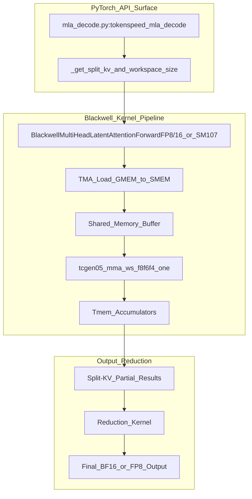
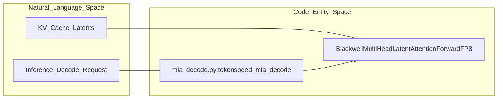
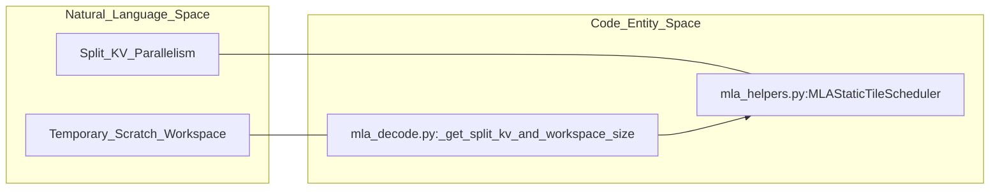

<!-- source: DeepWiki mcp.deepwiki.com · repo lightseekorg/tokenspeed · page 4.1 MLA Decode Kernels · fetched 2026-10-21 -->

# MLA Decode Kernels

Relevant source files

The following files were used as context for generating this wiki page:

- [test/ci/ut/ut-tokenspeed-kernel-nvidia-arm.yaml](test/ci/ut/ut-tokenspeed-kernel-nvidia-arm.yaml)
- [tokenspeed-mla/README.md](tokenspeed-mla/README.md)
- [tokenspeed-mla/python/tokenspeed_mla/fmha.py](tokenspeed-mla/python/tokenspeed_mla/fmha.py)
- [tokenspeed-mla/python/tokenspeed_mla/mla_decode.py](tokenspeed-mla/python/tokenspeed_mla/mla_decode.py)
- [tokenspeed-mla/python/tokenspeed_mla/mla_decode_fp16.py](tokenspeed-mla/python/tokenspeed_mla/mla_decode_fp16.py)
- [tokenspeed-mla/python/tokenspeed_mla/mla_decode_fp8.py](tokenspeed-mla/python/tokenspeed_mla/mla_decode_fp8.py)
- [tokenspeed-mla/python/tokenspeed_mla/mla_decode_fp8_sm107.py](tokenspeed-mla/python/tokenspeed_mla/mla_decode_fp8_sm107.py)
- [tokenspeed-mla/python/tokenspeed_mla/mla_helpers.py](tokenspeed-mla/python/tokenspeed_mla/mla_helpers.py)
- [tokenspeed-mla/python/tokenspeed_mla/mla_helpers_sm107.py](tokenspeed-mla/python/tokenspeed_mla/mla_helpers_sm107.py)
- [tokenspeed-mla/tests/test_mla_decode.py](tokenspeed-mla/tests/test_mla_decode.py)

The Multi-Head Latent Attention (MLA) decode kernels in `tokenspeed-mla` provide high-performance CUDA implementations optimized for NVIDIA Blackwell (`SM100/SM103/SM107`) architectures [tokenspeed-mla/README.md:3-3](). These kernels handle the inference-time decoding phase of MLA-based models (such as DeepSeek V3/V4), utilizing the CuTe DSL to manage complex memory layouts, data movement, warp specialization, and split-KV reductions [tokenspeed-mla/python/tokenspeed_mla/mla_decode.py:21-27]().

---

## Core Implementation Classes

The primary logic for MLA decoding is encapsulated in template classes exposed through the CuTe DSL. These classes implement the forward pass for decoding by fetching latent vectors, performing matrix multiplications for query/key/value projections, and applying attention [tokenspeed-mla/python/tokenspeed_mla/mla_decode_fp16.py:84-98]().

### BlackwellMultiHeadLatentAttentionForwardFP16
This class handles FP16 and BF16 precision decoding [tokenspeed-mla/python/tokenspeed_mla/mla_decode_fp16.py:151-165](). It manages the loading of compressed KV latent vectors and performs the necessary up-projections within the kernel, supporting persistent scheduling and variable sequence lengths [tokenspeed-mla/python/tokenspeed_mla/mla_decode_fp16.py:160-164]().

### BlackwellMultiHeadLatentAttentionForwardFP8
Specifically tuned for Blackwell's native FP8 support, this class implements the forward pass using `Float8E4M3FN` [tokenspeed-mla/python/tokenspeed_mla/mla_decode_fp8.py:128-135](). To maintain downstream stability, the FP8 decode path writes results in BF16 [tokenspeed-mla/README.md:10-11](). It utilizes Blackwell-specific tensor core instructions, such as `tcgen05_mma_ws`, to perform warp-specialized matrix multiplications [tokenspeed-mla/python/tokenspeed_mla/mla_decode_fp8.py:109-125]().

### Sm107MultiHeadLatentAttentionForwardFP8
Designed for SM107 targets via `mla_decode_fp8_sm107.py`, this implementation supports mixed 4-CTA/2-CTA clusters, cluster launch control (CLC), and packed-row layouts where queries are packed as `q_tok * num_heads + head` across M256 tiles (`SM107_MLA_M_TILE`) [tokenspeed-mla/python/tokenspeed_mla/mla_decode_fp8_sm107.py:29-45]().

| Feature | FP16/BF16 Implementation | FP8 Implementation (SM100/SM103) | SM107 FP8 Implementation |
| :--- | :--- | :--- | :--- |
| **Class Name** | `BlackwellMultiHeadLatentAttentionForwardFP16` | `BlackwellMultiHeadLatentAttentionForwardFP8` | `Sm107MultiHeadLatentAttentionForwardFP8` |
| **Input Precision** | `torch.float16`, `torch.bfloat16` | `torch.float8_e4m3fn` | `torch.float8_e4m3fn` |
| **Output Precision** | Matches Input | `torch.bfloat16` | `torch.float8_e4m3fn` or `torch.bfloat16` |
| **Tiling (QK / PV)** | `(128, 128)` / `(128, 256)` | `(128, 128)` / `(128, 256)` or `(64, 128)` / `(64, 256)` | M256 tiles (`SM107_MLA_M_TILE`) [tokenspeed-mla/python/tokenspeed_mla/mla_decode_fp8_sm107.py:83-84]() |

Sources: [tokenspeed-mla/python/tokenspeed_mla/mla_decode.py:37-41](), [tokenspeed-mla/python/tokenspeed_mla/mla_helpers.py:36-60](), [tokenspeed-mla/README.md:10-12](), [tokenspeed-mla/python/tokenspeed_mla/mla_decode_fp8_sm107.py:21-45]()

---

## Split-KV Workspace Sizing and Reducer Parallelism

To handle long sequence lengths during decoding, the MLA kernels support a **Split-KV** mechanism. This allows multiple thread blocks to work on different parts of the KV cache for a single request.

* **Auto-Sizing**: The function `_get_split_kv_and_workspace_size` calculates the required temporary workspace size and split count based on the batch size, query length, number of heads, latent rank, and max active blocks [tokenspeed-mla/python/tokenspeed_mla/mla_decode.py:89-137]().
* **Nonempty Partition Normalization**: For FP8 inputs, uniform K partitions are normalized before sizing the workspace so that launch grids, scratch strides, and reducers use the same nonempty split count [tokenspeed-mla/python/tokenspeed_mla/mla_decode.py:123-129]().
* **Reducer Tile Optimization**: The function `_get_reducer_d_tiles` computes whether to use 1 or 2 D512 bands for real output rows and split counts to minimize waves per output band [tokenspeed-mla/python/tokenspeed_mla/mla_decode.py:63-80]().
* **Workspace Requirements**: For packed queries under auto split-KV, workspace needs `B * 128 * ceil(H * q_len / 128) * split_kv * 513 * 4` bytes for D512/FP32 partials, or zero when split-KV is 1 [tokenspeed-mla/README.md:100-104]().

Sources: [tokenspeed-mla/python/tokenspeed_mla/mla_decode.py:57-137](), [tokenspeed-mla/README.md:100-104]()

---

## CuTe DSL Pipeline and DCP Decode

The kernels leverage the **CuTe DSL** to define a structured pipeline for data movement between Global Memory (GMEM), Shared Memory (SMEM), and Registers (RF).

### Warp Specialization and Query Folding
1. **Warp Specialization**: Kernels are implemented as TMA + TensorCore warp-specialized persistent kernels, assigning distinct warps to load, MMA, softmax, correction, and epilogue phases [tokenspeed-mla/python/tokenspeed_mla/mla_decode_fp8.py:130-149]().
2. **Query Folding**: To improve tile utilization when `num_heads < 128`, the runtime uses `fold_sq_factor` computed via `get_mla_decode_fold_sq_factor` to fold query tokens into the head axis [tokenspeed-mla/README.md:68-86](), [tokenspeed-mla/python/tokenspeed_mla/mla_helpers.py:80-92]().
3. **Packed Query Options**: The wrapper accepts `enable_packed_q=True` to opt into continuous query/head packing on FP8 and FP16/BF16 M128 paths, ordering rows as `query_token * num_heads + head` [tokenspeed-mla/README.md:87-92]().
4. **DCP and Masking Support**: Decode-Context-Parallel (DCP) and sliding-window maskings are supported via explicit row positions and global-coordinate causal predicate handling [tokenspeed-mla/README.md:110-112](), [tokenspeed-mla/python/tokenspeed_mla/mla_decode_fp8_sm107.py:40-52]().

### Data Flow Diagram: MLA Decode Pipeline

**Figure 1: MLA Decode Data Flow**

Sources: [tokenspeed-mla/python/tokenspeed_mla/mla_decode.py:88-137](), [tokenspeed-mla/python/tokenspeed_mla/mla_decode_fp8.py:109-135](), [tokenspeed-mla/README.md:10-12]()

---

## PyTorch-Compatible API Surface

The functionality is exposed to the TokenSpeed runtime through `mla_decode.py`, acting as the bridge between the high-level Python execution engine and the low-level CuTe DSL kernels [tokenspeed-mla/python/tokenspeed_mla/mla_decode.py:21-27]().

### Key API Components

| Entity | Role |
| :--- | :--- |
| `tokenspeed_mla_decode` | The primary PyTorch-compatible entry point function for invoking the MLA decode kernel [tokenspeed-mla/python/tokenspeed_mla/mla_decode.py]() |
| `_get_split_kv_and_workspace_size` | Cached helper returning split counts and workspace size bytes [tokenspeed-mla/python/tokenspeed_mla/mla_decode.py:88-137]() |
| `_check_can_implement` | Validates kernel support configuration against hardware capabilities [tokenspeed-mla/python/tokenspeed_mla/mla_decode.py:140-186]() |
| `MLAStaticTileScheduler` | Manages work distribution across the GPU grid in persistent or non-persistent modes [tokenspeed-mla/python/tokenspeed_mla/mla_helpers.py:94-167]() |
| `MLAStaticTileSchedulerParams` | Dataclass holding scheduling parameters like problem shapes and split-KV divisors [tokenspeed-mla/python/tokenspeed_mla/mla_helpers.py:94-167]() |

Sources: [tokenspeed-mla/python/tokenspeed_mla/mla_decode.py:21-186](), [tokenspeed-mla/python/tokenspeed_mla/mla_helpers.py:94-167]()

### Natural Language to Code Mapping (Requests & Kernels)

**Figure 2: Conceptual to Code Mapping — Request Execution**

Sources: [tokenspeed-mla/python/tokenspeed_mla/mla_decode.py:21-27](), [tokenspeed-mla/python/tokenspeed_mla/mla_decode_fp8.py:128-135]()

### Natural Language to Code Mapping (Workspace & Scheduling)

**Figure 3: Conceptual to Code Mapping — Workspace Sizing and Scheduling**

Sources: [tokenspeed-mla/python/tokenspeed_mla/mla_decode.py:88-137](), [tokenspeed-mla/python/tokenspeed_mla/mla_helpers.py:94-167]()

---

## Backend Integration
The `CuteDSLMLABackend` in the TokenSpeed runtime orchestrates these kernels for Blackwell GPUs [python/tokenspeed/runtime/layers/attention/backends/tokenspeed_mla.py:97-102](). It manages metadata such as `block_kv_indices` and `seq_lens_k` via the `CuteDSLMLADecodeMetadata` dataclass [python/tokenspeed/runtime/layers/attention/backends/tokenspeed_mla.py:86-93](), coordinating scratch space pooling to prevent allocation overhead during iterative generation.

Sources: [python/tokenspeed/runtime/layers/attention/backends/tokenspeed_mla.py:86-146]()

---

