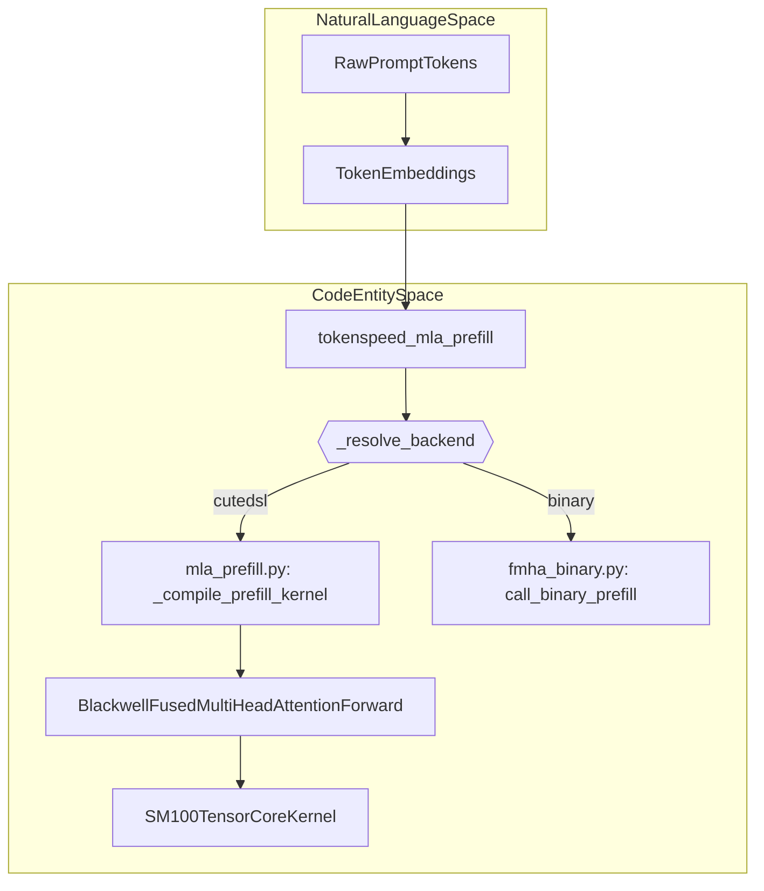
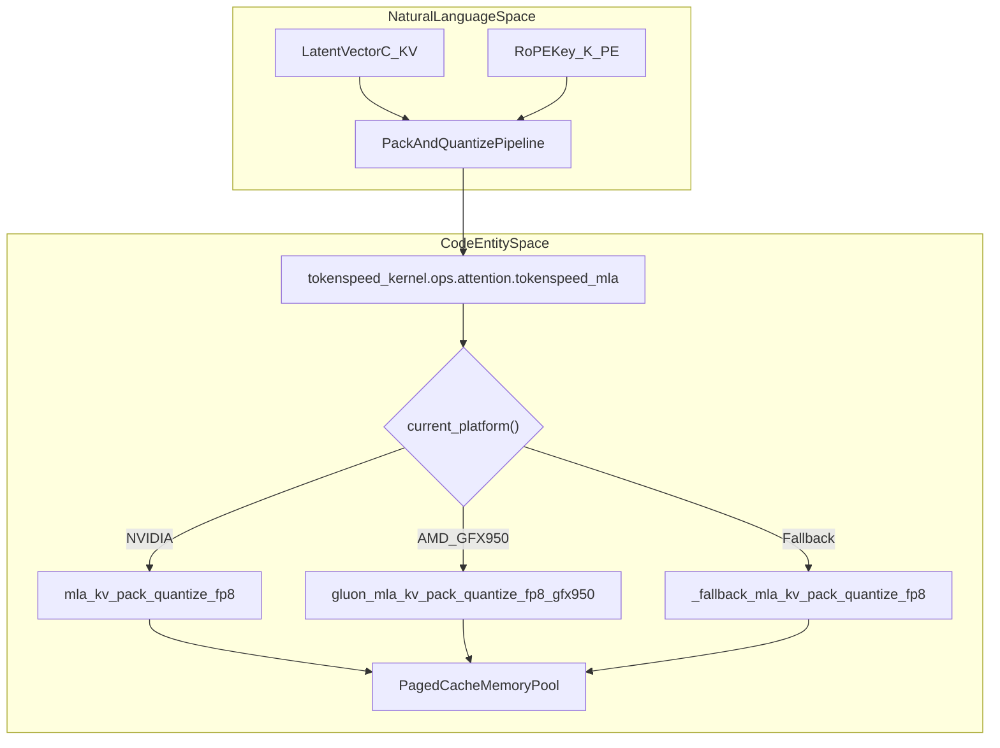

<!-- source: DeepWiki mcp.deepwiki.com · repo lightseekorg/tokenspeed · page 4.2 MLA Prefill and Helpers · fetched 2026-10-21 -->

# MLA Prefill and Helpers

Relevant source files

The following files were used as context for generating this wiki page:

- [.github/workflows/update-tokenspeed-kernel-amd-dependency.yml](.github/workflows/update-tokenspeed-kernel-amd-dependency.yml)
- [.github/workflows/update-tokenspeed-kernel-amd-version.yml](.github/workflows/update-tokenspeed-kernel-amd-version.yml)
- [tokenspeed-kernel-amd/pyproject.toml](tokenspeed-kernel-amd/pyproject.toml)
- [tokenspeed-kernel-amd/python/tokenspeed_kernel_amd/_scheduling.py](tokenspeed-kernel-amd/python/tokenspeed_kernel_amd/_scheduling.py)
- [tokenspeed-kernel-amd/python/tokenspeed_kernel_amd/ops/gfx950/attention/mla/extend.py](tokenspeed-kernel-amd/python/tokenspeed_kernel_amd/ops/gfx950/attention/mla/extend.py)
- [tokenspeed-kernel-amd/python/tokenspeed_kernel_amd/sched_barrier.ll](tokenspeed-kernel-amd/python/tokenspeed_kernel_amd/sched_barrier.ll)
- [tokenspeed-kernel/python/requirements/rocm.txt](tokenspeed-kernel/python/requirements/rocm.txt)
- [tokenspeed-kernel/python/tokenspeed_kernel/ops/attention/mla/__init__.py](tokenspeed-kernel/python/tokenspeed_kernel/ops/attention/mla/__init__.py)
- [tokenspeed-kernel/python/tokenspeed_kernel/ops/attention/mla/gluon.py](tokenspeed-kernel/python/tokenspeed_kernel/ops/attention/mla/gluon.py)
- [tokenspeed-kernel/test/amd/ops/attention/test_gluon_mla_extend_gfx950.py](tokenspeed-kernel/test/amd/ops/attention/test_gluon_mla_extend_gfx950.py)
- [tokenspeed-kernel/test/amd/ops/moe/test_mxfp8_contracts.py](tokenspeed-kernel/test/amd/ops/moe/test_mxfp8_contracts.py)
- [tokenspeed-kernel/test/amd/test_scheduling.py](tokenspeed-kernel/test/amd/test_scheduling.py)
- [tokenspeed-kernel/test/amd/test_scheduling_gfx950.py](tokenspeed-kernel/test/amd/test_scheduling_gfx950.py)
- [tokenspeed-kernel/test/nvidia/ops/test_tokenspeed_mla.py](tokenspeed-kernel/test/nvidia/ops/test_tokenspeed_mla.py)
- [tokenspeed-mla/pyproject.toml](tokenspeed-mla/pyproject.toml)
- [tokenspeed-mla/python/tokenspeed_mla/__init__.py](tokenspeed-mla/python/tokenspeed_mla/__init__.py)
- [tokenspeed-mla/python/tokenspeed_mla/mla_prefill.py](tokenspeed-mla/python/tokenspeed_mla/mla_prefill.py)

This page covers the technical architecture of prefill-stage Multi-Head Latent Attention (MLA) kernels, KV cache packing/quantization, helper utilities, release validation workflows, and fallback shim paths implemented across the `tokenspeed-mla` package and `tokenspeed-kernel` module.

---

## 1. Prefill Orchestration and Backend Selection (`mla_prefill.py`)

The prefill stage processes prompt sequences using Fused Multi-Head Attention (FMHA) optimized for Blackwell (`SM100`/`SM103`/`SM107`) hardware. The top-level orchestrator in `tokenspeed-mla/python/tokenspeed_mla/mla_prefill.py` manages execution via two backends selected through the `TOKENSPEED_MLA_PREFILL_BACKEND` environment variable:
- **`cutedsl`**: The default JIT-compiled CuTe DSL backend (`BlackwellFusedMultiHeadAttentionForward`) supporting ragged varlen prefill without padding `[tokenspeed-mla/python/tokenspeed_mla/mla_prefill.py:41-70]()`.
- **`binary`**: An AOT-compiled binary backend that loads pre-compiled `.so` modules via TVM-FFI `[tokenspeed-mla/python/tokenspeed_mla/mla_prefill.py:61-70]()`.

Compilation of the JIT prefill kernel uses symbolic tensor shapes (`cute.sym_int()`) to allow variable batch sizes and sequence lengths without recompiling `[tokenspeed-mla/python/tokenspeed_mla/mla_prefill.py:85-118]()`.

### Prefill Dispatch Architecture

*Sources: `tokenspeed-mla/python/tokenspeed_mla/mla_prefill.py:41-70`, `tokenspeed-mla/python/tokenspeed_mla/mla_prefill.py:85-118`*

---

## 2. KV Pack, FP8 Quantization, and Kernel Shim Fallbacks

To minimize memory bandwidth during chunked prefill, raw latent vectors $c_{KV}$ and decoupled rotary keys $k_{rope}$ must be packed and quantized into FP8 formats (`torch.float8_e4m3fn` or `torch.float8_e5m2`).

### Kernel Shim and Platform Routing
The `tokenspeed-kernel` package exposes MLA primitives under `tokenspeed_kernel.ops.attention.tokenspeed_mla`. The runtime router detects the active hardware platform and binds the corresponding implementation or fallback `[tokenspeed-kernel/python/tokenspeed_kernel/ops/attention/mla/__init__.py:48-68]()`:
- **NVIDIA Blackwell**: Binds native `tokenspeed_mla` library methods (`tokenspeed_mla_prefill`, `tokenspeed_mla_decode`, `mla_kv_pack_quantize_fp8`) wrapped with Processor Dependent Launch (PDL) defaults `[tokenspeed-kernel/python/tokenspeed_kernel/ops/attention/mla/__init__.py:52-67]()`.
- **AMD CDNA4 (GFX950/GFX1250)**: Binds Gluon-based GFX950 operations (`gluon_mla_kv_pack_quantize_fp8_gfx950`) via `tokenspeed_kernel.ops.attention.mla.gluon` `[tokenspeed-kernel/python/tokenspeed_kernel/ops/attention/mla/gluon.py:38-77]()`.
- **Fallback Path**: If platform-specific packages are unavailable, it defaults to Python/PyTorch reference implementations located in `tokenspeed_kernel.ops.attention.tokenspeed_mla.fallback` `[tokenspeed-kernel/python/tokenspeed_kernel/ops/attention/mla/__init__.py:25-27]()`.

### KV Cache Store & Pack Pipeline

*Sources: `tokenspeed-kernel/python/tokenspeed_kernel/ops/attention/mla/__init__.py:25-68`, `tokenspeed-kernel/python/tokenspeed_kernel/ops/attention/mla/gluon.py:38-77`, `tokenspeed-kernel/test/nvidia/ops/test_tokenspeed_mla.py:74-105`*

---

## 3. MLA Helpers and Tile Scheduling (`mla_helpers.py`)

The helper library `tokenspeed-mla/python/tokenspeed_mla/mla_helpers.py` provides configuration selectors, query folding logic, and static tile schedulers for Blackwell inference kernels.

### Key Functions and Classes
- **`select_mla_decode_tilers`**: Determines decode MMA tile shapes based on `num_heads`, `seq_len_q`, and compute capability. For SM100 FP8 configurations with small head-token products, it selects `(64, 128)` tiles instead of the default `(128, 128)`.
- **`get_mla_decode_fold_sq_factor`**: Computes the largest query-token fold factor $F$ that divides `seq_len_q` such that `num_heads * F <= 128`, improving TensorCore utilization in small-head agentic workloads.
- **`MLAStaticTileSchedulerParams` & `WorkTileInfo`**: Manages persistent kernel work distribution and `split_kv` parameters across streaming multiprocessors (SMs).

*Sources: `tokenspeed-mla/python/tokenspeed_mla/mla_helpers.py`*

---

## 4. Release Checks and Dependency Maintenance Workflows

To ensure consistency across the monorepo packages (`tokenspeed-mla`, `tokenspeed-kernel-amd`, `tokenspeed-kernel`), automated GitHub Actions workflows govern version synchronization and package validation.

| Workflow File | Purpose / Trigger | Key Operations |
| :--- | :--- | :--- |
| `update-tokenspeed-kernel-amd-dependency.yml` | Manual dispatch (`workflow_dispatch`) | Validates published `tokenspeed-kernel-amd` versions on PyPI and updates constraints in `rocm-thirdparty.txt` and `setup.py` [`.github/workflows/update-tokenspeed-kernel-amd-dependency.yml:1-125]() |
| `update-tokenspeed-kernel-amd-version.yml` | Manual dispatch (`workflow_dispatch`) | Bumps `pyproject.toml` package versions for AMD kernels, runs pre-commit checks, and opens PRs via `lightseek-bot` [`.github/workflows/update-tokenspeed-kernel-amd-version.yml:1-150]() |

*Sources: `.github/workflows/update-tokenspeed-kernel-amd-dependency.yml:1-125`, `.github/workflows/update-tokenspeed-kernel-amd-version.yml:1-150`*

---

