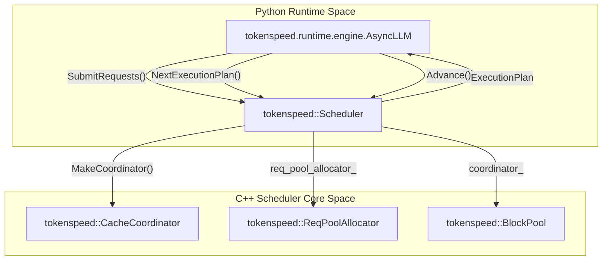
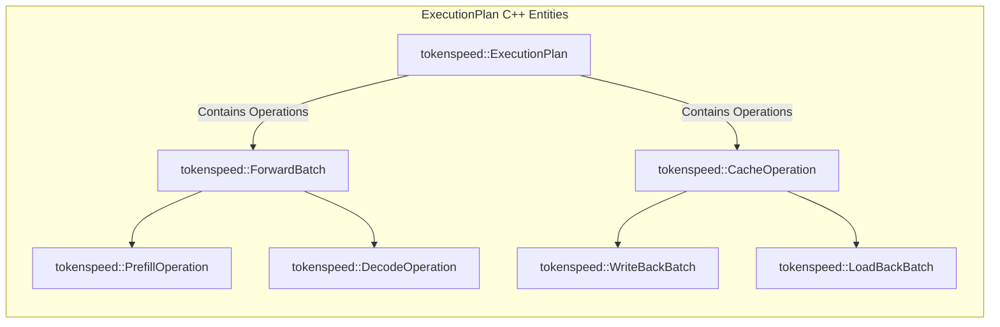
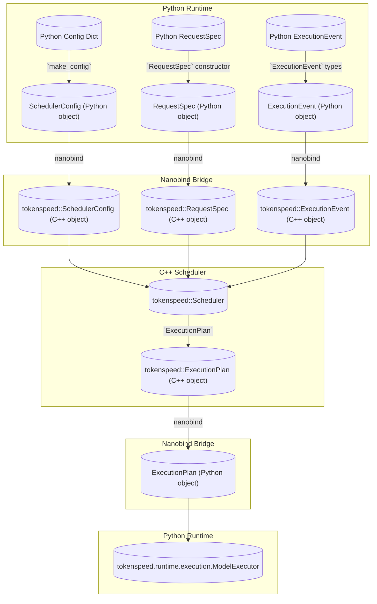

<!-- source: DeepWiki mcp.deepwiki.com · repo lightseekorg/tokenspeed · page 5.1 Scheduler Core and Execution Planning · fetched 2026-10-21 -->

# Scheduler Core and Execution Planning

Relevant source files

The following files were used as context for generating this wiki page:

- [docs/design/scheduler.md](docs/design/scheduler.md)
- [python/tokenspeed/runtime/engine/event_loop.py](python/tokenspeed/runtime/engine/event_loop.py)
- [python/tokenspeed/runtime/engine/scheduler_utils.py](python/tokenspeed/runtime/engine/scheduler_utils.py)
- [python/tokenspeed/runtime/execution/model_executor.py](python/tokenspeed/runtime/execution/model_executor.py)
- [python/tokenspeed/runtime/layers/attention/deepseek_v4_ops.py](python/tokenspeed/runtime/layers/attention/deepseek_v4_ops.py)
- [python/tokenspeed/runtime/models/deepseek_v4.py](python/tokenspeed/runtime/models/deepseek_v4.py)
- [python/tokenspeed/runtime/utils/env.py](python/tokenspeed/runtime/utils/env.py)
- [test/runtime/test_aligned_max_scheduled_tokens.py](test/runtime/test_aligned_max_scheduled_tokens.py)
- [test/runtime/test_deepseek_v4_config.py](test/runtime/test_deepseek_v4_config.py)
- [tokenspeed-scheduler/CMakeLists.txt](tokenspeed-scheduler/CMakeLists.txt)
- [tokenspeed-scheduler/bindings/python_module.cpp](tokenspeed-scheduler/bindings/python_module.cpp)
- [tokenspeed-scheduler/csrc/cache/coordinator/cache_coordinator.cpp](tokenspeed-scheduler/csrc/cache/coordinator/cache_coordinator.cpp)
- [tokenspeed-scheduler/csrc/cache/coordinator/cache_coordinator.h](tokenspeed-scheduler/csrc/cache/coordinator/cache_coordinator.h)
- [tokenspeed-scheduler/csrc/cache/core/cache_types.h](tokenspeed-scheduler/csrc/cache/core/cache_types.h)
- [tokenspeed-scheduler/csrc/fsm/forward_events.cpp](tokenspeed-scheduler/csrc/fsm/forward_events.cpp)
- [tokenspeed-scheduler/csrc/fsm/forward_events.h](tokenspeed-scheduler/csrc/fsm/forward_events.h)
- [tokenspeed-scheduler/csrc/fsm/forward_states.h](tokenspeed-scheduler/csrc/fsm/forward_states.h)
- [tokenspeed-scheduler/csrc/scheduler/operations/forward.cpp](tokenspeed-scheduler/csrc/scheduler/operations/forward.cpp)
- [tokenspeed-scheduler/csrc/scheduler/outside_event_handler.cpp](tokenspeed-scheduler/csrc/scheduler/outside_event_handler.cpp)
- [tokenspeed-scheduler/csrc/scheduler/request.cpp](tokenspeed-scheduler/csrc/scheduler/request.cpp)
- [tokenspeed-scheduler/csrc/scheduler/request.h](tokenspeed-scheduler/csrc/scheduler/request.h)
- [tokenspeed-scheduler/csrc/scheduler/request_spec.h](tokenspeed-scheduler/csrc/scheduler/request_spec.h)
- [tokenspeed-scheduler/csrc/scheduler/scheduler.cpp](tokenspeed-scheduler/csrc/scheduler/scheduler.cpp)
- [tokenspeed-scheduler/csrc/scheduler/scheduler.h](tokenspeed-scheduler/csrc/scheduler/scheduler.h)
- [tokenspeed-scheduler/csrc/scheduler/types.h](tokenspeed-scheduler/csrc/scheduler/types.h)
- [tokenspeed-scheduler/python/tests/test_kv_cache.py](tokenspeed-scheduler/python/tests/test_kv_cache.py)
- [tokenspeed-scheduler/tests/cpp/cache_test_access.h](tokenspeed-scheduler/tests/cpp/cache_test_access.h)
- [tokenspeed-scheduler/tests/cpp/test_cache_coordinator.cpp](tokenspeed-scheduler/tests/cpp/test_cache_coordinator.cpp)
- [tokenspeed-scheduler/tests/cpp/test_cache_operations.cpp](tokenspeed-scheduler/tests/cpp/test_cache_operations.cpp)
- [tokenspeed-scheduler/tests/cpp/test_cache_scenarios.cpp](tokenspeed-scheduler/tests/cpp/test_cache_scenarios.cpp)
- [tokenspeed-scheduler/tests/cpp/test_outside_event_handler.cpp](tokenspeed-scheduler/tests/cpp/test_outside_event_handler.cpp)

## Purpose and Scope
This page details the core architecture and implementation of the C++ scheduler library (`tokenspeed-scheduler`) and its integration with the Python runtime via `nanobind` bindings. It covers the `Scheduler` class API (`SubmitRequests`, `NextExecutionPlan`, `Advance`), execution plan structures, operation types (forward, writeback, loadback), chunked prefill admission control with head-of-line holding, outside event handling, and the Python-side `scheduler_utils` bridge.

---

## 1. Scheduler Class API and Lifecycle

The `Scheduler` class [tokenspeed-scheduler/csrc/scheduler/scheduler.h:50-85]() manages request states, KV cache memory allocation via the `CacheCoordinator`, and continuous batching execution planning.

### Key API Functions
*   **`SubmitRequests`**: Ingests new `RequestSpec` objects into the scheduler queue [tokenspeed-scheduler/csrc/scheduler/scheduler.cpp:211-213]().
*   **`NextExecutionPlan`**: Evaluates all active requests, memory availability, and hardware constraints to generate the next batch `ExecutionPlan` [tokenspeed-scheduler/csrc/scheduler/scheduler.cpp:215-217]().
*   **`Advance`**: Updates request finite-state machines (FSM) using an `ExecutionEvent` (e.g., token IDs, completion, aborts) [tokenspeed-scheduler/csrc/scheduler/scheduler.cpp:322-324]().
*   **`DrainKvEvents`**: Collects asynchronous `KvCacheEvent` objects (such as `BlockStored` or `BlockRemoved`) [tokenspeed-scheduler/csrc/scheduler/scheduler.cpp:139-162]().
*   **`ClearCache` / `ClearL1Cache`**: Flushes device L1 and host L2 prefix indexes [tokenspeed-scheduler/csrc/scheduler/scheduler.cpp:341-365]().

### Continuous Batching Data Flow (Code Entity Mapping)

*Sources: [tokenspeed-scheduler/csrc/scheduler/scheduler.h:50-85](), [tokenspeed-scheduler/csrc/scheduler/scheduler.cpp:75-105](), [tokenspeed-scheduler/csrc/scheduler/scheduler.cpp:139-162]()*

---

## 2. Execution Planning and Operation Types

The scheduler translates batching decisions into specific operation structures contained within an `ExecutionPlan`.

### Operation Types
1.  **`ForwardOperation`**: Divided into `PrefillOperation` and `DecodeOperation`, defining inputs, request pool indices, and physical `block_tables` [tokenspeed-scheduler/csrc/scheduler/operations/forward.h:44-84]().
2.  **`WriteBackOperation`**: Moves KV cache blocks from device GPU memory to host memory [tokenspeed-scheduler/csrc/scheduler/operations/cache.h:35-42]().
3.  **`LoadBackOperation`**: Fetches KV cache blocks from host memory back into device memory [tokenspeed-scheduler/csrc/scheduler/operations/cache.h:44-49]().

### Plan Construction Entities

*Sources: [tokenspeed-scheduler/csrc/scheduler/execution_plan.h:21-45](), [tokenspeed-scheduler/csrc/scheduler/operations/cache.h:35-49]()*

---

## 3. Chunked Prefill, Head-of-Line, and Admission Control

Prompts are processed in chunks bounded by `max_scheduled_tokens` (`--chunked-prefill-size`) [docs/design/scheduler.md:12-19]().

### Admission Mechanics and Alignment
*   **Chunk Alignment**: `AlignPrefillChunk` shortens a chunk so it ends on a prefix-page boundary (or on a promotion boundary), because a page is the unit of prefix caching [docs/design/scheduler.md:77-81]().
*   **Decode Reserve**: For full-history groups, the chunk that completes the prompt reserves `decode_input_tokens` to guarantee a slot for the first decode step. Sliding-window groups reserve only the decode slot. Snapshot-state groups reserve at least one growth block on a decoding role's completing chunk or remote landing [docs/design/scheduler.md:87-102]().
*   **Head-of-Line Holding**: `holdsHeadOfLine` [tokenspeed-scheduler/csrc/scheduler/operations/forward.cpp:70-72]() breaks the candidate loop after scheduling a chunk of a prefill that is still incomplete, preventing other requests from being scheduled in the same round [docs/design/scheduler.md:114-117]().
*   **State-Checkpoint Tail Lookahead**: For Mamba and hybrid architectures, `shouldSplitFinalStateCheckpoint` banks final state checkpoint pages in advance [docs/design/scheduler.md:69-80]().

*Sources: [tokenspeed-scheduler/csrc/scheduler/operations/forward.cpp:59-121](), [docs/design/scheduler.md:1-120](), [tokenspeed-scheduler/csrc/scheduler/operations/forward.cpp:70-72](), [docs/design/scheduler.md:77-81](), [docs/design/scheduler.md:87-102](), [docs/design/scheduler.md:114-117]()*

---

## 4. Outside Event Handler and Cache Operations

The scheduler processes asynchronous external events through the `ExecutionEvent` system and cache mutation handlers.

*   **`ExecutionEvent`**: Ingests external completion or control signals (e.g., `cache::WriteBackDone`, `forward::Abort`, `pd::BootstrappedEvent`) in deterministic insertion order [tokenspeed-scheduler/tests/cpp/test_outside_event_handler.cpp:25-35]().
*   **Cache Mutation Sink**: Connected via `coordinator_.SetCacheMutationSink`, the scheduler monitors block storage and removal to trigger host/device synchronization [tokenspeed-scheduler/csrc/scheduler/scheduler.cpp:96-100]().

*Sources: [tokenspeed-scheduler/csrc/scheduler/execution_event.h:21-40](), [tokenspeed-scheduler/tests/cpp/test_outside_event_handler.cpp:25-115](), [tokenspeed-scheduler/csrc/scheduler/scheduler.cpp:96-100]()*

---

## 5. Python-Side Bridge (`scheduler_utils`) and Nanobind Bindings

The Python integration layer (`python/tokenspeed/runtime/engine/scheduler_utils.py`) maps high-level configuration parameters and memory geometry onto scheduler-compatible structures.

### Key Python Bridge Functions
*   `engram_context_len`: Selects caller-owned Engram inputs, not Qwen4's LCM-owned PLE state [python/tokenspeed/runtime/engine/scheduler_utils.py:65-72]().
*   `ngram_inputs_for_forward`: Snapshots one bounded seed window per request, including empty prefills, for the executor to seed/reset its accepted input tail [python/tokenspeed/runtime/engine/scheduler_utils.py:75-114]().
*   `input_logprob_plan_for_forward`: Names the prompt rows of a forward pass whose next-token logprob is wanted [python/tokenspeed/runtime/engine/scheduler_utils.py:117-170]().
*   `make_config`: Instantiates and validates C++ `SchedulerConfig` objects from Python configuration dictionaries [python/tokenspeed/runtime/engine/scheduler_utils.py:158-184]().

### Nanobind Extension Surface
The C++ extension module exposes scheduler structures via `tokenspeed_scheduler_ext`, wrapping `SchedulerConfig`, `RequestSpec`, and event variants [tokenspeed-scheduler/bindings/python_module.cpp:72-140]().

*Sources: [python/tokenspeed/runtime/engine/scheduler_utils.py:1-184](), [tokenspeed-scheduler/bindings/python_module.cpp:72-140](), [python/tokenspeed/runtime/engine/scheduler_utils.py:65-72](), [python/tokenspeed/runtime/engine/scheduler_utils.py:75-114](), [python/tokenspeed/runtime/engine/scheduler_utils.py:117-170]()*

---

