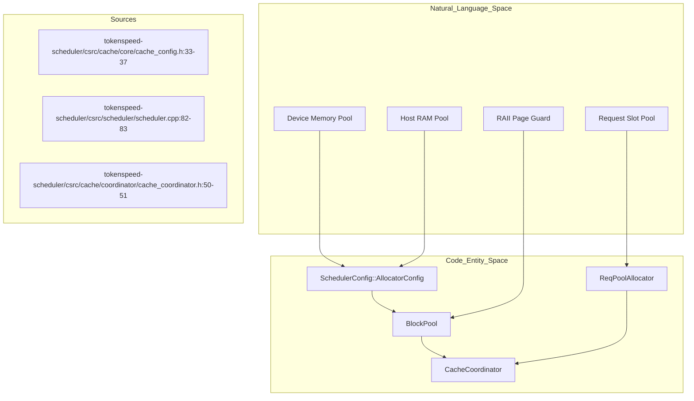
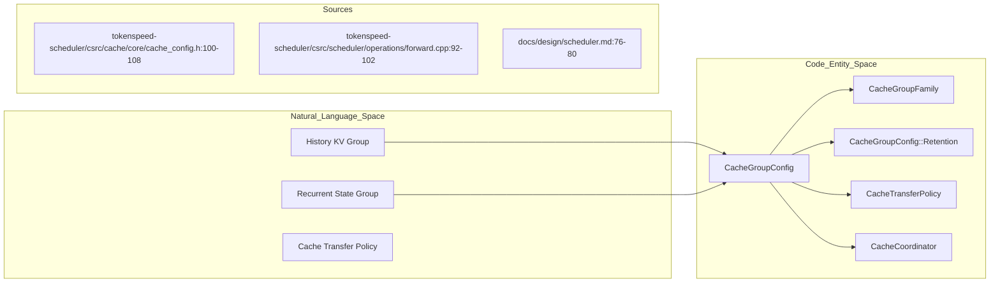

<!-- source: DeepWiki mcp.deepwiki.com · repo lightseekorg/tokenspeed · page 5.2 Resource Management and Prefix Cache · fetched 2026-10-21 -->

# Resource Management and Prefix Cache

<details>
<summary>Relevant source files</summary>

The following files were used as context for generating this wiki page:

- [docs/design/scheduler.md](docs/design/scheduler.md)
- [tokenspeed-scheduler/csrc/cache/coordinator/cache_coordinator.cpp](tokenspeed-scheduler/csrc/cache/coordinator/cache_coordinator.cpp)
- [tokenspeed-scheduler/csrc/cache/coordinator/cache_coordinator.h](tokenspeed-scheduler/csrc/cache/coordinator/cache_coordinator.h)
- [tokenspeed-scheduler/csrc/cache/core/cache_config.h](tokenspeed-scheduler/csrc/cache/core/cache_config.h)
- [tokenspeed-scheduler/csrc/cache/core/cache_types.h](tokenspeed-scheduler/csrc/cache/core/cache_types.h)
- [tokenspeed-scheduler/csrc/fsm/forward_events.cpp](tokenspeed-scheduler/csrc/fsm/forward_events.cpp)
- [tokenspeed-scheduler/csrc/fsm/forward_events.h](tokenspeed-scheduler/csrc/fsm/forward_events.h)
- [tokenspeed-scheduler/csrc/fsm/forward_states.h](tokenspeed-scheduler/csrc/fsm/forward_states.h)
- [tokenspeed-scheduler/csrc/scheduler/capacity_model.cpp](tokenspeed-scheduler/csrc/scheduler/capacity_model.cpp)
- [tokenspeed-scheduler/csrc/scheduler/operations/cache.cpp](tokenspeed-scheduler/csrc/scheduler/operations/cache.cpp)
- [tokenspeed-scheduler/csrc/scheduler/operations/forward.cpp](tokenspeed-scheduler/csrc/scheduler/operations/forward.cpp)
- [tokenspeed-scheduler/csrc/scheduler/operations/group_demands.cpp](tokenspeed-scheduler/csrc/scheduler/operations/group_demands.cpp)
- [tokenspeed-scheduler/csrc/scheduler/operations/group_demands.h](tokenspeed-scheduler/csrc/scheduler/operations/group_demands.h)
- [tokenspeed-scheduler/csrc/scheduler/outside_event_handler.cpp](tokenspeed-scheduler/csrc/scheduler/outside_event_handler.cpp)
- [tokenspeed-scheduler/csrc/scheduler/request.cpp](tokenspeed-scheduler/csrc/scheduler/request.cpp)
- [tokenspeed-scheduler/csrc/scheduler/request.h](tokenspeed-scheduler/csrc/scheduler/request.h)
- [tokenspeed-scheduler/csrc/scheduler/request_spec.h](tokenspeed-scheduler/csrc/scheduler/request_spec.h)
- [tokenspeed-scheduler/csrc/scheduler/scheduler.cpp](tokenspeed-scheduler/csrc/scheduler/scheduler.cpp)
- [tokenspeed-scheduler/csrc/scheduler/scheduler.h](tokenspeed-scheduler/csrc/scheduler/scheduler.h)
- [tokenspeed-scheduler/csrc/scheduler/types.cpp](tokenspeed-scheduler/csrc/scheduler/types.cpp)
- [tokenspeed-scheduler/tests/cpp/cache_test_access.h](tokenspeed-scheduler/tests/cpp/cache_test_access.h)
- [tokenspeed-scheduler/tests/cpp/test_cache_coordinator.cpp](tokenspeed-scheduler/tests/cpp/test_cache_coordinator.cpp)
- [tokenspeed-scheduler/tests/cpp/test_cache_operations.cpp](tokenspeed-scheduler/tests/cpp/test_cache_operations.cpp)
- [tokenspeed-scheduler/tests/cpp/test_cache_scenarios.cpp](tokenspeed-scheduler/tests/cpp/test_cache_scenarios.cpp)
- [tokenspeed-scheduler/tests/cpp/test_capacity_model.cpp](tokenspeed-scheduler/tests/cpp/test_capacity_model.cpp)
- [tokenspeed-scheduler/tests/cpp/test_forward_cache_ops.cpp](tokenspeed-scheduler/tests/cpp/test_forward_cache_ops.cpp)
- [tokenspeed-scheduler/tests/cpp/test_outside_event_handler.cpp](tokenspeed-scheduler/tests/cpp/test_outside_event_handler.cpp)

</details>


This page details the C++ resource management subsystem within `tokenspeed-scheduler`. This layer handles physical memory allocation, KV cache prefix caching via radix trees, block tables, request-pool indices, and hybrid cache group coordination for Transformer, Mamba, and Multi-Head Latent Attention (MLA) model architectures.

## Page Allocators and Memory Pools

The scheduler manages memory through specialized allocators configured in `SchedulerConfig` [tokenspeed-scheduler/csrc/scheduler/types.h:31-40](). Physical memory pages for device and host tiers are managed via discrete pool allocators that track availability and enforce ownership boundaries.

### Key Components

| Class / Structure | Description |
| :--- | :--- |
| `SchedulerConfig::AllocatorConfig` | Defines total and usable page counts, where page index `0` acts as a null placeholder [tokenspeed-scheduler/csrc/cache/core/cache_config.h:33-37](). |
| `BlockPool` | Manages device LCM blocks and page availability within the `Scheduler` instance [tokenspeed-scheduler/csrc/scheduler/scheduler.cpp:82-83](). |
| `CacheCoordinator` | Coordinates multi-group allocations, block tables, and prefix matching across cache groups [tokenspeed-scheduler/csrc/cache/coordinator/cache_coordinator.h:50-51](). |
| `ReqPoolAllocator` | Manages a pool of request slots, assigning a unique index to each active request [tokenspeed-scheduler/csrc/scheduler/scheduler.cpp:82-83](). |

### Diagram: Memory Pool and Allocator Entities
This diagram maps natural language memory management concepts to concrete code entities in the scheduler core.



**Sources:**
- Allocator config and pool bounds: [tokenspeed-scheduler/csrc/cache/core/cache_config.h:33-37]()
- Scheduler pool initialization: [tokenspeed-scheduler/csrc/scheduler/scheduler.cpp:82-83]()
- CacheCoordinator definition: [tokenspeed-scheduler/csrc/cache/coordinator/cache_coordinator.h:50-51]()

---

## Hybrid Prefix Cache and Cache Groups

TokenSpeed supports hybrid architectures (such as Kimi K3 and DeepSeek models with Mamba/KDA state groups alongside standard history groups) by organizing resources into distinct `CacheGroupConfig` definitions [tokenspeed-scheduler/csrc/cache/core/cache_config.h:100-101]().

### Cache Group Families and Policies
*   **Families**: `CacheGroupFamily::History` requires full history chains from token zero, whereas `CacheGroupFamily::State` tracks recurrent state windows [tokenspeed-scheduler/csrc/cache/core/cache_config.h:100-101]().
*   **Retention**: Configured via `CacheGroupConfig::Retention::FullHistory` or `CacheGroupConfig::Retention::SlidingWindow` [tokenspeed-scheduler/csrc/cache/core/cache_config.h:100-101]().
*   **Transfer Policies**: Governed by `CacheTransferPolicy` (`FullSuffix` or `LatestSnapshot`) for disaggregated prefill-decode (PD) deployments [tokenspeed-scheduler/csrc/cache/core/cache_config.h:100-101]().

### State Checkpoint Tails and Alignment
For recurrent-state architectures, `classifyCompletedStateBoundaries` ensures that prompt prefill chunks correctly align with state block boundaries [tokenspeed-scheduler/csrc/scheduler/operations/forward.cpp:92-102](). Auxiliary functions such as `AlignPrefillChunk` enforce chunk sizing to prevent prefix-cache reuse from degrading to zero [docs/design/scheduler.md:76-80]().

### Diagram: Hybrid Prefix Cache and Group Entities
This diagram maps hybrid cache concepts to their corresponding C++ and Python bindings.



**Sources:**
- Cache group configuration: [tokenspeed-scheduler/csrc/cache/core/cache_config.h:100-101]()
- State checkpoint classification: [tokenspeed-scheduler/csrc/scheduler/operations/forward.cpp:92-102]()
- Aligned scheduled tokens utility: [docs/design/scheduler.md:76-80]()

---

## ReqPoolAllocator and Request Lifecycle

The `ReqPoolAllocator` manages slot indices for active inference requests, allocating a unique position within the batch for each admitted prompt [tokenspeed-scheduler/csrc/scheduler/scheduler.cpp:82-83]().

### Admission and Request States
When requests are submitted, they transition through finite-state machine (FSM) states managed by event handlers [tokenspeed-scheduler/csrc/fsm/forward_events.cpp:32-77]().
*   `SchedulePrefillFirstChunkEvent::scheduleFirstChunk` allocates a `ReqPoolIndex` and assigns initial block tables [tokenspeed-scheduler/csrc/fsm/forward_events.cpp:32-46]().
*   `FinishEvent::finish` and `AbortEvent::abortForward` release the corresponding request pool slots and associated cache blocks back to the allocators [tokenspeed-scheduler/csrc/fsm/forward_events.cpp:115-116](), [tokenspeed-scheduler/csrc/fsm/forward_events.cpp:143-146]().

### Diagram: Request Pool Allocation Flow
```mermaid
graph TD
  subgraph "Event_Space"
    SPFCE["SchedulePrefillFirstChunkEvent"]
    FinishEv["FinishEvent"]
    AbortEv["AbortEvent"]
  end

  subgraph "Allocator_Space"
    RPA["ReqPoolAllocator"]
    Slot["ReqPoolIndex"]
  end

  SPFCE -->| "Allocate()" | RPA
  RPA -->| "Returns" | Slot
  FinishEv -->| "FreeRequest" | RPA
  AbortEv -->| "FreeRequest" | RPA

  subgraph "Sources"
    S5["tokenspeed-scheduler/csrc/scheduler/scheduler.cpp:82-83"]
    S6["tokenspeed-scheduler/csrc/fsm/forward_events.cpp:32-46"]
    S7["tokenspeed-scheduler/csrc/fsm/forward_events.cpp:115-116"]
    S8["tokenspeed-scheduler/csrc/fsm/forward_events.cpp:143-146"]
  end
```

**Sources:**
- Request pool allocator initialization: [tokenspeed-scheduler/csrc/scheduler/scheduler.cpp:82-83]()
- First chunk scheduling and pool allocation: [tokenspeed-scheduler/csrc/fsm/forward_events.cpp:32-46]()
- Finish event releases resources: [tokenspeed-scheduler/csrc/fsm/forward_events.cpp:115-116]()
- Abort event releases resources: [tokenspeed-scheduler/csrc/fsm/forward_events.cpp:143-146]()

---

## Chunked Prefill Admission and Head-of-Line Blocking

Prompts are prefilled in chunks bounded by `max_scheduled_tokens` [docs/design/scheduler.md:12-14](). Capacity is admitted per chunk rather than for the entire prompt up front [docs/design/scheduler.md:15-19]().

### Head-of-Line Rule
To prevent half-prefilled prompts from being starved of capacity by incoming requests, `holdsHeadOfLine` restricts the scheduler from processing further candidates behind an incomplete prefill that lacks a reserved state checkpoint tail [tokenspeed-scheduler/csrc/scheduler/operations/forward.cpp:71-74](). This ensures memory safety while limiting queue latency.

**Sources:**
- Chunked prefill and admission rules: [docs/design/scheduler.md:1-117]()
- Head-of-line helper implementation: [tokenspeed-scheduler/csrc/scheduler/operations/forward.cpp:71-74]()

---

## Resource Lifecycle Data Flow

The sequence below illustrates the coordination between the scheduler, cache coordinator, and allocators during request admission and prefix matching.

```mermaid
sequenceDiagram
    participant Sched as "Scheduler"
    participant Coord as "CacheCoordinator"
    participant Pool as "BlockPool"
    participant FSM as "Request FSM"

    Sched->>Coord: "AdmitChunk / MatchPrefix"
    alt "Sufficient Capacity"
        Coord->>Pool: "AcquireBlock(group_id)"
        Pool-->>Coord: "CacheBlockRef"
        Coord-->>Sched: "Admission Success"
        Sched->>FSM: "Apply(SchedulePrefillFirstChunkEvent)"
        FSM->>FSM: "Transition to Prefilling / Decoding"
    else "Capacity Exhausted"
        Coord-->>Sched: "Admission Failed"
        Sched->>Sched: "Trigger maybeRetractForCapacity"
    end

    subgraph "Sources"
        note over Sched, FSM: tokenspeed-scheduler/csrc/scheduler/scheduler.cpp:116-140, tokenspeed-scheduler/csrc/scheduler/operations/forward.cpp:71-121, tokenspeed-scheduler/csrc/fsm/forward_events.cpp:32-46
    end
```

**Sources:**
- Scheduler build operations: [tokenspeed-scheduler/csrc/scheduler/scheduler.cpp:116-140]()
- Forward operations and cache coordination: [tokenspeed-scheduler/csrc/scheduler/operations/forward.cpp:71-121]()
- FSM state transitions for prefill: [tokenspeed-scheduler/csrc/fsm/forward_events.cpp:32-46]()

---

