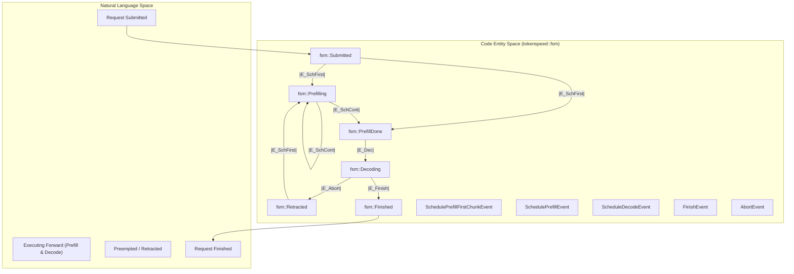
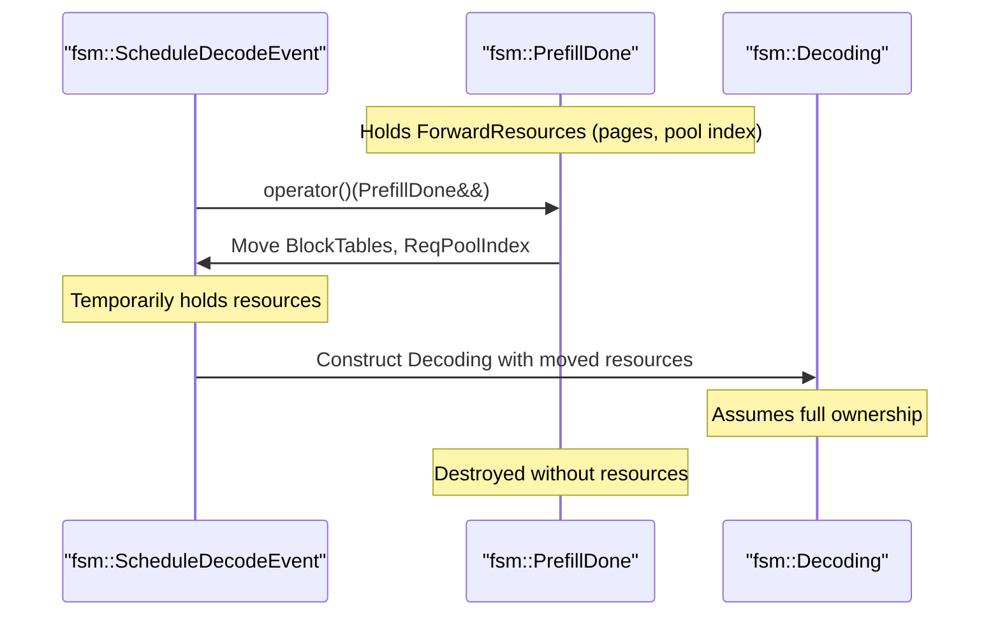

<!-- source: DeepWiki mcp.deepwiki.com · repo lightseekorg/tokenspeed · page 5.3 FSM and Request State Machine · fetched 2026-10-21 -->

# FSM and Request State Machine

Relevant source files

The following files were used as context for generating this wiki page:

- [docs/design/scheduler.md](docs/design/scheduler.md)
- [tokenspeed-scheduler/csrc/cache/coordinator/cache_coordinator.cpp](tokenspeed-scheduler/csrc/cache/coordinator/cache_coordinator.cpp)
- [tokenspeed-scheduler/csrc/cache/coordinator/cache_coordinator.h](tokenspeed-scheduler/csrc/cache/coordinator/cache_coordinator.h)
- [tokenspeed-scheduler/csrc/cache/core/cache_types.h](tokenspeed-scheduler/csrc/cache/core/cache_types.h)
- [tokenspeed-scheduler/csrc/fsm/forward_events.cpp](tokenspeed-scheduler/csrc/fsm/forward_events.cpp)
- [tokenspeed-scheduler/csrc/fsm/forward_events.h](tokenspeed-scheduler/csrc/fsm/forward_events.h)
- [tokenspeed-scheduler/csrc/fsm/forward_states.h](tokenspeed-scheduler/csrc/fsm/forward_states.h)
- [tokenspeed-scheduler/csrc/scheduler/operations/forward.cpp](tokenspeed-scheduler/csrc/scheduler/operations/forward.cpp)
- [tokenspeed-scheduler/csrc/scheduler/outside_event_handler.cpp](tokenspeed-scheduler/csrc/scheduler/outside_event_handler.cpp)
- [tokenspeed-scheduler/csrc/scheduler/request.cpp](tokenspeed-scheduler/csrc/scheduler/request.cpp)
- [tokenspeed-scheduler/csrc/scheduler/request.h](tokenspeed-scheduler/csrc/scheduler/request.h)
- [tokenspeed-scheduler/csrc/scheduler/request_spec.h](tokenspeed-scheduler/csrc/scheduler/request_spec.h)
- [tokenspeed-scheduler/csrc/scheduler/scheduler.cpp](tokenspeed-scheduler/csrc/scheduler/scheduler.cpp)
- [tokenspeed-scheduler/csrc/scheduler/scheduler.h](tokenspeed-scheduler/csrc/scheduler/scheduler.h)
- [tokenspeed-scheduler/tests/cpp/cache_test_access.h](tokenspeed-scheduler/tests/cpp/cache_test_access.h)
- [tokenspeed-scheduler/tests/cpp/test_cache_coordinator.cpp](tokenspeed-scheduler/tests/cpp/test_cache_coordinator.cpp)
- [tokenspeed-scheduler/tests/cpp/test_cache_operations.cpp](tokenspeed-scheduler/tests/cpp/test_cache_operations.cpp)
- [tokenspeed-scheduler/tests/cpp/test_cache_scenarios.cpp](tokenspeed-scheduler/tests/cpp/test_cache_scenarios.cpp)
- [tokenspeed-scheduler/tests/cpp/test_outside_event_handler.cpp](tokenspeed-scheduler/tests/cpp/test_outside_event_handler.cpp)

## Purpose and Scope

This page details the finite-state machine (FSM) architecture governing the inference request lifecycle within the `tokenspeed-scheduler` package. The scheduler separates state transitions from execution planning and event processing, ensuring deterministic and modular handling of complex request flows such as multi-chunk prefill, prefix cache sharing, retraction/preemption, and prefill-decode (PD) disaggregation.

This FSM underlies how individual inference requests move through the forward execution pipeline, how cache states are tracked for each request, and how PD roles coordinate disaggregated prefill and decode workloads.

Sources:  
- `tokenspeed-scheduler/csrc/scheduler/request.h:40-90`  
- `tokenspeed-scheduler/csrc/fsm/forward_states.h:37-142`  

---

## Core State Subsystems

The request lifecycle FSM operates across three interconnected subsystems:

### 1. Forward Execution States (`fsm/forward_states.h`)

The forward states represent the phases of request processing from submission through token generation and completion. They are stored in a `std::variant` inside the `Request` class. Key states include:

- **Submitted**: Initial request state immediately after submission. It holds a pointer to the `TokenContainer` and the scheduler-wide `prefix_granularity`. No KV pages are held yet.  
  Defined: `fsm::Submitted` [tokenspeed-scheduler/csrc/fsm/forward_states.h:88-98]

- **ForwardResources (Base Bundle)**: A move-only struct that aggregates ownership of resources a page-holding state manages:
  - Pointer to `TokenContainer` (model input tokens).  
  - Vector of `BlockTable` per cache group: physical memory pages allocated.
  - CacheProgress tracking prefix hashes and checkpoint boundaries.
  - Request pool index (for pooling request data structures).  
  - Count of scheduled but incomplete forward results (`results_in_flight`).

  This bundle moves atomically between states ensuring RAII resource transfer.  
  Defined: `fsm::ForwardResources` [tokenspeed-scheduler/csrc/fsm/forward_states.h:105-132]

- **Prefilling**: Active state where a prefill chunk is being computed. Holds a `TokenContainer::Window` representing the prompt segment under computation. Tracks chunk boundaries and reserved token budgets.  
  Defined: `fsm::Prefilling` [tokenspeed-scheduler/csrc/fsm/forward_states.h:133-143]

- **PrefillDone**: Terminal prefill state indicating the prompt has been fully prefetched and is ready for decode. It still owns forward resources.  
  Defined via transition returns in `fsm/forward_events.cpp`.

- **Decoding**: State where autoregressive token generation occurs. It holds input tokens reserved for decode steps and maintains the forward resources.  
  Defined via transition returns in `fsm/forward_events.cpp`.

- **Retracted**: Preemption state releasing device resources but retaining prompt history for efficient re-submission. Retracted requests are readmitted later with adjusted budgets and cache state.  
  Defined: `fsm::Retracted` [tokenspeed-scheduler/csrc/scheduler/request.h:60-90]

- **Finished**: Terminal state marking request completion or abortion. Releases resources permanently.  
  Defined in `fsm/forward_events.cpp`.

### 2. Cache State and Progress (`CacheProgress`)

Each request maintains a `CacheProgress` struct tracking:

- **Prefix Hashes**: The accumulated hash chain of all known prefix pages computed by this request, used to identify cache hits and publish resumable boundaries.  
- **Materialized State Boundaries**: Aligned checkpoints of cached partial states, allowing reuse and recovery on prefill and decode boundaries.  
- **Promotion Boundary Tokens**: Tokens marking a boundary that, when reached, cause promotion of cache pages to higher persistence.

This mechanism governs when prefetched cache pages can be safely published and retained across chunk boundaries.  
Defined: `fsm::CacheProgress` [tokenspeed-scheduler/csrc/fsm/forward_states.h:40-70]

---

## State Transition Logic and Event Types

Transitions between the above states are driven by explicit event types encapsulated as structs implementing visitor overloads on states. These event types are grouped under:

- **ForwardEvents**: Events related to the forward execution phase — starting prefill chunks, continuing them, decoding, finishing, or aborting [tokenspeed-scheduler/csrc/fsm/forward_events.cpp].
- **CacheEvents**: Events modifying or reporting cache state progress (not detailed here).
- **PDEvents**: Events for the disaggregated prefill-decode subsystem [tokenspeed-scheduler/csrc/fsm/pd_events.h, not shown].

The main `Request` object applies these events to its internal `std::variant` state via `Apply(event)` [tokenspeed-scheduler/csrc/scheduler/request.h:109-114].

### Main Request State Transitions

The typical lifecycle of a request progresses as follows:

This diagram illustrates:

- A request is `Submitted` and scheduled for its first prefill chunk via `SchedulePrefillFirstChunkEvent`.
- The request moves to `Prefilling` or directly to `PrefillDone` if the prompt is fully prefetched.
- Partial prefill chunks cause repeated transitions through `Prefilling` states via `SchedulePrefillEvent`.
- After prefill completes, decoding proceeds (`Decoding` state) via `ScheduleDecodeEvent`.
- A decoding request finishes cleanly via `FinishEvent`.
- If aborted or retracted (e.g., due to preemption or capacity), the request enters `Retracted`.
- A retracted request may be readmitted for prefill again.

Sources:  
- `tokenspeed-scheduler/csrc/fsm/forward_events.cpp:21-175`  
- `tokenspeed-scheduler/csrc/scheduler/request.h:109-130`  

---

## Resource Ownership and RAII Movement

Key to the design is that all resource handles related to a request's forward execution (memory pages, request pool slots, cache progress) are bundled in the `ForwardResources` struct and moved atomically between states. This prevents resource leaks and ensures the scheduler always knows who "owns" the device blocks at any time.

For example, when applying a `ScheduleDecodeEvent` to a `PrefillDone` state, the operator moves `BlockTable` vectors and request pool indices out of the old state into the new `Decoding` state. The old state is then destroyed without owning any resources.

**Sequence Diagram: Resource Transfer in a Prefill-to-Decode Transition**

This pattern recurs for all state transitions that transfer the ownership of device/cache resources along with cache progress and control data.

Sources:  
- `tokenspeed-scheduler/csrc/fsm/forward_states.h:90-105`  
- `tokenspeed-scheduler/csrc/fsm/forward_events.cpp:90-120`  

---

## Disaggregated Prefill-Decode (PD) and Outside Event Handling

The system supports disaggregated prefill and decode roles, where remote transfer and validation of prefix cache pages coordinate between separate runtime components. These external PD events cause transitions signaled by asynchronous callbacks on the scheduler.

Key outside events handled in `Scheduler::handleEvent(...)` include:

- **pd::BootstrappedEvent**: Marks that bootstrapping (initial prompt loading) finished; transitions requests from `Bootstrapping` to `Submitted` [scheduler/outside_event_handler.cpp:38-43].
- **pd::RemotePrefillDoneEvent**: Notifies that a remote prefill page transfer completed, triggering a transition from `RemotePrefilling` to `PrefillDone` or a similar state [scheduler/outside_event_handler.cpp:64-81].
- **forward::Finish**: Signals that a forward operation finished, publishing completed prefix cache pages into the `CacheCoordinator` and transitioning the request state with a `FinishEvent` [scheduler/outside_event_handler.cpp:82-97].
- **forward::Abort**: Indicates an abort request; the scheduler performs cleanup and transitions the affected request to `Finished` with `AbortEvent` [scheduler/outside_event_handler.cpp:138-148].

Publishing completed pages involves computing updated prefix hashes and sending them to the `CacheCoordinator` for cache persistence and eviction management. The scheduler queues any resulting host-side write-back operations for asynchronous storage.

Sources:  
- `tokenspeed-scheduler/csrc/scheduler/outside_event_handler.cpp:37-157`  
- `tokenspeed-scheduler/csrc/fsm/forward_events.cpp:80-170`  

---

## Summary

The FSM of the scheduler governs the entire lifespan of an inference request through:

- A layered state system encompassing forward execution phases, cache progress tracking, and PD coordination.
- Precise, carefully designed event-driven transitions implemented as strongly typed visitors.
- RAII-inspired resource management ensuring robust device cache and request pool ownership.
- Integration points for asynchronous external events facilitating disaggregated prefill-decode deployments.

Together, this provides a reliable, modular architecture to efficiently schedule, preempt, recover, and complete inference requests while rigorously managing cache state and device resources.

---

## References

| Concept                         | Code Entity / File                                  |
|--------------------------------|---------------------------------------------------|
| Request states and resources    | `tokenspeed::fsm::ForwardResources`, `Request` [scheduler/request.h:40-130]       |
| Forward states and windows      | `fsm::Submitted`, `fsm::Prefilling` [forward_states.h:80-143]                    |
| FSM events and transitions      | `fsm::SchedulePrefillFirstChunkEvent` etc. [forward_events.cpp:20-170]          |
| Scheduler event handlers        | `Scheduler::handleEvent(...)` [outside_event_handler.cpp:35-150]                |
| CacheProgress and prefix hashes | `fsm::CacheProgress` [forward_states.h:40-70]                                   |

Sources:  
- `tokenspeed-scheduler/csrc/fsm/forward_states.h`  
- `tokenspeed-scheduler/csrc/fsm/forward_events.cpp`  
- `tokenspeed-scheduler/csrc/scheduler/request.h`  
- `tokenspeed-scheduler/csrc/scheduler/outside_event_handler.cpp`

---

