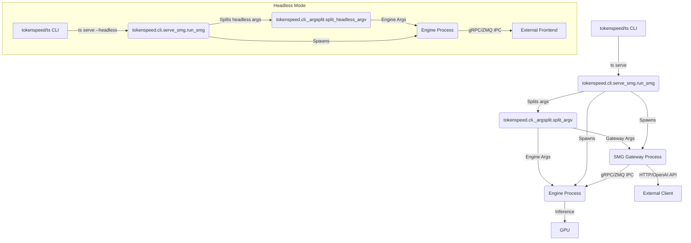

<!-- source: DeepWiki mcp.deepwiki.com · repo lightseekorg/tokenspeed · page 6 Serving CLI and Configuration · fetched 2026-10-21 -->

# Serving CLI and Configuration

<details>
<summary>Relevant source files</summary>

The following files were used as context for generating this wiki page:

- [python/pyproject.toml](python/pyproject.toml)
- [python/tokenspeed/cli/__init__.py](python/tokenspeed/cli/__init__.py)
- [python/tokenspeed/cli/_argsplit.py](python/tokenspeed/cli/_argsplit.py)
- [python/tokenspeed/cli/_logprefix.py](python/tokenspeed/cli/_logprefix.py)
- [python/tokenspeed/cli/serve_smg.py](python/tokenspeed/cli/serve_smg.py)
- [python/tokenspeed/version.py](python/tokenspeed/version.py)
- [test/ci/ut/ut-runtime-1gpu.yaml](test/ci/ut/ut-runtime-1gpu.yaml)
- [test/ci_system/install_deps.sh](test/ci_system/install_deps.sh)
- [test/ci_system/install_deps_rocm.sh](test/ci_system/install_deps_rocm.sh)
- [test/ci_system/package_cache.sh](test/ci_system/package_cache.sh)
- [test/ci_system/test_package_cache.py](test/ci_system/test_package_cache.py)
- [test/cli/__init__.py](test/cli/__init__.py)
- [test/cli/_fixtures/__init__.py](test/cli/_fixtures/__init__.py)
- [test/cli/_fixtures/fake_engine.py](test/cli/_fixtures/fake_engine.py)
- [test/cli/test_argsplit.py](test/cli/test_argsplit.py)
- [test/cli/test_logprefix.py](test/cli/test_logprefix.py)
- [test/cli/test_serve_smg_integration.py](test/cli/test_serve_smg_integration.py)
- [test/cli/test_serve_smg_unit.py](test/cli/test_serve_smg_unit.py)
- [tokenspeed-scheduler/python/tests/test_cache_group_admission.py](tokenspeed-scheduler/python/tests/test_cache_group_admission.py)
- [tokenspeed-scheduler/python/tests/test_d_role_state_reserve.py](tokenspeed-scheduler/python/tests/test_d_role_state_reserve.py)
- [tokenspeed-scheduler/python/tests/test_local_state_growth_reserve.py](tokenspeed-scheduler/python/tests/test_local_state_growth_reserve.py)

</details>


## Purpose and Scope

This page provides a high-level overview of how TokenSpeed is launched, orchestrated, and configured. TokenSpeed offers a unified command-line interface (`ts`/`tokenspeed`) that handles multi-process orchestration between an HTTP/protocol gateway (`tokenspeed-smg`) and the high-speed inference engine (`tokenspeed.runtime`), alongside headless execution modes and comprehensive configuration surfaces [python/pyproject.toml:91-94]().

For detailed deep-dives, refer to the child pages:
- [Server Configuration Reference](#6.1)
- [CLI and SMG Gateway Orchestration](#6.2)
- [Model Recipes and Serving Patterns](#6.3)

---

## CLI and SMG Gateway Orchestration

The TokenSpeed CLI entry point is defined in `python/tokenspeed/cli/__main__.py` under `main()` [python/pyproject.toml:92-93](), exposing commands such as `serve`, `env`, `merge-traces`, and `version`.

When launching the server via `ts serve` or `tokenspeed serve`, `python/tokenspeed/cli/serve_smg.py` orchestrates a dual-process architecture [python/tokenspeed/cli/serve_smg.py:21-31](). It spawns an SMG gateway process to handle OpenAI-compatible HTTP requests, routing, chat templating, and output parsing, while concurrently launching the gRPC/ZMQ inference engine process [python/tokenspeed/cli/serve_smg.py:24-31](). Headless mode (`--headless`) bypasses the gateway spawn entirely, running the engine alone to integrate with external frontends [python/tokenspeed/cli/serve_smg.py:25-31](). The `_argsplit.py` module handles the complex task of parsing and routing CLI arguments to either the gateway, the engine, or both, and also extracts orchestrator-specific options [python/tokenspeed/cli/_argsplit.py:21-42]().

**Diagram: CLI Entry and Dual-Process Orchestration**

**Sources:** [python/pyproject.toml:92-93](), [python/tokenspeed/cli/serve_smg.py:21-31](), [python/tokenspeed/cli/_argsplit.py:21-42](), [python/tokenspeed/cli/_argsplit.py:157-182]()

For complete details on argument splitting, readiness probes, log prefixing, signal handling, and trace merging, see [CLI and SMG Gateway Orchestration](#6.2).

---

## Server Configuration Reference

TokenSpeed centralizes engine parameters, hardware backends, memory allocations, and parallelism topologies through the configuration and argument parser structures [python/pyproject.toml:72-89](). Operators configure model loading paths, numerical precision, quantization formats (such as FP8, NVFP4, and MXFP4), and advanced scheduler tunables via CLI arguments or environment overrides. The `tokenspeed.cli._argsplit` module recognizes a set of flags that are explicitly for the engine, such as `--tensor-parallel-size` and `--sampling-backend` [python/tokenspeed/cli/_argsplit.py:72-73](), [test/cli/test_argsplit.py:100-110]().

**Diagram: Configuration to Runtime Binding**
```mermaid
graph LR
    subgraph "Configuration_Space"
        ServerArgsCLI[CLI Arguments (e.g., --model, --tp)]
        EnvVars[Environment Variables (e.g., TOKENSPEED_GRPC_MAX_MESSAGE_BYTES)]
        ServerArgsCLI --> ServerArgs(tokenspeed.runtime.utils.server_args.ServerArgs)
        EnvVars --> ServerArgs
    end

    subgraph "Runtime_Entity_Space"
        ServerArgs --> ModelConfig(tokenspeed.runtime.model_config.ModelConfig)
        ServerArgs --> SchedulerConfig(tokenspeed_scheduler.SchedulerConfig)
        ServerArgs --> AsyncLLM(tokenspeed.runtime.engine.AsyncLLM)
        ModelConfig --> ModelExecutor(tokenspeed.runtime.model_executor.ModelExecutor)
        SchedulerConfig --> Scheduler(tokenspeed_scheduler.Scheduler)
    end
```
**Sources:** [python/pyproject.toml:72-89](), [python/tokenspeed/cli/serve_smg.py:79-80](), [python/tokenspeed/cli/serve_smg.py:97-104](), [python/tokenspeed/cli/_argsplit.py:72-73](), [test/cli/test_argsplit.py:100-110](), [tokenspeed-scheduler/python/tests/test_cache_group_admission.py:43-49]()

### Core Configuration Surfaces
| Category | Key Arguments / Controls | Target Subsystem |
| --- | --- | --- |
| **Model & Loading** | `--model`, `--tokenizer`, `--load-format` | Weight loading and tokenizer initialization |
| **Precision** | `--dtype`, `--quantization`, `--kv-cache-dtype` | Numerical representation and memory scaling |
| **Parallelism** | `--tp`, `--ep-size`, `--dp`, `--attn-tp` | Tensor, Expert, Data, and Attention parallelism |
| **Scheduler** | `--max-num-seqs`, `--chunked-prefill-size` | Concurrency and issue budget control |

For a comprehensive breakdown of every parameter, environment variable override, KV cache granularity setting, and attention backend selector, see [Server Configuration Reference](#6.1).

---

## Model Recipes and Serving Patterns

Production deployments across different model families require specific combinations of parallelism shapes, weight quantization formats, and reasoning/tool parsers. TokenSpeed supports advanced architectures including DeepSeek V3/V4, Kimi K2.5/K3, Qwen3.5/Qwen4-exp, GLM5, MiniMax M3, Inkling, and GPT-OSS. The `serve_smg.py` module defines default reasoning and tool call parsers for various models, such as `deepseek_v31` for DeepSeek V4 and `kimi_k3` for Kimi K3 [python/tokenspeed/cli/serve_smg.py:63-74]().

For deployment templates, parallelization topologies, quantization profiles, and built-in reasoning/tool parsers (such as `deepseek_v31`, `kimi_k3`, and `glm45`), see [Model Recipes and Serving Patterns](#6.3).

**Sources:** [python/tokenspeed/cli/serve_smg.py:63-74]()

---

## Child Pages

- [Server Configuration Reference](#6.1)
- [CLI and SMG Gateway Orchestration](#6.2)
- [Model Recipes and Serving Patterns](#6.3)

---

