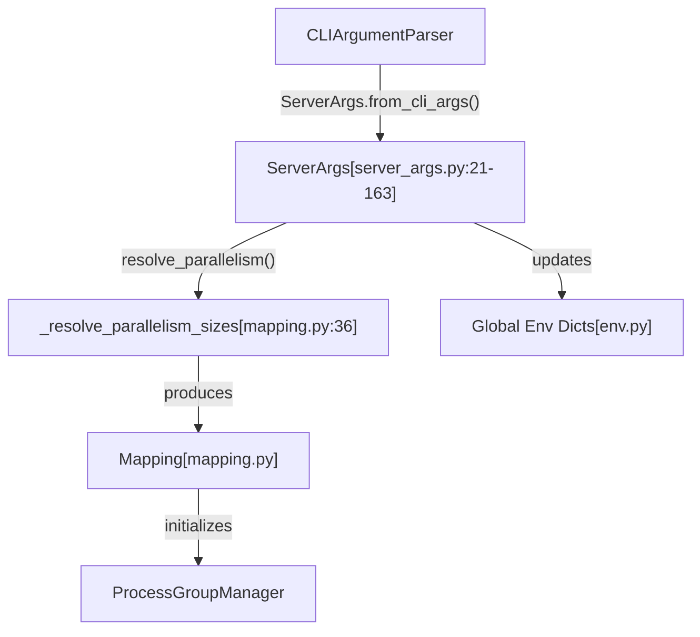
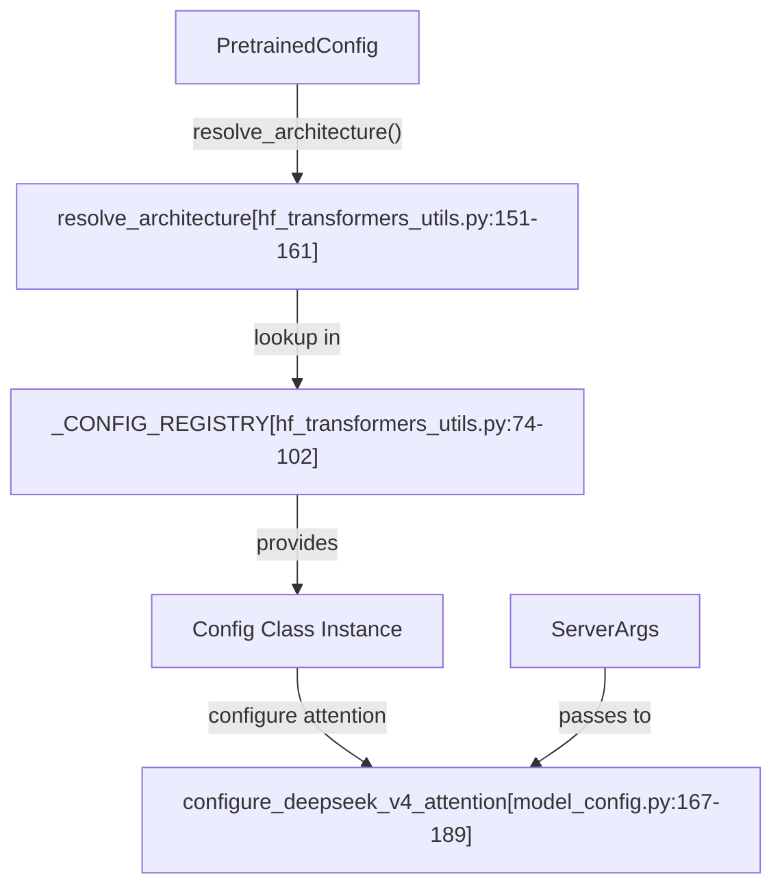
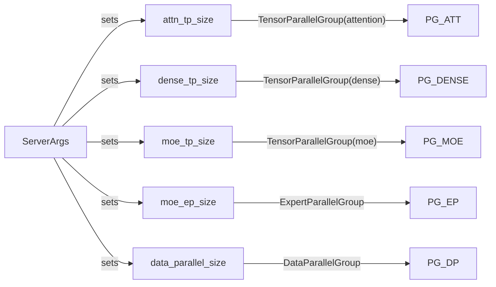
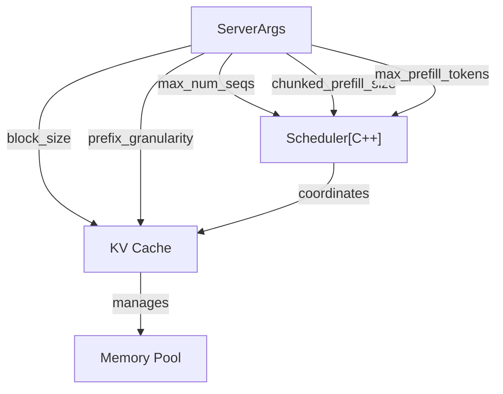
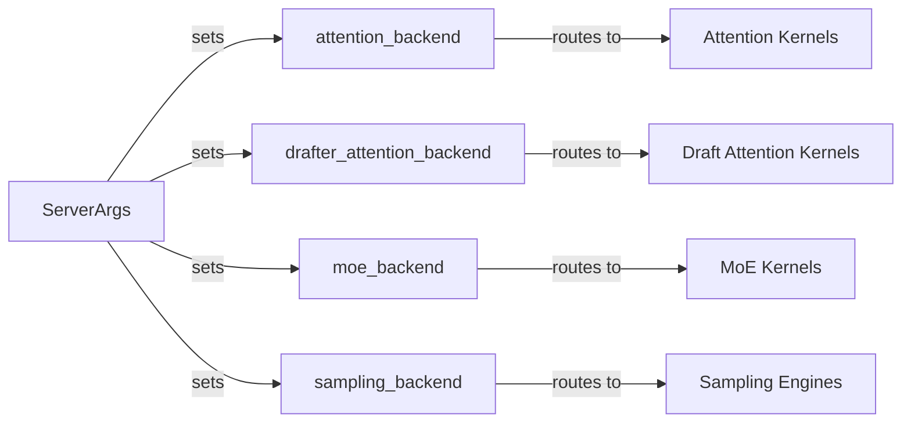
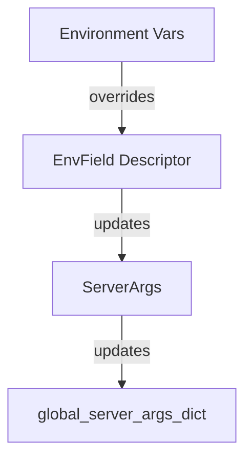

<!-- source: DeepWiki mcp.deepwiki.com · repo lightseekorg/tokenspeed · page 6.1 Server Configuration Reference · fetched 2026-10-21 -->

# Server Configuration Reference

Relevant source files

The following files were used as context for generating this wiki page:

- [docs/configuration/compatible-parameters.md](docs/configuration/compatible-parameters.md)
- [docs/configuration/server.md](docs/configuration/server.md)
- [docs/recipes/models.md](docs/recipes/models.md)
- [python/tokenspeed/runtime/configs/__init__.py](python/tokenspeed/runtime/configs/__init__.py)
- [python/tokenspeed/runtime/configs/model_config.py](python/tokenspeed/runtime/configs/model_config.py)
- [python/tokenspeed/runtime/utils/hf_transformers_utils.py](python/tokenspeed/runtime/utils/hf_transformers_utils.py)
- [python/tokenspeed/runtime/utils/server_args.py](python/tokenspeed/runtime/utils/server_args.py)
- [test/ci/eval/glm-5.2-nvfp4-mtp-evalscope-aime26.yaml](test/ci/eval/glm-5.2-nvfp4-mtp-evalscope-aime26.yaml)
- [test/ci/eval/glm-5.3-flash-fp8-mtp-evalscope-aime26-amd.yaml](test/ci/eval/glm-5.3-flash-fp8-mtp-evalscope-aime26-amd.yaml)
- [test/ci/eval/glm-5.3-flash-fp8-mtp-evalscope-aime26.yaml](test/ci/eval/glm-5.3-flash-fp8-mtp-evalscope-aime26.yaml)
- [test/ci/eval/kimi-k3-mxfp4-tp8ep1-evalscope-aime26-amd.yaml](test/ci/eval/kimi-k3-mxfp4-tp8ep1-evalscope-aime26-amd.yaml)
- [test/ci/perf/kimi-k2.5-nvfp4-evalscope-agentic.yaml](test/ci/perf/kimi-k2.5-nvfp4-evalscope-agentic.yaml)
- [test/ci/perf/kimi-k3-mxfp4-tp8ep1-evalscope-random-4k-1k-mi35x.yaml](test/ci/perf/kimi-k3-mxfp4-tp8ep1-evalscope-random-4k-1k-mi35x.yaml)
- [test/runtime/models/test_moe_routing_config.py](test/runtime/models/test_moe_routing_config.py)
- [test/runtime/test_cli_config_compat.py](test/runtime/test_cli_config_compat.py)
- [test/runtime/test_hf_snapshot_resolution.py](test/runtime/test_hf_snapshot_resolution.py)
- [test/runtime/test_prefix_cache_e2e.py](test/runtime/test_prefix_cache_e2e.py)
- [tokenspeed-kernel/python/tokenspeed_kernel/platform.py](tokenspeed-kernel/python/tokenspeed_kernel/platform.py)
- [tokenspeed-kernel/python/tokenspeed_kernel/thirdparty/cuda/csrc/kvcacheio_transfer.cu](tokenspeed-kernel/python/tokenspeed_kernel/thirdparty/cuda/csrc/kvcacheio_transfer.cu)

This page provides a comprehensive technical reference for `ServerArgs` [python/tokenspeed/runtime/utils/server_args.py:21-163]() and model configuration helpers [python/tokenspeed/runtime/configs/model_config.py:21-189](), covering critical server-side settings including model loading, precision and quantization, parallelism (TP/EP/DP/attention-TP), scheduler parameters, KV cache and prefix granularity, attention backend selection, and environment variable overrides.

---

## Configuration Architecture and Data Flow

The server configuration platform revolves around the `ServerArgs` dataclass, which encapsulates command-line and runtime arguments and their validation logic [python/tokenspeed/runtime/utils/server_args.py:21-163](). This class integrates with the command-line parser (`argparse`) and enforces constraints while mapping user inputs into a comprehensive config object.

The `ServerArgs` also drives distributed parallelism topology resolution through detailed mapping and helper functions embedded in `tokenspeed.runtime.distributed.mapping` [python/tokenspeed/runtime/utils/server_args.py:100-163]().

The resolved `ServerArgs` produce a `Mapping` object that controls tensor parallelism (TP), data parallelism (DP), expert parallelism (EP), and attention tensor parallelism (attn-TP), which maps to the compute topology and distributes workload accordingly. This facilitates consistent runtime distributed state backed by `ProcessGroupManager` and similar abstractions.

**Diagram: CLI Argument Parsing to Runtime Server Configuration**

Sources:  
[python/tokenspeed/runtime/utils/server_args.py:21-163](), [python/tokenspeed/runtime/distributed/mapping.py:36-36](), [python/tokenspeed/runtime/utils/env.py:30-128](), [test/runtime/test_cli_config_compat.py:10-55]()

---

## Model Loading, Precision, and Quantization

Model loading is specified by the `model` path or Hugging Face repo ID, supporting complex loading scenarios including trust of remote code, varied checkpoint formats (`pt`, `safetensors`, `instanttensor`, `npcache`, `dummy`, `extensible`), and override layers via JSON or YAML configuration files.

Precision configuration deals with both the model weights/activations and the KV cache. Precise options allow setting model dtype (`--dtype`) and KV cache dtype (`--kv-cache-dtype`), with kernels or numerical envelopes adapting accordingly.

Quantization includes methods such as `fp8`, `nvfp4`, `w8a8_fp8`, and compressed tensor formats, configurable via `--quantization`. Verification and scaling parameters may come from dedicated JSON files (`--quantization-param-path`) for FP8 KV cache scaling factors.

Model configuration helpers detect specific model archetypes by their config class or architecture name, e.g., DeepSeek V4, Qwen4-exp, and adjust attention parameters and kernel selection accordingly.

| Parameter                 | Purpose                                 | Code Entity / Details                                      |
|---------------------------|-----------------------------------------|------------------------------------------------------------|
| `model` / `--model`       | Model path or HF repo ID                | `ServerArgs.model` [server_args.py:21-163]()               |
| `--trust-remote-code`     | Allow custom model code from remote repo| Boolean flag, affects loading and security                 |
| `--load-format`           | Checkpoint format                       | Supported: `auto`, `pt`, `safetensors`, etc.                |
| `--dtype`                 | Model weight and activation dtype      | Defaults to `auto` based on checkpoint metadata             |
| `--quantization`          | Weight quantization mode                | FP8, NVFP4, etc. [server_args.py:21-163]()                  |
| `--kv-cache-dtype`        | Precision of KV cache memory            | Lower precision reduces KV memory, e.g., FP8                |

**Diagram: Model Architecture Resolution and Configuration Flow**

Sources:  
[python/tokenspeed/runtime/utils/hf_transformers_utils.py:74-161](), [python/tokenspeed/runtime/configs/model_config.py:119-189]()  

---

## Parallelism Strategies: Tensor (TP), Expert (EP), Data (DP), and Attention TP

TokenSpeed enables fine-grained control over distributed parallelism. Key sizes include:

- **Tensor Parallelism (TP)**: Split model weights and computation across devices.
  - `--attn-tp-size`: For attention layers.
  - `--dense-tp-size`: For MLP or dense layers.
  - `--moe-tp-size`: For Mixture-of-Experts layers.

- **Expert Parallelism (EP)**: Splits experts (in MoE layers) across devices. Controlled via `--ep-size`.

- **Data Parallelism (DP)**: Replicates model instances to increase throughput, configured via `--data-parallel-size`.

The server args provide flags such as `--enable-expert-parallel` to enable expert parallelism, and support nontrivial expert placements (e.g., redundant experts, recorded load balancing).

Mapping of these parameters to runtime distributed topology happens in the `_resolve_parallelism_sizes` helper, which ensures consistency and compatibility between sizes, ranks, and groups.

| Parameter                 | Purpose                                  | `ServerArgs` Attribute               |
|---------------------------|------------------------------------------|--------------------------------------|
| `--attn-tp-size`          | Attention tensor parallel size           | `attn_tp_size`                      |
| `--dense-tp-size`         | Dense layer TP size                      | `dense_tp_size`                     |
| `--moe-tp-size`           | MoE tensor parallel size                  | `moe_tp_size`                      |
| `--enable-expert-parallel`| Enable expert parallelism                 | `enable_expert_parallel`            |
| `--ep-size`               | Expert parallel size                      | `moe_ep_size`                      |
| `--data-parallel-size`    | Data parallel replicas                    | `data_parallel_size`                |

**Diagram: Parallelism Parameters to Distributed Groups**

Sources:  
[python/tokenspeed/runtime/utils/server_args.py:94-163](), [test/runtime/test_cli_config_compat.py:55-71]()

---

## Scheduler Knobs, KV Cache, and Prefix Granularity

The runtime scheduler, mainly implemented in C++ (tokenspeed-scheduler), manages request lifecycles, resource allocations, memory caches, and token budgets. TokenSpeed server args expose several knobs for scheduler tuning and KV cache behavior:

| Parameter                 | Purpose                                      | Code Entity / Details                          |
|---------------------------|----------------------------------------------|------------------------------------------------|
| `--max-num-seqs`          | Maximum concurrent active sequences          | Limits request concurrency                     |
| `--chunked-prefill-size`  | Maximum tokens per scheduling iteration      | Controls granularity of prefill steps          |
| `--max-prefill-tokens`    | Maximum tokens for non-chunked prefill paths |                                        |
| `--block-size`            | KV cache block size in tokens                 | Affects cache page size                        |
| `--prefix-granularity`    | Prefix caching radix tree page size           | Defines minimum prefix cache reuse granularity|
| `--enable-prefix-caching` | Enable prefix reuse in radix tree cache       | Optional prefix cache reuse                     |

These parameters influence how the KV cache organizes attention context, scheduling requests, and balancing throughput versus resource utilization.

**Diagram: Scheduler and KV Cache Interaction**

Sources:  
[python/tokenspeed/runtime/utils/server_args.py:130-143](), [docs/configuration/server.md:20-89]()

---

## Attention Backend Selection and Kernel Routing

TokenSpeed supports various attention kernel backends that can be selected via server arguments depending on the target hardware, model architecture, and feature requirements:

- `--attention-backend`: Primary attention backend selection such as `mha`, `fa3`, `fa4`, `trtllm_mla`, `tokenspeed_mla`, `gluon`.
- `--drafter-attention-backend`: Separate backend selection for speculative decoding draft models.
- `--moe-backend`: Choice of MoE kernel backend.
- `--sampling-backend`: Backend for token sampling, e.g., `greedy`, `flashinfer`.

These backends are routed in runtime and kernel layers, supporting diverse hardware (NVIDIA, AMD, Ascend NPU) and algorithmic variants (MLA, DSA, MSA, gated delta linear attention).

**Diagram: Attention Backend Routing**

Sources:  
[python/tokenspeed/runtime/utils/server_args.py:200-208](), [test/runtime/test_server_args_attention_backends.py:42-90]()

---

## Environment Variable Overrides and Global State

TokenSpeed synchronizes certain server arguments with environment variable flags, allowing dynamic global overrides and consistent runtime global state.

- Example: `ENABLE_CP` environment variable controls context parallelism (`--enable-context-parallel` flag).
- The `global_server_args_dict` (in memory dictionary) mirrors the active server flags for external introspection and internal coordination.
- The `EnvField` descriptor manages environment-backed configuration fields, transparently overlaying environment values into server attributes.

This architecture provides flexibility in responding to operating system environment changes and external control systems, crucial in multi-process launchers and job scheduling scenarios.

**Diagram: Environment and ServerArgs Synchronization**

Sources:  
[python/tokenspeed/runtime/utils/server_args.py:50-64](), [python/tokenspeed/runtime/utils/env.py:30-128]()

---

# Summary

This server configuration reference explains the key systems and parameters governing model-loading, numerical settings, distributed parallelism, scheduler tuning, KV cache coherence, attention kernel routing, and environment integration. `ServerArgs` acts as the central nexus for all these controls, enabling flexible, composable, and performant inference serving on diverse hardware targets.

Operators should consult this page to understand the intricate behavior behind each parameter, validate configuration conflicts early via `ServerArgs` and unit tests, and tailor launches precisely for their model families and hardware setups.

Sources:  
- [python/tokenspeed/runtime/utils/server_args.py:1-163]()  
- [python/tokenspeed/runtime/configs/model_config.py:21-189]()  
- [python/tokenspeed/runtime/utils/hf_transformers_utils.py:74-161]()  
- [test/runtime/test_cli_config_compat.py:10-55]()  
- [docs/configuration/server.md:10-69]()  
- [test/runtime/test_server_args_attention_backends.py:40-90]()  
- [python/tokenspeed/runtime/utils/env.py:30-128]()  
- [python/tokenspeed/runtime/distributed/mapping.py:30-40]()

---

