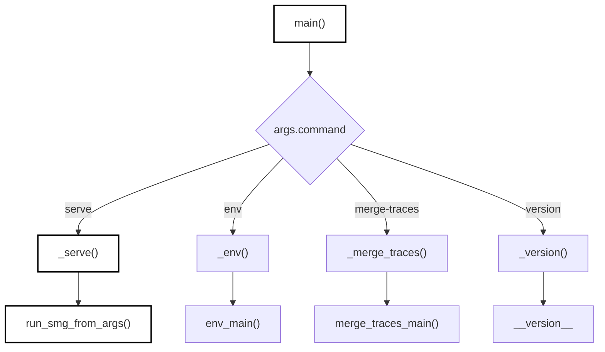
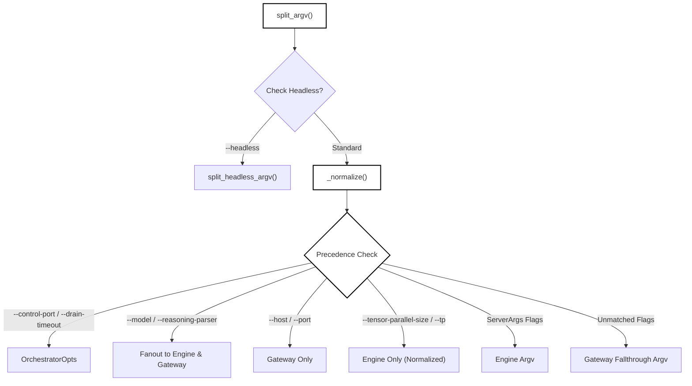
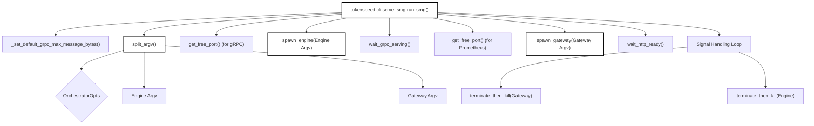

<!-- source: DeepWiki mcp.deepwiki.com · repo lightseekorg/tokenspeed · page 6.2 CLI and SMG Gateway Orchestration · fetched 2026-10-21 -->

# CLI and SMG Gateway Orchestration

Relevant source files

The following files were used as context for generating this wiki page:

- [python/pyproject.toml](python/pyproject.toml)
- [python/tokenspeed/cli/__init__.py](python/tokenspeed/cli/__init__.py)
- [python/tokenspeed/cli/__main__.py](python/tokenspeed/cli/__main__.py)
- [python/tokenspeed/cli/_argsplit.py](python/tokenspeed/cli/_argsplit.py)
- [python/tokenspeed/cli/_logprefix.py](python/tokenspeed/cli/_logprefix.py)
- [python/tokenspeed/cli/serve_smg.py](python/tokenspeed/cli/serve_smg.py)
- [python/tokenspeed/cli/trace_merge.py](python/tokenspeed/cli/trace_merge.py)
- [python/tokenspeed/runtime/engine/request_handler.py](python/tokenspeed/runtime/engine/request_handler.py)
- [python/tokenspeed/version.py](python/tokenspeed/version.py)
- [test/ci/ut/ut-runtime-1gpu.yaml](test/ci/ut/ut-runtime-1gpu.yaml)
- [test/ci_system/install_deps.sh](test/ci_system/install_deps.sh)
- [test/ci_system/install_deps_rocm.sh](test/ci_system/install_deps_rocm.sh)
- [test/ci_system/package_cache.sh](test/ci_system/package_cache.sh)
- [test/ci_system/test_package_cache.py](test/ci_system/test_package_cache.py)
- [test/cli/__init__.py](test/cli/__init__.py)
- [test/cli/_fixtures/__init__.py](test/cli/_fixtures/__init__.py)
- [test/cli/_fixtures/fake_engine.py](test/cli/_fixtures/fake_engine.py)
- [test/cli/test_argsplit.py](test/cli/test_argsplit.py)
- [test/cli/test_logprefix.py](test/cli/test_logprefix.py)
- [test/cli/test_serve_smg_integration.py](test/cli/test_serve_smg_integration.py)
- [test/cli/test_serve_smg_unit.py](test/cli/test_serve_smg_unit.py)
- [test/cli/test_trace_merge.py](test/cli/test_trace_merge.py)
- [test/runtime/layers/test_moe_layer_activation_flag.py](test/runtime/layers/test_moe_layer_activation_flag.py)
- [test/runtime/layers/test_moe_layer_plan_traits.py](test/runtime/layers/test_moe_layer_plan_traits.py)
- [test/runtime/test_request_handler_profile.py](test/runtime/test_request_handler_profile.py)
- [tokenspeed-kernel/python/tokenspeed_kernel/profiling.py](tokenspeed-kernel/python/tokenspeed_kernel/profiling.py)
- [tokenspeed-kernel/test/test_profiling.py](tokenspeed-kernel/test/test_profiling.py)
- [tokenspeed-scheduler/python/tests/test_cache_group_admission.py](tokenspeed-scheduler/python/tests/test_cache_group_admission.py)
- [tokenspeed-scheduler/python/tests/test_d_role_state_reserve.py](tokenspeed-scheduler/python/tests/test_d_role_state_reserve.py)
- [tokenspeed-scheduler/python/tests/test_local_state_growth_reserve.py](tokenspeed-scheduler/python/tests/test_local_state_growth_reserve.py)

## Purpose and Scope
This page details the implementation of `python/tokenspeed/cli`, which provides the entrypoint routing for the `tokenspeed` and `ts` CLI commands [python/pyproject.toml:91-94](), argument parsing and splitting for the serving orchestrator [python/tokenspeed/cli/_argsplit.py:21-44](), dual-process orchestration of the SMG gateway and gRPC inference engine [python/tokenspeed/cli/serve_smg.py:21-32](), subprocess log prefixing [python/tokenspeed/cli/_logprefix.py](), and trace merging utilities [python/tokenspeed/cli/trace_merge.py]().

---

## 1. Entrypoint Routing and CLI Subparsers

The CLI root is exposed via `tokenspeed.cli:main` as defined in `python/pyproject.toml` [python/pyproject.toml:91-94](). The command dispatcher uses `argparse.ArgumentParser` to route requests to specific subcommand handlers [python/tokenspeed/cli/__main__.py:51-60]().

*Figure 1: CLI Subparser Routing and Command Handlers.*

Sources: [python/pyproject.toml:91-94](), [python/tokenspeed/cli/__main__.py:51-122]()

---

## 2. Argv Splitting and Fanout Logic

The `ts serve` command accepts a unified argument list that must be split between the SMG gateway and the underlying gRPC inference engine [python/tokenspeed/cli/_argsplit.py:21-44](). The orchestrator uses `split_headless_argv()` for headless engine-only runs [python/tokenspeed/cli/_argsplit.py:157-182]() and `split_argv()` for dual-process setups.

Routing precedence follows a strict top-down model:
1. **Orchestrator-only flags** (`_ORCH_FLAGS`): Consumed by the orchestrator and never forwarded [python/tokenspeed/cli/_argsplit.py:53-58]().
2. **Fanout flags** (`_FANOUT_FLAGS`, e.g., `--model`, `--reasoning-parser`): Forwarded to both engine and gateway [python/tokenspeed/cli/_argsplit.py:60]().
3. **Gateway user-facing flags** (`--host`, `--port`): Routed exclusively to the gateway [python/tokenspeed/cli/_argsplit.py:67]().
4. **Gateway override flags** (`--chat-template`, `--tool-call-parser`): Assigned to the gateway for OpenAI-compatible HTTP request translation [python/tokenspeed/cli/_argsplit.py:69-72]().
5. **Engine explicit flags** (`--tensor-parallel-size`, `--tp`): Normalized and routed to the engine [python/tokenspeed/cli/_argsplit.py:62-65,74]().
6. **Fallback rules**: Recognized `ServerArgs` flags are directed to the engine; remaining arguments fall through to the gateway CLI parser [python/tokenspeed/cli/_argsplit.py:31-44]().

*Figure 2: Argv Splitting and Routing Precedence Flow.*

Sources: [python/tokenspeed/cli/_argsplit.py:21-182]()

---

## 3. SMG Gateway and gRPC Engine Orchestration

The `ts serve` orchestrator (`tokenspeed.cli.serve_smg`) manages the full lifecycle of the SMG gateway and gRPC engine subprocesses [python/tokenspeed/cli/serve_smg.py:21-32](). 

### Key Responsibilities
*   **Process Spawning**: Uses `spawn_gateway()` and `spawn_engine()` to launch subprocesses with separated logging streams [python/tokenspeed/cli/serve_smg.py:54-55]().
*   **Port Allocation**: Dynamically allocates non-colliding ports via `_free_port_avoiding_ephemeral_range()` and `get_free_port()` [python/tokenspeed/cli/serve_smg.py:57-58]().
*   **Readiness Probes**: Blocks startup until gRPC serving endpoints and HTTP readiness probes return success using `wait_grpc_serving()` and `wait_http_ready()` [python/tokenspeed/cli/serve_smg.py:54-55]().
*   **Signal Handling & Teardown**: Intercepts termination signals and tears down child processes in gateway-first order via `terminate_then_kill()` and `kill_process_tree()` [python/tokenspeed/cli/serve_smg.py:53,59]().
*   **Parser Auto-Injection**: Injects model-specific reasoning and tool-call parsers (e.g., DeepSeek V4, GLM, Inkling, Kimi K3) based on model argument detection [python/tokenspeed/cli/serve_smg.py:65-74]().
*   **gRPC Max Message Size**: Ensures multimodal tensors can be transmitted by setting `TOKENSPEED_GRPC_MAX_MESSAGE_BYTES` environment variable [python/tokenspeed/cli/serve_smg.py:97-105]().

*Figure 3: SMG Gateway and gRPC Engine Orchestration Flow.*

Sources: [python/tokenspeed/cli/serve_smg.py:21-170](), [python/tokenspeed/cli/serve_smg.py:97-105](), [python/tokenspeed/cli/serve_smg.py:54-55](), [python/tokenspeed/cli/serve_smg.py:53,59]()

---

## 4. Log Prefixing and Trace Merging

Subprocess outputs are intercepted and prefixed to distinguish between engine computations and gateway routing events [python/tokenspeed/cli/_logprefix.py]():
*   `ENGINE_TAG`: Prefixes lines originating from the gRPC inference engine runtime.
*   `GATEWAY_TAG`: Prefixes lines originating from the SMG frontend gateway.
*   `tag_stream()`: Implements asynchronous stream piping and tagging for subprocess stdout/stderr [python/tokenspeed/cli/_logprefix.py]().

The `merge-traces` subcommand invokes `merge_traces_main()` within `tokenspeed.cli.trace_merge` to combine asynchronous Proton and VizTracer execution profiles onto a unified timeline [python/tokenspeed/cli/__main__.py:39-43](). This is particularly useful for debugging performance issues across the distributed system.

Sources: [python/tokenspeed/cli/__main__.py:39-43](), [python/tokenspeed/cli/_logprefix.py](), [python/tokenspeed/cli/trace_merge.py]()

---

