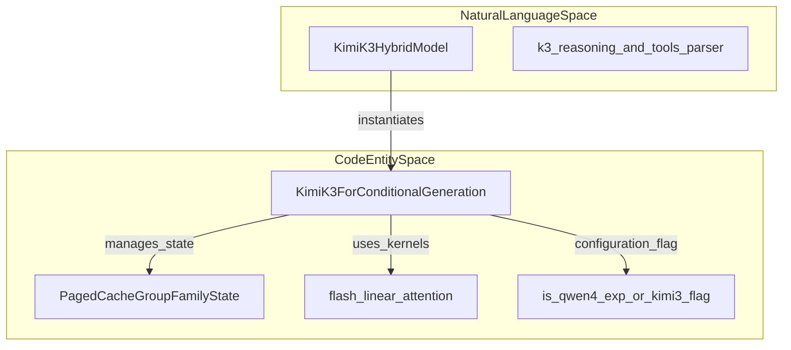
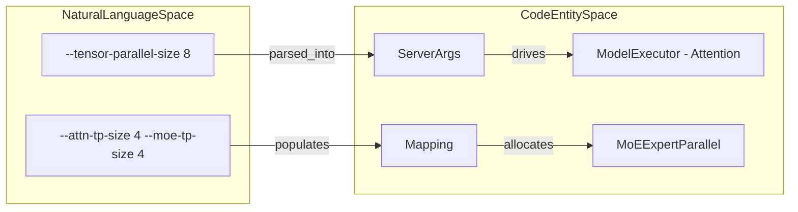
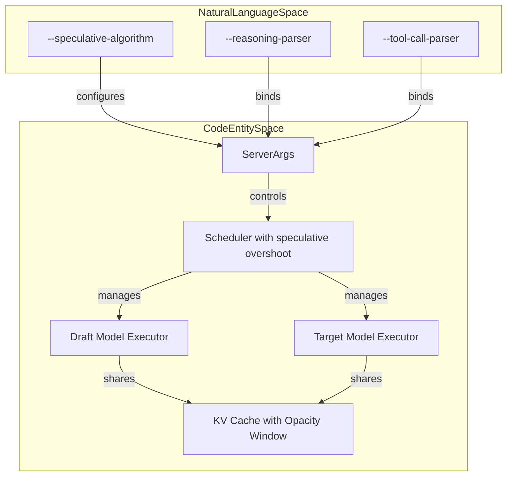
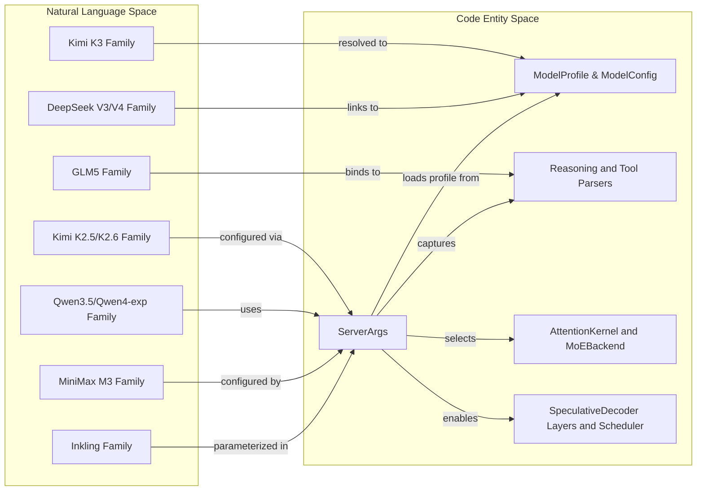
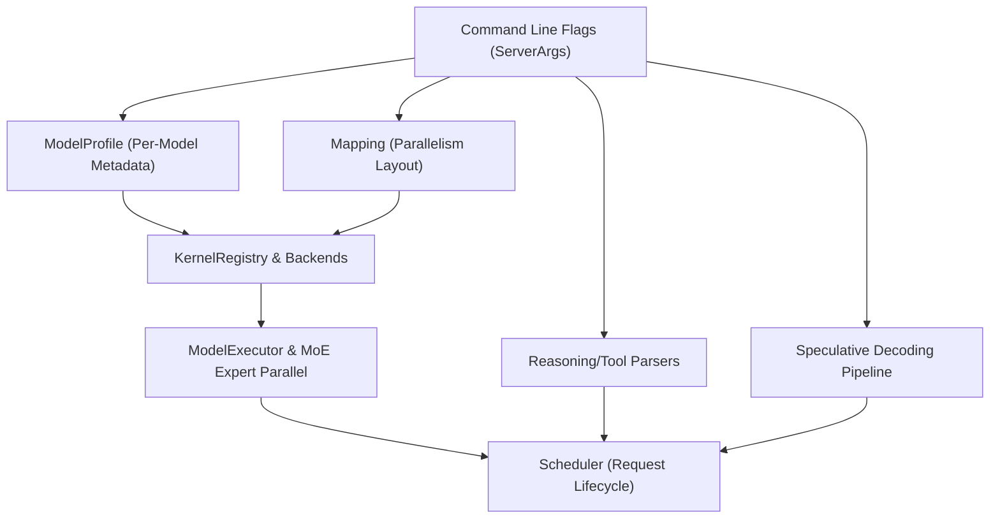

<!-- source: DeepWiki mcp.deepwiki.com · repo lightseekorg/tokenspeed · page 6.3 Model Recipes and Serving Patterns · fetched 2026-10-21 -->

# Model Recipes and Serving Patterns

<details>
<summary>Relevant source files</summary>

The following files were used as context for generating this wiki page:

- [docs/configuration/server.md](docs/configuration/server.md)
- [docs/recipes/models.md](docs/recipes/models.md)
- [python/tokenspeed/runtime/configs/__init__.py](python/tokenspeed/runtime/configs/__init__.py)
- [python/tokenspeed/runtime/configs/model_config.py](python/tokenspeed/runtime/configs/model_config.py)
- [python/tokenspeed/runtime/utils/hf_transformers_utils.py](python/tokenspeed/runtime/utils/hf_transformers_utils.py)
- [python/tokenspeed/runtime/utils/server_args.py](python/tokenspeed/runtime/utils/server_args.py)
- [test/ci/eval/gpt-oss-120b-mxfp4-evalscope-gpqa-diamond.yaml](test/ci/eval/gpt-oss-120b-mxfp4-evalscope-gpqa-diamond.yaml)
- [test/ci/eval/kimi-k2.5-mxfp4-eagle3-evalscope-aime25-amd.yaml](test/ci/eval/kimi-k2.5-mxfp4-eagle3-evalscope-aime25-amd.yaml)
- [test/ci/eval/kimi-k2.5-nvfp4-dflash-evalscope-aime25.yaml](test/ci/eval/kimi-k2.5-nvfp4-dflash-evalscope-aime25.yaml)
- [test/ci/eval/kimi-k2.5-nvfp4-eagle3-evalscope-aime25.yaml](test/ci/eval/kimi-k2.5-nvfp4-eagle3-evalscope-aime25.yaml)
- [test/ci/eval/kimi-k2.5-nvfp4-eagle3-evalscope-gpqa-diamond.yaml](test/ci/eval/kimi-k2.5-nvfp4-eagle3-evalscope-gpqa-diamond.yaml)
- [test/ci/eval/kimi-k2.5-nvfp4-eagle3-evalscope-gsm8k.yaml](test/ci/eval/kimi-k2.5-nvfp4-eagle3-evalscope-gsm8k.yaml)
- [test/ci/eval/kimi-k2.5-nvfp4-eagle3-evalscope-mmlu.yaml](test/ci/eval/kimi-k2.5-nvfp4-eagle3-evalscope-mmlu.yaml)
- [test/ci/eval/kimi-k2.5-nvfp4-eagle3-evalscope-ocr-bench.yaml](test/ci/eval/kimi-k2.5-nvfp4-eagle3-evalscope-ocr-bench.yaml)
- [test/ci/eval/qwen3.5-122b-a10b-nvfp4-evalscope-ocr-bench.yaml](test/ci/eval/qwen3.5-122b-a10b-nvfp4-evalscope-ocr-bench.yaml)
- [test/ci/eval/qwen3.5-397b-a17b-nvfp4-dp4ep4-evalscope-aime25.yaml](test/ci/eval/qwen3.5-397b-a17b-nvfp4-dp4ep4-evalscope-aime25.yaml)
- [test/ci/eval/qwen3.5-397b-a17b-nvfp4-evalscope-aime25.yaml](test/ci/eval/qwen3.5-397b-a17b-nvfp4-evalscope-aime25.yaml)
- [test/ci/eval/qwen3.8-flash-next-fp8-evalscope-gsm8k.yaml](test/ci/eval/qwen3.8-flash-next-fp8-evalscope-gsm8k.yaml)
- [test/ci/perf/kimi-k2.5-nvfp4-evalscope-agentic.yaml](test/ci/perf/kimi-k2.5-nvfp4-evalscope-agentic.yaml)
- [test/ci/perf/qwen3.5-397b-a17b-nvfp4-evalscope-agentic-b200-8gpu.yaml](test/ci/perf/qwen3.5-397b-a17b-nvfp4-evalscope-agentic-b200-8gpu.yaml)
- [test/ci/perf/qwen3.5-397b-a17b-nvfp4-evalscope-agentic.yaml](test/ci/perf/qwen3.5-397b-a17b-nvfp4-evalscope-agentic.yaml)
- [test/ci/perf/qwen3.5-397b-a17b-nvfp4-evalscope-longctx.yaml](test/ci/perf/qwen3.5-397b-a17b-nvfp4-evalscope-longctx.yaml)
- [test/ci/ut/ut-runtime-2gpu.yaml](test/ci/ut/ut-runtime-2gpu.yaml)
- [test/long_context_benchmark/tokenspeed/collect_outputs.py](test/long_context_benchmark/tokenspeed/collect_outputs.py)
- [test/runtime/models/test_moe_routing_config.py](test/runtime/models/test_moe_routing_config.py)
- [test/runtime/test_cli_config_compat.py](test/runtime/test_cli_config_compat.py)
- [test/runtime/test_hf_snapshot_resolution.py](test/runtime/test_hf_snapshot_resolution.py)
- [tokenspeed-kernel/python/tokenspeed_kernel/platform.py](tokenspeed-kernel/python/tokenspeed_kernel/platform.py)

</details>


## Purpose and Scope

This page provides practical launch recipes, serving patterns, parallelism configurations, quantization choices, and reasoning/tool-parser bindings for the model families supported by TokenSpeed. It bridges natural language configuration intent with concrete runtime flags (`ServerArgs`) and kernel execution paths, enabling reproducible setups adapted to specific hardware architectures and model types.

Sources: [docs/recipes/models.md](), [python/tokenspeed/runtime/utils/server_args.py]()

---

## Model Family Support Matrix and Recipes

TokenSpeed implements specialized configurations, kernel backends, and runtime setups optimized for key model architectures, reflecting their underlying attention and MoE designs, quantization preferences, and parser bindings.

| Model Family         | Key Architecture Features                               | Recommended Quantization        | Supported Parsers            |
|----------------------|----------------------------------------------------------|--------------------------------|-----------------------------|
| **Kimi K2.5 / K2.6** | MLA, Sigmoid/NoAux MoE                                   | `nvfp4`, `fp8`                 | `kimi_k25`, `kimik2`         |
| **Kimi K3**          | Hybrid KDA / NoPE-MLA, MoonViT encoder, DeepSeek MoE    | `fp8` (FlatKV cache)           | `kimi_k3`                   |
| **DeepSeek V3/V4**   | Sparse MLA, Mega-MoE, MTP pipeline                       | `fp8`, `mxfp4`, `nvfp4`        | `deepseek_v31`, `deepseek_v4` |
| **Qwen3.5 / Qwen4-exp** | Dense and MoE layers, varied speculative drafts         | `nvfp4`, `fp8`                 | `base`, `qwen3.5`, `qwen4-exp` |
| **MiniMax M3**       | 128-token MSA blocks, fusion attention                   | `nvfp4`, `fp8`                 | `minimax`                   |
| **GLM5**             | DSA attention, MoE sparse kernels                        | `fp8`, `nvfp4`                 | `glm5`                      |
| **Inkling**          | NVFP4/MXFP4 optimized MoE, large context                 | `nvfp4`, `mxfp4`               | `base`                      |

---

### Kimi K2.5 / K2.6 Launch Pattern (B200 4-GPU)

The Kimi K2.5 and K2.6 recipe emphasizes large context support with FP8 block-scaled KV cache, expert parallelism enabled, and MLA attention backends optimized for the NVIDIA platform. Remote code and explicit reasoning/tool parser flags are required for runtime integration.

```bash
ts serve \
  --model nvidia/Kimi-K2.5-NVFP4 \
  --served-model-name kimi-k2.5 \
  --trust-remote-code \
  --max-model-len 262144 \
  --kv-cache-dtype fp8 \
  --quantization nvfp4 \
  --tensor-parallel-size 4 \
  --enable-expert-parallel \
  --attention-backend tokenspeed_mla \
  --moe-backend flashinfer_trtllm \
  --reasoning-parser kimi_k25 \
  --tool-call-parser kimik2
```

For K2.6, keep the parallelism and backend flags identical (e.g. `--attention-backend tokenspeed_mla`) and change only the model and parser if specified by the model card. DFlash speculative draft integration requires additional speculative flags and draft model paths, as in:

```bash
ts serve nvidia/Kimi-K2.6-NVFP4 \
  --served-model-name kimi-k2.6 \
  --trust-remote-code \
  --max-model-len 262144 \
  --kv-cache-dtype fp8 \
  --quantization nvfp4 \
  --tensor-parallel-size 4 \
  --enable-expert-parallel \
  --attention-backend tokenspeed_mla \
  --moe-backend flashinfer_trtllm \
  --reasoning-parser kimi_k25 \
  --tool-call-parser kimik2 \
  --speculative-algorithm DFLASH \
  --speculative-draft-model-path /path/to/kimi-k2.6-dflash \
  --speculative-num-draft-tokens 8 \
  --speculative-num-steps 7 \
  --drafter-attention-backend fa4
```

Sources: [docs/recipes/models.md:149-201]()  

---

### Kimi K3 Hybrid Architecture and Serving

Kimi K3 models uniquely combine a MoonViT vision encoder with a hybrid KDA linear-attention decoder and a NoPE-MLA full-attention decoder. Serving this family requires assembly of components that maintain recurrent states mapped to `CacheBlock` boundaries.

The core execution includes:

- The model class `KimiK3ForConditionalGeneration` implementing the hybrid architecture.
- State management via `PagedCacheGroupFamilyState` for recurrent state snapshots.
- Flash linear attention kernels for KDA paths.
- Conditional configuration logic exposing `is_qwen4_exp_or_kimi3` flags.



This modular design enables Kimi K3 to flexibly integrate vision and language components with efficient kernel execution.

Sources: [docs/recipes/models.md:150-165](), [python/tokenspeed/runtime/configs/model_config.py:70-90]()

---

### DeepSeek V3/V4 Serving Patterns

DeepSeek V3 and V4 models are rooted in MLA attention with sparse MoE (Mega-MoE) components. They typically use FP8, MXFP4, or NVFP4 quantization schemes aligned with the FlashInfer family backends.

Launch patterns for DeepSeek V3/V4:

```bash
ts serve \
  --model nvidia/DeepSeek-V4 \
  --attn-tp-size 4 \
  --moe-tp-size 4 \
  --max-model-len 65536 \
  --max-num-seqs 16 \
  --chunked-prefill-size 8192 \
  --trust-remote-code \
  --attention-backend trtllm_mla \
  --moe-backend flashinfer_trtllm \
  --quantization nvfp4 \
  --kv-cache-dtype fp8
```

These configurations allow optimal sparse attention, large context, and robust MoE execution.

Sources: [docs/recipes/models.md:44-62](), [python/tokenspeed/runtime/configs/model_config.py:150-170]()

---

### MiniMax M3 Serving Recipes

MiniMax M3 uses 128-token multiple sparse attention (MSA) blocks with automatic dense and sparse attention backend selection and prefers the `trtllm` backend for dense layers. Speculative decoding algorithms such as EAGLE3 or DSPARK can be enabled.

Example launch with EAGLE3 speculative decoding:

```bash
tokenspeed serve nvidia/MiniMax-M3-NVFP4 \
  --tensor-parallel-size 4 \
  --max-model-len 81920 \
  --max-num-seqs 16 \
  --max-prefill-tokens 8192 \
  --chunked-prefill-size 8192 \
  --disable-cuda-graph-padding \
  --attention-backend trtllm \
  --kv-cache-dtype fp8 \
  --moe-backend flashinfer_trtllm \
  --speculative-algorithm EAGLE3 \
  --speculative-draft-model-path Inferact/MiniMax-M3-EAGLE3 \
  --speculative-num-steps 3 \
  --speculative-eagle-topk 1 \
  --speculative-num-draft-tokens 4 \
  --disable-kvstore \
  --block-size 128 \
  --trust-remote-code
```

DSPARK speculative decoding is similarly supported with adjusted `--speculative-algorithm` and draft model parameters.

Sources: [docs/recipes/models.md:64-140]()

---

### Inkling Launch Pattern

Inkling is designed for large context with NVFP4 or MXFP4 quantization on NVIDIA or AMD respectively, using FlashInfer and tokenspeed_mla backends. It disables KV store, enables prefix caching, and uses MTP speculative decoding.

Example for NVIDIA:

```bash
ts serve \
  --model thinkingmachines/Inkling-NVFP4 \
  --attn-tp-size 4 \
  --moe-tp-size 4 \
  --max-model-len 81920 \
  --max-num-seqs 16 \
  --max-prefill-tokens 8192 \
  --chunked-prefill-size 8192 \
  --disable-cuda-graph-padding \
  --trust-remote-code \
  --attention-backend fa4 \
  --moe-backend flashinfer_trtllm \
  --enable-prefix-caching \
  --disable-kvstore \
  --block-size 128 \
  --speculative-algorithm MTP \
  --speculative-num-steps 3 \
  --speculative-eagle-topk 1 \
  --speculative-num-draft-tokens 4
```

AMD versions swap in the MXFP4 checkpoint and omit CUDA graph padding similarly.

Sources: [docs/recipes/models.md:8-63]()

---

## Parallelism Shapes and Split Configurations

TokenSpeed supports fine-grained control of parallelism shapes, enabling operators to configure tensor parallelism unified or split across attention, dense, and MoE layers.

| Parameter              | Description                                                   |
|------------------------|---------------------------------------------------------------|
| `--tensor-parallel-size`, `--tp` | Unified tensor parallel size (alias for attention TP).          |
| `--attn-tp-size`        | Attention tensor parallel size.                               |
| `--dense-tp-size`       | Dense layer tensor parallel size. Defaults to attention TP.  |
| `--moe-tp-size`         | MoE tensor parallel size.                                     |
| `--enable-expert-parallel` | Enables expert parallelism (splitting MoE experts across devices). |
| `--all2all-backend`     | Selects the communication backend for all-to-all (e.g., `deepep`). |

Parallelism shapes are mapped in the `Mapping` class and integrated into runtime setup via `ServerArgs`. Attention and MoE layers receive the configured TP sizes and expert parallel layout to combine communication, kernel selection, and planning.



This flexible scheme allows adapting to diverse HW setups and model parallel requirements efficiently.

Sources: [python/tokenspeed/runtime/utils/server_args.py:80-120](), [docs/recipes/models.md:100-128]()

---

## Quantization Choices and Weight Formats

TokenSpeed supports multiple quantization schemes for weights and KV caches that directly impact memory footprint and kernel performance:

- **NVFP4**: Block-scaled 4-bit quantization optimized for NVIDIA with FlashInfer & CuTe-DSL backends.
- **MXFP4**: AMD counterpart block-scaled 4-bit quantization, leveraged in tokenspeed-kernel-amd.
- **FP8 (block scaled)**: Dynamic or static activation scaling with support in FlashInfer and deep_gemm kernels.
- **Compressed tensors**: For weight compression in some checkpoints.

Selecting quantization is done via the `--quantization` flag. The KV cache datatype is independently configurable (`--kv-cache-dtype`), often set to `fp8` for maximal memory savings without sacrificing throughput.

Internally, quantization preparations happen in functions like `prepare_fp8_linear` ([python/tokenspeed/runtime/layers/dense/fp8.py]()) and kernel dispatch is determined by heuristics and `ServerArgs` settings.

Sources: [tokenspeed-kernel/python/tokenspeed_kernel/ops/gemm/__init__.py](), [python/tokenspeed/runtime/layers/dense/fp8.py](), [tokenspeed-kernel/python/tokenspeed_kernel/ops/gemm/flashinfer.py]()

---

## Reasoning, Tool Parsers, and Speculative Decoding

TokenSpeed supports model-specific reasoning and tool-call parsers to map generation outputs into structured API schemas like OpenAI-compatible chat completions. These are specified via flags:

- `--reasoning-parser` (e.g. `kimi_k25`, `base`)
- `--tool-call-parser` (e.g. `kimik2`)

These parsers are integrated into runtime generation pipelines and enabled as per model family.

Speculative decoding algorithms enabled by `--speculative-algorithm` allow the server to draft tokens ahead in a background fashion and verify correctness against main decoders:

- Algorithms include `EAGLE3`, `MTP`, `DFLASH`, and `DSPARK`.
- Draft models run on separate cached states, sharing key-value caches with targets.
- The scheduler manages a speculative overshoot window (3 spans) accommodating draft verification, enabled by settings like `--speculative-num-steps`, `--speculative-num-draft-tokens`, and `--drafter-attention-backend`.

The scheduler accounts for 3 spans of KV cache overlap past the logical `context_len` to absorb late speculative commits and avoid premature truncation [python/tokenspeed/runtime/utils/server_args.py:83-95]().



Speculative decoding improves throughput with minimal accuracy impact when configured within these recipes.

Sources: [docs/recipes/models.md:175-201](), [python/tokenspeed/runtime/utils/server_args.py:80-120](), [python/tokenspeed/runtime/configs/model_config.py:125-170]()

---

# Summary

This page has documented practical launch recipes, key parallelism and quantization choices, and reasoning/tool parser integrations for the supported model families in TokenSpeed. Operators can configure these parameters in the CLI command line or server args with confidence in reproducibility and optimized kernel dispatch.

This bridges the gap between model family conceptual space and the concrete code entities — including `ServerArgs`, `Mapping`, specialized kernel backends, and scheduler states — that implement the efficient serving pipelines.

---

# Supplementary Mermaid Diagram: Natural Language Model Families to Code Classes



Sources: [docs/recipes/models.md](), [python/tokenspeed/runtime/utils/server_args.py](), [python/tokenspeed/runtime/configs/model_config.py]()

---

# Supplementary Mermaid Diagram: Flag Flow to Kernel and Scheduler Layers



This diagram illustrates how user flags propagate through server configuration, model metadata, parallelism mapping, kernel backend selection, and decoding layers, ending in the runtime scheduler managing request states.

Sources: [python/tokenspeed/runtime/utils/server_args.py](), [python/tokenspeed/runtime/configs/model_config.py]()

---

# End of 6.3 Model Recipes and Serving Patterns

---

