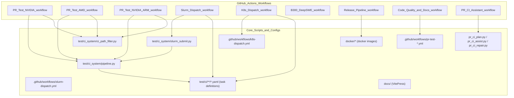
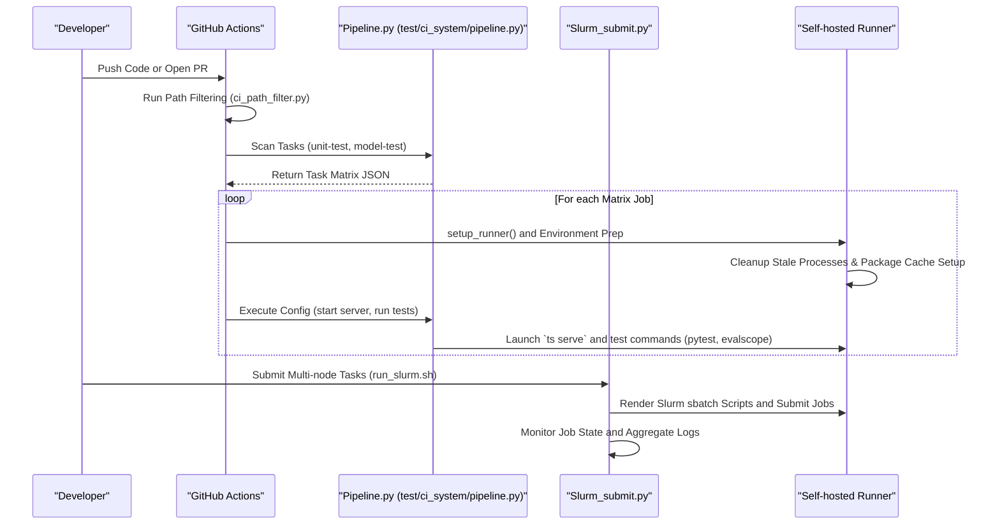

<!-- source: DeepWiki mcp.deepwiki.com · repo lightseekorg/tokenspeed · page 7 Infrastructure, CI/CD, and Tooling · fetched 2026-10-21 -->

# Infrastructure, CI/CD, and Tooling

Relevant source files

The following files were used as context for generating this wiki page:

- [.github/workflows/cancel-pr-tests-on-close.yml](.github/workflows/cancel-pr-tests-on-close.yml)
- [.github/workflows/k8s-dispatch.yml](.github/workflows/k8s-dispatch.yml)
- [.github/workflows/pr-test-nvidia-arm.yml](.github/workflows/pr-test-nvidia-arm.yml)
- [.github/workflows/retry-failed-approved-prs.yml](.github/workflows/retry-failed-approved-prs.yml)
- [.github/workflows/retry-failed-latest-main.yml](.github/workflows/retry-failed-latest-main.yml)
- [.github/workflows/slurm-dispatch.yml](.github/workflows/slurm-dispatch.yml)
- [test/ci/README.md](test/ci/README.md)
- [test/ci/perf/kimi-k3-eagle3-mxfp4-tp8ep1-evalscope-random-50k-500-mi35x.yaml](test/ci/perf/kimi-k3-eagle3-mxfp4-tp8ep1-evalscope-random-50k-500-mi35x.yaml)
- [test/ci_system/ci_path_filter.py](test/ci_system/ci_path_filter.py)
- [test/ci_system/pipeline.py](test/ci_system/pipeline.py)
- [test/ci_system/slurm_submit.py](test/ci_system/slurm_submit.py)
- [test/ci_system/test_ci_path_filter.py](test/ci_system/test_ci_path_filter.py)
- [test/ci_system/test_dispatch_workflows.py](test/ci_system/test_dispatch_workflows.py)
- [test/ci_system/test_eval_configs.py](test/ci_system/test_eval_configs.py)
- [test/ci_system/test_pipeline.py](test/ci_system/test_pipeline.py)
- [test/ci_system/test_slurm_submit.py](test/ci_system/test_slurm_submit.py)

This section provides a high-level overview of the infrastructure, continuous integration and delivery (CI/CD) pipelines, tooling, and deployment systems supporting the TokenSpeed monorepo. It outlines how GitHub Actions is used to orchestrate reusable, multi-vendor test pipelines, slurm and Kubernetes dispatch mechanisms for multi-node jobs, automated Docker and PyPI package releases, code quality enforcement, and the PR CI assistant bot with automated repair.

---

### System Overview

TokenSpeed's infrastructure supports a complex, multi-package codebase with Python runtime, native kernels for NVIDIA and AMD GPUs, scheduler libraries, and ML automation. The CI/CD system validates code correctness, performance, and model behavior across hardware types and configurations.

The integration is centered on GitHub Actions workflows invoking the core pipeline orchestrator in `test/ci_system/pipeline.py` to scan YAML-declared tasks, generate execution matrices, and dispatch jobs across self-hosted runners or multi-node cluster schedulers.

Multi-node dispatch employs Slurm and Kubernetes clusters via specialized dispatch scripts. Releases automate wheels for CUDA and ROCm variants and generate Docker images systematically.

Code quality is maintained by linting, formatting, and import/header enforcement integrated into pre-commit hooks and CI.

The PR CI assistant bot dynamically plans and repairs transient CI failures by analyzing logs and retesting selectively.

The following diagrams map from natural language system names to key code entities driving the infrastructure:

**CI/CD Workflows to Pipeline Code**

Sources: [test/ci_system/pipeline.py:1-150](), [test/ci_system/slurm_submit.py:1-130](), [.github/workflows/k8s-dispatch.yml:1-165](), [.github/workflows/slurm-dispatch.yml:1-154](), [test/ci/README.md:1-153](), [.github/workflows/pr-test-nvidia-arm.yml:1-160]()

---

### CI Pipeline and Test Framework

The CI pipeline architecture centers on a YAML-driven task specification format declarable under `test/ci/`. Each task defines its type (e.g., unit tests, server smoke tests, evaluation benchmarks, performance benchmarks), triggers (`per-commit`, `manual`, `nightly`, `slurm`), and runner labels.

`test/ci_system/pipeline.py` serves as the pipeline engine orchestrating task scanning, matrix building, filtering based on changed files, and dispatching tests on self-hosted runners. It supports priority and optionality on jobs to optimize resource usage in GitHub Actions.

Tasks that launch a server (e.g., eval, perf) enforce a JIT compile-time kernel parameter check via environment `TOKENSPEED_JIT_COMPILE_CHECK=error`, catching invalid kernel parameters during jit compilation phases.

The pipeline includes:

- Path-filtering via `ci_path_filter.py` to minimize unnecessary task execution based on changed files and runner groups.
- Runner setup commands ensuring clean environments (including GPU reclaim on AMD runners) and caching layers (persistent package caches on some runners).
- Artifact collection, detailed logging and test result extraction.
- Support for retries on flaky tests during evaluation and performance benchmarks.

These mechanisms enable extensible vendor-independent test task definitions, enabling concurrency and parallel job execution in GitHub Actions.

For detailed architecture, task state management, YAML task schemas, and implementation, see [CI Pipeline and Test Framework](#7.1).

Sources: [test/ci/README.md:1-153](), [test/ci_system/pipeline.py:33-150](), [test/ci_system/test_pipeline.py:10-63](), [.github/workflows/pr-test-nvidia-arm.yml:50-160]()

---

### Multi-Node Dispatch: Slurm, Kubernetes, and Emulated Runners

Multi-node and high-throughput workloads leverage integrated dispatch mechanisms into Slurm clusters and Kubernetes runners.

The Slurm dispatch integration is handled by `test/ci_system/slurm_submit.py`, which reads selected YAML task files and maps runner labels to Slurm resources and GPUs per node. It supports snapshotting repositories into tarballs, rendering Slurm batch scripts, and triggering `sbatch` submissions.

Slurm jobs respect node and GPU allocation directives declared per task, enforce validation between Slurm resource requests and runner labels, and manage logs and job states. The dispatch script supports physical GPU and container execution (Pyxis/Enroot).

Kubernetes dispatch is configured through the `.github/workflows/k8s-dispatch.yml` workflow, which resolves the git source commits/pull requests and selects tasks similarly but targets k8s runner pools.

There are also emulated runner pools for AMD MI450/gfx1250, and programmable evaluator jobs such as DeepSWE agentic benchmarks executed on the B300 cluster.

For operational details on Slurm and k8s dispatch, snapshot handling, and emulator runners, see [Multi-Node Dispatch: Slurm, K8s, and Emulated Runners](#7.2).

Sources: [test/ci_system/slurm_submit.py:1-130](), [.github/workflows/slurm-dispatch.yml:1-154](), [.github/workflows/k8s-dispatch.yml:1-165](), [test/ci/README.md:140-162]()

---

### Release Pipelines and Docker Images

TokenSpeed automates the build and publishing processes for Python wheels and Docker images:

- PyPI packages published include `tokenspeed`, `tokenspeed-kernel`, `tokenspeed-kernel-amd`, `tokenspeed-mla`, and `tokenspeed-scheduler`.
- Wheel builds cover both CUDA and ROCm variants, including manylinux standards for binary compatibility.
- FlashInfer JIT cache pinning enhances runtime reusability.
- Docker images are built nightly and on releases, producing container images tagged by CUDA or ROCm version, supporting a variety of hardware backends.

These release pipelines streamline continuous delivery and ensure version consistency across language bindings, native binaries, and container images.

For implementation specifics, see [Release Pipelines and Docker Images](#7.3).

Sources: [test/ci/README.md:86-110]()

---

### Code Quality, Linting, and Documentation Site

Maintaining code quality is enforced through an integrated toolchain:

- Pre-commit hooks automate running Ruff linting, clang-format and clang-tidy for C++/CUDA style enforcement.
- Import and header guards are checked for consistency and best practices.
- Contributor guidelines are documented in `AGENTS.md`.
- The documentation site is generated with VitePress from the `docs/` directory, producing a static website for the TokenSpeed API and guides.

File path filtering reduces redundant CI runs, especially across different platforms and runners.

For detailed linting policies, check configurations, and docs site info, see [Code Quality, Linting, and Documentation Site](#7.4).

Sources: [.github/workflows/pr-test-nvidia.yml:79-108](), [test/ci_system/pipeline.py:100-110]()

---

### PR CI Assistant and Automated Repair

To improve pull request test throughput and flake recovery, the TokenSpeed project employs a PR CI Assistant bot powered by scripts `pr_ci_plan.py`, `pr_ci_assist.py`, and `pr_ci_repair.py`.

This bot:

- Plans the minimal necessary tests to run on a PR based on files changed and labels.
- Watches for test failures and manages state in PR comments to coordinate retesting.
- Implements bounded repair loops to attempt fixes or test retries without manual intervention.

The bot integrates closely with GitHub workflows to comment on PRs, signal job states, and selectively trigger test runs, reducing unnecessary full CI runs and improving developer feedback.

For in-depth details of the bot architecture, job state management, and repair pipelines, see [PR CI Assistant and Automated Repair](#7.5).

Sources: [test/ci_system/pipeline.py:180-210](), [.github/workflows/pr-comment-assistant.yml](), [pr_ci_plan.py, pr_ci_assist.py, pr_ci_repair.py]()

---

### Tooling and Execution Flow Overview

The TokenSpeed infrastructure orchestration involves multiple components cooperating in test and release workflows. The sequence below summarizes the typical lifecycle of a test execution triggered by a code push or PR:

This flow highlights how GitHub Actions, the internal pipeline orchestrator, and cluster-aware submission scripts coordinate to validate TokenSpeed across hardware and software tiers.

Sources: [test/ci_system/pipeline.py:120-140](), [test/ci_system/slurm_submit.py:200-250](), [test/ci_system/test_pipeline.py:30-90]()

---

For comprehensive technical details on each topic covered here, please refer to the corresponding child pages:

- [CI Pipeline and Test Framework](#7.1)  
- [Multi-Node Dispatch: Slurm, K8s, and Emulated Runners](#7.2)  
- [Release Pipelines and Docker Images](#7.3)  
- [Code Quality, Linting, and Documentation Site](#7.4)  
- [PR CI Assistant and Automated Repair](#7.5)

---

