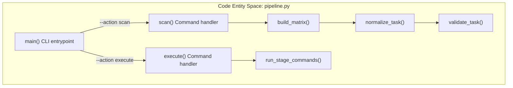
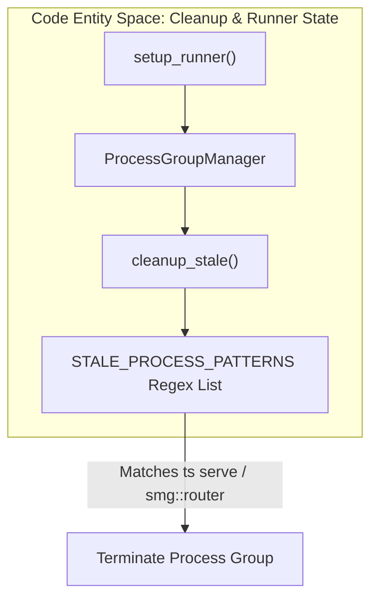
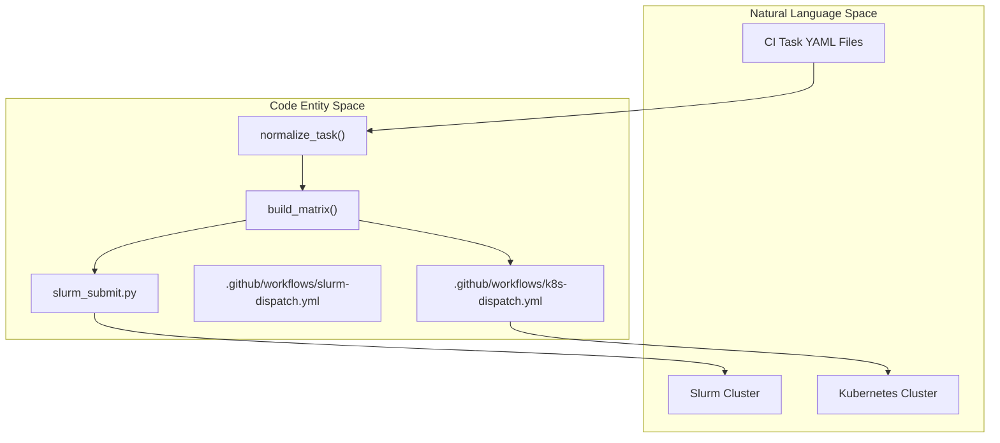
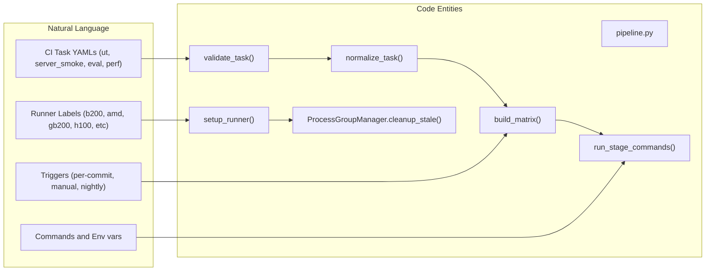
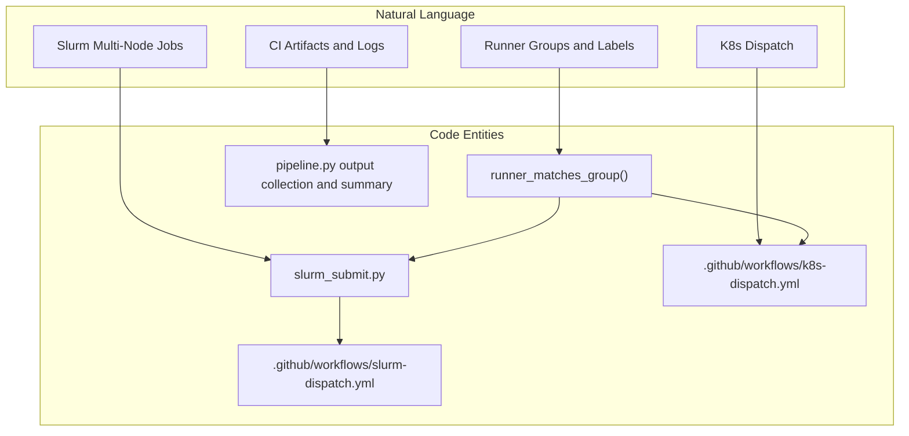

<!-- source: DeepWiki mcp.deepwiki.com · repo lightseekorg/tokenspeed · page 7.1 CI Pipeline and Test Framework · fetched 2026-10-21 -->

# CI Pipeline and Test Framework

Relevant source files

The following files were used as context for generating this wiki page:

- [.github/workflows/cancel-pr-tests-on-close.yml](.github/workflows/cancel-pr-tests-on-close.yml)
- [.github/workflows/k8s-dispatch.yml](.github/workflows/k8s-dispatch.yml)
- [.github/workflows/pr-test-nvidia-arm.yml](.github/workflows/pr-test-nvidia-arm.yml)
- [.github/workflows/retry-failed-approved-prs.yml](.github/workflows/retry-failed-approved-prs.yml)
- [.github/workflows/retry-failed-latest-main.yml](.github/workflows/retry-failed-latest-main.yml)
- [.github/workflows/slurm-dispatch.yml](.github/workflows/slurm-dispatch.yml)
- [python/pyproject.toml](python/pyproject.toml)
- [python/tokenspeed/cli/serve_smg.py](python/tokenspeed/cli/serve_smg.py)
- [python/tokenspeed/version.py](python/tokenspeed/version.py)
- [test/ci/README.md](test/ci/README.md)
- [test/ci/perf/kimi-k3-eagle3-mxfp4-tp8ep1-evalscope-random-50k-500-mi35x.yaml](test/ci/perf/kimi-k3-eagle3-mxfp4-tp8ep1-evalscope-random-50k-500-mi35x.yaml)
- [test/ci_system/ci_path_filter.py](test/ci_system/ci_path_filter.py)
- [test/ci_system/install_deps.sh](test/ci_system/install_deps.sh)
- [test/ci_system/install_deps_rocm.sh](test/ci_system/install_deps_rocm.sh)
- [test/ci_system/package_cache.sh](test/ci_system/package_cache.sh)
- [test/ci_system/pipeline.py](test/ci_system/pipeline.py)
- [test/ci_system/slurm_submit.py](test/ci_system/slurm_submit.py)
- [test/ci_system/test_ci_path_filter.py](test/ci_system/test_ci_path_filter.py)
- [test/ci_system/test_dispatch_workflows.py](test/ci_system/test_dispatch_workflows.py)
- [test/ci_system/test_eval_configs.py](test/ci_system/test_eval_configs.py)
- [test/ci_system/test_package_cache.py](test/ci_system/test_package_cache.py)
- [test/ci_system/test_pipeline.py](test/ci_system/test_pipeline.py)
- [test/ci_system/test_slurm_submit.py](test/ci_system/test_slurm_submit.py)
- [test/cli/test_serve_smg_unit.py](test/cli/test_serve_smg_unit.py)
- [tokenspeed-scheduler/python/tests/test_cache_group_admission.py](tokenspeed-scheduler/python/tests/test_cache_group_admission.py)
- [tokenspeed-scheduler/python/tests/test_d_role_state_reserve.py](tokenspeed-scheduler/python/tests/test_d_role_state_reserve.py)
- [tokenspeed-scheduler/python/tests/test_local_state_growth_reserve.py](tokenspeed-scheduler/python/tests/test_local_state_growth_reserve.py)

## Purpose and Scope

Section 7.1 details the CI pipeline and test framework implemented primarily in the `test/ci_system/` directory and supported by GitHub Actions workflows under `.github/workflows/`. The framework revolves around a Python-based orchestration engine (`pipeline.py`) that scans and executes declarative YAML task specifications found in `test/ci/`. This architecture supports complex hardware environments including NVIDIA Blackwell/Hopper, AMD MI300-series GPUs, and functional emulators.

---

## 1. Pipeline Architecture and Execution Engine (`pipeline.py`)

The heart of the CI system is the `pipeline.py` script in `test/ci_system/`. It exposes a command-line interface supporting key subcommands such as `scan`, `execute`, and `validate`. The pipeline separates duties into scanning and execution phases, matching task types to workflow stages to coordinate unit test, benchmark, and model evaluation runs [test/ci_system/pipeline.py:1-194]().

### Key Components

- **CLI Entrypoint and Subcommands**

  The `main()` function parses CLI arguments to dispatch actions like `scan` and `execute`. These actions orchestrate the discovery and running of CI tasks [test/ci_system/pipeline.py:1-194]().

- **Task Validation and Normalization**

  YAML task specs under `test/ci/` are loaded and validated with `validate_task()`, ensuring compliance with schema requirements such as `api_version`, `type`, `runner.labels`, and trigger filters. Tasks are normalized for downstream matrix generation and execution [test/ci_system/pipeline.py:157-194]().

- **Matrix Generation**

  The `build_matrix()` function compiles task definitions into GitHub Actions-compatible job matrices incorporating task/runners, triggers, and priorities. This matrix is then used to dynamically spawn parallel jobs in workflows [test/ci_system/pipeline.py:121-152](), [test/ci_system/test_dispatch_workflows.py:1-50]().

- **Stage Command Execution**

  Execution proceeds through ordered workflow stages (`unit-test`, `kernel-benchmark`, `model-test`), each mapped to specific task types (`ut`, `server_smoke`, `eval`, `perf`). The `run_stage_commands()` function sequentially runs commands per stage controlling environment, logging, and subprocess lifecycle [test/ci_system/pipeline.py:800-1000]().

Sources: [test/ci_system/pipeline.py:1-194](), [test/ci_system/test_dispatch_workflows.py:1-50](), [.github/workflows/run-pr-test-stage.yml:90-130]()

---

## 2. CI Task Specifications (`test/ci/`)

CI tasks are declared as YAML files organized in `test/ci/ut/`, `test/ci/eval/`, and `test/ci/perf/`. Each task defines its runtime properties, target runners, environmental variables, and commands for various workflow stages [test/ci/README.md:1-153](), [test/ci_system/pipeline.py:150-190]().

### Task YAML Schema and Properties

| Field             | Type                | Description                                                       |
|-------------------|---------------------|-------------------------------------------------------------------|
| `api_version`     | string              | Must be `"ci.tokenspeed.io/v1"`[test/ci_system/pipeline.py:158-163]() |
| `name`            | string              | Unique task name                                                 |
| `type`            | string              | One of `ut`, `server_smoke`, `eval`, or `perf`                   |
| `workflow_stage`  | string (optional)   | Maps to a known workflow stage such as `unit-test` or `model-test`|
| `triggers`        | list of string       | Events triggering task e.g. `per-commit`, `manual`, `nightly`    |
| `runner.labels`   | list of strings      | Hardware target labels (e.g., `b200-4gpu`, `amd-mi35x-1gpu-test`)|
| `priority`        | scalar or map        | Dispatch bias: `high`, `normal`, or `low`                       |
| `optional`        | boolean or map       | Marks jobs as non-blocking (continue-on-error)                   |
| `retries`         | integer              | Number of restart attempts post-failure                          |
| `env`             | map                  | Environment variables per runner label                           |
| `command`         | string               | Shell commands to execute for the stage                          |

The schema validation ensures correct types, presence of required fields, and compatibility of fields such as `type` against allowed values per workflow stage.

Sources: [test/ci/README.md:1-153](), [test/ci_system/pipeline.py:157-194]()

---

## 3. Path Filtering and Runner State Management

To prevent unnecessary task execution on unrelated changes, a path filtering mechanism matches changed files against the directory structure and task labels. This reduces CI runtime cost by skipping hardware-specific tests unless relevant files are modified [test/ci_system/ci_path_filter.py; .github/workflows/pr-test-nvidia.yml:104-108]().

### Runner Groups and Filtering

Runners are categorized into groups: `"all"`, `"amd"`, `"nvidia"`, `"nvidia-arm"`, and `"nvidia-x86"`. The function `runner_matches_group()` performs membership checks based on runner label prefixes [test/ci_system/pipeline.py:110-130]().

### Cleanup of Stale Server Processes

To avoid port conflicts and stale IPC sockets, the framework automatically cleans up orphaned server processes matched by the `STALE_PROCESS_PATTERNS` list containing regexes for:

- Running servers launched via `ts serve`
- SMG gateway and gRPC engine processes
- Other CI-related runners and router components

The `ProcessGroupManager` tracks process states and supports cleanup actions [test/ci_system/pipeline.py:25,59-70]().

Sources: [test/ci_system/pipeline.py:25,59-70,107-130](), [test/ci_system/test_pipeline.py:39-65](), [.github/workflows/pr-test-nvidia.yml:104-108]()

---

## 4. Runner Setup, Emulated Runners, and Dependency Installation

### Runner Setup

Runners are prepared with environment setup, hardware-specific cleanup, and dependency installation adapted to the hardware type. For example, AMD MI450 functional simulators are treated specially by setting environment variables and invoking the `rocJITsu` emulator [test/ci/ut/ut-tokenspeed-kernel-mi450-sim.yaml:1-59]().

### Emulated Runner: AMD MI450 Simulator

The `test/ci_system/setup_mi450_sim.sh` script:

- Clones the `rocm-systems` repo
- Builds `rocJITsu` using CMake and Ninja
- Configures emulator options: device `gfx1250`, disable wallet tool invocations, bypass PCIe detour
- Exports environment variables to run the functional emulator transparently [test/ci_system/setup_mi450_sim.sh:1-90]()

### Dependency Installation

`install_deps.sh` dispatches to installation scripts based on runner type (`amd` vs NVIDIA), CUDA version, and hardware architecture. It wraps `pip` and `apt-get` installs with retry logic to mitigate transient failures in package downloads or APT updates [test/ci_system/install_deps.sh:1-175]().

- FlashInfer JIT caches are synchronized for Blackwell runners to speed up test execution startup.
- Node-local persistent caches on runners like `b200v2-*` reduce cold start overhead for large Python package containers.

Sources: [test/ci/ut/ut-tokenspeed-kernel-mi450-sim.yaml:1-59](), [test/ci_system/setup_mi450_sim.sh:1-90](), [test/ci_system/install_deps.sh:1-175]()

---

## 5. Multi-Node Dispatch: Slurm, Kubernetes, and Pyxis/Enroot

For large-scale and multi-node runs, the TokenSpeed CI pipeline supports job submission on Slurm clusters and Kubernetes environments using task dispatch scripts.

### Slurm Submission (`slurm_submit.py`)

- `slurm_submit.py` parses CLI arguments and YAML task definitions to produce Slurm `sbatch` scripts.
- It validates GPU counts, node numbers, and runner aliases to ensure correct job placement and resource allocation.
- The script encodes binding information for Pyxis containers and Enroot environments.
- Artifacts and logs are collected on shared storage roots for further processing [test/ci_system/slurm_submit.py:1-241]().

### Kubernetes Dispatch (`k8s-dispatch.yml`)

- Kubernetes jobs are launched using matrix-generated task bundles with contextual filtering.
- The dispatch workflows parse PR/Commit information and changed files to selectively launch model tests or benchmarks.
- Runner pools and job concurrency groups are maintained to ensure coordinated execution and cancellation [`.github/workflows/k8s-dispatch.yml:1-165`](), [test/ci_system/test_dispatch_workflows.py:1-161]().

Sources: [test/ci_system/slurm_submit.py:1-241](), [.github/workflows/slurm-dispatch.yml:1-322](), [.github/workflows/k8s-dispatch.yml:1-165]()

---

## 6. Artifact Collection, Validation, and Summaries

After test execution, `pipeline.py` collects logs and result artifacts into `.ci-artifacts` directories. It performs validation such as:

- Extracting performance summaries and verifying against reference thresholds.
- Parsing EvalScope or Inspect evaluation scores and comparing to accuracy thresholds.
- Uploading logs and metrics as GitHub Actions artifacts for reporting and debugging [test/ci/perf/qwen3.5-397b-a17b-nvfp4-evalscope-agentic.yaml:90-102](), [test/ci_system/test_pipeline.py:15-25](), [.github/workflows/run-pr-test-stage.yml:123-140]().

### Summary Generation

The pipeline assembles step summary lines for GitHub Actions annotation, listing:

- Task name and type
- Runner label and hardware info
- Completion status and failure reasons
- Key metric scores and comparisons

This assists in quick triage through the GitHub UI.

Sources: [test/ci_system/test_pipeline.py:11-40](), [test/ci/perf/qwen3.5-397b-a17b-nvfp4-evalscope-agentic.yaml:90-102](), [.github/workflows/run-pr-test-stage.yml:120-140]()

---

# Summary Diagrams Linking Natural Language Concepts to Code Entities

---

# References and Further Reading

- `test/ci_system/pipeline.py`: central orchestrator, task validation, matrix construction, execution [lines 1-194, 700-1000]()
- `test/ci/README.md`: detailed task YAML specs, triggers, priorities [lines 1-153]()
- `test/ci_system/test_pipeline.py`: unit tests for pipeline utilities and filtering [lines 1-200]()
- `test/ci_system/install_deps.sh`: dependency install scripts with retry loops and hardware dispatch [lines 1-175]()
- `test/ci_system/setup_mi450_sim.sh`: MI450 functional emulator setup script [lines 1-90]()
- `.github/workflows/slurm-dispatch.yml`: Slurm job dispatch workflow [lines 1-322]()
- `.github/workflows/k8s-dispatch.yml`: Kubernetes dispatch workflow [lines 1-165]()
- `test/ci_system/slurm_submit.py`: Slurm submission script, Task and Submission classes [lines 1-241]()

This architecture forms a comprehensive CI pipeline supporting diverse hardware, multi-node distributed testing, matrix-based workload parallelization, and artifact-driven validation critical to maintaining TokenSpeed's high performance and hardware compatibility.

Sources: [test/ci_system/pipeline.py:1-194,700-1000](), [test/ci/README.md:1-153](), [test/ci_system/test_pipeline.py:1-200](), [test/ci_system/install_deps.sh:1-175](), [test/ci_system/setup_mi450_sim.sh:1-90](), [.github/workflows/slurm-dispatch.yml:1-322](), [.github/workflows/k8s-dispatch.yml:1-165](), [test/ci_system/slurm_submit.py:1-241]()

---

