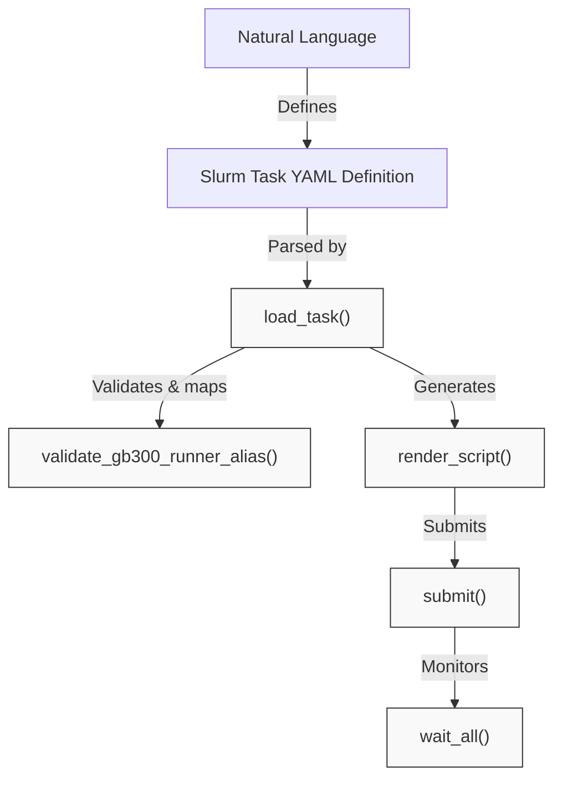
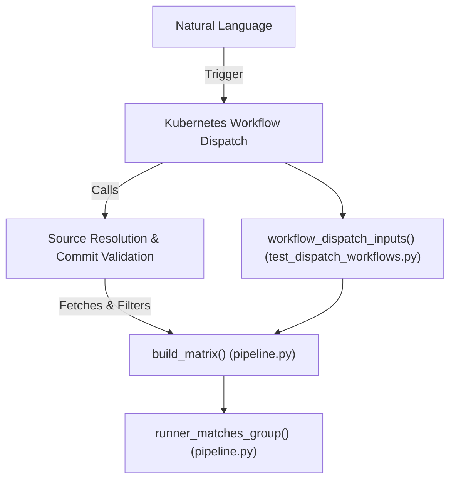
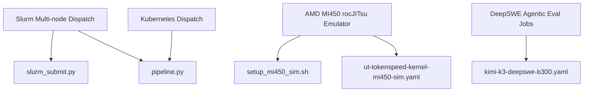

<!-- source: DeepWiki mcp.deepwiki.com · repo lightseekorg/tokenspeed · page 7.2 Multi-Node Dispatch: Slurm, K8s, and Emulated Runners · fetched 2026-10-21 -->

# Multi-Node Dispatch: Slurm, K8s, and Emulated Runners

Relevant source files

The following files were used as context for generating this wiki page:

- [.github/workflows/k8s-dispatch.yml](.github/workflows/k8s-dispatch.yml)
- [.github/workflows/slurm-dispatch.yml](.github/workflows/slurm-dispatch.yml)
- [test/ci/README.md](test/ci/README.md)
- [test/ci/eval/kimi-k3-mxfp4-dspark-tp8-two-node-kvv-mmmu-pro-vision-gb300-slurm.yaml](test/ci/eval/kimi-k3-mxfp4-dspark-tp8-two-node-kvv-mmmu-pro-vision-gb300-slurm.yaml)
- [test/ci/eval/kimi-k3-mxfp4-dspark-tp8-two-node-kvv-ocr-bench-gb300-slurm.yaml](test/ci/eval/kimi-k3-mxfp4-dspark-tp8-two-node-kvv-ocr-bench-gb300-slurm.yaml)
- [test/ci/eval/kimi-k3-mxfp4-tp16-four-node-evalscope-aime26-slurm.yaml](test/ci/eval/kimi-k3-mxfp4-tp16-four-node-evalscope-aime26-slurm.yaml)
- [test/ci/eval/kimi-k3-mxfp4-tp8-two-node-evalscope-aime26-gb300-slurm.yaml](test/ci/eval/kimi-k3-mxfp4-tp8-two-node-evalscope-aime26-gb300-slurm.yaml)
- [test/ci/eval/kimi-k3-nvfp4-dspark-tp8-two-node-evalscope-aime26-gb300-slurm.yaml](test/ci/eval/kimi-k3-nvfp4-dspark-tp8-two-node-evalscope-aime26-gb300-slurm.yaml)
- [test/ci/eval/kimi-k3-nvfp4-tp8-two-node-evalscope-aime26-gb300-slurm.yaml](test/ci/eval/kimi-k3-nvfp4-tp8-two-node-evalscope-aime26-gb300-slurm.yaml)
- [test/ci/perf/kimi-k3-eagle3-mxfp4-tp8ep1-evalscope-random-50k-500-mi35x.yaml](test/ci/perf/kimi-k3-eagle3-mxfp4-tp8ep1-evalscope-random-50k-500-mi35x.yaml)
- [test/ci/ut/ut-tokenspeed-kernel-mi450-sim.yaml](test/ci/ut/ut-tokenspeed-kernel-mi450-sim.yaml)
- [test/ci_system/mi450_rocjitsu_worker_python.sh](test/ci_system/mi450_rocjitsu_worker_python.sh)
- [test/ci_system/mi450_sim_report_digest.py](test/ci_system/mi450_sim_report_digest.py)
- [test/ci_system/pipeline.py](test/ci_system/pipeline.py)
- [test/ci_system/run_mi450_rocjitsu_parallel.sh](test/ci_system/run_mi450_rocjitsu_parallel.sh)
- [test/ci_system/setup_mi450_sim.sh](test/ci_system/setup_mi450_sim.sh)
- [test/ci_system/slurm_submit.py](test/ci_system/slurm_submit.py)
- [test/ci_system/test_dispatch_workflows.py](test/ci_system/test_dispatch_workflows.py)
- [test/ci_system/test_eval_configs.py](test/ci_system/test_eval_configs.py)
- [test/ci_system/test_pipeline.py](test/ci_system/test_pipeline.py)
- [test/ci_system/test_slurm_submit.py](test/ci_system/test_slurm_submit.py)
- [test/runtime/test_kimi_k3_cudagraph.py](test/runtime/test_kimi_k3_cudagraph.py)
- [test/runtime/test_kimi_k3_mla.py](test/runtime/test_kimi_k3_mla.py)

## Purpose and Scope
This page details the multi-node dispatch infrastructure in the TokenSpeed codebase, focusing on the orchestration of distributed tasks across Slurm clusters, Kubernetes workflows, and emulated GPU runners. It covers:

- Slurm submission mechanisms, including snapshotting, sbatch/srun script rendering, containerization with Pyxis and Enroot, and multi-node workflows on GB200/GB300 hardware.
- Kubernetes (K8s) dispatch workflows, including source resolution and test matrix construction.
- Emulated runners using AMD MI450/gfx1250 `rocJITsu` functional simulators for kernel testing without hardware.
- DeepSWE agentic evaluation jobs for multi-node NVIDIA B300 hardware.

---

## 1. Slurm Submission and Orchestration

### Overview
TokenSpeed orchestrates evaluation and performance CI tasks on Slurm clusters (notably GB200 and GB300) using the `test/ci_system/slurm_submit.py` script. This script acts as a Slurm task coordinator, parsing task YAMLs, validating runner configurations, mapping runner aliases for hardware abstraction (notably remapping GB200 to GB300 runners), and submitting Slurm jobs with appropriate GPU and node topologies.

### Task Loading and Validation
Tasks are described in YAML format in the `test/ci/` CI directory. `slurm_submit.py` parses these using `load_task()` which loads and normalizes the YAML, validates that the runner label exists, and infers GPU counts and node counts, ensuring consistency between the declared Slurm node/gpu topology and the runner label [test/ci_system/slurm_submit.py:76-118]().

Importantly, multi-node jobs specify the number of nodes and GPUs per node explicitly via the `slurm` section in the YAML, allowing the system to accurately request resource allocations for distributed runs [test/ci/README.md:143-160]().

### Runner Alias Mapping
To abstract hardware differences, runner aliases are supported, e.g., mapping a logical GB200 runner label to a physical GB300 runner. This flexibility is handled via `validate_gb300_runner_alias()` in the pipeline and used in `load_task()` [test/ci_system/slurm_submit.py:100-111](), [test/ci_system/pipeline.py:154-170]().

### Script Rendering and Submission
Once tasks are loaded and validated, `render_script()` generates Slurm batch submission scripts embedding environment variables, runner information, and GPU IDs. The script invokes Enroot containers wrapped with Pyxis for isolation and efficient GPU resource management in the Slurm environment.

The core Slurm submission and monitoring flow occurs via `submit()` and `wait_all()` which handles launching jobs, querying job status, and collecting logs [test/ci_system/slurm_submit.py:200-253]().

### Data Flow Diagram

*Diagram 1: Natural language Slurm tasks mapped to code entities handling Slurm submission.*

---

## 2. Kubernetes Dispatch and Workflow Integration

### Overview
TokenSpeed leverages GitHub Actions workflows to dispatch CI tasks for execution on Kubernetes clusters, coordinating with runner groups and dynamically building task matrices.

The workflow `.github/workflows/k8s-dispatch.yml` defines inputs such as PR number, commit SHA, runner pool, task types, and filtering patterns. The scan phase resolves GitHub sources, validates commit/pr compatibility, and constructs relevant job matrices [`.github/workflows/k8s-dispatch.yml:1-168`](), [test/ci_system/pipeline.py:1-194](). 

### Configuration Filtering and Matrix Construction
The `pipeline.py` module contains logic to build task matrices filtered by triggers, runner labels, and hardware groups such as `amd`, `nvidia`, `nvidia-arm`, and `nvidia-x86`. It provides utility functions like `runner_matches_group()` to filter runners by group [test/ci_system/pipeline.py:119-130](). 

### Source Resolution
Source SHA and PR metadata are dynamically resolved via GitHub API wrappers, enabling consistent determination of code to test per job run. This step is implemented in the "Resolve source" step of the workflow [test/ci_system/test_dispatch_workflows.py:80-160]().

### Data Flow Diagram

*Diagram 2: From natural language workflow inputs to source resolution and matrix filtering functions.*

---

## 3. AMD MI450 / gfx1250 rocJITsu Emulator Runners

### Purpose
To facilitate testing AMD gfx1250 (MI450) specific kernels in CI environments without physical hardware availability, TokenSpeed integrates the `rocJITsu` functional GPU simulator. This enables functional validation of AMD kernel implementations in the pipeline `tokenspeed-kernel-amd`.

### Setup and Configuration
The setup is scripted in `test/ci_system/setup_mi450_sim.sh` which installs ROCm SDK dependencies, clones the ROCm-systems repository at a pinned commit, installs the ROCJITsu emulator, and adjusts configuration JSON like `gfx1250_mi455x.json` to disable execution tick limits for the HIP driver initialization [test/ci_system/setup_mi450_sim.sh:1-90](). 

CPU thread budgets are set conservatively for K8s runner cgroup quotas to avoid interference with host scheduling. The ROCJITsu native launcher and shared libraries are rebuilt if not cached [test/ci_system/setup_mi450_sim.sh:70-99]().

### Emulator Test Configuration
The run configuration lives in `test/ci/ut/ut-tokenspeed-kernel-mi450-sim.yaml`. This config defines environment variables controlling parallelism, test subsets, and simulator runtime parameters. It runs selected kernel tests focusing on key attention prefill and decode functions, MLA kernels, KDA replay, and MoE staging that are critical for AMD validation [test/ci/ut/ut-tokenspeed-kernel-mi450-sim.yaml:1-87]().

---

## 4. DeepSWE Agentic Evaluation Jobs

### Overview
Agentic evaluation workflows using DeepSWE are implemented for multi-node NVIDIA workloads, especially targeting B300 GPUs.

These jobs coordinate specialized AI agent environments with reasoning evaluation, combining environment bootstrapping, threshold scoring, and orchestrating distributed model inference to generate agentic behavior evaluations on large models such as Kimi-K3 and Qwen.

### Configuration and Execution
DeepSWE job workflows are defined in YAML under `test/ci/eval/kimi-k3-deepswe-b300.yaml` and others, triggered via GitHub Actions workflows like `.github/workflows/b300-deepswe.yml` (not shown here). They specify the multi-node runner pools, concurrency parameters, and evaluation harness commands tailored for the agentic evaluations.

---

# Summary Table of Components

| Functionality            | Key Files / Configurations                     | Description                                                    |
|-------------------------|------------------------------------------------|----------------------------------------------------------------|
| Slurm Submission        | `test/ci_system/slurm_submit.py`                | Parses and submits Slurm tasks; handles multi-node GPU setups. |
| Slurm Task YAMLs        | `test/ci/` directory task YAMLs                 | Declare tasks with runner labels, node/gpu specs, commands.    |
| Kubernetes Dispatch     | `.github/workflows/k8s-dispatch.yml`, `test/ci_system/pipeline.py` | GitHub Actions workflows for K8s dispatch and matrix builds.         |
| Emulator Runners Setup  | `test/ci_system/setup_mi450_sim.sh`, `test/ci/ut/ut-tokenspeed-kernel-mi450-sim.yaml` | MI450 gfx1250 kernel testing via `rocJITsu` emulator.            |
| DeepSWE Agentic Jobs    | `test/ci/eval/kimi-k3-deepswe-b300.yaml` and workflows | Agentic evaluation runs on multi-node B300 GPUs.                 |

---

# Visual Summary Bridging Natural Language to Code Entities

*Diagram 3: High-level mapping of system components to their defining code/config files.*

---

# References and Sources

- Slurm submission and task abstraction: `test/ci_system/slurm_submit.py:1-253`, `test/ci/README.md:143-160`
- Runner alias validation and matrix construction: `test/ci_system/pipeline.py:100-170, 119-130`
- K8s dispatch workflow: `.github/workflows/k8s-dispatch.yml:1-168`, `test/ci_system/test_dispatch_workflows.py:20-161`
- AMD MI450 simulator setup: `test/ci_system/setup_mi450_sim.sh:1-90`, `test/ci/ut/ut-tokenspeed-kernel-mi450-sim.yaml:1-87`
- DeepSWE job configs: `test/ci/eval/kimi-k3-deepswe-b300.yaml`

---

This completes the comprehensive technical overview of TokenSpeed's multi-node dispatch subsystems including Slurm, Kubernetes, and functional AMD GPU emulation pipelines.

---

