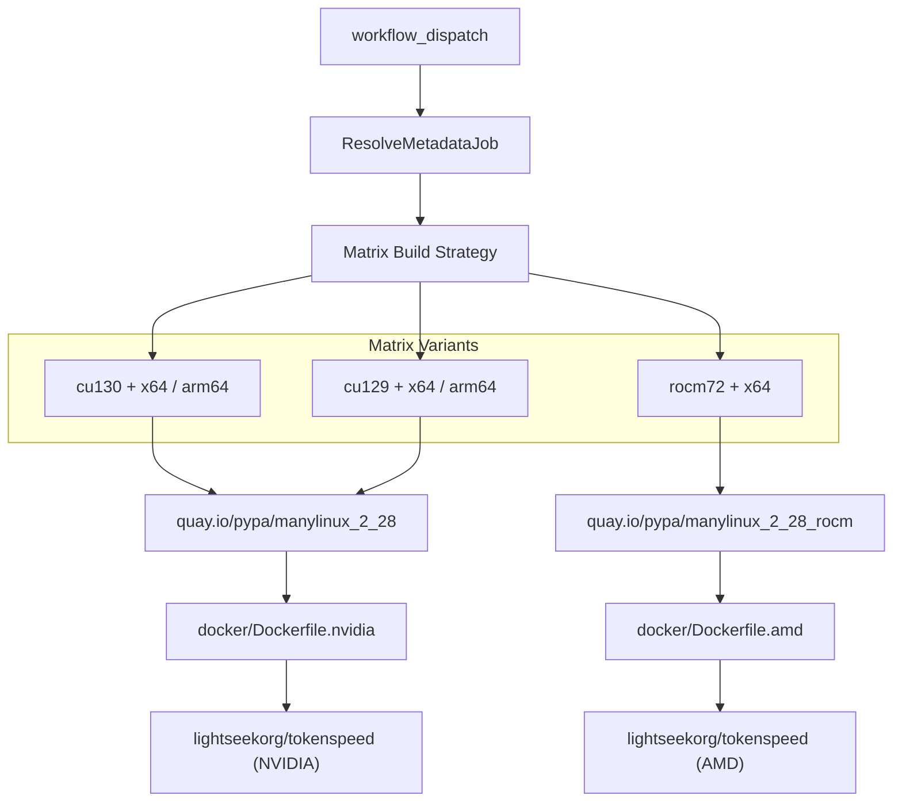
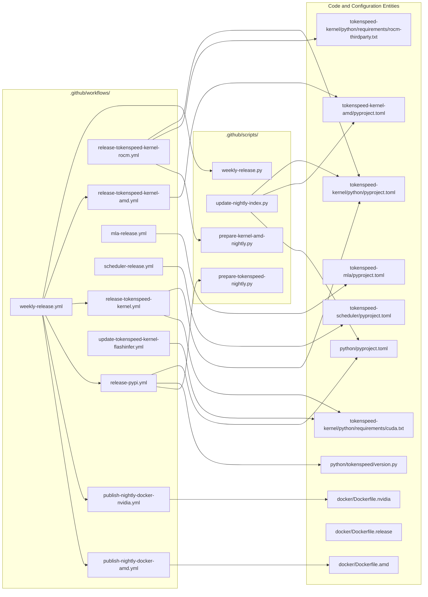

<!-- source: DeepWiki mcp.deepwiki.com · repo lightseekorg/tokenspeed · page 7.3 Release Pipelines and Docker Images · fetched 2026-10-21 -->

# Release Pipelines and Docker Images

<details>
<summary>Relevant source files</summary>

The following files were used as context for generating this wiki page:

- [.github/scripts/prepare-kernel-amd-nightly.py](.github/scripts/prepare-kernel-amd-nightly.py)
- [.github/scripts/prepare-tokenspeed-nightly.py](.github/scripts/prepare-tokenspeed-nightly.py)
- [.github/scripts/update-nightly-index.py](.github/scripts/update-nightly-index.py)
- [.github/scripts/weekly-release.py](.github/scripts/weekly-release.py)
- [.github/workflows/lint.yml](.github/workflows/lint.yml)
- [.github/workflows/mla-release.yml](.github/workflows/mla-release.yml)
- [.github/workflows/publish-nightly-docker-amd.yml](.github/workflows/publish-nightly-docker-amd.yml)
- [.github/workflows/publish-nightly-docker-nvidia.yml](.github/workflows/publish-nightly-docker-nvidia.yml)
- [.github/workflows/publish-release-docker.yml](.github/workflows/publish-release-docker.yml)
- [.github/workflows/release-pypi.yml](.github/workflows/release-pypi.yml)
- [.github/workflows/release-tokenspeed-kernel-amd-nightly.yml](.github/workflows/release-tokenspeed-kernel-amd-nightly.yml)
- [.github/workflows/release-tokenspeed-kernel-amd.yml](.github/workflows/release-tokenspeed-kernel-amd.yml)
- [.github/workflows/release-tokenspeed-kernel-rocm.yml](.github/workflows/release-tokenspeed-kernel-rocm.yml)
- [.github/workflows/release-tokenspeed-kernel.yml](.github/workflows/release-tokenspeed-kernel.yml)
- [.github/workflows/release-tokenspeed-mla.yml](.github/workflows/release-tokenspeed-mla.yml)
- [.github/workflows/scheduler-release.yml](.github/workflows/scheduler-release.yml)
- [.github/workflows/update-tokenspeed-mla-version.yml](.github/workflows/update-tokenspeed-mla-version.yml)
- [.github/workflows/weekly-release-stage.yml](.github/workflows/weekly-release-stage.yml)
- [.github/workflows/weekly-release.yml](.github/workflows/weekly-release.yml)
- [docker/Dockerfile.amd](docker/Dockerfile.amd)
- [docker/Dockerfile.nvidia](docker/Dockerfile.nvidia)
- [docker/Dockerfile.release](docker/Dockerfile.release)
- [docs/guides/getting-started.md](docs/guides/getting-started.md)
- [docs/guides/weekly-release.md](docs/guides/weekly-release.md)
- [docs/index.md](docs/index.md)
- [test/ci_system/flashinfer_jit_cache_installer.py](test/ci_system/flashinfer_jit_cache_installer.py)
- [test/ci_system/install_kernel_benchmark_rocm.sh](test/ci_system/install_kernel_benchmark_rocm.sh)
- [test/ci_system/test_flashinfer_jit_cache.py](test/ci_system/test_flashinfer_jit_cache.py)
- [test/ci_system/test_nightly_release.py](test/ci_system/test_nightly_release.py)
- [test/ci_system/test_weekly_release.py](test/ci_system/test_weekly_release.py)
- [tokenspeed-kernel/python/pyproject.toml](tokenspeed-kernel/python/pyproject.toml)
- [tokenspeed-kernel/python/tokenspeed_kernel/ops/attention/gdn/README.md](tokenspeed-kernel/python/tokenspeed_kernel/ops/attention/gdn/README.md)
- [tokenspeed-kernel/python/tokenspeed_kernel/ops/attention/gdn/_flashinfer/pdl.py](tokenspeed-kernel/python/tokenspeed_kernel/ops/attention/gdn/_flashinfer/pdl.py)
- [tokenspeed-kernel/python/tokenspeed_kernel/thirdparty/cute_dsl/argmax.py](tokenspeed-kernel/python/tokenspeed_kernel/thirdparty/cute_dsl/argmax.py)
- [tokenspeed-kernel/test/test_nightly_index.py](tokenspeed-kernel/test/test_nightly_index.py)
- [tokenspeed-mla/scripts/check_release.py](tokenspeed-mla/scripts/check_release.py)
- [tokenspeed-mla/tests/test_release.py](tokenspeed-mla/tests/test_release.py)

</details>


TokenSpeed utilizes GitHub Actions to manage the lifecycle of its multi-package monorepo. The release infrastructure is split into core Python package publishing to PyPI for components like `tokenspeed-scheduler` [tokenspeed-scheduler/pyproject.toml:11-14](), `tokenspeed-mla` [tokenspeed-mla/pyproject.toml:5-8](), and `tokenspeed-kernel-amd` [tokenspeed-kernel-amd/pyproject.toml:5-8](); CUDA and ROCm variant matrices [`.github/workflows/release-tokenspeed-kernel.yml:14-30`](); manylinux wheel builds [`.github/workflows/release-tokenspeed-kernel.yml:144-162`](); FlashInfer JIT cache pinning/updating [test/ci_system/test_flashinfer_jit_cache.py:4-9](); and Docker nightly/release images [docker/Dockerfile.nvidia:1-4]().

---

## 1. Core Release Triggers and PyPI Package Publishing

The primary release workflows for monorepo components are orchestrated via GitHub Actions workflows and configured through standard packaging files (`pyproject.toml`, `setup.py`).

| Pipeline | Trigger File | Target Package | Target Registry |
| :--- | :--- | :--- | :--- |
| **Scheduler Release** | `.github/workflows/scheduler-release.yml` [`.github/workflows/scheduler-release.yml:1-15`]() | `tokenspeed-scheduler` | PyPI / GitHub (`lightseekorg/whl`) |
| **Kernel CUDA Release** | `.github/workflows/release-tokenspeed-kernel.yml` [`.github/workflows/release-tokenspeed-kernel.yml:1-46`]() | `tokenspeed-kernel` | PyPI / GitHub |
| **MLA Release** | `.github/workflows/mla-release.yml` [`.github/workflows/mla-release.yml:1-15`]() | `tokenspeed-mla` | PyPI |
| **Kernel AMD Release** | `.github/workflows/release-tokenspeed-kernel-amd.yml` [`.github/workflows/release-tokenspeed-kernel-amd.yml:1-26`]() | `tokenspeed-kernel-amd` | PyPI |
| **TokenSpeed Release** | `.github/workflows/release-pypi.yml` [`.github/workflows/release-pypi.yml:1-27`]() | `tokenspeed` | PyPI / GitHub (`lightseekorg/whl`) |

### PyPI Publishing Implementation
Components declare their package metadata and dependencies in their respective project manifests. For instance, `tokenspeed-mla` specifies dependencies such as `apache-tvm-ffi==0.1.13.post3`, `nvidia-cutlass-dsl`, `tokenspeed-triton>=3.8.10.post20260721`, and `torch` [tokenspeed-mla/pyproject.toml:12-17](). Similarly, `tokenspeed-scheduler` uses `scikit-build-core` with `nanobind>=2.13.0` and `tokenspeed-spdlog==1.15.1` to compile its C++ bindings [tokenspeed-scheduler/pyproject.toml:1-8]().

The `release-pypi.yml` workflow handles the `tokenspeed` package itself. It builds distributions [`.github/workflows/release-pypi.yml:102-108`]() and publishes them to PyPI using `pypa/gh-action-pypi-publish@release/v1` [`.github/workflows/release-pypi.yml:132-134`](). Nightly builds are published to `lightseekorg/whl` [`.github/workflows/release-pypi.yml:153-172`]().

Sources:
- [tokenspeed-mla/pyproject.toml:5-17]()
- [tokenspeed-scheduler/pyproject.toml:1-18]()
- [tokenspeed-kernel-amd/pyproject.toml:5-15]()
- [`.github/workflows/scheduler-release.yml:1-15`]()
- [`.github/workflows/release-tokenspeed-kernel.yml:1-46`]()
- [`.github/workflows/mla-release.yml:1-15`]()
- [`.github/workflows/release-tokenspeed-kernel-amd.yml:1-26`]()
- [`.github/workflows/release-pypi.yml:1-177`]()

---

## 2. Docker Image Build Matrices and Registry Publishing

TokenSpeed produces standardized container images optimized for NVIDIA and AMD hardware.

### NVIDIA Production Images (`docker/Dockerfile.nvidia`)
The NVIDIA production container builds upon a multi-architecture base image pinned to specific runtime versions [docker/Dockerfile.nvidia:1-4]():
- **Base Image**: `lightseekorg/tokenspeed-runner:cu130-torch-2.13.0-flashinfer-0.6.18` [docker/Dockerfile.nvidia:4-4]()
- **Build Sequence**: Installs system packages (`libssl-dev`, `libopenmpi-dev`, `libnuma1`, `pkg-config`) [docker/Dockerfile.nvidia:18-23](), then builds and installs `tokenspeed-kernel` with `TOKENSPEED_KERNEL_BACKEND=cuda` [docker/Dockerfile.nvidia:32-33](), `tokenspeed-scheduler` [docker/Dockerfile.nvidia:34-34](), and the core runtime package from `./python` [docker/Dockerfile.nvidia:35-35]().

### AMD Production Images (`docker/Dockerfile.amd`)
The AMD production container is built using `docker/Dockerfile.amd` [docker/Dockerfile.amd:1-4](). It uses a ROCm-enabled base image and installs `tokenspeed-kernel` with `TOKENSPEED_KERNEL_BACKEND=rocm` [docker/Dockerfile.amd:32-33]().

### Build Matrix and Strategy
The container and wheel pipelines target a matrix of architectures (`x64`, `arm64`) and CUDA variant configurations (`cu130`, `cu129`) [`.github/workflows/release-tokenspeed-kernel.yml:111-152`]. Manulinux wheel builds are executed inside `quay.io/pypa/manylinux_2_28` containers equipped with toolchain components like `cuda-nvcc` and `gcc-toolset-13` [`.github/workflows/release-tokenspeed-kernel.yml:170-192`].

**Title: Docker and Wheel Matrix Architecture**


Sources:
- [docker/Dockerfile.nvidia:1-37]()
- [docker/Dockerfile.amd:1-37]()
- [`.github/workflows/release-tokenspeed-kernel.yml:55-192`]()
- [`.github/workflows/release-tokenspeed-kernel-rocm.yml:123-137`]()

---

## 3. Component-Specific Binary Pipelines

### 3.1. `tokenspeed-kernel`
The CUDA kernel pipeline resolves version metadata dynamically using `setup.py` [`.github/workflows/release-tokenspeed-kernel.yml:92-99`](). It supports dispatching selective variants (`cu130`, `cu129`, or `all`) and ensures strict checks against local git version segments prior to PyPI publication [`.github/workflows/release-tokenspeed-kernel.yml:14-45`, `[`.github/workflows/release-tokenspeed-kernel.yml:101-104`]()].

The ROCm kernel pipeline (`release-tokenspeed-kernel-rocm.yml`) builds wheels for ROCm 7.2 [`.github/workflows/release-tokenspeed-kernel-rocm.yml:40-40`, `.github/workflows/release-tokenspeed-kernel-rocm.yml:123-137`](). It depends on the `tokenspeed-kernel-amd` nightly being available for the same date [`.github/workflows/release-tokenspeed-kernel-rocm.yml:93-110`]().

### 3.2. `tokenspeed-scheduler`
The C++ scheduler release pipeline (`scheduler-release.yml`) utilizes `pypa/cibuildwheel` across `x86_64` and `arm64` runners [`.github/workflows/scheduler-release.yml:21-34`]. It builds wheels for Python 3.10 through 3.13, validates them using `twine check`, and uploads artifacts to GitHub releases under `lightseekorg/whl` as well as publishing directly to PyPI [`.github/workflows/scheduler-release.yml:54-170`].

### 3.3. Nightly Index Updates
The `update-nightly-index.py` script [`.github/scripts/update-nightly-index.py:21-22`]() is responsible for updating the `lightseek.org/whl/nightly` simple API index. It takes the wheelhouse path, release JSON, distributions path, package name, and variant (`cu130` or `rocm72`) as input [`.github/scripts/update-nightly-index.py:30-36`](). It parses existing `index.html` files, adds new wheel entries with their download URLs and SHA256 digests, and handles replacement of existing entries if `replace=True` is specified [`.github/scripts/update-nightly-index.py:60-87`](). This ensures that `pip install --extra-index-url` can correctly resolve nightly packages.

Sources:
- [`.github/workflows/release-tokenspeed-kernel.yml:14-136`]()
- [`.github/workflows/release-tokenspeed-kernel-rocm.yml:40-137`]()
- [`.github/workflows/scheduler-release.yml:21-170`]()
- [`.github/scripts/update-nightly-index.py:21-128`]()
- [tokenspeed-kernel/test/test_nightly_index.py:29-107]()

---

## 4. FlashInfer JIT Cache Pinning and Automated Maintenance

TokenSpeed manages third-party binary acceleration dependencies like FlashInfer through precise requirement pins and automated synchronization workflows.

### FlashInfer JIT Cache Pinning
The CUDA requirements file `tokenspeed-kernel/python/requirements/cuda.txt` pins exact versions for tools such as `torch==2.13.0`, `flashinfer-python==0.6.18`, and `nvidia-cutlass-dsl[cu13]==4.7.1` [tokenspeed-kernel/python/requirements/cuda.txt:6-12]().

Testing for the JIT cache installation logic is codified in `test/ci_system/test_flashinfer_jit_cache.py`, which validates wheel URLs against expected FlashInfer versions and CUDA runtime variants [test/ci_system/test_flashinfer_jit_cache.py:27-36]():

```python
def test_jit_cache_url_tracks_flashinfer_and_cuda_versions():
    assert expected_jit_cache_version("0.6.18", "130") == "0.6.18+cu130"
    assert jit_cache_wheel_url(
        "0.6.18", "130", platform_tag="manylinux_2_28_aarch64"
    ) == (
        "https://github.com/flashinfer-ai/flashinfer/releases/download/"
        "v0.6.18/flashinfer_jit_cache-0.6.18+cu130-cp39-abi3-"
        "manylinux_2_28_aarch64.whl"
    )
``` [test/ci_system/test_flashinfer_jit_cache.py:27-35]()

### Automated FlashInfer Update Workflow
The `.github/workflows/update-tokenspeed-kernel-flashinfer.yml` workflow automates dependency maintenance [`.github/workflows/update-tokenspeed-kernel-flashinfer.yml:1-18`]. It parses requested FlashInfer versions, updates `tokenspeed-kernel/python/requirements/cuda.txt`, commits changes via `lightseekorg-bot`, and opens a pull request [`.github/workflows/update-tokenspeed-kernel-flashinfer.yml:36-103`].

**Title: FlashInfer JIT Cache Update Flow**
```mermaid
graph LR
    Workflow["update-tokenspeed-kernel-flashinfer.yml"] --> Parse["Parse Version Inputs"]
    Parse --> ReqFile["tokenspeed-kernel/python/requirements/cuda.txt"]
    ReqFile --> TestJIT["test_flashinfer_jit_cache.py"]
    TestJIT --> PR["Create Pull Request"]
``` [`.github/workflows/update-tokenspeed-kernel-flashinfer.yml:33-103`, test/ci_system/test_flashinfer_jit_cache.py:27-36]()

Sources:
- [tokenspeed-kernel/python/requirements/cuda.txt:1-16]()
- [test/ci_system/test_flashinfer_jit_cache.py:1-72]()
- [`.github/workflows/update-tokenspeed-kernel-flashinfer.yml:1-104`]()

---

## 5. Weekly Release Orchestration

The `weekly-release.yml` workflow [`.github/workflows/weekly-release.yml:1-15`]() orchestrates the biweekly stable release process. It is triggered on a schedule or manually [`.github/workflows/weekly-release.yml:3-10`]() and uses the `weekly-release.py` script [`.github/scripts/weekly-release.py:21-22`]() to manage the release state.

The workflow proceeds through several stages:
1.  **Lock `main` and CI checks**: Ensures the latest `main` commit has passed CI before reserving versions [docs/guides/weekly-release.md:11-25]().
2.  **`tokenspeed-kernel-amd` release**: Creates a version PR, merges it, and publishes to PyPI and the wheelhouse [docs/guides/weekly-release.md:26-28]().
3.  **`tokenspeed-kernel` release**: Updates the AMD dependency, creates a version PR, and publishes CUDA 12.9/13.0 and ROCm 7.2 wheels [docs/guides/weekly-release.md:29-32]().
4.  **`tokenspeed` release**: Updates the kernel requirement and version declarations, then publishes distributions to the wheelhouse [docs/guides/weekly-release.md:33-36]().
5.  **Update stable pip indexes**: Updates the CUDA and ROCm pip indexes [docs/guides/weekly-release.md:37-38]().
6.  **Publish Docker images**: Publishes NVIDIA Docker images for `linux/amd64` and `linux/arm64` [docs/guides/weekly-release.md:39-42]().
7.  **Create GitHub release**: Creates a `v<version>` tag with generated release notes [docs/guides/weekly-release.md:43-46]().
8.  **Cleanup**: Verifies published sources and release page, then deletes temporary release branches [docs/guides/weekly-release.md:47-49]().

The `weekly-release.py` script maintains state across workflow runs, allowing for recovery from failures [`.github/scripts/weekly-release.py:21-22`, docs/guides/weekly-release.md:72-76](). It uses GitHub API calls to manage PRs, check CI status, and publish releases [`.github/scripts/weekly-release.py:98-101`, `.github/scripts/weekly-release.py:104-108`]().

**Title: Weekly Release Workflow Stages**
```mermaid
graph TD
    A[Scheduled/Manual Trigger] --> B{Lock main & CI Pass?}
    B -- Yes --> C[Release tokenspeed-kernel-amd]
    C --> D[Release tokenspeed-kernel (CUDA/ROCm)]
    D --> E[Release tokenspeed]
    E --> F[Update Stable Pip Indexes]
    F --> G[Publish Docker Images]
    G --> H[Create GitHub Release]
    H --> I[Cleanup]
    B -- No --> J[Fail/Retry]
```
Sources:
- [`.github/workflows/weekly-release.yml:1-15`]()
- [`.github/scripts/weekly-release.py:21-22`]()
- [docs/guides/weekly-release.md:11-49]()
- [test/ci_system/test_weekly_release.py:21-193]()

---

## 6. Implementation Data Flow and Code Mapping

The following diagram maps CI workflow files and maintenance scripts to their respective source configuration entities within the monorepo.

**Title: Release and Maintenance Pipeline Code Entity Mapping**

Sources:
- [`.github/workflows/release-tokenspeed-kernel.yml:1-46`]()
- [`.github/workflows/release-tokenspeed-kernel-rocm.yml:1-425`]()
- [`.github/workflows/release-tokenspeed-kernel-amd.yml:1-421`]()
- [`.github/workflows/mla-release.yml:1-15`]()
- [`.github/workflows/scheduler-release.yml:1-15`]()
- [`.github/workflows/release-pypi.yml:1-328`]()
- [`.github/workflows/update-tokenspeed-kernel-flashinfer.yml:1-20`]()
- [`.github/workflows/weekly-release.yml:1-15`]()
- [`.github/workflows/publish-nightly-docker-nvidia.yml:1-15`]()
- [`.github/workflows/publish-nightly-docker-amd.yml:1-15`]()
- [`.github/scripts/weekly-release.py:21-22`]()
- [`.github/scripts/update-nightly-index.py:21-22`]()
- [`.github/scripts/prepare-kernel-amd-nightly.py:1-15`]()
- [`.github/scripts/prepare-tokenspeed-nightly.py:1-15`]()
- [tokenspeed-kernel/python/pyproject.toml:1-10]()
- [tokenspeed-kernel-amd/pyproject.toml:1-15]()
- [tokenspeed-mla/pyproject.toml:1-17]()
- [tokenspeed-scheduler/pyproject.toml:1-18]()
- [python/pyproject.toml:1-15]()
- [tokenspeed-kernel/python/requirements/cuda.txt:1-16]()
- [tokenspeed-kernel/python/requirements/rocm-thirdparty.txt:1-4]()
- [docker/Dockerfile.nvidia:1-37]()
- [docker/Dockerfile.amd:1-37]()
- [docker/Dockerfile.release:1-28]()
- [python/tokenspeed/version.py:1-15]()

---

