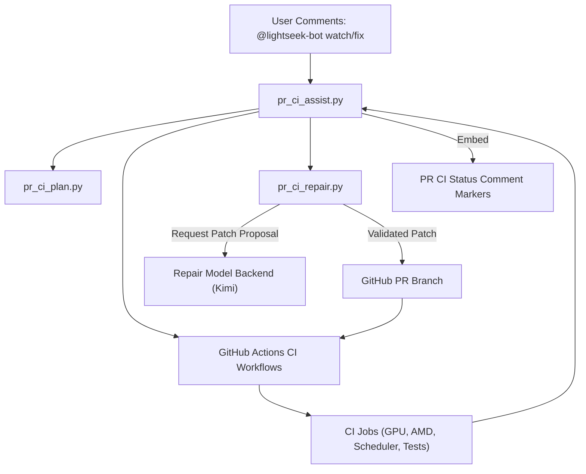
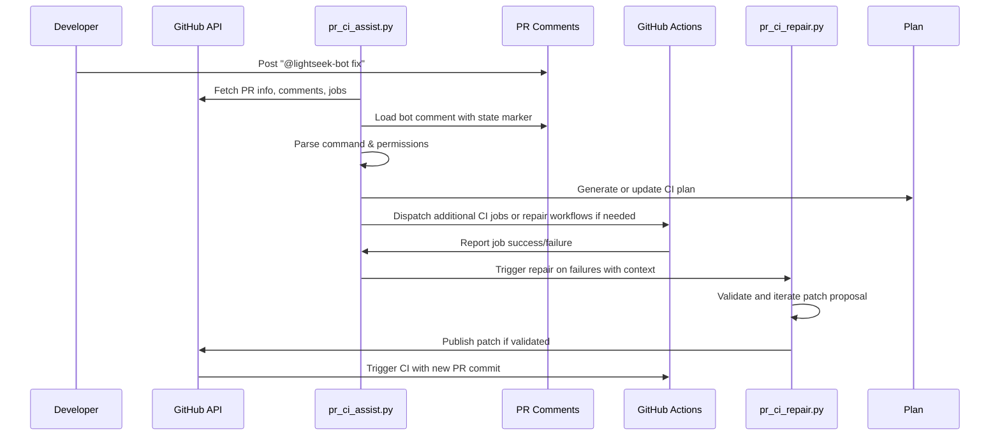

<!-- source: DeepWiki mcp.deepwiki.com · repo lightseekorg/tokenspeed · page 7.5 PR CI Assistant and Automated Repair · fetched 2026-10-21 -->

# 7.5 PR CI Assistant and Automated Repair

<details>
<summary>Relevant source files</summary>

The following files were used as context for generating this wiki page:

- [.github/scripts/ci_result_source.py](.github/scripts/ci_result_source.py)
- [.github/scripts/pr-ci-model.py](.github/scripts/pr-ci-model.py)
- [.github/scripts/pr-ci-planner.md](.github/scripts/pr-ci-planner.md)
- [.github/scripts/pr_ci_assist.py](.github/scripts/pr_ci_assist.py)
- [.github/scripts/pr_ci_plan.py](.github/scripts/pr_ci_plan.py)
- [.github/scripts/pr_ci_repair.py](.github/scripts/pr_ci_repair.py)
- [.github/scripts/pr_ci_state.py](.github/scripts/pr_ci_state.py)
- [.github/workflows/pr-ci-assist-dispatch.yml](.github/workflows/pr-ci-assist-dispatch.yml)
- [.github/workflows/pr-ci-assist.yml](.github/workflows/pr-ci-assist.yml)
- [.github/workflows/pr-ci-plan.yml](.github/workflows/pr-ci-plan.yml)
- [.github/workflows/run-ci-task-matrix.yml](.github/workflows/run-ci-task-matrix.yml)
- [docs/guides/pr-ci-assist.md](docs/guides/pr-ci-assist.md)
- [test/ci_system/test_pr_ci_assist.py](test/ci_system/test_pr_ci_assist.py)
- [test/ci_system/test_pr_ci_model.py](test/ci_system/test_pr_ci_model.py)
- [test/ci_system/test_pr_ci_plan.py](test/ci_system/test_pr_ci_plan.py)

</details>


This section details the "PR CI Assistant and Automated Repair" system implemented for the `lightseekorg/tokenspeed` repository. It comprises the lightseek-bot controlled process for planning, watching, and bounded automated repair of pull request (PR) continuous integration (CI) jobs. The system operates through three main scripts:

- `pr_ci_plan.py`: Plans and publishes focused CI validation targets.
- `pr_ci_assist.py`: Watches running PR CI jobs, handles user commands (`watch`, `fix`), updates status comments, and controls repair triggers.
- `pr_ci_repair.py`: Implements a bounded, iterative source repair pipeline with source patch proposals validated without secrets before promotion.

These scripts form a multi-stage, credential-isolated workflow that automates CI prioritization and limited flaw correction on PRs, facilitating faster iteration and higher correctness confidence in the codebase.

---

## Overview

The PR CI Assistant and Automated Repair system aims to:

- **Focus CI validation on minimal but comprehensive tasks** based on changed source, test coverage, and hardware requirements.
- **Support interactive user commands** (`watch`, `fix` on PR comments) to initiate or target repair workflows.
- **Maintain PR CI status comments** embedding structured state markers for persistent progress tracking.
- **Automatically add fallback or targeted backend CI tasks** on failures for corrective diagnosis.
- **Bound automated repairs** to controlled edits respecting repository policies and patch size limits.
- **Validate repair patches without secrets** before publishing to prevent leakage or unauthorized code changes.
- **Use credential-separated GitHub Actions workflows** to securely coordinate multi-step planning, control, repair, checking, staging, and promotion phases.
  
Together, this system reduces manual overhead in managing complex multi-hardware CI pipelines and accelerates reliable merges.

---

## Key Components

### 1. PR CI Assistant (`pr_ci_assist.py`)

- **Purpose**: Acts as the central controller that monitors PR CI statuses, authorizes commands, enforces workflow phase transitions, and orchestrates dispatch of follow-up tasks or repairs.
  
- **Main Features**:
  - Uses GitHub API via `gh` CLI to fetch PR info, comments, workflow runs, and jobs.
  - Parses PR comments looking for commands that match against the regex pattern for authorized users and permitted command types (`watch`, `fix`).
  - Tracks phased progress with state markers embedded in bot comments (e.g., `"<!-- pr-ci-assist: <base64json> -->"`).
  - On detecting failed or missing jobs, calculates a targeted plan update with fallback runners/backends.
  - Dispatches CI re-runs by spawning new workflow jobs corresponding to prioritized validation tasks.
  - Controls concurrency and conflict detection to avoid overlapping plans or repairs.
  
- **Representative Functions/Classes**:
  - `resolve()`: Entry function to identify the PR and trigger the control flow based on event type (issue comments, workflow runs, dispatch).
  - `permitted(comment)`: Validates permission level of comment author to issue commands.
  - `latest_command(comments)`: Retrieves the most recent authorized bot command comment.
  - `load_state(comments, pr)`: Extracts the current persistent state marker from bot comments.
  - `validate_plan()`: Ensures proposed task configurations are supported and consistent.
  - `targeted_plan()`: Augments the current plan on failures considering backend runners.
  - `dispatch()`: Issues commands to trigger workflows or tasks.
  - Uses shared constants and patterns from `pr_ci_state` for marker encoding and command regex.
  
- **State Tracking**: Maintains states such as `watching`, `waiting-plan`, `repairing`, `validating`, `done`, `manual`, `stale`, and `promoted`. These states govern workflow transitions and comment updates.

### 2. PR CI Repair (`pr_ci_repair.py`)

- **Purpose**: Implements the bounded source repair process triggered by the Assistant to automatically fix detected CI failures within constrained limits and repository policy.

- **Features**:
  - Takes an initial repair request with PR source, existing plan, and failure context.
  - Iteratively runs the repair model (`run_model()`) that proposes candidate patches.
  - Checks and parses patch edits ensuring only safe file paths are modified and on permitted files only.
  - Validates python syntax, linting, native build tests, and assertion coverage to reject invalid repairs.
  - Rejects or accepts repairs with detailed feedback recorded into JSON diagnostics for feedback loops.
  - Supports reuse of accepted patches (rechecks) to confirm fixes before promotion.
  - Publishes bounded diffs back to the PR branch if criteria pass.
  
- **Safety Checks and Constraints**:
  - Prohibits edits outside defined protected folders and configuration files.
  - Implements file mode and size limits.
  - Enforces retention of test assertions and existing native test coverage.
  - Prevents regressions by forbidding removal of essential exports or changes to critical reference files.
  
- **Core Classes/Functions**:
  - `RepairRejected`: Custom exception for repair validation rejection with specific feedback.
  - `repair_with_feedback(request, run_model, proposal, feedback)`: Core retry loop for bounded repair.
  - `allowed_paths(request)`: Computes which files the repair may edit.
  - `safe_path(path)`: Path safety criteria function.
  - Various functions to run external checks, parse diffs, and validate patches.
  
### 3. PR CI Plan (`pr_ci_plan.py` and `pr-ci-model.py`)

- **Purpose**: Produce a focused CI validation plan tailored to the PR's diff and context, restricting matrix size and scope to the minimal set of tests and tasks that can catch regressions.

- **Functionality**:
  - Runs static analysis of changed files, test coverage mappings, and hardware triggers.
  - Enforces that all recommended tests are covered by selected CI tasks.
  - Discerns native hardware checks vs. runtime tests and schedules accordingly.
  - Returns a JSON proposal object describing:
    - `summary` of the CI coverage rationale.
    - `tests`: a prioritized subset of test files with reasons.
    - `tasks`: selected CI tasks (config, runner, cluster, label, reason).
    - `conflicts`: notes on merge conflicts or required manual actions.
  - Plans serialized as base64-encoded markers embedded in bot comments.
  
- **Integration**: The plan feeds into the Assistant for dispatching workflows and later serves as reference for repairs.

### 4. Workflows (`.github/workflows/pr-ci-assist.yml` and related)

- Defines multi-job GitHub Actions workflows implementing the multi-step pipeline:
  - `resolve` job: Runs `pr_ci_assist.py` to identify and parse triggers.
  - `control` job: Runs `pr_ci_assist.py` control mode to manage plan updates and dispatch repairs.
  - `repair` job: Runs `pr_ci_repair.py` to execute the bounded repair process.
  - `check` job: Rechecks repaired source without secrets for validation.
  - `stage` job: Publishes accepted repairs back to the PR branch.
  - `failed` job: Handles failure reporting and fallback paths.
- Supports inputs for repair runs and check-only modes.
- Uses environment secrets (`LIGHTSEEK_BOT_TOKEN`, `KIMI_API_KEY`) scoped to jobs.
- Artifacts are passed between jobs for repair requests, patches, and validation metadata.

---

## Data Flow and Interaction

The system operates in a loop coordinated by GitHub Actions and bot comments:

```mermaid
flowchart TD
  NL["Natural Language Space: Human PR Interaction"] -->|Comment Commands| Assist[/"pr_ci_assist.py"/]

  Assist -->|Query PR data, comments, statuses via GitHub API| GitHubAPI[(GitHub API)]
  Assist -->|Load PR state from comment markers| CommentMarkers[/"pr-ci-assist comment markers"/]
  Assist -->|Generate plan update or targeted plan with new CI tasks| Plan["pr_ci_plan.py (CI Planner)"]
  Plan -->|Return focused CI tasks and tests| Assist
  Assist -->|Dispatch workflows with new tasks| Workflow["GitHub Actions workflows"]

  Workflow -->|Run CI jobs (tests, native build, runtime UTs)| CIJobs[("CI Jobs")]

  CIJobs -->|Success/Failure reports| Assist
  Assist -->|On failure & fix command: trigger bounded repair| Repair[/"pr_ci_repair.py"/]
  Repair -->|Generate & validate patch proposals| RepairModel["Kimi Model API via pr-ci-repair.py"]
  Repair -->|Publish acceptable patch back to PR branch| GitHubPRBranch

  GitHubPRBranch -->|New commits trigger CI| Workflow

  subgraph PR CI Assistant System
    Assist & Plan & Repair & CommentMarkers
  end
```

This diagram illustrates how:

- Human developers issue comments invoking `@lightseek-bot watch` or `fix` commands.
- The Assistant loads and updates a persistent state embedded in bot comments to track phases.
- The CI Plan component proposes an optimized suite of validation tasks.
- Workflows run the CI jobs on different hardware runners.
- On job failures and authorized fix commands, the Assistant triggers the Repair pipeline.
- The Repair script communicates with a code repair model backend (Kimi) to generate patch proposals.
- Accepted patches are applied to the PR branch, which triggers another CI cycle.
- The Assistant supervises the entire cycle ensuring correctness and bounded scope.


## Command States and Markers

The PR CI workflow uses comment-embedded state markers that encode structured JSON information in base64 between HTML comments, e.g.:

```html
<!-- pr-ci-assist: eyJ2ZXJzaW9uIjoxLCJwciI6MTIzLCJoZWFkIjoiYW... -->
```

These markers hold versioned data such as:

- PR number, repository name, commit SHA for head and base branches.
- Current `phase` (e.g. `watching`, `repairing`, `validating`, etc.).
- `action`: either `watch` or `fix`.
- `tasks`: list of planned CI tasks with runners and clusters.
- `statuses`: recorded job statuses (passed, failed, missing).
- `run_ids`: mapping of runs to jobs.
- `conflicts`: merge conflict info or instructions.
- Optional `target` for targeted fix jobs.
- `command`: comment ID that initiated the watchdog or repair.

They enable the Assistant to pick up progress, avoid duplication, and correlate commands with workflows and repair proposals.

---

## Command Syntax

Users on an open PR from the same repository targeting `main` can comment with:

- `@lightseek-bot watch` – Track and monitor this PR's CI progress.
- `@lightseek-bot fix` – Request automated repair attempts on the current failing validation plans.
- `@lightseek-bot fix <GitHub Actions job URL>` – Target a specific failing job for repair with its run and job IDs.

The command regex used is:

```python
COMMAND = re.compile(
    rf"\s*@lightseek-bot[ \t]+(watch|fix)"
    rf"(?:[ \t]+https://github\.com/{re.escape(REPO)}/actions/runs/"
    r"(?P<run>[1-9][0-9]*)/job/(?P<job>[1-9][0-9]*)(?:\?pr=(?P<pr>[1-9][0-9]*))?)?\s*",
    re.IGNORECASE,
)
```

Only users with maintain/write/admin permission on the repo can issue commands.

---

## Implementation Notes and Highlights

### 1. `pr_ci_assist.py` (Lines 21-184...)

- Heavy use of GitHub CLI (`gh`) to paginate API queries fetching PRs, comments, workflow runs.
- Permission checks on comment authors and parsing of authorized commands.
- Supports multiple GitHub event types (`issue_comment`, `workflow_run`, `workflow_dispatch`) to maintain live state.
- Distinguishes phased states and decides whether to add fallback backend runners upon failures.
- Writes outputs compatible with GitHub Actions steps for downstream consumers.
- Maintains a concurrency-safe comment update pattern by editing or creating a single bot comment for status display.
[SOURCES: .github/scripts/pr_ci_assist.py:1-184()]

### 2. `pr_ci_repair.py` (Lines 21-170...)

- Defines strict path and file validation to scope allowed patches.
- Bounded attempts to fix within an hour using iterative calls to repair model backend.
- Emits feedback with categorized error messages on reject (`RepairRejected` exception).
- Checks against syntax errors, coverage removal, retired API usage.
- Preserves protected files and config names from mutation.
- Manages staging (publishing) patches after successful validation.
[SOURCES: .github/scripts/pr_ci_repair.py:1-170()]

### 3. `pr_ci_plan.py` (Lines 21-185...)

- Provides utilities to match PR diff file paths to native test workflows.
- Computes a concise validation plan considering changed files, tests, and tasks existing in catalog.
- Enforces coverage completeness, e.g., MLA changes require explicit serving tasks using `tokenspeed_mla` backend.
- Outputs a JSON object encoding summary, tests, CI tasks, and any conflict resolutions in a strict schema.
- Used by `pr-ci-model.py` for plan generation with integration to OpenAI-powered planner models.
[SOURCES: .github/scripts/pr_ci_plan.py:1-185()]

### 4. GitHub Actions Workflow `.github/workflows/pr-ci-assist.yml`

- Chains jobs `resolve`, `control`, `repair`, `check`, `stage`, and `failed` sequentially.
- Passes JSON repair requests and patches as artifacts between jobs.
- Sets environment variables and secrets scoped narrowly per job.
- Includes concurrency groups to avoid races per PR number.
- Defines inputs for manual repair runs and check-only modes.
- Automatically uploads artifacts and controls timeout durations per job.
[SOURCES: .github/workflows/pr-ci-assist.yml:1-198()]

---

## Mermaid Diagram: Mapping System Components to Scripts



This diagram shows the main flow from user commands through assistant control and repair, with integration to workflows and branching.

---

## Mermaid Diagram: Command Parsing and State Tracking Data Flow



This sequence emphasizes permission validation, state recovery, planning, dispatch, repair, and commit update.

---

## Table: CI Assistant Phase States

| Phase          | Description                                          | Transition Triggers                   |
|----------------|------------------------------------------------------|-------------------------------------|
| `watching`     | Tracking PR CI results awaiting failures or success | New command comment or workflow run |
| `waiting-plan` | Waiting for a successful new plan to start          | After plan publishing                |
| `repairing`    | Repair model actively generating patches            | Upon fix command and CI failure     |
| `validating`   | Validating repair candidate branch CI                | After repair patch is pushed        |
| `done`         | CI tasks all passed or no further steps required    | Successful run or manual stop       |
| `manual`       | No automated resolution possible                      | Unsupported failures or conflicts   |
| `stale`        | State superseded by another plan                      | New plan published                  |
| `promoted`     | Repair candidate merged to PR branch                  | After staging repair                |

---

## Summary

The PR CI Assistant and Automated Repair system implements a comprehensive automated pipeline driven by bot user commands and structured state comments to:

- Plan optimal CI validation scopes dynamically on PR changes.
- Monitor CI workflows actively and update progress in PR comments.
- Launch bounded repair attempts on failures using model-generated patch proposals.
- Enforce strict safety and repository policy constraints on automated repairs.
- Coordinate multi-step GitHub workflows to securely and reliably cycle through plan, assist, repair, check, and stage phases.
- Provide granular control to repository maintainers via command comments to focus either on observation (`watch`) or directed fixes (`fix`).

This system reduces CI waste, accelerates developer feedback, and raises code quality by integrating intelligent automation directly into the PR lifecycle.

---

## References and Sources

- `.github/scripts/pr_ci_assist.py:1-184()`
- `.github/scripts/pr_ci_repair.py:1-170()`
- `.github/scripts/pr_ci_plan.py:1-185()`
- `.github/workflows/pr-ci-assist.yml:1-198()`
- `docs/guides/pr-ci-assist.md` (partial conceptual reference)

---

