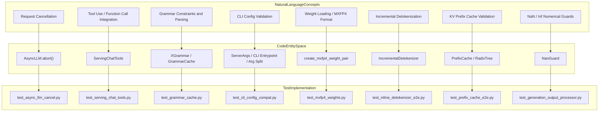
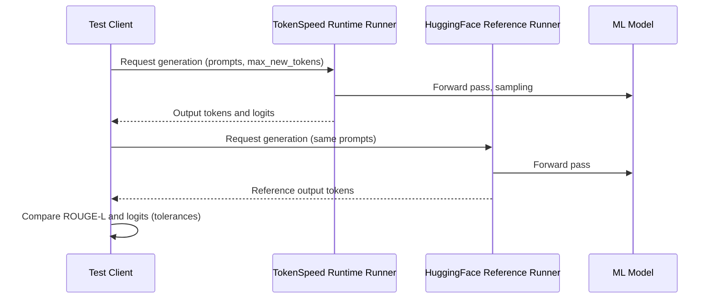
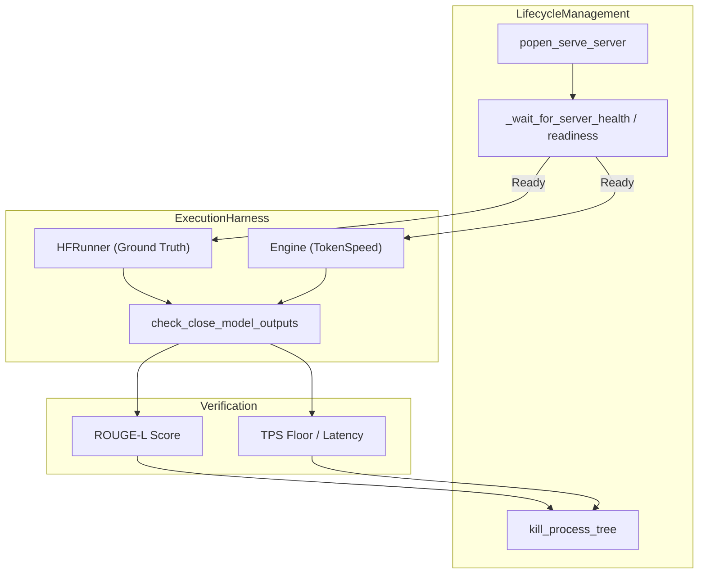

<!-- source: DeepWiki mcp.deepwiki.com · repo lightseekorg/tokenspeed · page 8.1 Runtime and CLI Tests · fetched 2026-10-21 -->

# Runtime and CLI Tests

<details>
<summary>Relevant source files</summary>

The following files were used as context for generating this wiki page:

- [python/tokenspeed/cli/__init__.py](python/tokenspeed/cli/__init__.py)
- [python/tokenspeed/cli/_argsplit.py](python/tokenspeed/cli/_argsplit.py)
- [python/tokenspeed/cli/_logprefix.py](python/tokenspeed/cli/_logprefix.py)
- [test/ci/ut/ut-runtime-1gpu.yaml](test/ci/ut/ut-runtime-1gpu.yaml)
- [test/cli/__init__.py](test/cli/__init__.py)
- [test/cli/_fixtures/__init__.py](test/cli/_fixtures/__init__.py)
- [test/cli/_fixtures/fake_engine.py](test/cli/_fixtures/fake_engine.py)
- [test/cli/test_argsplit.py](test/cli/test_argsplit.py)
- [test/cli/test_logprefix.py](test/cli/test_logprefix.py)
- [test/cli/test_serve_smg_integration.py](test/cli/test_serve_smg_integration.py)
- [test/runtime/distributed/test_mla_dsa_pd_contract.py](test/runtime/distributed/test_mla_dsa_pd_contract.py)
- [test/runtime/distributed/test_vocab_parallel_topk_nccl.py](test/runtime/distributed/test_vocab_parallel_topk_nccl.py)
- [test/runtime/layers/test_mla_decode_dcp.py](test/runtime/layers/test_mla_decode_dcp.py)
- [test/runtime/layers/test_mla_verify_metadata.py](test/runtime/layers/test_mla_verify_metadata.py)
- [test/runtime/models/test_generation_models.py](test/runtime/models/test_generation_models.py)
- [test/runtime/test_cache_loc_kernel.py](test/runtime/test_cache_loc_kernel.py)
- [test/runtime/test_causal_conv1d_graph_replay.py](test/runtime/test_causal_conv1d_graph_replay.py)
- [test/runtime/test_cupti_warmup_vendor_guard.py](test/runtime/test_cupti_warmup_vendor_guard.py)
- [test/runtime/test_executor_capture_step.py](test/runtime/test_executor_capture_step.py)
- [test/runtime/test_mla_spec_write_locs.py](test/runtime/test_mla_spec_write_locs.py)
- [tokenspeed-kernel/python/tokenspeed_kernel/ops/moe/triton/__init__.py](tokenspeed-kernel/python/tokenspeed_kernel/ops/moe/triton/__init__.py)
- [tokenspeed-kernel/python/tokenspeed_kernel/ops/moe/triton/_common.py](tokenspeed-kernel/python/tokenspeed_kernel/ops/moe/triton/_common.py)
- [tokenspeed-kernel/python/tokenspeed_kernel/ops/moe/triton/bf16.py](tokenspeed-kernel/python/tokenspeed_kernel/ops/moe/triton/bf16.py)
- [tokenspeed-kernel/python/tokenspeed_kernel/ops/moe/triton/fp8.py](tokenspeed-kernel/python/tokenspeed_kernel/ops/moe/triton/fp8.py)
- [tokenspeed-kernel/python/tokenspeed_kernel/ops/moe/triton/mxfp4.py](tokenspeed-kernel/python/tokenspeed_kernel/ops/moe/triton/mxfp4.py)
- [tokenspeed-kernel/test/ops/moe/test_triton_fp8_apply.py](tokenspeed-kernel/test/ops/moe/test_triton_fp8_apply.py)

</details>


The **Runtime and CLI Tests** suite covers comprehensive validation of the TokenSpeed Python runtime and CLI layers, including core model unit tests, cache specification tests, distributed prefill/decode (PD/EPD) tests, sampling and logits processing verification, detokenizer correctness, CLI configuration compatibility, and the shared testing infrastructure supporting these modules. These tests reside primarily under the `test/runtime` and `test/cli` directories.

The purpose of this suite is to ensure reliable and correct execution of model inference pipelines, configuration handling, distributed coordination, and CLI routing logic across different hardware targets and deployment scenarios.

---

## Natural Language to Code Mapping: Runtime Testing

The following diagram bridges **natural language testing concerns** with the **TokenSpeed runtime code entities** and the corresponding **test modules** implementing each test scenario.

### Runtime Test Entity Mapping



This mapping clarifies how each major test concern corresponds tightly to specific runtime and CLI modules, facilitating targeted development and debugging.

Sources:  
- `[test/runtime/test_cli_config_compat.py:26-32]()`,  
- `[test/runtime/test_mxfp4_weights.py:18-20]()`,  
- `[test/runtime/test_prefix_cache_e2e.py:1-5]()`,  
- `[test/runtime/test_inline_detokenizer_e2e.py:8-12]()`,  
- `[test/runtime/test_generation_output_processor.py:137-178]()`

---

## CLI Argument Splitting and Configuration Compatibility

TokenSpeed performs fine-grained parsing and routing of CLI arguments passed to the top-level `ts serve` command by splitting flags between the engine process and the SMG gateway process, while also supporting a `--headless` mode where only the engine runs.

### CLI Argument Splitting Logic

- Orchestrator-only flags like `--engine-startup-timeout`, `--gateway-startup-timeout`, and `--control-port` are consumed exclusively by the orchestrator.
- Flags such as `--model` and `--reasoning-parser` are **fanned out** to both engine and gateway.
- Gateway-only flags include `--host`, `--port`, `--chat-template`, and `--tool-call-parser`.
- Engine-only flags include tensor-parallelism flags `--tp`/`--tensor-parallel-size` and other engine parameters.
- The special `--headless` flag short-circuits splitting entirely, passing all remaining flags to the engine directly.

This precise split is implemented in the function `split_argv(argv: list[str]) -> SplitResult` in `python/tokenspeed/cli/_argsplit.py` and is validated in `test/cli/test_argsplit.py` through unit tests covering alias normalization, fan-out behavior, routing precedence, and error conditions with orchestrator-only flags in headless mode.

### Example of Argument Routing in Tests

```python
argv = [
    "--model", "Qwen/Qwen3-30B-A3B",
    "--port", "8000",
    "--tp", "2",
    "--tool-call-parser", "hermes",
    "--reasoning-parser", "qwen3",
    "--sampling-backend", "flashinfer",
    "--policy", "cache_aware",
]
split_result = split_argv(argv)
assert split_result.engine == [
    "--model", "Qwen/Qwen3-30B-A3B",  "--tensor-parallel-size", "2",
    "--reasoning-parser", "qwen3",  "--sampling-backend", "flashinfer"
]
assert split_result.gateway == [
    "--model", "Qwen/Qwen3-30B-A3B",  "--port", "8000",
    "--tool-call-parser", "hermes",  "--reasoning-parser", "qwen3",
    "--policy", "cache_aware"
]
```

This routing behavior allows independent scaling and lifecycle management of the engine and gateway components.

Sources:  
- `[python/tokenspeed/cli/_argsplit.py:20-192]()`,  
- `[test/cli/test_argsplit.py:1-197]()`

---

## Model Unit Tests and Generation Validation

The core model execution path is validated by unit tests for individual model architectures, including complex configurations like mixture of experts (MoE), speculative decoding, and distributed parallelism.

- The `TestGenerationModels` suite in `test/runtime/models/test_generation_models.py` orchestrates multi-GPU tests for major supported models such as OpenAI GPT-OSS 120B and Qwen3.5 35B.
- It runs generation requests through both TokenSpeed (`RTRunner`) and HuggingFace models (served as ground truth via subprocess runners) and compares outputs for correctness via ROUGE-L and token likelihood tolerances.
- Tests perform sampling and logits verification, including speculative decoding integration with algorithms like EAGLE3 and MTP.
- These tests support variations in tensor parallelism sizes, precision modes (bfloat16), and other serving parameters.

### Distributed Model Test Flow



This validates that TokenSpeed runtime and sampling components produce outputs consistent with established HuggingFace models, ensuring inference correctness.

Sources:  
- `[test/runtime/models/test_generation_models.py:1-215]()`,  
- `[test/runners.py:99-185]()`

---

## Cache, Sampling, and Distributed PD/EPD Tests

Advanced tests validate the correctness of cache structures, speculative decoding logic, and distributed parameter passing for prefill/decode (PD/EPD) disaggregation.

- The `test/runtime/layers/` directory tests the metadata layout and decode kernel interfaces of the Multi-Head Latent Attention (MLA) layer, including verification of block decode masks, sliding window bounds, and query block semantics.
- Specifically, `test_mla_verify_metadata.py` tests the consistency of cache sequence lengths and decode call arguments under different decode modes and kernel capabilities.
- Distributed vocabulary parallel top-k tests and communication manager (comm manager) integration are covered in other distributed test files (not shown fully here).
- Sampling backends such as FlashInfer and fused top-k/top-p sampling are also validated through dedicated tests ensuring shared random seeds, output distributions, and logits processing accuracy.

Sources:  
- `[test/runtime/layers/test_mla_verify_metadata.py:1-204]()`,  
- `[test/runtime/distributed/test_vocab_parallel_topk_nccl.py]()`,  
- `[test/runtime/test_generation_output_processor.py:137-178]()`

---

## Incremental Detokenizer and Output Processor

The tests ensure detokenization correctness and update semantics:

- IncrementalDetokenizer is assessed in `test_inline_detokenizer_e2e.py` by comparing outputs from inline detokenization against independent batch token ID outputs.
- The output processor is tested for numerical instability handling (`NaN` and `Inf` flags in logits) by checks that aborted requests are correctly handled without corrupting the cache.
- These behaviors guarantee that the streaming of partial token outputs preserves text correctness and that error conditions in decoding result in graceful termination.

Sources:  
- `[test/runtime/test_inline_detokenizer_e2e.py:1-180]()`,  
- `[test/runtime/test_generation_output_processor.py:137-178]()`

---

## CLI Orchestration Integration with Smg Gateway and Fake Engine

Integration tests simulate the startup and shutdown orchestration of the TokenSpeed engine and SMG gateway processes.

- The `test/cli/test_serve_smg_integration.py` launches the real `tokenspeed.cli.serve` command configured with a fake in-process gRPC engine (`test/cli/_fixtures/fake_engine.py`).
- It verifies readiness probes by polling HTTP `/readiness` endpoint, checks for healthy status reporting, and clean process termination upon receiving `SIGTERM`.
- The fake engine provides minimal grpc services like health check and model info to support gateway lifecycle and readiness gating.

This ensures robust orchestration logic and graceful lifecycle management of multi-process serving.

Sources:  
- `[test/cli/test_serve_smg_integration.py:21-124]()`,  
- `[test/cli/_fixtures/fake_engine.py:21-106]()`

---

## Testing Infrastructure, Runners, and Fixtures

The runtime tests utilize shared runners and utility functions to manage subprocesses and ensure reproducible environment conditions.

### Key Components

| Component Name            | Role/Function                                                                                         | Location (example lines)                 |
|--------------------------|-----------------------------------------------------------------------------------------------------|----------------------------------------|
| `RTRunner`               | Spawn TokenSpeed runtime in subprocess for model execution and deterministic output generation       | `[test/runners.py:99-185]()`           |
| `HFRunner`               | Spawns separate HF autoregressive models for ground-truth output comparison                         | `[test/runners.py:99-150]()`           |
| `popen_serve_server`     | Launches the `tokenspeed serve` CLI command with allocated ports and environment setup               | `[test/test_utils.py:139-187]()`       |
| `_wait_for_server_health`| Polls HTTP /readiness until server reports ready                                                    | `[test/test_utils.py:102-137]()`       |
| `kill_process_tree`      | Ensures clean worker process termination to avoid GPU leaks                                         | `[test/test_utils.py:20]()`             |

### Server Lifecycle and Evaluation Flow Diagram



This infrastructure provides durable, reproducible test harnesses that integrate with CI/CD pipelines covering single-GPU and multi-GPU environments.

Sources:  
- `[test/runners.py:99-185]()`,  
- `[test/runtime/models/test_kimi_models.py:60-105]()`,  
- `[test/test_utils.py:1-200]()`

---

## Summary

The TokenSpeed runtime and CLI test suite exercises a broad spectrum of critical system components:

- Detailed model inference unit tests verifying correctness and performance.
- Cache and block/decode metadata structural validations.
- Distributed parameter passing and pipeline correctness guarantees.
- Sampling and logits processing accuracy and stability under production conditions.
- CLI argument routing and configuration compatibility ensuring smooth operational deployment.
- Integration tests simulating real orchestrator lifecycle and gRPC engine interaction.
- Shared test runners and utilities to anchor consistency between TokenSpeed outputs and HuggingFace references.

Together, these tests form a crucial backbone to maintain the reliability, correctness, and maintainability of the TokenSpeed inference stack.

---

# References

- `python/tokenspeed/cli/_argsplit.py` [lines 1-192]()  
- `test/cli/test_argsplit.py` [lines 1-197]()  
- `test/runtime/models/test_generation_models.py` [lines 1-215]()  
- `test/runtime/layers/test_mla_verify_metadata.py` [lines 1-204]()  
- `test/cli/test_serve_smg_integration.py` [lines 21-125]()  
- `test/cli/_fixtures/fake_engine.py` [lines 21-106]()  
- `test/runners.py` [lines 99-185]()  
- `test/test_utils.py` [lines 1-200]()  
- `test/runtime/test_generation_output_processor.py` [lines 137-178]()  
- `test/runtime/test_inline_detokenizer_e2e.py` [lines 1-180]()  
- `test/runtime/test_cli_config_compat.py` [lines 26-141]()

---

