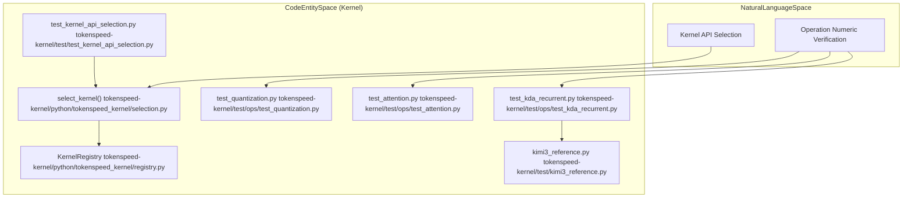
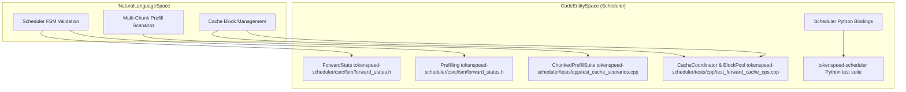

<!-- source: DeepWiki mcp.deepwiki.com · repo lightseekorg/tokenspeed · page 8.2 Kernel and Scheduler Tests · fetched 2026-10-21 -->

# Kernel and Scheduler Tests

Relevant source files

The following files were used as context for generating this wiki page:

- [python/tokenspeed/runtime/layers/dense/w8a8_fp8.py](python/tokenspeed/runtime/layers/dense/w8a8_fp8.py)
- [test/runtime/test_fp8_linear_blockscale_flashinfer.py](test/runtime/test_fp8_linear_blockscale_flashinfer.py)
- [test/runtime/test_fp8_pb_wo_loading.py](test/runtime/test_fp8_pb_wo_loading.py)
- [test/runtime/test_kda_fp8_w8a8.py](test/runtime/test_kda_fp8_w8a8.py)
- [tokenspeed-kernel/python/tokenspeed_kernel/__init__.py](tokenspeed-kernel/python/tokenspeed_kernel/__init__.py)
- [tokenspeed-kernel/python/tokenspeed_kernel/ops/attention/__init__.py](tokenspeed-kernel/python/tokenspeed_kernel/ops/attention/__init__.py)
- [tokenspeed-kernel/python/tokenspeed_kernel/ops/gemm/__init__.py](tokenspeed-kernel/python/tokenspeed_kernel/ops/gemm/__init__.py)
- [tokenspeed-kernel/python/tokenspeed_kernel/ops/gemm/flashinfer.py](tokenspeed-kernel/python/tokenspeed_kernel/ops/gemm/flashinfer.py)
- [tokenspeed-kernel/python/tokenspeed_kernel/ops/gemm/triton.py](tokenspeed-kernel/python/tokenspeed_kernel/ops/gemm/triton.py)
- [tokenspeed-kernel/python/tokenspeed_kernel/ops/metadata/ngram_history.py](tokenspeed-kernel/python/tokenspeed_kernel/ops/metadata/ngram_history.py)
- [tokenspeed-kernel/test/kimi3_reference.py](tokenspeed-kernel/test/kimi3_reference.py)
- [tokenspeed-kernel/test/nvidia/ops/test_nvfp4_cute_dsl_gemm.py](tokenspeed-kernel/test/nvidia/ops/test_nvfp4_cute_dsl_gemm.py)
- [tokenspeed-kernel/test/ops/metadata/test_ngram_history.py](tokenspeed-kernel/test/ops/metadata/test_ngram_history.py)
- [tokenspeed-kernel/test/ops/test_attention.py](tokenspeed-kernel/test/ops/test_attention.py)
- [tokenspeed-kernel/test/ops/test_kda_recurrent.py](tokenspeed-kernel/test/ops/test_kda_recurrent.py)
- [tokenspeed-kernel/test/test_benchmark_gemm_generator.py](tokenspeed-kernel/test/test_benchmark_gemm_generator.py)
- [tokenspeed-kernel/test/test_kernel_api_selection.py](tokenspeed-kernel/test/test_kernel_api_selection.py)
- [tokenspeed-kernel/test/utils.py](tokenspeed-kernel/test/utils.py)
- [tokenspeed-scheduler/csrc/cache/core/cache_config.h](tokenspeed-scheduler/csrc/cache/core/cache_config.h)
- [tokenspeed-scheduler/csrc/scheduler/capacity_model.cpp](tokenspeed-scheduler/csrc/scheduler/capacity_model.cpp)
- [tokenspeed-scheduler/csrc/scheduler/operations/cache.cpp](tokenspeed-scheduler/csrc/scheduler/operations/cache.cpp)
- [tokenspeed-scheduler/csrc/scheduler/operations/group_demands.cpp](tokenspeed-scheduler/csrc/scheduler/operations/group_demands.cpp)
- [tokenspeed-scheduler/csrc/scheduler/operations/group_demands.h](tokenspeed-scheduler/csrc/scheduler/operations/group_demands.h)
- [tokenspeed-scheduler/csrc/scheduler/types.cpp](tokenspeed-scheduler/csrc/scheduler/types.cpp)
- [tokenspeed-scheduler/tests/cpp/test_capacity_model.cpp](tokenspeed-scheduler/tests/cpp/test_capacity_model.cpp)
- [tokenspeed-scheduler/tests/cpp/test_forward_cache_ops.cpp](tokenspeed-scheduler/tests/cpp/test_forward_cache_ops.cpp)

This page documents the testing infrastructure for the core performance components of TokenSpeed: the `tokenspeed-kernel` portable multi-silicon kernel library and the `tokenspeed-scheduler` C++ scheduler engine with Python bindings. These tests ensure operation-level numeric correctness, API selection integrity with golden outcomes, third-party kernel integration validation, and robust finite-state machine (FSM) logic for request lifecycle and resource management.

---

## 1. Kernel Testing (`tokenspeed-kernel`)

The `tokenspeed-kernel` test suite focuses on numeric verification of kernel implementations, validation of kernel API selection logic against golden expected kernels, and end-to-end integration correctness including third-party kernels. It heavily tests both NVIDIA and AMD architectures via dynamic platform simulation.

### 1.1 Kernel Operation API Selection Goldens

Kernel selection is managed by the `select_kernel` function, which queries the centralized `KernelRegistry` and evaluates platform traits, kernel registration priority, and constraints to pick the best kernel for a given operation signature and traits [tokenspeed-kernel/test/test_kernel_api_selection.py:21-119](). To verify stability and correctness of this oracle:

- Tests invoke real operator APIs (e.g., attention, GEMM) or their internal registry facades.
- The kernel actually selected is intercepted and logged using a spy class on `SelectedKernel`.
- The selected kernel's canonical name is asserted against a golden expected name hard-coded for each platform test.
- To ensure cross-platform robustness, tests override `Platform` with NVIDIA, AMD, and other fixtures so all platform selections are verified on all CI machines regardless of actual hardware.
- Kernels that are guarded by optional backend package imports are skipped when the backend is absent.

This test provides a regression safety net ensuring that performance-tuned kernel dispatches continue unchanged and that new registrations don't negatively regress or cause surprises in the selection result.

### 1.2 Numeric and Operation-Level Verification

Beyond selection correctness, `tokenspeed-kernel/test` houses numerous numeric verification tests that compare kernels' numeric outputs against trusted PyTorch or reference implementations, spanning quantization, GEMM, and attention families:

- Quantization tests validate low-bit floating point formats (FP8 variants) and MXFP4 packing/unpacking invariants, ensuring bitwise equality where mandated [tokenspeed-kernel/test/ops/test_quantization.py:21-145]().
- Attention op tests (`test_attention.py`) run MHA (multi-head attention) prefill, extend, and decode kernels across multiple dtype configurations (bf16, FP8 variants) and solution backends (Triton, Gluon), asserting shape and numeric closeness with reference outputs [tokenspeed-kernel/test/ops/test_attention.py:22-179]().
- KDA recurrent and routing tests (`test_kda_recurrent.py`) verify correctness of chunked prefill states, launch configurations, and replay commit semantics under simulated inference workloads and replay latencies, including conditional relayout support [tokenspeed-kernel/test/ops/test_kda_recurrent.py:1-217]().
- Reference implementations (e.g., from `tokenspeed-kernel/test/kimi3_reference.py`) provide precise PyTorch baselines for Kimi K3 MXFP4 MoE routing, gating, and recurrent operations to cross-check kernel outputs.

These extensive tests strengthen the reliability of numerical kernels across silicon and precision modes, essential for accurate and performant LLM serving.

---

Sources: [tokenspeed-kernel/test/test_kernel_api_selection.py:21-119](), [tokenspeed-kernel/test/ops/test_quantization.py:21-145](), [tokenspeed-kernel/test/ops/test_attention.py:22-179](), [tokenspeed-kernel/test/ops/test_kda_recurrent.py:1-217](), [tokenspeed-kernel/test/kimi3_reference.py:1-194]()

### 1.3 Third-Party Integration Tests

The kernel test suite also includes integration tests that validate interoperability with third-party CUDA kernel libraries:

- FlashInfer FP8 block-scale GEMM kernels are exercised to confirm that platform-specific API bindings return expected outputs and honor FP8 scale formats [tokenspeed-kernel/python/tokenspeed_kernel/ops/gemm/flashinfer.py:90-189]().
- Tests ensure correct dispatch of FP8, BF16, and quantized GEMM backends on Hopper/Blackwell architectures, verifying capability requirements and kernel traits.
- The live integration extends to dynamic platform querying and runtime fallback handling.

This layer ensures the robust inclusion and fallback for external CUDA sources instrumental for peak performance.

---

## 2. Scheduler Testing (`tokenspeed-scheduler`)

The `tokenspeed-scheduler` C++ engine implements a finite-state machine (FSM) to manage request lifecycles, execution plans, resource allocation, and cache coordination for multi-chunk model inference workloads. Testing spans:

### 2.1 C++ Scheduler FSM and Cache Coordination

The C++ GTest suite in `tokenspeed-scheduler/tests/cpp` validates scheduler FSM correctness via:

- **Forward State Management**: Classes like `ForwardState` and `Prefilling` encapsulate token window tracking and prefill/decode chunking, with tests ensuring accurate transitions and invariant preservation for block tables and cache claims [tokenspeed-scheduler/csrc/fsm/forward_states.h:79-146]().

- **Chunked Prefill Execution Plans**: `ChunkedPrefillSuite` tests cases where prefill requests exceed `max_scheduled_tokens`, requiring sequential multi-chunk prefill plans that later transition to decode stages, verifying full-history growth of cache tables [tokenspeed-scheduler/tests/cpp/test_cache_scenarios.cpp:99-157]().

- **Cache Pool and BlockTable Management**: Tests validate block pool allocation and freeing semantics, ensuring that block tables claim and release memory correctly and that sliding-window cache matches prefix token hits while honoring cache coherence protocols [tokenspeed-scheduler/tests/cpp/test_forward_cache_ops.cpp:60-151]().

These tests validate the scheduler's robust handling of concurrency, chunking, and cache state evolution during high-throughput serving.

### 2.2 Python Binding Tests

In addition to C++ tests, the scheduler exposes nanobind-generated Python bindings that receive targeted testing in the `tokenspeed-scheduler` Python test suite. These Python-side tests:

- Exercise the scheduler API methods (`SubmitRequests`, `NextExecutionPlan`, and `Advance`).
- Verify event handling and transitions within the Python finite-state request machine.
- Test coordination with cache clients and KV prefix cache behaviors.

This two-pronged testing ensures parity and correctness between C++ core logic and Python runtime usage.

---

Sources: [tokenspeed-scheduler/csrc/fsm/forward_states.h:79-146](), [tokenspeed-scheduler/tests/cpp/test_cache_scenarios.cpp:99-157](), [tokenspeed-scheduler/tests/cpp/test_forward_cache_ops.cpp:60-151]()

---

## 3. Test Coverage Summary

| Component                 | Code Entity / File                                           | Test File Path                                           | Key Focus                                         |
|--------------------------|-------------------------------------------------------------|---------------------------------------------------------|--------------------------------------------------|
| Kernel Selection          | `select_kernel`, `SelectedKernel`                           | `tokenspeed-kernel/test/test_kernel_api_selection.py`   | Kernel API selection goldens, platform gating    |
| Numeric Verification      | Quantize FP8, MHA, KDA recurrent pipelines                 | `tokenspeed-kernel/test/ops/test_quantization.py`       | Bitwise quantization parity, scale validations   |
|                          |                                                             | `tokenspeed-kernel/test/ops/test_attention.py`          | MHA prefill/extend/decode correctness            |
|                          |                                                             | `tokenspeed-kernel/test/ops/test_kda_recurrent.py`      | Chunked KDA decode, replay commit, relayout      |
| Third-Party CUDA          | FlashInfer FP8 GEMM API                                     | `tokenspeed-kernel/python/tokenspeed_kernel/ops/gemm/flashinfer.py` | FlashInfer blockscale FP8 GEMM integration        |
| Scheduler FSM             | `ForwardState`, `Prefilling`, execution plans              | `tokenspeed-scheduler/tests/cpp/test_cache_scenarios.cpp`| Multi-chunk request prefill, cache growth         |
| Scheduler Cache Ops       | CacheCoordinator, BlockPool management                      | `tokenspeed-scheduler/tests/cpp/test_forward_cache_ops.cpp` | Freeing, admitting, sliding window cache correctness |
| Scheduler Python Bindings | Nanobind binding API exposed to Python                      | `tokenspeed-scheduler/tests/python`                      | FSM transition and API usage tests                 |

---

This page summarizes the rigorous testing approach securing TokenSpeed kernel and scheduler core. The tests give confidence that operation selection remains stable, numerics remain accurate across silicon and precision variants, and the scheduler FSM and resource management behave robustly in complex multi-chunk inference scenarios.

Sources:  
[tokenspeed-kernel/test/test_kernel_api_selection.py:21-119](),  
[tokenspeed-kernel/test/ops/test_quantization.py:21-145](),  
[tokenspeed-kernel/test/ops/test_attention.py:22-179](),  
[tokenspeed-kernel/test/ops/test_kda_recurrent.py:1-217](),  
[tokenspeed-kernel/test/kimi3_reference.py:1-194](),  
[tokenspeed-kernel/python/tokenspeed_kernel/ops/gemm/flashinfer.py:90-189](),  
[tokenspeed-scheduler/csrc/fsm/forward_states.h:79-146](),  
[tokenspeed-scheduler/tests/cpp/test_cache_scenarios.cpp:99-157](),  
[tokenspeed-scheduler/tests/cpp/test_forward_cache_ops.cpp:60-151]()

---

