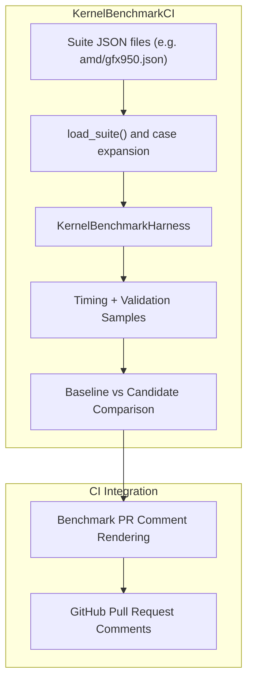
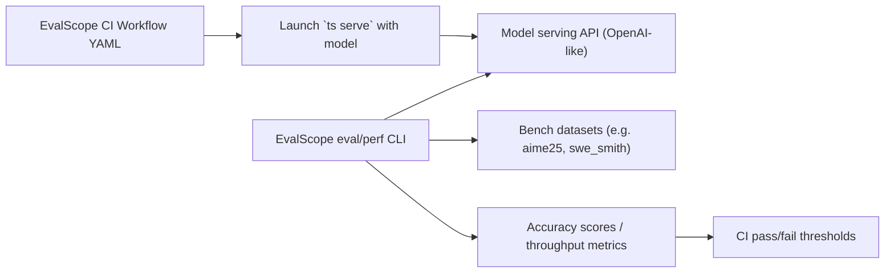
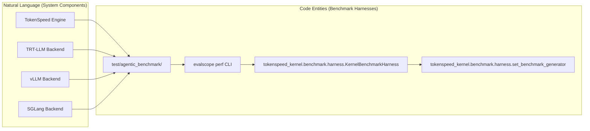
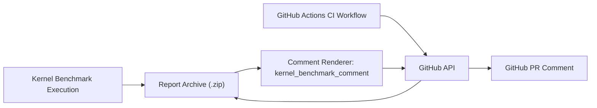

<!-- source: DeepWiki mcp.deepwiki.com · repo lightseekorg/tokenspeed · page 8.3 Benchmarks and Evaluations · fetched 2026-10-21 -->

# Benchmarks and Evaluations

<details>
<summary>Relevant source files</summary>

The following files were used as context for generating this wiki page:

- [.github/workflows/amd-tests.yml](.github/workflows/amd-tests.yml)
- [.github/workflows/kernel-benchmark-comment.yml](.github/workflows/kernel-benchmark-comment.yml)
- [.github/workflows/nvidia-b200-tests.yml](.github/workflows/nvidia-b200-tests.yml)
- [.github/workflows/nvidia-gb200-tests.yml](.github/workflows/nvidia-gb200-tests.yml)
- [.github/workflows/nvidia-gb300-nightly-tests.yml](.github/workflows/nvidia-gb300-nightly-tests.yml)
- [.github/workflows/nvidia-gb300-tests.yml](.github/workflows/nvidia-gb300-tests.yml)
- [test/ci/eval/kimi-k3-mxfp4-tp8ep8-evalscope-aime26-amd.yaml](test/ci/eval/kimi-k3-mxfp4-tp8ep8-evalscope-aime26-amd.yaml)
- [test/ci/eval/qwen3.5-122b-a10b-nvfp4-evalscope-ocr-bench.yaml](test/ci/eval/qwen3.5-122b-a10b-nvfp4-evalscope-ocr-bench.yaml)
- [test/ci/eval/qwen3.5-397b-a17b-nvfp4-dp4ep4-evalscope-aime25.yaml](test/ci/eval/qwen3.5-397b-a17b-nvfp4-dp4ep4-evalscope-aime25.yaml)
- [test/ci/eval/qwen3.5-397b-a17b-nvfp4-evalscope-aime25.yaml](test/ci/eval/qwen3.5-397b-a17b-nvfp4-evalscope-aime25.yaml)
- [test/ci/eval/qwen3.8-flash-next-fp8-evalscope-gsm8k.yaml](test/ci/eval/qwen3.8-flash-next-fp8-evalscope-gsm8k.yaml)
- [test/ci/perf/gpt-oss-120b-mxfp4-evalscope-mi350.yaml](test/ci/perf/gpt-oss-120b-mxfp4-evalscope-mi350.yaml)
- [test/ci/perf/kernel-benchmark-amd-gfx950.yaml](test/ci/perf/kernel-benchmark-amd-gfx950.yaml)
- [test/ci/perf/kimi-k3-mxfp4-tp8ep8-evalscope-random-4k-1k-mi35x.yaml](test/ci/perf/kimi-k3-mxfp4-tp8ep8-evalscope-random-4k-1k-mi35x.yaml)
- [test/ci/perf/qwen3.5-397b-a17b-nvfp4-evalscope-agentic-b200-8gpu.yaml](test/ci/perf/qwen3.5-397b-a17b-nvfp4-evalscope-agentic-b200-8gpu.yaml)
- [test/ci/perf/qwen3.5-397b-a17b-nvfp4-evalscope-agentic.yaml](test/ci/perf/qwen3.5-397b-a17b-nvfp4-evalscope-agentic.yaml)
- [test/ci/perf/qwen3.5-397b-a17b-nvfp4-evalscope-longctx.yaml](test/ci/perf/qwen3.5-397b-a17b-nvfp4-evalscope-longctx.yaml)
- [test/ci_system/kernel_benchmark_ci.py](test/ci_system/kernel_benchmark_ci.py)
- [test/ci_system/kernel_benchmark_comment.py](test/ci_system/kernel_benchmark_comment.py)
- [test/ci_system/test_kernel_benchmark_ci.py](test/ci_system/test_kernel_benchmark_ci.py)
- [test/ci_system/test_kernel_benchmark_comment.py](test/ci_system/test_kernel_benchmark_comment.py)
- [test/ci_system/test_random_benchmark_perf_csv.py](test/ci_system/test_random_benchmark_perf_csv.py)
- [test/long_context_benchmark/tokenspeed/collect_outputs.py](test/long_context_benchmark/tokenspeed/collect_outputs.py)
- [test/random_benchmark/tokenspeed/collect_outputs.py](test/random_benchmark/tokenspeed/collect_outputs.py)
- [tokenspeed-kernel/benchmarks/README.md](tokenspeed-kernel/benchmarks/README.md)
- [tokenspeed-kernel/benchmarks/amd/gfx950.json](tokenspeed-kernel/benchmarks/amd/gfx950.json)
- [tokenspeed-kernel/python/tokenspeed_kernel/benchmark/ci.py](tokenspeed-kernel/python/tokenspeed_kernel/benchmark/ci.py)
- [tokenspeed-kernel/python/tokenspeed_kernel/benchmark/generators/gemm.py](tokenspeed-kernel/python/tokenspeed_kernel/benchmark/generators/gemm.py)
- [tokenspeed-kernel/python/tokenspeed_kernel/benchmark/graph.py](tokenspeed-kernel/python/tokenspeed_kernel/benchmark/graph.py)
- [tokenspeed-kernel/python/tokenspeed_kernel/benchmark/harness.py](tokenspeed-kernel/python/tokenspeed_kernel/benchmark/harness.py)
- [tokenspeed-kernel/test/test_benchmark_ci.py](tokenspeed-kernel/test/test_benchmark_ci.py)
- [tokenspeed-kernel/test/test_benchmark_graph.py](tokenspeed-kernel/test/test_benchmark_graph.py)
- [tokenspeed-kernel/test/test_benchmark_harness.py](tokenspeed-kernel/test/test_benchmark_harness.py)

</details>


## Purpose and Scope

This page documents the benchmarking, routing tuning, and accuracy evaluation infrastructure for the TokenSpeed framework. It covers:

- The agentic and serving benchmark harnesses supporting multiple backends and model families under `test/agentic_benchmark/`.
- Random and long-context benchmarks used for measuring performance at variable input lengths.
- Kernel benchmark continuous integration (CI) testing and comment generation phases.
- EvalScope-driven accuracy evaluation tasks implemented via CI jobs in `test/ci/eval/`.

This infrastructure forms a critical part of the performance and correctness validation strategy throughout the TokenSpeed codebase.

Sources:  
[test/agentic_benchmark/kimi_k3/tokenspeed/agentic_bench.sh:5-140]()  
[test/ci/eval/gpt-oss-120b-mxfp4-evalscope-gpqa-diamond.yaml:1-75]()  
[test/gemm_tuning/tune_route.py:21-37]()  
[tokenspeed-kernel/test/test_benchmark_ci.py:23-210]()

---

## Agentic and Serving Benchmarks

TokenSpeed supports comprehensive benchmark harnesses which emulate real-world multi-turn conversational workloads across different inference backends such as TokenSpeed, TRT-LLM, vLLM, and SGLang. These are organized per model family, facilitating direct apples-to-apples performance and accuracy comparisons.

### Harness Architecture

- **Server Lifecycle Management:** Benchmarks launch dedicated TokenSpeed servers (`ts serve`) using configuration shells that specify parallelization topologies (tensor parallelism (TP), expert parallelism (EP)), quantization strategies, and attention backends. Examples for Kimi-K3 include scripts like `attn_tp8_moe_ep8.sh` which specify flags such as `--tp 8 --ep-size 8 --attention-backend mla` [test/agentic_benchmark/kimi_k3/tokenspeed/configs/attn_tp8_moe_ep8.sh:5-29]().  
- **EvalScope Driver:** The `evalscope perf` CLI is used as the load generator, issuing concurrent multi-turn chat completions via OpenAI-compatible endpoints (`/v1/chat/completions`). Concurrency and token limits are varied to saturate GPU resource usage and gather throughput and latency metrics [test/agentic_benchmark/kimi_k3/tokenspeed/agentic_bench.sh:108-136]().  
- **Result Collection:** Post-run analysis is handled by scripts such as `collect_outputs.py` that read benchmark SQLite DBs (`benchmark_data.db`) and JSON summary files. These tools normalize raw timing, throughput, cache hit statistics, and decoded tokens per iteration into unified CSV summaries consumable by CI pipelines and dashboards [test/agentic_benchmark/kimi_k3/tokenspeed/collect_outputs.py:29-78]().

```mermaid
graph TD
    subgraph "Natural_Language_Space (Datasets)"
        SWE_Smith["SWE-Smith Conversations"] --> AgenticDataset["agentic_dataset.json"]
    end

    subgraph "Code_Entity_Space (test/agentic_benchmark/)"
        AgenticDataset --> EvalScopePerf["evalscope perf (perf)"]
        EvalScopePerf --> TS_Serve["`ts serve` CLI Entrypoint"]
        TS_Serve --> RuntimeEngine["tokenspeed.runtime Engine"]
    end

    subgraph "Metrics_Output"
        EvalScopePerf --> BenchmarkJSON["benchmark_summary.json"]
        EvalScopePerf --> BenchmarkDB["benchmark_data.db"]
        BenchmarkJSON --> CollectOutputs["collect_outputs.py"]
        BenchmarkDB --> CollectOutputs
        CollectOutputs --> UnifiedCSV["Unified CSV Summary"]
    end
```
Sources:  
[test/agentic_benchmark/kimi_k3/tokenspeed/agentic_bench.sh:5-140]()  
[test/agentic_benchmark/kimi_k3/tokenspeed/collect_outputs.py:29-78]()

---

## Random and Long-Context Benchmarks

Independent from agentic conversational benchmarks, TokenSpeed runs random and long-context performance sweeps to test inference throughput on controlled prompt lengths and token counts.

These benchmarks utilize EvalScope's `perf` mode to generate synthetic workloads with configurable minimum and maximum prompt lengths and tokens. They measure throughput scaling with concurrency and prompt length using real models served locally via `ts serve`.

A collector script aggregates the raw benchmark outputs into performance summary tables:

- Latency in terms of tokens per second per user (TPS/user)
- Throughput in tokens per second per GPU (TPS/gpu)
- Cache hit rate approximations
- Average decoded tokens per iteration

These are reported as CSV tables that feed into gating steps of the CI pipeline.

```mermaid
graph LR
    TestRunner["EvalScope perf CLI"] -->|Runs| InferenceServer["`ts serve` tokenSpeed server"]
    InferenceServer -->|serves| Model["Model families (Kimi-K3, Qwen3.5, etc.)"]

    TestRunner --> RawMetrics["benchmark_summary.json + benchmark_data.db"]
    RawMetrics --> CollectOutputs["collect_outputs.py"]
    CollectOutputs --> CSVSummary["CSV metrics (latency, throughput, cache hit)"]
    CI_Pipeline["CI performance gate"] --> CSVSummary
```
Sources:  
[test/random_benchmark/tokenspeed/collect_outputs.py:1-160]()  
[test/ci/perf/kimi-k3-mxfp4-tp8ep8-evalscope-random-4k-1k-mi35x.yaml:1-101]()

---

## Kernel Benchmark CI and Regression Commenting

Kernel-level benchmarks for primitive operations (e.g., GEMM, attention) are automated in the CI pipelines under `tokenspeed-kernel/test/test_benchmark_ci.py` and related kernel benchmarking modules.

### Kernel Benchmark CI Workflow

- **Suite Loading and Case Expansion:** Suites such as `amd/gfx950.json` define kernel benchmark batches that are expanded across parameter grids for thorough coverage [tokenspeed-kernel/test/test_benchmark_ci.py:130-210]().  
- **Execution Harness:** The `KernelBenchmarkHarness` executes invocations via graph timers, collects detailed timing samples, and validates outputs against expected precision criteria [tokenspeed-kernel/test/test_benchmark_harness.py:29-190]().  
- **Validation and Results:** Validation checks include input/output correctness and timing stability (e.g., median, p90 latencies) [tokenspeed-kernel/benchmark/harness.py:60-184]().  
- **Regression Detection:** Baseline and candidate runs are compared with configurable regression thresholds on relative and absolute latency increases, along with relative median absolute deviation (MAD) bounds to avoid false positives caused by noise [test/ci_system/test_kernel_benchmark_ci.py:60-213]().  

### GitHub PR Commenting

Benchmark comparison reports generated by the CI are converted into GitHub Pull Request comments by the `kernel_benchmark_comment` module. It downloads archived run results, extracts summaries, and posts formatted comments with regression alerts or performance improvements. The commenting module respects limits on comment length and number of benchmark results included. Tests ensure expected behavior of the commenting bots’ API interactions [test/ci_system/test_kernel_benchmark_comment.py:20-191]().


Sources:  
[tokenspeed-kernel/test/test_benchmark_ci.py:130-210]()  
[tokenspeed-kernel/test/test_benchmark_harness.py:29-190]()  
[test/ci_system/test_kernel_benchmark_ci.py:50-212]()  
[test/ci_system/test_kernel_benchmark_comment.py:20-191]()  

---

## EvalScope-Based Accuracy Evaluations (`test/ci/eval`)

EvalScope is employed as a high-level benchmarking and evaluation driver to test the correctness and quality of model outputs across diverse reasoning and accuracy benchmarks in CI.

### CI Job Setup

- Dedicated CI YAML workflows in `test/ci/eval/` launch TokenSpeed servers for particular models and configurations (e.g., Qwen3.5 397B, Kimi-K3 MXFP4) exposing OpenAI-compliant APIs [test/ci/eval/qwen3.5-397b-a17b-nvfp4-evalscope-aime25.yaml:1-56]().  
- These jobs install a pinned version of EvalScope with performance and evaluation dependencies. Tokenizers are cached locally to reduce network calls [test/ci/eval/qwen3.5-397b-a17b-nvfp4-evalscope-agentic.yaml:10-93]().  
- EvalScope’s `eval` and `perf` commands invoke benchmark suites (e.g., `aime25`, `swe_smith`) which formally measure accuracy scores or latencies under multi-turn and multi-sample conditions, with optional dataset offsets and repeats [test/ci/eval/qwen3.5-397b-a17b-nvfp4-evalscope-aime25.yaml:40-54]().

### Metrics and Passing Criteria

- EvalScope evaluations output accuracy scores which the CI gates against configured `score_threshold` values to detect quality regressions.  
- Performance tests similarly apply `perf_reference` baselines with thresholds (`perf_threshold`) that must be met or exceeded [test/ci/perf/qwen3.5-397b-a17b-nvfp4-evalscope-agentic.yaml:91-102]().  
- This approach provides automated regression detection in both speed and quality dimensions, ensuring stable model service releases.


Sources:  
[test/ci/eval/qwen3.5-397b-a17b-nvfp4-evalscope-aime25.yaml:1-56]()  
[test/ci/perf/qwen3.5-397b-a17b-nvfp4-evalscope-agentic.yaml:5-102]()  

---

# Summary

TokenSpeed integrates rigorous, multilayered performance and accuracy evaluation tooling to ensure high-quality delivery:

- Agentic benchmarks simulate real conversational workloads and backend competition.
- Random and variable-length context benchmarks provide broad performance coverage.
- Kernel benchmark CI uses detailed timing and validation instrumentation to detect regressions.
- EvalScope evaluations automate model quality tests within CI.
- Infrastructure provides automated collection, aggregation, and GitHub integration for developer feedback.

This suite ensures TokenSpeed maintains state-of-the-art speed and correctness across hardware platforms and model families.

---

# Appendix: Key Classes and Functions in Benchmark Harness

```python
# KernelBenchmarkHarness coordinates running a benchmark case end-to-end.
class KernelBenchmarkHarness:
    def __init__(self, timer: GraphTimer, platform_provider: Callable[[], PlatformInfo]):
        # Stores the timer and platform information provider.
        ...

    def run(self, request: BenchmarkRequest, *, measurement_blocks: int) -> KernelBenchmarkResult:
        # Runs the benchmark case:
        # - selects or loads the kernel registration (registration or solution mode)
        # - prepares invocation and parameters using benchmark generators
        # - measures execution time via GraphTimer.measure with warmups
        # - executes validation runs if provided
        # - returns a detailed KernelBenchmarkResult with timing stats and correctness
        ...
```

```python
# BenchmarkRequest represents a single benchmark invocation request.
@dataclass(frozen=True)
class BenchmarkRequest:
    family: str           # Operation family, e.g., 'gemm'
    mode: str             # Operation mode, e.g., 'bmm'
    parameters: dict      # Operation parameters, e.g., matrix sizes, dtype
    solution: str | None  # Name of a solution to use (mutually exclusive with registration)
    registration: str | None # Exact kernel registration to use
    cold_cache: bool      # Whether to measure cold cache vs warmed
    seed: int             # RNG seed for stochastic correctness checks
```

```python
# set_benchmark_generator associates a family/mode pair with a generator function that prepares the benchmark state.
def set_benchmark_generator(family: str, mode: str, generator: BenchmarkGenerator) -> None:
    # Registers benchmark request handler, enabling KernelBenchmarkHarness to prepare the correct invocation.
    ...
```

Sources:  
[tokenspeed-kernel/python/tokenspeed_kernel/benchmark/harness.py:23-185]()  
[tokenspeed-kernel/test/test_benchmark_harness.py:20-180]()

---

# Appendix: Natural Language to Code Entity Bridging Diagram


Sources:  
[test/agentic_benchmark/kimi_k3/tokenspeed/agentic_bench.sh:5-140]()  
[tokenspeed-kernel/python/tokenspeed_kernel/benchmark/harness.py:150-179]()  

---

# Appendix: Kernel Benchmark CI Comment Pipeline Diagram


Sources:  
[test/ci_system/test_kernel_benchmark_comment.py:20-191]()  
[tokenspeed-kernel/test/test_benchmark_ci.py:130-210]()

---

