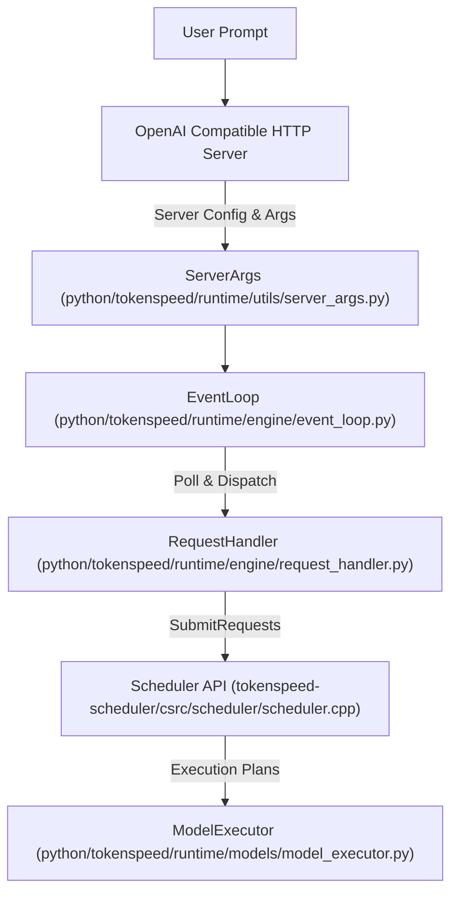
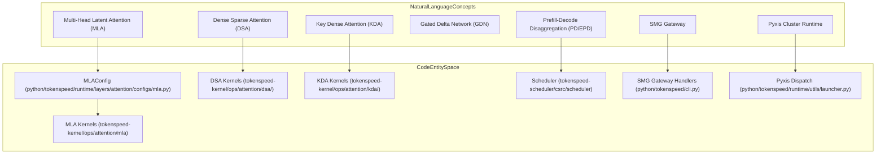

<!-- source: DeepWiki mcp.deepwiki.com · repo lightseekorg/tokenspeed · page 9 Glossary · fetched 2026-10-21 -->

# Glossary

Relevant source files

The following files were used as context for generating this wiki page:

- [docs/configuration/server.md](docs/configuration/server.md)
- [docs/design/cache-concepts.md](docs/design/cache-concepts.md)
- [docs/design/scheduler.md](docs/design/scheduler.md)
- [docs/design/unified_path.md](docs/design/unified_path.md)
- [docs/recipes/models.md](docs/recipes/models.md)
- [python/tokenspeed/runtime/configs/__init__.py](python/tokenspeed/runtime/configs/__init__.py)
- [python/tokenspeed/runtime/configs/model_config.py](python/tokenspeed/runtime/configs/model_config.py)
- [python/tokenspeed/runtime/layers/attention/backends/base.py](python/tokenspeed/runtime/layers/attention/backends/base.py)
- [python/tokenspeed/runtime/layers/attention/backends/hybrid/linear.py](python/tokenspeed/runtime/layers/attention/backends/hybrid/linear.py)
- [python/tokenspeed/runtime/layers/attention/backends/specific/inkling.py](python/tokenspeed/runtime/layers/attention/backends/specific/inkling.py)
- [python/tokenspeed/runtime/layers/attention/backends/specific/qwen4_exp.py](python/tokenspeed/runtime/layers/attention/backends/specific/qwen4_exp.py)
- [python/tokenspeed/runtime/layers/attention/backends/state/kda.py](python/tokenspeed/runtime/layers/attention/backends/state/kda.py)
- [python/tokenspeed/runtime/layers/attention/configs/base.py](python/tokenspeed/runtime/layers/attention/configs/base.py)
- [python/tokenspeed/runtime/layers/attention/configs/mla.py](python/tokenspeed/runtime/layers/attention/configs/mla.py)
- [python/tokenspeed/runtime/layers/attention/kv_cache/recipes/glm53_flash.py](python/tokenspeed/runtime/layers/attention/kv_cache/recipes/glm53_flash.py)
- [python/tokenspeed/runtime/layers/attention/kv_cache/recipes/inkling.py](python/tokenspeed/runtime/layers/attention/kv_cache/recipes/inkling.py)
- [python/tokenspeed/runtime/layers/attention/kv_cache/recipes/kimi_k3.py](python/tokenspeed/runtime/layers/attention/kv_cache/recipes/kimi_k3.py)
- [python/tokenspeed/runtime/layers/attention/registry.py](python/tokenspeed/runtime/layers/attention/registry.py)
- [python/tokenspeed/runtime/utils/hf_transformers_utils.py](python/tokenspeed/runtime/utils/hf_transformers_utils.py)
- [python/tokenspeed/runtime/utils/server_args.py](python/tokenspeed/runtime/utils/server_args.py)
- [test/ci/perf/kimi-k2.5-nvfp4-evalscope-agentic.yaml](test/ci/perf/kimi-k2.5-nvfp4-evalscope-agentic.yaml)
- [test/runtime/conftest.py](test/runtime/conftest.py)
- [test/runtime/models/test_moe_routing_config.py](test/runtime/models/test_moe_routing_config.py)
- [test/runtime/test_cache_setup.py](test/runtime/test_cache_setup.py)
- [test/runtime/test_cli_config_compat.py](test/runtime/test_cli_config_compat.py)
- [test/runtime/test_hf_snapshot_resolution.py](test/runtime/test_hf_snapshot_resolution.py)
- [test/runtime/test_kimi_k3_cache_spec.py](test/runtime/test_kimi_k3_cache_spec.py)
- [test/runtime/test_kimi_k3_kda_eager_commit.py](test/runtime/test_kimi_k3_kda_eager_commit.py)
- [test/runtime/test_qwen4_backend_composition.py](test/runtime/test_qwen4_backend_composition.py)
- [test/runtime/test_qwen4_exp.py](test/runtime/test_qwen4_exp.py)
- [test/runtime/test_server_args_attention_backends.py](test/runtime/test_server_args_attention_backends.py)
- [tokenspeed-kernel/python/tokenspeed_kernel/__init__.py](tokenspeed-kernel/python/tokenspeed_kernel/__init__.py)
- [tokenspeed-kernel/python/tokenspeed_kernel/ops/attention/__init__.py](tokenspeed-kernel/python/tokenspeed_kernel/ops/attention/__init__.py)
- [tokenspeed-kernel/python/tokenspeed_kernel/ops/gemm/__init__.py](tokenspeed-kernel/python/tokenspeed_kernel/ops/gemm/__init__.py)
- [tokenspeed-kernel/python/tokenspeed_kernel/ops/gemm/flashinfer.py](tokenspeed-kernel/python/tokenspeed_kernel/ops/gemm/flashinfer.py)
- [tokenspeed-kernel/python/tokenspeed_kernel/platform.py](tokenspeed-kernel/python/tokenspeed_kernel/platform.py)
- [tokenspeed-kernel/test/kimi3_reference.py](tokenspeed-kernel/test/kimi3_reference.py)
- [tokenspeed-kernel/test/nvidia/ops/test_nvfp4_cute_dsl_gemm.py](tokenspeed-kernel/test/nvidia/ops/test_nvfp4_cute_dsl_gemm.py)
- [tokenspeed-kernel/test/ops/test_attention.py](tokenspeed-kernel/test/ops/test_attention.py)
- [tokenspeed-kernel/test/ops/test_kda_recurrent.py](tokenspeed-kernel/test/ops/test_kda_recurrent.py)
- [tokenspeed-kernel/test/test_kernel_api_selection.py](tokenspeed-kernel/test/test_kernel_api_selection.py)
- [tokenspeed-scheduler/csrc/cache/coordinator/cache_coordinator.cpp](tokenspeed-scheduler/csrc/cache/coordinator/cache_coordinator.cpp)
- [tokenspeed-scheduler/csrc/cache/coordinator/cache_coordinator.h](tokenspeed-scheduler/csrc/cache/coordinator/cache_coordinator.h)
- [tokenspeed-scheduler/csrc/cache/core/cache_types.h](tokenspeed-scheduler/csrc/cache/core/cache_types.h)
- [tokenspeed-scheduler/csrc/fsm/forward_events.cpp](tokenspeed-scheduler/csrc/fsm/forward_events.cpp)
- [tokenspeed-scheduler/csrc/fsm/forward_events.h](tokenspeed-scheduler/csrc/fsm/forward_events.h)
- [tokenspeed-scheduler/csrc/fsm/forward_states.h](tokenspeed-scheduler/csrc/fsm/forward_states.h)
- [tokenspeed-scheduler/csrc/scheduler/operations/forward.cpp](tokenspeed-scheduler/csrc/scheduler/operations/forward.cpp)
- [tokenspeed-scheduler/csrc/scheduler/outside_event_handler.cpp](tokenspeed-scheduler/csrc/scheduler/outside_event_handler.cpp)
- [tokenspeed-scheduler/csrc/scheduler/request.cpp](tokenspeed-scheduler/csrc/scheduler/request.cpp)
- [tokenspeed-scheduler/csrc/scheduler/request.h](tokenspeed-scheduler/csrc/scheduler/request.h)
- [tokenspeed-scheduler/csrc/scheduler/request_spec.h](tokenspeed-scheduler/csrc/scheduler/request_spec.h)
- [tokenspeed-scheduler/csrc/scheduler/scheduler.cpp](tokenspeed-scheduler/csrc/scheduler/scheduler.cpp)
- [tokenspeed-scheduler/csrc/scheduler/scheduler.h](tokenspeed-scheduler/csrc/scheduler/scheduler.h)
- [tokenspeed-scheduler/tests/cpp/cache_test_access.h](tokenspeed-scheduler/tests/cpp/cache_test_access.h)
- [tokenspeed-scheduler/tests/cpp/test_cache_coordinator.cpp](tokenspeed-scheduler/tests/cpp/test_cache_coordinator.cpp)
- [tokenspeed-scheduler/tests/cpp/test_cache_operations.cpp](tokenspeed-scheduler/tests/cpp/test_cache_operations.cpp)
- [tokenspeed-scheduler/tests/cpp/test_cache_scenarios.cpp](tokenspeed-scheduler/tests/cpp/test_cache_scenarios.cpp)
- [tokenspeed-scheduler/tests/cpp/test_outside_event_handler.cpp](tokenspeed-scheduler/tests/cpp/test_outside_event_handler.cpp)

This page provides definitions for codebase-specific terms, abbreviations, and domain concepts within the TokenSpeed ecosystem. It serves as a technical reference for onboarding engineers to understand how natural language concepts map to specific code entities and implementation details across the execution runtime, scheduler, and multi-silicon kernel library.

Sources: [README.md:5-20](), [tokenspeed-kernel/python/tokenspeed_kernel/ops/attention/__init__.py:63-131]()

---

## Core Architectural Concepts

The TokenSpeed architecture is partitioned into high-level Python orchestration, a high-performance C++ control plane scheduler, and a multi-silicon kernel library.

### Prefill-Decode Disaggregation (PD / EPD)
A serving architecture where the **Prefill** phase (processing input token batches) and the **Decode** phase (generating subsequent tokens autoregressively) execute on separate worker pools or nodes to optimize throughput and TTFT/TPOT latency independently.

- **Implementation**: TokenSpeed coordinates disaggregation using specialized executors such as `DisaggPrefillExecutor` and `DisaggDecodeExecutor` which handle event-loop orchestration and KV cache transfers asynchronously in the runtime [python/tokenspeed/runtime/engine/event_loop.py:74-87]().

- **KV Transfer**: Inter-cluster KV state transfer relies on transfer plans and the Mooncake block transfer protocol to stream cache blocks between prefill and decode workers.

- **Disaggregation Modes**: The system validates disaggregation mode compatibility for decode context parallelism (DCP), ensuring that only specific modes (`null` or `prefill`) support DCP greater than 1 [python/tokenspeed/runtime/utils/server_args.py:149-163]().

Sources: [python/tokenspeed/runtime/engine/event_loop.py:74-87](), [python/tokenspeed/runtime/utils/server_args.py:149-163]()

### Parallelism Types: Tensor Parallel (TP), Expert Parallel (EP), and Device-SPMD

TokenSpeed implements a static compilation design with local Single-Program-Multiple-Data (SPMD) execution, translating module-boundary annotations into collective communication.

- **Tensor Parallelism (TP)**: Splits weight matrices and activation tensors across devices within a layer. Configured via parameters like `attn_tp_size` and resolved through mapping utilities [python/tokenspeed/runtime/distributed/mapping.py:1-40]().

- **Expert Parallelism (EP)**: Applies to Mixture-of-Experts (MoE) routing and expert weight distribution. Includes redundant expert handling and online load balancing that require expert placement tables [python/tokenspeed/runtime/utils/server_args.py:107-120]().

- **Distributed Communication**: Manages process groups and backend communication via NCCL, TRT-LLM allreduce, Triton allreduce, and third-party solutions.

Sources: [python/tokenspeed/runtime/distributed/mapping.py:1-40](), [python/tokenspeed/runtime/utils/server_args.py:107-120]()

### TokenSpeed Kernel Registry and Auto-Selection

A multi-silicon kernel library decoupling platform-specific optimizations from model logic via a centralized registry and selection mechanism.

- **Kernel Registration**: Kernels use `@register_kernel` decorators with metadata to specify target platforms, problem structures, and priority bands (e.g., `REFERENCE`, `PERFORMANT`, `VENDOR`).

- **Selection**: The `select_kernel` function applies trait dictionaries describing problem shapes and features to resolve the best kernel for a request [tokenspeed-kernel/test/test_kernel_api_selection.py:21-119]().

- **Priority Bands and Overrides**: Kernels have priority tiers, enabling fallback from vendor-optimized backends (like `gluon` or `flashinfer`) to portable implementations (e.g., Triton).

Sources: [tokenspeed-kernel/test/test_kernel_api_selection.py:21-119](), [tokenspeed-kernel/python/tokenspeed_kernel/registry.py:40-70]()

---

### Diagram: Request Intake and Execution Flow Mapping Natural Language to Code Entities

Sources: [python/tokenspeed/runtime/engine/event_loop.py:182-200](), [tokenspeed-scheduler/csrc/scheduler/scheduler.cpp:75-105]()

---

## Memory and Cache Terms

| Term                         | Definition                                                                                                         | Code Pointer                                         |
|------------------------------|--------------------------------------------------------------------------------------------------------------------|-----------------------------------------------------|
| **KV Cache**                 | Paged memory structure for storing attention key and value tensors. Managed by `CacheCoordinator` and BlockTables. | [tokenspeed-scheduler/csrc/scheduler/scheduler.cpp:75-100]() |
| **Cache Group**              | A logical grouping of cache blocks with uniform token granularity, retention, and storage layout.                   | [tokenspeed-scheduler/csrc/cache/core/cache_types.h:80-110]() |
| **LCM Block**                | The Least Common Multiple block: a physical unit of cache storage that aligns group blocks for mixed retention.    | [tokenspeed-scheduler/csrc/cache/core/cache_types.h:80-110]() |
| **Prefix Cache**             | Radix-tree based prefix hashing and matching mechanism to reuse cached KV blocks between sequences with common prefixes. | [tokenspeed-scheduler/csrc/scheduler/scheduler.cpp:40-50]() |
| **Block Size / Granularity** | The token count per block or page; distinguishes logical token range (schedule layer) and physical storage unit.  | [docs/design/cache-concepts.md:12-80]() |

Sources: [tokenspeed-scheduler/csrc/scheduler/scheduler.cpp:75-105](), [docs/design/cache-concepts.md:1-126]()

---

## Model and Kernel Terms

### MLA (Multi-Head Latent Attention)
A memory-efficient attention mechanism compressing key-value tensors into latent vectors, used for large context and MoE model families such as DeepSeek-V3/V4 and Kimi K3.

- **Implementation**: Abstracts query compression and latent projection, using CuTe DSL decode kernels with fallback paths to Triton or flashinfer, integrated tightly in runtime backends [tokenspeed-kernel/python/tokenspeed_kernel/ops/attention/mla/cuda/__init__.py:1-90](), [python/tokenspeed/runtime/layers/attention/registry.py:39-130]().

- **Code Entities**: `MLAConfig`, `MLATokenToKVPool`, `mla_decode.py`, `mla_prefill.py`

Sources: [tokenspeed-kernel/python/tokenspeed_kernel/ops/attention/__init__.py:63-131](), [python/tokenspeed/runtime/layers/attention/registry.py:30-130]()

### DSA (Dense Sparse Attention)
A sparsity-aware attention backend providing a hybrid between local dense windows and global sparse top-k token selection for long contexts.

- **Implementation**: Combines dense and sparse components, with DSA kernels implemented in CUDA, Triton, DeepGEMM, and Gluon frameworks with specialized top-k indexers [tokenspeed-kernel/python/tokenspeed_kernel/ops/attention/dsa/__init__.py]().

Sources: [tokenspeed-kernel/test/ops/test_kda_recurrent.py:10-100](), [tokenspeed-kernel/python/tokenspeed_kernel/ops/attention/__init__.py:40-70]()

### QSA (Query-Sparse Attention)
An advanced sparse attention variant utilizing query-driven top-k selection indexes, improving efficiency for models with very long sequences.

- **Representation**: QSA is often used in conjunction with DCP-style scheduling and speculative decode paradigms.

Sources: (implicit in DSA/DSV4 family coverage)

### KDA (Key Dense Attention)
A linear or recurrent-state attention variant combining dense key/value representation with causal recurrence or convolution.

- **Implementation**: KDA uses a custom recurrent layout and streaming prefill kernels to enable efficient stateful attention [tokenspeed-kernel/test/ops/test_kda_recurrent.py:1-150]().

- **Code Entities**: `kda_paged_prefill`, `kda_recurrent_layout`, `KdaPrefillResult`

Sources: [tokenspeed-kernel/test/ops/test_kda_recurrent.py:1-150]()

### GDN (Gated Delta Network)
A hybrid stateful attention variant using gated deltas for efficient incremental state update.

- **Backend Kernels**: Fuse custom CUDA and Triton kernels for prefill and decode steps.

Sources: [tokenspeed-kernel/python/tokenspeed_kernel/ops/attention/gdn/__init__.py]()

### MSA (Multi-Stage Attention)
A modular attention architecture capable of disaggregated evaluation stages, layered execution, and combined dense/sparse interactions.

- **Use Cases**: Frequently used in multimodal inputs and models with complex layer compositions.

Sources: [python/tokenspeed/runtime/layers/attention/configs/msa.py]()

### CuTe DSL
A domain-specific language used to write and optimize CUDA kernels for the Multi-Head Latent Attention backends, allowing flexible and composable kernel implementations.

- **Use**: CuTe DSL kernels appear in the MLA decode and sampling chain implementations for NVIDIA Blackwell (SM100/SM103/SM107) GPUs [tokenspeed-kernel/python/tokenspeed_kernel/ops/attention/mla/cuda/mla_decode.py]().

Sources: [tokenspeed-kernel/python/tokenspeed_kernel/ops/sampling/cute_dsl.py](), [tokenspeed-kernel/python/tokenspeed_kernel/ops/attention/mla/cuda/mla_decode.py]()

### NVFP4 / MXFP4
Floating-point quantization formats used to compress MoE and GEMM weights to 4-bit floating representations.

- **NVFP4**: NVIDIA variant with block-scale FP8 quantization.

- **MXFP4**: AMD variant used on GFX950/GFX1250 devices with Gluon JIT kernel support.

Sources: [tokenspeed-kernel/test/test_kernel_api_selection.py:75-110](), [docs/recipes/models.md:8-85]()

### EvalScope
An evaluation harness and benchmarking framework integrated into the test pipeline, enabling agentic evaluations for multiple model families and accuracy cross-checks [test/agentic_benchmark/]().

Sources: [test/agentic_benchmark/README.md]()

### Pyxis
A containerized job submission and runtime environment used for Slurm-based cluster execution and multi-node dispatch workflows, including GPU benchmarks and ML training jobs [docs/ci/ci_system.md](), [tokenspeed-scheduler/csrc/slurm/pyxis.cpp]().

Sources: [python/tokenspeed/runtime/utils/launcher.py:20-60]()

### SMG (Server Management Gateway)
The lightweight HTTP and gRPC gateway process orchestrating TokenSpeed serving pipelines.

- **Responsible for**: API key authorization, request multiplexing, configuration splitting, and upstream broker routing.

- **Code Entities**: `smg/` gateway package, CLI serve orchestration [python/tokenspeed/cli.py:50-90]().

Sources: [python/tokenspeed/runtime/utils/server_args.py:55-90](), [docs/configuration/server.md:50-90]()

### LCM Blocks and Cache Groups

- **LCM Blocks**: The physical storage units in the cache backend. The Least Common Multiple concept means blocks align token ranges for multiple cache groups with differing block granularities.

- **Cache Groups**: Logical groupings of blocks with consistent token granularity and layout, notably `history` groups (paged KV caches with sliding windows) and `state` groups (snapshot-style groups holding recurrent state values).

Sources: [docs/design/cache-concepts.md:1-126](), [tokenspeed-scheduler/csrc/cache/core/cache_types.h:70-115]()

---

### Diagram: Bridging Natural Language Concepts and Code Entities

Sources: [python/tokenspeed/runtime/layers/attention/configs/mla.py:10-60](), [tokenspeed-kernel/test/test_kernel_api_selection.py:20-120](), [tokenspeed-scheduler/csrc/scheduler/scheduler.cpp:50-120](), [python/tokenspeed/cli.py:50-90](), [python/tokenspeed/runtime/utils/launcher.py:20-60]()

---

## Infrastructure and Tooling Terms

| Term              | Description                                                                   | Code Pointer                              |
|-------------------|-------------------------------------------------------------------------------|------------------------------------------|
| `tokenspeed-kernel`  | A portable, multi-silicon CUDA kernel library providing attention, GEMM, MoE, quantization, and sampling operators with auto-selection and tuning. | [tokenspeed-kernel/test/test_kernel_api_selection.py:21-119]() |
| `tokenspeed-scheduler` | A C++ scheduling engine managing request lifecycle via a finite-state machine and KV cache resource management. Provides Python bindings via nanobind. | [tokenspeed-scheduler/csrc/scheduler/scheduler.cpp:75-105]() |
| `ServerArgs`       | Central runtime server configuration dataclass governing model parameters, parallelism, numerics, and memory usage. | [python/tokenspeed/runtime/utils/server_args.py:1-163]() |

Sources: [tokenspeed-kernel/test/test_kernel_api_selection.py:21-119](), [tokenspeed-scheduler/csrc/scheduler/scheduler.cpp:75-105](), [python/tokenspeed/runtime/utils/server_args.py:1-163]()

---

This glossary page serves as a technical reference for contributors to understand the interplay of key TokenSpeed concepts with their concrete codebase implementations, spanning runtime, kernel, and scheduler layers.