# Page: TokenSpeed Overview

# TokenSpeed Overview

<details>
<summary>Relevant source files</summary>

The following files were used as context for generating this wiki page:

- [README.md](README.md)
- [assets/banner/tokenspeed-banner.png](assets/banner/tokenspeed-banner.png)
- [assets/perf/tokenspeed-kimi-k2.5-performance.png](assets/perf/tokenspeed-kimi-k2.5-performance.png)
- [python/pyproject.toml](python/pyproject.toml)
- [python/tokenspeed/cli/serve_smg.py](python/tokenspeed/cli/serve_smg.py)
- [python/tokenspeed/version.py](python/tokenspeed/version.py)
- [test/ci_system/install_deps.sh](test/ci_system/install_deps.sh)
- [test/ci_system/install_deps_rocm.sh](test/ci_system/install_deps_rocm.sh)
- [test/ci_system/package_cache.sh](test/ci_system/package_cache.sh)
- [test/ci_system/test_package_cache.py](test/ci_system/test_package_cache.py)
- [test/cli/test_serve_smg_unit.py](test/cli/test_serve_smg_unit.py)
- [tokenspeed-scheduler/python/tests/test_cache_group_admission.py](tokenspeed-scheduler/python/tests/test_cache_group_admission.py)
- [tokenspeed-scheduler/python/tests/test_d_role_state_reserve.py](tokenspeed-scheduler/python/tests/test_d_role_state_reserve.py)
- [tokenspeed-scheduler/python/tests/test_local_state_growth_reserve.py](tokenspeed-scheduler/python/tests/test_local_state_growth_reserve.py)

</details>


TokenSpeed is a speed-of-light LLM inference engine designed for **agentic workloads**, providing raw execution performance comparable to `TensorRT-LLM` while maintaining the usability and flexibility of `vLLM` [README.md:5-6](). 

The project is structured as a monorepo containing a Python-based runtime layer, a portable multi-silicon kernel system, specialized Multi-Head Latent Attention (`MLA`) implementations for modern architectures, and a high-efficiency C++ scheduler [README.md:9-17]().

Sources: [README.md:5-17]()

## Architecture Pillars

TokenSpeed's design is built on four core architectural pillars:

1. **Modeling Layer**: Utilizes a local-SPMD design with a static compilation path that automatically generates collective communication from module-boundary annotations.
2. **Native Scheduling**: Implements a C++ control plane and Python execution plane. Request lifecycles, KV cache ownership, and overlap timing are encoded as a finite-state machine (`FSM`), using the type system to enforce resource safety at compile time [README.md:9-11]().
3. **Pluggable Kernels**: Treats kernels as a first-class modular subsystem through a portable public API, centralized registry, and platform abstraction layer [README.md:12-14]().
4. **SMG-Integrated Entrypoint**: Integrates `AsyncLLM` with the Service Mesh Gateway (`SMG`) for low-overhead request handling and routing [README.md:15-19]().

### System Architecture and Code Entities

The following diagram maps high-level system components to their concrete code entities within the monorepo.

**TokenSpeed System Component Map**
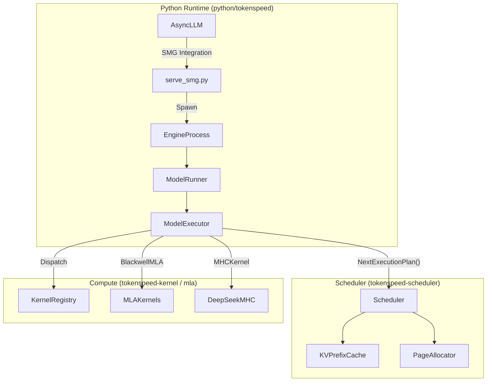
Sources: [README.md:9-19](), [python/tokenspeed/cli/serve_smg.py:38-44](), [python/pyproject.toml:70-74]()

## Supported Hardware

TokenSpeed targets high-end accelerator hardware, offering optimized execution paths across major silicon vendors:

| Vendor | Supported Architectures | Kernel Backend & Execution Path |
| :--- | :--- | :--- |
| **NVIDIA** | Blackwell (B200/GB200, SM100/SM103), Hopper (H100, SM90) | CuTe DSL, DeepGEMM, FlashInfer [test/ci_system/install_deps.sh:26-28]() |
| **AMD** | MI300, MI350 (GFX950/GFX1250) | Triton, Gluon JIT backend [test/ci_system/install_deps_rocm.sh:7-8]() |
| **Ascend** | Ascend NPU | Native NPU integration via `tokenspeed-kernel-npu` |

Sources: [README.md:23-28](), [test/ci_system/install_deps.sh:26-36](), [test/ci_system/install_deps_rocm.sh:7-11]()

## Monorepo Organization

The codebase is partitioned into distinct packages to separate control-plane logic, platform runtimes, and hardware-specific kernel plugins [python/pyproject.toml:70-77]().

| Directory | Package Name | Responsibility |
| :--- | :--- | :--- |
| `python/` | `tokenspeed` | High-level Python runtime, `AsyncLLM`, SMG gateway integration, and `ts` CLI [python/pyproject.toml:25-27](). |
| `tokenspeed-kernel/` | `tokenspeed-kernel` | Portable multi-silicon kernel library and op registry [python/pyproject.toml:72-72](). |
| `tokenspeed-kernel-amd/` | `tokenspeed-kernel-amd` | AMD ROCm-specific kernel shims and Gluon pipelines [test/ci_system/install_deps_rocm.sh:62-63](). |
| `tokenspeed-kernel-npu/` | `tokenspeed-kernel-npu` | Ascend NPU platform integration and op wrappers. |
| `tokenspeed-mla/` | `tokenspeed-mla` | Specialized Multi-Head Latent Attention kernels for NVIDIA Blackwell [python/pyproject.toml:73-74](). |
| `tokenspeed-scheduler/` | `tokenspeed-scheduler` | C++ core scheduler, FSM state machine, and nanobind Python bindings [python/pyproject.toml:74-74](). |

### CLI and Environment Management

The entrypoint command-line interface (`tokenspeed` / `ts`) routes commands to subprocess orchestrators and diagnostic utilities like `tokenspeed env`.

**CLI and Entrypoint Routing Map**
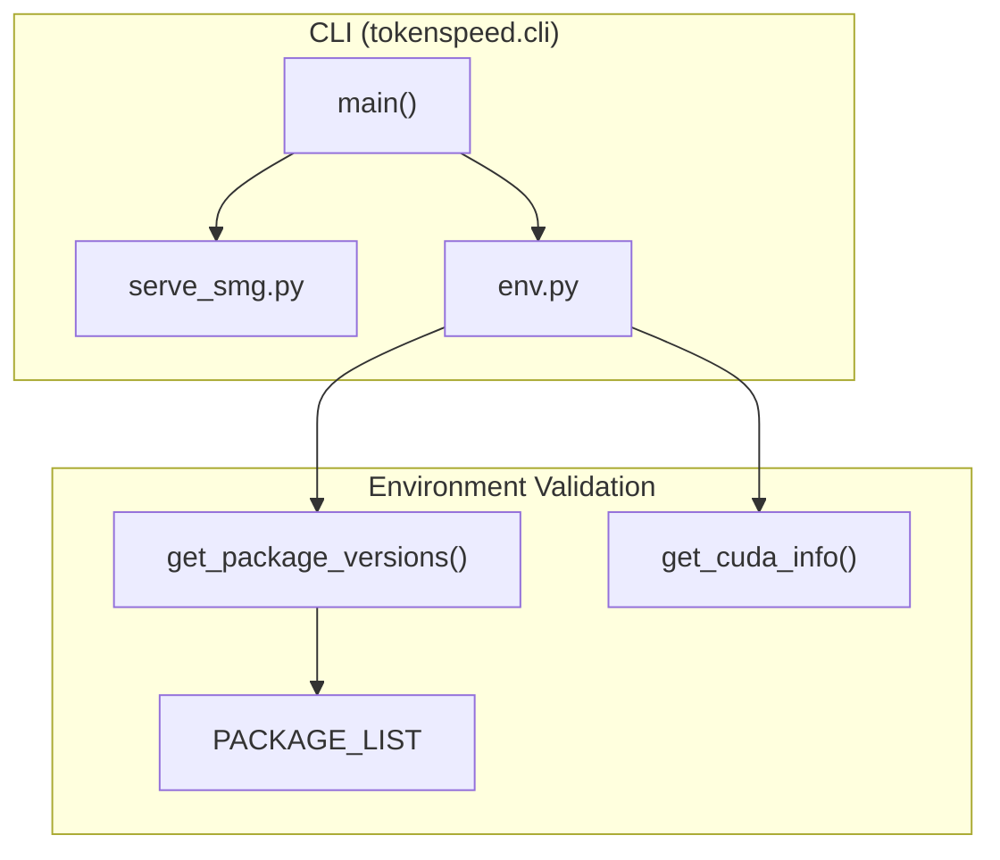
Sources: [python/pyproject.toml:91-93](), [python/tokenspeed/cli/serve_smg.py:21-22]()

## Child Pages and Further Reading

For a comprehensive walkthrough of each subsystem, consult the following child pages:

- **[Getting Started](#1.1)** — Setting up a development environment, installing core packages (`tokenspeed`, `tokenspeed-kernel`, `tokenspeed-kernel-amd`, `tokenspeed-mla`, `tokenspeed-scheduler`), verifying installations via `tokenspeed env`, and launching initial servers.
- **[Project Structure and Monorepo Layout](#1.2)** — Detailed breakdown of top-level directories (`python/`, `tokenspeed-kernel/`, `tokenspeed-kernel-amd/`, `tokenspeed-kernel-npu/`, `tokenspeed-mla/`, `tokenspeed-scheduler/`), ownership boundaries, and inter-package dependency management [python/pyproject.toml:70-77]().

Sources: [README.md:62-73](), [python/pyproject.toml:70-77]()

---

# Page: Getting Started

# Getting Started

<details>
<summary>Relevant source files</summary>

The following files were used as context for generating this wiki page:

- [.github/scripts/prepare-kernel-amd-nightly.py](.github/scripts/prepare-kernel-amd-nightly.py)
- [.github/scripts/prepare-tokenspeed-nightly.py](.github/scripts/prepare-tokenspeed-nightly.py)
- [.github/scripts/update-nightly-index.py](.github/scripts/update-nightly-index.py)
- [.github/workflows/nvidia-kernel-library-tests.yml](.github/workflows/nvidia-kernel-library-tests.yml)
- [.github/workflows/release-pypi.yml](.github/workflows/release-pypi.yml)
- [.github/workflows/release-tokenspeed-kernel-amd-nightly.yml](.github/workflows/release-tokenspeed-kernel-amd-nightly.yml)
- [.github/workflows/release-tokenspeed-kernel-rocm.yml](.github/workflows/release-tokenspeed-kernel-rocm.yml)
- [.github/workflows/release-tokenspeed-kernel.yml](.github/workflows/release-tokenspeed-kernel.yml)
- [.github/workflows/update-tokenspeed-kernel-flashinfer.yml](.github/workflows/update-tokenspeed-kernel-flashinfer.yml)
- [docs/guides/getting-started.md](docs/guides/getting-started.md)
- [python/tokenspeed/env.py](python/tokenspeed/env.py)
- [test/ci/run_slurm.sh](test/ci/run_slurm.sh)
- [test/ci_system/test_cuda_install_validation.py](test/ci_system/test_cuda_install_validation.py)
- [test/ci_system/test_nightly_release.py](test/ci_system/test_nightly_release.py)
- [test/runtime/test_draft_advance_seqlens.py](test/runtime/test_draft_advance_seqlens.py)
- [tokenspeed-kernel/python/pyproject.toml](tokenspeed-kernel/python/pyproject.toml)
- [tokenspeed-kernel/python/requirements/cuda-thirdparty.txt](tokenspeed-kernel/python/requirements/cuda-thirdparty.txt)
- [tokenspeed-kernel/python/requirements/cuda.txt](tokenspeed-kernel/python/requirements/cuda.txt)
- [tokenspeed-kernel/python/requirements/rocm-thirdparty.txt](tokenspeed-kernel/python/requirements/rocm-thirdparty.txt)
- [tokenspeed-kernel/python/setup.py](tokenspeed-kernel/python/setup.py)
- [tokenspeed-kernel/python/tokenspeed_kernel/thirdparty/cute_dsl/argmax.py](tokenspeed-kernel/python/tokenspeed_kernel/thirdparty/cute_dsl/argmax.py)
- [tokenspeed-kernel/python/tokenspeed_kernel/thirdparty/flashinfer/mxfp8.py](tokenspeed-kernel/python/tokenspeed_kernel/thirdparty/flashinfer/mxfp8.py)
- [tokenspeed-kernel/python/tokenspeed_kernel/thirdparty/msa/README.md](tokenspeed-kernel/python/tokenspeed_kernel/thirdparty/msa/README.md)
- [tokenspeed-kernel/python/tokenspeed_kernel/thirdparty/msa/cute/requirements.txt](tokenspeed-kernel/python/tokenspeed_kernel/thirdparty/msa/cute/requirements.txt)
- [tokenspeed-kernel/python/tokenspeed_kernel/thirdparty/msa/cute/src/common/utils.py](tokenspeed-kernel/python/tokenspeed_kernel/thirdparty/msa/cute/src/common/utils.py)
- [tokenspeed-kernel/test/test_nightly_index.py](tokenspeed-kernel/test/test_nightly_index.py)
- [tokenspeed-kernel/test/test_setup.py](tokenspeed-kernel/test/test_setup.py)

</details>


## Purpose and Scope

This page provides a comprehensive guide for setting up a TokenSpeed development environment, installing all required monorepo packages (`tokenspeed`, `tokenspeed-kernel`, `tokenspeed-kernel-amd`, `tokenspeed-mla`, and `tokenspeed-scheduler`), verifying system configuration via `tokenspeed env`, and launching your first high-performance inference server using the serving orchestration CLI.

Sources: [python/tokenspeed/env.py:42-115](), [docs/guides/getting-started.md:1-12]()

---

## Prerequisites

Before setting up your workspace, ensure your target hardware and software environment satisfy TokenSpeed's dependencies:
*   **Hardware**: NVIDIA accelerators (H100, H200, B200, B300, GB200, GB300) or AMD accelerators (MI350X, MI355X) with compatible device drivers [docs/guides/getting-started.md:8-11]().
*   **Software**: Docker configured with the NVIDIA Container Toolkit or ROCm container runtimes [docs/guides/getting-started.md:9-9]().
*   **Python/PyTorch**: TokenSpeed targets PyTorch 2.14.0 for optimized execution contexts [tokenspeed-kernel/python/requirements/cuda.txt:6-6]().

Sources: [tokenspeed-kernel/python/requirements/cuda.txt:6-6](), [docs/guides/getting-started.md:6-12]()

---

## Environment Setup and Monorepo Layout

The recommended development environment runs inside the official runner container, which provisions the underlying CUDA toolchains, compilers, and system libraries [docs/guides/getting-started.md:13-36]().

### 1. Start the Runner Container
Launch the environment container with host IPC, networking, and privileged device access to support multi-node and multi-GPU distributed communication [docs/guides/getting-started.md:18-29]():

```bash
docker pull lightseekorg/tokenspeed-runner:latest

docker run -itd \
  --shm-size 32g \
  --gpus all \
  -v /raid/cache:/home/runner/.cache \
  --ipc=host \
  --network=host \
  --pid=host \
  --privileged \
  --name tokenspeed \
  lightseekorg/tokenspeed-runner:latest \
  /bin/bash
```

### 2. Clone the Repository
Inside the container, clone the TokenSpeed repository [docs/guides/getting-started.md:33-36]():
```bash
git clone https://github.com/lightseekorg/tokenspeed.git
cd tokenspeed
```

Sources: [docs/guides/getting-started.md:13-36]()

---

## Package Installation

TokenSpeed is organized into multiple discrete packages. For development, they must be installed in a specific order, leveraging editable installs (`-e`) where applicable [docs/guides/getting-started.md:105-135]().

| Package Name | Source Path | Description |
| :--- | :--- | :--- |
| **tokenspeed** | `./python` | Core Python runtime, orchestration logic, and CLI wrapper [docs/guides/getting-started.md:121-121]() |
| **tokenspeed-kernel** | `./tokenspeed-kernel/python/` | Portable multi-silicon kernel library (CUDA/Triton/FlashInfer shims) [docs/guides/getting-started.md:128-128]() |
| **tokenspeed-kernel-amd** | `./tokenspeed-kernel-amd` | AMD-specific high-performance kernels (GFX950/GFX1250) [tokenspeed-kernel/python/requirements/rocm-thirdparty.txt:2-2]() |
| **tokenspeed-mla** | `./tokenspeed-mla` | Multi-Head Latent Attention library for NVIDIA Blackwell (SM100/SM103) [tokenspeed-kernel/python/requirements/cuda-thirdparty.txt:5-5]() |
| **tokenspeed-scheduler** | `./tokenspeed-scheduler/` | C++ request scheduler, radix-tree prefix cache, and nanobind Python bindings [docs/guides/getting-started.md:134-134]() |

### Installation Commands

Execute the following commands to install the complete workspace environment [docs/guides/getting-started.md:120-135]():

```bash
export PIP_BREAK_SYSTEM_PACKAGES=1

# 1. Install Platform-Specific Kernels
# For NVIDIA:
TOKENSPEED_KERNEL_BACKEND=cuda pip install -e tokenspeed-kernel/python/ --no-build-isolation
# For AMD ROCm:
TOKENSPEED_KERNEL_BACKEND=rocm pip install -e tokenspeed-kernel/python/ --no-build-isolation
pip install -e tokenspeed-kernel-amd/ --no-build-isolation

# 2. Install MLA Library (Blackwell SM100+)
pip install -e tokenspeed-mla/ --no-build-isolation

# 3. Install C++ Scheduler
pip install -e tokenspeed-scheduler/

# 4. Install Core Python Runtime
pip install -e "./python" --no-build-isolation
```

Sources: [tokenspeed-kernel/python/requirements/cuda-thirdparty.txt:5-5](), [tokenspeed-kernel/python/requirements/rocm-thirdparty.txt:2-2](), [docs/guides/getting-started.md:117-135]()

---

## Verification with `tokenspeed env`

To verify that your installation is correct and all required packages, hardware drivers, and third-party bindings are accessible, TokenSpeed provides an environment diagnostic tool [python/tokenspeed/env.py:21-21]().

### Running the Diagnostic
```bash
tokenspeed env
```

This command invokes `tokenspeed.env` routines to inspect package availability, device topologies, and compiler versions [python/tokenspeed/env.py:118-148]().

**Diagram: Verification Subsystem Code Flow**
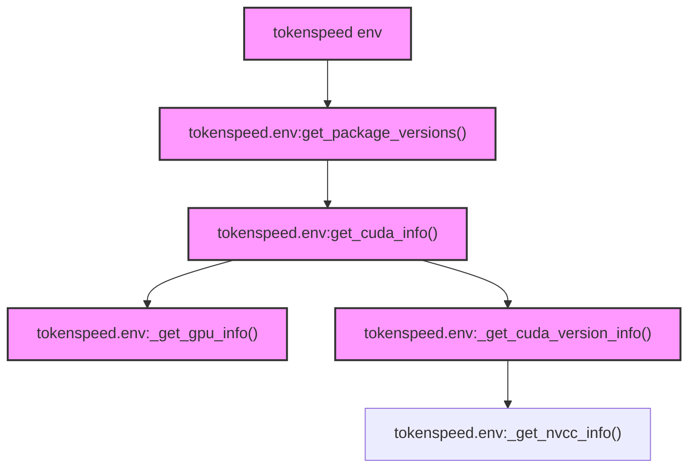
Sources: [python/tokenspeed/env.py:118-218]()

---

## Launching Your First Server

TokenSpeed provides the `tokenspeed serve` CLI command to launch high-performance inference instances [docs/guides/getting-started.md:144-151]().

### Minimal Launch Command
```bash
tokenspeed serve openai/gpt-oss-20b \
  --host 0.0.0.0 \
  --port 8000 \
  --tensor-parallel-size 1
```

### Server Initialization Data Flow

When `tokenspeed serve` executes, the runtime initializes configuration args, boots up the model engine worker pool, and opens the gRPC/HTTP serving interface [docs/guides/getting-started.md:144-151]().

**Diagram: Serving Initialization Flow**
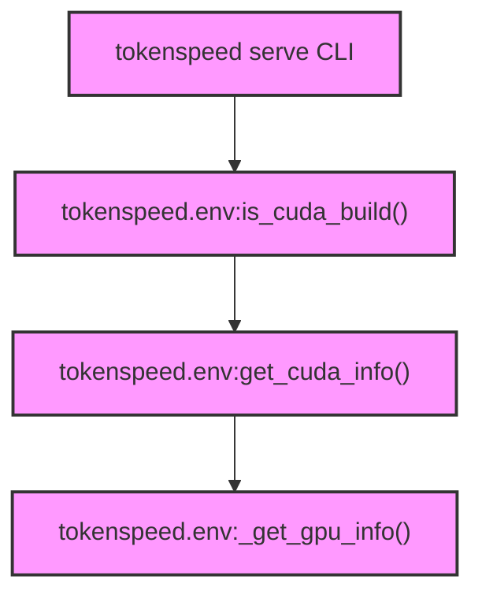
Sources: [python/tokenspeed/env.py:33-148](), [docs/guides/getting-started.md:144-151]()

### Interacting with the Server
Once the initialization sequence completes, you can query the OpenAI-compatible endpoint [docs/guides/getting-started.md:144-151]():
```python
from openai import OpenAI

client = OpenAI(api_key="EMPTY", base_url="http://localhost:8000/v1")
response = client.chat.completions.create(
    model="openai/gpt-oss-20b",
    messages=[{"role": "user", "content": "Hello TokenSpeed!"}],
)
print(response.choices[0].message.content)
```

Sources: [docs/guides/getting-started.md:144-151]()

---

# Page: Project Structure and Monorepo Layout

# Project Structure and Monorepo Layout

<details>
<summary>Relevant source files</summary>

The following files were used as context for generating this wiki page:

- [.github/workflows/release-tokenspeed-scheduler.yml](.github/workflows/release-tokenspeed-scheduler.yml)
- [.github/workflows/scheduler-cpp-test.yml](.github/workflows/scheduler-cpp-test.yml)
- [.github/workflows/update-tokenspeed-kernel-amd-dependency.yml](.github/workflows/update-tokenspeed-kernel-amd-dependency.yml)
- [.github/workflows/update-tokenspeed-kernel-amd-version.yml](.github/workflows/update-tokenspeed-kernel-amd-version.yml)
- [python/pyproject.toml](python/pyproject.toml)
- [python/tokenspeed/cli/serve_smg.py](python/tokenspeed/cli/serve_smg.py)
- [python/tokenspeed/version.py](python/tokenspeed/version.py)
- [test/ci_system/install_deps.sh](test/ci_system/install_deps.sh)
- [test/ci_system/install_deps_rocm.sh](test/ci_system/install_deps_rocm.sh)
- [test/ci_system/package_cache.sh](test/ci_system/package_cache.sh)
- [test/ci_system/test_package_cache.py](test/ci_system/test_package_cache.py)
- [test/cli/test_serve_smg_unit.py](test/cli/test_serve_smg_unit.py)
- [test/runtime/test_scheduler_config_guard.py](test/runtime/test_scheduler_config_guard.py)
- [tokenspeed-kernel-amd/pyproject.toml](tokenspeed-kernel-amd/pyproject.toml)
- [tokenspeed-kernel/python/requirements/rocm.txt](tokenspeed-kernel/python/requirements/rocm.txt)
- [tokenspeed-kernel/test/nvidia/ops/test_tokenspeed_mla.py](tokenspeed-kernel/test/nvidia/ops/test_tokenspeed_mla.py)
- [tokenspeed-mla/pyproject.toml](tokenspeed-mla/pyproject.toml)
- [tokenspeed-mla/python/tokenspeed_mla/__init__.py](tokenspeed-mla/python/tokenspeed_mla/__init__.py)
- [tokenspeed-mla/python/tokenspeed_mla/mla_prefill.py](tokenspeed-mla/python/tokenspeed_mla/mla_prefill.py)
- [tokenspeed-scheduler/pyproject.toml](tokenspeed-scheduler/pyproject.toml)
- [tokenspeed-scheduler/python/tests/test_cache_group_admission.py](tokenspeed-scheduler/python/tests/test_cache_group_admission.py)
- [tokenspeed-scheduler/python/tests/test_d_role_state_reserve.py](tokenspeed-scheduler/python/tests/test_d_role_state_reserve.py)
- [tokenspeed-scheduler/python/tests/test_local_state_growth_reserve.py](tokenspeed-scheduler/python/tests/test_local_state_growth_reserve.py)

</details>


This page provides a detailed breakdown of the TokenSpeed monorepo layout, explaining the top-level packages (`python/`, `tokenspeed-kernel/`, `tokenspeed-kernel-amd/`, `tokenspeed-kernel-npu/`, `tokenspeed-mla/`, `tokenspeed-scheduler/`), their strict ownership boundaries, build systems, and inter-package dependency relationships. TokenSpeed is structured as a monorepo to ensure tight coupling between the high-level Python inference runtime, the low-level C++ FSM control plane, and hardware-specific kernel libraries optimized for agentic workloads [python/pyproject.toml:26-89](), [tokenspeed-scheduler/pyproject.toml:11-19]().

## Top-Level Packages and Ownership Boundaries

The TokenSpeed repository is partitioned into distinct functional directories, each corresponding to a specific layer of the inference stack.

| Package | Directory | Language | Primary Responsibility |
| :--- | :--- | :--- | :--- |
| **Python Runtime** | `python/` | Python | Endpoints, `AsyncLLM` frontend, `EngineCore` IPC, execution plane, and SPMD model layers [python/pyproject.toml:26-89](). |
| **TokenSpeed Kernel** | `tokenspeed-kernel/` | Python/C++/Triton | Portable multi-silicon operator library, centralized registry, and auto-tuning [test/ci_system/install_deps.sh:170-174](). |
| **TokenSpeed Kernel AMD** | `tokenspeed-kernel-amd/` | Python/C++ | AMD-specific hardware optimizations (`GFX950`/`GFX1250`), Gluon MHA, and MXFP4 MoE pipelines [tokenspeed-kernel-amd/pyproject.toml:5-15](). |
| **TokenSpeed Kernel NPU** | `tokenspeed-kernel-npu/` | Python/C++ | NPU integration layer for heterogeneous accelerator execution. |
| **TokenSpeed MLA** | `tokenspeed-mla/` | Python/C++/CuTe | Specialized Multi-Head Latent Attention for NVIDIA Blackwell (`SM100`/`SM103`) [tokenspeed-mla/pyproject.toml:5-17](). |
| **TokenSpeed Scheduler** | `tokenspeed-scheduler/` | C++/Python | C++ FSM control plane, KV cache radix tree, block table, and `nanobind` bindings [tokenspeed-scheduler/pyproject.toml:11-19](). |

### Package Boundaries and Responsibilities

- **`python/` (`tokenspeed`)**: Implements high-level orchestration, the `AsyncLLM` service entrypoint, request input processors, weight loading, distributed communication primitives (Tensor/Pipeline/Expert Parallelism), and model architectures [python/pyproject.toml:26-89]().
- **`tokenspeed-kernel/`**: Provides the portable kernel abstraction layer. It features the `@register_kernel` decorator, signature validation, numerics verification, and compilation shims for CUDA and ROCm backends [test/ci_system/install_deps.sh:170-174]().
- **`tokenspeed-kernel-amd/`**: Houses AMD-specific operator implementations and tuning caches targeted at CDNA architectures utilizing Gluon JIT and custom ROCm kernels [tokenspeed-kernel-amd/pyproject.toml:5-15]().
- **`tokenspeed-kernel-npu/`**: Manages runtime registration, device mapping, and operator shims for neural processing units.
- **`tokenspeed-mla/`**: Dedicated entirely to high-performance Multi-Head Latent Attention decode and prefill primitives using NVIDIA CUTLASS DSL (`CuTe`) for Blackwell architectures [tokenspeed-mla/pyproject.toml:5-17]().
- **`tokenspeed-scheduler/`**: Implements the C++ scheduler core. It governs request lifecycles, KV cache allocation, and FSM transition rules, exposing them to Python via `nanobind` [tokenspeed-scheduler/pyproject.toml:4-19]().

Sources: [python/pyproject.toml:26-89](), [tokenspeed-scheduler/pyproject.toml:4-19](), [tokenspeed-mla/pyproject.toml:5-17](), [tokenspeed-kernel-amd/pyproject.toml:5-15](), [test/ci_system/install_deps.sh:170-174]()

## Dependency Relationships and Build Systems

The monorepo employs heterogeneous build systems tailored to each package's runtime and compilation requirements:
1. **`python/` and `tokenspeed-kernel/`**: Standard `setuptools` packages governed by `pyproject.toml` configurations that declare runtime dependencies on accelerator runtimes, `torch`, and IPC helpers [python/pyproject.toml:21-89]().
2. **`tokenspeed-scheduler/`**: Built via `scikit-build-core`, `CMake`, and `Ninja`, compiling C++ sources into shared objects wrapped by `nanobind` [tokenspeed-scheduler/pyproject.toml:1-9]().
3. **`tokenspeed-kernel-amd/` and `tokenspeed-mla/`**: Vendor-specific extension packages that depend upon base kernel interfaces, `tokenspeed-triton`, and `nvidia-cutlass-dsl` [tokenspeed-mla/pyproject.toml:12-17](), [tokenspeed-kernel-amd/pyproject.toml:12-15]().

### Monorepo Dependency and Code Entity Architecture

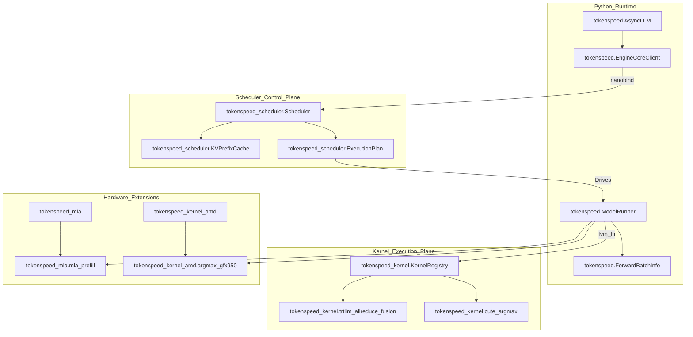

Sources: [python/pyproject.toml:26-89](), [tokenspeed-scheduler/pyproject.toml:1-19](), [tokenspeed-mla/pyproject.toml:12-17](), [tokenspeed-kernel-amd/pyproject.toml:12-15]()

## Data Flow and Inter-Package Communication

The execution flow spans the Python execution layer, the C++ FSM scheduler, and hardware-accelerated kernels:
1. **Request Ingestion**: Incoming client requests are parsed by `tokenspeed.cli.serve_smg` and routed to the `AsyncLLM` execution frontend [python/tokenspeed/cli/serve_smg.py:21-32]().
2. **Control Scheduling**: `EngineCore` communicates with the C++ `tokenspeed_scheduler.Scheduler` via zero-copy IPC and `nanobind` bindings [tokenspeed-scheduler/pyproject.toml:4-9](). The scheduler manages the radix tree (`KVPrefixCache`) and yields an `ExecutionPlan` [tokenspeed-scheduler/pyproject.toml:11-19]().
3. **Model Execution**: `ModelRunner` consumes the execution plan, allocating tensors and dispatching operator calls through `tokenspeed-kernel` or hardware-specific extensions (`tokenspeed-mla`, `tokenspeed-kernel-amd`) using `tvm_ffi` and custom shims [tokenspeed-mla/pyproject.toml:5-17](), [tokenspeed-kernel-amd/pyproject.toml:5-15]().

### Code Entity Execution Flow

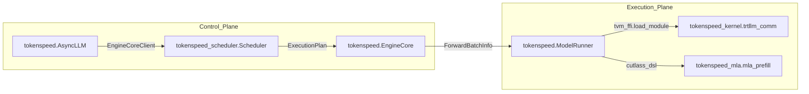

Sources: [python/tokenspeed/cli/serve_smg.py:21-32](), [tokenspeed-scheduler/pyproject.toml:4-19](), [tokenspeed-mla/pyproject.toml:5-17](), [tokenspeed-kernel-amd/pyproject.toml:5-15]()

---

# Page: Python Runtime

# Python Runtime

<details>
<summary>Relevant source files</summary>

The following files were used as context for generating this wiki page:

- [python/tokenspeed/runtime/engine/event_loop.py](python/tokenspeed/runtime/engine/event_loop.py)
- [python/tokenspeed/runtime/engine/scheduler_utils.py](python/tokenspeed/runtime/engine/scheduler_utils.py)
- [python/tokenspeed/runtime/execution/model_executor.py](python/tokenspeed/runtime/execution/model_executor.py)
- [python/tokenspeed/runtime/layers/attention/deepseek_v4_ops.py](python/tokenspeed/runtime/layers/attention/deepseek_v4_ops.py)
- [python/tokenspeed/runtime/models/deepseek_v4.py](python/tokenspeed/runtime/models/deepseek_v4.py)
- [python/tokenspeed/runtime/utils/env.py](python/tokenspeed/runtime/utils/env.py)
- [test/runtime/test_aligned_max_scheduled_tokens.py](test/runtime/test_aligned_max_scheduled_tokens.py)
- [test/runtime/test_deepseek_v4_config.py](test/runtime/test_deepseek_v4_config.py)
- [tokenspeed-scheduler/CMakeLists.txt](tokenspeed-scheduler/CMakeLists.txt)
- [tokenspeed-scheduler/bindings/python_module.cpp](tokenspeed-scheduler/bindings/python_module.cpp)
- [tokenspeed-scheduler/csrc/scheduler/types.h](tokenspeed-scheduler/csrc/scheduler/types.h)
- [tokenspeed-scheduler/python/tests/test_kv_cache.py](tokenspeed-scheduler/python/tests/test_kv_cache.py)

</details>


The `python/tokenspeed/runtime` package serves as the high-level orchestration layer of the TokenSpeed inference engine. It is responsible for managing the lifecycle of inference requests, coordinating distributed model execution, and interfacing with the C++ scheduler and custom hardware kernels.

The runtime is designed for high-throughput serving, supporting features like continuous batching, prefix caching, and prefill-decode disaggregation. It utilizes `uvloop` for high-performance asynchronous event handling `[python/tokenspeed/runtime/engine/async_llm.py:102-102]()`.

### Architecture Overview

The Python runtime acts as a bridge between the external API layers and low-level hardware execution components. The `AsyncLLM` class serves as the main-process async frontend, owning request intake, per-request state, scheduler IPC via `EngineCoreClient`, and the output-dispatch loop `[python/tokenspeed/runtime/engine/async_llm.py:118-125](), [python/tokenspeed/runtime/engine/core_client.py:78-85]()`. The `EventLoop` orchestrates rank-local execution, interacting with the `tokenspeed_scheduler.Scheduler` C++ bindings `[python/tokenspeed/runtime/engine/event_loop.py:32-34](), [python/tokenspeed/runtime/engine/event_loop.py:131-145]()`.

#### System Component Map

The following diagram illustrates the relationship between primary Python entities, communication channels, and underlying execution layers, bridging natural language spaces to code entities.

**Diagram: Runtime Entity Relationships**
```mermaid
graph TD
    subgraph "Natural Language Space (API)"
        "HTTP_Server"["api_server.py"]
        "AsyncLLM"["AsyncLLM (async_llm.py)"]
    end

    subgraph "Code Entity Space (Python Runtime)"
        "EngineCoreClient"["EngineCoreClient (core_client.py)"]
        "EventLoop"["EventLoop (event_loop.py)"]
        "ModelExecutor"["ModelExecutor (model_executor.py)"]
        "InputBuffers"["InputBuffers (input_buffer.py)"]
    end

    subgraph "Execution Space (C++ / Kernels)"
        "Scheduler"["Scheduler (tokenspeed-scheduler)"]
        "Kernels"["tokenspeed-kernel"]
    end

    "HTTP_Server" --> "AsyncLLM"
    "AsyncLLM" --> "EngineCoreClient"
    "EngineCoreClient" -- "ZMQ IPC" --> "EventLoop"
    "EventLoop" -- "Nanobind" --> "Scheduler"
    "EventLoop" --> "ModelExecutor"
    "ModelExecutor" --> "InputBuffers"
    "ModelExecutor" --> "Kernels"
```
Sources: `[python/tokenspeed/runtime/engine/async_llm.py:118-125](), [python/tokenspeed/runtime/engine/core_client.py:78-85](), [python/tokenspeed/runtime/engine/event_loop.py:32-34](), [python/tokenspeed/runtime/execution/model_executor.py:52-57]()`

---

### Subsystems and Child Pages

The runtime is organized into several specialized modules. Detailed documentation for each is covered in the respective child pages:

#### [Engine and Request Lifecycle](#2.1)
This subsystem handles the entry point for all requests. `AsyncLLM` manages request intake, validation, and per-request state tracking `[python/tokenspeed/runtime/engine/async_llm.py:118-125]()`. IPC communication with the scheduler uses `EngineCoreClient` over ZMQ sockets `[python/tokenspeed/runtime/engine/core_client.py:78-85]()`. The `EventLoop` drives the iteration process, advancing the C++ scheduler and processing execution results `[python/tokenspeed/runtime/engine/event_loop.py:131-145]()`.
*   **Key Entities:** `AsyncLLM`, `EngineCoreClient`, `EventLoop`, `RequestHandler`, `OutputProcesser`.
*   For details, see [Engine and Request Lifecycle](#2.1).
Sources: `[python/tokenspeed/runtime/engine/async_llm.py:118-125](), [python/tokenspeed/runtime/engine/core_client.py:78-85](), [python/tokenspeed/runtime/engine/event_loop.py:131-145]()`

#### [KV Cache and Memory Management](#2.2)
TokenSpeed utilizes a sophisticated prefix cache and slab pools to manage attention key-value caches across varying sequence lengths and model recipes (such as MHA, MLA, and hybrid variants). The runtime coordinates cache state alongside the C++ scheduler and memory allocators.
*   **Key Entities:** `CachePool`, `MemoryOccupationController`, `RuntimeStates`.
*   For details, see [KV Cache and Memory Management](#2.2).
Sources: `[python/tokenspeed/runtime/execution/runtime_states.py:25-27]()`

#### [Model Execution and Layers](#2.3)
The execution layer is responsible for loading weights, building forward contexts, and running the model forward pass. `ModelExecutor` and `ModelRunner` orchestrate execution steps, using `InputBuffers` to manage tensor data sources and `RuntimeStates` to maintain per-request pool indices and cached lengths `[python/tokenspeed/runtime/execution/model_executor.py:52-61](), [python/tokenspeed/runtime/execution/input_buffer.py:41-47](), [python/tokenspeed/runtime/execution/runtime_states.py:25-27]()`.
*   **Key Entities:** `ModelExecutor`, `ModelRunner`, `InputBuffers`, `RuntimeStates`.
*   For details, see [Model Execution and Layers](#2.3).
Sources: `[python/tokenspeed/runtime/execution/model_executor.py:52-61](), [python/tokenspeed/runtime/execution/input_buffer.py:41-47](), [python/tokenspeed/runtime/execution/runtime_states.py:25-27]()`

#### [Distributed Communication](#2.4)
The runtime orchestrates distributed inference across multiple GPUs and nodes using process group managers. It supports tensor, expert, data, and pipeline parallelism via pluggable communication backends such as NCCL and Triton allreduce.
*   **Key Entities:** `process_group_manager`, `DistributedInitializer`.
*   For details, see [Distributed Communication](#2.4).
Sources: `[python/tokenspeed/runtime/distributed/process_group_manager.py]()`

#### [Prefill-Decode Disaggregation (PD/EPD)](#2.5)
TokenSpeed supports disaggregating prefill and decode phases into separate execution instances. Prefill and decode executors coordinate KV cache transfers using external transfer mechanisms like Mooncake and specialized transfer plans.
*   **Key Entities:** `DisaggPrefillExecutor`, `DisaggDecodeExecutor`, `KVEventBatch`.
*   For details, see [Prefill-Decode Disaggregation (PD/EPD)](#2.5).
Sources: `[python/tokenspeed/runtime/pd/kv_events]()`

#### [Speculative Decoding and Grammar](#2.6)
For accelerated generation and structured output, the runtime provides drafter registries (supporting algorithms such as EAGLE, MTP, and DFLASH) alongside capturable grammar runtimes.
*   **Key Entities:** `BaseDrafter`, `GrammarStepInputs`, `SamplingParams`.
*   For details, see [Speculative Decoding and Grammar](#2.6).
Sources: `[python/tokenspeed/runtime/grammar/capturable_grammar.py]()`

#### [Multimodal and Sampling](#2.7)
The multimodal pipeline handles input embedders, multi-modal rotary position embeddings (MRoPE), and shared-memory transport. The sampling subsystem handles token selection through backends like FlashInfer and logits processors.
*   **Key Entities:** `SamplingBackend`, `LogitsProcessor`, `MultimodalRuntime`.
*   For details, see [Multimodal and Sampling](#2.7).
Sources: `[python/tokenspeed/runtime/sampling/backends/base.py]()`

---

### Configuration and Subprocess Orchestration

The runtime reads configuration parameters via `ServerArgs` and initializes rank-local subprocesses for execution and scheduling over ZMQ IPC channels `[python/tokenspeed/runtime/engine/async_llm.py:126-140](), [python/tokenspeed/runtime/engine/event_loop.py:131-150]()`.

**Diagram: Configuration to Execution Flow**
```mermaid
graph LR
    subgraph "Configuration Space"
        "ServerArgs"["ServerArgs (server_args.py)"]
    end
    
    subgraph "Orchestration & IPC"
        "ServerArgs" --> "AsyncLLM"["AsyncLLM (async_llm.py)"]
        "AsyncLLM" --> "EngineCoreClient"["EngineCoreClient (core_client.py)"]
        "EngineCoreClient" -- "ZMQ IPC" --> "EventLoop"["EventLoop (event_loop.py)"]
    end

    subgraph "Execution Layer"
        "EventLoop" --> "ModelExecutor"["ModelExecutor (model_executor.py)"]
        "ModelExecutor" --> "InputBuffers"["InputBuffers (input_buffer.py)"]
    end
```
Sources: `[python/tokenspeed/runtime/engine/async_llm.py:126-140](), [python/tokenspeed/runtime/engine/core_client.py:78-85](), [python/tokenspeed/runtime/engine/event_loop.py:131-150](), [python/tokenspeed/runtime/execution/model_executor.py:52-61](), [python/tokenspeed/runtime/execution/input_buffer.py:41-47]()`

---

# Page: Engine and Request Lifecycle

# Engine and Request Lifecycle

<details>
<summary>Relevant source files</summary>

The following files were used as context for generating this wiki page:

- [python/tokenspeed/cli/__main__.py](python/tokenspeed/cli/__main__.py)
- [python/tokenspeed/cli/_proc.py](python/tokenspeed/cli/_proc.py)
- [python/tokenspeed/cli/trace_merge.py](python/tokenspeed/cli/trace_merge.py)
- [python/tokenspeed/runtime/engine/async_llm.py](python/tokenspeed/runtime/engine/async_llm.py)
- [python/tokenspeed/runtime/engine/collector.py](python/tokenspeed/runtime/engine/collector.py)
- [python/tokenspeed/runtime/engine/data_parallel_controller.py](python/tokenspeed/runtime/engine/data_parallel_controller.py)
- [python/tokenspeed/runtime/engine/generation_output_processor.py](python/tokenspeed/runtime/engine/generation_output_processor.py)
- [python/tokenspeed/runtime/engine/input_processor.py](python/tokenspeed/runtime/engine/input_processor.py)
- [python/tokenspeed/runtime/engine/io_struct.py](python/tokenspeed/runtime/engine/io_struct.py)
- [python/tokenspeed/runtime/engine/load_snapshot.py](python/tokenspeed/runtime/engine/load_snapshot.py)
- [python/tokenspeed/runtime/engine/logprobs.py](python/tokenspeed/runtime/engine/logprobs.py)
- [python/tokenspeed/runtime/engine/output_processor.py](python/tokenspeed/runtime/engine/output_processor.py)
- [python/tokenspeed/runtime/engine/parallel_sampling.py](python/tokenspeed/runtime/engine/parallel_sampling.py)
- [python/tokenspeed/runtime/engine/protocol.py](python/tokenspeed/runtime/engine/protocol.py)
- [python/tokenspeed/runtime/engine/request_handler.py](python/tokenspeed/runtime/engine/request_handler.py)
- [python/tokenspeed/runtime/engine/request_stats.py](python/tokenspeed/runtime/engine/request_stats.py)
- [python/tokenspeed/runtime/engine/scheduler_communicator.py](python/tokenspeed/runtime/engine/scheduler_communicator.py)
- [python/tokenspeed/runtime/engine/scheduler_control_client.py](python/tokenspeed/runtime/engine/scheduler_control_client.py)
- [python/tokenspeed/runtime/engine/zmq_msgpack.py](python/tokenspeed/runtime/engine/zmq_msgpack.py)
- [python/tokenspeed/runtime/entrypoints/engine.py](python/tokenspeed/runtime/entrypoints/engine.py)
- [python/tokenspeed/runtime/entrypoints/engine_base.py](python/tokenspeed/runtime/entrypoints/engine_base.py)
- [python/tokenspeed/runtime/multimodal/mrope.py](python/tokenspeed/runtime/multimodal/mrope.py)
- [python/tokenspeed/runtime/sampling/sampling_params.py](python/tokenspeed/runtime/sampling/sampling_params.py)
- [python/tokenspeed/runtime/utils/common.py](python/tokenspeed/runtime/utils/common.py)
- [python/tokenspeed/runtime/utils/launcher.py](python/tokenspeed/runtime/utils/launcher.py)
- [test/cli/test_trace_merge.py](test/cli/test_trace_merge.py)
- [test/runners.py](test/runners.py)
- [test/runtime/layers/test_moe_layer_activation_flag.py](test/runtime/layers/test_moe_layer_activation_flag.py)
- [test/runtime/layers/test_moe_layer_plan_traits.py](test/runtime/layers/test_moe_layer_plan_traits.py)
- [test/runtime/test_generation_output_processor.py](test/runtime/test_generation_output_processor.py)
- [test/runtime/test_inline_detokenizer_e2e.py](test/runtime/test_inline_detokenizer_e2e.py)
- [test/runtime/test_inline_detokenizer_receiver.py](test/runtime/test_inline_detokenizer_receiver.py)
- [test/runtime/test_io_struct_codec.py](test/runtime/test_io_struct_codec.py)
- [test/runtime/test_launcher_topology.py](test/runtime/test_launcher_topology.py)
- [test/runtime/test_load_snapshot.py](test/runtime/test_load_snapshot.py)
- [test/runtime/test_multimodal_mrope.py](test/runtime/test_multimodal_mrope.py)
- [test/runtime/test_parallel_sampling.py](test/runtime/test_parallel_sampling.py)
- [test/runtime/test_request_handler_profile.py](test/runtime/test_request_handler_profile.py)
- [test/runtime/test_scheduler_communicator.py](test/runtime/test_scheduler_communicator.py)
- [test/runtime/test_zmq_msgpack.py](test/runtime/test_zmq_msgpack.py)
- [tokenspeed-kernel/python/tokenspeed_kernel/profiling.py](tokenspeed-kernel/python/tokenspeed_kernel/profiling.py)
- [tokenspeed-kernel/test/test_profiling.py](tokenspeed-kernel/test/test_profiling.py)

</details>


## Purpose and Scope

This page covers the core runtime architecture of TokenSpeed, detailing the end-to-end flow of requests from the asynchronous frontend (`AsyncLLM`) through ZeroMQ (ZMQ) message-packed IPC to the backend scheduler worker process, model execution loop, and incremental detokenization output processor.

Sources: [python/tokenspeed/runtime/entrypoints/engine.py:98-110](), [python/tokenspeed/runtime/engine/async_llm.py:118-125]()

## Architectural Overview

The runtime architecture divides responsibilities across distinct processes and classes:
1. **AsyncLLM**: The main-process asynchronous frontend that handles request intake, state management, scheduler IPC, and output dispatching [python/tokenspeed/runtime/engine/async_llm.py:118-125]().
2. **RequestHandler**: The coordinator inside the scheduler process that receives ZMQ requests, manages sessions, and handles control signals [python/tokenspeed/runtime/engine/request_handler.py:96-115]().
3. **EventLoop**: The backend execution loop that polls the C++ scheduler (`tokenspeed_scheduler`), drives model forward passes, and processes execution results [python/tokenspeed/runtime/entrypoints/engine.py:68-68]().

### System Component Interaction
This diagram maps natural language roles to explicit codebase entities and C++ bindings.

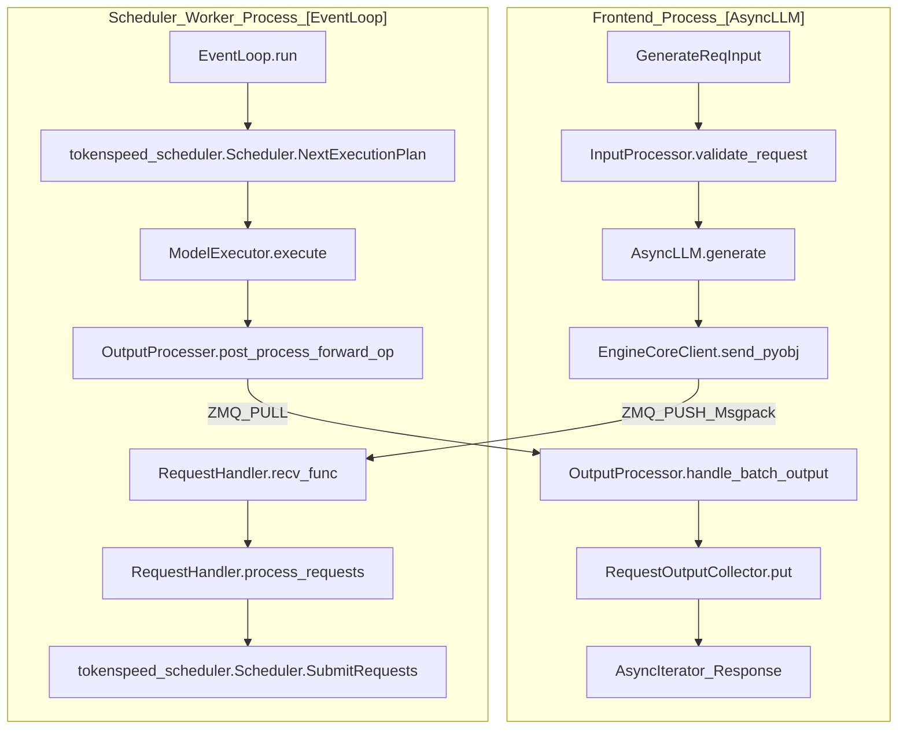
Sources: [python/tokenspeed/runtime/entrypoints/engine.py:68-110](), [python/tokenspeed/runtime/engine/request_handler.py:96-115](), [python/tokenspeed/runtime/engine/async_llm.py:118-125](), [python/tokenspeed/runtime/engine/io_struct.py:60-91]()

## Request Intake, Validation, and Tokenization

Requests enter the engine via high-level APIs like `Engine` or `AsyncLLM`, encapsulated within `GenerateReqInput` or `EmbeddingReqInput` data structures [python/tokenspeed/runtime/engine/io_struct.py:120-160]().

1. **Validation**: The `InputProcessor.validate_request` method rejects unsupported cross-type requests (e.g., embedding requests arriving at a generation-only engine) and checks data-parallel rank bindings [python/tokenspeed/runtime/engine/input_processor.py:85-118]().
2. **Tokenization and M-RoPE**: Text prompts are tokenized into `TokenizedGenerateReqInput` objects [python/tokenspeed/runtime/engine/input_processor.py:30-36](). For multimodal inputs, 3-axis M-RoPE position IDs are computed using helper utilities [python/tokenspeed/runtime/multimodal/mrope.py:21-32]().
3. **Reasoning Schema Wrapping**: If a reasoning parser is active, JSON schemas in sampling parameters are automatically wrapped with structural tags to ensure correct reasoning marker generation [python/tokenspeed/runtime/engine/input_processor.py:59-84]().

Sources: [python/tokenspeed/runtime/engine/input_processor.py:48-118](), [python/tokenspeed/runtime/engine/io_struct.py:120-160]()

## IPC and ZMQ Msgpack Serialization

Inter-process communication between the frontend and the scheduler process relies on ZeroMQ sockets using `msgspec.Struct` definitions derived from `BaseReq` and `BaseBatchReq` [python/tokenspeed/runtime/engine/io_struct.py:21-91]().

- **Array-Encoded Structs**: Payloads utilize `array_like=True` and `tag=True` for efficient positional serialization without pickle overhead [python/tokenspeed/runtime/engine/io_struct.py:60-91]().
- **Data Parallel Routing**: In data-parallel configurations, `DataParallelController` manages load balancing across multiple worker ranks [python/tokenspeed/runtime/engine/data_parallel_controller.py:58-162]().

### Request Data Flow Detail

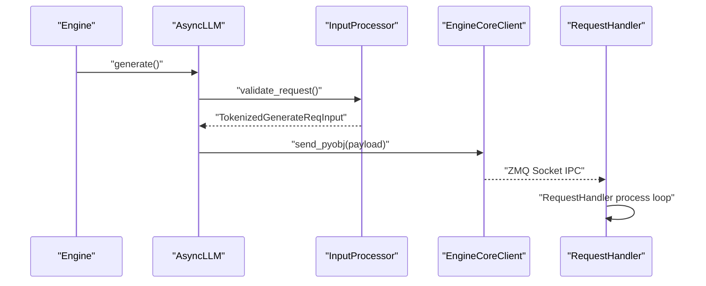
Sources: [python/tokenspeed/runtime/engine/async_llm.py:118-139](), [python/tokenspeed/runtime/engine/input_processor.py:85-95](), [python/tokenspeed/runtime/engine/io_struct.py:60-91](), [python/tokenspeed/runtime/engine/request_handler.py:96-115]()

## Scheduler Core and Request Handler

The `RequestHandler` processes incoming ZMQ messages within the scheduler worker process [python/tokenspeed/runtime/engine/request_handler.py:96-115](). It maintains broadcast groups using `PipelinedPyobjBroadcaster` when tensor/pipeline parallelism requires synchronization [python/tokenspeed/runtime/engine/request_handler.py:102-105](). Control requests such as `ProfileReq`, `FlushCacheReqInput`, and weight synchronization requests are dispatched through type-based handlers [python/tokenspeed/runtime/engine/request_handler.py:43-80]().

Sources: [python/tokenspeed/runtime/engine/request_handler.py:39-178]()

## Generation Output Processing and Detokenization

The backend `OutputProcessor` and per-request `RequestState` classes manage incremental streaming, token accumulation, and finish reason materialization [python/tokenspeed/runtime/engine/generation_output_processor.py:64-129](), [python/tokenspeed/runtime/engine/output_processor.py:96-105]().

- **RequestState**: Tracks immutable prompt inputs and mutable generation state including `output_ids`, `finished_reason`, `cached_tokens`, and incremental detokenization offsets [python/tokenspeed/runtime/engine/generation_output_processor.py:64-129]().
- **Error Handling and Aborts**: When numerical instabilities are detected (e.g., via NaN guards), the request is flagged with `ABORT_CODE.NumericalError`, generating an abort event that bypasses host-KV writeback to protect the cache pool from corruption [python/tokenspeed/runtime/engine/generation_output_processor.py:159-164]().

Sources: [python/tokenspeed/runtime/engine/generation_output_processor.py:26-168](), [python/tokenspeed/runtime/engine/output_processor.py:96-172]()

## The Backend Event Loop

The `EventLoop` coordinates execution cycles by interfacing with the C++ `tokenspeed_scheduler` and PyTorch model execution infrastructure [python/tokenspeed/runtime/engine/event_loop.py:63-63](). It repeatedly retrieves execution plans, invokes model executors for prefill, extend, or decode phases, and feeds generated tokens back into the output processors.

Sources: [python/tokenspeed/runtime/engine/event_loop.py:60-76]()

---

# Page: KV Cache and Memory Management

# KV Cache and Memory Management

<details>
<summary>Relevant source files</summary>

The following files were used as context for generating this wiki page:

- [docs/design/cache-concepts.md](docs/design/cache-concepts.md)
- [docs/design/unified_path.md](docs/design/unified_path.md)
- [python/tokenspeed/runtime/layers/attention/backends/base.py](python/tokenspeed/runtime/layers/attention/backends/base.py)
- [python/tokenspeed/runtime/layers/attention/backends/hybrid/linear.py](python/tokenspeed/runtime/layers/attention/backends/hybrid/linear.py)
- [python/tokenspeed/runtime/layers/attention/backends/specific/inkling.py](python/tokenspeed/runtime/layers/attention/backends/specific/inkling.py)
- [python/tokenspeed/runtime/layers/attention/backends/specific/qwen4_exp.py](python/tokenspeed/runtime/layers/attention/backends/specific/qwen4_exp.py)
- [python/tokenspeed/runtime/layers/attention/backends/state/kda.py](python/tokenspeed/runtime/layers/attention/backends/state/kda.py)
- [python/tokenspeed/runtime/layers/attention/configs/base.py](python/tokenspeed/runtime/layers/attention/configs/base.py)
- [python/tokenspeed/runtime/layers/attention/configs/mla.py](python/tokenspeed/runtime/layers/attention/configs/mla.py)
- [python/tokenspeed/runtime/layers/attention/deepseek_v4_geometry.py](python/tokenspeed/runtime/layers/attention/deepseek_v4_geometry.py)
- [python/tokenspeed/runtime/layers/attention/kv_cache/arena.py](python/tokenspeed/runtime/layers/attention/kv_cache/arena.py)
- [python/tokenspeed/runtime/layers/attention/kv_cache/base.py](python/tokenspeed/runtime/layers/attention/kv_cache/base.py)
- [python/tokenspeed/runtime/layers/attention/kv_cache/factory.py](python/tokenspeed/runtime/layers/attention/kv_cache/factory.py)
- [python/tokenspeed/runtime/layers/attention/kv_cache/hybrid_deepseek_v4.py](python/tokenspeed/runtime/layers/attention/kv_cache/hybrid_deepseek_v4.py)
- [python/tokenspeed/runtime/layers/attention/kv_cache/hybrid_kda.py](python/tokenspeed/runtime/layers/attention/kv_cache/hybrid_kda.py)
- [python/tokenspeed/runtime/layers/attention/kv_cache/hybrid_mha.py](python/tokenspeed/runtime/layers/attention/kv_cache/hybrid_mha.py)
- [python/tokenspeed/runtime/layers/attention/kv_cache/mha.py](python/tokenspeed/runtime/layers/attention/kv_cache/mha.py)
- [python/tokenspeed/runtime/layers/attention/kv_cache/recipes/deepseek_v4.py](python/tokenspeed/runtime/layers/attention/kv_cache/recipes/deepseek_v4.py)
- [python/tokenspeed/runtime/layers/attention/kv_cache/recipes/glm53_flash.py](python/tokenspeed/runtime/layers/attention/kv_cache/recipes/glm53_flash.py)
- [python/tokenspeed/runtime/layers/attention/kv_cache/recipes/inkling.py](python/tokenspeed/runtime/layers/attention/kv_cache/recipes/inkling.py)
- [python/tokenspeed/runtime/layers/attention/kv_cache/recipes/kimi_k3.py](python/tokenspeed/runtime/layers/attention/kv_cache/recipes/kimi_k3.py)
- [python/tokenspeed/runtime/layers/attention/kv_cache/recipes/plan.py](python/tokenspeed/runtime/layers/attention/kv_cache/recipes/plan.py)
- [python/tokenspeed/runtime/layers/attention/kv_cache/recipes/setup.py](python/tokenspeed/runtime/layers/attention/kv_cache/recipes/setup.py)
- [python/tokenspeed/runtime/layers/attention/kv_cache/recipes/spec.py](python/tokenspeed/runtime/layers/attention/kv_cache/recipes/spec.py)
- [python/tokenspeed/runtime/layers/attention/registry.py](python/tokenspeed/runtime/layers/attention/registry.py)
- [test/runtime/conftest.py](test/runtime/conftest.py)
- [test/runtime/test_cache_memory_plan.py](test/runtime/test_cache_memory_plan.py)
- [test/runtime/test_cache_pool.py](test/runtime/test_cache_pool.py)
- [test/runtime/test_cache_setup.py](test/runtime/test_cache_setup.py)
- [test/runtime/test_group_specs_from_layer_types.py](test/runtime/test_group_specs_from_layer_types.py)
- [test/runtime/test_group_write_locations.py](test/runtime/test_group_write_locations.py)
- [test/runtime/test_kimi_k3_cache_pool.py](test/runtime/test_kimi_k3_cache_pool.py)
- [test/runtime/test_kimi_k3_cache_spec.py](test/runtime/test_kimi_k3_cache_spec.py)
- [test/runtime/test_kimi_k3_kda_eager_commit.py](test/runtime/test_kimi_k3_kda_eager_commit.py)
- [test/runtime/test_mha_pool_spec_decode_groups.py](test/runtime/test_mha_pool_spec_decode_groups.py)
- [test/runtime/test_page_zeroing_contract.py](test/runtime/test_page_zeroing_contract.py)
- [test/runtime/test_qwen4_backend_composition.py](test/runtime/test_qwen4_backend_composition.py)
- [test/runtime/test_qwen4_exp.py](test/runtime/test_qwen4_exp.py)
- [test/runtime/test_server_args_attention_backends.py](test/runtime/test_server_args_attention_backends.py)
- [test/runtime/test_trtllm_cache_groups.py](test/runtime/test_trtllm_cache_groups.py)
- [test/runtime/test_unified_kv_slab_pool.py](test/runtime/test_unified_kv_slab_pool.py)
- [test/runtime/test_v4_sliding_window_groups_smoke.py](test/runtime/test_v4_sliding_window_groups_smoke.py)
- [tokenspeed-kernel/python/tokenspeed_kernel/ops/kvcache/triton.py](tokenspeed-kernel/python/tokenspeed_kernel/ops/kvcache/triton.py)
- [tokenspeed-kernel/test/ops/test_kvcache.py](tokenspeed-kernel/test/ops/test_kvcache.py)

</details>


This page details the TokenSpeed KV cache subsystem, which manages the lifecycle of Key-Value (KV) tensors across device, host, and remote tiers, as well as specialized cache recipes for diverse architectures (MHA, MLA, hybrid KDA/GDN, Qwen3.5, Kimi K3, Inkling, and Qwen4-exp), unified slab pools, cache memory planning, scheduler coordination clients, and cache pool binding/rebinding invariants.

## Attention KV Cache Registry, Factory, and Arena

The KV cache infrastructure decouples physical memory allocations from model layer views via `CacheArena` and `CachePool` abstractions `[python/tokenspeed/runtime/layers/attention/kv_cache/base.py:142-152]()`.

### Component Relationship Diagram
This diagram bridges natural language concepts to code entities for cache creation, registry, and pooling.

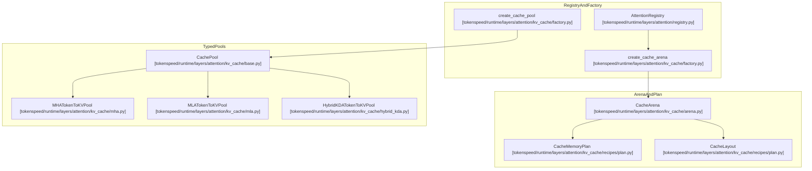
**Sources:** `[python/tokenspeed/runtime/layers/attention/registry.py:46-58]`, `[python/tokenspeed/runtime/layers/attention/kv_cache/base.py:142-152]`, `[python/tokenspeed/runtime/layers/attention/kv_cache/recipes/setup.py:54-58]`

- **`CacheArena`**: Manages the single contiguous memory buffer allocated for a model's cache and holds the `CacheMemoryPlan` geometry `[python/tokenspeed/runtime/layers/attention/registry.py:113-119]()`.
- **`CachePool`**: Represents a typed layer window onto a shared cache arena, defining dtypes and per-layer buffers `[python/tokenspeed/runtime/layers/attention/kv_cache/base.py:142-152]()`.
- **`create_cache_arena` / `create_cache_pool`**: Factory functions that construct arenas and concrete token-to-KV pools from cache recipes `[python/tokenspeed/runtime/layers/attention/registry.py:50-53]()`.

---

## Cache Recipes and Model Families

Cache recipes standardize how different architectures configure their memory groups, prefixes, and state fields `[python/tokenspeed/runtime/layers/attention/kv_cache/recipes/spec.py:1-50]()`.

### Supported Cache Recipes
| Recipe / Family | Target Architectures | Key Characteristics |
| :--- | :--- | :--- |
| **MHA** | Standard Llama, Mistral, GPT-OSS | Standard Key-Value head separation with uniform prefix granularity `[test/runtime/test_cache_setup.py:70-80]()` |
| **MLA** | DeepSeek V3, Kimi K2.5 | Compresses keys and values into low-rank latents plus RoPE dimensions `[test/runtime/test_cache_setup.py:82-96]()` |
| **Hybrid KDA / GDN** | Kimi K3, Qwen3.5, Qwen4-exp | Combines full attention with recurrent/conv state groups (`CacheGroupSpec`) in a single arena `[test/runtime/test_kimi_k3_cache_spec.py:22-31]()` |
| **Inkling / MSA** | Sparse & Custom Architectures | Supports sparse attention layers and layer-external state columns `[test/runtime/test_cache_setup.py:99-114]`, `[test/runtime/test_cache_setup.py:185-198]()` |

### Architectural Integration Diagram
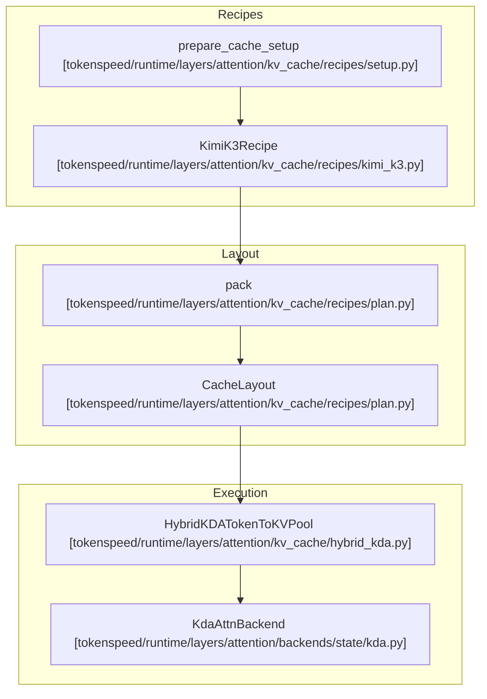
**Sources:** `[python/tokenspeed/runtime/layers/attention/registry.py:54-58]`, `[python/tokenspeed/runtime/layers/attention/kv_cache/recipes/kimi_k3.py:80-87]`, `[python/tokenspeed/runtime/layers/attention/backends/state/kda.py:131-143]`

---

## Unified Slab Pool, Logical/Physical Separation, and Memory Planning

TokenSpeed separates cache concepts into a logical world (token units, storage-agnostic) and a physical world (storage units, allocation, refcounting) `[docs/design/cache-concepts.md:9-15]`.

### Logical vs. Physical Vocabulary
- **`prefix_granularity`**: The granularity at which prefixes are hashed and matched for cache reuse `[docs/design/cache-concepts.md:20-25]`.
- **`block_granularity`**: The number of tokens covered by one block-table slot (`CacheBlock`) of a cache group `[docs/design/cache-concepts.md:20-25]`.
- **`CacheBlock` & LCM Blocks**: The unit of physical storage. Allocation, eviction, and tiering operate on physical blocks. For hybrid models (such as Kimi K3 with 69 KDA layers and 24 MLA layers), TokenSpeed relies on Least Common Multiple (LCM) block geometry where fixed-size LCM blocks (`lcm_block_bytes`) contain exact integer multiples of cache blocks for each group `[python/tokenspeed/runtime/layers/attention/kv_cache/recipes/kimi_k3.py:60-62]`, `[docs/design/cache-concepts.md:80-90]`.
- **Fixed Workspace Reservation**: Reserves non-arena scratchpads (such as speculative verification buffers and KDA replay states) outside the main arena `[test/runtime/test_kimi_k3_cache_spec.py:136-162]`.
- **Zeroing & Packing**: Employs Triton-based `zero_byte_ranges` to prevent poisoned tails when pages are reused across hybrid states `[tokenspeed-kernel/python/tokenspeed_kernel/ops/kvcache/triton.py:72-74]`.

**Sources:** `[docs/design/cache-concepts.md:9-110]`, `[test/runtime/test_kimi_k3_cache_spec.py:18-114]`, `[tokenspeed-kernel/python/tokenspeed_kernel/ops/kvcache/triton.py:70-74]`

---

## Cache Pool Binding, Rebinding, and Unified Decode Invariants

`CachePoolBinding` manages how backends interact with pool instances, supporting dynamic rebinds for memory probing and graph compilation `[python/tokenspeed/runtime/layers/attention/backends/base.py:108-141]`.

- **Rebinding Contract**: `set_cache_pool` executes a two-phase validation and publishing sequence across the backend tree. Nodes validate geometry via `validate_cache_pool` before any mutation occurs. Rebinding drops pool-derived latches (pointer tables, scratch views, paged leaf graph buffers) while retaining pool-independent state index buffers `[docs/design/unified_path.md:82-119]`.

**Sources:** `[python/tokenspeed/runtime/layers/attention/backends/base.py:108-141]`, `[docs/design/unified_path.md:82-119]`

---

## Scheduler Control and Cache Coordination Clients

The runtime control plane interfaces between `AsyncLLM`, engine core clients, and the scheduler to handle cache flushing, state updates, and memory occupation `[python/tokenspeed/runtime/engine/scheduler_control_client.py:1-50]()`.

- **`SchedulerControlClient`**: Manages asynchronous communication channels for cache flush requests, weight updates, pause/resume commands, and internal state inspection `[python/tokenspeed/runtime/engine/scheduler_control_client.py:79-132]()`.
- **Cache Coordination**: Coordinates distributed cache operations across data-parallel ranks (`dp_size`) through typed request-response message structures `[python/tokenspeed/runtime/engine/scheduler_control_client.py:82-132]()`.

**Sources:** `[python/tokenspeed/runtime/engine/scheduler_control_client.py:79-132]`, `[python/tokenspeed/runtime/engine/scheduler_communicator.py:1-30]`

---

# Page: Model Execution and Layers

# Model Execution and Layers

<details>
<summary>Relevant source files</summary>

The following files were used as context for generating this wiki page:

- [docs/.vitepress/config.mts](docs/.vitepress/config.mts)
- [docs/design/kda-prefill-subgraphs.md](docs/design/kda-prefill-subgraphs.md)
- [docs/guides/instanttensor.md](docs/guides/instanttensor.md)
- [python/tokenspeed/runtime/cache/l2/executor.py](python/tokenspeed/runtime/cache/l2/executor.py)
- [python/tokenspeed/runtime/configs/load_config.py](python/tokenspeed/runtime/configs/load_config.py)
- [python/tokenspeed/runtime/engine/event_loop.py](python/tokenspeed/runtime/engine/event_loop.py)
- [python/tokenspeed/runtime/engine/scheduler_utils.py](python/tokenspeed/runtime/engine/scheduler_utils.py)
- [python/tokenspeed/runtime/execution/breakable_cuda_graph.py](python/tokenspeed/runtime/execution/breakable_cuda_graph.py)
- [python/tokenspeed/runtime/execution/cache_loc_kernel.py](python/tokenspeed/runtime/execution/cache_loc_kernel.py)
- [python/tokenspeed/runtime/execution/cudagraph_memory.py](python/tokenspeed/runtime/execution/cudagraph_memory.py)
- [python/tokenspeed/runtime/execution/device.py](python/tokenspeed/runtime/execution/device.py)
- [python/tokenspeed/runtime/execution/forward_step.py](python/tokenspeed/runtime/execution/forward_step.py)
- [python/tokenspeed/runtime/execution/input_buffer.py](python/tokenspeed/runtime/execution/input_buffer.py)
- [python/tokenspeed/runtime/execution/model_executor.py](python/tokenspeed/runtime/execution/model_executor.py)
- [python/tokenspeed/runtime/execution/prefill_graph.py](python/tokenspeed/runtime/execution/prefill_graph.py)
- [python/tokenspeed/runtime/execution/runtime_states.py](python/tokenspeed/runtime/execution/runtime_states.py)
- [python/tokenspeed/runtime/layers/attention/deepseek_v4_ops.py](python/tokenspeed/runtime/layers/attention/deepseek_v4_ops.py)
- [python/tokenspeed/runtime/layers/attention/utils.py](python/tokenspeed/runtime/layers/attention/utils.py)
- [python/tokenspeed/runtime/model_loader/loader.py](python/tokenspeed/runtime/model_loader/loader.py)
- [python/tokenspeed/runtime/model_loader/weight_utils.py](python/tokenspeed/runtime/model_loader/weight_utils.py)
- [python/tokenspeed/runtime/models/deepseek_v4.py](python/tokenspeed/runtime/models/deepseek_v4.py)
- [python/tokenspeed/runtime/models/gpt_oss.py](python/tokenspeed/runtime/models/gpt_oss.py)
- [python/tokenspeed/runtime/utils/env.py](python/tokenspeed/runtime/utils/env.py)
- [test/agentic_benchmark/minimax_m3/tokenspeed/configs/attn_tp4_moe_ep4.sh](test/agentic_benchmark/minimax_m3/tokenspeed/configs/attn_tp4_moe_ep4.sh)
- [test/agentic_benchmark/minimax_m3/tokenspeed/configs/attn_tp4_moe_tp4.sh](test/agentic_benchmark/minimax_m3/tokenspeed/configs/attn_tp4_moe_tp4.sh)
- [test/ci/eval/minimax-m3-nvfp4-dspark-evalscope-aime26.yaml](test/ci/eval/minimax-m3-nvfp4-dspark-evalscope-aime26.yaml)
- [test/ci/eval/minimax-m3-nvfp4-evalscope-aime25.yaml](test/ci/eval/minimax-m3-nvfp4-evalscope-aime25.yaml)
- [test/runtime/execution/test_breakable_cuda_graph.py](test/runtime/execution/test_breakable_cuda_graph.py)
- [test/runtime/execution/test_kda_prefill_graph_cache.py](test/runtime/execution/test_kda_prefill_graph_cache.py)
- [test/runtime/test_aligned_max_scheduled_tokens.py](test/runtime/test_aligned_max_scheduled_tokens.py)
- [test/runtime/test_cache_pd_shutdown.py](test/runtime/test_cache_pd_shutdown.py)
- [test/runtime/test_cudagraph_memory_projection.py](test/runtime/test_cudagraph_memory_projection.py)
- [test/runtime/test_cudagraph_probe_arena.py](test/runtime/test_cudagraph_probe_arena.py)
- [test/runtime/test_cudagraph_probe_ladder.py](test/runtime/test_cudagraph_probe_ladder.py)
- [test/runtime/test_deepseek_v41_inputs.py](test/runtime/test_deepseek_v41_inputs.py)
- [test/runtime/test_deepseek_v4_config.py](test/runtime/test_deepseek_v4_config.py)
- [test/runtime/test_device_handle.py](test/runtime/test_device_handle.py)
- [test/runtime/test_draft_page_table_scrub.py](test/runtime/test_draft_page_table_scrub.py)
- [test/runtime/test_dspark_config.py](test/runtime/test_dspark_config.py)
- [test/runtime/test_eagle3_d2t_device.py](test/runtime/test_eagle3_d2t_device.py)
- [test/runtime/test_executor_rebind.py](test/runtime/test_executor_rebind.py)
- [test/runtime/test_gpt_oss_mxfp4_streaming.py](test/runtime/test_gpt_oss_mxfp4_streaming.py)
- [test/runtime/test_host_executor.py](test/runtime/test_host_executor.py)
- [test/runtime/test_instanttensor_loader.py](test/runtime/test_instanttensor_loader.py)
- [test/runtime/test_l3_storage_hits.py](test/runtime/test_l3_storage_hits.py)
- [test/runtime/test_prefill_graph.py](test/runtime/test_prefill_graph.py)
- [test/runtime/test_runtime_states.py](test/runtime/test_runtime_states.py)
- [test/runtime/test_weight_loader_prefetch.py](test/runtime/test_weight_loader_prefetch.py)
- [test/runtime/test_zero_output_prefill.py](test/runtime/test_zero_output_prefill.py)
- [tokenspeed-scheduler/CMakeLists.txt](tokenspeed-scheduler/CMakeLists.txt)
- [tokenspeed-scheduler/bindings/python_module.cpp](tokenspeed-scheduler/bindings/python_module.cpp)
- [tokenspeed-scheduler/csrc/cache/tier/transfer.h](tokenspeed-scheduler/csrc/cache/tier/transfer.h)
- [tokenspeed-scheduler/csrc/cache/tier/transfer_manager.cpp](tokenspeed-scheduler/csrc/cache/tier/transfer_manager.cpp)
- [tokenspeed-scheduler/csrc/cache/tier/transfer_manager.h](tokenspeed-scheduler/csrc/cache/tier/transfer_manager.h)
- [tokenspeed-scheduler/csrc/scheduler/types.h](tokenspeed-scheduler/csrc/scheduler/types.h)
- [tokenspeed-scheduler/python/tests/test_kv_cache.py](tokenspeed-scheduler/python/tests/test_kv_cache.py)

</details>


This page provides a high-level overview of the execution orchestration layer in TokenSpeed, residing primarily under `python/tokenspeed/runtime/execution/`. It covers the coordination duties of `ModelExecutor` and `ModelRunner`, forward context management, pre-allocated input buffers (`InputBuffers`), CUDA graph capture mechanics (including `PrefillGraph`), weight loading pipelines, and the core layer abstractions.

For deep-dives into concrete model implementations (such as DeepSeek, Kimi, Qwen, and others), see [Supported Model Architectures](#2.3.1). For details on expert routing stacks, latent MoE tiers, quantization configs (FP8, NVFP4, MXFP4), and dense linear backends, see [MoE Layers and Quantization](#2.3.2).

---

## Model Runner, Executor, and Forward Context

The execution pipeline bridges high-level scheduler demands and low-silicon hardware primitives. `ModelExecutor` and `ModelRunner` coordinate the execution lifecycle of a forward pass [python/tokenspeed/runtime/execution/model_executor.py:143-167](). They ingest request batches formatted via `ForwardBatchInfo` and manage tensor state across execution iterations.

To prevent dynamic memory allocation overhead during generation, `InputBuffers` pre-allocates static GPU tensors such as `input_ids_buf`, `positions_buf`, `req_pool_indices_buf`, and `seq_lens_buf` [python/tokenspeed/runtime/execution/input_buffer.py:41-98](). Furthermore, `PrepTape` records and replays padding-tail clearing operations as an optimized batch kernel sequence [python/tokenspeed/runtime/execution/input_buffer.py:99-121]().

Title: Execution Orchestration and Input Buffer Architecture
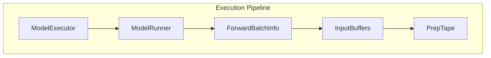
**Sources:**
- `python/tokenspeed/runtime/execution/model_executor.py:143-167`()
- `python/tokenspeed/runtime/execution/input_buffer.py:41-121`()

---

## CUDA Graph Capture: Decode and Prefill Graphs

To bypass host-side CPU dispatch bottlenecks during auto-regressive decoding, TokenSpeed leverages CUDA graph capture for static batch patterns.

- **Decode Graphs**: Captured across predefined batch-size buckets (`cudagraph_capture_sizes`) for rapid steady-state decoding replays.
- **Prefill (Extend) Graphs**: Managed via `PrefillGraph` and `get_prefill_token_buckets`, capturing token-shaped compute keyed by total token count rather than request batch size [python/tokenspeed/runtime/execution/prefill_graph.py:93-148]().
- **CUPTI Warmup**: Profile initialization hazards post-capture are mitigated optionally via `maybe_warm_cupti_for_graph_capture` [python/tokenspeed/runtime/engine/event_loop.py:96-130]().

Title: CUDA Graph Capture Subsystem
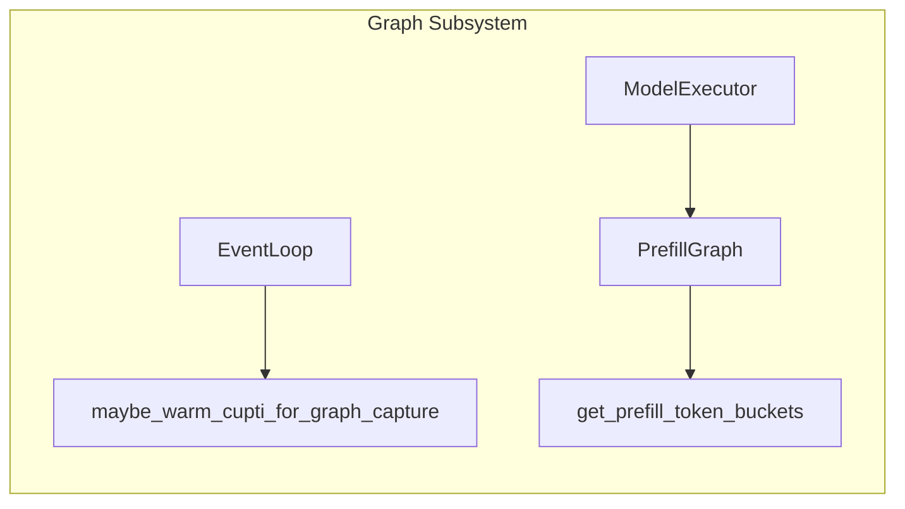
**Sources:**
- `python/tokenspeed/runtime/execution/prefill_graph.py:93-148`()
- `python/tokenspeed/runtime/engine/event_loop.py:96-130`()

---

## Weight Loading and Device Placement

The weight loading subsystem manages streaming safetensors checkpoints from storage into device memory, configuring appropriate quantization strategies and handling memory contexts safely.

Loaders implement base abstractions to discover files, parse weight maps, and allocate shards across tensor-parallel and pipeline-parallel process groups. Quantization configs verify hardware constraints and datatype compatibility prior to layer initialization.

**Sources:**
- `python/tokenspeed/runtime/model_loader/loader.py:69-172`()

---

## Layer Library and Architecture Abstractions

The layer library under `tokenspeed.runtime.layers` provides standard and specialized primitives for constructing high-performance transformer models:

- **Attention Backends**: Implements the `AttentionBackend` protocol (such as paged attention and composite routers) governing block tables, KV cache bindings, and sequence metadata [python/tokenspeed/runtime/layers/attention/backends/base.py:114-138]().
- **Linear and Normalization**: Exposes parallel linear projections (`ColumnParallelLinear`, `RowParallelLinear`) and high-throughput normalization layers (`RMSNorm`, `FusedRMSNorm`).
- **Quantization & Hyperconnections**: Integrates weight formats, scaling configs, and residue/hyperconnection operations for advanced models.

For a comprehensive breakdown of model definitions like DeepSeek V3/V4, Kimi, Qwen, and others, refer to [Supported Model Architectures](#2.3.1). For details on MoE expert routing stacks and dense linear backends, see [MoE Layers and Quantization](#2.3.2).

**Sources:**
- `python/tokenspeed/runtime/layers/attention/backends/base.py:114-138`()
- `python/tokenspeed/runtime/execution/cache_loc_kernel.py:36-77`()

---

# Page: Supported Model Architectures

# Supported Model Architectures

<details>
<summary>Relevant source files</summary>

The following files were used as context for generating this wiki page:

- [docs/design/numerics.md](docs/design/numerics.md)
- [python/tokenspeed/runtime/configs/qwen3_5_config.py](python/tokenspeed/runtime/configs/qwen3_5_config.py)
- [python/tokenspeed/runtime/configs/qwen3_5_text_base_config.py](python/tokenspeed/runtime/configs/qwen3_5_text_base_config.py)
- [python/tokenspeed/runtime/configs/utils.py](python/tokenspeed/runtime/configs/utils.py)
- [python/tokenspeed/runtime/distributed/comm_manager.py](python/tokenspeed/runtime/distributed/comm_manager.py)
- [python/tokenspeed/runtime/engine/batch_log.py](python/tokenspeed/runtime/engine/batch_log.py)
- [python/tokenspeed/runtime/execution/context.py](python/tokenspeed/runtime/execution/context.py)
- [python/tokenspeed/runtime/execution/drafter/eagle.py](python/tokenspeed/runtime/execution/drafter/eagle.py)
- [python/tokenspeed/runtime/layers/attention/backends/specific/deepseek_v41.py](python/tokenspeed/runtime/layers/attention/backends/specific/deepseek_v41.py)
- [python/tokenspeed/runtime/layers/attention/configs/msa.py](python/tokenspeed/runtime/layers/attention/configs/msa.py)
- [python/tokenspeed/runtime/layers/dense/fp8.py](python/tokenspeed/runtime/layers/dense/fp8.py)
- [python/tokenspeed/runtime/layers/dense/nvfp4.py](python/tokenspeed/runtime/layers/dense/nvfp4.py)
- [python/tokenspeed/runtime/layers/hyperconnection.py](python/tokenspeed/runtime/layers/hyperconnection.py)
- [python/tokenspeed/runtime/layers/layernorm.py](python/tokenspeed/runtime/layers/layernorm.py)
- [python/tokenspeed/runtime/layers/linear.py](python/tokenspeed/runtime/layers/linear.py)
- [python/tokenspeed/runtime/layers/logits_processor.py](python/tokenspeed/runtime/layers/logits_processor.py)
- [python/tokenspeed/runtime/layers/moe/latent.py](python/tokenspeed/runtime/layers/moe/latent.py)
- [python/tokenspeed/runtime/layers/quantization/base_config.py](python/tokenspeed/runtime/layers/quantization/base_config.py)
- [python/tokenspeed/runtime/model_loader/utils.py](python/tokenspeed/runtime/model_loader/utils.py)
- [python/tokenspeed/runtime/models/base/causal_lm.py](python/tokenspeed/runtime/models/base/causal_lm.py)
- [python/tokenspeed/runtime/models/base/transformer_model.py](python/tokenspeed/runtime/models/base/transformer_model.py)
- [python/tokenspeed/runtime/models/deepseek_nextn.py](python/tokenspeed/runtime/models/deepseek_nextn.py)
- [python/tokenspeed/runtime/models/deepseek_v3.py](python/tokenspeed/runtime/models/deepseek_v3.py)
- [python/tokenspeed/runtime/models/deepseek_v41.py](python/tokenspeed/runtime/models/deepseek_v41.py)
- [python/tokenspeed/runtime/models/deepseek_v41_dspark.py](python/tokenspeed/runtime/models/deepseek_v41_dspark.py)
- [python/tokenspeed/runtime/models/glm5.py](python/tokenspeed/runtime/models/glm5.py)
- [python/tokenspeed/runtime/models/inkling.py](python/tokenspeed/runtime/models/inkling.py)
- [python/tokenspeed/runtime/models/kimi_k3.py](python/tokenspeed/runtime/models/kimi_k3.py)
- [python/tokenspeed/runtime/models/kimi_k3_deepep.py](python/tokenspeed/runtime/models/kimi_k3_deepep.py)
- [python/tokenspeed/runtime/models/llama_eagle3.py](python/tokenspeed/runtime/models/llama_eagle3.py)
- [python/tokenspeed/runtime/models/longcat_flash.py](python/tokenspeed/runtime/models/longcat_flash.py)
- [python/tokenspeed/runtime/models/minimax_m3.py](python/tokenspeed/runtime/models/minimax_m3.py)
- [python/tokenspeed/runtime/models/nemotron_h.py](python/tokenspeed/runtime/models/nemotron_h.py)
- [python/tokenspeed/runtime/models/qwen3_5.py](python/tokenspeed/runtime/models/qwen3_5.py)
- [python/tokenspeed/runtime/models/qwen3_5_moe.py](python/tokenspeed/runtime/models/qwen3_5_moe.py)
- [python/tokenspeed/runtime/models/qwen3_5_nextn.py](python/tokenspeed/runtime/models/qwen3_5_nextn.py)
- [python/tokenspeed/runtime/models/qwen4_exp.py](python/tokenspeed/runtime/models/qwen4_exp.py)
- [test/runtime/distributed/run_dcp_indexer.py](test/runtime/distributed/run_dcp_indexer.py)
- [test/runtime/layers/test_kimi_k3_addmm_fold.py](test/runtime/layers/test_kimi_k3_addmm_fold.py)
- [test/runtime/layers/test_latent_moe.py](test/runtime/layers/test_latent_moe.py)
- [test/runtime/models/test_inkling_models.py](test/runtime/models/test_inkling_models.py)
- [test/runtime/models/test_llama_eagle3.py](test/runtime/models/test_llama_eagle3.py)
- [test/runtime/models/test_longcat_flash.py](test/runtime/models/test_longcat_flash.py)
- [test/runtime/models/test_minimax_m3.py](test/runtime/models/test_minimax_m3.py)
- [test/runtime/models/test_qwen3_5_fused_norm.py](test/runtime/models/test_qwen3_5_fused_norm.py)
- [test/runtime/test_batch_log.py](test/runtime/test_batch_log.py)
- [test/runtime/test_deepseek_v41_cache.py](test/runtime/test_deepseek_v41_cache.py)
- [test/runtime/test_deepseek_v41_config.py](test/runtime/test_deepseek_v41_config.py)
- [test/runtime/test_deepseek_v41_dspark.py](test/runtime/test_deepseek_v41_dspark.py)
- [test/runtime/test_deepseek_v41_model.py](test/runtime/test_deepseek_v41_model.py)
- [test/runtime/test_event_loop_in_flight.py](test/runtime/test_event_loop_in_flight.py)
- [test/runtime/test_hyperconnection_kernel_boundary.py](test/runtime/test_hyperconnection_kernel_boundary.py)
- [test/runtime/test_inkling_activation_parity.py](test/runtime/test_inkling_activation_parity.py)
- [test/runtime/test_inkling_mtp_conv_state.py](test/runtime/test_inkling_mtp_conv_state.py)
- [test/runtime/test_k3_moe_tail_equivalence.py](test/runtime/test_k3_moe_tail_equivalence.py)
- [test/runtime/test_k3_moe_tail_tier.py](test/runtime/test_k3_moe_tail_tier.py)
- [test/runtime/test_kimi_k3_config.py](test/runtime/test_kimi_k3_config.py)
- [test/runtime/test_kimi_k3_deepep.py](test/runtime/test_kimi_k3_deepep.py)
- [test/runtime/test_kimi_k3_moe_attn_dp.py](test/runtime/test_kimi_k3_moe_attn_dp.py)
- [test/runtime/test_kimi_k3_moe_fork_warmup.py](test/runtime/test_kimi_k3_moe_fork_warmup.py)
- [test/runtime/test_logits_processor.py](test/runtime/test_logits_processor.py)
- [test/runtime/test_resolve_architecture.py](test/runtime/test_resolve_architecture.py)
- [tokenspeed-kernel/python/tokenspeed_kernel/ops/attention/dsa/__init__.py](tokenspeed-kernel/python/tokenspeed_kernel/ops/attention/dsa/__init__.py)
- [tokenspeed-kernel/python/tokenspeed_kernel/ops/attention/msa/triton.py](tokenspeed-kernel/python/tokenspeed_kernel/ops/attention/msa/triton.py)
- [tokenspeed-kernel/python/tokenspeed_kernel/ops/conv/__init__.py](tokenspeed-kernel/python/tokenspeed_kernel/ops/conv/__init__.py)
- [tokenspeed-kernel/python/tokenspeed_kernel/ops/layernorm/__init__.py](tokenspeed-kernel/python/tokenspeed_kernel/ops/layernorm/__init__.py)
- [tokenspeed-kernel/python/tokenspeed_kernel/ops/layernorm/triton.py](tokenspeed-kernel/python/tokenspeed_kernel/ops/layernorm/triton.py)
- [tokenspeed-kernel/python/tokenspeed_kernel/ops/moe/latent_tail.py](tokenspeed-kernel/python/tokenspeed_kernel/ops/moe/latent_tail.py)
- [tokenspeed-kernel/python/tokenspeed_kernel/ops/moe/marlin/mxfp4.py](tokenspeed-kernel/python/tokenspeed_kernel/ops/moe/marlin/mxfp4.py)
- [tokenspeed-kernel/python/tokenspeed_kernel/ops/residual/cute_fused.py](tokenspeed-kernel/python/tokenspeed_kernel/ops/residual/cute_fused.py)
- [tokenspeed-kernel/python/tokenspeed_kernel/thirdparty/cute_dsl/hc_fused.py](tokenspeed-kernel/python/tokenspeed_kernel/thirdparty/cute_dsl/hc_fused.py)
- [tokenspeed-kernel/python/tokenspeed_kernel/thirdparty/cute_dsl/latent_moe_tail/allreduce_rmsnorm_reduce_scatter_early_exit.py](tokenspeed-kernel/python/tokenspeed_kernel/thirdparty/cute_dsl/latent_moe_tail/allreduce_rmsnorm_reduce_scatter_early_exit.py)
- [tokenspeed-kernel/python/tokenspeed_kernel/thirdparty/cute_dsl/latent_moe_tail/primitives.py](tokenspeed-kernel/python/tokenspeed_kernel/thirdparty/cute_dsl/latent_moe_tail/primitives.py)
- [tokenspeed-kernel/test/nvidia/ops/attention/test_flashmla_dsa_dcp.py](tokenspeed-kernel/test/nvidia/ops/attention/test_flashmla_dsa_dcp.py)
- [tokenspeed-kernel/test/nvidia/ops/moe/test_marlin_mxfp4_apply.py](tokenspeed-kernel/test/nvidia/ops/moe/test_marlin_mxfp4_apply.py)
- [tokenspeed-kernel/test/nvidia/ops/test_dsa_topk_batch_invariant.py](tokenspeed-kernel/test/nvidia/ops/test_dsa_topk_batch_invariant.py)
- [tokenspeed-kernel/test/nvidia/ops/test_hyperconnection_batched.py](tokenspeed-kernel/test/nvidia/ops/test_hyperconnection_batched.py)
- [tokenspeed-kernel/test/nvidia/ops/test_hyperconnection_capture.py](tokenspeed-kernel/test/nvidia/ops/test_hyperconnection_capture.py)
- [tokenspeed-kernel/test/ops/attention/test_dsa_facade_traits.py](tokenspeed-kernel/test/ops/attention/test_dsa_facade_traits.py)
- [tokenspeed-kernel/test/ops/moe/test_latent_tail_contract.py](tokenspeed-kernel/test/ops/moe/test_latent_tail_contract.py)
- [tokenspeed-kernel/test/ops/test_attention_dsa.py](tokenspeed-kernel/test/ops/test_attention_dsa.py)
- [tokenspeed-kernel/test/ops/test_attention_msa.py](tokenspeed-kernel/test/ops/test_attention_msa.py)
- [tokenspeed-kernel/test/ops/test_conv.py](tokenspeed-kernel/test/ops/test_conv.py)
- [tokenspeed-kernel/test/ops/test_hyperconnection.py](tokenspeed-kernel/test/ops/test_hyperconnection.py)
- [tokenspeed-kernel/test/ops/test_layernorm.py](tokenspeed-kernel/test/ops/test_layernorm.py)

</details>


## Purpose and Scope

This page provides a deep technical dive into the model implementations supported by TokenSpeed under `python/tokenspeed/runtime/models/`. It covers state-of-the-art sparse mixture-of-experts (MoE), multi-head latent attention (MLA), linear attention hybrids (KDA, Gated DeltaNet), dynamic sparse attention (DSA/QSA/MSA), hyperconnections, and the extensible base causal language model abstractions that unify them.

---

## 1. Extensible Base Causal LM and Transformer Abstractions

TokenSpeed establishes a strict object-oriented hierarchy for all causal language models to ensure uniform weight loading, tensor-parallel slicing, KV-cache population, and execution context plumbing.

```
BaseCausalLM
  └── BaseTransformerModel
        └── BaseDecoderLayer
              ├── SelfAttention / MLA / KDA / GatedDeltaNet
              └── MLP / MoELayer / LatentMoELayer
```

### Key Classes and Roles
* `BaseCausalLM`: Defined in `[python/tokenspeed/runtime/models/base/causal_lm.py:1-120]`, this base class implements top-level inference entrypoints, vocabulary embedding lookups (`VocabParallelEmbedding`), final normalization (`RMSNorm`), and parallel language modeling heads (`ParallelLMHead`).
* `BaseTransformerModel`: Defined in `[python/tokenspeed/runtime/models/base/transformer_model.py:1-150]`, it manages layer stacking via `make_layers`, pipeline-parallel stage boundaries (`PPStageState`), and hidden-state propagation across decoding steps.
* `BaseDecoderLayer`: Manages the residual stream additions, attention/linear-attention block invocation, and MLP/MoE feed-forward transformations.

Sources: `[python/tokenspeed/runtime/models/base/causal_lm.py:1-120]`, `[python/tokenspeed/runtime/models/base/transformer_model.py:1-150]`

---

## 2. Natural Language Space to Code Entity Mapping

The following diagram bridges conceptual transformer architectural families to their concrete Python module implementations and execution pipelines in TokenSpeed.

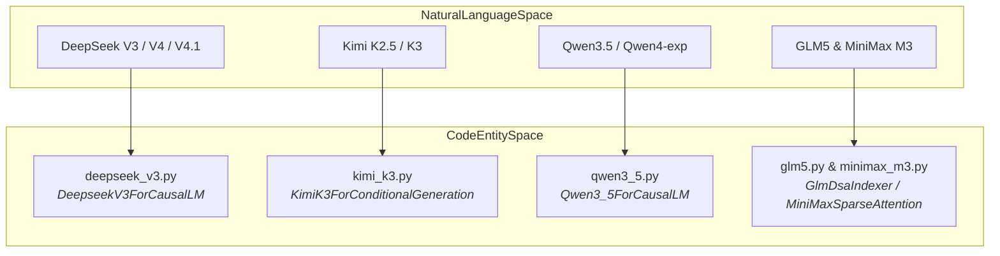

Sources: `[python/tokenspeed/runtime/models/deepseek_v3.py:1-121]`, `[python/tokenspeed/runtime/models/deepseek_v4.py:1-142]`, `[python/tokenspeed/runtime/models/kimi_k3.py:1-54]`, `[python/tokenspeed/runtime/models/qwen3_5.py:1-89]`, `[python/tokenspeed/runtime/models/glm5.py:21-65]`

---

## 3. DeepSeek V3, V4, and V4.1 Architectures

### DeepSeek V3 (`deepseek_v3.py`)
DeepSeek V3 introduces Multi-head Latent Attention (MLA) to compress KV cache footprints, coupled with a DeepSeekMoE architecture featuring shared and routed experts.
* **MLA Implementation**: Projections are handled via `DeepseekV3AttentionMLA` `[python/tokenspeed/runtime/models/deepseek_v3.py:140-143]`. KV compression splits incoming activations into low-rank latent vectors and rotary-embedded parts using `apply_rope_mla` `[python/tokenspeed/runtime/models/deepseek_v3.py:40-40]`.
* **Router GEMM**: Expert routing uses optimized Triton/CUDA kernels such as `dsv3_router_gemm` `[python/tokenspeed/runtime/models/deepseek_v3.py:42-42]` and fused A-gemm operations (`dsv3_fused_a_gemm`) `[python/tokenspeed/runtime/models/deepseek_v3.py:46-46]`.

### DeepSeek V4 and V4.1 (`deepseek_v4.py`, `deepseek_v41.py`)
DeepSeek V4/V4.1 advance sparse modeling with Dynamic Sparse Attention (DSA / DSV4 indexers), Multi-Head Compression (MHC) hyperconnections, and Mega-MoE pipelines.
* **Indexer & Sparse Routing**: Utilizes `dsa_prefill_topk`, `dsa_decode_topk`, and `dsv4_indexer_cache_format` `[python/tokenspeed/runtime/models/deepseek_v4.py:37-46]` to construct sparse routing indices dynamically.
* **Hyperconnections (MHC)**: Integrates `fast_mhc_pre` and `fast_mhc_post` `[python/tokenspeed/runtime/models/deepseek_v4.py:61-63]` to route residual streams across non-linear feature pathways.
* **Mega-MoE**: Process weights are staged via `dsv4_mega_moe_process_weights` and executed via `dsv4_mega_moe_apply` `[python/tokenspeed/runtime/models/deepseek_v4.py:49-51]`.

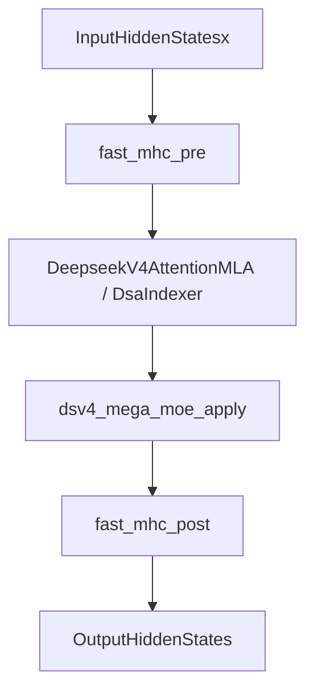

Sources: `[python/tokenspeed/runtime/models/deepseek_v3.py:21-183]`, `[python/tokenspeed/runtime/models/deepseek_v4.py:21-155]`, `[python/tokenspeed/runtime/models/deepseek_v41.py:1-120]`

---

## 4. Kimi K2.5 and K3 Architectures (`kimi_k3.py`)

Kimi K3 combines the MoonViT3d vision tower with a `KimiLinear` text backbone containing hybrid KDA linear attention and NoPE-MLA full attention layers governed by AttnRes block residuals.

### Core Component Breakdown
* **KimiLinearKDA**: Per-head gated delta-rule linear attention handling convolution and recurrent state updates via `KdaAttnBackend` `[python/tokenspeed/runtime/models/kimi_k3.py:27-32]`.
* **NoPE-MLA**: No-Position-Embedding Multi-head Latent Attention paired with sigmoid output gating (`KimiLinearMLAAttention`) `[python/tokenspeed/runtime/models/kimi_k3.py:29-29]`.
* **AttnRes Block Residuals**: Inter-layer state combination executed using Triton kernels `attn_res_fwd`, `attnres_combine`, and `attnres_partial` `[python/tokenspeed/runtime/models/kimi_k3.py:63-71]`.
* **Latent MoE Tail Tiers**: Managed via `K3MoETailTier` `[python/tokenspeed/runtime/models/kimi_k3_comm.py:83-96]` and `select_k3_moe_tail_tier` `[python/tokenspeed/runtime/models/kimi_k3_comm.py:112-121]`, supporting tail fusion, multimem AR, and fused-lane one-shot collectives.

Sources: `[python/tokenspeed/runtime/models/kimi_k3.py:21-54]`, `[python/tokenspeed/runtime/models/kimi_k3_comm.py:21-141]`

---

## 5. Qwen3.5, Qwen4-exp, GLM5, and MiniMax M3

| Model Family | Core Innovation | Key Code Modules / Kernels |
| :--- | :--- | :--- |
| **Qwen3.5 / Qwen4-exp** | Gated DeltaNet & Qwen Sparse Attention (QSA) | `[python/tokenspeed/runtime/models/qwen3_5.py:185-188]`, `[python/tokenspeed/runtime/models/qwen4_exp.py:1-50]` |
| **GLM5** | GlmDsaIndexer & DeepSeek-Yarn RoPE scaling | `[python/tokenspeed/runtime/models/glm5.py:71-128]` |
| **MiniMax M3** | MiniMax Sparse Attention (MSA) | `[python/tokenspeed/runtime/models/minimax_m3.py:1-100]` |

* **Qwen3.5 Gated DeltaNet**: Implements recurrent delta projections with fused RMSNorm, RoPE, and gate operations via `fused_qk_rmsnorm_rope_gate` `[python/tokenspeed/runtime/models/qwen3_5.py:33-36]`.
* **GLM5 DSA Indexer**: Encapsulated in `GlmDsaIndexer` `[python/tokenspeed/runtime/models/glm5.py:141-154]`, computing dynamic query/key index projections for sparse attention routing.

Sources: `[python/tokenspeed/runtime/models/qwen3_5.py:21-188]`, `[python/tokenspeed/runtime/models/qwen4_exp.py:1-50]`, `[python/tokenspeed/runtime/models/glm5.py:21-188]`, `[python/tokenspeed/runtime/models/minimax_m3.py:1-100]`

---

## 6. Inkling, LongCat, and GPT-OSS

Inkling, LongCat, and GPT-OSS models validate TokenSpeed's flexible activation and state management paradigms:
* **Inkling Activation Parity**: Integrates custom SiTU/SiLU gating checks to ensure numerical parity during speculative decoding `[python/tokenspeed/runtime/models/inkling.py:1-90]`.
* **LongCat Flash MoE**: Combines DeepSeek-style MLA full attention with optimized MoE routing and expert memory placement via `longcat_flash.py` `[python/tokenspeed/runtime/models/longcat_flash.py:1-120]`.
* **GPT-OSS State Management**: Handles multi-query token projections (`MTP`) and conv-state caches for hybrid architectures `[python/tokenspeed/runtime/models/base/causal_lm.py:1-50]`.

Sources: `[python/tokenspeed/runtime/models/inkling.py:1-90]`, `[python/tokenspeed/runtime/models/longcat_flash.py:1-120]`, `[python/tokenspeed/runtime/models/base/causal_lm.py:1-50]`

---

# Page: MoE Layers and Quantization

# MoE Layers and Quantization

<details>
<summary>Relevant source files</summary>

The following files were used as context for generating this wiki page:

- [docs/serving/parallelism.md](docs/serving/parallelism.md)
- [python/tokenspeed/runtime/layers/activation.py](python/tokenspeed/runtime/layers/activation.py)
- [python/tokenspeed/runtime/layers/moe/expert.py](python/tokenspeed/runtime/layers/moe/expert.py)
- [python/tokenspeed/runtime/layers/moe/loader.py](python/tokenspeed/runtime/layers/moe/loader.py)
- [python/tokenspeed/runtime/layers/moe/topk.py](python/tokenspeed/runtime/layers/moe/topk.py)
- [python/tokenspeed/runtime/layers/moe/weights/fp8.py](python/tokenspeed/runtime/layers/moe/weights/fp8.py)
- [python/tokenspeed/runtime/layers/moe/weights/nvfp4.py](python/tokenspeed/runtime/layers/moe/weights/nvfp4.py)
- [python/tokenspeed/runtime/layers/quantization/fp8.py](python/tokenspeed/runtime/layers/quantization/fp8.py)
- [python/tokenspeed/runtime/layers/quantization/modelopt_mixed.py](python/tokenspeed/runtime/layers/quantization/modelopt_mixed.py)
- [python/tokenspeed/runtime/layers/vocab_parallel_embedding.py](python/tokenspeed/runtime/layers/vocab_parallel_embedding.py)
- [python/tokenspeed/runtime/models/deepseek_v41_engram.py](python/tokenspeed/runtime/models/deepseek_v41_engram.py)
- [python/tokenspeed/runtime/models/deepseek_v4_dspark_ops/attention.py](python/tokenspeed/runtime/models/deepseek_v4_dspark_ops/attention.py)
- [test/runtime/layers/test_moe_expert.py](test/runtime/layers/test_moe_expert.py)
- [test/runtime/layers/test_moe_loader_ep.py](test/runtime/layers/test_moe_loader_ep.py)
- [test/runtime/layers/test_moe_topk.py](test/runtime/layers/test_moe_topk.py)
- [test/runtime/models/test_qwen3_5_fused_qkvzba.py](test/runtime/models/test_qwen3_5_fused_qkvzba.py)
- [test/runtime/test_deepseek_v41_engram.py](test/runtime/test_deepseek_v41_engram.py)
- [test/runtime/test_fp8_linear_online_block_quant.py](test/runtime/test_fp8_linear_online_block_quant.py)
- [test/runtime/test_linear_method_construction.py](test/runtime/test_linear_method_construction.py)
- [test/runtime/test_modelopt_mixed_config.py](test/runtime/test_modelopt_mixed_config.py)
- [test/runtime/test_moe_global_padded_tp_loader.py](test/runtime/test_moe_global_padded_tp_loader.py)
- [test/runtime/test_moe_online_block_fp8_loader.py](test/runtime/test_moe_online_block_fp8_loader.py)
- [tokenspeed-kernel/python/tokenspeed_kernel/ops/moe/__init__.py](tokenspeed-kernel/python/tokenspeed_kernel/ops/moe/__init__.py)
- [tokenspeed-kernel/python/tokenspeed_kernel/ops/moe/flashinfer/cutedsl_deepep_nvfp4.py](tokenspeed-kernel/python/tokenspeed_kernel/ops/moe/flashinfer/cutedsl_deepep_nvfp4.py)
- [tokenspeed-kernel/python/tokenspeed_kernel/ops/moe/flashinfer/cutlass_fp8.py](tokenspeed-kernel/python/tokenspeed_kernel/ops/moe/flashinfer/cutlass_fp8.py)
- [tokenspeed-kernel/python/tokenspeed_kernel/ops/moe/flashinfer/cutlass_nvfp4.py](tokenspeed-kernel/python/tokenspeed_kernel/ops/moe/flashinfer/cutlass_nvfp4.py)
- [tokenspeed-kernel/python/tokenspeed_kernel/ops/moe/flashinfer/cutlass_unquant.py](tokenspeed-kernel/python/tokenspeed_kernel/ops/moe/flashinfer/cutlass_unquant.py)
- [tokenspeed-kernel/python/tokenspeed_kernel/ops/moe/flashinfer/trtllm_mxfp4.py](tokenspeed-kernel/python/tokenspeed_kernel/ops/moe/flashinfer/trtllm_mxfp4.py)
- [tokenspeed-kernel/python/tokenspeed_kernel/ops/moe/flashinfer/trtllm_nvfp4.py](tokenspeed-kernel/python/tokenspeed_kernel/ops/moe/flashinfer/trtllm_nvfp4.py)
- [tokenspeed-kernel/python/tokenspeed_kernel/ops/moe/softmax_topk.py](tokenspeed-kernel/python/tokenspeed_kernel/ops/moe/softmax_topk.py)
- [tokenspeed-kernel/python/tokenspeed_kernel/ops/moe/triton/softmax_topk.py](tokenspeed-kernel/python/tokenspeed_kernel/ops/moe/triton/softmax_topk.py)
- [tokenspeed-kernel/python/tokenspeed_kernel/ops/quantization/__init__.py](tokenspeed-kernel/python/tokenspeed_kernel/ops/quantization/__init__.py)
- [tokenspeed-kernel/python/tokenspeed_kernel/ops/quantization/triton.py](tokenspeed-kernel/python/tokenspeed_kernel/ops/quantization/triton.py)
- [tokenspeed-kernel/python/tokenspeed_kernel/ops/quantization/trtllm.py](tokenspeed-kernel/python/tokenspeed_kernel/ops/quantization/trtllm.py)
- [tokenspeed-kernel/python/tokenspeed_kernel/ops/tuning.py](tokenspeed-kernel/python/tokenspeed_kernel/ops/tuning.py)
- [tokenspeed-kernel/test/nvidia/ops/moe/test_flashinfer_cutlass_unquant.py](tokenspeed-kernel/test/nvidia/ops/moe/test_flashinfer_cutlass_unquant.py)
- [tokenspeed-kernel/test/ops/moe/test_softmax_topk.py](tokenspeed-kernel/test/ops/moe/test_softmax_topk.py)
- [tokenspeed-kernel/test/ops/test_quantization.py](tokenspeed-kernel/test/ops/test_quantization.py)
- [tokenspeed-kernel/test/test_tuning_cache.py](tokenspeed-kernel/test/test_tuning_cache.py)

</details>


## Purpose and Scope
This section covers the technical implementation of Mixture of Experts (MoE) layers, expert routing/top-k selection mechanisms, weight loading pipelines, latent MoE architectures, weight quantization formats (FP8, NVFP4, MXFP4), quantization configuration registries (`Fp8Config`, `Mxfp8Config`), and dense linear backends within TokenSpeed.

---

## 1. MoE Expert, Top-K Routing, and Loader Stack

The MoE execution pipeline orchestrates sparse expert computation through `MoELayer` [python/tokenspeed/runtime/layers/moe/expert.py:68-159](), handling token routing, expert parallelism (EP), tensor parallelism (TP), and weight transformations.

Routing logic processes router logits through specialized top-k strategies including standard softmax top-k, biased sigmoid top-k, and hash-based selection (`moe_topk` in [tokenspeed-kernel/python/tokenspeed_kernel/ops/moe/__init__.py:114-160]()).

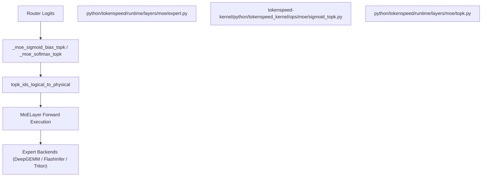
Sources: [python/tokenspeed/runtime/layers/moe/expert.py:68-159](), [tokenspeed-kernel/python/tokenspeed_kernel/ops/moe/__init__.py:114-160](), [python/tokenspeed/runtime/layers/moe/topk.py:53-147]()

`MoELayer` initializes routing configurations, activation functions (SiTU, SwiGLU), and parallel coordinates:
- `python/tokenspeed/runtime/layers/moe/expert.py` [python/tokenspeed/runtime/layers/moe/expert.py:68-159]() defines `MoELayer.__init__` with parameters for top-k, number of experts, activation types, and parallelism ranks (`tp_rank`, `ep_rank`).
- `tokenspeed-kernel/python/tokenspeed_kernel/ops/moe/__init__.py` [tokenspeed-kernel/python/tokenspeed_kernel/ops/moe/__init__.py:114-160]() implements `moe_topk` supporting softmax, sigmoid, and sqrt_softplus scoring functions with correction biases or hash tables.
- `python/tokenspeed/runtime/layers/moe/topk.py` [python/tokenspeed/runtime/layers/moe/topk.py:53-147]() defines `ExpertLocationDispatchInfo` for tracking physical expert placement and static/dynamic dispatch algorithms.

Sources: [python/tokenspeed/runtime/layers/moe/expert.py:68-159](), [tokenspeed-kernel/python/tokenspeed_kernel/ops/moe/__init__.py:114-160](), [python/tokenspeed/runtime/layers/moe/topk.py:53-147]()

---

## 2. Latent MoE and Tail Tiers

Latent MoE architectures and specialized tail tiers manage compressed latent representations and expert intermediate caching. Kernels such as FlashInfer Cutlass unquantized MoE (`flashinfer_cutlass_unquant_moe_apply` in [tokenspeed-kernel/python/tokenspeed_kernel/ops/moe/flashinfer/cutlass_unquant.py:130-169]()) and FP4/MXFP4 block-scaled MoE implementations orchestrate state management across devices.

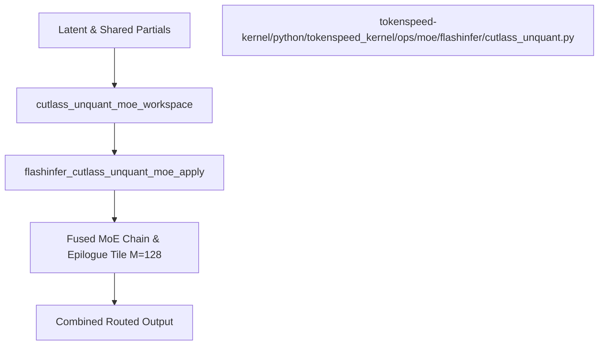
Sources: [tokenspeed-kernel/python/tokenspeed_kernel/ops/moe/flashinfer/cutlass_unquant.py:71-169]()

- `cutlass_unquant_moe_workspace` allocates persistent per-device scratch buffers sized for max row counts to prevent uninitialized read races on SM90 architectures [tokenspeed-kernel/python/tokenspeed_kernel/ops/moe/flashinfer/cutlass_unquant.py:71-129]().
- `flashinfer_cutlass_unquant_moe_apply` executes fused unquantized MoE operations supporting SwiGLU activations and expert parallelism [tokenspeed-kernel/python/tokenspeed_kernel/ops/moe/flashinfer/cutlass_unquant.py:130-169]().

Sources: [tokenspeed-kernel/python/tokenspeed_kernel/ops/moe/flashinfer/cutlass_unquant.py:71-169]()

---

## 3. Weight Formats and Quantization Schemes (FP8, NVFP4, MXFP4)

TokenSpeed supports FP8, NVFP4, and MXFP4 weight formats. Weight preprocessing kernels handle layout reordering (such as swapping gate/up projections from checkpoint layout to `[W3, W1]` for interleaved TRTLLM-Gen/FlashInfer kernels) and block scale interleaving (`nvfp4_block_scale_interleave`).

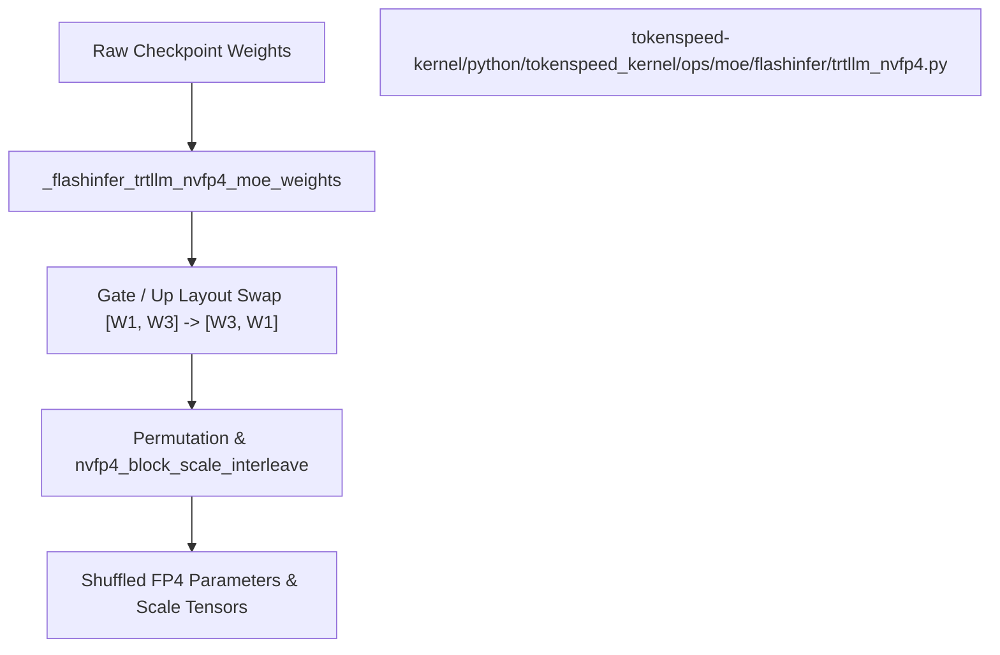
Sources: [tokenspeed-kernel/python/tokenspeed_kernel/ops/moe/flashinfer/trtllm_nvfp4.py:59-166]()

- NVFP4 weight preparation and block scaling interleaving are implemented in `_flashinfer_trtllm_nvfp4_moe_weights`, handling gated activations (`swiglu`, `situ`) and permutation caching (`maybe_get_cached_w3_w1_permute_indices`) [tokenspeed-kernel/python/tokenspeed_kernel/ops/moe/flashinfer/trtllm_nvfp4.py:59-166]().
- Triton-based FP8 quantization (`fp8_quantize` in [tokenspeed-kernel/python/tokenspeed_kernel/ops/quantization/triton.py:103-179]()) supports scale factors, block-size heuristics, and Programmatic Dependent Launch (PDL) integration [tokenspeed-kernel/python/tokenspeed_kernel/ops/quantization/triton.py:103-179]().

Sources: [tokenspeed-kernel/python/tokenspeed_kernel/ops/moe/flashinfer/trtllm_nvfp4.py:59-166](), [tokenspeed-kernel/python/tokenspeed_kernel/ops/quantization/triton.py:103-179]()

---

## 4. Quantization Configs and Dense Linear Backends

Quantization configurations govern how models instantiate quantized modules and parse checkpoint metadata. Classes like `Fp8Config` and `Mxfp8Config` ([python/tokenspeed/runtime/layers/quantization/fp8.py:40-154]()) determine activation schemes, weight block sizes, and online ignored layers.

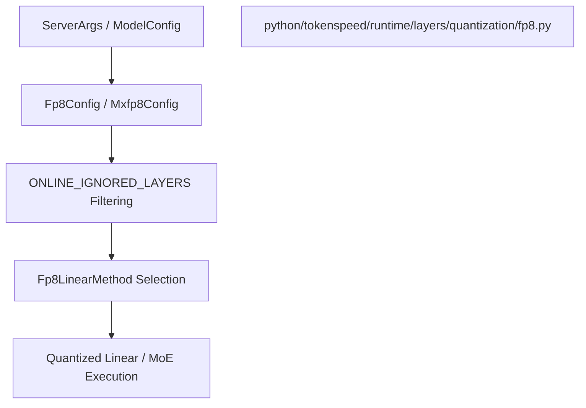
Sources: [python/tokenspeed/runtime/layers/quantization/fp8.py:40-98]()

- `Fp8Config` defines quantization parameters, including `is_checkpoint_fp8_serialized`, activation schemes (`dynamic`), weight block sizes, and online ignored layers (`ONLINE_IGNORED_LAYERS`) [python/tokenspeed/runtime/layers/quantization/fp8.py:40-86]().
- `Fp8Config.get_quant_method` instantiates `Fp8LinearMethod` for handling quantized linear operations [python/tokenspeed/runtime/layers/quantization/fp8.py:87-98]().
- `Mxfp8Config` extends `Fp8Config` for MXFP8 with `ue8m0` scale formatting [python/tokenspeed/runtime/layers/quantization/fp8.py:137-154]().

Sources: [python/tokenspeed/runtime/layers/quantization/fp8.py:40-98](), [python/tokenspeed/runtime/layers/quantization/fp8.py:137-154]()

---

# Page: Distributed Communication

# Distributed Communication

<details>
<summary>Relevant source files</summary>

The following files were used as context for generating this wiki page:

- [python/tokenspeed/runtime/distributed/comm_backend/auto.py](python/tokenspeed/runtime/distributed/comm_backend/auto.py)
- [python/tokenspeed/runtime/distributed/comm_backend/base.py](python/tokenspeed/runtime/distributed/comm_backend/base.py)
- [python/tokenspeed/runtime/distributed/comm_backend/nccl.py](python/tokenspeed/runtime/distributed/comm_backend/nccl.py)
- [python/tokenspeed/runtime/distributed/comm_backend/projection.py](python/tokenspeed/runtime/distributed/comm_backend/projection.py)
- [python/tokenspeed/runtime/distributed/comm_backend/registry.py](python/tokenspeed/runtime/distributed/comm_backend/registry.py)
- [python/tokenspeed/runtime/distributed/comm_backend/triton_allreduce.py](python/tokenspeed/runtime/distributed/comm_backend/triton_allreduce.py)
- [python/tokenspeed/runtime/distributed/comm_backend/triton_rsag.py](python/tokenspeed/runtime/distributed/comm_backend/triton_rsag.py)
- [python/tokenspeed/runtime/distributed/comm_backend/trtllm_allreduce.py](python/tokenspeed/runtime/distributed/comm_backend/trtllm_allreduce.py)
- [python/tokenspeed/runtime/distributed/comm_ops.py](python/tokenspeed/runtime/distributed/comm_ops.py)
- [python/tokenspeed/runtime/distributed/process_group_manager.py](python/tokenspeed/runtime/distributed/process_group_manager.py)
- [python/tokenspeed/runtime/execution/distributed_initializer.py](python/tokenspeed/runtime/execution/distributed_initializer.py)
- [python/tokenspeed/runtime/execution/drafter/mtp.py](python/tokenspeed/runtime/execution/drafter/mtp.py)
- [python/tokenspeed/runtime/execution/model_runner.py](python/tokenspeed/runtime/execution/model_runner.py)
- [python/tokenspeed/runtime/models/inkling_nextn.py](python/tokenspeed/runtime/models/inkling_nextn.py)
- [python/tokenspeed/runtime/models/kimi_k3_comm.py](python/tokenspeed/runtime/models/kimi_k3_comm.py)
- [python/tokenspeed/runtime/models/kimi_k3_dspark.py](python/tokenspeed/runtime/models/kimi_k3_dspark.py)
- [python/tokenspeed/runtime/models/kimi_k3_nextn.py](python/tokenspeed/runtime/models/kimi_k3_nextn.py)
- [test/ci/eval/kimi-k3-eagle3-mxfp4-tp8ep1-evalscope-aime26-amd.yaml](test/ci/eval/kimi-k3-eagle3-mxfp4-tp8ep1-evalscope-aime26-amd.yaml)
- [test/ci_system/run_kernel_gpu_ut.sh](test/ci_system/run_kernel_gpu_ut.sh)
- [test/runtime/distributed/test_auto_backend.py](test/runtime/distributed/test_auto_backend.py)
- [test/runtime/distributed/test_comm_ops.py](test/runtime/distributed/test_comm_ops.py)
- [test/runtime/distributed/test_dp_parallel_linear.py](test/runtime/distributed/test_dp_parallel_linear.py)
- [test/runtime/test_drafter_accept_indexing.py](test/runtime/test_drafter_accept_indexing.py)
- [test/runtime/test_kimi_k3_attn_res.py](test/runtime/test_kimi_k3_attn_res.py)
- [test/runtime/test_kimi_k3_comm_arming.py](test/runtime/test_kimi_k3_comm_arming.py)
- [test/runtime/test_kimi_k3_dspark_capture.py](test/runtime/test_kimi_k3_dspark_capture.py)
- [test/runtime/test_kimi_k3_dspark_model.py](test/runtime/test_kimi_k3_dspark_model.py)
- [test/runtime/test_port_args.py](test/runtime/test_port_args.py)
- [tokenspeed-kernel/python/tokenspeed_kernel/ops/communication/_cuda/a2a_fp8.cuh](tokenspeed-kernel/python/tokenspeed_kernel/ops/communication/_cuda/a2a_fp8.cuh)
- [tokenspeed-kernel/python/tokenspeed_kernel/ops/communication/_cuda/chunk_a2a.cu](tokenspeed-kernel/python/tokenspeed_kernel/ops/communication/_cuda/chunk_a2a.cu)
- [tokenspeed-kernel/python/tokenspeed_kernel/ops/communication/_cuda/lamport_a2a.cu](tokenspeed-kernel/python/tokenspeed_kernel/ops/communication/_cuda/lamport_a2a.cu)
- [tokenspeed-kernel/python/tokenspeed_kernel/ops/communication/_cuda/lamport_a2a.py](tokenspeed-kernel/python/tokenspeed_kernel/ops/communication/_cuda/lamport_a2a.py)
- [tokenspeed-kernel/python/tokenspeed_kernel/ops/communication/allreduce_fusion.py](tokenspeed-kernel/python/tokenspeed_kernel/ops/communication/allreduce_fusion.py)
- [tokenspeed-kernel/python/tokenspeed_kernel/ops/communication/cuda.py](tokenspeed-kernel/python/tokenspeed_kernel/ops/communication/cuda.py)
- [tokenspeed-kernel/python/tokenspeed_kernel/ops/communication/deep_ep.py](tokenspeed-kernel/python/tokenspeed_kernel/ops/communication/deep_ep.py)
- [tokenspeed-kernel/python/tokenspeed_kernel/ops/communication/iris.py](tokenspeed-kernel/python/tokenspeed_kernel/ops/communication/iris.py)
- [tokenspeed-kernel/python/tokenspeed_kernel/ops/communication/tokenspeed_a2a_lamport.md](tokenspeed-kernel/python/tokenspeed_kernel/ops/communication/tokenspeed_a2a_lamport.md)
- [tokenspeed-kernel/python/tokenspeed_kernel/ops/communication/triton.py](tokenspeed-kernel/python/tokenspeed_kernel/ops/communication/triton.py)
- [tokenspeed-kernel/python/tokenspeed_kernel/ops/communication/trtllm.py](tokenspeed-kernel/python/tokenspeed_kernel/ops/communication/trtllm.py)
- [tokenspeed-kernel/python/tokenspeed_kernel/ops/moe/deep_gemm/ue8m0.py](tokenspeed-kernel/python/tokenspeed_kernel/ops/moe/deep_gemm/ue8m0.py)
- [tokenspeed-kernel/python/tokenspeed_kernel/thirdparty/cuda/csrc/include/flashinfer/comm/trtllm_mnnvl_allreduce_fusion.cuh](tokenspeed-kernel/python/tokenspeed_kernel/thirdparty/cuda/csrc/include/flashinfer/comm/trtllm_mnnvl_allreduce_fusion.cuh)
- [tokenspeed-kernel/python/tokenspeed_kernel/thirdparty/cuda/csrc/trtllm_mnnvl_allreduce_fusion.cu](tokenspeed-kernel/python/tokenspeed_kernel/thirdparty/cuda/csrc/trtllm_mnnvl_allreduce_fusion.cu)
- [tokenspeed-kernel/python/tokenspeed_kernel/thirdparty/cuda/trtllm.py](tokenspeed-kernel/python/tokenspeed_kernel/thirdparty/cuda/trtllm.py)
- [tokenspeed-kernel/python/tokenspeed_kernel/thirdparty/flashinfer/allreduce_fusion.py](tokenspeed-kernel/python/tokenspeed_kernel/thirdparty/flashinfer/allreduce_fusion.py)
- [tokenspeed-kernel/test/amd/ops/test_iris_communication.py](tokenspeed-kernel/test/amd/ops/test_iris_communication.py)
- [tokenspeed-kernel/test/amd/ops/test_iris_moe_tail.py](tokenspeed-kernel/test/amd/ops/test_iris_moe_tail.py)
- [tokenspeed-kernel/test/nvidia/ops/communication/test_allreduce_fusion.py](tokenspeed-kernel/test/nvidia/ops/communication/test_allreduce_fusion.py)
- [tokenspeed-kernel/test/nvidia/ops/communication/test_projection_tp.py](tokenspeed-kernel/test/nvidia/ops/communication/test_projection_tp.py)
- [tokenspeed-kernel/test/ops/test_communcation.py](tokenspeed-kernel/test/ops/test_communcation.py)

</details>


The distributed communication subsystem in TokenSpeed orchestrates tensor, expert, data, and pipeline parallelism across single and multi-node clusters. It features a pluggable backend architecture that dynamically routes collectives across NCCL, TRT-LLM allreduce, Triton allreduce, MNNVL, and Iris based on payload size, hardware capabilities, and model layer requirements [python/tokenspeed/runtime/distributed/comm_backend/auto.py:21-27]().

Sources: [python/tokenspeed/runtime/distributed/comm_backend/auto.py:21-27]()

---

## Parallelism Mapping and Initialization

Parallelism topologies are defined via the `Mapping` abstraction and initialized through `DistributedInitializer` and `DistributedConfig`, which capture network topology, device configuration, and parallelism dimensions [python/tokenspeed/runtime/execution/distributed_initializer.py](). 

Process groups are established via `pg_manager` (`ProcessGroupManager`) for attention tensor parallelism (TP), dense TP, MoE TP+EP, and pipeline parallelism stages [python/tokenspeed/runtime/distributed/process_group_manager.py]().

```mermaid
graph TD
    subgraph "Initialization Space"
        DC["DistributedConfig"]
        DI["DistributedInitializer"]
    end

    subgraph "Process Group Management"
        PGM["pg_manager (process_group_manager.py)"]
        TS["TCPStore"]
    end

    subgraph "Backend Registration"
        GB["get_global_backend (comm_backend/__init__.py)"]
        TRT["TrtllmAllReduceBackend (trtllm_allreduce.py)"]
    end

    DC -->|PassesMapping| DI
    DI -->|InitsGroups| PGM
    PGM -->|Binds| TS
    DI -->|ArmsWorkspaces| GB
    GB -->|ConfiguresGroup| TRT
```
*Figure 1: Initialization and Process Group Binding Workflow.*

Sources: [python/tokenspeed/runtime/execution/distributed_initializer.py](), [python/tokenspeed/runtime/distributed/process_group_manager.py]()

---

## Pluggable Communication Backends and Auto Selection

The abstract base class `CommBackend` [python/tokenspeed/runtime/distributed/comm_backend/base.py:38-43]() defines the required interface for all collective operations. `AutoBackend` acts as a composite router that selects the optimal backend strategy per-call depending on group scope, payload size, and hardware features [python/tokenspeed/runtime/distributed/comm_backend/auto.py:101-114]().

### Backend Routing Matrix

| Backend Class | Primary Operation | Scope & Hardware Condition |
| :--- | :--- | :--- |
| `NcclBackend` | All Collectives | Cross-node or general fallback [python/tokenspeed/runtime/distributed/comm_backend/auto.py:105]() |
| `TrtllmAllReduceBackend` | `all_reduce` (SUM) | NVIDIA Hopper/Blackwell, one-shot IPC/MNNVL [python/tokenspeed/runtime/distributed/comm_backend/trtllm_allreduce.py:21-50]() |
| `TritonAllReduceBackend` | `all_reduce` | AMD CDNA / Triton-accelerated node-local [python/tokenspeed/runtime/distributed/comm_backend/triton_allreduce.py:21-38]() |
| `TritonRSAGBackend` | Token AllGather / ReduceScatter | Node-local MoE token dispatch [python/tokenspeed/runtime/distributed/comm_backend/auto.py:108]() |

```mermaid
graph TD
    subgraph "Routing Space"
        AB["AutoBackend.route (auto.py)"]
        CB["CommBackend (base.py)"]
    end

    subgraph "Backend Implementations"
        NC["NcclBackend (nccl.py)"]
        TRT["TrtllmAllReduceBackend (trtllm_allreduce.py)"]
        TRI["TritonAllReduceBackend (triton_allreduce.py)"]
        RSAG["TritonRSAGBackend (triton_rsag.py)"]
    end

    AB -->|CrossNode| NC
    AB -->|NvidiaOneShot| TRT
    AB -->|AmdLocal| TRI
    AB -->|MoETokenDispatch| RSAG
```
*Figure 2: AutoBackend Collective Routing Architecture.*

Sources: [python/tokenspeed/runtime/distributed/comm_backend/base.py:38-43](), [python/tokenspeed/runtime/distributed/comm_backend/auto.py:101-114](), [python/tokenspeed/runtime/distributed/comm_backend/trtllm_allreduce.py:21-50](), [python/tokenspeed/runtime/distributed/comm_backend/triton_allreduce.py:21-38]()

---

## Communication Patterns, CommOps, and Fusions

Communication inside decoder layers is coordinated via `comm_ops.py`, which supports fused communication and elementwise normalization operations using `FusionOp` and `FusionParams` [python/tokenspeed/runtime/distributed/comm_ops.py:73-121]().

### Supported Fusion Types
* **`RESIDUAL_RMS_NORM`**: Fuses `all_reduce` + residual add + `RMSNorm` [python/tokenspeed/runtime/distributed/comm_ops.py:77-78]().
* **`RS_RESIDUAL_RMS_NORM`**: Fuses `reduce_scatter` + residual add + `RMSNorm` [python/tokenspeed/runtime/distributed/comm_ops.py:79-80]().
* **`AG_DUAL_RMS_NORM`**: Fuses `all_gather` + dual RMSNorm for Multi-Head Latent Attention (MLA) [python/tokenspeed/runtime/distributed/comm_ops.py:81-82]().

```mermaid
graph TD
    subgraph "Execution Layer"
        MR["ModelRunner (model_runner.py)"]
        CO["comm_ops.py"]
    end

    subgraph "Fusion Context"
        FP["FusionParams (comm_ops.py)"]
        FO["FusionOp (comm_ops.py)"]
    end

    subgraph "Kernel Execution"
        AR["allreduce_residual_rmsnorm"]
        RS["reducescatter_residual_rmsnorm"]
        AG["allgather_dual_rmsnorm"]
    end

    MR -->|Invokes| CO
    CO -->|Attaches| FP
    FP -->|Specifies| FO
    FO -->|Dispatches| AR
    FO -->|Dispatches| RS
    FO -->|Dispatches| AG
```
*Figure 3: Communication Fusion Data Flow.*

Sources: [python/tokenspeed/runtime/distributed/comm_ops.py:73-121](), [python/tokenspeed/runtime/execution/model_runner.py]()

---

## MoE, Expert Parallelism, and Token-Aware Operations (Iris & Triton RSAG)

Expert Parallelism (EP) distributes sparse Mixture-of-Experts blocks across devices, resulting in variable token counts per rank. `TritonCommState` and `IrisRSAG` manage symmetric-heap allocations, producer-direct buffers, and synchronization flags for high-throughput token gathering and scattering [tokenspeed-kernel/python/tokenspeed_kernel/ops/communication/triton.py:133-148](), [tokenspeed-kernel/python/tokenspeed_kernel/ops/communication/iris.py:71-90]().

For complex models like Kimi-K3, specialized communication modules (`kimi_k3_comm.py`) manage attention reduce workspaces, routed all-reduces, and residual mixing (`AttnRes`) [python/tokenspeed/runtime/models/kimi_k3_comm.py:110-176]().

```mermaid
graph TD
    subgraph "MoE Communication"
        K3["K3AttnComm (kimi_k3_comm.py)"]
        TS["TritonCommState (triton.py)"]
        IR["IrisRSAG (iris.py)"]
    end

    subgraph "Kernels"
        AR["iris_all_reduce"]
        RSAG["rsag_all_reduce"]
    end

    K3 -->|AllocatesBuffers| TS
    TS -->|BacksCollective| AR
    IR -->|ManagesHeap| RSAG
```
*Figure 4: MoE and Token-Aware Communication Routing.*

Sources: [tokenspeed-kernel/python/tokenspeed_kernel/ops/communication/triton.py:133-148](), [tokenspeed-kernel/python/tokenspeed_kernel/ops/communication/iris.py:71-90](), [python/tokenspeed/runtime/models/kimi_k3_comm.py:110-176]()

---

## Multi-Node and Fabric Topologies (MNNVL and Trtllm Allreduce)

When clusters scale across multiple nodes, communication groups span physical host boundaries. `AutoBackend` detects multi-node layouts and routes payloads through `NcclBackend` unless accelerated fabric layers like MNNVL (Multi-Node NVLink) are armed [python/tokenspeed/runtime/distributed/comm_backend/trtllm_allreduce.py:135-169]().

The MNNVL two-shot all-reduce workspace allocates symmetric memory utilizing NVLink fabric adapters, bypassing socket-based interconnect bottlenecks for low-latency inference on NVIDIA Blackwell and Hopper architectures [tokenspeed-kernel/python/tokenspeed_kernel/thirdparty/cuda/trtllm.py:116-169]().

Sources: [python/tokenspeed/runtime/distributed/comm_backend/trtllm_allreduce.py:135-169](), [tokenspeed-kernel/python/tokenspeed_kernel/thirdparty/cuda/trtllm.py:116-169]()

---

# Page: Prefill-Decode Disaggregation (PD/EPD)

# Prefill-Decode Disaggregation (PD/EPD)

<details>
<summary>Relevant source files</summary>

The following files were used as context for generating this wiki page:

- [python/tokenspeed/runtime/epd/encode_executor.py](python/tokenspeed/runtime/epd/encode_executor.py)
- [python/tokenspeed/runtime/epd/encode_loop.py](python/tokenspeed/runtime/epd/encode_loop.py)
- [python/tokenspeed/runtime/layers/attention/kv_cache/recipes/cache_runtime.py](python/tokenspeed/runtime/layers/attention/kv_cache/recipes/cache_runtime.py)
- [python/tokenspeed/runtime/layers/attention/kv_cache/recipes/ordinary.py](python/tokenspeed/runtime/layers/attention/kv_cache/recipes/ordinary.py)
- [python/tokenspeed/runtime/layers/attention/kv_cache/virtual_blocks.py](python/tokenspeed/runtime/layers/attention/kv_cache/virtual_blocks.py)
- [python/tokenspeed/runtime/layers/attention/mm_encoder_attention.py](python/tokenspeed/runtime/layers/attention/mm_encoder_attention.py)
- [python/tokenspeed/runtime/models/kimi_k25.py](python/tokenspeed/runtime/models/kimi_k25.py)
- [python/tokenspeed/runtime/models/moonvit.py](python/tokenspeed/runtime/models/moonvit.py)
- [python/tokenspeed/runtime/models/qwen3_asr.py](python/tokenspeed/runtime/models/qwen3_asr.py)
- [python/tokenspeed/runtime/models/qwen3_audio.py](python/tokenspeed/runtime/models/qwen3_audio.py)
- [python/tokenspeed/runtime/models/qwen3_omni.py](python/tokenspeed/runtime/models/qwen3_omni.py)
- [python/tokenspeed/runtime/pd/cache_protocol.py](python/tokenspeed/runtime/pd/cache_protocol.py)
- [python/tokenspeed/runtime/pd/decode_executor.py](python/tokenspeed/runtime/pd/decode_executor.py)
- [python/tokenspeed/runtime/pd/factory.py](python/tokenspeed/runtime/pd/factory.py)
- [python/tokenspeed/runtime/pd/mooncake/conn.py](python/tokenspeed/runtime/pd/mooncake/conn.py)
- [python/tokenspeed/runtime/pd/mooncake/decode.py](python/tokenspeed/runtime/pd/mooncake/decode.py)
- [python/tokenspeed/runtime/pd/mooncake/entities.py](python/tokenspeed/runtime/pd/mooncake/entities.py)
- [python/tokenspeed/runtime/pd/mooncake/prefill.py](python/tokenspeed/runtime/pd/mooncake/prefill.py)
- [python/tokenspeed/runtime/pd/mooncake/receiver.py](python/tokenspeed/runtime/pd/mooncake/receiver.py)
- [python/tokenspeed/runtime/pd/mooncake/sender.py](python/tokenspeed/runtime/pd/mooncake/sender.py)
- [python/tokenspeed/runtime/pd/prefill_executor.py](python/tokenspeed/runtime/pd/prefill_executor.py)
- [python/tokenspeed/runtime/pd/transfer_plan.py](python/tokenspeed/runtime/pd/transfer_plan.py)
- [test/ci/eval/qwen3.5-122b-a10b-nvfp4-epd-1e1p2d-evalscope-ocr-bench.yaml](test/ci/eval/qwen3.5-122b-a10b-nvfp4-epd-1e1p2d-evalscope-ocr-bench.yaml)
- [test/ci/eval/qwen3.5-35b-a3b-fp8-deepep-tp2dp2ep4-evalscope-gsm8k.yaml](test/ci/eval/qwen3.5-35b-a3b-fp8-deepep-tp2dp2ep4-evalscope-gsm8k.yaml)
- [test/ci/ut/qwen3.5-122b-a10b-nvfp4-epd-1e1p2d.yaml](test/ci/ut/qwen3.5-122b-a10b-nvfp4-epd-1e1p2d.yaml)
- [test/ci/ut/qwen3.5-397b-a17b-nvfp4-pd-1p1d.yaml](test/ci/ut/qwen3.5-397b-a17b-nvfp4-pd-1p1d.yaml)
- [test/ci_system/serve_qwen35_122b_nvfp4_epd_1e1p2d.sh](test/ci_system/serve_qwen35_122b_nvfp4_epd_1e1p2d.sh)
- [test/ci_system/serve_qwen35_397b_nvfp4_pd_1p1d.sh](test/ci_system/serve_qwen35_397b_nvfp4_pd_1p1d.sh)
- [test/ci_system/test_worker_cleanup.py](test/ci_system/test_worker_cleanup.py)
- [test/ci_system/worker_cleanup.sh](test/ci_system/worker_cleanup.sh)
- [test/runtime/cache_pd_test_utils.py](test/runtime/cache_pd_test_utils.py)
- [test/runtime/distributed/test_cache_pd_executors.py](test/runtime/distributed/test_cache_pd_executors.py)
- [test/runtime/distributed/test_cache_pd_layerwise.py](test/runtime/distributed/test_cache_pd_layerwise.py)
- [test/runtime/distributed/test_cache_pd_manifest.py](test/runtime/distributed/test_cache_pd_manifest.py)
- [test/runtime/distributed/test_epd_encode.py](test/runtime/distributed/test_epd_encode.py)
- [test/runtime/distributed/test_pd_transfer_plan.py](test/runtime/distributed/test_pd_transfer_plan.py)
- [test/runtime/distributed/test_qwen35_epd_1e1p2d.py](test/runtime/distributed/test_qwen35_epd_1e1p2d.py)
- [test/runtime/distributed/test_qwen35_pd_1p1d.py](test/runtime/distributed/test_qwen35_pd_1p1d.py)
- [test/runtime/test_dcp_cache_contract.py](test/runtime/test_dcp_cache_contract.py)
- [test/runtime/test_input_logprobs.py](test/runtime/test_input_logprobs.py)
- [tokenspeed-kernel/python/tokenspeed_kernel/ops/attention/prologue/triton.py](tokenspeed-kernel/python/tokenspeed_kernel/ops/attention/prologue/triton.py)

</details>


## Purpose and Scope
This page details the Prefill-Decode Disaggregation (PD) and Encode-Prefill-Decode (EPD) architectures in TokenSpeed. Disaggregation separates the compute-bound prefill phase and the vision encoding phase from the memory-bandwidth-bound decode phase, enabling independent cluster scaling and reducing interference. This document covers the prefill and decode executors, Mooncake distributed KV transfer, transfer planning across heterogeneous tensor parallelism (TP) layouts, factory wiring, and the EPD multimodal encode pipeline.

Sources: `[python/tokenspeed/runtime/pd/prefill_executor.py:41-50]()`, `[python/tokenspeed/runtime/pd/decode_executor.py:35-42]()`

---

## Prefill and Decode Executors

TokenSpeed divides execution roles into `DisaggPrefillExecutor` and `DisaggDecodeExecutor`, orchestrating chunked prefill, block manifests, and cross-node cache handoffs.

### DisaggPrefillExecutor
`DisaggPrefillExecutor` `[python/tokenspeed/runtime/pd/prefill_executor.py:41-]` manages prompt ingestion and streams generated KV cache segments to decode workers via Mooncake `[python/tokenspeed/runtime/pd/mooncake/prefill.py:76-]()`.
*   **Initialization & Buffer Registration**: Instantiates `MooncakeKVManagerPrefill` and binds local KV arena pointers `[python/tokenspeed/runtime/pd/prefill_executor.py:42-45]()`.
*   **Layer-wise Transfer**: Supports asynchronous layer-wise step counters via `register_layerwise_step_counter()` to overlap communication with execution `[python/tokenspeed/runtime/pd/prefill_executor.py:51-56]()`.
*   **Request Teardown**: Cleans up sender states and discards bootstrap rooms via `_drop_request_state()` `[python/tokenspeed/runtime/pd/prefill_executor.py:65-74]()`.

### DisaggDecodeExecutor
`DisaggDecodeExecutor` `[python/tokenspeed/runtime/pd/decode_executor.py:35-]` handles low-latency token generation on decode workers.
*   **Bootstrap Registration**: Registers incoming request identifiers and establishes rendezvous sockets through `register()` `[python/tokenspeed/runtime/pd/decode_executor.py:87-93]()`.
*   **Cache Preamble**: Injects block manifests via `_cache_prefill()` to configure remote receiver slots before batch execution `[python/tokenspeed/runtime/pd/decode_executor.py:53-85]()`.
*   **Event Generation**: Polls transfer completion statuses and emits scheduler-compatible events (`BootstrappedEvent`, `FailedEvent`) via `generate_events()` `[python/tokenspeed/runtime/pd/decode_executor.py:106-152]()`.

**Figure 1: PD Execution Flow and Code Entity Mapping**
```mermaid
sequenceDiagram
    participant LB as "SMGGateway [smg/launch.py]"
    participant PE as "DisaggPrefillExecutor [python/tokenspeed/runtime/pd/prefill_executor.py]"
    participant MP as "MooncakeKVManagerPrefill [python/tokenspeed/runtime/pd/mooncake/prefill.py]"
    participant DE as "DisaggDecodeExecutor [python/tokenspeed/runtime/pd/decode_executor.py]"
    participant MD as "MooncakeKVManagerDecode [python/tokenspeed/runtime/pd/mooncake/decode.py]"

    LB->>PE: "SubmitGenerateReq"
    activate PE
    PE->>PE: "_bootstrap(request_id, info)"
    PE->>MP: "register_buffer_to_engine()"
    PE->>PE: "prepare_prefill(op)"
    PE->>MP: "MooncakeKVSender.send_kv_chunk()"
    PE-->>LB: "Prefill Metadata (Token + Spec IDs)"
    deactivate PE

    LB->>DE: "HandoffToDecode(BootstrapInfo)"
    activate DE
    DE->>DE: "register(request_id, bootstrap_info)"
    DE->>MD: "MooncakeKVReceiver.prefill(block_manifest)"
    
    loop "TokenGenerationLoop"
        DE->>DE: "execute(Forward.Batch)"
    end
    DE-->>LB: "StreamResponse"
    deactivate DE
```
Sources: `[python/tokenspeed/runtime/pd/prefill_executor.py:41-63]()`, `[python/tokenspeed/runtime/pd/decode_executor.py:35-105]()`, `[python/tokenspeed/runtime/pd/mooncake/prefill.py:76-121]()`

---

## Mooncake KV Transfer Subsystem

The data plane relies on the Mooncake engine, wrapped by `MooncakeKVManagerBase` `[python/tokenspeed/runtime/pd/mooncake/conn.py:37-]` and specialized subclasses.

### Core Manager Classes
*   `MooncakeKVManagerBase`: Initializes the underlying `MooncakeTransferEngine`, binds host/GPU arenas, and hooks metrics collection `[python/tokenspeed/runtime/pd/mooncake/conn.py:37-75]()`.
*   `MooncakeKVManagerPrefill`: Manages send queues, transfer worker threads, and prefill metadata publishing `[python/tokenspeed/runtime/pd/mooncake/prefill.py:76-121]()`.
*   `MooncakeKVManagerDecode`: Coordinates decode-side slab mapping, receiver pools, and ZMQ synchronization channels.
*   `MooncakeKVBootstrapServer`: HTTP rendezvous bootstrap server managing layout validation and endpoint routing `[python/tokenspeed/runtime/pd/mooncake/conn.py:84-109]()`.

**Figure 2: Mooncake Manager and Entity Code Mapping**
```mermaid
graph TD
    subgraph "ManagerHierarchy"
        MCB["MooncakeKVManagerBase [python/tokenspeed/runtime/pd/mooncake/conn.py]"]
        MP["MooncakeKVManagerPrefill [python/tokenspeed/runtime/pd/mooncake/prefill.py]"]
        MD["MooncakeKVManagerDecode [python/tokenspeed/runtime/pd/mooncake/decode.py]"]
        MBS["MooncakeKVBootstrapServer [python/tokenspeed/runtime/pd/mooncake/conn.py]"]
    end

    subgraph "TransferProtocolEntities"
        TI["TransferInfo [python/tokenspeed/runtime/pd/mooncake/entities.py]"]
        TKC["TransferKVChunk [python/tokenspeed/runtime/pd/mooncake/entities.py]"]
        KVR["KVArgsRegisterInfo [python/tokenspeed/runtime/pd/mooncake/entities.py]"]
    end

    MP -->|"inherits"| MCB
    MD -->|"inherits"| MCB
    MP -->|"publishes"| TKC
    MD -->|"parses"| TI
    MD -->|"registers"| KVR
    MBS -->|"validates"| MP
```
Sources: `[python/tokenspeed/runtime/pd/mooncake/conn.py:37-109]()`, `[python/tokenspeed/runtime/pd/mooncake/entities.py:53-180]()`

---

## Transfer Planning and Layout Protocols

When prefill and decode ranks operate with unequal tensor-parallelism (TP) sizes or partitioned pipeline stages, `CacheTransferPlanner` `[python/tokenspeed/runtime/pd/transfer_plan.py:95-]` computes explicit memory copy fragments.

### Key Data Structures
*   `CacheTransferFragment`: Describes a field-relative sub-page row fragment copied between source and destination slabs `[python/tokenspeed/runtime/pd/transfer_plan.py:40-58]()`.
*   `RankTransferPlan`: Aggregates mapping collections from prefill ranks to decode ranks `[python/tokenspeed/runtime/pd/transfer_plan.py:63-70]()`.
*   `TransferKVChunk`: Payload structure tracking chunk boundaries, step counters, and block manifests `[python/tokenspeed/runtime/pd/mooncake/entities.py:95-108]()`.
*   `TransferInfo`: Request manifest associated with a registered decode session `[python/tokenspeed/runtime/pd/mooncake/entities.py:112-122]()`.

Sources: `[python/tokenspeed/runtime/pd/transfer_plan.py:40-70]()`, `[python/tokenspeed/runtime/pd/mooncake/entities.py:95-122]()`

---

## EPD (Encode-Prefill-Decode) Pipeline

For multimodal models (e.g., Qwen3.5-VL), TokenSpeed introduces an **Encode** role (`encode`) preceding prefill.

### Pipeline Architecture
*   `EncodeWorker`: Runs independently as an LM-free process, executing only vision encoders and multimodal embedding extractors.
*   **Embedding Transport**: Encoded visual features are shipped directly over Mooncake to prefill workers, while raw image pixels are transported inline via gRPC messages (`TOKENSPEED_GRPC_MAX_MESSAGE_BYTES`) `[test/ci_system/serve_qwen35_122b_nvfp4_epd_1e1p2d.sh:54-56]()`.
*   **Topology Wiring**: Supports multi-replica decode dispatch (e.g., `1E-1P-2D` topologies) where gateways balance requests across decode instances `[test/ci_system/serve_qwen35_122b_nvfp4_epd_1e1p2d.sh:10-14]()`.

Sources: `[test/ci_system/serve_qwen35_122b_nvfp4_epd_1e1p2d.sh:1-60]()`

---

## Lifecycle Status States

Transfer lifecycles are governed by the `TransferPoll` status machine:

| Status State | Description | Code Reference |
| :--- | :--- | :--- |
| `Bootstrapping` | Establishing sockets, exchanging metadata and route headers. | `[python/tokenspeed/runtime/pd/base/status.py]()`, `[python/tokenspeed/runtime/pd/decode_executor.py:114-122]()` |
| `Bootstrapped` | Connection verified; ready for KV chunk transmission. | `[python/tokenspeed/runtime/pd/decode_executor.py:116-121]()` |
| `Transferring` | Mooncake RDMA data movement in progress. | `[python/tokenspeed/runtime/pd/base/status.py]()` |
| `Success` | KV cache successfully transferred and loaded on decode node. | `[python/tokenspeed/runtime/pd/decode_executor.py:133-141]()` |
| `Failed` | Timeout or unrecoverable error during transfer or bootstrap. | `[python/tokenspeed/runtime/pd/decode_executor.py:123-131]()` |

Sources: `[python/tokenspeed/runtime/pd/base/status.py]()`, `[python/tokenspeed/runtime/pd/decode_executor.py:113-145]()`

---

# Page: Speculative Decoding and Grammar

# Speculative Decoding and Grammar

<details>
<summary>Relevant source files</summary>

The following files were used as context for generating this wiki page:

- [python/tokenspeed/runtime/configs/deepseek_v41_config.py](python/tokenspeed/runtime/configs/deepseek_v41_config.py)
- [python/tokenspeed/runtime/execution/drafter/__init__.py](python/tokenspeed/runtime/execution/drafter/__init__.py)
- [python/tokenspeed/runtime/execution/drafter/base.py](python/tokenspeed/runtime/execution/drafter/base.py)
- [python/tokenspeed/runtime/execution/drafter/deepseek_v4_dspark.py](python/tokenspeed/runtime/execution/drafter/deepseek_v4_dspark.py)
- [python/tokenspeed/runtime/execution/drafter/dflash.py](python/tokenspeed/runtime/execution/drafter/dflash.py)
- [python/tokenspeed/runtime/execution/drafter/dflash2.py](python/tokenspeed/runtime/execution/drafter/dflash2.py)
- [python/tokenspeed/runtime/execution/drafter/dspark.py](python/tokenspeed/runtime/execution/drafter/dspark.py)
- [python/tokenspeed/runtime/grammar/reasoning_structural_tag.py](python/tokenspeed/runtime/grammar/reasoning_structural_tag.py)
- [python/tokenspeed/runtime/layers/attention/backends/paged/trtllm.py](python/tokenspeed/runtime/layers/attention/backends/paged/trtllm.py)
- [python/tokenspeed/runtime/layers/attention/configs/mha.py](python/tokenspeed/runtime/layers/attention/configs/mha.py)
- [python/tokenspeed/runtime/models/deepseek_v41_vision.py](python/tokenspeed/runtime/models/deepseek_v41_vision.py)
- [python/tokenspeed/runtime/models/dflash.py](python/tokenspeed/runtime/models/dflash.py)
- [python/tokenspeed/runtime/models/dflash2.py](python/tokenspeed/runtime/models/dflash2.py)
- [python/tokenspeed/runtime/models/dspark.py](python/tokenspeed/runtime/models/dspark.py)
- [test/cli/test_serve_smg_deepseek_v41.py](test/cli/test_serve_smg_deepseek_v41.py)
- [test/runtime/test_deepseek_v41_vision.py](test/runtime/test_deepseek_v41_vision.py)
- [test/runtime/test_dflash2.py](test/runtime/test_dflash2.py)
- [test/runtime/test_dspark_proposal.py](test/runtime/test_dspark_proposal.py)
- [test/runtime/test_encoder_batching.py](test/runtime/test_encoder_batching.py)
- [test/runtime/test_reasoning_structural_tag.py](test/runtime/test_reasoning_structural_tag.py)
- [test/runtime/test_tree_attention_cascade.py](test/runtime/test_tree_attention_cascade.py)
- [test/runtime/test_tree_support_resolution.py](test/runtime/test_tree_support_resolution.py)
- [test/runtime/test_trtllm_kv_counter_buffer.py](test/runtime/test_trtllm_kv_counter_buffer.py)
- [tokenspeed-kernel/python/tokenspeed_kernel/ops/attention/mha/flashinfer.py](tokenspeed-kernel/python/tokenspeed_kernel/ops/attention/mha/flashinfer.py)
- [tokenspeed-kernel/python/tokenspeed_kernel/ops/attention/tree/__init__.py](tokenspeed-kernel/python/tokenspeed_kernel/ops/attention/tree/__init__.py)
- [tokenspeed-kernel/python/tokenspeed_kernel/ops/attention/tree/triton.py](tokenspeed-kernel/python/tokenspeed_kernel/ops/attention/tree/triton.py)
- [tokenspeed-kernel/python/tokenspeed_kernel/ops/sampling/__init__.py](tokenspeed-kernel/python/tokenspeed_kernel/ops/sampling/__init__.py)
- [tokenspeed-kernel/python/tokenspeed_kernel/ops/sampling/cute_dsl.py](tokenspeed-kernel/python/tokenspeed_kernel/ops/sampling/cute_dsl.py)
- [tokenspeed-kernel/test/ops/test_tree_speculative.py](tokenspeed-kernel/test/ops/test_tree_speculative.py)

</details>


The Speculative Decoding and Grammar subsystem in TokenSpeed provides high-performance inference optimizations through multi-algorithm drafting (EAGLE/EAGLE3, MTP/NextN, DFLASH, DFLASH2, DSPARK), tight draft/target wiring, tree speculation support, acceptance indexing, and grammar-constrained reasoning generation.

## Drafter Registry and Implementations

TokenSpeed maintains a pluggable drafter registry supporting diverse speculative execution paradigms. These include traditional feature-tree estimators (EAGLE, EAGLE3), native next-token predictors integrated into the main model trunk (MTP/NextN), and block-drafting architectures (DFLASH, DFLASH2, DSPARK). All drafters inherit from `BaseDrafter` defined in `[python/tokenspeed/runtime/execution/drafter/base.py:46-100]()`.

### EAGLE and EAGLE3
The `Eagle` drafter class implements multi-step speculative drafting using hidden states from the target model `[python/tokenspeed/runtime/execution/drafter/eagle.py:70-100]()`. EAGLE3 variants incorporate specialized attention corrections and KV cache sharing with the base model runner.

### MTP / NextN
Next-token prediction (MTP) architectures, such as DeepSeek V4 and Qwen 4, embed speculative prediction heads directly into model layers via classes like `DeepseekV4MultiTokenPredictorLayer` `[python/tokenspeed/runtime/models/deepseek_v4_mtp.py:142-202]()` and associated compressor blocks `[python/tokenspeed/runtime/models/deepseek_v4_mtp.py:49-56]()`.

### DFLASH, DFLASH2, and DSPARK
Block-drafting algorithms like `DFlash` `[python/tokenspeed/runtime/execution/drafter/dflash.py:112-169]()` and `DeepseekV4DSpark` `[python/tokenspeed/runtime/execution/drafter/deepseek_v4_dspark.py:85-130]()` enable multi-token block prediction by consuming target residual streams from specified layers (`dflash_config.target_layer_ids`) `[python/tokenspeed/runtime/execution/drafter/dflash.py:150-155]()`. DFLASH2 extends this with refined fused KV scatter primitives and dual-stream auxiliary integration.

**Natural Language to Drafter Code Entity Mapping**
```mermaid
graph TD
    subgraph "NaturalLanguageSpace"["Natural Language Space"]
        NLPrompt["User Prompt with Speculative Decoding Enabled"]
    end

    subgraph "CodeEntitySpace"["Code Entity Space"]
        NLPrompt --> ServerArgs["ServerArgs(speculative_algorithm)"]
        ServerArgs --> DrafterFactory["get_drafter_impl()"]
        DrafterFactory --> EagleImpl["Eagle(BaseDrafter)"]
        DrafterFactory --> DFlashImpl["DFlash(BaseDrafter)"]
        DrafterFactory --> DSparkImpl["DeepseekV4DSpark(BaseDrafter)"]
        DFlashImpl --> ModelImpl["DFlashAttention / DFlash2DraftModel"]
        DSparkImpl --> MarkovImpl["VanillaMarkov / DeepseekV4DSpark"]
    end
```
Sources: [python/tokenspeed/runtime/execution/drafter/base.py:46-100](), [python/tokenspeed/runtime/execution/drafter/dflash.py:112-169](), [python/tokenspeed/runtime/execution/drafter/deepseek_v4_dspark.py:85-130](), [python/tokenspeed/runtime/models/deepseek_v4_mtp.py:49-202]()

Sources: [python/tokenspeed/runtime/execution/drafter/base.py:46-100](), [python/tokenspeed/runtime/execution/drafter/dflash.py:112-169](), [python/tokenspeed/runtime/execution/drafter/deepseek_v4_dspark.py:85-130](), [python/tokenspeed/runtime/models/deepseek_v4_mtp.py:49-202]()

## Draft and Target Wiring & Tree Speculation

Speculative execution requires coordinating memory spaces, KV cache allocations, state buffers, and attention backends between the primary target model and the draft model runner.

### KV Cache Sharing and Overshoot Management
Draft models often write directly into the target model's KV cache pool or share underlying page tables. To absorb speculative overshoot past the logical context length, TokenSpeed configures runtime buffers to accommodate spec-decode overshoot spans (`_SPEC_OVERSHOOT_SPANS = 3`) `[python/tokenspeed/runtime/utils/server_args.py:52-64]()`.

### Input Buffers and Runtime States
The `InputBuffers` and `ForwardContext` classes manage sequence lengths (`draft_seq_lens_buf`) and cache location pointers (`draft_out_cache_loc_buf`) `[python/tokenspeed/runtime/execution/drafter/eagle.py:116-123]()`. Triton and CUDA kernels such as `dflash_prepare_decode` translate scheduler page tables into physical memory addresses for both target and draft execution phases `[python/tokenspeed/runtime/execution/cache_loc_kernel.py:31-82]()`.

### Tree Speculation Support and Window Attention
Tree-based speculative decoding uses `resolve_tree_support` to compose capabilities across target and draft backend hierarchies at startup `[python/tokenspeed/runtime/layers/attention/backends/support.py:58-60]()` (verified via tests in `[test/runtime/test_tree_support_resolution.py:96-123]()`). The `tree_window_attention` primitive executes draft-tree attention topologies over paged memory `[tokenspeed-kernel/python/tokenspeed_kernel/ops/attention/tree/__init__.py]()`.

Sources: [python/tokenspeed/runtime/utils/server_args.py:52-64](), [python/tokenspeed/runtime/execution/drafter/eagle.py:116-123](), [python/tokenspeed/runtime/execution/cache_loc_kernel.py:31-82](), [python/tokenspeed/runtime/layers/attention/backends/support.py:58-60](), [test/runtime/test_tree_support_resolution.py:96-123]()

## Acceptance Indexing and Sampling

Verification and acceptance indexing map flat token outputs back to sequence rows following speculative draft evaluation.

### Acceptance Lengths and Flat Indices
The acceptance mechanism computes safe flat token offsets based on `accept_lengths` returned by the verification step `[python/tokenspeed/runtime/execution/drafter/eagle.py:142-164]()`. 
*   **Zero-Accept Fallback**: When context length caps force zero accepted tokens for a sequence row, the verifier uses the row's initial verify output as a dummy source to preserve CUDA graph tensor shapes `[python/tokenspeed/runtime/execution/drafter/eagle.py:153-158]()`.
*   **Correction Trimming**: Attention decoders apply correction steps (e.g., trimming `cache_seqlens` in draft sequence length buffers by `spec_num_tokens - accept_lengths`) to maintain accurate history windows `[python/tokenspeed/runtime/models/llama_eagle3.py:129-143]()`.

### CuTe DSL Distributed Argmax
For Hopper/Blackwell architectures, high-performance kernels such as `tokenspeed_kernel.ops.sampling.cute_dsl.distributed_argmax` optimize greedy verification and speculative candidate selection across tensor-parallel ranks `[tokenspeed-kernel/python/tokenspeed_kernel/ops/sampling/cute_dsl.py:47-70]()`.

Sources: [python/tokenspeed/runtime/execution/drafter/eagle.py:142-164](), [python/tokenspeed/runtime/models/llama_eagle3.py:129-143](), [tokenspeed-kernel/python/tokenspeed_kernel/ops/sampling/cute_dsl.py:47-70]()

## Grammar and Reasoning Structural Tags

TokenSpeed integrates grammar-constrained generation backends (such as `xgrammar`) with reasoning models to enforce structured outputs without breaking special reasoning tokens.

### Reasoning Structural Tags
To prevent grammar parsers from rejecting reasoning markers (such as DeepSeek's `<think>` blocks), the system wraps user constraints using model-specific structural tags defined in `[python/tokenspeed/runtime/grammar/reasoning_structural_tag.py:21-44]()`. The function `structural_tag_for_reasoning_response` isolates the response channel and applies the requested schema `[python/tokenspeed/runtime/grammar/reasoning_structural_tag.py:105-116]()`. Model families are mapped via `_REASONING_PARSER_TO_XGRAMMAR_MODEL` `[python/tokenspeed/runtime/grammar/reasoning_structural_tag.py:56-66]()`, with custom formatting helpers such as `_structural_tag_for_inkling` handling specialized multi-block reasoning structures `[python/tokenspeed/runtime/grammar/reasoning_structural_tag.py:69-102]()`.

### Logits Processing and Sampling Integration
The `LogitsProcessor` manages logprob calculation, temperature scaling, and distributed argmax operations `[python/tokenspeed/runtime/layers/logits_processor.py:71-134]()`. Draft proposal sampling is coordinated via `DraftProposalSampler` when `--enable-speculative-sampling` is active `[python/tokenspeed/runtime/execution/drafter/base.py:103-139]()`.

**Natural Language to Grammar & Sampling Code Entity Mapping**
```mermaid
graph TD
    subgraph "NaturalLanguageSpace"["Natural Language Space"]
        StructuredPrompt["User Request with JSON/Regex Constraints & Thinking Chunks"]
    end

    subgraph "CodeEntitySpace"["Code Entity Space"]
        StructuredPrompt --> ReasoningParser["smg reasoning_parser"]
        ReasoningParser --> TagBuilder["structural_tag_for_reasoning_response()"]
        TagBuilder --> ModelMap["_REASONING_PARSER_TO_XGRAMMAR_MODEL"]
        TagBuilder --> InklingTag["_structural_tag_for_inkling()"]
        ModelMap --> XGrammar["xgrammar.get_builtin_structural_tag()"]
        InklingTag --> XGrammar
        XGrammar --> LogitsProc["LogitsProcessor"]
        LogitsProc --> CuteArgmax["cute_dsl.distributed_argmax()"]
    end

    CuteArgmax --> ValidOutput["Schema-Compliant Final Output Tokens"]
```
Sources: [python/tokenspeed/runtime/grammar/reasoning_structural_tag.py:21-116](), [python/tokenspeed/runtime/layers/logits_processor.py:71-134](), [tokenspeed-kernel/python/tokenspeed_kernel/ops/sampling/cute_dsl.py:47-70](), [python/tokenspeed/runtime/execution/drafter/base.py:103-139]()

---

# Page: Multimodal and Sampling

# Multimodal and Sahmpling

<details>
<summary>Relevant source files</summary>

The following files were used as context for generating this wiki page:

- [python/tokenspeed/runtime/engine/zmq_wire.py](python/tokenspeed/runtime/engine/zmq_wire.py)
- [python/tokenspeed/runtime/execution/nan_guard.py](python/tokenspeed/runtime/execution/nan_guard.py)
- [python/tokenspeed/runtime/multimodal/embedder.py](python/tokenspeed/runtime/multimodal/embedder.py)
- [python/tokenspeed/runtime/multimodal/encoder_batching.py](python/tokenspeed/runtime/multimodal/encoder_batching.py)
- [python/tokenspeed/runtime/multimodal/encoder_feature_transport.py](python/tokenspeed/runtime/multimodal/encoder_feature_transport.py)
- [python/tokenspeed/runtime/multimodal/inputs.py](python/tokenspeed/runtime/multimodal/inputs.py)
- [python/tokenspeed/runtime/multimodal/shm_transport.py](python/tokenspeed/runtime/multimodal/shm_transport.py)
- [python/tokenspeed/runtime/sampling/backends/base.py](python/tokenspeed/runtime/sampling/backends/base.py)
- [python/tokenspeed/runtime/sampling/backends/flashinfer.py](python/tokenspeed/runtime/sampling/backends/flashinfer.py)
- [python/tokenspeed/runtime/sampling/backends/flashinfer_full.py](python/tokenspeed/runtime/sampling/backends/flashinfer_full.py)
- [python/tokenspeed/runtime/sampling/backends/greedy.py](python/tokenspeed/runtime/sampling/backends/greedy.py)
- [python/tokenspeed/runtime/sampling/utils.py](python/tokenspeed/runtime/sampling/utils.py)
- [test/runtime/distributed/test_multimodal_encoder_parallelism.py](test/runtime/distributed/test_multimodal_encoder_parallelism.py)
- [test/runtime/distributed/test_multimodal_shm_multinode.py](test/runtime/distributed/test_multimodal_shm_multinode.py)
- [test/runtime/models/test_qwen3_omni.py](test/runtime/models/test_qwen3_omni.py)
- [test/runtime/sampling/test_dp_sampling_logits_verify.py](test/runtime/sampling/test_dp_sampling_logits_verify.py)
- [test/runtime/sampling/test_flashinfer_verify_dp.py](test/runtime/sampling/test_flashinfer_verify_dp.py)
- [test/runtime/sampling/test_nan_guard.py](test/runtime/sampling/test_nan_guard.py)
- [test/runtime/test_multimodal_encoded_offload.py](test/runtime/test_multimodal_encoded_offload.py)
- [test/runtime/test_multimodal_encoder_dtype.py](test/runtime/test_multimodal_encoder_dtype.py)
- [test/runtime/test_multimodal_shm_transport.py](test/runtime/test_multimodal_shm_transport.py)
- [test/runtime/test_multimodal_tp_broadcast.py](test/runtime/test_multimodal_tp_broadcast.py)
- [tokenspeed-kernel/python/tokenspeed_kernel/ops/sampling/cuda.py](tokenspeed-kernel/python/tokenspeed_kernel/ops/sampling/cuda.py)
- [tokenspeed-kernel/python/tokenspeed_kernel/thirdparty/cuda/csrc/fused_topk_topp/air_top_p.cuh](tokenspeed-kernel/python/tokenspeed_kernel/thirdparty/cuda/csrc/fused_topk_topp/air_top_p.cuh)
- [tokenspeed-kernel/python/tokenspeed_kernel/thirdparty/cuda/csrc/fused_topk_topp/air_topk_stable.cuh](tokenspeed-kernel/python/tokenspeed_kernel/thirdparty/cuda/csrc/fused_topk_topp/air_topk_stable.cuh)
- [tokenspeed-kernel/python/tokenspeed_kernel/thirdparty/cuda/csrc/fused_topk_topp/fused_topk_topp.cu](tokenspeed-kernel/python/tokenspeed_kernel/thirdparty/cuda/csrc/fused_topk_topp/fused_topk_topp.cu)
- [tokenspeed-kernel/python/tokenspeed_kernel/thirdparty/cuda/csrc/fused_topk_topp/fused_topk_topp.h](tokenspeed-kernel/python/tokenspeed_kernel/thirdparty/cuda/csrc/fused_topk_topp/fused_topk_topp.h)
- [tokenspeed-kernel/python/tokenspeed_kernel/thirdparty/cuda/csrc/fused_topk_topp/fused_topk_topp_binding.cu](tokenspeed-kernel/python/tokenspeed_kernel/thirdparty/cuda/csrc/fused_topk_topp/fused_topk_topp_binding.cu)
- [tokenspeed-kernel/python/tokenspeed_kernel/thirdparty/cuda/fused_topk_topp.py](tokenspeed-kernel/python/tokenspeed_kernel/thirdparty/cuda/fused_topk_topp.py)
- [tokenspeed-kernel/test/ops/test_sampling.py](tokenspeed-kernel/test/ops/test_sampling.py)

</details>


Purpose and Scope: This section covers the architecture and implementation of the multimodal input pipeline and the sampling subsystem. The multimodal pipeline handles the ingestion, encoding, and splicing of non-text data (images, video, audio) into the LLM embedding space. The sampling subsystem provides high-performance backends for stochastic and greedy token generation, including support for speculative decoding verification and distributed parallel sampling.

## Multimodal Input Pipeline

TokenSpeed employs an **EPD (Encode-Prefill-Decode)** pipeline for multimodal requests. Multimodal data is processed in three distinct phases: planning, encoding, and assembly [python/tokenspeed/runtime/multimodal/embedder.py:23-41]().

### Data Flow and Representation
Multimodal inputs are encapsulated in `MultimodalDataItem` objects [python/tokenspeed/runtime/multimodal/inputs.py:155-162]() and `MultimodalInputs` structures. These items carry raw features, modality types, and spatial information like `grid_thw` for vision models.

To maintain compatibility with the prefix cache, placeholder tokens in the `input_ids` are rewritten to hash-derived "pad values" [python/tokenspeed/runtime/multimodal/inputs.py:39-51](). This ensures that two different images result in different prefix keys even if they use the same number of placeholder tokens.

### Natural Language Space to Code Entity Space: Multimodal Pipeline

```mermaid
graph TD
    subgraph "NaturalLanguageSpace"
        NL_PROMPT["User Prompt (Text + Image/Audio)"]
        NL_PARAMS["Multimodal Payload & Media Constraints"]
    end

    subgraph "CodeEntitySpace"
        NL_PROMPT --> IP["InputProcessor"]
        NL_PARAMS --> MM_INPUTS["MultimodalInputs / MultimodalDataItem"]
        IP --> MM_INPUTS
        MM_INPUTS --> EMBEDDER["MultimodalEmbedder (_plan, _encode, _assemble)"]
        EMBEDDER --> SHM["ShmTensorHandle / ShmTransport"]
        EMBEDDER --> MROPE["compute_mrope_positions"]
        EMBEDDER --> RUNNER["ModelRunner.forward()"]
    end
```
Sources: [python/tokenspeed/runtime/multimodal/embedder.py:21-53](), [python/tokenspeed/runtime/multimodal/inputs.py:39-162](), [python/tokenspeed/runtime/multimodal/shm_transport.py:21-27]()

### Shared-Memory Transport
For efficient inter-process communication (IPC) of large multimodal features, TokenSpeed uses `ShmTensorHandle` [python/tokenspeed/runtime/multimodal/shm_transport.py:45-52]() and `EncoderFeatureTransport`. 
* **Publishing**: Tensors are written into POSIX shared memory segments [python/tokenspeed/runtime/multimodal/shm_transport.py:71-82]().
* **Reachability**: The discovery function determines which ranks can open each producer-side segment, handling cross-node transport if necessary [python/tokenspeed/runtime/multimodal/shm_transport.py:128-161]().

### Multimodal RoPE (M-RoPE) and Qwen3 Omni/ASR/Audio
For models like Qwen-VL, Qwen3-Omni, Qwen3-ASR, and Qwen3-Audio, the engine computes 3-axis position IDs (Temporal, Height, Width) [python/tokenspeed/runtime/multimodal/mrope.py]().
* **Vision**: Uses T/H/W axes based on `spatial_merge_size` [test/runtime/models/test_qwen3_omni.py:35-42]().
* **Audio/ASR**: Handles streaming audio features, advancing time dimensions across audio tokens.
* **Qwen3-Omni**: Specifically coordinates independent image, audio, and video streams where video time is expressed on a clock [test/runtime/models/test_qwen3_omni.py:37-42]().

### The Embedding Assembler
The `MultimodalEmbedder` class orchestrates the splicing of encoded tokens into the text embedding stream [python/tokenspeed/runtime/multimodal/embedder.py:87]().

| Phase | Entity | Responsibility |
| :--- | :--- | :--- |
| **Plan** | `_plan` | Walks active inputs, de-duplicates by content hash, and creates `ScatterRange` records [python/tokenspeed/runtime/multimodal/embedder.py:25-30](). |
| **Encode** | `_encode` | Invokes modality-specific encoders. Results are cached on the `MultimodalDataItem` and reused across chunked prefill [python/tokenspeed/runtime/multimodal/embedder.py:31-37](). |
| **Assemble** | `_assemble` | Performs text embedding lookup and uses `ScatterRange` to overwrite placeholders with encoder outputs [python/tokenspeed/runtime/multimodal/embedder.py:38-41](). |

Sources: [python/tokenspeed/runtime/multimodal/embedder.py:21-166](), [python/tokenspeed/runtime/multimodal/inputs.py:39-162](), [python/tokenspeed/runtime/multimodal/shm_transport.py:21-172]()

---

## Sampling Subsystem

The sampling system converts model logits into discrete token IDs. It supports greedy search, stochastic sampling (Top-K, Top-P, Min-P), and speculative decoding verification.

### Natural Language Space to Code Entity Space: Sampling Subsystem

```mermaid
graph TD
    subgraph "NaturalLanguageSpace"
        NL_LOGITS["Model Logits Output Tensor"]
        NL_SAMPLING["Sampling Params (temperature, top_k, top_p, min_p, penalties)"]
    end

    subgraph "CodeEntitySpace"
        NL_LOGITS --> LP["LogitsProcessor"]
        NL_SAMPLING --> SB["SamplingBackend (FlashInfer / FlashInferFull / Greedy)"]
        LP --> |"next_token_logits"| SB
        SB --> FUSED["fused_topk_topp_renorm (CUDA)"]
        SB --> CUTE["sampling_argmax / _verify_chain_greedy"]
        SB --> TRITON_OP["min_p_renorm_prob / gather_and_expand_scalars"]
    end
```
Sources: [python/tokenspeed/runtime/sampling/backends/flashinfer.py:85-168](), [python/tokenspeed/runtime/sampling/backends/flashinfer_full.py:69-100](), [python/tokenspeed/runtime/sampling/backends/greedy.py:123-134]()

### Sampling Backends

#### 1. FlashInfer (Stochastic)
The `FlashInferSamplingBackend` is the primary path for stochastic sampling [python/tokenspeed/runtime/sampling/backends/flashinfer.py:152-166]().
* **Single-step**: Fuses `softmax` with `top_k_top_p_sampling_from_probs` [python/tokenspeed/runtime/sampling/backends/flashinfer.py:37-42]().
* **Multi-step (Speculative)**: Uses `chain_speculative_sampling_target_only` for verification [python/tokenspeed/runtime/sampling/backends/flashinfer.py:27-29]().
* **DP Sampling**: Supports Data Parallel sampling via `DpSamplingComm` where logits are distributed across ranks [python/tokenspeed/runtime/sampling/backends/flashinfer.py:50]().

#### 2. FlashInferFull (Advanced Penalties)
A superset of the FlashInfer backend that adds support for [python/tokenspeed/runtime/sampling/backends/flashinfer_full.py:69-99]():
* **Min-P Sampling**: `min_p_sampling_from_probs` [python/tokenspeed/runtime/sampling/backends/flashinfer_full.py:36]().
* **Logit Bias**: Per-token additive bias stored in a dedicated pool buffer [python/tokenspeed/runtime/sampling/backends/flashinfer_full.py:126-130]().
* **Penalties**: Frequency, presence, and repetition penalties applied before softmax [python/tokenspeed/runtime/sampling/backends/flashinfer_full.py:88-94]().

#### 3. Greedy
The `GreedySamplingBackend` provides a simplified path for deterministic generation [python/tokenspeed/runtime/sampling/backends/greedy.py:123-132](). It utilizes `sampling_argmax` for high-performance selection [python/tokenspeed/runtime/sampling/backends/greedy.py:26]().

### Fused Kernels and Performance

#### Fused Top-K / Top-P Renorm
TokenSpeed implements a fused CUDA kernel for Top-K and Top-P renormalization [tokenspeed-kernel/python/tokenspeed_kernel/thirdparty/cuda/csrc/fused_topk_topp/fused_topk_topp.cu:21-36]().
* **Deterministic**: Designed for CUDA-graph compatibility [tokenspeed-kernel/python/tokenspeed_kernel/thirdparty/cuda/csrc/fused_topk_topp/fused_topk_topp.cu:21-25]().
* **Workspace Management**: Requires explicit preparation via `fused_topk_topp_prepare` [python/tokenspeed/runtime/sampling/backends/flashinfer.py:33-36]().

Sources: [python/tokenspeed/runtime/sampling/backends/flashinfer.py:25-168](), [python/tokenspeed/runtime/sampling/backends/flashinfer_full.py:21-166](), [python/tokenspeed/runtime/sampling/backends/greedy.py:21-150](), [tokenspeed-kernel/python/tokenspeed_kernel/thirdparty/cuda/csrc/fused_topk_topp/fused_topk_topp.cu:21-143]()

---

## Logits Processor

The `LogitsProcessor` handles the final transformation of hidden states into logits, managing vocabulary parallelism across tensor-parallel ranks and applying model-specific adjustments.

### Output and Metadata Structures
* **`LogitsProcessorOutput`**: Encapsulates next-token logits, selected token IDs, hidden states, layout plans, and optional input/output logprobs for requests requiring granular probability reporting.
* **`LogitsMetadata`**: Tracks forward modes, capture hidden modes, sequence lengths, and sampling post-processing parameters such as scaled logprobs and top-p normalized configurations.

Sources: [python/tokenspeed/runtime/sampling/utils.py:47-105]()

---

# Page: Attention Backends and Hybrid State Layers

# Attention Backends and Hybrid State Layers

<details>
<summary>Relevant source files</summary>

The following files were used as context for generating this wiki page:

- [docs/design/tree-speculation.md](docs/design/tree-speculation.md)
- [python/tokenspeed/runtime/layers/attention/backends/paged/base.py](python/tokenspeed/runtime/layers/attention/backends/paged/base.py)
- [python/tokenspeed/runtime/layers/attention/backends/paged/flashmla.py](python/tokenspeed/runtime/layers/attention/backends/paged/flashmla.py)
- [python/tokenspeed/runtime/layers/attention/backends/paged/group_tables.py](python/tokenspeed/runtime/layers/attention/backends/paged/group_tables.py)
- [python/tokenspeed/runtime/layers/attention/backends/paged/qsa.py](python/tokenspeed/runtime/layers/attention/backends/paged/qsa.py)
- [python/tokenspeed/runtime/layers/attention/backends/paged/router.py](python/tokenspeed/runtime/layers/attention/backends/paged/router.py)
- [python/tokenspeed/runtime/layers/attention/backends/paged/write_locations.py](python/tokenspeed/runtime/layers/attention/backends/paged/write_locations.py)
- [python/tokenspeed/runtime/layers/attention/backends/specific/qsa_indexer.py](python/tokenspeed/runtime/layers/attention/backends/specific/qsa_indexer.py)
- [python/tokenspeed/runtime/layers/attention/backends/specific/qwen4_exp_ple.py](python/tokenspeed/runtime/layers/attention/backends/specific/qwen4_exp_ple.py)
- [python/tokenspeed/runtime/layers/attention/backends/state/checkpoint.py](python/tokenspeed/runtime/layers/attention/backends/state/checkpoint.py)
- [python/tokenspeed/runtime/layers/attention/backends/state/mamba.py](python/tokenspeed/runtime/layers/attention/backends/state/mamba.py)
- [python/tokenspeed/runtime/layers/attention/backends/state/mamba2.py](python/tokenspeed/runtime/layers/attention/backends/state/mamba2.py)
- [python/tokenspeed/runtime/layers/attention/configs/dsa.py](python/tokenspeed/runtime/layers/attention/configs/dsa.py)
- [python/tokenspeed/runtime/layers/attention/configs/linear_attn.py](python/tokenspeed/runtime/layers/attention/configs/linear_attn.py)
- [python/tokenspeed/runtime/layers/attention/dcp/metadata.py](python/tokenspeed/runtime/layers/attention/dcp/metadata.py)
- [python/tokenspeed/runtime/layers/attention/kv_cache/dsa.py](python/tokenspeed/runtime/layers/attention/kv_cache/dsa.py)
- [python/tokenspeed/runtime/layers/attention/kv_cache/recipes/base.py](python/tokenspeed/runtime/layers/attention/kv_cache/recipes/base.py)
- [python/tokenspeed/runtime/layers/attention/kv_cache/recipes/qwen35.py](python/tokenspeed/runtime/layers/attention/kv_cache/recipes/qwen35.py)
- [python/tokenspeed/runtime/layers/attention/kv_cache/recipes/qwen4_exp.py](python/tokenspeed/runtime/layers/attention/kv_cache/recipes/qwen4_exp.py)
- [python/tokenspeed/runtime/layers/attention/linear/causal_conv1d.py](python/tokenspeed/runtime/layers/attention/linear/causal_conv1d.py)
- [python/tokenspeed/runtime/layers/attention/qsa/indexer.py](python/tokenspeed/runtime/layers/attention/qsa/indexer.py)
- [python/tokenspeed/runtime/layers/attention/qsa/metadata.py](python/tokenspeed/runtime/layers/attention/qsa/metadata.py)
- [test/runtime/dsa_index_k_test_utils.py](test/runtime/dsa_index_k_test_utils.py)
- [test/runtime/layers/test_gdn_qkv_split_fused.py](test/runtime/layers/test_gdn_qkv_split_fused.py)
- [test/runtime/test_cache_group_router.py](test/runtime/test_cache_group_router.py)
- [test/runtime/test_causal_conv1d_tree.py](test/runtime/test_causal_conv1d_tree.py)
- [test/runtime/test_dcp_page_metadata.py](test/runtime/test_dcp_page_metadata.py)
- [test/runtime/test_flashmla_dcp.py](test/runtime/test_flashmla_dcp.py)
- [test/runtime/test_gdn_pdl.py](test/runtime/test_gdn_pdl.py)
- [test/runtime/test_gdn_state_paging.py](test/runtime/test_gdn_state_paging.py)
- [test/runtime/test_kimi_k3_kda.py](test/runtime/test_kimi_k3_kda.py)
- [test/runtime/test_nemotron_h.py](test/runtime/test_nemotron_h.py)
- [test/runtime/test_qsa_backend.py](test/runtime/test_qsa_backend.py)
- [test/runtime/test_qwen35_gdn_replay.py](test/runtime/test_qwen35_gdn_replay.py)
- [test/runtime/test_qwen4_exp_ple_backend.py](test/runtime/test_qwen4_exp_ple_backend.py)
- [test/runtime/test_tree_spec.py](test/runtime/test_tree_spec.py)
- [tokenspeed-kernel/python/tokenspeed_kernel/ops/attention/_triton/prefill_state_checkpoints.py](tokenspeed-kernel/python/tokenspeed_kernel/ops/attention/_triton/prefill_state_checkpoints.py)
- [tokenspeed-kernel/python/tokenspeed_kernel/ops/attention/dsa/_triton/topk.py](tokenspeed-kernel/python/tokenspeed_kernel/ops/attention/dsa/_triton/topk.py)
- [tokenspeed-kernel/python/tokenspeed_kernel/ops/attention/dsa/deep_gemm.py](tokenspeed-kernel/python/tokenspeed_kernel/ops/attention/dsa/deep_gemm.py)
- [tokenspeed-kernel/python/tokenspeed_kernel/ops/attention/dsa/triton.py](tokenspeed-kernel/python/tokenspeed_kernel/ops/attention/dsa/triton.py)
- [tokenspeed-kernel/python/tokenspeed_kernel/ops/attention/dsv4/deep_gemm.py](tokenspeed-kernel/python/tokenspeed_kernel/ops/attention/dsv4/deep_gemm.py)
- [tokenspeed-kernel/python/tokenspeed_kernel/ops/attention/gdn/__init__.py](tokenspeed-kernel/python/tokenspeed_kernel/ops/attention/gdn/__init__.py)
- [tokenspeed-kernel/python/tokenspeed_kernel/ops/attention/gdn/_triton/qkv_split.py](tokenspeed-kernel/python/tokenspeed_kernel/ops/attention/gdn/_triton/qkv_split.py)
- [tokenspeed-kernel/python/tokenspeed_kernel/ops/attention/gdn/flashinfer.py](tokenspeed-kernel/python/tokenspeed_kernel/ops/attention/gdn/flashinfer.py)
- [tokenspeed-kernel/python/tokenspeed_kernel/ops/attention/gdn/triton.py](tokenspeed-kernel/python/tokenspeed_kernel/ops/attention/gdn/triton.py)
- [tokenspeed-kernel/python/tokenspeed_kernel/ops/attention/qsa/triton.py](tokenspeed-kernel/python/tokenspeed_kernel/ops/attention/qsa/triton.py)
- [tokenspeed-kernel/test/nvidia/ops/bench_pdl_attention.py](tokenspeed-kernel/test/nvidia/ops/bench_pdl_attention.py)
- [tokenspeed-kernel/test/nvidia/ops/test_qsa_pdl.py](tokenspeed-kernel/test/nvidia/ops/test_qsa_pdl.py)
- [tokenspeed-kernel/test/ops/attention/test_gdn_replay_commit.py](tokenspeed-kernel/test/ops/attention/test_gdn_replay_commit.py)
- [tokenspeed-kernel/test/ops/attention/test_prefill_state_checkpoints.py](tokenspeed-kernel/test/ops/attention/test_prefill_state_checkpoints.py)
- [tokenspeed-kernel/test/ops/test_attention_gdn.py](tokenspeed-kernel/test/ops/test_attention_gdn.py)
- [tokenspeed-kernel/test/ops/test_longcat_lsa_topk.py](tokenspeed-kernel/test/ops/test_longcat_lsa_topk.py)
- [tokenspeed-kernel/test/ops/test_qwen4_exp_qsa.py](tokenspeed-kernel/test/ops/test_qwen4_exp_qsa.py)

</details>


## Purpose and Scope
This page details the attention routing subsystem, hybrid linear/recurrent state backends (GDN, KDA, Mamba2, causal conv1d), sparse attention indexers (DSA/QSA), and distributed cache parallelism (DCP) metadata management in TokenSpeed. It covers how the runtime routes attention requests through the `CacheGroupRouter`, manages dual-index paged states for recurrent models like Qwen3.5 and Kimi K3, and interfaces with hardware-accelerated kernels.

---

## 1. Attention Backend Routing and Paged Router

The attention subsystem uses a cache-group router architecture (`CacheGroupRouter`) which acts as the runner-facing attention backend for models utilizing paged KV history and hybrid layers [python/tokenspeed/runtime/layers/attention/backends/paged/router.py:21-43]().

### Cache Group Router Architecture
`CacheGroupRouter` holds one `PagedAttentionBackend` leaf per history-family cache group. It is responsible for expanding raw per-group block tables into kernel-specific page tables, deriving write locations (extend spans, decode windows, and speculative draft steps), and dispatching layer forwards to the appropriate group leaf [python/tokenspeed/runtime/layers/attention/backends/paged/router.py:21-43]().

```mermaid
graph TD
    subgraph "NaturalLanguageSpace"
        A["Scheduler Request Batch"] --> B["CacheGroupRouter"]
    end
    subgraph "CodeEntitySpace"
        B --> C["CacheGroupGeometry"]
        B --> D["GroupTableStacks"]
        C --> E["PagedAttentionBackend[FullAttn]"]
        C --> F["PagedAttentionBackend[SlidingWindow]"]
        D --> G["decode_write_locations"]
        D --> H["extend_write_locations"]
    end
    E --> I["FlashInfer / FlashMLA Kernel"]
    F --> I
```
*Sources: [python/tokenspeed/runtime/layers/attention/backends/paged/router.py:21-163](), [test/runtime/test_cache_group_router.py:1-46]()*

### Key Routing Classes and Functions

| Class / Function | File Path | Role |
| :--- | :--- | :--- |
| `CacheGroupRouter` | `python/tokenspeed/runtime/layers/attention/backends/paged/router.py:129()` | Manages multi-group paged attention routing and kernel page expansions. |
| `CacheGroupGeometry` | `python/tokenspeed/runtime/layers/attention/backends/paged/cache_group_geometry.py:1()` | Learns block granularities and group mappings from cache pool specs. |
| `GroupTableStacks` | `python/tokenspeed/runtime/layers/attention/backends/paged/group_tables.py:1()` | Manages contiguous address-stable kernel page tables across groups. |
| `decode_write_locations` | `python/tokenspeed/runtime/layers/attention/backends/paged/write_locations.py:1()` | Computes per-group decode write-slot views for batched execution. |

*Sources: [python/tokenspeed/runtime/layers/attention/backends/paged/router.py:129-163](), [test/runtime/test_cache_group_router.py:30-46]()*

---

## 2. Hybrid Linear and Recurrent State Backends

For hybrid architectures combining causal attention with linear/recurrent state layers (e.g., Qwen3.5 Gated Delta Net, Kimi K3 KDA, Mamba2), TokenSpeed implements paged state backends that manage recurrent hidden states and causal convolutions alongside traditional KV caches.

### GDN and KDA State Management
Recurrent-state attention backends support chunked prefill, decoding, and tree verification. For instance, `mamba.py` handles Qwen3.5 GDN and KDA base structures [python/tokenspeed/runtime/layers/attention/backends/state/mamba.py:21-23](). State updates are computed via specialized Triton kernels (`tokenspeed_kernel.ops.attention.gdn.triton`) and paged memory slabs.

```mermaid
graph TD
    subgraph "NaturalLanguageSpace"
        A["Hybrid Forward Batch"] --> B["MambaAttnBackend / KdaAttnBackend"]
    end
    subgraph "CodeEntitySpace"
        B --> C["compute_state_block_indices"]
        B --> D["triton_gdn_chunk_prefill"]
        B --> E["causal_conv1d_fn"]
        C --> F["linear_attention block table"]
        D --> G["GdnChunkPrefillResult"]
    end
    F --> H["GPU State Slabs Pool"]
```
*Sources: [python/tokenspeed/runtime/layers/attention/backends/state/mamba.py:21-96](), [test/runtime/test_gdn_state_paging.py:1-8]*

### Dual-Index State Paging
Recurrent state paging maps per-request sequence lengths (`seq_len_before`, `seq_len_after`) to `(in, out)` state page IDs over the `linear_attention` block table via `compute_state_block_indices` [test/runtime/test_gdn_state_paging.py:1-8]().

```python
# Conceptual dual-index state allocation flow
state_in, state_out = compute_state_block_indices(
    rows, page_size, seq_len_before, seq_len_after, validate=True, group_id="linear_attention"
)
```
*Sources: [test/runtime/test_gdn_state_paging.py:137-162]*

### Causal Convolution Implementation
Linear layers maintain short temporal context windows via causal 1D convolutions (`causal_conv1d_fn`). The Triton kernel handles continuous batching, chunk offsets, and state updates [python/tokenspeed/runtime/layers/attention/linear/causal_conv1d.py:42-84]().

*Sources: [python/tokenspeed/runtime/layers/attention/linear/causal_conv1d.py:38-84](), [tokenspeed-kernel/python/tokenspeed_kernel/ops/attention/gdn/triton.py:78-106]*

---

## 3. DSA and QSA Indexers

Dynamic Sparse Attention (DSA) and Quantized Sparse Attention (QSA) indexers select subset token paths for sparse model variants (such as DeepSeek-V4 and Qwen4-exp).

### Indexer Mechanics
* **DSA Indexers**: Utilize deep GEMM or Triton kernels to evaluate routing top-k scores over latent KV representations [tokenspeed-kernel/python/tokenspeed_kernel/ops/attention/dsa/triton.py:1]().
* **QSA Indexers**: Provide quantized score evaluation to index attention blocks efficiently under memory constraints [tokenspeed-kernel/python/tokenspeed_kernel/ops/attention/qsa/triton.py:1]().

```mermaid
graph TD
    subgraph "NaturalLanguageSpace"
        A["Sparse Query / Key Tensors"] --> B["DSA / QSA Indexer"]
    end
    subgraph "CodeEntitySpace"
        B --> C["dsa_topk_kernel"]
        B --> D["qsa_index_kernel"]
        C --> E["Selected Sparse KV Indices"]
        D --> E
    end
```
*Sources: [tokenspeed-kernel/python/tokenspeed_kernel/ops/attention/dsa/triton.py:1](), [tokenspeed-kernel/python/tokenspeed_kernel/ops/attention/qsa/triton.py:1()]*

---

## 4. DCP (Distributed Cache Parallelism) Metadata

Distributed Cache Parallelism (DCP) coordinates KV cache distribution across tensor and pipeline parallel ranks.

### Metadata Slabs and Workspaces
* **`HistoryGatherWorkspace`**: Manages cross-rank history gathering for disaggregated prefill/decode setups [python/tokenspeed/runtime/layers/attention/dcp/metadata.py:1]().
* **Page Metadata**: Coordinates physical page allocation indices and synchronization barriers across nodes to support remote KV transfer (e.g., Mooncake transfer plans).

```mermaid
graph TD
    subgraph "NaturalLanguageSpace"
        A["Distributed Prefill / Decode Request"] --> B["DCP Metadata Subsystem"]
    end
    subgraph "CodeEntitySpace"
        B --> C["HistoryGatherWorkspace"]
        B --> D["dcp_page_metadata"]
        C --> E["Inter-Node KV Transfer Plan"]
        D --> E
    end
```
*Sources: [python/tokenspeed/runtime/layers/attention/dcp/metadata.py:1](), [test/runtime/test_dcp_page_metadata.py:1()]*

---

# Page: TokenSpeed Kernel (tokenspeed-kernel)

# TokenSpeed Kernel (tokenspeed-kernel)

<details>
<summary>Relevant source files</summary>

The following files were used as context for generating this wiki page:

- [docs/design/event-loop.md](docs/design/event-loop.md)
- [python/tokenspeed/runtime/utils/jit_compile_check.py](python/tokenspeed/runtime/utils/jit_compile_check.py)
- [test/runtime/test_jit_compile_check.py](test/runtime/test_jit_compile_check.py)
- [tokenspeed-kernel/README.md](tokenspeed-kernel/README.md)
- [tokenspeed-kernel/python/tokenspeed_kernel/__init__.py](tokenspeed-kernel/python/tokenspeed_kernel/__init__.py)
- [tokenspeed-kernel/python/tokenspeed_kernel/compile_monitor.py](tokenspeed-kernel/python/tokenspeed_kernel/compile_monitor.py)
- [tokenspeed-kernel/python/tokenspeed_kernel/ops/attention/__init__.py](tokenspeed-kernel/python/tokenspeed_kernel/ops/attention/__init__.py)
- [tokenspeed-kernel/python/tokenspeed_kernel/ops/gemm/__init__.py](tokenspeed-kernel/python/tokenspeed_kernel/ops/gemm/__init__.py)
- [tokenspeed-kernel/python/tokenspeed_kernel/ops/gemm/flashinfer.py](tokenspeed-kernel/python/tokenspeed_kernel/ops/gemm/flashinfer.py)
- [tokenspeed-kernel/python/tokenspeed_kernel/ops/gemm/ll_bf16.py](tokenspeed-kernel/python/tokenspeed_kernel/ops/gemm/ll_bf16.py)
- [tokenspeed-kernel/python/tokenspeed_kernel/ops/moe/marlin/deepep_layout.py](tokenspeed-kernel/python/tokenspeed_kernel/ops/moe/marlin/deepep_layout.py)
- [tokenspeed-kernel/python/tokenspeed_kernel/ops/sampling/triton/topk_topp.py](tokenspeed-kernel/python/tokenspeed_kernel/ops/sampling/triton/topk_topp.py)
- [tokenspeed-kernel/python/tokenspeed_kernel/thirdparty/cute_dsl/ll_bf16/__init__.py](tokenspeed-kernel/python/tokenspeed_kernel/thirdparty/cute_dsl/ll_bf16/__init__.py)
- [tokenspeed-kernel/test/kimi3_reference.py](tokenspeed-kernel/test/kimi3_reference.py)
- [tokenspeed-kernel/test/nvidia/ops/gemm/test_bf16_serving_switch.py](tokenspeed-kernel/test/nvidia/ops/gemm/test_bf16_serving_switch.py)
- [tokenspeed-kernel/test/nvidia/ops/gemm/test_ll_bf16_router.py](tokenspeed-kernel/test/nvidia/ops/gemm/test_ll_bf16_router.py)
- [tokenspeed-kernel/test/nvidia/ops/test_nvfp4_cute_dsl_gemm.py](tokenspeed-kernel/test/nvidia/ops/test_nvfp4_cute_dsl_gemm.py)
- [tokenspeed-kernel/test/ops/test_attention.py](tokenspeed-kernel/test/ops/test_attention.py)
- [tokenspeed-kernel/test/ops/test_kda_recurrent.py](tokenspeed-kernel/test/ops/test_kda_recurrent.py)
- [tokenspeed-kernel/test/test_compile_monitor.py](tokenspeed-kernel/test/test_compile_monitor.py)
- [tokenspeed-kernel/test/test_kernel_api_selection.py](tokenspeed-kernel/test/test_kernel_api_selection.py)

</details>


The `tokenspeed-kernel` library provides a portable, multi-silicon kernel collection designed to support high-performance LLM inference across diverse hardware backends (NVIDIA Hopper/Blackwell, AMD CDNA4/CDNA5, and Ascend NPU) [tokenspeed-kernel/README.md:3-10](). It defines a layered API, dynamic kernel registry, auto-selection oracle, hardware abstraction layer, and standalone profiling/tuning utilities [tokenspeed-kernel/README.md:3-10](). The build system detects the target platform (e.g., CUDA vs ROCm) to manage package dependencies and compile native shared libraries [tokenspeed-kernel/python/setup.py:21-48]().

This page serves as a high-level parent overview. Detailed implementation mechanics for registry selection, operation families, and vendor-specific runtimes are delegated to dedicated child pages.

---

### Architecture and Layered API

`tokenspeed-kernel` decouples high-level operation requests from low-level execution backends using a structured registry and selection pipeline [tokenspeed-kernel/README.md:34-45]().

Title: "Kernel Selection Pipeline Architecture"
```mermaid
graph TD
    subgraph "NaturalLanguageSpace"["Natural Language Space"]
        A["Operation Request"]
        B["Hardware Auto-Selection"]
    end

    subgraph "CodeEntitySpace"["Code Entity Space"]
        A --> C["tokenspeed_kernel.registry.KernelRegistry"]
        C --> D["tokenspeed_kernel.selection.select_kernel"]
        D --> E["tokenspeed_kernel.registry.register_kernel"]
        B --> F["tokenspeed_kernel.platform.PlatformInfo.detect"]
        F --> D
    end
```
Sources: [tokenspeed-kernel/python/tokenspeed_kernel/registry.py:1-30](), [tokenspeed-kernel/python/tokenspeed_kernel/selection.py:1-50](), [tokenspeed-kernel/python/tokenspeed_kernel/platform.py:128-132]()

The system routes high-level public APIs defined in `tokenspeed_kernel/__init__.py` through the selection oracle to locate the most optimal registered implementation [tokenspeed-kernel/README.md:37-66]().

Title: "Public API Routing Flow"
```mermaid
graph TD
    subgraph "NaturalLanguageSpace"["Natural Language Space"]
        REQ["High-Level Operation Call"]
    end

    subgraph "CodeEntitySpace"["Code Entity Space"]
        REQ --> PUB["tokenspeed_kernel.__init__"]
        PUB --> SEL["tokenspeed_kernel.selection.select_kernel"]
        SEL --> REG["tokenspeed_kernel.registry.KernelRegistry"]
        REG --> TRI["tokenspeed_kernel.ops.layernorm.triton.rmsnorm"]
        REG --> GLU["tokenspeed_kernel.ops.gemm.gluon"]
        REG --> REF["tokenspeed_kernel.numerics.reference"]
    end
```
Sources: [tokenspeed-kernel/python/tokenspeed_kernel/__init__.py:25](), [tokenspeed-kernel/python/tokenspeed_kernel/ops/layernorm/triton.py:80-129]()

---

### Kernel Registry and Selection

The library uses a decorator-driven registry pattern (`@register_kernel`) where backends declare supported format signatures, architecture capabilities, and priority bands [tokenspeed-kernel/README.md:59-61](). At runtime, `select_kernel()` filters candidates using `PlatformInfo` hardware traits and ranks them via a `SelectionOracle` according to optimization objectives like latency or throughput [tokenspeed-kernel/README.md:62-67]().

For details on priority bands, signature validation, numerics verification, benchmarking CLIs, and tuning caches, see [Kernel Registry and Selection](#3.1).

Sources: [tokenspeed-kernel/README.md:59-67](), [tokenspeed-kernel/python/tokenspeed_kernel/platform.py:101-132]()

---

### Kernel Operation Families

Operations are organized into families under `tokenspeed_kernel/ops/` [tokenspeed-kernel/README.md:80-84](). Each family contains peer subdirectories representing different solutions—such as in-tree JIT kernels (Triton, Gluon, CuTe DSL) or thin wrappers around third-party libraries (FlashAttention, FlashInfer, DeepGEMM) [tokenspeed-kernel/README.md:93-95](). 

The supported op families include attention, GEMM/MoE, quantization, normalization, communication, and sampling [tokenspeed-kernel/python/tokenspeed_kernel/__init__.py:25]().

For details on op breakdowns, signatures, and third-party CUDA integrations, see [Kernel Operation Families](#3.2).

Sources: [tokenspeed-kernel/python/tokenspeed_kernel/__init__.py:25](), [tokenspeed-kernel/README.md:80-98]()

---

### AMD Kernel Support (tokenspeed-kernel-amd)

TokenSpeed provides specialized kernels for AMD Instinct accelerators through the `tokenspeed-kernel-amd` package and `rocm` build configurations [tokenspeed-kernel/python/setup.py:24-26](). This package integrates tightly with the core registry to supply GFX950/GFX1250 attention, MLA, DSA, KDA, AttnRes paths, MXFP4 MoE staged pipelines, FP16 MoE/GEMM, and the Gluon JIT backend [tokenspeed-kernel/python/tokenspeed_kernel/platform.py:159-165](), [tokenspeed-kernel/README.md:104-108]().

For full details on AMD-specific compilation pipelines and hardware integration, see [AMD Kernel Support (tokenspeed-kernel-amd)](#3.3).

Sources: [tokenspeed-kernel/python/setup.py:21-48](), [tokenspeed-kernel/python/tokenspeed_kernel/platform.py:159-165](), [tokenspeed-kernel/README.md:104-108]()

---

### Ascend NPU Kernel Support (tokenspeed-kernel-npu)

The `tokenspeed-kernel-npu` package extends TokenSpeed to Huawei Ascend NPU hardware architectures. It provides platform detection hooks, operator coverage for core inference paths, and specialized test harnesses tailored to the Ascend NPU environment.

For complete coverage of the Ascend NPU package scope and platform hooks, see [Ascend NPU Kernel Support (tokenspeed-kernel-npu)](#3.4).

Sources: [tokenspeed-kernel/README.md:3-10]()

---

# Page: Kernel Registry and Selection

# Kernel Registry and Selection

<details>
<summary>Relevant source files</summary>

The following files were used as context for generating this wiki page:

- [test/ci_system/kernel_benchmark_ci.py](test/ci_system/kernel_benchmark_ci.py)
- [test/ci_system/test_kernel_benchmark_ci.py](test/ci_system/test_kernel_benchmark_ci.py)
- [tokenspeed-kernel-amd/python/tokenspeed_kernel_amd/_triton.py](tokenspeed-kernel-amd/python/tokenspeed_kernel_amd/_triton.py)
- [tokenspeed-kernel-amd/python/tokenspeed_kernel_amd/ops/gfx950/attention/mla/prefill.py](tokenspeed-kernel-amd/python/tokenspeed_kernel_amd/ops/gfx950/attention/mla/prefill.py)
- [tokenspeed-kernel-amd/python/tokenspeed_kernel_amd/ops/gfx950/attention/mla/prefill_8wave.py](tokenspeed-kernel-amd/python/tokenspeed_kernel_amd/ops/gfx950/attention/mla/prefill_8wave.py)
- [tokenspeed-kernel/benchmarks/README.md](tokenspeed-kernel/benchmarks/README.md)
- [tokenspeed-kernel/benchmarks/amd/gfx950.json](tokenspeed-kernel/benchmarks/amd/gfx950.json)
- [tokenspeed-kernel/benchmarks/amd/gfx950/dsv41_flash/gemm.json](tokenspeed-kernel/benchmarks/amd/gfx950/dsv41_flash/gemm.json)
- [tokenspeed-kernel/benchmarks/amd/gfx950/glm53_flash/dsa.json](tokenspeed-kernel/benchmarks/amd/gfx950/glm53_flash/dsa.json)
- [tokenspeed-kernel/benchmarks/amd/gfx950/glm53_flash/kda.json](tokenspeed-kernel/benchmarks/amd/gfx950/glm53_flash/kda.json)
- [tokenspeed-kernel/benchmarks/amd/gfx950/glm53_flash/moe.json](tokenspeed-kernel/benchmarks/amd/gfx950/glm53_flash/moe.json)
- [tokenspeed-kernel/benchmarks/amd/gfx950/kimi_k3/kda.json](tokenspeed-kernel/benchmarks/amd/gfx950/kimi_k3/kda.json)
- [tokenspeed-kernel/benchmarks/amd/gfx950/kimi_k3/mla.json](tokenspeed-kernel/benchmarks/amd/gfx950/kimi_k3/mla.json)
- [tokenspeed-kernel/benchmarks/amd/gfx950/kimi_k3/moe.json](tokenspeed-kernel/benchmarks/amd/gfx950/kimi_k3/moe.json)
- [tokenspeed-kernel/benchmarks/amd/gfx950/kimi_k3/residual.json](tokenspeed-kernel/benchmarks/amd/gfx950/kimi_k3/residual.json)
- [tokenspeed-kernel/python/tokenspeed_kernel/benchmark/ci.py](tokenspeed-kernel/python/tokenspeed_kernel/benchmark/ci.py)
- [tokenspeed-kernel/python/tokenspeed_kernel/benchmark/cli.py](tokenspeed-kernel/python/tokenspeed_kernel/benchmark/cli.py)
- [tokenspeed-kernel/python/tokenspeed_kernel/benchmark/generators/dsa.py](tokenspeed-kernel/python/tokenspeed_kernel/benchmark/generators/dsa.py)
- [tokenspeed-kernel/python/tokenspeed_kernel/benchmark/generators/gemm.py](tokenspeed-kernel/python/tokenspeed_kernel/benchmark/generators/gemm.py)
- [tokenspeed-kernel/python/tokenspeed_kernel/benchmark/generators/kda.py](tokenspeed-kernel/python/tokenspeed_kernel/benchmark/generators/kda.py)
- [tokenspeed-kernel/python/tokenspeed_kernel/benchmark/generators/mla.py](tokenspeed-kernel/python/tokenspeed_kernel/benchmark/generators/mla.py)
- [tokenspeed-kernel/python/tokenspeed_kernel/benchmark/graph.py](tokenspeed-kernel/python/tokenspeed_kernel/benchmark/graph.py)
- [tokenspeed-kernel/python/tokenspeed_kernel/benchmark/harness.py](tokenspeed-kernel/python/tokenspeed_kernel/benchmark/harness.py)
- [tokenspeed-kernel/python/tokenspeed_kernel/numerics/cli.py](tokenspeed-kernel/python/tokenspeed_kernel/numerics/cli.py)
- [tokenspeed-kernel/python/tokenspeed_kernel/selection.py](tokenspeed-kernel/python/tokenspeed_kernel/selection.py)
- [tokenspeed-kernel/python/tokenspeed_kernel/signature.py](tokenspeed-kernel/python/tokenspeed_kernel/signature.py)
- [tokenspeed-kernel/test/amd/ops/attention/test_gluon_mla_prefill_gfx950.py](tokenspeed-kernel/test/amd/ops/attention/test_gluon_mla_prefill_gfx950.py)
- [tokenspeed-kernel/test/conftest.py](tokenspeed-kernel/test/conftest.py)
- [tokenspeed-kernel/test/test_benchmark_ci.py](tokenspeed-kernel/test/test_benchmark_ci.py)
- [tokenspeed-kernel/test/test_benchmark_dsa_generator.py](tokenspeed-kernel/test/test_benchmark_dsa_generator.py)
- [tokenspeed-kernel/test/test_benchmark_graph.py](tokenspeed-kernel/test/test_benchmark_graph.py)
- [tokenspeed-kernel/test/test_benchmark_harness.py](tokenspeed-kernel/test/test_benchmark_harness.py)
- [tokenspeed-kernel/test/test_benchmark_kda_generator.py](tokenspeed-kernel/test/test_benchmark_kda_generator.py)
- [tokenspeed-kernel/test/test_benchmark_mla_generator.py](tokenspeed-kernel/test/test_benchmark_mla_generator.py)
- [tokenspeed-kernel/test/test_registry.py](tokenspeed-kernel/test/test_registry.py)
- [tokenspeed-kernel/test/test_selection.py](tokenspeed-kernel/test/test_selection.py)

</details>


The purpose and scope of this section cover the tiered kernel management system implemented in `tokenspeed-kernel`. This system provides portability across diverse hardware backends while maintaining high performance through a centralized registry, priority-banded ranking, an extensible selection oracle, signature validation, numerics verification, a benchmarking CLI, and a robust tuning cache with offline tactic sweeps.

## Kernel Registry Architecture

The registry system centers around `KernelRegistry` and the `@register_kernel` decorator [tokenspeed-kernel/python/tokenspeed_kernel/registry.py:42-135](). This architecture permits developers to define multiple implementations for a single operation (such as attention, GEMM, or quantization) and tag them with hardware capabilities and metadata.

### Priority Bands

Implementations are categorized into priority bands that selection logic uses to rank candidates. These bands are represented in the `Priority` enum:

| Priority Band | Value | Description |
| :--- | :--- | :--- |
| `REFERENCE` | 0 | Correctness reference. Useful for numeric ground truth in tests; never auto-selected if a real implementation exists. |
| `PORTABLE` | 5 | In-tree generic implementations (e.g., default Triton or PyTorch references) with broad coverage. |
| `PERFORMANT` | 10 | Generally optimized kernels (e.g., optimized Triton for Hopper+). The default winner on supported vendors. |
| `SPECIALIZED` | 15 | Highly optimized kernels narrowly gated on architecture and shape (e.g., CuTe DSL for Blackwell or Gluon for AMD GFX950). |
| `VENDOR` | 20 | Optimized libraries provided by hardware vendors (e.g., `flashinfer`, `flash-attn`). |

Sources: [tokenspeed-kernel/python/tokenspeed_kernel/registry.py:28-40]()

### Registration Data Flow

The following diagram illustrates how a kernel implementation moves from developer specification to the global registry structures in code.

**Kernel Registration Flow**
```mermaid
graph TD
    subgraph "Natural Language Space"
        A["Developer defines a new kernel implementation"]
    end

    subgraph "Code Entity Space"
        B["@register_kernel decorator"]
        C["KernelRegistry"]
        D["KernelSpec"]
        E["KernelImplementation"]
    end

    A --> B
    B -->|Captures Metadata| D
    D -->|Stored in| C
    B -->|Wraps| E
    E -->|Linked to| D
```

Sources: [tokenspeed-kernel/python/tokenspeed_kernel/registry.py:42-108](), [tokenspeed-kernel/python/tokenspeed_kernel/registry.py:115-135]()

## Runtime Kernel Selection

When the runtime requests an operation via `select_kernel`, the selection engine executes a filtering and ranking process to choose the optimal kernel implementation compatible with `PlatformInfo` and specific operation `traits` [tokenspeed-kernel/python/tokenspeed_kernel/selection.py:270-330]().

### Selection Strategies and Policies

Selection is governed by `SelectionStrategy` and `SelectionPolicy` [tokenspeed-kernel/python/tokenspeed_kernel/selection.py:79-145]():
*   **Strategies**: `HEURISTIC` (instant score-based ranking) or `AUTOTUNE` (runtime benchmarking).
*   **Policies**: `SelectionPolicy` manages per-op overrides mapping `(family, mode)` tuples to specific `SelectionStrategy` instances, alongside global defaults and autotune configuration parameters [tokenspeed-kernel/python/tokenspeed_kernel/selection.py:129-145]().

Sources: [tokenspeed-kernel/python/tokenspeed_kernel/selection.py:79-145]()

### Selection Logic Workflow

1.  **Platform Capability Check**: Queries `current_platform()` (detected via `Platform.detect()`) to ensure hardware satisfies the kernel's `CapabilityRequirement` [tokenspeed-kernel/python/tokenspeed_kernel/platform.py:120-122](), [tokenspeed-kernel/python/tokenspeed_kernel/registry.py:65-70]().
2.  **Trait Filtering**: Filters out kernels using `spec_matches_traits`, verifying that runtime request parameters (such as `head_dim`, `page_size`, or `topk`) match the `frozenset` of supported values defined during registration [tokenspeed-kernel/python/tokenspeed_kernel/selection.py:430-447]().
3.  **Signature Matching**: Verifies input tensor dtypes against registered `signatures` (e.g., `torch.bfloat16` or `torch.float8_e4m3fn`) [tokenspeed-kernel/python/tokenspeed_kernel/selection.py:408-414]().
4.  **Scoring and Ranking**: Ranks candidates using a `ScoreBreakdown` based on lexicographic comparison of `(oracle, priority)` [tokenspeed-kernel/python/tokenspeed_kernel/selection.py:84-98]().

**Kernel Selection Flow**
```mermaid
graph TD
    subgraph "Natural Language Space"
        REQ["User requests operator execution via runtime"]
    end

    subgraph "Code Entity Space"
        START["select_kernel(family, mode, signature, traits)"]
        FILTER["spec_matches_traits()"]
        PLATFORM["current_platform() Capability Check"]
        SIG["Signature Validation"]
        RANK["_rank() with ScoreBreakdown (oracle, priority)"]
        PICK["SelectedKernel Implementation"]
    end

    REQ --> START
    START --> FILTER
    FILTER --> PLATFORM
    PLATFORM --> SIG
    SIG --> RANK
    RANK --> PICK
```

Sources: [tokenspeed-kernel/python/tokenspeed_kernel/selection.py:270-330](), [tokenspeed-kernel/python/tokenspeed_kernel/registry.py:42-80]()

### Selection Oracles

A `SelectionOracle` provides per-family custom scoring logic to break ties or prefer specific solutions based on runtime traits. Oracles return a score in `[0, 20)` where `10` is neutral, and are registered via `register_oracle(family, oracle)` [tokenspeed-kernel/python/tokenspeed_kernel/selection.py:104-175]().

Sources: [tokenspeed-kernel/python/tokenspeed_kernel/selection.py:104-175]()

## Key Components

| Class/Function | Role |
| :--- | :--- |
| `KernelRegistry` | Global registry holding all registered `KernelSpec` metadata [tokenspeed-kernel/python/tokenspeed_kernel/registry.py:115-135]() |
| `PlatformInfo` | Complete description of a compute platform (vendor, arch, memory, features) [tokenspeed-kernel/platform.py] |
| `register_kernel` | Decorator used to add a function to the registry with metadata [tokenspeed-kernel/python/tokenspeed_kernel/registry.py:42-108]() |
| `select_kernel` | Primary entry point for retrieving a kernel based on runtime traits [tokenspeed-kernel/python/tokenspeed_kernel/selection.py:270-330]() |
| `SelectedKernel` | Wrapper containing the kernel name and callable implementation [tokenspeed-kernel/python/tokenspeed_kernel/selection.py:63-77]() |

Sources: [tokenspeed-kernel/python/tokenspeed_kernel/registry.py:42-108](), [tokenspeed-kernel/python/tokenspeed_kernel/selection.py:270-330]()

## Numerics Verification and Benchmarking Harness

To validate kernel correctness and performance across platforms, `tokenspeed-kernel` provides standalone tools under `tokenspeed_kernel.benchmark` and `tokenspeed_kernel.numerics`.

*   **Benchmarking Harness (`KernelBenchmarkHarness`)**: Manages `BenchmarkRequest` objects, executes preparation generators (`BenchmarkGenerator`), captures timings via graph-based timers, and validates outputs using `PreparedValidation` [tokenspeed-kernel/python/tokenspeed_kernel/benchmark/harness.py:52-150]().
*   **Benchmarking Suites**: JSON suite specifications (such as `gfx950.json`) declare environment requirements, timer iterations, and parameterized case fragments for CI testing [tokenspeed-kernel/benchmarks/amd/gfx950.json:1-25]().

Sources: [tokenspeed-kernel/python/tokenspeed_kernel/benchmark/harness.py:52-150](), [tokenspeed-kernel/benchmarks/amd/gfx950.json:1-25]()

## Tuning Cache and Tactic Sweeps

Tunable kernels profile candidate tactics only while the tuning window is open, defaulting to heuristic tactics otherwise [tokenspeed-kernel/python/tokenspeed_kernel/ops/tuning.py](). 

### Autotuning Lifecycle

1.  **Startup Window**: The runtime opens exactly one tuning window during engine startup around a dummy forward pass, closing it before CUDA-graph capture [tokenspeed-kernel/python/tokenspeed_kernel/ops/tuning.py]().
2.  **Tuning Cache Loading**: Seeds the autotuner from a pre-swept tactic table. Loaded entries win over live profiling to eliminate rank divergence in distributed settings [tokenspeed-kernel/python/tokenspeed_kernel/ops/tuning.py]().
3.  **Process Group Synchronization**: Averages per-tactic profile timings across ranks during the window so that live-tuned shapes converge on a single optimal tactic [tokenspeed-kernel/python/tokenspeed_kernel/ops/tuning.py]().

Sources: [tokenspeed-kernel/python/tokenspeed_kernel/ops/tuning.py]()

## Platform Detection and Dispatch

The `PlatformInfo` class and singleton access via `current_platform()` provide detailed introspection of the compute environment, distinguishing between NVIDIA and AMD architectures [tokenspeed-kernel/python/tokenspeed_kernel/platform.py]().

**Platform Hierarchy**
```mermaid
graph TD
    subgraph "Code Entity Space"
        PI["PlatformInfo"]
        AV["ArchVersion"]
        CP["current_platform()"]
    end

    PI -->|Contains| AV
    CP -->|Returns| PI
    PI -->|is_hopper| H["Arch 9.0 NVIDIA"]
    PI -->|is_blackwell| B["Arch 10.0 NVIDIA"]
    PI -->|is_cdna4| AMD4["Arch 9.5 AMD GFX950"]
    PI -->|is_cdna5| AMD5["Arch 12.5 AMD GFX1250"]
```

Sources: [tokenspeed-kernel/python/tokenspeed_kernel/platform.py]()

---

# Page: Kernel Operation Families

# Kernel Operation Families

<details>
<summary>Relevant source files</summary>

The following files were used as context for generating this wiki page:

- [python/tokenspeed/runtime/layers/attention/kv_cache/mla.py](python/tokenspeed/runtime/layers/attention/kv_cache/mla.py)
- [python/tokenspeed/runtime/layers/dense/w8a8_fp8.py](python/tokenspeed/runtime/layers/dense/w8a8_fp8.py)
- [python/tokenspeed/runtime/layers/moe/weights/loaders.py](python/tokenspeed/runtime/layers/moe/weights/loaders.py)
- [python/tokenspeed/runtime/layers/rotary_embedding.py](python/tokenspeed/runtime/layers/rotary_embedding.py)
- [python/tokenspeed/runtime/models/utils.py](python/tokenspeed/runtime/models/utils.py)
- [test/runtime/cache/test_mla_kv_buffer.py](test/runtime/cache/test_mla_kv_buffer.py)
- [test/runtime/layers/test_situ_activation.py](test/runtime/layers/test_situ_activation.py)
- [test/runtime/models/test_kimi_k3_attnres_hoist.py](test/runtime/models/test_kimi_k3_attnres_hoist.py)
- [test/runtime/test_fp8_linear_blockscale_flashinfer.py](test/runtime/test_fp8_linear_blockscale_flashinfer.py)
- [test/runtime/test_fp8_pb_wo_loading.py](test/runtime/test_fp8_pb_wo_loading.py)
- [test/runtime/test_hybrid_mla_kv_nan_sanitize.py](test/runtime/test_hybrid_mla_kv_nan_sanitize.py)
- [test/runtime/test_kda_fp8_w8a8.py](test/runtime/test_kda_fp8_w8a8.py)
- [test/runtime/test_mla_project_value_layout_dispatch.py](test/runtime/test_mla_project_value_layout_dispatch.py)
- [tokenspeed-kernel/python/tokenspeed_kernel/ops/activation/__init__.py](tokenspeed-kernel/python/tokenspeed_kernel/ops/activation/__init__.py)
- [tokenspeed-kernel/python/tokenspeed_kernel/ops/activation/triton.py](tokenspeed-kernel/python/tokenspeed_kernel/ops/activation/triton.py)
- [tokenspeed-kernel/python/tokenspeed_kernel/ops/embedding/__init__.py](tokenspeed-kernel/python/tokenspeed_kernel/ops/embedding/__init__.py)
- [tokenspeed-kernel/python/tokenspeed_kernel/ops/embedding/cuda.py](tokenspeed-kernel/python/tokenspeed_kernel/ops/embedding/cuda.py)
- [tokenspeed-kernel/python/tokenspeed_kernel/ops/embedding/triton.py](tokenspeed-kernel/python/tokenspeed_kernel/ops/embedding/triton.py)
- [tokenspeed-kernel/python/tokenspeed_kernel/ops/gemm/triton.py](tokenspeed-kernel/python/tokenspeed_kernel/ops/gemm/triton.py)
- [tokenspeed-kernel/python/tokenspeed_kernel/ops/metadata/ngram_history.py](tokenspeed-kernel/python/tokenspeed_kernel/ops/metadata/ngram_history.py)
- [tokenspeed-kernel/python/tokenspeed_kernel/registry.py](tokenspeed-kernel/python/tokenspeed_kernel/registry.py)
- [tokenspeed-kernel/python/tokenspeed_kernel/thirdparty/cuda/csrc/routing_flash.cu](tokenspeed-kernel/python/tokenspeed_kernel/thirdparty/cuda/csrc/routing_flash.cu)
- [tokenspeed-kernel/test/nvidia/ops/test_activation_pdl.py](tokenspeed-kernel/test/nvidia/ops/test_activation_pdl.py)
- [tokenspeed-kernel/test/ops/activation/test_attnres_split.py](tokenspeed-kernel/test/ops/activation/test_attnres_split.py)
- [tokenspeed-kernel/test/ops/metadata/test_ngram_history.py](tokenspeed-kernel/test/ops/metadata/test_ngram_history.py)
- [tokenspeed-kernel/test/ops/test_activation.py](tokenspeed-kernel/test/ops/test_activation.py)
- [tokenspeed-kernel/test/ops/test_embedding.py](tokenspeed-kernel/test/ops/test_embedding.py)
- [tokenspeed-kernel/test/ops/test_layernorm_dispatch.py](tokenspeed-kernel/test/ops/test_layernorm_dispatch.py)
- [tokenspeed-kernel/test/test_benchmark_gemm_generator.py](tokenspeed-kernel/test/test_benchmark_gemm_generator.py)
- [tokenspeed-kernel/test/utils.py](tokenspeed-kernel/test/utils.py)

</details>


The `tokenspeed-kernel` library provides a portable, multi-silicon collection of optimized operator implementations designed for high-performance LLM inference. This page serves as a high-level parent overview of the operator families managed by the kernel registry (`KernelRegistry`), including attention, GEMM, Mixture-of-Experts (MoE), quantization, activation, embedding, KV cache, and declarative metadata tapes.

As a parent wiki page, this overview outlines the major operator groups and directs readers to dedicated child pages for in-depth technical specifications:
* For attention architectures, MHA/MLA facades, and linear attention, see [Attention Kernels](#3.2.1).
* For GEMM backends, MoE routing tiers, and quantization formats, see [GEMM and MoE Kernels](#3.2.2).
* For native CUDA/CuTe-DSL sources, custom fusions, and third-party primitives, see [Fusion and Third-Party CUDA Kernels](#3.2.3).

Sources: [tokenspeed-kernel/python/tokenspeed_kernel/registry.py:40-42]()

---

## High-Level Architecture and Op Family Mapping

Operators within `tokenspeed-kernel` are registered via the `@register_kernel` decorator and selected dynamically at runtime through the `select_kernel` oracle based on input signatures, hardware capabilities, and execution traits.

Diagram: "Op Family to Code Entity Mapping"
```mermaid
graph TD
    subgraph "NaturalLanguageSpace"
        A["AttentionFamily"]
        B["GemmAndMoeFamily"]
        C["ActivationAndEmbeddingFamily"]
        D["MetadataTapeFamily"]
    end

    subgraph "CodeEntitySpace"
        A --> E["tokenspeed_kernel.ops.attention"]
        B --> F["tokenspeed_kernel.ops.gemm"]
        B --> G["tokenspeed_kernel.ops.moe"]
        C --> H["tokenspeed_kernel.ops.activation.triton"]
        C --> I["tokenspeed_kernel.ops.embedding"]
        D --> J["tokenspeed_kernel.ops.metadata.PrepTape"]
    end
```
Sources: [tokenspeed-kernel/python/tokenspeed_kernel/registry.py:40-44](), [tokenspeed-kernel/python/tokenspeed_kernel/ops/embedding/__init__.py:25-27]()

---

## Attention Operation Family

The attention family unifies multi-head attention (MHA), group-query attention (GQA), relative-position attention, and Multi-Head Latent Attention (MLA) under a common dispatch facade. It supports prefill, extend, and decode execution modes across hardware backends including FlashAttention, FlashInfer, Triton, and custom CUDA/CuTe-DSL sources.

For comprehensive details on attention plans, backend shims, DSA/QSA indexing, MSA, KDA, and gated-delta-rule linear attention, see [Attention Kernels](#3.2.1).

Sources: [tokenspeed-kernel/python/tokenspeed_kernel/ops/attention/__init__.py:31-35]()

---

## GEMM and Mixture-of-Experts (MoE) Families

GEMM operations form the backbone of dense projections, MLPs, and attention key-value-query linear transformations, integrating optimized backends for FP16, BF16, FP8 (`float8_e4m3fn`, `float8_e5m2`), and block-scaled formats (`nvfp4`, `mxfp4`, `mxfp8`).

The MoE family manages expert routing (sigmoid/softmax top-k), expert-parallel communication (DeepEP), and specialized execution tiers such as latent decode/tail compute and Kimi3-specific projections.

For full technical details on GEMM backends, MoE routing stacks, and quantization formats, see [GEMM and MoE Kernels](#3.2.2).

Sources: [tokenspeed-kernel/python/tokenspeed_kernel/ops/gemm/triton.py:41-88](), [tokenspeed-kernel/python/tokenspeed_kernel/ops/embedding/__init__.py:38-48]()

---

## Activation and Normalization Family

The activation family provides fused Triton and CUDA kernels designed for gated linear units (GLUs) and model-specific activation variants. Key functions include:
* `silu_and_mul`: Fused SwiGLU computation with optional clamping and limit thresholds [tokenspeed-kernel/python/tokenspeed_kernel/ops/activation/triton.py:38-38]().
* `sigmoid_mul`: In-place element-wise product `x *= sigmoid(gate)` supporting 2D and strided 3D views from packed QKV chunks [tokenspeed-kernel/python/tokenspeed_kernel/ops/activation/triton.py:37-37](), [tokenspeed-kernel/python/tokenspeed_kernel/ops/activation/triton.py:168-178]().
* `fused_gate_sigmoid_mul_add`: Fused reduction and addition for shared-expert MoE paths (`final_hidden_states += sigmoid(hidden_states @ gate_weight) * shared_output`) [tokenspeed-kernel/python/tokenspeed_kernel/ops/activation/triton.py:33-33](), [tokenspeed-kernel/python/tokenspeed_kernel/ops/activation/triton.py:83-92]().

Sources: [tokenspeed-kernel/python/tokenspeed_kernel/ops/activation/triton.py:31-41]()

---

## Embedding and Rotary Positional Embedding Family

The embedding family manages token embedding lookups and rotary positional embeddings (RoPE). The core entrypoint `apply_rope` supports both NEOX half-split and GPT-J interleaved-pair rotation formats across Triton and CUDA implementations [tokenspeed-kernel/python/tokenspeed_kernel/ops/embedding/__init__.py:50-89]().
* **Fused KV Cache Writing**: `_rope_apply_kernel` and associated buffer argument dataclasses (`FusedSetKVBufferArg`, `FusedMLASetKVBufferArg`) permit writing rotated K (or MLA latent components) directly into paged KV buffers during RoPE execution, minimizing memory roundtrips [tokenspeed-kernel/python/tokenspeed_kernel/ops/embedding/triton.py:48-96](), [tokenspeed-kernel/python/tokenspeed_kernel/ops/embedding/__init__.py:29-48]().

Sources: [tokenspeed-kernel/python/tokenspeed_kernel/ops/embedding/__init__.py:29-65](), [tokenspeed-kernel/python/tokenspeed_kernel/ops/embedding/triton.py:48-96]()

---

## Quantization and Conversion Family

Quantization routines handle online and offline weight/activation conversions for reduced-precision inference.
* `quantize_fp8`: Casts BF16/FP16 tensors to `torch.float8_e4m3fn` or `torch.float8_e5m2` with optional per-tensor or per-block scaling factors, supporting Hopper+ Programmatic Dependent Launch.
* Block-scaled formats (`nvfp4`, `mxfp4`, `mxfp8`) are integrated directly into the GEMM dispatcher and quantization module registry [tokenspeed-kernel/python/tokenspeed_kernel/ops/gemm/triton.py:41-88]().

Sources: [tokenspeed-kernel/python/tokenspeed_kernel/ops/gemm/triton.py:41-88]()

---

## Metadata Tapes and Declarative Replay Family

To eliminate host-side CPU launch overhead during CUDA graph replays, `tokenspeed-kernel` provides declarative metadata tapes.

Diagram: "Metadata Tape Execution Flow"
```mermaid
graph TD
    subgraph "NaturalLanguageSpace"
        A["RecordPhase"]
        B["HostRegisterUpload"]
        C["InterpreterDispatch"]
    end

    subgraph "CodeEntitySpace"
        A --> D["PrepTape.fill / copy / gather / state_pages"]
        B --> E["PrepTape.run(regs_dict)"]
        C --> D1["tokenspeed_kernel.ops.metadata"]
        C --> E1["tokenspeed_kernel.ops.metadata.triton_tape"]
    end
```
Sources: [tokenspeed-kernel/python/tokenspeed_kernel/registry.py:40-44]()

* **Operation Mechanics**: Instead of issuing tens of individual tiny CUDA fills, copies, and gathers before every graph replay, a metadata tape records the descriptor chain once against persistent buffer pointers.
* **Execution**: Each step uploads register states via small host-to-device transfers and launches a lightweight portable interpreter kernel that processes operations (`FILL`, `COPY`, `GATHER`, `COPY2D`, `FILLTAIL`, `STATE_PAGES`) independently across stages separated by explicit barriers.

Sources: [tokenspeed-kernel/python/tokenspeed_kernel/registry.py:40-44]()

---

## Fusion and Third-Party Kernels

The library houses custom CUDA/CuTe-DSL source extensions under `tokenspeed-kernel/python/tokenspeed_kernel/thirdparty/cuda/csrc/` for advanced model architectures.

For full technical coverage of fused operations (such as `attn_res` forward, DeepSeek router GEMMs and top-k operators, fused top-k/top-p sampling, MNNVL allreduce fusions, hyperconnections, and latent MoE tail primitives), see [Fusion and Third-Party CUDA Kernels](#3.2.3).

Sources: [tokenspeed-kernel/python/tokenspeed_kernel/thirdparty/cuda/csrc/routing_flash.cu:1-1]()

---

# Page: Attention Kernels

# Attention Kernels

<details>
<summary>Relevant source files</summary>

The following files were used as context for generating this wiki page:

- [AGENTS.md](AGENTS.md)
- [python/tokenspeed/runtime/layers/attention/backends/paged/tokenspeed_mla.py](python/tokenspeed/runtime/layers/attention/backends/paged/tokenspeed_mla.py)
- [python/tokenspeed/runtime/layers/attention/dcp/comm.py](python/tokenspeed/runtime/layers/attention/dcp/comm.py)
- [tokenspeed-kernel-amd/python/tokenspeed_kernel_amd/_scheduling.py](tokenspeed-kernel-amd/python/tokenspeed_kernel_amd/_scheduling.py)
- [tokenspeed-kernel-amd/python/tokenspeed_kernel_amd/ops/gfx1250/attention/mha/decode.py](tokenspeed-kernel-amd/python/tokenspeed_kernel_amd/ops/gfx1250/attention/mha/decode.py)
- [tokenspeed-kernel-amd/python/tokenspeed_kernel_amd/ops/gfx1250/attention/mla/_common.py](tokenspeed-kernel-amd/python/tokenspeed_kernel_amd/ops/gfx1250/attention/mla/_common.py)
- [tokenspeed-kernel-amd/python/tokenspeed_kernel_amd/ops/gfx1250/attention/mla/decode.py](tokenspeed-kernel-amd/python/tokenspeed_kernel_amd/ops/gfx1250/attention/mla/decode.py)
- [tokenspeed-kernel-amd/python/tokenspeed_kernel_amd/ops/gfx1250/attention/mla/extend.py](tokenspeed-kernel-amd/python/tokenspeed_kernel_amd/ops/gfx1250/attention/mla/extend.py)
- [tokenspeed-kernel-amd/python/tokenspeed_kernel_amd/ops/gfx1250/attention/mla/normalize_project_query.py](tokenspeed-kernel-amd/python/tokenspeed_kernel_amd/ops/gfx1250/attention/mla/normalize_project_query.py)
- [tokenspeed-kernel-amd/python/tokenspeed_kernel_amd/ops/gfx1250/attention/mla/prefill.py](tokenspeed-kernel-amd/python/tokenspeed_kernel_amd/ops/gfx1250/attention/mla/prefill.py)
- [tokenspeed-kernel-amd/python/tokenspeed_kernel_amd/ops/gfx1250/attention/mla/project_value.py](tokenspeed-kernel-amd/python/tokenspeed_kernel_amd/ops/gfx1250/attention/mla/project_value.py)
- [tokenspeed-kernel-amd/python/tokenspeed_kernel_amd/ops/gfx1250/attention/mla/reduce_project_value.py](tokenspeed-kernel-amd/python/tokenspeed_kernel_amd/ops/gfx1250/attention/mla/reduce_project_value.py)
- [tokenspeed-kernel-amd/python/tokenspeed_kernel_amd/ops/gfx950/attention/mla/decode.py](tokenspeed-kernel-amd/python/tokenspeed_kernel_amd/ops/gfx950/attention/mla/decode.py)
- [tokenspeed-kernel-amd/python/tokenspeed_kernel_amd/ops/gfx950/attention/mla/extend.py](tokenspeed-kernel-amd/python/tokenspeed_kernel_amd/ops/gfx950/attention/mla/extend.py)
- [tokenspeed-kernel-amd/python/tokenspeed_kernel_amd/ops/gfx950/attention/mla/project_value.py](tokenspeed-kernel-amd/python/tokenspeed_kernel_amd/ops/gfx950/attention/mla/project_value.py)
- [tokenspeed-kernel-amd/python/tokenspeed_kernel_amd/ops/gfx950/attention/mla/reduce_project_value.py](tokenspeed-kernel-amd/python/tokenspeed_kernel_amd/ops/gfx950/attention/mla/reduce_project_value.py)
- [tokenspeed-kernel-amd/python/tokenspeed_kernel_amd/sched_barrier.ll](tokenspeed-kernel-amd/python/tokenspeed_kernel_amd/sched_barrier.ll)
- [tokenspeed-kernel/python/tokenspeed_kernel/ops/attention/dsa/cuda.py](tokenspeed-kernel/python/tokenspeed_kernel/ops/attention/dsa/cuda.py)
- [tokenspeed-kernel/python/tokenspeed_kernel/ops/attention/dsv4/__init__.py](tokenspeed-kernel/python/tokenspeed_kernel/ops/attention/dsv4/__init__.py)
- [tokenspeed-kernel/python/tokenspeed_kernel/ops/attention/dsv4/_triton/__init__.py](tokenspeed-kernel/python/tokenspeed_kernel/ops/attention/dsv4/_triton/__init__.py)
- [tokenspeed-kernel/python/tokenspeed_kernel/ops/attention/dsv4/cuda.py](tokenspeed-kernel/python/tokenspeed_kernel/ops/attention/dsv4/cuda.py)
- [tokenspeed-kernel/python/tokenspeed_kernel/ops/attention/dsv4/triton.py](tokenspeed-kernel/python/tokenspeed_kernel/ops/attention/dsv4/triton.py)
- [tokenspeed-kernel/python/tokenspeed_kernel/ops/attention/dsv41/__init__.py](tokenspeed-kernel/python/tokenspeed_kernel/ops/attention/dsv41/__init__.py)
- [tokenspeed-kernel/python/tokenspeed_kernel/ops/attention/dsv41/deep_gemm.py](tokenspeed-kernel/python/tokenspeed_kernel/ops/attention/dsv41/deep_gemm.py)
- [tokenspeed-kernel/python/tokenspeed_kernel/ops/attention/dsv41/triton.py](tokenspeed-kernel/python/tokenspeed_kernel/ops/attention/dsv41/triton.py)
- [tokenspeed-kernel/python/tokenspeed_kernel/ops/attention/mamba2/README.md](tokenspeed-kernel/python/tokenspeed_kernel/ops/attention/mamba2/README.md)
- [tokenspeed-kernel/python/tokenspeed_kernel/ops/attention/mamba2/__init__.py](tokenspeed-kernel/python/tokenspeed_kernel/ops/attention/mamba2/__init__.py)
- [tokenspeed-kernel/python/tokenspeed_kernel/ops/attention/mamba2/triton.py](tokenspeed-kernel/python/tokenspeed_kernel/ops/attention/mamba2/triton.py)
- [tokenspeed-kernel/python/tokenspeed_kernel/ops/attention/mla/__init__.py](tokenspeed-kernel/python/tokenspeed_kernel/ops/attention/mla/__init__.py)
- [tokenspeed-kernel/python/tokenspeed_kernel/ops/attention/mla/_triton/page_table.py](tokenspeed-kernel/python/tokenspeed_kernel/ops/attention/mla/_triton/page_table.py)
- [tokenspeed-kernel/python/tokenspeed_kernel/ops/attention/mla/gluon.py](tokenspeed-kernel/python/tokenspeed_kernel/ops/attention/mla/gluon.py)
- [tokenspeed-kernel/python/tokenspeed_kernel/ops/residual/deep_gemm.py](tokenspeed-kernel/python/tokenspeed_kernel/ops/residual/deep_gemm.py)
- [tokenspeed-kernel/test/amd/ops/attention/test_gluon_mla_extend_gfx950.py](tokenspeed-kernel/test/amd/ops/attention/test_gluon_mla_extend_gfx950.py)
- [tokenspeed-kernel/test/amd/ops/moe/test_mxfp8_contracts.py](tokenspeed-kernel/test/amd/ops/moe/test_mxfp8_contracts.py)
- [tokenspeed-kernel/test/amd/test_scheduling.py](tokenspeed-kernel/test/amd/test_scheduling.py)
- [tokenspeed-kernel/test/amd/test_scheduling_gfx950.py](tokenspeed-kernel/test/amd/test_scheduling_gfx950.py)
- [tokenspeed-kernel/test/nvidia/ops/attention/test_mamba2.py](tokenspeed-kernel/test/nvidia/ops/attention/test_mamba2.py)
- [tokenspeed-kernel/test/ops/test_attention_dsv41.py](tokenspeed-kernel/test/ops/test_attention_dsv41.py)
- [tokenspeed-kernel/test/ops/test_attention_dsv4_dcp.py](tokenspeed-kernel/test/ops/test_attention_dsv4_dcp.py)
- [tokenspeed-kernel/test/ops/test_attention_mla.py](tokenspeed-kernel/test/ops/test_attention_mla.py)
- [tokenspeed-kernel/test/test_rocm_platform.py](tokenspeed-kernel/test/test_rocm_platform.py)

</details>


## Purpose and Scope

This page covers the architecture, unified facades, and backend implementations of attention and state-space kernels within `tokenspeed-kernel` (`tokenspeed-kernel/python/tokenspeed_kernel/ops/attention/`) [tokenspeed-kernel/python/tokenspeed_kernel/ops/attention/__init__.py:1-139](). It details the unified MHA, relative MHA (rel-MHA), and Multi-Head Latent Attention (MLA) entry points, planning mechanisms (`mha_plan`), multi-silicon backend shims (`flash_attn`, `flashinfer`, `triton`, `deep_gemm`, `tokenspeed_mla`, AMD `gluon`), Sparse Attention indexing (DSA/QSA/DeepSeek V4.1 top-k), Minimax Sparse Attention (MSA), Mamba2 selective state space (SSD) scans, and linear attention primitives like Kernelized Delta Attention (KDA) and Gated Delta Rule (GDN).

---

## 1. Unified Attention Facade and Planning

The public attention entry point exposes architecture-agnostic Python functions that dynamically select hardware-optimized kernels via TokenSpeed's registry and signature-based selection oracle.

### Planning API (`mha_plan`)
`mha_plan` constructs dense MHA execution plans based on datatype, head dimensions, sliding windows (`window_left`), logit soft-capping (`logit_cap`), and attention sinks (`sinks`) [tokenspeed-kernel/python/tokenspeed_kernel/ops/attention/__init__.py:101-127](). It queries the `KernelRegistry` for `attention` / `mha_prefill` capabilities and determines whether to use a `postwrite` (run prefill before writing to the KV cache) or `prewrite` (write KV cache first, then run cached extend) execution mode [tokenspeed-kernel/python/tokenspeed_kernel/ops/attention/__init__.py:139]().

### Block-Scaled Signatures
For quantized execution paths (e.g., MXFP8 / MXFP4), block-scaled signature builders resolve signature formats and scale factor keyword arguments (`q_scale`, `k_scale`, `v_scale`) [tokenspeed-kernel/python/tokenspeed_kernel/ops/attention/__init__.py:68-90]().

```mermaid
graph TD
    UserCall["UserAttentionCall"] --> MhaPlan["mha_plan(...)"]
    MhaPlan --> KernelReg["KernelRegistry.get_for_operator"]
    KernelReg --> EvalDtype{"Evaluate Traits & Dtype"}
    EvalDtype -->|"Performant Candidate Found"| PostWrite["ExtendMode: postwrite"]
    EvalDtype -->|"Fallback / FP8"| PreWrite["ExtendMode: prewrite"]
    
    classDef default stroke:#000,fill:#fff;
```
*Figure 1: Natural Language Space to Code Entity Space mapping for `mha_plan` and execution mode resolution.*

**Sources:**
- `tokenspeed-kernel/python/tokenspeed_kernel/ops/attention/__init__.py` [tokenspeed-kernel/python/tokenspeed_kernel/ops/attention/__init__.py:21-139]()

---

## 2. Backend Shims and Multi-Backend Dispatch

Attention execution delegates to specific hardware backends depending on the active platform, kernel signatures, and configuration flags.

### Backend Shims Overview
* **FlashAttention (`flash_attn`)**: Integrates Blackwell FA4 (`flash_attn_func`, `flash_attn_varlen_func`, `flash_attn_with_kvcache`) with automatic fallbacks for relative positional bias (`score_mod` or fused `rel_bias`) [tokenspeed-kernel/python/tokenspeed_kernel/ops/attention/flash_attn/__init__.py:31-140]().
* **FlashInfer (`flashinfer`)**: Provides wrappers for paged KV cache prefill and decode (`BatchPrefillWithPagedKVCacheWrapper`, `BatchDecodeWithPagedKVCacheWrapper`), TensorRT-LLM context shims (`trtllm_batch_context_with_kv_cache`), and MLA paged attention wrappers (`BatchMLAPagedAttentionWrapper`) [tokenspeed-kernel/python/tokenspeed_kernel/ops/attention/flashinfer/__init__.py:40-113]().
* **Triton (`triton`)**: Houses custom Triton implementation modules for MHA, MLA, DSA, KDA, and Gated Delta Rule under `tokenspeed_kernel/ops/attention/triton/` [tokenspeed-kernel/python/tokenspeed_kernel/ops/attention/triton/__init__.py:21-38]().
* **Deep GEMM (`deep_gemm`)**: Integrates Blackwell and Hopper packed FP8/FP4 MQA scoring and index generation paths (`fp8_fp4_paged_mqa_logits`) [tokenspeed-kernel/python/tokenspeed_kernel/ops/attention/dsv41/deep_gemm.py:80-139]().
* **TokenSpeed MLA (`tokenspeed_mla`)**: Shim layer mapping runtime KV access requests to specialized CuTe DSL and Triton MLA decode/prefill pipelines [tokenspeed-kernel/python/tokenspeed_kernel/ops/attention/mla/__init__.py:21-127]().
* **AMD Gluon (`gluon`)**: Registers high-performance GFX950/GFX1250 attention, DSA, Dsv4, Kda, and MLA kernels for AMD CDNA architectures [tokenspeed-kernel/python/tokenspeed_kernel/ops/attention/gluon/__init__.py:21-148]().

| Backend | Primary Target | Key Entrypoints / Wrappers | Supported Quantization / Features |
| :--- | :--- | :--- | :--- |
| `flash_attn` | NVIDIA SM100+ | `flash_attn_varlen_func`, `fa4_mha_prefill` | BF16, FP16, sliding window, relative bias |
| `flashinfer` | NVIDIA Hopper/Blackwell | `BatchDecodeWithPagedKVCacheWrapper`, `trtllm_batch_context_with_kv_cache` | Paged KV, FP8, TRT-LLM graph integration |
| `deep_gemm` | NVIDIA Hopper/Blackwell | `fp8_fp4_paged_mqa_logits`, `index_topk` | FP8 / MXFP4, packed MQA scoring |
| `tokenspeed_mla` | NVIDIA Blackwell / Multi-silicon | `mla_decode_with_kvcache`, `mla_prefill` | Low-rank latent KV caching, FP8 scales |
| `triton` | Multi-silicon / Portable | `mha_prefill`, `mha_decode`, `mla_prefill`, `gated_delta_rule` | Dynamic block sizes, custom score mods |
| `gluon` | AMD GFX950 / GFX1250 | `gluon_mha_prefill_gfx950`, `gluon_mla_decode_gfx1250` | Full CDNA4 feature set, MXFP4/FP8 |

**Sources:**
- `tokenspeed-kernel/python/tokenspeed_kernel/ops/attention/flash_attn/__init__.py` [tokenspeed-kernel/python/tokenspeed_kernel/ops/attention/flash_attn/__init__.py:21-140]()
- `tokenspeed-kernel/python/tokenspeed_kernel/ops/attention/flashinfer/__init__.py` [tokenspeed-kernel/python/tokenspeed_kernel/ops/attention/flashinfer/__init__.py:21-113]()
- `tokenspeed-kernel/python/tokenspeed_kernel/ops/attention/dsv41/deep_gemm.py` [tokenspeed-kernel/python/tokenspeed_kernel/ops/attention/dsv41/deep_gemm.py:80-185]()
- `tokenspeed-kernel/python/tokenspeed_kernel/ops/attention/mla/__init__.py` [tokenspeed-kernel/python/tokenspeed_kernel/ops/attention/mla/__init__.py:21-127]()
- `tokenspeed-kernel/python/tokenspeed_kernel/ops/attention/gluon/__init__.py` [tokenspeed-kernel/python/tokenspeed_kernel/ops/attention/gluon/__init__.py:21-148]()

---

## 3. Sparse Attention Indexing: DSA, QSA, and DeepSeek V4.1

DeepSeek Sparse Attention (DSA), Qwen QSA indexers, and DeepSeek V4.1 indexers identify active KV blocks or key tokens dynamically prior to attention reduction.

### Indexing Workspaces & Top-K Kernels
* **DeepSeek V4.1 / DSA Indexer**: Implemented via Triton and DeepGEMM shims (`deep_gemm_dsv41_index_topk`, `cache_pack`, `cache_unpack`) under `tokenspeed_kernel/ops/attention/dsv41/` [tokenspeed-kernel/python/tokenspeed_kernel/ops/attention/dsv41/deep_gemm.py:157-185](), [tokenspeed-kernel/python/tokenspeed_kernel/ops/attention/dsv41/triton.py:116-169]().
* **Top-K Workspaces**: Index extraction computes score matrices using query-key inner products scaled by head dimension factors, selecting top-k indices to route sparse KV lookups while maintaining aligned layout byte constraints (`_LAYOUTS`) [tokenspeed-kernel/python/tokenspeed_kernel/ops/attention/dsv41/triton.py:38-52]().

**Sources:**
- `tokenspeed-kernel/python/tokenspeed_kernel/ops/attention/dsv41/deep_gemm.py` [tokenspeed-kernel/python/tokenspeed_kernel/ops/attention/dsv41/deep_gemm.py:113-185]()
- `tokenspeed-kernel/python/tokenspeed_kernel/ops/attention/dsv41/triton.py` [tokenspeed-kernel/python/tokenspeed_kernel/ops/attention/triton.py:38-107]()

---

## 4. Multi-Head Latent Attention (MLA) and MSA

Multi-Head Latent Attention (MLA), popularized by DeepSeek V3/V4, compresses key-value representations into low-rank latent vectors to reduce KV cache memory footprints.

### MLA Architecture & Shims
* **Compressed KV**: Key and value states are projected to low-rank latent vectors (`kv_a_proj_with_mqa`) and reconstructed or consumed directly via specialized kernels.
* **Prefill & Decode**: Implemented across FlashInfer (`BatchMLAPagedAttentionWrapper`), Triton (`mla_prefill`, `mla_decode`), and AMD Gluon (`gluon_mla_decode_gfx1250`, `gluon_mla_reduce_project_value_gfx950`) [tokenspeed-kernel/python/tokenspeed_kernel/ops/attention/mla/__init__.py:129-188](), [tokenspeed-kernel-amd/python/tokenspeed_kernel_amd/ops/gfx1250/attention/mla/decode.py:134-166]().
* **Minimax Sparse Attention (MSA)**: Supported via specialized Triton modules (`tokenspeed_kernel.ops.attention.triton.minimax_sparse_attention`) for alternative sparse routing structures [tokenspeed-kernel/python/tokenspeed_kernel/ops/attention/triton/__init__.py:21-38]().

**Sources:**
- `tokenspeed-kernel/python/tokenspeed_kernel/ops/attention/mla/__init__.py` [tokenspeed-kernel/python/tokenspeed_kernel/ops/attention/mla/__init__.py:129-188]()
- `tokenspeed-kernel-amd/python/tokenspeed_kernel_amd/ops/gfx1250/attention/mla/decode.py` [tokenspeed-kernel-amd/python/tokenspeed_kernel_amd/ops/gfx1250/attention/mla/decode.py:134-166]()

---

## 5. Mamba2 Selective State Space (SSD) Scans

Mamba2 selective state space mixer operations are implemented via four primary Triton kernel families under `tokenspeed_kernel/ops/attention/mamba2/` [tokenspeed-kernel/python/tokenspeed_kernel/ops/attention/mamba2/README.md:1-48]().

### Op Families and Execution Flow
1. **Chunk Scan (`mamba2_chunk_scan`)**: Handles multi-token prefill via chunked SSD in four Triton launches (`_ssd_chunk_state_kernel`, `_ssd_state_passing_kernel`, `_ssd_chunk_cb_kernel`, `_ssd_chunk_scan_kernel`) [tokenspeed-kernel/python/tokenspeed_kernel/ops/attention/mamba2/README.md:27-41](). `build_mamba2_chunk_metadata` derives chunk boundaries on the host from `cu_seqlens` without blocking [tokenspeed-kernel/python/tokenspeed_kernel/ops/attention/mamba2/README.md:21-25]().
2. **State Update (`mamba2_state_update`)**: Updates recurrent states token-by-token per request, supporting source and destination index mapping for speculative decoding [tokenspeed-kernel/python/tokenspeed_kernel/ops/attention/mamba2/README.md:62-69]().
3. **Speculative Verify & Replay (`mamba2_verify_scan`, `mamba2_replay_commit`)**: Steps a draft tree or verification window through candidate tokens from read slots, leaving the base pool intact until `mamba2_replay_commit` replays the accepted path [tokenspeed-kernel/python/tokenspeed_kernel/ops/attention/mamba2/README.md:70-105]().

```mermaid
graph TD
    InputData["TokenActivations & cu_seqlens"] --> MetaBuild["build_mamba2_chunk_metadata"]
    MetaBuild --> ChunkState["_ssd_chunk_state_kernel"]
    ChunkState --> StatePass["_ssd_state_passing_kernel"]
    StatePass --> ChunkCB["_ssd_chunk_cb_kernel"]
    ChunkCB --> ChunkScan["_ssd_chunk_scan_kernel"]
    ChunkScan --> FinalState["Final Recurrent States"]

    classDef default stroke:#000,fill:#fff;
```
*Figure 2: Natural Language Space to Code Entity Space mapping for Mamba2 chunked SSD prefill execution.*

**Sources:**
- `tokenspeed-kernel/python/tokenspeed_kernel/ops/attention/mamba2/README.md` [tokenspeed-kernel/python/tokenspeed_kernel/ops/attention/mamba2/README.md:1-116]()
- `tokenspeed-kernel/python/tokenspeed_kernel/ops/attention/mamba2/triton.py` [tokenspeed-kernel/python/tokenspeed_kernel/ops/attention/mamba2/triton.py:111-181]()

---

## 6. Linear Attention: KDA and Gated-Delta-Rule (GDN)

Linear attention mechanisms replace quadratic attention with recurrent updates or gated delta rules, enabling constant memory scaling per token during decoding.

### Kernelized Delta Attention (KDA)
KDA (used in Kimi models) performs recurrent state updates over a paged state pool. 
* **State Pool Management**: Instead of separate gather/scatter operations through PyTorch index elements, kernels like `fused_recurrent_kda_pool_fwd_kernel` read from `h_pool[read_indices]` and write to `h_pool[write_indices]` directly within Triton/Gluon instructions [tokenspeed-kernel/python/tokenspeed_kernel/thirdparty/triton/fla_kda_recurrent.py:7-116](), [tokenspeed-kernel-amd/python/tokenspeed_kernel_amd/ops/gfx950/attention/kda/decode.py:108-199]().
* **Megafusion**: Combines depthwise convolution steps, gate decay computations, delta-rule state recurrence, and gated RMSNorm epilogues into single kernel launches (`fused_recurrent_kda_megafuse`, `triton_nvidia_kda_fused_paged_decode`) [tokenspeed-kernel/python/tokenspeed_kernel/ops/attention/triton/kda_dispatch.py:44-90](), [tokenspeed-kernel/python/tokenspeed_kernel/thirdparty/triton/fla_kda_recurrent.py:10-18]().

```mermaid
graph TD
    KdaDecode["kda_paged_decode"] --> TritonNvKda["triton_nvidia_kda_fused_paged_decode"]
    TritonNvKda --> MegaFuse["fused_recurrent_kda_megafuse"]
    MegaFuse --> PoolFwd["fused_recurrent_kda_pool_fwd_kernel"]
    PoolFwd --> ReadState["Read state_pool via read_indices"]
    PoolFwd --> ComputeDelta["Compute Delta-Rule & Decay"]
    PoolFwd --> WriteState["Store updated state to state_pool via write_indices"]

    classDef default stroke:#000,fill:#fff;
```
*Figure 3: Natural Language Space to Code Entity Space mapping for KDA paged decode and recurrent state pool execution.*

### Gated Delta Rule (GDN)
Gated Delta Rule implementations (`gated_delta_rule.py`) provide parallel chunk prefill and recurrent decode routines for linear attention layers with data-dependent gating and forget gates.

**Sources:**
- `tokenspeed-kernel/python/tokenspeed_kernel/ops/attention/triton/kda_dispatch.py` [tokenspeed-kernel/python/tokenspeed_kernel/ops/attention/triton/kda_dispatch.py:29-90]()
- `tokenspeed-kernel/python/tokenspeed_kernel/thirdparty/triton/fla_kda_recurrent.py` [tokenspeed-kernel/python/tokenspeed_kernel/thirdparty/triton/fla_kda_recurrent.py:7-172]()
- `tokenspeed-kernel-amd/python/tokenspeed_kernel_amd/ops/gfx950/attention/kda/decode.py` [tokenspeed-kernel-amd/python/tokenspeed_kernel_amd/ops/gfx950/attention/kda/decode.py:108-199]()

---

# Page: GEMM and MoE Kernels

# GEMM and MoE Kernels

<details>
<summary>Relevant source files</summary>

The following files were used as context for generating this wiki page:

- [test/runtime/layers/test_kimi_moe_topk_gfx950.py](test/runtime/layers/test_kimi_moe_topk_gfx950.py)
- [test/runtime/models/test_generation_models.py](test/runtime/models/test_generation_models.py)
- [test/runtime/test_dispatch_autotune.py](test/runtime/test_dispatch_autotune.py)
- [test/runtime/test_gluon_petit_backend.py](test/runtime/test_gluon_petit_backend.py)
- [test/runtime/test_moe_ispp_padding.py](test/runtime/test_moe_ispp_padding.py)
- [tokenspeed-kernel-amd/python/tokenspeed_kernel_amd/ops/gfx1250/moe/fp16/__init__.py](tokenspeed-kernel-amd/python/tokenspeed_kernel_amd/ops/gfx1250/moe/fp16/__init__.py)
- [tokenspeed-kernel-amd/python/tokenspeed_kernel_amd/ops/gfx1250/moe/fp16/_common.py](tokenspeed-kernel-amd/python/tokenspeed_kernel_amd/ops/gfx1250/moe/fp16/_common.py)
- [tokenspeed-kernel-amd/python/tokenspeed_kernel_amd/ops/gfx1250/moe/fp16/latent_input_decode.py](tokenspeed-kernel-amd/python/tokenspeed_kernel_amd/ops/gfx1250/moe/fp16/latent_input_decode.py)
- [tokenspeed-kernel-amd/python/tokenspeed_kernel_amd/ops/gfx1250/moe/fp16/latent_input_largem.py](tokenspeed-kernel-amd/python/tokenspeed_kernel_amd/ops/gfx1250/moe/fp16/latent_input_largem.py)
- [tokenspeed-kernel-amd/python/tokenspeed_kernel_amd/ops/gfx1250/moe/mxfp4/routing.py](tokenspeed-kernel-amd/python/tokenspeed_kernel_amd/ops/gfx1250/moe/mxfp4/routing.py)
- [tokenspeed-kernel-amd/python/tokenspeed_kernel_amd/ops/gfx950/moe/fp16/__init__.py](tokenspeed-kernel-amd/python/tokenspeed_kernel_amd/ops/gfx950/moe/fp16/__init__.py)
- [tokenspeed-kernel-amd/python/tokenspeed_kernel_amd/ops/gfx950/moe/fp16/latent_input_mediumm.py](tokenspeed-kernel-amd/python/tokenspeed_kernel_amd/ops/gfx950/moe/fp16/latent_input_mediumm.py)
- [tokenspeed-kernel/python/tokenspeed_kernel/ops/gemm/gluon_gemv.py](tokenspeed-kernel/python/tokenspeed_kernel/ops/gemm/gluon_gemv.py)
- [tokenspeed-kernel/python/tokenspeed_kernel/ops/gemm/triton_bf16x3.py](tokenspeed-kernel/python/tokenspeed_kernel/ops/gemm/triton_bf16x3.py)
- [tokenspeed-kernel/python/tokenspeed_kernel/ops/gemm/triton_gemv.py](tokenspeed-kernel/python/tokenspeed_kernel/ops/gemm/triton_gemv.py)
- [tokenspeed-kernel/python/tokenspeed_kernel/ops/moe/flashinfer/README.md](tokenspeed-kernel/python/tokenspeed_kernel/ops/moe/flashinfer/README.md)
- [tokenspeed-kernel/python/tokenspeed_kernel/ops/moe/flashinfer/trtllm_unquant.py](tokenspeed-kernel/python/tokenspeed_kernel/ops/moe/flashinfer/trtllm_unquant.py)
- [tokenspeed-kernel/python/tokenspeed_kernel/ops/moe/gluon/latent_input.py](tokenspeed-kernel/python/tokenspeed_kernel/ops/moe/gluon/latent_input.py)
- [tokenspeed-kernel/python/tokenspeed_kernel/ops/moe/gluon/sigmoid_topk.py](tokenspeed-kernel/python/tokenspeed_kernel/ops/moe/gluon/sigmoid_topk.py)
- [tokenspeed-kernel/python/tokenspeed_kernel/ops/moe/sigmoid_topk.py](tokenspeed-kernel/python/tokenspeed_kernel/ops/moe/sigmoid_topk.py)
- [tokenspeed-kernel/python/tokenspeed_kernel/ops/moe/triton/__init__.py](tokenspeed-kernel/python/tokenspeed_kernel/ops/moe/triton/__init__.py)
- [tokenspeed-kernel/python/tokenspeed_kernel/ops/moe/triton/_common.py](tokenspeed-kernel/python/tokenspeed_kernel/ops/moe/triton/_common.py)
- [tokenspeed-kernel/python/tokenspeed_kernel/ops/moe/triton/bf16.py](tokenspeed-kernel/python/tokenspeed_kernel/ops/moe/triton/bf16.py)
- [tokenspeed-kernel/python/tokenspeed_kernel/ops/moe/triton/decode_sigmoid_topk.py](tokenspeed-kernel/python/tokenspeed_kernel/ops/moe/triton/decode_sigmoid_topk.py)
- [tokenspeed-kernel/python/tokenspeed_kernel/ops/moe/triton/fp8.py](tokenspeed-kernel/python/tokenspeed_kernel/ops/moe/triton/fp8.py)
- [tokenspeed-kernel/python/tokenspeed_kernel/ops/moe/triton/kimi3_sigmoid_topk.py](tokenspeed-kernel/python/tokenspeed_kernel/ops/moe/triton/kimi3_sigmoid_topk.py)
- [tokenspeed-kernel/python/tokenspeed_kernel/ops/moe/triton/mxfp4.py](tokenspeed-kernel/python/tokenspeed_kernel/ops/moe/triton/mxfp4.py)
- [tokenspeed-kernel/python/tokenspeed_kernel/thirdparty/flashinfer/trtllm_bf16_moe.py](tokenspeed-kernel/python/tokenspeed_kernel/thirdparty/flashinfer/trtllm_bf16_moe.py)
- [tokenspeed-kernel/python/tokenspeed_kernel/thirdparty/flashinfer/trtllm_moe.py](tokenspeed-kernel/python/tokenspeed_kernel/thirdparty/flashinfer/trtllm_moe.py)
- [tokenspeed-kernel/test/amd/ops/moe/test_gluon_latent_input_gfx1250.py](tokenspeed-kernel/test/amd/ops/moe/test_gluon_latent_input_gfx1250.py)
- [tokenspeed-kernel/test/amd/ops/moe/test_gluon_latent_input_gfx950.py](tokenspeed-kernel/test/amd/ops/moe/test_gluon_latent_input_gfx950.py)
- [tokenspeed-kernel/test/amd/ops/moe/test_gluon_petit.py](tokenspeed-kernel/test/amd/ops/moe/test_gluon_petit.py)
- [tokenspeed-kernel/test/amd/ops/moe/test_gluon_petit_distributed.py](tokenspeed-kernel/test/amd/ops/moe/test_gluon_petit_distributed.py)
- [tokenspeed-kernel/test/amd/ops/moe/test_gluon_petit_tensor.py](tokenspeed-kernel/test/amd/ops/moe/test_gluon_petit_tensor.py)
- [tokenspeed-kernel/test/amd/ops/test_kimi3_sigmoid_topk_amd.py](tokenspeed-kernel/test/amd/ops/test_kimi3_sigmoid_topk_amd.py)
- [tokenspeed-kernel/test/nvidia/ops/gemm/bench_bf16x3_gemm_fp32.py](tokenspeed-kernel/test/nvidia/ops/gemm/bench_bf16x3_gemm_fp32.py)
- [tokenspeed-kernel/test/nvidia/ops/gemm/test_bf16x3_gemm_fp32.py](tokenspeed-kernel/test/nvidia/ops/gemm/test_bf16x3_gemm_fp32.py)
- [tokenspeed-kernel/test/nvidia/ops/moe/test_nvfp4_situ_flashinfer_trtllm.py](tokenspeed-kernel/test/nvidia/ops/moe/test_nvfp4_situ_flashinfer_trtllm.py)
- [tokenspeed-kernel/test/nvidia/ops/test_kimi3_sigmoid_topk_multitoken.py](tokenspeed-kernel/test/nvidia/ops/test_kimi3_sigmoid_topk_multitoken.py)
- [tokenspeed-kernel/test/nvidia/thirdparty/test_moe_finalize_fuse_shared.py](tokenspeed-kernel/test/nvidia/thirdparty/test_moe_finalize_fuse_shared.py)
- [tokenspeed-kernel/test/nvidia/thirdparty/test_trtllm_bf16_moe.py](tokenspeed-kernel/test/nvidia/thirdparty/test_trtllm_bf16_moe.py)
- [tokenspeed-kernel/test/nvidia/thirdparty/test_trtllm_moe_route_init.py](tokenspeed-kernel/test/nvidia/thirdparty/test_trtllm_moe_route_init.py)
- [tokenspeed-kernel/test/ops/gemm/test_bf16x3_gemm.py](tokenspeed-kernel/test/ops/gemm/test_bf16x3_gemm.py)
- [tokenspeed-kernel/test/ops/gemm/test_decode_gemv.py](tokenspeed-kernel/test/ops/gemm/test_decode_gemv.py)
- [tokenspeed-kernel/test/ops/gemm/test_decode_gemv_fp32_simt.py](tokenspeed-kernel/test/ops/gemm/test_decode_gemv_fp32_simt.py)
- [tokenspeed-kernel/test/ops/moe/test_latent_input.py](tokenspeed-kernel/test/ops/moe/test_latent_input.py)
- [tokenspeed-kernel/test/ops/moe/test_triton_fp8_apply.py](tokenspeed-kernel/test/ops/moe/test_triton_fp8_apply.py)

</details>


This page documents the low-level General Matrix Multiplication (GEMM) and Mixture-of-Experts (MoE) kernel orchestration layer within `tokenspeed-kernel`. It covers multi-vendor backend selection, flash attention/GEMM shims, block-scaled FP8/NVFP4/MXFP4 quantization formats, DeepEP collective communication integration, and specialized model projections (such as Kimi3 latent, router, and SiTU primitives).

Sources: [tokenspeed-kernel/python/tokenspeed_kernel/ops/gemm/__init__.py:1-108]()

---

## 1. GEMM Backends and Architecture Dispatch

The `tokenspeed-kernel` GEMM subsystem abstracts various vendor-specific and portable backends under a unified interface (`tokenspeed_kernel.ops.gemm`). Backends are registered via `KernelRegistry` and selected dynamically based on shape, precision, and hardware capabilities.

```mermaid
graph TD
    subgraph "Natural_Language_Space_GEMM_Dispatch"
        A["RequestGEMMOp"] --> B["SelectionOracleSelect"]
    end
    subgraph "Code_Entity_Space_Backend_Modules"
        B --> C["flashinfer_ops\ntokenspeed_kernel.ops.gemm.flashinfer"]
        B --> D["deep_gemm\ntokenspeed_kernel.ops.gemm.deep_gemm"]
        B --> E["triton_ops\ntokenspeed_kernel.ops.gemm.triton"]
        B --> F["trtllm_ops\ntokenspeed_kernel.ops.gemm.trtllm"]
        B --> G["gluon_ops\nलेक्ट_gluon_ops"]
        B --> H["ll_bf16_ops\ntokenspeed_kernel.ops.gemm.ll_bf16"]
    end
    C --> I["gemm_fp8_nt_groupwise\ntokenspeed_kernel.ops.gemm.flashinfer"]
    D --> J["_warmup_deep_gemm_fp8_linears\ntokenspeed_kernel.ops.gemm.deep_gemm"]
```
Sources: [tokenspeed-kernel/python/tokenspeed_kernel/ops/gemm/__init__.py:29-65](), [tokenspeed-kernel/python/tokenspeed_kernel/ops/gemm/flashinfer.py:81-128]()

### Core Backend Implementations
- **FlashInfer (`flashinfer.py`)**: Provides Hopper and Blackwell block-scaled FP8 GEMM (`gemm_fp8_nt_groupwise`), NVFP4, and MXFP8 routines. Handles layout prepacking (`prepare_flashinfer_fp8_blockscale_weight_scales`) and PDL (Programmatic Dependent Launch) defaults (`tinygemm_bf16`).
- **DeepGEMM (`deep_gemm.py`)**: Specialized FP8 block-scale GEMM supporting TMA layouts, custom scale transforms (`transform_sf_into_required_layout`, `ceil_to_ue8m0`), and deep integration with DeepEP all-to-all communication.
- **Triton & GLUON (`triton.py`, `gluon.py`)**: Portable and JIT-compiled GPU kernels optimized for custom activation fusions and small-batch decode.
- **LL-BF16 / CuTe DSL (`ll_bf16.py`)**: Vendored CuTe DSL low-latency FP32-accumulated BF16 kernels (`LLBf16Router`) designed for small-M decode projection shapes.

Sources: [tokenspeed-kernel/python/tokenspeed_kernel/ops/gemm/flashinfer.py:81-168](), [tokenspeed-kernel/python/tokenspeed_kernel/ops/gemm/__init__.py:31-37]()

---

## 2. Specialized GEMV and Skinny GEMM Routing

For decode workloads where batch size $M$ is small (e.g., $M \in [1, 32]$), standard GEMM algorithms suffer from low arithmetic intensity and padding overheads. TokenSpeed implements a measured routing mechanism (`routed_gemv.py`) and Triton row-CTA decode routines (`triton_gemv.py`) that dispatch specialized kernels (`skinny`, `tgv`, `rowcta`, `ll_bf16`).

```mermaid
graph TD
    subgraph "Natural_Language_Space_Decode_GEMV_Selection"
        K1["DecodeGEMVRequest"] --> K2["_select_implementation\ntokenspeed_kernel.ops.gemm.routed_gemv"]
    end
    subgraph "Code_Entity_Space_Implementation_Routes"
        K2 --> K3["MEASURED_ROUTE table lookup\ntokenspeed_kernel.ops.gemm.routed_gemv"]
        K3 --> K4["triton_rowcta_gemv\ntokenspeed_kernel.ops.gemm.triton_gemv"]
        K3 --> K5["_rowcta_gemv_add3_kernel\ntokenspeed_kernel.ops.gemm.triton_gemv:72-99"]
        K3 --> K6["ll_bf16_gemv\ntokenspeed_kernel.ops.gemm.ll_bf16"]
    end
```
Sources: [tokenspeed-kernel/python/tokenspeed_kernel/ops/gemm/triton_gemv.py:21-35](), [tokenspeed-kernel/python/tokenspeed_kernel/ops/gemm/routed_gemv.py:21-52]()

### Triton Row-CTA and Add3 Epilogues
The Triton GEMV module (`triton_gemv.py`) supplies row dot-product kernels with specialized support for $M=1$ decodes and fused two-addend epilogues (`_rowcta_gemv_add3_kernel`), which combine residual accumulations directly during the up-projection store step [tokenspeed-kernel/python/tokenspeed_kernel/ops/gemm/triton_gemv.py:72-99]().

| Backend | Typical Shape Range ($M, N, K$) | Role & Optimization |
| :--- | :--- | :--- |
| `skinny` | Small $M$ ($1 \le M \le 16$), large $N, K$ | CuTe DSL kernel optimized for narrow token counts and wide hidden dimensions. |
| `tgv` | Medium $M$, specific projection widths | Triton GEMV/GEMM kernel avoiding split-K reduction penalties. |
| `rowcta` | $M = 1$ | Row-CTA per-token execution. |
| `ll_bf16` | $M \le 32$ (e.g., K3 router) | FP32-accumulated CuTe router GEMM with split-K support. |

Sources: [tokenspeed-kernel/python/tokenspeed_kernel/ops/gemm/triton_gemv.py:72-142](), [tokenspeed-kernel/python/tokenspeed_kernel/ops/gemm/routed_gemv.py:52-165]()

---

## 3. MoE Kernels and Collective Infrastructure

Mixture-of-Experts (MoE) operations involve expert routing, all-to-all communication, and grouped expert GEMMs. TokenSpeed supports multiple MoE backends, including DeepEP integration and low-precision formats (NVFP4, MXFP4, block-scale FP8).

### MoE Backends, Routing, and Padding Policies
- **Sigmoid Top-K Routing (`sigmoid_topk.py`)**: Replaces traditional softmax routing with fused Triton launchers (`triton_minimax_sigmoid_bias_topk`) that compute biased sigmoid expert selection and scaling in a single kernel launch [tokenspeed-kernel/python/tokenspeed_kernel/ops/moe/sigmoid_topk.py:37-175]().
- **NVFP4 Routing-Map Padding (`README.md`)**: FlashInfer routing producers initialize unused rows inside active expert tiles of `permuted_idx_to_token_idx` to `-1`, preventing unnecessary activation loads without launching separate fill-kernels [tokenspeed-kernel/python/tokenspeed_kernel/ops/moe/flashinfer/README.md:1-12]().
- **BF16 Intermediate Size Alignments**: FlashInfer's TRT-LLM launcher (`Bf16MoeLauncher`) is adapted in `trtllm_bf16_moe.py` to accept gated activation intermediate sizes that are multiples of 64 instead of strictly 128 [tokenspeed-kernel/python/tokenspeed_kernel/ops/moe/flashinfer/README.md:24-50]().
- **MXFP4 Quantized MoE (`mxfp4.py`)**: Validates and executes block-scaled 4-bit micro-scaling formats over grouped experts with concatenated or interleaved gate/up layouts [tokenspeed-kernel/python/tokenspeed_kernel/ops/moe/triton/mxfp4.py:39-85]().

Sources: [tokenspeed-kernel/python/tokenspeed_kernel/ops/moe/flashinfer/README.md:1-50](), [tokenspeed-kernel/python/tokenspeed_kernel/ops/moe/sigmoid_topk.py:37-175](), [tokenspeed-kernel/python/tokenspeed_kernel/ops/moe/triton/mxfp4.py:39-85]()

---

## 4. Kimi3-Specific Projections and Specialized Linear Ops

Kimi3 models introduce specific architectural requirements, including replicated dense projections ($7168 \to 3584$ and $3584 \to 7168$), bandwidth-optimized Q/K/V/output-gate projections, and shared-expert SiTU activations [tokenspeed-kernel/python/tokenspeed_kernel/ops/moe/gluon/latent_input.py:21-93]().

### Key Functions and Kernels
- `kimi3_latent_projection`: Executes hidden-to-latent and latent-to-hidden projections using Triton small-M kernels or Gluon/vendor fallbacks [tokenspeed-kernel/test/ops/gemm/test_decode_gemv.py:102-120]().
- `gluon_latent_input_decode_gfx1250` / `gluon_latent_input_largem_gfx1250`: Multi-architecture AMD Gluon registrations for latent-MoE input projections optimized across decode and large batch regimes [tokenspeed-kernel/python/tokenspeed_kernel/ops/moe/gluon/latent_input.py:76-145]().
- `kimi3_shared_situ_projection`: Fuses the local shared-expert gate/up GEMV with SiTU activation ($\beta \cdot \tanh(\text{gate}/\beta) \cdot \text{sigmoid}(\text{gate}) \cdot \text{up}$) [tokenspeed-kernel/test/ops/gemm/test_decode_gemv.py:78-90]().

Sources: [tokenspeed-kernel/python/tokenspeed_kernel/ops/moe/gluon/latent_input.py:21-145](), [tokenspeed-kernel/test/ops/gemm/test_decode_gemv.py:56-97]()

---

# Page: Fusion and Third-Party CUDA Kernels

# Fusion and Third-Party CUDA Kernels

<details>
<summary>Relevant source files</summary>

The following files were used as context for generating this wiki page:

- [test/runtime/layers/test_latent_down_op.py](test/runtime/layers/test_latent_down_op.py)
- [tokenspeed-kernel-amd/python/tokenspeed_kernel_amd/ops/gfx950/gemm/fp16/rmsnorm_linear_add.py](tokenspeed-kernel-amd/python/tokenspeed_kernel_amd/ops/gfx950/gemm/fp16/rmsnorm_linear_add.py)
- [tokenspeed-kernel-amd/python/tokenspeed_kernel_amd/ops/gfx950/moe/mxfp4/decode_common.py](tokenspeed-kernel-amd/python/tokenspeed_kernel_amd/ops/gfx950/moe/mxfp4/decode_common.py)
- [tokenspeed-kernel-amd/python/tokenspeed_kernel_amd/ops/gfx950/moe/mxfp4/decode_stage1.py](tokenspeed-kernel-amd/python/tokenspeed_kernel_amd/ops/gfx950/moe/mxfp4/decode_stage1.py)
- [tokenspeed-kernel-amd/python/tokenspeed_kernel_amd/ops/gfx950/moe/mxfp4/decode_stage2.py](tokenspeed-kernel-amd/python/tokenspeed_kernel_amd/ops/gfx950/moe/mxfp4/decode_stage2.py)
- [tokenspeed-kernel-amd/python/tokenspeed_kernel_amd/ops/gfx950/moe/mxfp4/routing.py](tokenspeed-kernel-amd/python/tokenspeed_kernel_amd/ops/gfx950/moe/mxfp4/routing.py)
- [tokenspeed-kernel-amd/python/tokenspeed_kernel_amd/ops/gfx950/moe/mxfp4/situ_decode.py](tokenspeed-kernel-amd/python/tokenspeed_kernel_amd/ops/gfx950/moe/mxfp4/situ_decode.py)
- [tokenspeed-kernel-amd/python/tokenspeed_kernel_amd/ops/gfx950/moe/mxfp4/situ_grouped.py](tokenspeed-kernel-amd/python/tokenspeed_kernel_amd/ops/gfx950/moe/mxfp4/situ_grouped.py)
- [tokenspeed-kernel/python/tokenspeed_kernel/ops/moe/gluon/latent_decode.py](tokenspeed-kernel/python/tokenspeed_kernel/ops/moe/gluon/latent_decode.py)
- [tokenspeed-kernel/python/tokenspeed_kernel/ops/moe/gluon/mxfp4.py](tokenspeed-kernel/python/tokenspeed_kernel/ops/moe/gluon/mxfp4.py)
- [tokenspeed-kernel/python/tokenspeed_kernel/ops/moe/latent_decode.py](tokenspeed-kernel/python/tokenspeed_kernel/ops/moe/latent_decode.py)
- [tokenspeed-kernel/python/tokenspeed_kernel/ops/moe/latent_down.py](tokenspeed-kernel/python/tokenspeed_kernel/ops/moe/latent_down.py)
- [tokenspeed-kernel/python/tokenspeed_kernel/thirdparty/cuda/csrc/flashinfer_sampling_chain_binding.cu](tokenspeed-kernel/python/tokenspeed_kernel/thirdparty/cuda/csrc/flashinfer_sampling_chain_binding.cu)
- [tokenspeed-kernel/python/tokenspeed_kernel/thirdparty/cuda/csrc/include/flashinfer/sampling.cuh](tokenspeed-kernel/python/tokenspeed_kernel/thirdparty/cuda/csrc/include/flashinfer/sampling.cuh)
- [tokenspeed-kernel/python/tokenspeed_kernel/thirdparty/cuda/csrc/sampling_chain.cu](tokenspeed-kernel/python/tokenspeed_kernel/thirdparty/cuda/csrc/sampling_chain.cu)
- [tokenspeed-kernel/python/tokenspeed_kernel/thirdparty/cuda/sampling_chain.py](tokenspeed-kernel/python/tokenspeed_kernel/thirdparty/cuda/sampling_chain.py)
- [tokenspeed-kernel/python/tokenspeed_kernel/thirdparty/cute_dsl/latent_moe_tail/lamport_copy_nvfp4_quant.py](tokenspeed-kernel/python/tokenspeed_kernel/thirdparty/cute_dsl/latent_moe_tail/lamport_copy_nvfp4_quant.py)
- [tokenspeed-kernel/test/amd/ops/moe/test_gluon_bf16_apply_gfx950.py](tokenspeed-kernel/test/amd/ops/moe/test_gluon_bf16_apply_gfx950.py)
- [tokenspeed-kernel/test/amd/ops/moe/test_gluon_mxfp4_situ_gfx1250.py](tokenspeed-kernel/test/amd/ops/moe/test_gluon_mxfp4_situ_gfx1250.py)
- [tokenspeed-kernel/test/amd/ops/moe/test_gluon_mxfp8_prefill_gfx950.py](tokenspeed-kernel/test/amd/ops/moe/test_gluon_mxfp8_prefill_gfx950.py)
- [tokenspeed-kernel/test/nvidia/ops/moe/test_lamport_copy_nvfp4_quant.py](tokenspeed-kernel/test/nvidia/ops/moe/test_lamport_copy_nvfp4_quant.py)
- [tokenspeed-kernel/test/nvidia/ops/moe/test_marlin_deepep_distributed.py](tokenspeed-kernel/test/nvidia/ops/moe/test_marlin_deepep_distributed.py)
- [tokenspeed-kernel/test/nvidia/ops/moe/test_mxfp4_situ_flashinfer_trtllm.py](tokenspeed-kernel/test/nvidia/ops/moe/test_mxfp4_situ_flashinfer_trtllm.py)
- [tokenspeed-kernel/test/nvidia/ops/moe/test_trtllm_mega_moe.py](tokenspeed-kernel/test/nvidia/ops/moe/test_trtllm_mega_moe.py)
- [tokenspeed-kernel/test/nvidia/thirdparty/test_cuda.py](tokenspeed-kernel/test/nvidia/thirdparty/test_cuda.py)
- [tokenspeed-kernel/test/ops/moe/test_triton_dsv4_router.py](tokenspeed-kernel/test/ops/moe/test_triton_dsv4_router.py)
- [tokenspeed-kernel/test/test_optional_import_releases_frames.py](tokenspeed-kernel/test/test_optional_import_releases_frames.py)

</details>


This page documents the native CUDA and CuTe-DSL source implementations located under `tokenspeed-kernel/python/tokenspeed_kernel/thirdparty/` and related integration modules. These primitives provide high-performance, specialized execution paths for advanced architectures including DeepSeek V3/V4, Kimi K3, and multimodal models. Covered subsystems include the latent MoE tail primitives, DSV3/DSV4 router GEMM, online AttnRes forward variants, MNNVL allreduce and reduce-scatter fusions, hyperconnection blocks, and advanced sampling chains.

---

## 1. Latent MoE Tail Primitives and CuTe-DSL Sources

The Kimi-K3 decoder replaces the standard all-reduce and replicated up-projection tail with a fused multi-stage operation. The implementation relies on CuTe-DSL sources vendored under `tokenspeed-kernel/python/tokenspeed_kernel/thirdparty/cute_dsl/latent_moe_tail/` [tokenspeed-kernel/python/tokenspeed_kernel/ops/moe/latent_tail.py:21-36]().

### Architecture and Execution Flow

The tail is orchestrated by `KimiK3LatentTailOp` and consists of three stages:
1. **Fused AR(latent) + RMSNorm + ReduceScatter(shared)**: Executed via `AllReduceRMSNormWithReduceScatterEarlyExit` [tokenspeed-kernel/python/tokenspeed_kernel/thirdparty/cute_dsl/latent_moe_tail/allreduce_rmsnorm_reduce_scatter_early_exit.py:96-104]().
2. **Sharded Up-Projection**: Each rank computes `hidden/tp` rows with NVLS multicast-storing the shard into every peer's mailbox.
3. **Barrier-free Lamport Gather**: Synchronizes intermediate buffers using lightweight memory semantics and NVFP4 quantization via `LamportCopyNvfp4QuantKernel` [tokenspeed-kernel/python/tokenspeed_kernel/thirdparty/cute_dsl/latent_moe_tail/lamport_copy_nvfp4_quant.py:33-37]().

```mermaid
graph TD
    subgraph "NaturalLanguageSpace"
        A["LatentMoETailExecution"]
        B["AllReduceRMSNormAndReduceScatter"]
        C["ShardedUpProjectionNVLS"]
        D["LamportGatherSync"]
    end
    subgraph "CodeEntitySpace"
        E["KimiK3LatentTailOp"]
        F["AllReduceRMSNormWithReduceScatterEarlyExit"]
        G["LamportCopyNvfp4QuantKernel"]
        H["latent_moe_expert_shared"]
    end
    A --> E
    B --> F
    C --> G
    D --> H
```
*Sources: `tokenspeed-kernel/python/tokenspeed_kernel/ops/moe/latent_tail.py`, `tokenspeed-kernel/python/tokenspeed_kernel/thirdparty/cute_dsl/latent_moe_tail/allreduce_rmsnorm_reduce_scatter_early_exit.py`, `tokenspeed-kernel/python/tokenspeed_kernel/thirdparty/cute_dsl/latent_moe_tail/lamport_copy_nvfp4_quant.py`, `tokenspeed-kernel/python/tokenspeed_kernel/ops/moe/latent_decode.py`*

### Key Primitives and Functions

- `LamportCopyNvfp4QuantKernel`: Manages live mailbox-row ownership and graph replay for NVFP4 quantized data and block-scales under Blackwell architectures [tokenspeed-kernel/python/tokenspeed_kernel/thirdparty/cute_dsl/latent_moe_tail/lamport_copy_nvfp4_quant.py:33-37]().
- `latent_moe_decode_pipeline_available`: Validates backend, tensor format, and exact-shape constraints for joint routed/shared small-batch decode [tokenspeed-kernel/python/tokenspeed_kernel/ops/moe/latent_decode.py:81-102]().
- `finalize_top16_bf16`: Inlines wide metadata loads and fixed-order `fma` accumulation for top-16 routing configurations.

*Sources: `tokenspeed-kernel/python/tokenspeed_kernel/thirdparty/cute_dsl/latent_moe_tail/lamport_copy_nvfp4_quant.py`, `tokenspeed-kernel/python/tokenspeed_kernel/ops/moe/latent_decode.py`*

---

## 2. DeepSeek V3/V4 Router GEMM Kernels and DSV4 Top-K

The DeepSeek V3/V4 router modules utilize specialized JIT-compiled CUDA kernels under `tokenspeed-kernel/python/tokenspeed_kernel/thirdparty/cuda/csrc/` to compute expert routing logits efficiently [tokenspeed-kernel/python/tokenspeed_kernel/thirdparty/cuda/csrc/dsv3_router_gemm.cu:1-12]().

### Kernel Organization and Dispatch

- `dsv3_router_gemm`: TVM-FFI entrypoint validating tensor dimensions, data types (`mat_a` in `bf16`, `mat_b` in `bf16` or `float32`, `output` in `float32`), and device residency [tokenspeed-kernel/python/tokenspeed_kernel/thirdparty/cuda/csrc/dsv3_router_gemm.cu:146-163]().
- `moe_topk` with `triton_sqrt_softplus_topk`: Implements DSv4's specialized BF16-input, concatenated-weight, clipped SwiGLU routing paths using sqrt-softplus score functions [tokenspeed-kernel/test/ops/moe/test_triton_dsv4_router.py:65-76]().
- `router_gemm_kernel_float_output`: CUDA device kernel utilizing vectorized memory instructions (`uint4`), warp-level shuffles (`__shfl_xor_sync`), and programmatic dependent launch (`griddepcontrol.wait` / `griddepcontrol.launch_dependents`) on SM90+ architectures [tokenspeed-kernel/python/tokenspeed_kernel/thirdparty/cuda/csrc/dsv3_router_gemm_float_out.cu:32-131]().

```mermaid
graph TD
    subgraph "NaturalLanguageSpace"
        A["TVMFFIEntrypoint"]
        B["SqrtSoftplusTopKSide"]
        C["VectorizedGEMMKernel"]
    end
    subgraph "CodeEntitySpace"
        D["dsv3_router_gemm"]
        E["moe_topk"]
        F["router_gemm_kernel_float_output"]
    end
    A --> D
    B --> E
    C --> F
```
*Sources: `tokenspeed-kernel/python/tokenspeed_kernel/thirdparty/cuda/csrc/dsv3_router_gemm.cu`, `tokenspeed-kernel/test/ops/moe/test_triton_dsv4_router.py`, `tokenspeed-kernel/python/tokenspeed_kernel/thirdparty/cuda/csrc/dsv3_router_gemm_float_out.cu`*

---

## 3. AttnRes Forward and Split Kernels

Attention residual combination (`AttnRes`) incorporates online softmax candidate mixing across auxiliary blocks and prefix tokens.

### Split Factorization

The split kernels factor the candidate mix into a blocks-side partial (precomputable on an asynchronous auxiliary stream) and a prefix-side combine stage [tokenspeed-kernel/test/ops/activation/test_attnres_split.py:1-6]().

- `attnres_partial`: Computes candidate logits and intermediate statistics across auxiliary blocks.
- `attnres_combine`: Blends prefix tokens with the partial statistics using online softmax reduction and applies output normalization layers.
- `attnres_partial_dual`: Computes dual probe partials in an interleaved schedule to optimize instruction-level parallelism [tokenspeed-kernel/test/ops/activation/test_attnres_split.py:67-82]().

*Sources: `tokenspeed-kernel/test/ops/activation/test_attnres_split.py`, `tokenspeed-kernel/python/tokenspeed_kernel/thirdparty/cuda/csrc/attn_res/attn_res_fwd_online_v2.cu`*

---

## 4. Fused Sampling, Sampling Chains, and Fused Top-K/Top-P

Collective sampling chains and filtering primitives combine multinomial, top-k, and top-p sampling operations within unified CUDA kernels to prevent memory roundtrips between logits processors.

### Sampling Primitives

- `SamplingTempStorage` and `OnlineSoftmaxTempStorage`: Managed block-level template structures in FlashInfer supporting deterministic scan algorithms (`DeterministicInclusiveSum`) and online softmax calculations [tokenspeed-kernel/python/tokenspeed_kernel/thirdparty/cuda/csrc/flashinfer/sampling.cuh:128-162,173-177]().
- `sampling_chain.cu` and `flashinfer_sampling_chain_binding.cu`: PyTorch/C++ extensions binding multi-stage sampling chains (temperature scaling, top-k/top-p filtering, and multinomial draw) into a single kernel execution envelope [tokenspeed-kernel/python/tokenspeed_kernel/thirdparty/cuda/sampling_chain.py:1-25]().

*Sources: `tokenspeed-kernel/python/tokenspeed_kernel/thirdparty/cuda/csrc/flashinfer/sampling.cuh`, `tokenspeed-kernel/python/tokenspeed_kernel/thirdparty/cuda/sampling_chain.py`*

---

## 5. MNNVL Allreduce Fusion and Hyperconnection

Collective communication operations are tightly fused with normalization passes to minimize memory roundtrips.

### Collective and Sampling Primitives

- `AllReduceRMSNormWithReduceScatterEarlyExit`: Manages multi-role execution where routed roles and reduce-scatter roles share cluster bandwidth [tokenspeed-kernel/python/tokenspeed_kernel/thirdparty/cute_dsl/latent_moe_tail/allreduce_rmsnorm_reduce_scatter_early_exit.py:96-104]().
- Programmatic Dependent Launch (PDL): Enabled via `pdl_enabled()` to allow successor kernels to prime input-independent data while protecting active collective output dependencies [tokenspeed-kernel/python/tokenspeed_kernel/thirdparty/cute_dsl/latent_moe_tail/allreduce_rmsnorm_reduce_scatter_early_exit.py:118-125]().

*Sources: `tokenspeed-kernel/python/tokenspeed_kernel/thirdparty/cute_dsl/latent_moe_tail/allreduce_rmsnorm_reduce_scatter_early_exit.py`*

---

# Page: AMD Kernel Support (tokenspeed-kernel-amd)

# AMD Kernel Support (tokenspeed-kernel-amd)

<details>
<summary>Relevant source files</summary>

The following files were used as context for generating this wiki page:

- [tokenspeed-kernel-amd/THIRDPARTYNOTICES](tokenspeed-kernel-amd/THIRDPARTYNOTICES)
- [tokenspeed-kernel-amd/python/tokenspeed_kernel_amd/ops/README.md](tokenspeed-kernel-amd/python/tokenspeed_kernel_amd/ops/README.md)
- [tokenspeed-kernel-amd/python/tokenspeed_kernel_amd/ops/gfx1250/attention/_common.py](tokenspeed-kernel-amd/python/tokenspeed_kernel_amd/ops/gfx1250/attention/_common.py)
- [tokenspeed-kernel-amd/python/tokenspeed_kernel_amd/ops/gfx1250/attention/dsa/__init__.py](tokenspeed-kernel-amd/python/tokenspeed_kernel_amd/ops/gfx1250/attention/dsa/__init__.py)
- [tokenspeed-kernel-amd/python/tokenspeed_kernel_amd/ops/gfx1250/attention/dsa/attention.py](tokenspeed-kernel-amd/python/tokenspeed_kernel_amd/ops/gfx1250/attention/dsa/attention.py)
- [tokenspeed-kernel-amd/python/tokenspeed_kernel_amd/ops/gfx1250/attention/dsa/indexing.py](tokenspeed-kernel-amd/python/tokenspeed_kernel_amd/ops/gfx1250/attention/dsa/indexing.py)
- [tokenspeed-kernel-amd/python/tokenspeed_kernel_amd/ops/gfx1250/attention/dsa/sparse_mla.py](tokenspeed-kernel-amd/python/tokenspeed_kernel_amd/ops/gfx1250/attention/dsa/sparse_mla.py)
- [tokenspeed-kernel-amd/python/tokenspeed_kernel_amd/ops/gfx1250/attention/dsa/standard_cache_logits.py](tokenspeed-kernel-amd/python/tokenspeed_kernel_amd/ops/gfx1250/attention/dsa/standard_cache_logits.py)
- [tokenspeed-kernel-amd/python/tokenspeed_kernel_amd/ops/gfx1250/attention/dsv4/prefill.py](tokenspeed-kernel-amd/python/tokenspeed_kernel_amd/ops/gfx1250/attention/dsv4/prefill.py)
- [tokenspeed-kernel-amd/python/tokenspeed_kernel_amd/ops/gfx1250/attention/dsv41/selected.py](tokenspeed-kernel-amd/python/tokenspeed_kernel_amd/ops/gfx1250/attention/dsv41/selected.py)
- [tokenspeed-kernel-amd/python/tokenspeed_kernel_amd/ops/gfx1250/attention/kda/attn_res.py](tokenspeed-kernel-amd/python/tokenspeed_kernel_amd/ops/gfx1250/attention/kda/attn_res.py)
- [tokenspeed-kernel-amd/python/tokenspeed_kernel_amd/ops/gfx1250/attention/kda/decode.py](tokenspeed-kernel-amd/python/tokenspeed_kernel_amd/ops/gfx1250/attention/kda/decode.py)
- [tokenspeed-kernel-amd/python/tokenspeed_kernel_amd/ops/gfx1250/attention/kda/prefill.py](tokenspeed-kernel-amd/python/tokenspeed_kernel_amd/ops/gfx1250/attention/kda/prefill.py)
- [tokenspeed-kernel-amd/python/tokenspeed_kernel_amd/ops/gfx1250/attention/mha/prefill.py](tokenspeed-kernel-amd/python/tokenspeed_kernel_amd/ops/gfx1250/attention/mha/prefill.py)
- [tokenspeed-kernel-amd/python/tokenspeed_kernel_amd/ops/gfx1250/gemm/fp16/mm.py](tokenspeed-kernel-amd/python/tokenspeed_kernel_amd/ops/gfx1250/gemm/fp16/mm.py)
- [tokenspeed-kernel-amd/python/tokenspeed_kernel_amd/ops/gfx1250/moe/mxfp4/_common.py](tokenspeed-kernel-amd/python/tokenspeed_kernel_amd/ops/gfx1250/moe/mxfp4/_common.py)
- [tokenspeed-kernel-amd/python/tokenspeed_kernel_amd/ops/gfx1250/moe/mxfp4/decode.py](tokenspeed-kernel-amd/python/tokenspeed_kernel_amd/ops/gfx1250/moe/mxfp4/decode.py)
- [tokenspeed-kernel-amd/python/tokenspeed_kernel_amd/ops/gfx1250/moe/mxfp4/fused.py](tokenspeed-kernel-amd/python/tokenspeed_kernel_amd/ops/gfx1250/moe/mxfp4/fused.py)
- [tokenspeed-kernel-amd/python/tokenspeed_kernel_amd/ops/gfx950/attention/dsa/attention.py](tokenspeed-kernel-amd/python/tokenspeed_kernel_amd/ops/gfx950/attention/dsa/attention.py)
- [tokenspeed-kernel-amd/python/tokenspeed_kernel_amd/ops/gfx950/attention/dsa/indexing.py](tokenspeed-kernel-amd/python/tokenspeed_kernel_amd/ops/gfx950/attention/dsa/indexing.py)
- [tokenspeed-kernel-amd/python/tokenspeed_kernel_amd/ops/gfx950/attention/dsa/sparse_mla.py](tokenspeed-kernel-amd/python/tokenspeed_kernel_amd/ops/gfx950/attention/dsa/sparse_mla.py)
- [tokenspeed-kernel-amd/python/tokenspeed_kernel_amd/ops/gfx950/attention/dsa/standard_cache_logits.py](tokenspeed-kernel-amd/python/tokenspeed_kernel_amd/ops/gfx950/attention/dsa/standard_cache_logits.py)
- [tokenspeed-kernel-amd/python/tokenspeed_kernel_amd/ops/gfx950/attention/dsv4/decode.py](tokenspeed-kernel-amd/python/tokenspeed_kernel_amd/ops/gfx950/attention/dsv4/decode.py)
- [tokenspeed-kernel-amd/python/tokenspeed_kernel_amd/ops/gfx950/attention/dsv41/selected.py](tokenspeed-kernel-amd/python/tokenspeed_kernel_amd/ops/gfx950/attention/dsv41/selected.py)
- [tokenspeed-kernel-amd/python/tokenspeed_kernel_amd/ops/gfx950/attention/kda/attn_res.py](tokenspeed-kernel-amd/python/tokenspeed_kernel_amd/ops/gfx950/attention/kda/attn_res.py)
- [tokenspeed-kernel-amd/python/tokenspeed_kernel_amd/ops/gfx950/attention/kda/decode.py](tokenspeed-kernel-amd/python/tokenspeed_kernel_amd/ops/gfx950/attention/kda/decode.py)
- [tokenspeed-kernel-amd/python/tokenspeed_kernel_amd/ops/gfx950/attention/kda/prefill.py](tokenspeed-kernel-amd/python/tokenspeed_kernel_amd/ops/gfx950/attention/kda/prefill.py)
- [tokenspeed-kernel-amd/python/tokenspeed_kernel_amd/ops/gfx950/attention/rmha/decode.py](tokenspeed-kernel-amd/python/tokenspeed_kernel_amd/ops/gfx950/attention/rmha/decode.py)
- [tokenspeed-kernel-amd/python/tokenspeed_kernel_amd/ops/gfx950/gemm/fp16/largem.py](tokenspeed-kernel-amd/python/tokenspeed_kernel_amd/ops/gfx950/gemm/fp16/largem.py)
- [tokenspeed-kernel-amd/python/tokenspeed_kernel_amd/ops/gfx950/gemm/fp16/linear_attnres_partials_gfx950.py](tokenspeed-kernel-amd/python/tokenspeed_kernel_amd/ops/gfx950/gemm/fp16/linear_attnres_partials_gfx950.py)
- [tokenspeed-kernel-amd/python/tokenspeed_kernel_amd/ops/gfx950/gemm/fp16/mm.py](tokenspeed-kernel-amd/python/tokenspeed_kernel_amd/ops/gfx950/gemm/fp16/mm.py)
- [tokenspeed-kernel-amd/python/tokenspeed_kernel_amd/ops/gfx950/moe/fp16/latent_input_decode.py](tokenspeed-kernel-amd/python/tokenspeed_kernel_amd/ops/gfx950/moe/fp16/latent_input_decode.py)
- [tokenspeed-kernel-amd/python/tokenspeed_kernel_amd/ops/gfx950/moe/fp16/latent_input_largem.py](tokenspeed-kernel-amd/python/tokenspeed_kernel_amd/ops/gfx950/moe/fp16/latent_input_largem.py)
- [tokenspeed-kernel-amd/python/tokenspeed_kernel_amd/ops/gfx950/moe/fp16/moe_align_fused.py](tokenspeed-kernel-amd/python/tokenspeed_kernel_amd/ops/gfx950/moe/fp16/moe_align_fused.py)
- [tokenspeed-kernel-amd/python/tokenspeed_kernel_amd/ops/gfx950/moe/mxfp4/README.md](tokenspeed-kernel-amd/python/tokenspeed_kernel_amd/ops/gfx950/moe/mxfp4/README.md)
- [tokenspeed-kernel-amd/python/tokenspeed_kernel_amd/ops/gfx950/moe/mxfp4/__init__.py](tokenspeed-kernel-amd/python/tokenspeed_kernel_amd/ops/gfx950/moe/mxfp4/__init__.py)
- [tokenspeed-kernel-amd/python/tokenspeed_kernel_amd/ops/gfx950/moe/mxfp4/fused/__init__.py](tokenspeed-kernel-amd/python/tokenspeed_kernel_amd/ops/gfx950/moe/mxfp4/fused/__init__.py)
- [tokenspeed-kernel-amd/python/tokenspeed_kernel_amd/ops/gfx950/moe/mxfp4/fused/_common.py](tokenspeed-kernel-amd/python/tokenspeed_kernel_amd/ops/gfx950/moe/mxfp4/fused/_common.py)
- [tokenspeed-kernel-amd/python/tokenspeed_kernel_amd/ops/gfx950/moe/mxfp4/fused/_layouts.py](tokenspeed-kernel-amd/python/tokenspeed_kernel_amd/ops/gfx950/moe/mxfp4/fused/_layouts.py)
- [tokenspeed-kernel-amd/python/tokenspeed_kernel_amd/ops/gfx950/moe/mxfp4/fused/gemm_api.py](tokenspeed-kernel-amd/python/tokenspeed_kernel_amd/ops/gfx950/moe/mxfp4/fused/gemm_api.py)
- [tokenspeed-kernel-amd/python/tokenspeed_kernel_amd/ops/gfx950/moe/mxfp4/fused/launch.py](tokenspeed-kernel-amd/python/tokenspeed_kernel_amd/ops/gfx950/moe/mxfp4/fused/launch.py)
- [tokenspeed-kernel-amd/python/tokenspeed_kernel_amd/ops/gfx950/moe/mxfp4/fused/medium_decode.py](tokenspeed-kernel-amd/python/tokenspeed_kernel_amd/ops/gfx950/moe/mxfp4/fused/medium_decode.py)
- [tokenspeed-kernel-amd/python/tokenspeed_kernel_amd/ops/gfx950/moe/mxfp4/fused/moe.py](tokenspeed-kernel-amd/python/tokenspeed_kernel_amd/ops/gfx950/moe/mxfp4/fused/moe.py)
- [tokenspeed-kernel-amd/python/tokenspeed_kernel_amd/ops/gfx950/moe/mxfp4/fused/pipelined_kernel.py](tokenspeed-kernel-amd/python/tokenspeed_kernel_amd/ops/gfx950/moe/mxfp4/fused/pipelined_kernel.py)
- [tokenspeed-kernel-amd/python/tokenspeed_kernel_amd/ops/gfx950/moe/mxfp4/fused/quantize.py](tokenspeed-kernel-amd/python/tokenspeed_kernel_amd/ops/gfx950/moe/mxfp4/fused/quantize.py)
- [tokenspeed-kernel-amd/python/tokenspeed_kernel_amd/ops/gfx950/moe/mxfp4/fused/routing.py](tokenspeed-kernel-amd/python/tokenspeed_kernel_amd/ops/gfx950/moe/mxfp4/fused/routing.py)
- [tokenspeed-kernel-amd/python/tokenspeed_kernel_amd/ops/gfx950/moe/mxfp4/fused/tuning.py](tokenspeed-kernel-amd/python/tokenspeed_kernel_amd/ops/gfx950/moe/mxfp4/fused/tuning.py)
- [tokenspeed-kernel-amd/python/tokenspeed_kernel_amd/ops/gfx950/moe/mxfp4/fused/warp_decode.py](tokenspeed-kernel-amd/python/tokenspeed_kernel_amd/ops/gfx950/moe/mxfp4/fused/warp_decode.py)
- [tokenspeed-kernel-amd/python/tokenspeed_kernel_amd/ops/gfx950/moe/mxfp4/moe_sorting.py](tokenspeed-kernel-amd/python/tokenspeed_kernel_amd/ops/gfx950/moe/mxfp4/moe_sorting.py)
- [tokenspeed-kernel-amd/python/tokenspeed_kernel_amd/ops/gfx950/moe/mxfp4/prefill_stage1.py](tokenspeed-kernel-amd/python/tokenspeed_kernel_amd/ops/gfx950/moe/mxfp4/prefill_stage1.py)
- [tokenspeed-kernel-amd/python/tokenspeed_kernel_amd/ops/gfx950/moe/mxfp4/prefill_stage2.py](tokenspeed-kernel-amd/python/tokenspeed_kernel_amd/ops/gfx950/moe/mxfp4/prefill_stage2.py)
- [tokenspeed-kernel-amd/python/tokenspeed_kernel_amd/ops/gfx950/moe/mxfp4/preprocess.py](tokenspeed-kernel-amd/python/tokenspeed_kernel_amd/ops/gfx950/moe/mxfp4/preprocess.py)
- [tokenspeed-kernel-amd/python/tokenspeed_kernel_amd/ops/gfx950/moe/mxfp4/quantize_gluon.py](tokenspeed-kernel-amd/python/tokenspeed_kernel_amd/ops/gfx950/moe/mxfp4/quantize_gluon.py)
- [tokenspeed-kernel-amd/python/tokenspeed_kernel_amd/ops/gfx950/moe/mxfp4/scale.py](tokenspeed-kernel-amd/python/tokenspeed_kernel_amd/ops/gfx950/moe/mxfp4/scale.py)
- [tokenspeed-kernel/benchmarks/amd/gfx950/kimi_k3/gemm.json](tokenspeed-kernel/benchmarks/amd/gfx950/kimi_k3/gemm.json)
- [tokenspeed-kernel/python/tokenspeed_kernel/numerics/reference/gemm.py](tokenspeed-kernel/python/tokenspeed_kernel/numerics/reference/gemm.py)
- [tokenspeed-kernel/python/tokenspeed_kernel/ops/attention/kda/gluon.py](tokenspeed-kernel/python/tokenspeed_kernel/ops/attention/kda/gluon.py)
- [tokenspeed-kernel/python/tokenspeed_kernel/ops/attention/rmha/gluon.py](tokenspeed-kernel/python/tokenspeed_kernel/ops/attention/rmha/gluon.py)
- [tokenspeed-kernel/python/tokenspeed_kernel/ops/gemm/gluon.py](tokenspeed-kernel/python/tokenspeed_kernel/ops/gemm/gluon.py)
- [tokenspeed-kernel/python/tokenspeed_kernel/ops/gemm/kimi3.py](tokenspeed-kernel/python/tokenspeed_kernel/ops/gemm/kimi3.py)
- [tokenspeed-kernel/python/tokenspeed_kernel/ops/moe/triton/deepep_permute.py](tokenspeed-kernel/python/tokenspeed_kernel/ops/moe/triton/deepep_permute.py)
- [tokenspeed-kernel/python/tokenspeed_kernel/thirdparty/cutedsl_kda/__init__.py](tokenspeed-kernel/python/tokenspeed_kernel/thirdparty/cutedsl_kda/__init__.py)
- [tokenspeed-kernel/test/amd/ops/attention/test_gluon_mha_prefill_gfx1250.py](tokenspeed-kernel/test/amd/ops/attention/test_gluon_mha_prefill_gfx1250.py)
- [tokenspeed-kernel/test/amd/ops/gemm/test_gluon_a16w16_gfx950.py](tokenspeed-kernel/test/amd/ops/gemm/test_gluon_a16w16_gfx950.py)
- [tokenspeed-kernel/test/amd/ops/moe/test_gluon_mxfp4_amd.py](tokenspeed-kernel/test/amd/ops/moe/test_gluon_mxfp4_amd.py)
- [tokenspeed-kernel/test/amd/ops/moe/test_gluon_mxfp4_contracts_gfx1250.py](tokenspeed-kernel/test/amd/ops/moe/test_gluon_mxfp4_contracts_gfx1250.py)
- [tokenspeed-kernel/test/amd/ops/moe/test_gluon_mxfp4_routing_gfx950.py](tokenspeed-kernel/test/amd/ops/moe/test_gluon_mxfp4_routing_gfx950.py)
- [tokenspeed-kernel/test/amd/ops/moe/test_gluon_mxfp4_situ_gfx950.py](tokenspeed-kernel/test/amd/ops/moe/test_gluon_mxfp4_situ_gfx950.py)
- [tokenspeed-kernel/test/amd/ops/moe/test_gluon_mxfp_quantize_gfx950.py](tokenspeed-kernel/test/amd/ops/moe/test_gluon_mxfp_quantize_gfx950.py)
- [tokenspeed-kernel/test/amd/ops/test_batch_shape_recompiles_gfx950.py](tokenspeed-kernel/test/amd/ops/test_batch_shape_recompiles_gfx950.py)
- [tokenspeed-kernel/test/amd/ops/test_dense_bf16_gfx1250.py](tokenspeed-kernel/test/amd/ops/test_dense_bf16_gfx1250.py)
- [tokenspeed-kernel/test/amd/ops/test_kimi3_prefill_gluon_amd.py](tokenspeed-kernel/test/amd/ops/test_kimi3_prefill_gluon_amd.py)
- [tokenspeed-kernel/test/amd/ops/test_kimi3_projection_gfx950.py](tokenspeed-kernel/test/amd/ops/test_kimi3_projection_gfx950.py)
- [tokenspeed-kernel/test/ops/attention/test_kda_cu_seqlens_cpu_hint.py](tokenspeed-kernel/test/ops/attention/test_kda_cu_seqlens_cpu_hint.py)
- [tokenspeed-kernel/test/ops/attention/test_kda_recurrent_pool.py](tokenspeed-kernel/test/ops/attention/test_kda_recurrent_pool.py)
- [tokenspeed-kernel/test/ops/attention/test_kda_replay_commit.py](tokenspeed-kernel/test/ops/attention/test_kda_replay_commit.py)
- [tokenspeed-kernel/test/ops/test_gemm.py](tokenspeed-kernel/test/ops/test_gemm.py)
- [tokenspeed-kernel/test/test_kimi_prefill_ops.py](tokenspeed-kernel/test/test_kimi_prefill_ops.py)

</details>


The `tokenspeed-kernel-amd` package provides advanced, specialized kernel implementations for AMD GPUs, primarily targeting the CDNA4 (GFX950) and RDNA4 (GFX1250) architectures. It comprises highly optimized kernels for attention (including Gluon MHA prefill/extend/decode, MLA, DSA, KDA, AttnRes), MXFP4 MoE staged and fused pipelines, and FP16 MoE/GEMM operations. Additionally, it integrates with the Gluon JIT backend, a Triton-based compiler adapted for AMD hardware features.

---

## Purpose and Scope

This page documents the AMD kernel support subsystem in TokenSpeed, detailing the following capabilities:

- **GFX950 and GFX1250 attention kernels**: Multi-head attention (MHA) prefills, extends and decodes using the Gluon JIT backend, including MHA, MLA, DSA, and KDA families as well as the AttnRes fused ops.
- **MXFP4 MoE pipelines**: Both staged and fused execution paths for the Mixture-of-Experts layers using MXFP4 quantization on AMD hardware.
- **FP16 GEMM and MoE support**: Dense and decode GEMMs tuned for fp16 on GFX950 and GFX1250.
- **Gluon JIT backend**: The compiler infrastructure enabling the above kernels through closely hardware-aware jit compilation.

---

## Gluon JIT Compiler Backend

The Gluon backend is a compiler layer built on top of Triton, specialized for AMD hardware. It provides the infrastructure for:

- **Hardware-specific instruction scheduling**: e.g., controlling MFMA instructions on CDNA4 or WMMA/TDM on RDNA4.
- **Shared memory layout tuning**: Using padded layouts to avoid bank conflicts.
- **Barrier and hazard management**: The compiler automatically manages memory barriers in shared LDS (local data store), minimizing manual barriers which are inserted only when global memory ordering is required.
- **Constexpr kernel configuration and aggregation**: Through `@gluon.aggregate` classes, complex kernel parameters, tensor layouts, and shared memory descriptors are managed as part of the compile-time configuration.

### Key Aspects

- The Gluon kernel functions are decorated with `@gluon.jit`, enabling compilation to AMD-specific PTX/ISA.
- Kernel names follow conventions so profilers and runtime can identify them (`gluon_mm_mxfp8_gfx950`, etc.).
- Avoids manual `gl.barrier()` for shared memory hazards except where compiler cannot track hazards (e.g., global memory ordering).

Sources: [tokenspeed-kernel-amd/python/tokenspeed_kernel_amd/ops/README.md:3-47](), [tokenspeed-kernel-amd/python/tokenspeed_kernel_amd/ops/gfx1250/attention/mha/prefill.py:20-199]().

---

## Attention Kernels (MHA, MLA, DSA, KDA, AttnRes)

The AMD package contains attention kernels optimized per architecture:

### 1. MHA (Multi-Head Attention)

- Dedicated prefill kernels for GFX1250 leverage WMMA tiled MFMA with careful warp scheduling.
- Supports causal masking, optional sliding window attention, output sinks, and log-sum-exp (LSE) outputs.
- Kernels are controlled via an `AttentionConfig` aggregate class configuring warps, blocking, precisions, and memory layouts.
- Works with packed/ragged tensor layouts for efficient batched execution.

### 2. MLA (Multi-Head Latent Attention)

- Supports both decode and prefill modes tailored for large state sizes.
- Implements various precalculated or precomputed routing and masking strategies.
- Uses custom layouts and tiling to maximize memory throughput.

### 3. DSA (Dynamic Sparse Attention)

- Implements a two-stage selected-row TDM top-k attention pipeline on GFX1250.
- Includes kernels for logit computation, radix-based top-k selection, and sparse dense WMMA kernels.
- Provides efficient sparse attention inference by reducing KV slots dynamically.

### 4. KDA (Kernel Delta Attention)

- KDA uses a recurrent state stored in V-major layout optimized for single-token decode.
- Supports multi-tap depthwise convolutions and delta-rule updates with decay control.
- Works with sliding key/query/value buffers and low-level indexing arithmetic.

### 5. AttnRes (Attention Residual Mixing)

- Fuses Kimi K3 AttnRes mixing and output RMS normalization into a single kernel for GFX950.
- Uses an online normalized softmax mixture with BF16 math and squared sums.
- Supports merging multiple candidate residuals with gating and RMS normalization.

---

### Diagram: Attention Kernels Code Mapping (Natural Language Space -> Code Entity Space)

```mermaid
graph LR
    A["Multi-Head Attention (MHA)"] --> M1["AttentionConfig (prefill cfg)"]
    A --> M2["gluon_mha_prefill_gfx1250 / launch_gluon_mha_prefill_gfx1250"]
    A --> M3["gluon_mha_decode_gfx950 / gluon_mha_decode_gfx1250"]
    
    B["Multi-Head Latent Attention (MLA)"] --> L1["MLA prefill & decode kernels"]
    B --> L2["tokenspeed_kernel_amd.ops.gfx950.attention.mla"]

    C["Dynamic Sparse Attention (DSA)"] --> D1["launch_gluon_dsa_decode_topk_fp8_gfx950"]
    C --> D2["_dsa_decode_logits_fp8_kernel"]
    C --> D3["_dsa_wave32_radix_topk_kernel"]
    C --> D4["_dsa_selected_dense_wmma_kernel"]

    D["Kernel Delta Attention (KDA)"] --> K1["gluon_kda_paged_decode_gfx950"]
    D --> K2["_kda_conv_step()"]
    D --> K3["_kda_recurrent_step()"]

    E["AttnRes Mixing"] --> R1["gluon_attn_res_fwd_gfx950"]
    E --> R2["_attn_res_mix_gfx950()"]

```

Sources:  
- Attention MHA & Prefill: [tokenspeed-kernel-amd/python/tokenspeed_kernel_amd/ops/gfx1250/attention/mha/prefill.py:20-199]()  
- DSA kernels: [tokenspeed-kernel-amd/python/tokenspeed_kernel_amd/ops/gfx1250/attention/dsa/attention.py:20-205]()  
- KDA decode: [tokenspeed-kernel-amd/python/tokenspeed_kernel_amd/ops/gfx950/attention/kda/decode.py:1-199]()  
- AttnRes: [tokenspeed-kernel-amd/python/tokenspeed_kernel_amd/ops/gfx950/attention/kda/attn_res.py:1-191]()

---

### Diagram: DSA Attention Kernel Execution Flow

```mermaid
graph TD
    InputQ["Query Q Tensor"] 
    InputKV["Key-Value KV Cache"]
    TopKArgs["Top-K Configuration"]

    InputQ --> LogitsKernel["_dsa_decode_logits_fp8_kernel"]
    InputKV --> LogitsKernel 

    LogitsKernel --> RadixTopKKernel["_dsa_wave32_radix_topk_kernel (Top-K)"]

    RadixTopKKernel --> SparseWMMAKernel["_dsa_selected_dense_wmma_kernel"]

    InputQ --> SparseWMMAKernel
    InputKV --> SparseWMMAKernel

    SparseWMMAKernel --> Output["Output Tensor"]
```

Sources:  
- DSA kernels and top-k pipeline: [tokenspeed-kernel-amd/python/tokenspeed_kernel_amd/ops/gfx1250/attention/dsa/attention.py:48-189](), [tokenspeed-kernel-amd/python/tokenspeed_kernel_amd/ops/gfx1250/attention/dsa/indexing.py:45-66](), [tokenspeed-kernel-amd/python/tokenspeed_kernel_amd/ops/gfx1250/attention/dsa/sparse_mla.py:149-165]()

---

## MXFP4 (Mixed FP4) MoE Pipelines

The package includes staged and fused pipeline support for MXFP4 quantized Mixture-of-Experts layers, primarily for gfx1250:

- **MoEConfig & ProgramBase**: Encapsulates configuration and program pipeline control for MXFP4 MoE.
- **Staged execution**: Divided into stages (e.g., prefill_stage1, prefill_stage2, decode_stage1, decode_stage2) to optimize for batch sizes and hardware occupancy.
- **Fused execution**: A unified path combining routing, decode, and aggregation for smaller batch sizes or simplified execution.
- **PrecisionConfig & Scale Management**: Manages quantization scales dynamically for activations and weights.
- **Fused Activation Functions**: Supports fused activation layers like SWIGLU with runtime parameters.

The fused MoE kernels implement warp decode, medium decode, direct and precomputed MFMA decode, and package prefill paths chosen based on input size and weight layout.

---

### Diagram: MXFP4 MoE Kernel Execution Pipeline

```mermaid
graph LR
    Route["invoke_softmax_topk_route_gluon / invoke_sigmoid_bias_topk_route_gluon"]
    Scale["gather_package_cdna4_scale"]
    Prefill1["invoke_stage1_mxfp4_mfma_decode_gluon (Prefill Stage 1)"]
    Prefill2["invoke_stage2_mxfp4_mfma_decode_gluon (Prefill Stage 2)"]
    Decode["gluon_latent_expert_shared_decode_gfx950"]

    Route --> Prefill1
    Scale --> Prefill1
    Prefill1 --> Prefill2
    Prefill2 --> Decode
```

Sources:  
- MXFP4 fused and staged MoE pipeline: [tokenspeed-kernel-amd/python/tokenspeed_kernel_amd/ops/gfx1250/moe/mxfp4/fused.py:20-212](), [tokenspeed-kernel-amd/python/tokenspeed_kernel_amd/ops/gfx1250/moe/mxfp4/decode.py:40-218](), [tokenspeed-kernel-amd/python/tokenspeed_kernel_amd/ops/gfx950/moe/mxfp4/__init__.py:29-66]()

---

## FP16 MoE and GEMM Support

The AMD kernels include FP16 GEMM implementations tuned for GFX950/GFX1250:

- **Dense FP16 Projection**: Kernel methods like `gluon_mm_a16w16_prefill_gfx950` and `gluon_mm_a16w16_decode_gfx950` provide efficient BF16/FP16 GEMMs targeting Kimi K3 model shapes.
- **BF16 Kernels for Decode and Prefill**: Optimized kernels use 256×256 output tiles with asynchronous double buffering over LDS.
- **MXFP8 and MXFP4 Support**: MXFP8 (float8 E4M3) and MXFP4 (E2M1) kernels support quantized GEMMs with scale and layout management.
- Registers and API shims in `tokenspeed_kernel/python/tokenspeed_kernel/ops/gemm/gluon.py` integrate these AMD-specific kernels into the TokenSpeed kernel registry.

---

## Kernel Registration and Dispatch

The AMD kernels are registered in TokenSpeed's kernel registry with careful platform and capability filters:

- Registration uses `@register_kernel` decorators specifying the operation type (e.g., `"gemm"`, `"attention"`) and solution name `"gluon"`.
- Kernels are tied to architecture capabilities: for example, CDNA4-only capability for `gluon_mm_a16w16_prefill_gfx950`.
- Selection predicates check the platform (`current_platform().is_amd`), architecture version (GFX950 vs GFX1250), and input problem shapes.
- Operation families include:
  - MHA decode: chooses between `gluon_mha_decode_gfx950` and `gluon_mha_decode_gfx1250`.
  - MLA prefill: analogously dispatched by architecture.
  - DSA top-k decode: uses architecture-specific radix top-k kernels.
  - MoE MXFP4: multiple fused and staged paths selected by batch size and weight layout.

### Diagram: Kernel Dispatch Logic for Attention Ops (simplified)

```mermaid
graph TD
    PlatformCheck["current_platform().is_amd"]
    ArchCheck["ArchVersion: GFX950 or GFX1250"]

    PlatformCheck --> ArchCheck

    ArchCheck -->|GFX950| MHA950["gluon_mha_decode_gfx950"]
    ArchCheck -->|GFX1250| MHA1250["gluon_mha_decode_gfx1250"]

    ArchCheck -->|GFX950| MLA950["gluon_mla_prefill_gfx950"]
    ArchCheck -->|GFX1250| MLA1250["gluon_mla_prefill_gfx1250"]

    ArchCheck -->|GFX950| DSA950["gluon_dsa_decode_topk_fp8_gfx950"]
    ArchCheck -->|GFX1250| DSA1250["gluon_dsa_decode_topk_fp8_gfx1250"]
```

Sources:  
- Kernel registration and selection: [tokenspeed-kernel/python/tokenspeed_kernel/ops/attention/gluon/__init__.py:39-174](), [tokenspeed-kernel/test/test_kernel_api_selection.py:47-66]()

---

## Summary

The `tokenspeed-kernel-amd` package delivers performance-optimized kernels leveraging AMD GPU architecture features with the Gluon JIT backend. It covers a comprehensive set of operations for large language models:

- **Attention**: Including MHA, MLA, DSA, KDA, and fused residuals
- **MoE pipelines**: Efficient MXFP4 fused and staged execution
- **GEMM**: BF16 and FP16 dense and decode kernels
- **Compiler technology**: A specialized Triton dialect for AMD hardware features and memory patterns

These kernels integrate with TokenSpeed's kernel registry, enabling automatic runtime selection and efficient inferencing on AMD GFX950/GFX1250 GPUs.

---

# References to Important Files

| Topic | File Reference (lines) |
|-------|-----------------------|
| Gluon JIT Kernel Conventions & Backend | `tokenspeed-kernel-amd/python/tokenspeed_kernel_amd/ops/README.md:1-134`() |
| MHA Prefill GFX1250 | `tokenspeed-kernel-amd/python/tokenspeed_kernel_amd/ops/gfx1250/attention/mha/prefill.py:1-199`() |
| DSA Attention Implementation | `tokenspeed-kernel-amd/python/tokenspeed_kernel_amd/ops/gfx1250/attention/dsa/attention.py:1-205`() |
| KDA Decode | `tokenspeed-kernel-amd/python/tokenspeed_kernel_amd/ops/gfx950/attention/kda/decode.py:1-199`() |
| AttnRes Mixing | `tokenspeed-kernel-amd/python/tokenspeed_kernel_amd/ops/gfx950/attention/kda/attn_res.py:1-191`() |
| MXFP4 MoE Fused Pipeline | `tokenspeed-kernel-amd/python/tokenspeed_kernel_amd/ops/gfx1250/moe/mxfp4/fused.py:1-212`() |
| MXFP4 MoE Decode | `tokenspeed-kernel-amd/python/tokenspeed_kernel_amd/ops/gfx1250/moe/mxfp4/decode.py:1-218`() |
| GEMM FP16 & MoE Kernel Registration Shim | `tokenspeed-kernel/python/tokenspeed_kernel/ops/gemm/gluon.py:1-179`() |
| Kernel Registration and Selection Dispatch | `tokenspeed-kernel/python/tokenspeed_kernel/ops/attention/gluon/__init__.py:39-174`(), `tokenspeed-kernel/test/test_kernel_api_selection.py:47-66`() |

---

# End of AMD Kernel Support (tokenspeed-kernel-amd) documentation page.

---

# Page: Ascend NPU Kernel Support (tokenspeed-kernel-npu)

# Ascend NPU Kernel Support (tokenspeed-kernel-npu)

<details>
<summary>Relevant source files</summary>

The following files were used as context for generating this wiki page:

- [docs/configuration/server.md](docs/configuration/server.md)
- [docs/recipes/models.md](docs/recipes/models.md)
- [python/tokenspeed/runtime/configs/__init__.py](python/tokenspeed/runtime/configs/__init__.py)
- [python/tokenspeed/runtime/configs/model_config.py](python/tokenspeed/runtime/configs/model_config.py)
- [python/tokenspeed/runtime/utils/hf_transformers_utils.py](python/tokenspeed/runtime/utils/hf_transformers_utils.py)
- [python/tokenspeed/runtime/utils/server_args.py](python/tokenspeed/runtime/utils/server_args.py)
- [test/ci/perf/kimi-k2.5-nvfp4-evalscope-agentic.yaml](test/ci/perf/kimi-k2.5-nvfp4-evalscope-agentic.yaml)
- [test/runtime/models/test_moe_routing_config.py](test/runtime/models/test_moe_routing_config.py)
- [test/runtime/test_cli_config_compat.py](test/runtime/test_cli_config_compat.py)
- [test/runtime/test_hf_snapshot_resolution.py](test/runtime/test_hf_snapshot_resolution.py)
- [tokenspeed-kernel/python/tokenspeed_kernel/__init__.py](tokenspeed-kernel/python/tokenspeed_kernel/__init__.py)
- [tokenspeed-kernel/python/tokenspeed_kernel/ops/attention/__init__.py](tokenspeed-kernel/python/tokenspeed_kernel/ops/attention/__init__.py)
- [tokenspeed-kernel/python/tokenspeed_kernel/ops/gemm/__init__.py](tokenspeed-kernel/python/tokenspeed_kernel/ops/gemm/__init__.py)
- [tokenspeed-kernel/python/tokenspeed_kernel/ops/gemm/flashinfer.py](tokenspeed-kernel/python/tokenspeed_kernel/ops/gemm/flashinfer.py)
- [tokenspeed-kernel/python/tokenspeed_kernel/platform.py](tokenspeed-kernel/python/tokenspeed_kernel/platform.py)
- [tokenspeed-kernel/test/kimi3_reference.py](tokenspeed-kernel/test/kimi3_reference.py)
- [tokenspeed-kernel/test/nvidia/ops/test_nvfp4_cute_dsl_gemm.py](tokenspeed-kernel/test/nvidia/ops/test_nvfp4_cute_dsl_gemm.py)
- [tokenspeed-kernel/test/ops/test_attention.py](tokenspeed-kernel/test/ops/test_attention.py)
- [tokenspeed-kernel/test/ops/test_kda_recurrent.py](tokenspeed-kernel/test/ops/test_kda_recurrent.py)
- [tokenspeed-kernel/test/test_kernel_api_selection.py](tokenspeed-kernel/test/test_kernel_api_selection.py)

</details>


The `tokenspeed-kernel-npu` package provides kernel support for Huawei Ascend NPUs within the TokenSpeed framework. Its primary purpose is to enable efficient execution of core LLM operations on Ascend hardware. This page details the scope of this package, the types of operations it covers, how TokenSpeed detects and utilizes Ascend platforms, and the testing methodologies employed.

## Scope and Operation Coverage

The `tokenspeed-kernel-npu` package is designed to integrate Ascend NPU-specific implementations for performance-critical operations. While the provided file contents do not explicitly show the `tokenspeed-kernel-npu` package's internal structure or specific kernel implementations, the general architecture of `tokenspeed-kernel` implies its role.

The `tokenspeed-kernel` library is structured around operation families such as attention, GEMM, MoE, quantization, and sampling [tokenspeed-kernel/python/tokenspeed_kernel/ops/attention/__init__.py:1-20](), [tokenspeed-kernel/python/tokenspeed_kernel/ops/gemm/__init__.py:1-20](). Each operation family has a top-level Python module (e.g., `tokenspeed_kernel.ops.attention`) that acts as a facade, using the `select_kernel` mechanism to dispatch to the most suitable backend implementation for the current platform and input traits [tokenspeed-kernel/python/tokenspeed_kernel/ops/attention/__init__.py:94-101]().

For Ascend NPUs, `tokenspeed-kernel-npu` would contain the specialized implementations for these operations, registered with the `tokenspeed_kernel.registry.KernelRegistry`. These kernels would be selected by the `tokenspeed_kernel.selection.SelectionOracle` when the `tokenspeed_kernel.platform.current_platform()` identifies an Ascend NPU.

Common operations expected to have Ascend NPU-specific implementations include:
*   **Attention Kernels**: Efficient implementations of various attention mechanisms (e.g., MHA, MLA, DSA, KDA) are crucial for LLM performance. The `tokenspeed-kernel/test/ops/test_attention.py` file demonstrates tests for `mha_prefill`, `mha_decode_with_kvcache`, and `mha_extend_with_kvcache` [tokenspeed-kernel/test/ops/test_attention.py:28-32](). Ascend-specific versions would be registered for these.
*   **GEMM (General Matrix Multiply) Kernels**: GEMM operations are fundamental to neural network computations. The `tokenspeed-kernel/python/tokenspeed_kernel/ops/gemm/__init__.py` module imports various GEMM backends like CUDA, FlashInfer, Gluon, Triton, and TRT-LLM [tokenspeed-kernel/python/tokenspeed_kernel/ops/gemm/__init__.py:28-38](). An Ascend backend would provide highly optimized GEMM routines.
*   **MoE (Mixture of Experts) Kernels**: For MoE models, specialized kernels for routing and expert execution are vital. The `tokenspeed-kernel/test/test_kernel_api_selection.py` file imports several MoE-related modules, indicating the complexity and importance of these operations [tokenspeed-kernel/test/test_kernel_api_selection.py:84-99]().
*   **Quantization Kernels**: Efficient handling of quantized data types (e.g., FP8, NVFP4, MXFP4) is essential for memory and performance optimization. The `tokenspeed-kernel/python/tokenspeed_kernel/ops/quantization/__init__.py` (not fully shown) and `tokenspeed-kernel/python/tokenspeed_kernel/ops/gemm/flashinfer.py` [tokenspeed-kernel/python/tokenspeed_kernel/ops/gemm/flashinfer.py:58-90]() indicate support for various quantization schemes.

### Kernel Selection Process

The `tokenspeed-kernel` library uses a dynamic kernel selection mechanism. When an operation like `attn_merge_state` is called, it invokes `select_kernel` [tokenspeed-kernel/python/tokenspeed_kernel/ops/attention/__init__.py:94](). This function, part of `tokenspeed_kernel.selection`, identifies the best available kernel based on:
1.  **Operation Name**: e.g., "attention", "gemm".
2.  **Sub-operation Name**: e.g., "attn_merge_state", "mm".
3.  **Signature**: Data types and formats of input tensors [tokenspeed-kernel/python/tokenspeed_kernel/ops/attention/__init__.py:91-93]().
4.  **Traits**: Specific characteristics of the operation or hardware, such as `head_dim` [tokenspeed-kernel/python/tokenspeed_kernel/ops/attention/__init__.py:98](), `batch`, `m`, `n`, `k` dimensions, alignment requirements (`_align`), minimums (`_min`), and problem filters (`mnk_problem_filter`) [tokenspeed-kernel/python/tokenspeed_kernel/ops/gemm/__init__.py:118-136]().
5.  **Platform**: The `tokenspeed_kernel.platform.current_platform()` function determines the underlying hardware (e.g., NVIDIA, AMD, Ascend NPU). Kernels are registered with `CapabilityRequirement` objects that specify compatible architectures and vendors [tokenspeed-kernel/python/tokenspeed_kernel/ops/gemm/flashinfer.py:153-155]().

For `tokenspeed-kernel-npu`, kernels would be registered with `CapabilityRequirement` indicating `vendors=frozenset({"huawei"})` or similar, ensuring they are only considered when running on an Ascend NPU.

```mermaid
graph TD
    A[User Code Calls tokenspeed_kernel.ops.attention.mha_prefill] --> B{tokenspeed_kernel.selection.select_kernel};
    B -- "Operation: 'attention', Sub-op: 'mha_prefill', Signature, Traits" --> C[KernelRegistry.get_matching_kernels];
    C -- "Filters by CapabilityRequirement (e.g., vendor='huawei')" --> D[Platform.current_platform];
    D -- "Detects Ascend NPU" --> E[Ascend NPU Kernels (from tokenspeed-kernel-npu)];
    E --> F[SelectionOracle Ranks Kernels];
    F --> G[Best Kernel Selected];
    G --> H[Kernel Execution];

    style A fill:#f9f,stroke:#333,stroke-width:2px
    style B fill:#bbf,stroke:#333,stroke-width:2px
    style C fill:#bbf,stroke:#333,stroke-width:2px
    style D fill:#bbf,stroke:#333,stroke-width:2px
    style E fill:#ccf,stroke:#333,stroke-width:2px
    style F fill:#bbf,stroke:#333,stroke-width:2px
    style G fill:#bbf,stroke:#333,stroke-width:2px
    style H fill:#f9f,stroke:#333,stroke-width:2px
```
**Diagram: Ascend NPU Kernel Selection Flow**
Sources: [tokenspeed-kernel/python/tokenspeed_kernel/ops/attention/__init__.py:94-101](), [tokenspeed-kernel/python/tokenspeed_kernel/ops/gemm/__init__.py:118-136](), [tokenspeed-kernel/python/tokenspeed_kernel/ops/gemm/flashinfer.py:153-155]()

## Platform Detection Hooks for Ascend NPU

The `tokenspeed_kernel.platform` module is responsible for detecting the underlying hardware platform. The `Platform.get()` method [tokenspeed-kernel/python/tokenspeed_kernel/ops/gemm/__init__.py:110]() and `current_platform()` function [python/tokenspeed/runtime/utils/server_args.py:33]() are used throughout the codebase to query platform capabilities.

While the specific implementation for Ascend NPU detection is not shown in the provided files, it would typically involve:
*   **Checking environment variables**: Environment variables specific to Ascend (e.g., `ASCEND_RT_VISIBLE_DEVICES`) could indicate the presence of NPUs.
*   **Querying system libraries**: Importing and querying Ascend-specific Python libraries (e.g., `torch_npu`) to check for device availability and properties.
*   **Hardware enumeration**: Using low-level system calls or utilities to enumerate available hardware accelerators and identify Ascend devices.

The `Platform` class [tokenspeed-kernel/python/tokenspeed_kernel/platform.py]() would then expose properties like `is_huawei` (analogous to `is_nvidia` [tokenspeed-kernel/python/tokenspeed_kernel/ops/gemm/flashinfer.py:53]() or `is_hopper_plus` [tokenspeed-kernel/python/tokenspeed_kernel/ops/gemm/flashinfer.py:97]()) to allow kernels to conditionally register or execute.

```mermaid
graph TD
    A[tokenspeed_kernel.platform.current_platform()] --> B{Detect Hardware};
    B -- "Check Environment Variables" --> C{ASCEND_RT_VISIBLE_DEVICES?};
    B -- "Query System Libraries" --> D{torch_npu available?};
    B -- "Enumerate Hardware" --> E{Ascend Device Found?};
    C -- "Yes" --> F[Platform.is_huawei = True];
    D -- "Yes" --> F;
    E -- "Yes" --> F;
    F --> G[Kernel Selection Logic];
    G -- "Uses Platform.is_huawei to filter kernels" --> H[tokenspeed-kernel-npu Kernels];
    G -- "Otherwise" --> I[Other Vendor Kernels (e.g., NVIDIA, AMD)];
```
**Diagram: Ascend NPU Platform Detection**
Sources: [python/tokenspeed/runtime/utils/server_args.py:33](), [tokenspeed-kernel/python/tokenspeed_kernel/ops/gemm/__init__.py:110](), [tokenspeed-kernel/python/tokenspeed_kernel/ops/gemm/flashinfer.py:53](), [tokenspeed-kernel/python/tokenspeed_kernel/ops/gemm/flashinfer.py:97]()

## Testing

The `tokenspeed-kernel-npu` package, like other kernel packages, relies on a robust testing framework to ensure correctness and performance. The `tokenspeed-kernel/test/test_kernel_api_selection.py` file provides a good example of how kernel selection is tested.

Key aspects of testing for `tokenspeed-kernel-npu` would include:
*   **Golden Selection Tests**: These tests verify that the `select_kernel` mechanism correctly chooses the intended Ascend NPU kernel for a given set of inputs and traits. The `test_kernel_api_selection.py` module uses `Platform.override` to simulate different hardware platforms, allowing tests to run on any host while checking platform-specific selections [tokenspeed-kernel/test/test_kernel_api_selection.py:25-27]().
*   **Numeric Verification**: Ascend NPU kernels must produce numerically correct results. This involves comparing the output of NPU kernels against reference implementations (e.g., `tokenspeed_kernel.numerics.reference.gemm` [tokenspeed-kernel/test/test_kernel_api_selection.py:43]()) or known good outputs.
*   **Functional Tests**: Ensuring that the kernels perform their intended operations correctly across various input shapes, data types, and configurations. Examples include `test_mha_prefill` [tokenspeed-kernel/test/ops/test_attention.py:62]() and `test_kda_prefill_relayouts_only_for_declaring_kernels` [tokenspeed-kernel/test/ops/test_kda_recurrent.py:47]().
*   **Performance Benchmarking**: While not explicitly detailed in the provided snippets for `tokenspeed-kernel-npu`, performance tests are critical to ensure that NPU kernels offer significant speedups compared to generic or CPU-based implementations. The `tokenspeed-kernel` framework includes benchmarking CLI and harness for tactic sweeps [3.1. Kernel Registry and Selection]().
*   **Integration Tests**: Verifying that Ascend NPU kernels integrate seamlessly with the broader TokenSpeed runtime, including memory management, distributed communication, and model execution.

The `pytest` framework is used for testing, with parameterized tests covering various scenarios [tokenspeed-kernel/test/ops/test_attention.py:48-61](). The `require` fixture is used to ensure that a specific kernel solution is available for the current platform before running a test [tokenspeed-kernel/test/ops/test_attention.py:73]().

Sources: [tokenspeed-kernel/test/test_kernel_api_selection.py:25-27](), [tokenspeed-kernel/test/test_kernel_api_selection.py:43](), [tokenspeed-kernel/test/ops/test_attention.py:62](), [tokenspeed-kernel/test/ops/test_attention.py:73](), [tokenspeed-kernel/test/ops/test_kda_recurrent.py:47]()

---

# Page: TokenSpeed MLA (tokenspeed-mla)

# TokenSpeed MLA (tokenspeed-mla)

<details>
<summary>Relevant source files</summary>

The following files were used as context for generating this wiki page:

- [.github/workflows/update-tokenspeed-kernel-amd-dependency.yml](.github/workflows/update-tokenspeed-kernel-amd-dependency.yml)
- [.github/workflows/update-tokenspeed-kernel-amd-version.yml](.github/workflows/update-tokenspeed-kernel-amd-version.yml)
- [test/ci/ut/ut-tokenspeed-kernel-nvidia-arm.yaml](test/ci/ut/ut-tokenspeed-kernel-nvidia-arm.yaml)
- [tokenspeed-kernel-amd/pyproject.toml](tokenspeed-kernel-amd/pyproject.toml)
- [tokenspeed-kernel/python/requirements/rocm.txt](tokenspeed-kernel/python/requirements/rocm.txt)
- [tokenspeed-kernel/test/nvidia/ops/test_tokenspeed_mla.py](tokenspeed-kernel/test/nvidia/ops/test_tokenspeed_mla.py)
- [tokenspeed-mla/README.md](tokenspeed-mla/README.md)
- [tokenspeed-mla/pyproject.toml](tokenspeed-mla/pyproject.toml)
- [tokenspeed-mla/python/tokenspeed_mla/__init__.py](tokenspeed-mla/python/tokenspeed_mla/__init__.py)
- [tokenspeed-mla/python/tokenspeed_mla/fmha.py](tokenspeed-mla/python/tokenspeed_mla/fmha.py)
- [tokenspeed-mla/python/tokenspeed_mla/mla_decode.py](tokenspeed-mla/python/tokenspeed_mla/mla_decode.py)
- [tokenspeed-mla/python/tokenspeed_mla/mla_decode_fp16.py](tokenspeed-mla/python/tokenspeed_mla/mla_decode_fp16.py)
- [tokenspeed-mla/python/tokenspeed_mla/mla_decode_fp8.py](tokenspeed-mla/python/tokenspeed_mla/mla_decode_fp8.py)
- [tokenspeed-mla/python/tokenspeed_mla/mla_decode_fp8_sm107.py](tokenspeed-mla/python/tokenspeed_mla/mla_decode_fp8_sm107.py)
- [tokenspeed-mla/python/tokenspeed_mla/mla_helpers.py](tokenspeed-mla/python/tokenspeed_mla/mla_helpers.py)
- [tokenspeed-mla/python/tokenspeed_mla/mla_helpers_sm107.py](tokenspeed-mla/python/tokenspeed_mla/mla_helpers_sm107.py)
- [tokenspeed-mla/python/tokenspeed_mla/mla_prefill.py](tokenspeed-mla/python/tokenspeed_mla/mla_prefill.py)
- [tokenspeed-mla/tests/test_mla_decode.py](tokenspeed-mla/tests/test_mla_decode.py)

</details>


The `tokenspeed-mla` library is a high-performance Multi-Head Latent Attention (MLA) implementation optimized for NVIDIA Blackwell GPUs (SM100, SM103, SM107) [tokenspeed-mla/pyproject.toml:5-8](). It provides tightly integrated CUDA kernels using the CuTe DSL to deliver low-latency attention operations that leverage Blackwell-specific tensor cores and memory hierarchies. These kernels handle key aspects of MLA model inference, encompassing advanced decode kernels, efficient prefill fused multi-head attention, and utilities for KV cache management and quantization [tokenspeed-mla/README.md:1-25]().

## Overview and Scope

`tokenspeed-mla` implements two primary execution paths for Multi-Head Latent Attention:

- **Prefill FMHA**: A fused multi-head attention kernel optimized for ragged variable-length inputs, supporting BF16 and FP16 output, causal and non-causal modes, and persistent kernel scheduling for maximum throughput using CuTe DSL [tokenspeed-mla/README.md:5-8](), [tokenspeed-mla/python/tokenspeed_mla/fmha.py:53-101]().

- **Decode Kernels**: Low-latency decode kernels targeting workloads with split-key-value (split-KV) caching on extremely long KV contexts, supporting FP8, FP16, and BF16 input data types. Decode kernels fold query tokens into heads to improve tile utilization and parallelize over query groups for small query lengths [tokenspeed-mla/README.md:8-118](), [tokenspeed-mla/python/tokenspeed_mla/mla_decode.py:20-186]().

The library also includes fused Triton kernels for packing and FP8 quantizing KV cache chunks, as well as shared helpers for workspace sizing, tile scheduling, and other decode utilities [tokenspeed-mla/README.md:12-15](), [tokenspeed-mla/python/tokenspeed_mla/mla_helpers.py:1-167]().

The library is tightly integrated into the TokenSpeed runtime attention backend, exposing a PyTorch-compatible API to leverage these kernels efficiently for ML inference workloads requiring high throughput and minimal latency [tokenspeed-mla/pyproject.toml:5-17]().

---

## Architecture Overview

`tokenspeed-mla` is organized into layers and components reflecting the inferences stages and kernel specializations:

```mermaid
graph TD
    subgraph "TokenSpeed Runtime (python/tokenspeed/runtime/)"
        AL["AttentionLayer"] --> MLABackend["tokenspeed_mla backend"]
    end

    subgraph "tokenspeed-mla (python/tokenspeed_mla/)"
        MLABackend --> PhaseSelector{"Execution Phase?"}
        PhaseSelector -- "Prefill" --> Prefill["mla_prefill.py"]
        PhaseSelector -- "Decode" --> Decode["mla_decode.py"]

        subgraph "Kernel Implementations (CuTe DSL)"
            Prefill --> FMHAKernel["BlackwellFusedMultiHeadAttentionForward (fmha.py)"]
            Decode --> DecodeKernel["BlackwellMultiHeadLatentAttentionForward (mla_decode_fp16.py, mla_decode_fp8.py)"]
        end

        subgraph "Utilities & Helpers"
            KVPack["KV pack + quantize FP8 (mla_helpers.py)"]
            DecodeHelpers["mla_helpers.py"]
        end

        FMHAKernel -.-> DecodeHelpers
        DecodeKernel -.-> DecodeHelpers
        DecodeKernel -.-> KVPack
    end
```

- The **Prefill path** serves bulk prefill queries using large variable-length batch sequences without padding, orchestrated in `mla_prefill.py` and implemented with persistent CuTe DSL kernels (`fmha.py`).

- The **Decode path** supports token-by-token inference with split-KV strategies to segment large KV caches, improving hardware occupancy and minimizing memory latency. It uses tiling and query folding to efficiently map small decode workloads to the GPU tile size constraints.

- The **Helpers** provide common utilities for tile layout computation, workspace size estimation, and FP8 packing/quantization. These are extensively used by both prefill and decode paths.

**Sources:** [tokenspeed-mla/README.md:1-25](), [tokenspeed-mla/python/tokenspeed_mla/mla_decode.py:20-186](), [tokenspeed-mla/python/tokenspeed_mla/fmha.py:53-101](), [tokenspeed-mla/python/tokenspeed_mla/mla_helpers.py:1-167]()

---

## Integration with NVIDIA Blackwell Architecture

The `tokenspeed-mla` library is specifically tailored for the NVIDIA Blackwell GPU architecture (SM100, SM103, SM107), exploiting its features for optimal MLA kernel performance:

- **CuTe DSL and tcgen05 MMA Instructions:** Kernels are implemented with NVIDIA’s CuTe DSL, which allows tight control of low-level GPU tensor core instructions, including the specialized tcgen05 MMA instructions for efficient 128x128 or 64x128 matrix multiplies and warp-level pipelines [tokenspeed-mla/python/tokenspeed_mla/mla_decode_fp8.py:80-160](), [tokenspeed-mla/python/tokenspeed_mla/mla_decode_fp16.py:80-160]().

- **FP8 Data Type Support:** MLA decode supports FP8 inputs with BF16 outputs for numerical stability and performance. FP8 path includes optimizations for split-KV workspace partitioning to parallelize decoding of large KV contexts, leveraging fine-grained workload split across thread blocks [tokenspeed-mla/README.md:8-110](), [tokenspeed-mla/python/tokenspeed_mla/mla_decode_fp8.py:20-160](), [tokenspeed-mla/python/tokenspeed_mla/mla_decode_fp8_sm107.py:20-56]().

- **Split-KV Workspace Sizing:** The workspace size and split count are dynamically calculated based on batch size, number of heads, query length, and max active GPU blocks to maximize occupancy without exceeding hardware limits [tokenspeed-mla/python/tokenspeed_mla/mla_decode.py:63-140]().

- **Query Folding:** For small `num_heads`, the library folds query tokens into heads to maximize the BMM tile dimension and reduce thread-waste in decode kernels. This improves throughput particularly for token-by-token agent decode workloads with short query sequences [tokenspeed-mla/python/tokenspeed_mla/mla_helpers.py:80-92]().

- **SM107-specific Variants:** The decode kernels support architectural variants for SM107 featuring packed FP16 softmax and cluster launch control patterns, inheriting ideas from FlashInfer but adapted to TokenSpeed’s tensor layouts and scheduling [tokenspeed-mla/python/tokenspeed_mla/mla_decode_fp8_sm107.py:20-56]().

- **Prefill FMHA Kernels:** Prefill kernels leverage similar CuTe DSL and Blackwell tensor core instructions with optimizations for persistent scheduling, pipelined warps, and causal/non-causal masking [tokenspeed-mla/python/tokenspeed_mla/fmha.py:53-101]().

**Sources:** [tokenspeed-mla/README.md:8-110](), [tokenspeed-mla/python/tokenspeed_mla/mla_decode.py:20-140](), [tokenspeed-mla/python/tokenspeed_mla/mla_helpers.py:80-92](), [tokenspeed-mla/python/tokenspeed_mla/mla_decode_fp8_sm107.py:20-56](), [tokenspeed-mla/python/tokenspeed_mla/fmha.py:53-101]()

---

## Component Breakdown and Responsibilities

| Component               | Responsibility                                                                                       | Primary Files/Modules                                    |
|-------------------------|---------------------------------------------------------------------------------------------------|---------------------------------------------------------|
| **MLA Decode Kernels**  | Implements low-latency decode attention kernels with split-KV workspace, query token folding, and support for FP8/FP16/BF16 input types with CuTe DSL. | `mla_decode.py`, `mla_decode_fp8.py`, `mla_decode_fp16.py`, `mla_decode_fp8_sm107.py` |
| **Prefill FMHA**        | Optimized fused multi-head attention kernel for variable-length prefill queries using persistent kernel execution and Blackwell tensor cores. | `fmha.py`, `mla_prefill.py`                             |
| **KV Pack + Quantize**  | Fused Triton kernels for packing and quantizing latent KV caches to FP8 format for decode input preparation. | `mla_helpers.py`, `mla_prefill.py`                      |
| **Helpers and Utilities** | Common utilities for tile layout, fold factor calculation, workspace size estimation, and architectural helpers for split-KV planning and scheduling. | `mla_helpers.py`, `mla_helpers_sm107.py`                |

**Sources:** [tokenspeed-mla/python/tokenspeed_mla/mla_decode.py:20-186](), [tokenspeed-mla/python/tokenspeed_mla/fmha.py:53-101](), [tokenspeed-mla/python/tokenspeed_mla/mla_helpers.py:1-167]()

---

## Runtime Integration and API Usage

The `tokenspeed-mla` Python API is exposed primarily through `tokenspeed_mla_decode` and `tokenspeed_mla_prefill` entrypoints that integrate within the TokenSpeed runtime attention layer system [tokenspeed-mla/pyproject.toml:5-17]().

- The decode API supports PyTorch tensors and automatically selects the appropriate kernel variant based on device compute capability and precision (FP8, FP16, BF16). It handles internal workspace sizing and kernel compilation caching transparently [tokenspeed-mla/python/tokenspeed_mla/mla_decode.py:20-80](), [tokenspeed-mla/python/tokenspeed_mla/mla_decode_fp8.py:20-160]().

- Prefill operations use fused multi-head attention kernels implemented in `fmha.py` and orchestrated from `mla_prefill.py`, supporting persistent scheduling for high-concurrency workloads [tokenspeed-mla/python/tokenspeed_mla/fmha.py:109-250]().

- Shared utilities for KV packing and FP8 quantization enable efficient compression of large KV caches, which decode consumes to minimize GPU memory traffic and latency [tokenspeed-mla/python/tokenspeed_mla/mla_helpers.py:1-167]().

```mermaid
graph LR
    subgraph "Runtime Layer"
        TSRuntime["AttentionLayer in tokenspeed.runtime"]
        TSRuntime --> TSMLABackend["tokenspeed_mla backend"]
    end

    subgraph "tokenspeed-mla API"
        TSMLABackend --> DecodeCall["tokenspeed_mla_decode()"]
        TSMLABackend --> PrefillCall["tokenspeed_mla_prefill()"]
    end

    subgraph "Hardware & Kernel Selection"
        GPU["NVIDIA Blackwell (SM100/103/107)"]
        GPU --> DecodeCall
        GPU --> PrefillCall
    end

    DecodeCall --> WorkspaceSize["_get_split_kv_and_workspace_size()"]
    DecodeCall --> QueryFold["get_mla_decode_fold_sq_factor()"]
    PrefillCall --> FMHAKernel["BlackwellFusedMultiHeadAttentionForward (fmha.py)"]

    DecodeCall --> DecodeKernels["BlackwellMultiHeadLatentAttentionForward (mla_decode_fp16.py, mla_decode_fp8.py)"]
```

**Sources:** [tokenspeed-mla/python/tokenspeed_mla/mla_decode.py:1-186](), [tokenspeed-mla/python/tokenspeed_mla/fmha.py:100-250](), [tokenspeed-mla/python/tokenspeed_mla/mla_helpers.py:20-80](), [tokenspeed-mla/pyproject.toml:5-16]()

---

## Child Pages

- ### [MLA Decode Kernels](#4.1)  
  Deep dive into decoding with `mla_decode.py`, `mla_decode_fp16.py`, and `mla_decode_fp8.py`. Includes details on split-KV workspace sizing heuristics, CuTe DSL decode kernel pipeline, DCP decode patterns, and the PyTorch-compatible decode API surface, including SM107-specific variants and folding strategies.

- ### [MLA Prefill and Helpers](#4.2)  
  Covers `mla_prefill.py` and `mla_helpers.py` with details on FMHA prefill kernels, KV pack/quantize FP8 routines, fallback paths in the tokenspeed-kernel `tokenspeed_mla` shim, release-time checks, and shared utility functions enabling efficient prefill and decode interoperability.

---

# Summary

`tokenspeed-mla` offers low-level, architecture-optimized Multi-Head Latent Attention kernels for NVIDIA Blackwell GPUs, leveraging CuTe DSL for performance and flexibility. It supports critical inference phases of MLA models with dedicated decode and prefill paths and provides robust workspace and quantization helpers for efficient KV cache handling. This package represents the performance-critical attention backend of TokenSpeed tailored for latency-sensitive large context inference in cutting-edge transformer models.

**Sources:**  
- [tokenspeed-mla/README.md:1-125]()  
- [tokenspeed-mla/python/tokenspeed_mla/mla_decode.py:1-186]()  
- [tokenspeed-mla/python/tokenspeed_mla/mla_decode_fp8.py:1-172]()  
- [tokenspeed-mla/python/tokenspeed_mla/mla_decode_fp16.py:1-167]()  
- [tokenspeed-mla/python/tokenspeed_mla/mla_helpers.py:1-167]()  
- [tokenspeed-mla/python/tokenspeed_mla/mla_decode_fp8_sm107.py:1-56]()  
- [tokenspeed-mla/python/tokenspeed_mla/fmha.py:1-150]()  
- [tokenspeed-mla/pyproject.toml:1-17]()

---

# Page: MLA Decode Kernels

# MLA Decode Kernels

<details>
<summary>Relevant source files</summary>

The following files were used as context for generating this wiki page:

- [test/ci/ut/ut-tokenspeed-kernel-nvidia-arm.yaml](test/ci/ut/ut-tokenspeed-kernel-nvidia-arm.yaml)
- [tokenspeed-mla/README.md](tokenspeed-mla/README.md)
- [tokenspeed-mla/python/tokenspeed_mla/fmha.py](tokenspeed-mla/python/tokenspeed_mla/fmha.py)
- [tokenspeed-mla/python/tokenspeed_mla/mla_decode.py](tokenspeed-mla/python/tokenspeed_mla/mla_decode.py)
- [tokenspeed-mla/python/tokenspeed_mla/mla_decode_fp16.py](tokenspeed-mla/python/tokenspeed_mla/mla_decode_fp16.py)
- [tokenspeed-mla/python/tokenspeed_mla/mla_decode_fp8.py](tokenspeed-mla/python/tokenspeed_mla/mla_decode_fp8.py)
- [tokenspeed-mla/python/tokenspeed_mla/mla_decode_fp8_sm107.py](tokenspeed-mla/python/tokenspeed_mla/mla_decode_fp8_sm107.py)
- [tokenspeed-mla/python/tokenspeed_mla/mla_helpers.py](tokenspeed-mla/python/tokenspeed_mla/mla_helpers.py)
- [tokenspeed-mla/python/tokenspeed_mla/mla_helpers_sm107.py](tokenspeed-mla/python/tokenspeed_mla/mla_helpers_sm107.py)
- [tokenspeed-mla/tests/test_mla_decode.py](tokenspeed-mla/tests/test_mla_decode.py)

</details>


The Multi-Head Latent Attention (MLA) decode kernels in `tokenspeed-mla` provide high-performance CUDA implementations optimized for NVIDIA Blackwell (`SM100/SM103/SM107`) architectures [tokenspeed-mla/README.md:3-3](). These kernels handle the inference-time decoding phase of MLA-based models (such as DeepSeek V3/V4), utilizing the CuTe DSL to manage complex memory layouts, data movement, warp specialization, and split-KV reductions [tokenspeed-mla/python/tokenspeed_mla/mla_decode.py:21-27]().

---

## Core Implementation Classes

The primary logic for MLA decoding is encapsulated in template classes exposed through the CuTe DSL. These classes implement the forward pass for decoding by fetching latent vectors, performing matrix multiplications for query/key/value projections, and applying attention [tokenspeed-mla/python/tokenspeed_mla/mla_decode_fp16.py:84-98]().

### BlackwellMultiHeadLatentAttentionForwardFP16
This class handles FP16 and BF16 precision decoding [tokenspeed-mla/python/tokenspeed_mla/mla_decode_fp16.py:151-165](). It manages the loading of compressed KV latent vectors and performs the necessary up-projections within the kernel, supporting persistent scheduling and variable sequence lengths [tokenspeed-mla/python/tokenspeed_mla/mla_decode_fp16.py:160-164]().

### BlackwellMultiHeadLatentAttentionForwardFP8
Specifically tuned for Blackwell's native FP8 support, this class implements the forward pass using `Float8E4M3FN` [tokenspeed-mla/python/tokenspeed_mla/mla_decode_fp8.py:128-135](). To maintain downstream stability, the FP8 decode path writes results in BF16 [tokenspeed-mla/README.md:10-11](). It utilizes Blackwell-specific tensor core instructions, such as `tcgen05_mma_ws`, to perform warp-specialized matrix multiplications [tokenspeed-mla/python/tokenspeed_mla/mla_decode_fp8.py:109-125]().

### Sm107MultiHeadLatentAttentionForwardFP8
Designed for SM107 targets via `mla_decode_fp8_sm107.py`, this implementation supports mixed 4-CTA/2-CTA clusters, cluster launch control (CLC), and packed-row layouts where queries are packed as `q_tok * num_heads + head` across M256 tiles (`SM107_MLA_M_TILE`) [tokenspeed-mla/python/tokenspeed_mla/mla_decode_fp8_sm107.py:29-45]().

| Feature | FP16/BF16 Implementation | FP8 Implementation (SM100/SM103) | SM107 FP8 Implementation |
| :--- | :--- | :--- | :--- |
| **Class Name** | `BlackwellMultiHeadLatentAttentionForwardFP16` | `BlackwellMultiHeadLatentAttentionForwardFP8` | `Sm107MultiHeadLatentAttentionForwardFP8` |
| **Input Precision** | `torch.float16`, `torch.bfloat16` | `torch.float8_e4m3fn` | `torch.float8_e4m3fn` |
| **Output Precision** | Matches Input | `torch.bfloat16` | `torch.float8_e4m3fn` or `torch.bfloat16` |
| **Tiling (QK / PV)** | `(128, 128)` / `(128, 256)` | `(128, 128)` / `(128, 256)` or `(64, 128)` / `(64, 256)` | M256 tiles (`SM107_MLA_M_TILE`) [tokenspeed-mla/python/tokenspeed_mla/mla_decode_fp8_sm107.py:83-84]() |

Sources: [tokenspeed-mla/python/tokenspeed_mla/mla_decode.py:37-41](), [tokenspeed-mla/python/tokenspeed_mla/mla_helpers.py:36-60](), [tokenspeed-mla/README.md:10-12](), [tokenspeed-mla/python/tokenspeed_mla/mla_decode_fp8_sm107.py:21-45]()

---

## Split-KV Workspace Sizing and Reducer Parallelism

To handle long sequence lengths during decoding, the MLA kernels support a **Split-KV** mechanism. This allows multiple thread blocks to work on different parts of the KV cache for a single request.

* **Auto-Sizing**: The function `_get_split_kv_and_workspace_size` calculates the required temporary workspace size and split count based on the batch size, query length, number of heads, latent rank, and max active blocks [tokenspeed-mla/python/tokenspeed_mla/mla_decode.py:89-137]().
* **Nonempty Partition Normalization**: For FP8 inputs, uniform K partitions are normalized before sizing the workspace so that launch grids, scratch strides, and reducers use the same nonempty split count [tokenspeed-mla/python/tokenspeed_mla/mla_decode.py:123-129]().
* **Reducer Tile Optimization**: The function `_get_reducer_d_tiles` computes whether to use 1 or 2 D512 bands for real output rows and split counts to minimize waves per output band [tokenspeed-mla/python/tokenspeed_mla/mla_decode.py:63-80]().
* **Workspace Requirements**: For packed queries under auto split-KV, workspace needs `B * 128 * ceil(H * q_len / 128) * split_kv * 513 * 4` bytes for D512/FP32 partials, or zero when split-KV is 1 [tokenspeed-mla/README.md:100-104]().

Sources: [tokenspeed-mla/python/tokenspeed_mla/mla_decode.py:57-137](), [tokenspeed-mla/README.md:100-104]()

---

## CuTe DSL Pipeline and DCP Decode

The kernels leverage the **CuTe DSL** to define a structured pipeline for data movement between Global Memory (GMEM), Shared Memory (SMEM), and Registers (RF).

### Warp Specialization and Query Folding
1. **Warp Specialization**: Kernels are implemented as TMA + TensorCore warp-specialized persistent kernels, assigning distinct warps to load, MMA, softmax, correction, and epilogue phases [tokenspeed-mla/python/tokenspeed_mla/mla_decode_fp8.py:130-149]().
2. **Query Folding**: To improve tile utilization when `num_heads < 128`, the runtime uses `fold_sq_factor` computed via `get_mla_decode_fold_sq_factor` to fold query tokens into the head axis [tokenspeed-mla/README.md:68-86](), [tokenspeed-mla/python/tokenspeed_mla/mla_helpers.py:80-92]().
3. **Packed Query Options**: The wrapper accepts `enable_packed_q=True` to opt into continuous query/head packing on FP8 and FP16/BF16 M128 paths, ordering rows as `query_token * num_heads + head` [tokenspeed-mla/README.md:87-92]().
4. **DCP and Masking Support**: Decode-Context-Parallel (DCP) and sliding-window maskings are supported via explicit row positions and global-coordinate causal predicate handling [tokenspeed-mla/README.md:110-112](), [tokenspeed-mla/python/tokenspeed_mla/mla_decode_fp8_sm107.py:40-52]().

### Data Flow Diagram: MLA Decode Pipeline

**Figure 1: MLA Decode Data Flow**
```mermaid
graph TD
    subgraph "PyTorch_API_Surface"
        A["mla_decode.py:tokenspeed_mla_decode"] --> B["_get_split_kv_and_workspace_size"]
    end

    subgraph "Blackwell_Kernel_Pipeline"
        B --> C["BlackwellMultiHeadLatentAttentionForwardFP8/16_or_SM107"]
        C --> D["TMA_Load_GMEM_to_SMEM"]
        D --> E["Shared_Memory_Buffer"]
        E --> F["tcgen05_mma_ws_f8f6f4_one"]
        F --> G["Tmem_Accumulators"]
    end

    subgraph "Output_Reduction"
        G --> H["Split-KV_Partial_Results"]
        H --> I["Reduction_Kernel"]
        I --> J["Final_BF16_or_FP8_Output"]
    end
```
Sources: [tokenspeed-mla/python/tokenspeed_mla/mla_decode.py:88-137](), [tokenspeed-mla/python/tokenspeed_mla/mla_decode_fp8.py:109-135](), [tokenspeed-mla/README.md:10-12]()

---

## PyTorch-Compatible API Surface

The functionality is exposed to the TokenSpeed runtime through `mla_decode.py`, acting as the bridge between the high-level Python execution engine and the low-level CuTe DSL kernels [tokenspeed-mla/python/tokenspeed_mla/mla_decode.py:21-27]().

### Key API Components

| Entity | Role |
| :--- | :--- |
| `tokenspeed_mla_decode` | The primary PyTorch-compatible entry point function for invoking the MLA decode kernel [tokenspeed-mla/python/tokenspeed_mla/mla_decode.py]() |
| `_get_split_kv_and_workspace_size` | Cached helper returning split counts and workspace size bytes [tokenspeed-mla/python/tokenspeed_mla/mla_decode.py:88-137]() |
| `_check_can_implement` | Validates kernel support configuration against hardware capabilities [tokenspeed-mla/python/tokenspeed_mla/mla_decode.py:140-186]() |
| `MLAStaticTileScheduler` | Manages work distribution across the GPU grid in persistent or non-persistent modes [tokenspeed-mla/python/tokenspeed_mla/mla_helpers.py:94-167]() |
| `MLAStaticTileSchedulerParams` | Dataclass holding scheduling parameters like problem shapes and split-KV divisors [tokenspeed-mla/python/tokenspeed_mla/mla_helpers.py:94-167]() |

Sources: [tokenspeed-mla/python/tokenspeed_mla/mla_decode.py:21-186](), [tokenspeed-mla/python/tokenspeed_mla/mla_helpers.py:94-167]()

### Natural Language to Code Mapping (Requests & Kernels)

**Figure 2: Conceptual to Code Mapping — Request Execution**
```mermaid
graph LR
    subgraph "Natural_Language_Space"
        Req["Inference_Decode_Request"]
        KV["KV_Cache_Latents"]
    end

    subgraph "Code_Entity_Space"
        Req --- API["mla_decode.py:tokenspeed_mla_decode"]
        KV --- KERN["BlackwellMultiHeadLatentAttentionForwardFP8"]
    end

    API --> KERN
```
Sources: [tokenspeed-mla/python/tokenspeed_mla/mla_decode.py:21-27](), [tokenspeed-mla/python/tokenspeed_mla/mla_decode_fp8.py:128-135]()

### Natural Language to Code Mapping (Workspace & Scheduling)

**Figure 3: Conceptual to Code Mapping — Workspace Sizing and Scheduling**
```mermaid
graph LR
    subgraph "Natural_Language_Space"
        Spl["Split_KV_Parallelism"]
        Ws["Temporary_Scratch_Workspace"]
    end

    subgraph "Code_Entity_Space"
        Spl --- SCHED["mla_helpers.py:MLAStaticTileScheduler"]
        Ws --- SIZ["mla_decode.py:_get_split_kv_and_workspace_size"]
    end

    SIZ --> SCHED
```
Sources: [tokenspeed-mla/python/tokenspeed_mla/mla_decode.py:88-137](), [tokenspeed-mla/python/tokenspeed_mla/mla_helpers.py:94-167]()

---

## Backend Integration
The `CuteDSLMLABackend` in the TokenSpeed runtime orchestrates these kernels for Blackwell GPUs [python/tokenspeed/runtime/layers/attention/backends/tokenspeed_mla.py:97-102](). It manages metadata such as `block_kv_indices` and `seq_lens_k` via the `CuteDSLMLADecodeMetadata` dataclass [python/tokenspeed/runtime/layers/attention/backends/tokenspeed_mla.py:86-93](), coordinating scratch space pooling to prevent allocation overhead during iterative generation.

Sources: [python/tokenspeed/runtime/layers/attention/backends/tokenspeed_mla.py:86-146]()

---

# Page: MLA Prefill and Helpers

# MLA Prefill and Helpers

<details>
<summary>Relevant source files</summary>

The following files were used as context for generating this wiki page:

- [.github/workflows/update-tokenspeed-kernel-amd-dependency.yml](.github/workflows/update-tokenspeed-kernel-amd-dependency.yml)
- [.github/workflows/update-tokenspeed-kernel-amd-version.yml](.github/workflows/update-tokenspeed-kernel-amd-version.yml)
- [tokenspeed-kernel-amd/pyproject.toml](tokenspeed-kernel-amd/pyproject.toml)
- [tokenspeed-kernel-amd/python/tokenspeed_kernel_amd/_scheduling.py](tokenspeed-kernel-amd/python/tokenspeed_kernel_amd/_scheduling.py)
- [tokenspeed-kernel-amd/python/tokenspeed_kernel_amd/ops/gfx950/attention/mla/extend.py](tokenspeed-kernel-amd/python/tokenspeed_kernel_amd/ops/gfx950/attention/mla/extend.py)
- [tokenspeed-kernel-amd/python/tokenspeed_kernel_amd/sched_barrier.ll](tokenspeed-kernel-amd/python/tokenspeed_kernel_amd/sched_barrier.ll)
- [tokenspeed-kernel/python/requirements/rocm.txt](tokenspeed-kernel/python/requirements/rocm.txt)
- [tokenspeed-kernel/python/tokenspeed_kernel/ops/attention/mla/__init__.py](tokenspeed-kernel/python/tokenspeed_kernel/ops/attention/mla/__init__.py)
- [tokenspeed-kernel/python/tokenspeed_kernel/ops/attention/mla/gluon.py](tokenspeed-kernel/python/tokenspeed_kernel/ops/attention/mla/gluon.py)
- [tokenspeed-kernel/test/amd/ops/attention/test_gluon_mla_extend_gfx950.py](tokenspeed-kernel/test/amd/ops/attention/test_gluon_mla_extend_gfx950.py)
- [tokenspeed-kernel/test/amd/ops/moe/test_mxfp8_contracts.py](tokenspeed-kernel/test/amd/ops/moe/test_mxfp8_contracts.py)
- [tokenspeed-kernel/test/amd/test_scheduling.py](tokenspeed-kernel/test/amd/test_scheduling.py)
- [tokenspeed-kernel/test/amd/test_scheduling_gfx950.py](tokenspeed-kernel/test/amd/test_scheduling_gfx950.py)
- [tokenspeed-kernel/test/nvidia/ops/test_tokenspeed_mla.py](tokenspeed-kernel/test/nvidia/ops/test_tokenspeed_mla.py)
- [tokenspeed-mla/pyproject.toml](tokenspeed-mla/pyproject.toml)
- [tokenspeed-mla/python/tokenspeed_mla/__init__.py](tokenspeed-mla/python/tokenspeed_mla/__init__.py)
- [tokenspeed-mla/python/tokenspeed_mla/mla_prefill.py](tokenspeed-mla/python/tokenspeed_mla/mla_prefill.py)

</details>


This page covers the technical architecture of prefill-stage Multi-Head Latent Attention (MLA) kernels, KV cache packing/quantization, helper utilities, release validation workflows, and fallback shim paths implemented across the `tokenspeed-mla` package and `tokenspeed-kernel` module.

---

## 1. Prefill Orchestration and Backend Selection (`mla_prefill.py`)

The prefill stage processes prompt sequences using Fused Multi-Head Attention (FMHA) optimized for Blackwell (`SM100`/`SM103`/`SM107`) hardware. The top-level orchestrator in `tokenspeed-mla/python/tokenspeed_mla/mla_prefill.py` manages execution via two backends selected through the `TOKENSPEED_MLA_PREFILL_BACKEND` environment variable:
- **`cutedsl`**: The default JIT-compiled CuTe DSL backend (`BlackwellFusedMultiHeadAttentionForward`) supporting ragged varlen prefill without padding `[tokenspeed-mla/python/tokenspeed_mla/mla_prefill.py:41-70]()`.
- **`binary`**: An AOT-compiled binary backend that loads pre-compiled `.so` modules via TVM-FFI `[tokenspeed-mla/python/tokenspeed_mla/mla_prefill.py:61-70]()`.

Compilation of the JIT prefill kernel uses symbolic tensor shapes (`cute.sym_int()`) to allow variable batch sizes and sequence lengths without recompiling `[tokenspeed-mla/python/tokenspeed_mla/mla_prefill.py:85-118]()`.

### Prefill Dispatch Architecture

```mermaid
graph TD
    subgraph "NaturalLanguageSpace"
        PromptToken["RawPromptTokens"] --> Embed["TokenEmbeddings"]
    end

    subgraph "CodeEntitySpace"
        Embed --> PrefillFunc["tokenspeed_mla_prefill"]
        PrefillFunc --> ResolveBackend{{"_resolve_backend"}}
        ResolveBackend -->|"cutedsl"| CompileKernel["mla_prefill.py: _compile_prefill_kernel"]
        CompileKernel --> FwdClass["BlackwellFusedMultiHeadAttentionForward"]
        ResolveBackend -->|"binary"| BinaryLoader["fmha_binary.py: call_binary_prefill"]
        FwdClass --> Sm100Kernel["SM100TensorCoreKernel"]
    end
```
*Sources: `tokenspeed-mla/python/tokenspeed_mla/mla_prefill.py:41-70`, `tokenspeed-mla/python/tokenspeed_mla/mla_prefill.py:85-118`*

---

## 2. KV Pack, FP8 Quantization, and Kernel Shim Fallbacks

To minimize memory bandwidth during chunked prefill, raw latent vectors $c_{KV}$ and decoupled rotary keys $k_{rope}$ must be packed and quantized into FP8 formats (`torch.float8_e4m3fn` or `torch.float8_e5m2`).

### Kernel Shim and Platform Routing
The `tokenspeed-kernel` package exposes MLA primitives under `tokenspeed_kernel.ops.attention.tokenspeed_mla`. The runtime router detects the active hardware platform and binds the corresponding implementation or fallback `[tokenspeed-kernel/python/tokenspeed_kernel/ops/attention/mla/__init__.py:48-68]()`:
- **NVIDIA Blackwell**: Binds native `tokenspeed_mla` library methods (`tokenspeed_mla_prefill`, `tokenspeed_mla_decode`, `mla_kv_pack_quantize_fp8`) wrapped with Processor Dependent Launch (PDL) defaults `[tokenspeed-kernel/python/tokenspeed_kernel/ops/attention/mla/__init__.py:52-67]()`.
- **AMD CDNA4 (GFX950/GFX1250)**: Binds Gluon-based GFX950 operations (`gluon_mla_kv_pack_quantize_fp8_gfx950`) via `tokenspeed_kernel.ops.attention.mla.gluon` `[tokenspeed-kernel/python/tokenspeed_kernel/ops/attention/mla/gluon.py:38-77]()`.
- **Fallback Path**: If platform-specific packages are unavailable, it defaults to Python/PyTorch reference implementations located in `tokenspeed_kernel.ops.attention.tokenspeed_mla.fallback` `[tokenspeed-kernel/python/tokenspeed_kernel/ops/attention/mla/__init__.py:25-27]()`.

### KV Cache Store & Pack Pipeline

```mermaid
graph TD
    subgraph "NaturalLanguageSpace"
        KVLatent["LatentVectorC_KV"] --> PackOp["PackAndQuantizePipeline"]
        RoPEKey["RoPEKey_K_PE"] --> PackOp
    end

    subgraph "CodeEntitySpace"
        PackOp --> Shims["tokenspeed_kernel.ops.attention.tokenspeed_mla"]
        Shims --> CheckPlatform{"current_platform()"}
        CheckPlatform -->|"NVIDIA"| NvidiaImpl["mla_kv_pack_quantize_fp8"]
        CheckPlatform -->|"AMD_GFX950"| AmdImpl["gluon_mla_kv_pack_quantize_fp8_gfx950"]
        CheckPlatform -->|"Fallback"| FallbackImpl["_fallback_mla_kv_pack_quantize_fp8"]
        NvidiaImpl --> PagedPool["PagedCacheMemoryPool"]
        AmdImpl --> PagedPool
        FallbackImpl --> PagedPool
    end
```
*Sources: `tokenspeed-kernel/python/tokenspeed_kernel/ops/attention/mla/__init__.py:25-68`, `tokenspeed-kernel/python/tokenspeed_kernel/ops/attention/mla/gluon.py:38-77`, `tokenspeed-kernel/test/nvidia/ops/test_tokenspeed_mla.py:74-105`*

---

## 3. MLA Helpers and Tile Scheduling (`mla_helpers.py`)

The helper library `tokenspeed-mla/python/tokenspeed_mla/mla_helpers.py` provides configuration selectors, query folding logic, and static tile schedulers for Blackwell inference kernels.

### Key Functions and Classes
- **`select_mla_decode_tilers`**: Determines decode MMA tile shapes based on `num_heads`, `seq_len_q`, and compute capability. For SM100 FP8 configurations with small head-token products, it selects `(64, 128)` tiles instead of the default `(128, 128)`.
- **`get_mla_decode_fold_sq_factor`**: Computes the largest query-token fold factor $F$ that divides `seq_len_q` such that `num_heads * F <= 128`, improving TensorCore utilization in small-head agentic workloads.
- **`MLAStaticTileSchedulerParams` & `WorkTileInfo`**: Manages persistent kernel work distribution and `split_kv` parameters across streaming multiprocessors (SMs).

*Sources: `tokenspeed-mla/python/tokenspeed_mla/mla_helpers.py`*

---

## 4. Release Checks and Dependency Maintenance Workflows

To ensure consistency across the monorepo packages (`tokenspeed-mla`, `tokenspeed-kernel-amd`, `tokenspeed-kernel`), automated GitHub Actions workflows govern version synchronization and package validation.

| Workflow File | Purpose / Trigger | Key Operations |
| :--- | :--- | :--- |
| `update-tokenspeed-kernel-amd-dependency.yml` | Manual dispatch (`workflow_dispatch`) | Validates published `tokenspeed-kernel-amd` versions on PyPI and updates constraints in `rocm-thirdparty.txt` and `setup.py` [`.github/workflows/update-tokenspeed-kernel-amd-dependency.yml:1-125]() |
| `update-tokenspeed-kernel-amd-version.yml` | Manual dispatch (`workflow_dispatch`) | Bumps `pyproject.toml` package versions for AMD kernels, runs pre-commit checks, and opens PRs via `lightseek-bot` [`.github/workflows/update-tokenspeed-kernel-amd-version.yml:1-150]() |

*Sources: `.github/workflows/update-tokenspeed-kernel-amd-dependency.yml:1-125`, `.github/workflows/update-tokenspeed-kernel-amd-version.yml:1-150`*

---

# Page: TokenSpeed Scheduler (tokenspeed-scheduler)

# TokenSpeed Scheduler (tokenspeed-scheduler)

<details>
<summary>Relevant source files</summary>

The following files were used as context for generating this wiki page:

- [.github/workflows/release-tokenspeed-scheduler.yml](.github/workflows/release-tokenspeed-scheduler.yml)
- [.github/workflows/scheduler-cpp-test.yml](.github/workflows/scheduler-cpp-test.yml)
- [docs/design/scheduler.md](docs/design/scheduler.md)
- [test/runtime/test_scheduler_config_guard.py](test/runtime/test_scheduler_config_guard.py)
- [tokenspeed-scheduler/csrc/cache/coordinator/cache_coordinator.cpp](tokenspeed-scheduler/csrc/cache/coordinator/cache_coordinator.cpp)
- [tokenspeed-scheduler/csrc/cache/coordinator/cache_coordinator.h](tokenspeed-scheduler/csrc/cache/coordinator/cache_coordinator.h)
- [tokenspeed-scheduler/csrc/cache/core/cache_types.h](tokenspeed-scheduler/csrc/cache/core/cache_types.h)
- [tokenspeed-scheduler/csrc/fsm/forward_events.cpp](tokenspeed-scheduler/csrc/fsm/forward_events.cpp)
- [tokenspeed-scheduler/csrc/fsm/forward_events.h](tokenspeed-scheduler/csrc/fsm/forward_events.h)
- [tokenspeed-scheduler/csrc/fsm/forward_states.h](tokenspeed-scheduler/csrc/fsm/forward_states.h)
- [tokenspeed-scheduler/csrc/scheduler/operations/forward.cpp](tokenspeed-scheduler/csrc/scheduler/operations/forward.cpp)
- [tokenspeed-scheduler/csrc/scheduler/outside_event_handler.cpp](tokenspeed-scheduler/csrc/scheduler/outside_event_handler.cpp)
- [tokenspeed-scheduler/csrc/scheduler/request.cpp](tokenspeed-scheduler/csrc/scheduler/request.cpp)
- [tokenspeed-scheduler/csrc/scheduler/request.h](tokenspeed-scheduler/csrc/scheduler/request.h)
- [tokenspeed-scheduler/csrc/scheduler/request_spec.h](tokenspeed-scheduler/csrc/scheduler/request_spec.h)
- [tokenspeed-scheduler/csrc/scheduler/scheduler.cpp](tokenspeed-scheduler/csrc/scheduler/scheduler.cpp)
- [tokenspeed-scheduler/csrc/scheduler/scheduler.h](tokenspeed-scheduler/csrc/scheduler/scheduler.h)
- [tokenspeed-scheduler/pyproject.toml](tokenspeed-scheduler/pyproject.toml)
- [tokenspeed-scheduler/tests/cpp/cache_test_access.h](tokenspeed-scheduler/tests/cpp/cache_test_access.h)
- [tokenspeed-scheduler/tests/cpp/test_cache_coordinator.cpp](tokenspeed-scheduler/tests/cpp/test_cache_coordinator.cpp)
- [tokenspeed-scheduler/tests/cpp/test_cache_operations.cpp](tokenspeed-scheduler/tests/cpp/test_cache_operations.cpp)
- [tokenspeed-scheduler/tests/cpp/test_cache_scenarios.cpp](tokenspeed-scheduler/tests/cpp/test_cache_scenarios.cpp)
- [tokenspeed-scheduler/tests/cpp/test_outside_event_handler.cpp](tokenspeed-scheduler/tests/cpp/test_outside_event_handler.cpp)

</details>


The `tokenspeed-scheduler` is a high-performance C++ library designed to manage the execution lifecycle of LLM inference requests [tokenspeed-scheduler/pyproject.toml:11-14](). It provides a robust scheduling engine that handles continuous batching, resource allocation (KV cache), and complex state transitions via a Finite State Machine (FSM). By utilizing `nanobind`, it exposes a low-overhead Python interface that allows the `tokenspeed` runtime to drive high-speed inference loops while delegating heavy-duty planning and memory accounting to optimized C++ [tokenspeed-scheduler/pyproject.toml:11-14](), [tokenspeed-scheduler/bindings/python_module.cpp:72-82]().

### System Architecture Overview

The scheduler acts as the brain of the inference engine, bridging the gap between high-level request intake and low-level kernel execution. It maintains a global view of hardware resources (GPU memory pages) and the logical state of every active request.

The following diagram illustrates how the C++ entities in `tokenspeed-scheduler` map to the logical scheduling process:

**Scheduler Entity Mapping**
```mermaid
graph TD
    subgraph "NaturalLanguageSpace"
        R["InferenceRequest"]
        P["MemoryManagement"]
        L["ExecutionLoop"]
        T["TestingAndCI"]
    end

    subgraph "CodeEntitySpace"
        direction TB
        S["Scheduler"]
        FSM["RequestFSM"]
        KVC["CacheCoordinator"]
        PA["BlockPool"]
        EP["ExecutionPlan"]
        NB["PythonBindings"]
    end

    R --> S
    S --> FSM
    P --> KVC
    P --> PA
    L --> EP
    NB --> S
```
Sources: [tokenspeed-scheduler/csrc/scheduler/scheduler.h:50-50](), [tokenspeed-scheduler/csrc/cache/coordinator/cache_coordinator.h:1-1](), [tokenspeed-scheduler/bindings/python_module.cpp:72-73]()

---

### Key Components

#### 1. Scheduler Core and Execution Planning
The `Scheduler` class is the primary entry point for the library, defined in `csrc/scheduler/scheduler.h` [tokenspeed-scheduler/csrc/scheduler/scheduler.h:50-50](). It manages the `SubmitRequests` API to intake new work and the `NextExecutionPlan` API to generate the next batch of operations for the hardware [tokenspeed-scheduler/csrc/scheduler/scheduler.h:54-56](). It produces `ExecutionPlan` objects containing instructions that tell the runtime exactly which tokens to process and how to manage their KV cache entries [tokenspeed-scheduler/csrc/scheduler/execution_plan.h:1-1](). The scheduler supports complex features like chunked prefill, mixed prefill-decode batches, and speculative decoding [tokenspeed-scheduler/csrc/scheduler/types.h:49-59]().

For details, see [Scheduler Core and Execution Planning](#5.1).

Sources: [tokenspeed-scheduler/csrc/scheduler/scheduler.h:50-75](), [tokenspeed-scheduler/csrc/scheduler/types.h:49-59]()

#### 2. Resource Management and Prefix Cache
Efficient LLM serving requires sophisticated memory management. The scheduler implements a `CacheCoordinator` to maximize prefix sharing across requests and manage complex multi-group cache geometries [tokenspeed-scheduler/csrc/scheduler/scheduler.cpp:80-83](). It manages physical memory through a hierarchy of allocators and pools configured via `SchedulerConfig` [tokenspeed-scheduler/csrc/scheduler/types.h:31-42](), including device and host page pools [tokenspeed-scheduler/csrc/scheduler/scheduler.cpp:78-79]() and request pool allocators [tokenspeed-scheduler/csrc/scheduler/scheduler.cpp:77-77]().

For details, see [Resource Management and Prefix Cache](#5.2).

Sources: [tokenspeed-scheduler/csrc/scheduler/scheduler.cpp:75-84](), [tokenspeed-scheduler/csrc/scheduler/types.h:31-42]()

#### 3. FSM and Request State Machine
Every request in costumes and scheduler paths is governed by a Finite State Machine (FSM). This state machine tracks the request through various phases, including prefill, decoding, and potential preemption [tokenspeed-scheduler/csrc/fsm/forward_events.cpp:32-76](). Transitions are driven by execution and cache events [tokenspeed-scheduler/bindings/python_module.cpp:31-38](), governing residency of the KV cache across device and host tiers as well as disaggregated prefill-decode states.

For details, see [FSM and Request State Machine](#5.3).

Sources: [tokenspeed-scheduler/csrc/fsm/forward_events.cpp:32-76](), [tokenspeed-scheduler/bindings/python_module.cpp:31-38]()

---

### Python Bindings and Integration

The scheduler is integrated into the wider TokenSpeed ecosystem via `nanobind` in `bindings/python_module.cpp` [tokenspeed-scheduler/bindings/python_module.cpp:72-73](). This allows the Python-based engine to interact with the C++ scheduler with minimal overhead. The Python layer in `scheduler_utils.py` provides helpers to align `max_scheduled_tokens` with state-snapshot grains and construct request specs [python/tokenspeed/runtime/engine/scheduler_utils.py:130-155]().

**Integration Flow**
```mermaid
sequenceDiagram
    participant PR as "AsyncLLM (Python)"
    participant NB as "nanobind (python_module.cpp)"
    participant CS as "Scheduler (C++)"
    participant KVC as "CacheCoordinator"

    PR->>NB: SubmitRequests(RequestSpec)
    NB->>CS: Scheduler::SubmitRequests()
    CS->>KVC: PrefixMatch (matchPrefixAtAdmission)
    PR->>NB: NextExecutionPlan()
    NB->>CS: Scheduler::NextExecutionPlan()
    CS-->>PR: ExecutionPlan
    PR->>NB: Advance(ExecutionEvent)
    NB->>CS: Scheduler::Advance()
```
Sources: [tokenspeed-scheduler/bindings/python_module.cpp:21-38](), [tokenspeed-scheduler/csrc/scheduler/scheduler.cpp:52-70](), [python/tokenspeed/runtime/engine/scheduler_utils.py:31-41]()

---

### Build, Test, and Release

The project maintains rigorous validation for the scheduler across both C++ and Python layers:
*   **Compilation**: Built using C++20 with `nanobind` and `spdlog` integration via CMake [tokenspeed-scheduler/pyproject.toml:2-8]().
*   **C++ Unit Testing**: A comprehensive suite of tests covers block pools, request allocators, and complex KV cache scenarios using GoogleTest [tokenspeed-scheduler/tests/cpp/test_cache_scenarios.cpp:21-25](), [tokenspeed-scheduler/tests/cpp/test_cache_coordinator.cpp:21-25](), [tokenspeed-scheduler/tests/cpp/test_outside_event_handler.cpp:21-25]().
*   **Python Interface**: The `tokenspeed_scheduler` Python package exposes core types like `SchedulerConfig`, `CacheGroupConfig`, and `ExecutionPlan` [tokenspeed-scheduler/pyproject.toml:11-14]().
*   **Release Pipelines**: Automated GitHub Actions workflows compile cross-platform manylinux wheels and publish packages to PyPI and GitHub releases [tokenspeed-scheduler/pyproject.toml:29-29](), [.github/workflows/release-tokenspeed-scheduler.yml:21-64]().

Sources: [tokenspeed-scheduler/pyproject.toml:2-8](), [tokenspeed-scheduler/tests/cpp/test_cache_scenarios.cpp:21-25](), [tokenspeed-scheduler/tests/cpp/test_cache_coordinator.cpp:21-25](), [tokenspeed-scheduler/tests/cpp/test_outside_event_handler.cpp:21-25](), [tokenspeed-scheduler/pyproject.toml:11-14](), [tokenspeed-scheduler/pyproject.toml:29-29](), [.github/workflows/release-tokenspeed-scheduler.yml:21-64]()

---

# Page: Scheduler Core and Execution Planning

# Scheduler Core and Execution Planning

<details>
<summary>Relevant source files</summary>

The following files were used as context for generating this wiki page:

- [docs/design/scheduler.md](docs/design/scheduler.md)
- [python/tokenspeed/runtime/engine/event_loop.py](python/tokenspeed/runtime/engine/event_loop.py)
- [python/tokenspeed/runtime/engine/scheduler_utils.py](python/tokenspeed/runtime/engine/scheduler_utils.py)
- [python/tokenspeed/runtime/execution/model_executor.py](python/tokenspeed/runtime/execution/model_executor.py)
- [python/tokenspeed/runtime/layers/attention/deepseek_v4_ops.py](python/tokenspeed/runtime/layers/attention/deepseek_v4_ops.py)
- [python/tokenspeed/runtime/models/deepseek_v4.py](python/tokenspeed/runtime/models/deepseek_v4.py)
- [python/tokenspeed/runtime/utils/env.py](python/tokenspeed/runtime/utils/env.py)
- [test/runtime/test_aligned_max_scheduled_tokens.py](test/runtime/test_aligned_max_scheduled_tokens.py)
- [test/runtime/test_deepseek_v4_config.py](test/runtime/test_deepseek_v4_config.py)
- [tokenspeed-scheduler/CMakeLists.txt](tokenspeed-scheduler/CMakeLists.txt)
- [tokenspeed-scheduler/bindings/python_module.cpp](tokenspeed-scheduler/bindings/python_module.cpp)
- [tokenspeed-scheduler/csrc/cache/coordinator/cache_coordinator.cpp](tokenspeed-scheduler/csrc/cache/coordinator/cache_coordinator.cpp)
- [tokenspeed-scheduler/csrc/cache/coordinator/cache_coordinator.h](tokenspeed-scheduler/csrc/cache/coordinator/cache_coordinator.h)
- [tokenspeed-scheduler/csrc/cache/core/cache_types.h](tokenspeed-scheduler/csrc/cache/core/cache_types.h)
- [tokenspeed-scheduler/csrc/fsm/forward_events.cpp](tokenspeed-scheduler/csrc/fsm/forward_events.cpp)
- [tokenspeed-scheduler/csrc/fsm/forward_events.h](tokenspeed-scheduler/csrc/fsm/forward_events.h)
- [tokenspeed-scheduler/csrc/fsm/forward_states.h](tokenspeed-scheduler/csrc/fsm/forward_states.h)
- [tokenspeed-scheduler/csrc/scheduler/operations/forward.cpp](tokenspeed-scheduler/csrc/scheduler/operations/forward.cpp)
- [tokenspeed-scheduler/csrc/scheduler/outside_event_handler.cpp](tokenspeed-scheduler/csrc/scheduler/outside_event_handler.cpp)
- [tokenspeed-scheduler/csrc/scheduler/request.cpp](tokenspeed-scheduler/csrc/scheduler/request.cpp)
- [tokenspeed-scheduler/csrc/scheduler/request.h](tokenspeed-scheduler/csrc/scheduler/request.h)
- [tokenspeed-scheduler/csrc/scheduler/request_spec.h](tokenspeed-scheduler/csrc/scheduler/request_spec.h)
- [tokenspeed-scheduler/csrc/scheduler/scheduler.cpp](tokenspeed-scheduler/csrc/scheduler/scheduler.cpp)
- [tokenspeed-scheduler/csrc/scheduler/scheduler.h](tokenspeed-scheduler/csrc/scheduler/scheduler.h)
- [tokenspeed-scheduler/csrc/scheduler/types.h](tokenspeed-scheduler/csrc/scheduler/types.h)
- [tokenspeed-scheduler/python/tests/test_kv_cache.py](tokenspeed-scheduler/python/tests/test_kv_cache.py)
- [tokenspeed-scheduler/tests/cpp/cache_test_access.h](tokenspeed-scheduler/tests/cpp/cache_test_access.h)
- [tokenspeed-scheduler/tests/cpp/test_cache_coordinator.cpp](tokenspeed-scheduler/tests/cpp/test_cache_coordinator.cpp)
- [tokenspeed-scheduler/tests/cpp/test_cache_operations.cpp](tokenspeed-scheduler/tests/cpp/test_cache_operations.cpp)
- [tokenspeed-scheduler/tests/cpp/test_cache_scenarios.cpp](tokenspeed-scheduler/tests/cpp/test_cache_scenarios.cpp)
- [tokenspeed-scheduler/tests/cpp/test_outside_event_handler.cpp](tokenspeed-scheduler/tests/cpp/test_outside_event_handler.cpp)

</details>


## Purpose and Scope
This page details the core architecture and implementation of the C++ scheduler library (`tokenspeed-scheduler`) and its integration with the Python runtime via `nanobind` bindings. It covers the `Scheduler` class API (`SubmitRequests`, `NextExecutionPlan`, `Advance`), execution plan structures, operation types (forward, writeback, loadback), chunked prefill admission control with head-of-line holding, outside event handling, and the Python-side `scheduler_utils` bridge.

---

## 1. Scheduler Class API and Lifecycle

The `Scheduler` class [tokenspeed-scheduler/csrc/scheduler/scheduler.h:50-85]() manages request states, KV cache memory allocation via the `CacheCoordinator`, and continuous batching execution planning.

### Key API Functions
*   **`SubmitRequests`**: Ingests new `RequestSpec` objects into the scheduler queue [tokenspeed-scheduler/csrc/scheduler/scheduler.cpp:211-213]().
*   **`NextExecutionPlan`**: Evaluates all active requests, memory availability, and hardware constraints to generate the next batch `ExecutionPlan` [tokenspeed-scheduler/csrc/scheduler/scheduler.cpp:215-217]().
*   **`Advance`**: Updates request finite-state machines (FSM) using an `ExecutionEvent` (e.g., token IDs, completion, aborts) [tokenspeed-scheduler/csrc/scheduler/scheduler.cpp:322-324]().
*   **`DrainKvEvents`**: Collects asynchronous `KvCacheEvent` objects (such as `BlockStored` or `BlockRemoved`) [tokenspeed-scheduler/csrc/scheduler/scheduler.cpp:139-162]().
*   **`ClearCache` / `ClearL1Cache`**: Flushes device L1 and host L2 prefix indexes [tokenspeed-scheduler/csrc/scheduler/scheduler.cpp:341-365]().

### Continuous Batching Data Flow (Code Entity Mapping)

```mermaid
graph TD
    subgraph "Python Runtime Space"
    AsyncLLM["tokenspeed.runtime.engine.AsyncLLM"] -->|"SubmitRequests()"| SchedulerAPI["tokenspeed::Scheduler"]
    AsyncLLM -->|"NextExecutionPlan()"| SchedulerAPI
    SchedulerAPI -->|"ExecutionPlan"| AsyncLLM
    AsyncLLM -->|"Advance()"| SchedulerAPI
    end

    subgraph "C++ Scheduler Core Space"
    SchedulerAPI -->|"MakeCoordinator()"| CacheCoordinator["tokenspeed::CacheCoordinator"]
    SchedulerAPI -->|"req_pool_allocator_"| ReqPoolAllocator["tokenspeed::ReqPoolAllocator"]
    SchedulerAPI -->|"coordinator_"| BlockPool["tokenspeed::BlockPool"]
    end
```
*Sources: [tokenspeed-scheduler/csrc/scheduler/scheduler.h:50-85](), [tokenspeed-scheduler/csrc/scheduler/scheduler.cpp:75-105](), [tokenspeed-scheduler/csrc/scheduler/scheduler.cpp:139-162]()*

---

## 2. Execution Planning and Operation Types

The scheduler translates batching decisions into specific operation structures contained within an `ExecutionPlan`.

### Operation Types
1.  **`ForwardOperation`**: Divided into `PrefillOperation` and `DecodeOperation`, defining inputs, request pool indices, and physical `block_tables` [tokenspeed-scheduler/csrc/scheduler/operations/forward.h:44-84]().
2.  **`WriteBackOperation`**: Moves KV cache blocks from device GPU memory to host memory [tokenspeed-scheduler/csrc/scheduler/operations/cache.h:35-42]().
3.  **`LoadBackOperation`**: Fetches KV cache blocks from host memory back into device memory [tokenspeed-scheduler/csrc/scheduler/operations/cache.h:44-49]().

### Plan Construction Entities

```mermaid
graph LR
    subgraph "ExecutionPlan C++ Entities"
    ExecutionPlan["tokenspeed::ExecutionPlan"] -->|"Contains Operations"| ForwardBatch["tokenspeed::ForwardBatch"]
    ExecutionPlan -->|"Contains Operations"| CacheOperation["tokenspeed::CacheOperation"]
    ForwardBatch --> PrefillOp["tokenspeed::PrefillOperation"]
    ForwardBatch --> DecodeOp["tokenspeed::DecodeOperation"]
    CacheOperation --> WriteBack["tokenspeed::WriteBackBatch"]
    CacheOperation --> LoadBack["tokenspeed::LoadBackBatch"]
    end
```
*Sources: [tokenspeed-scheduler/csrc/scheduler/execution_plan.h:21-45](), [tokenspeed-scheduler/csrc/scheduler/operations/cache.h:35-49]()*

---

## 3. Chunked Prefill, Head-of-Line, and Admission Control

Prompts are processed in chunks bounded by `max_scheduled_tokens` (`--chunked-prefill-size`) [docs/design/scheduler.md:12-19]().

### Admission Mechanics and Alignment
*   **Chunk Alignment**: `AlignPrefillChunk` shortens a chunk so it ends on a prefix-page boundary (or on a promotion boundary), because a page is the unit of prefix caching [docs/design/scheduler.md:77-81]().
*   **Decode Reserve**: For full-history groups, the chunk that completes the prompt reserves `decode_input_tokens` to guarantee a slot for the first decode step. Sliding-window groups reserve only the decode slot. Snapshot-state groups reserve at least one growth block on a decoding role's completing chunk or remote landing [docs/design/scheduler.md:87-102]().
*   **Head-of-Line Holding**: `holdsHeadOfLine` [tokenspeed-scheduler/csrc/scheduler/operations/forward.cpp:70-72]() breaks the candidate loop after scheduling a chunk of a prefill that is still incomplete, preventing other requests from being scheduled in the same round [docs/design/scheduler.md:114-117]().
*   **State-Checkpoint Tail Lookahead**: For Mamba and hybrid architectures, `shouldSplitFinalStateCheckpoint` banks final state checkpoint pages in advance [docs/design/scheduler.md:69-80]().

*Sources: [tokenspeed-scheduler/csrc/scheduler/operations/forward.cpp:59-121](), [docs/design/scheduler.md:1-120](), [tokenspeed-scheduler/csrc/scheduler/operations/forward.cpp:70-72](), [docs/design/scheduler.md:77-81](), [docs/design/scheduler.md:87-102](), [docs/design/scheduler.md:114-117]()*

---

## 4. Outside Event Handler and Cache Operations

The scheduler processes asynchronous external events through the `ExecutionEvent` system and cache mutation handlers.

*   **`ExecutionEvent`**: Ingests external completion or control signals (e.g., `cache::WriteBackDone`, `forward::Abort`, `pd::BootstrappedEvent`) in deterministic insertion order [tokenspeed-scheduler/tests/cpp/test_outside_event_handler.cpp:25-35]().
*   **Cache Mutation Sink**: Connected via `coordinator_.SetCacheMutationSink`, the scheduler monitors block storage and removal to trigger host/device synchronization [tokenspeed-scheduler/csrc/scheduler/scheduler.cpp:96-100]().

*Sources: [tokenspeed-scheduler/csrc/scheduler/execution_event.h:21-40](), [tokenspeed-scheduler/tests/cpp/test_outside_event_handler.cpp:25-115](), [tokenspeed-scheduler/csrc/scheduler/scheduler.cpp:96-100]()*

---

## 5. Python-Side Bridge (`scheduler_utils`) and Nanobind Bindings

The Python integration layer (`python/tokenspeed/runtime/engine/scheduler_utils.py`) maps high-level configuration parameters and memory geometry onto scheduler-compatible structures.

### Key Python Bridge Functions
*   `engram_context_len`: Selects caller-owned Engram inputs, not Qwen4's LCM-owned PLE state [python/tokenspeed/runtime/engine/scheduler_utils.py:65-72]().
*   `ngram_inputs_for_forward`: Snapshots one bounded seed window per request, including empty prefills, for the executor to seed/reset its accepted input tail [python/tokenspeed/runtime/engine/scheduler_utils.py:75-114]().
*   `input_logprob_plan_for_forward`: Names the prompt rows of a forward pass whose next-token logprob is wanted [python/tokenspeed/runtime/engine/scheduler_utils.py:117-170]().
*   `make_config`: Instantiates and validates C++ `SchedulerConfig` objects from Python configuration dictionaries [python/tokenspeed/runtime/engine/scheduler_utils.py:158-184]().

### Nanobind Extension Surface
The C++ extension module exposes scheduler structures via `tokenspeed_scheduler_ext`, wrapping `SchedulerConfig`, `RequestSpec`, and event variants [tokenspeed-scheduler/bindings/python_module.cpp:72-140]().

```mermaid
graph TD
    subgraph "Python Runtime"
        PythonConfig[("Python Config Dict")]
        PythonRequestSpec[("Python RequestSpec")]
        PythonEvents[("Python ExecutionEvent")]
        PythonConfig -->|`make_config`| SchedulerConfigPython[("SchedulerConfig (Python object)")]
        PythonRequestSpec -->|`RequestSpec` constructor| RequestSpecPython[("RequestSpec (Python object)")]
        PythonEvents -->|`ExecutionEvent` types| ExecutionEventPython[("ExecutionEvent (Python object)")]
    end

    subgraph "Nanobind Bridge"
        SchedulerConfigPython -- nanobind --> SchedulerConfigCpp[("tokenspeed::SchedulerConfig (C++ object)")]
        RequestSpecPython -- nanobind --> RequestSpecCpp[("tokenspeed::RequestSpec (C++ object)")]
        ExecutionEventPython -- nanobind --> ExecutionEventCpp[("tokenspeed::ExecutionEvent (C++ object)")]
    end

    subgraph "C++ Scheduler"
        SchedulerConfigCpp --> Scheduler[("tokenspeed::Scheduler")]
        RequestSpecCpp --> Scheduler
        ExecutionEventCpp --> Scheduler
        Scheduler -->|`ExecutionPlan`| ExecutionPlanCpp[("tokenspeed::ExecutionPlan (C++ object)")]
    end

    subgraph "Nanobind Bridge"
        ExecutionPlanCpp -- nanobind --> ExecutionPlanPython[("ExecutionPlan (Python object)")]
    end

    subgraph "Python Runtime"
        ExecutionPlanPython --> ModelExecutor[("tokenspeed.runtime.execution.ModelExecutor")]
    end
```
*Sources: [python/tokenspeed/runtime/engine/scheduler_utils.py:1-184](), [tokenspeed-scheduler/bindings/python_module.cpp:72-140](), [python/tokenspeed/runtime/engine/scheduler_utils.py:65-72](), [python/tokenspeed/runtime/engine/scheduler_utils.py:75-114](), [python/tokenspeed/runtime/engine/scheduler_utils.py:117-170]()*

---

# Page: Resource Management and Prefix Cache

# Resource Management and Prefix Cache

<details>
<summary>Relevant source files</summary>

The following files were used as context for generating this wiki page:

- [docs/design/scheduler.md](docs/design/scheduler.md)
- [tokenspeed-scheduler/csrc/cache/coordinator/cache_coordinator.cpp](tokenspeed-scheduler/csrc/cache/coordinator/cache_coordinator.cpp)
- [tokenspeed-scheduler/csrc/cache/coordinator/cache_coordinator.h](tokenspeed-scheduler/csrc/cache/coordinator/cache_coordinator.h)
- [tokenspeed-scheduler/csrc/cache/core/cache_config.h](tokenspeed-scheduler/csrc/cache/core/cache_config.h)
- [tokenspeed-scheduler/csrc/cache/core/cache_types.h](tokenspeed-scheduler/csrc/cache/core/cache_types.h)
- [tokenspeed-scheduler/csrc/fsm/forward_events.cpp](tokenspeed-scheduler/csrc/fsm/forward_events.cpp)
- [tokenspeed-scheduler/csrc/fsm/forward_events.h](tokenspeed-scheduler/csrc/fsm/forward_events.h)
- [tokenspeed-scheduler/csrc/fsm/forward_states.h](tokenspeed-scheduler/csrc/fsm/forward_states.h)
- [tokenspeed-scheduler/csrc/scheduler/capacity_model.cpp](tokenspeed-scheduler/csrc/scheduler/capacity_model.cpp)
- [tokenspeed-scheduler/csrc/scheduler/operations/cache.cpp](tokenspeed-scheduler/csrc/scheduler/operations/cache.cpp)
- [tokenspeed-scheduler/csrc/scheduler/operations/forward.cpp](tokenspeed-scheduler/csrc/scheduler/operations/forward.cpp)
- [tokenspeed-scheduler/csrc/scheduler/operations/group_demands.cpp](tokenspeed-scheduler/csrc/scheduler/operations/group_demands.cpp)
- [tokenspeed-scheduler/csrc/scheduler/operations/group_demands.h](tokenspeed-scheduler/csrc/scheduler/operations/group_demands.h)
- [tokenspeed-scheduler/csrc/scheduler/outside_event_handler.cpp](tokenspeed-scheduler/csrc/scheduler/outside_event_handler.cpp)
- [tokenspeed-scheduler/csrc/scheduler/request.cpp](tokenspeed-scheduler/csrc/scheduler/request.cpp)
- [tokenspeed-scheduler/csrc/scheduler/request.h](tokenspeed-scheduler/csrc/scheduler/request.h)
- [tokenspeed-scheduler/csrc/scheduler/request_spec.h](tokenspeed-scheduler/csrc/scheduler/request_spec.h)
- [tokenspeed-scheduler/csrc/scheduler/scheduler.cpp](tokenspeed-scheduler/csrc/scheduler/scheduler.cpp)
- [tokenspeed-scheduler/csrc/scheduler/scheduler.h](tokenspeed-scheduler/csrc/scheduler/scheduler.h)
- [tokenspeed-scheduler/csrc/scheduler/types.cpp](tokenspeed-scheduler/csrc/scheduler/types.cpp)
- [tokenspeed-scheduler/tests/cpp/cache_test_access.h](tokenspeed-scheduler/tests/cpp/cache_test_access.h)
- [tokenspeed-scheduler/tests/cpp/test_cache_coordinator.cpp](tokenspeed-scheduler/tests/cpp/test_cache_coordinator.cpp)
- [tokenspeed-scheduler/tests/cpp/test_cache_operations.cpp](tokenspeed-scheduler/tests/cpp/test_cache_operations.cpp)
- [tokenspeed-scheduler/tests/cpp/test_cache_scenarios.cpp](tokenspeed-scheduler/tests/cpp/test_cache_scenarios.cpp)
- [tokenspeed-scheduler/tests/cpp/test_capacity_model.cpp](tokenspeed-scheduler/tests/cpp/test_capacity_model.cpp)
- [tokenspeed-scheduler/tests/cpp/test_forward_cache_ops.cpp](tokenspeed-scheduler/tests/cpp/test_forward_cache_ops.cpp)
- [tokenspeed-scheduler/tests/cpp/test_outside_event_handler.cpp](tokenspeed-scheduler/tests/cpp/test_outside_event_handler.cpp)

</details>


This page details the C++ resource management subsystem within `tokenspeed-scheduler`. This layer handles physical memory allocation, KV cache prefix caching via radix trees, block tables, request-pool indices, and hybrid cache group coordination for Transformer, Mamba, and Multi-Head Latent Attention (MLA) model architectures.

## Page Allocators and Memory Pools

The scheduler manages memory through specialized allocators configured in `SchedulerConfig` [tokenspeed-scheduler/csrc/scheduler/types.h:31-40](). Physical memory pages for device and host tiers are managed via discrete pool allocators that track availability and enforce ownership boundaries.

### Key Components

| Class / Structure | Description |
| :--- | :--- |
| `SchedulerConfig::AllocatorConfig` | Defines total and usable page counts, where page index `0` acts as a null placeholder [tokenspeed-scheduler/csrc/cache/core/cache_config.h:33-37](). |
| `BlockPool` | Manages device LCM blocks and page availability within the `Scheduler` instance [tokenspeed-scheduler/csrc/scheduler/scheduler.cpp:82-83](). |
| `CacheCoordinator` | Coordinates multi-group allocations, block tables, and prefix matching across cache groups [tokenspeed-scheduler/csrc/cache/coordinator/cache_coordinator.h:50-51](). |
| `ReqPoolAllocator` | Manages a pool of request slots, assigning a unique index to each active request [tokenspeed-scheduler/csrc/scheduler/scheduler.cpp:82-83](). |

### Diagram: Memory Pool and Allocator Entities
This diagram maps natural language memory management concepts to concrete code entities in the scheduler core.

```mermaid
graph TD
  subgraph "Natural_Language_Space"
    DevPool["Device Memory Pool"]
    HostPool["Host RAM Pool"]
    ReqPool["Request Slot Pool"]
    AllocGuard["RAII Page Guard"]
  end

  subgraph "Code_Entity_Space"
    DevAlloc["SchedulerConfig::AllocatorConfig"]
    BlockPoolCls["BlockPool"]
    ReqPoolAllocCls["ReqPoolAllocator"]
    Coord["CacheCoordinator"]
  end

  DevPool --> DevAlloc
  DevAlloc --> BlockPoolCls
  BlockPoolCls --> Coord
  HostPool --> DevAlloc
  AllocGuard --> BlockPoolCls
  ReqPool --> ReqPoolAllocCls
  ReqPoolAllocCls --> Coord

  subgraph "Sources"
    S1["tokenspeed-scheduler/csrc/cache/core/cache_config.h:33-37"]
    S2["tokenspeed-scheduler/csrc/scheduler/scheduler.cpp:82-83"]
    S3["tokenspeed-scheduler/csrc/cache/coordinator/cache_coordinator.h:50-51"]
  end
```

**Sources:**
- Allocator config and pool bounds: [tokenspeed-scheduler/csrc/cache/core/cache_config.h:33-37]()
- Scheduler pool initialization: [tokenspeed-scheduler/csrc/scheduler/scheduler.cpp:82-83]()
- CacheCoordinator definition: [tokenspeed-scheduler/csrc/cache/coordinator/cache_coordinator.h:50-51]()

---

## Hybrid Prefix Cache and Cache Groups

TokenSpeed supports hybrid architectures (such as Kimi K3 and DeepSeek models with Mamba/KDA state groups alongside standard history groups) by organizing resources into distinct `CacheGroupConfig` definitions [tokenspeed-scheduler/csrc/cache/core/cache_config.h:100-101]().

### Cache Group Families and Policies
*   **Families**: `CacheGroupFamily::History` requires full history chains from token zero, whereas `CacheGroupFamily::State` tracks recurrent state windows [tokenspeed-scheduler/csrc/cache/core/cache_config.h:100-101]().
*   **Retention**: Configured via `CacheGroupConfig::Retention::FullHistory` or `CacheGroupConfig::Retention::SlidingWindow` [tokenspeed-scheduler/csrc/cache/core/cache_config.h:100-101]().
*   **Transfer Policies**: Governed by `CacheTransferPolicy` (`FullSuffix` or `LatestSnapshot`) for disaggregated prefill-decode (PD) deployments [tokenspeed-scheduler/csrc/cache/core/cache_config.h:100-101]().

### State Checkpoint Tails and Alignment
For recurrent-state architectures, `classifyCompletedStateBoundaries` ensures that prompt prefill chunks correctly align with state block boundaries [tokenspeed-scheduler/csrc/scheduler/operations/forward.cpp:92-102](). Auxiliary functions such as `AlignPrefillChunk` enforce chunk sizing to prevent prefix-cache reuse from degrading to zero [docs/design/scheduler.md:76-80]().

### Diagram: Hybrid Prefix Cache and Group Entities
This diagram maps hybrid cache concepts to their corresponding C++ and Python bindings.

```mermaid
graph LR
  subgraph "Natural_Language_Space"
    HistoryGroup["History KV Group"]
    StateGroup["Recurrent State Group"]
    TransferPolicy["Cache Transfer Policy"]
  end

  subgraph "Code_Entity_Space"
    Config[CacheGroupConfig]
    Family[CacheGroupFamily]
    Retention[CacheGroupConfig::Retention]
    Policy[CacheTransferPolicy]
    Coord[CacheCoordinator]
  end

  HistoryGroup --> Config
  StateGroup --> Config
  Config --> Family
  Config --> Retention
  Config --> Policy
  Config --> Coord

  subgraph "Sources"
    S3["tokenspeed-scheduler/csrc/cache/core/cache_config.h:100-108"]
    S4["tokenspeed-scheduler/csrc/scheduler/operations/forward.cpp:92-102"]
    S5["docs/design/scheduler.md:76-80"]
  end
```

**Sources:**
- Cache group configuration: [tokenspeed-scheduler/csrc/cache/core/cache_config.h:100-101]()
- State checkpoint classification: [tokenspeed-scheduler/csrc/scheduler/operations/forward.cpp:92-102]()
- Aligned scheduled tokens utility: [docs/design/scheduler.md:76-80]()

---

## ReqPoolAllocator and Request Lifecycle

The `ReqPoolAllocator` manages slot indices for active inference requests, allocating a unique position within the batch for each admitted prompt [tokenspeed-scheduler/csrc/scheduler/scheduler.cpp:82-83]().

### Admission and Request States
When requests are submitted, they transition through finite-state machine (FSM) states managed by event handlers [tokenspeed-scheduler/csrc/fsm/forward_events.cpp:32-77]().
*   `SchedulePrefillFirstChunkEvent::scheduleFirstChunk` allocates a `ReqPoolIndex` and assigns initial block tables [tokenspeed-scheduler/csrc/fsm/forward_events.cpp:32-46]().
*   `FinishEvent::finish` and `AbortEvent::abortForward` release the corresponding request pool slots and associated cache blocks back to the allocators [tokenspeed-scheduler/csrc/fsm/forward_events.cpp:115-116](), [tokenspeed-scheduler/csrc/fsm/forward_events.cpp:143-146]().

### Diagram: Request Pool Allocation Flow
```mermaid
graph TD
  subgraph "Event_Space"
    SPFCE["SchedulePrefillFirstChunkEvent"]
    FinishEv["FinishEvent"]
    AbortEv["AbortEvent"]
  end

  subgraph "Allocator_Space"
    RPA["ReqPoolAllocator"]
    Slot["ReqPoolIndex"]
  end

  SPFCE -->| "Allocate()" | RPA
  RPA -->| "Returns" | Slot
  FinishEv -->| "FreeRequest" | RPA
  AbortEv -->| "FreeRequest" | RPA

  subgraph "Sources"
    S5["tokenspeed-scheduler/csrc/scheduler/scheduler.cpp:82-83"]
    S6["tokenspeed-scheduler/csrc/fsm/forward_events.cpp:32-46"]
    S7["tokenspeed-scheduler/csrc/fsm/forward_events.cpp:115-116"]
    S8["tokenspeed-scheduler/csrc/fsm/forward_events.cpp:143-146"]
  end
```

**Sources:**
- Request pool allocator initialization: [tokenspeed-scheduler/csrc/scheduler/scheduler.cpp:82-83]()
- First chunk scheduling and pool allocation: [tokenspeed-scheduler/csrc/fsm/forward_events.cpp:32-46]()
- Finish event releases resources: [tokenspeed-scheduler/csrc/fsm/forward_events.cpp:115-116]()
- Abort event releases resources: [tokenspeed-scheduler/csrc/fsm/forward_events.cpp:143-146]()

---

## Chunked Prefill Admission and Head-of-Line Blocking

Prompts are prefilled in chunks bounded by `max_scheduled_tokens` [docs/design/scheduler.md:12-14](). Capacity is admitted per chunk rather than for the entire prompt up front [docs/design/scheduler.md:15-19]().

### Head-of-Line Rule
To prevent half-prefilled prompts from being starved of capacity by incoming requests, `holdsHeadOfLine` restricts the scheduler from processing further candidates behind an incomplete prefill that lacks a reserved state checkpoint tail [tokenspeed-scheduler/csrc/scheduler/operations/forward.cpp:71-74](). This ensures memory safety while limiting queue latency.

**Sources:**
- Chunked prefill and admission rules: [docs/design/scheduler.md:1-117]()
- Head-of-line helper implementation: [tokenspeed-scheduler/csrc/scheduler/operations/forward.cpp:71-74]()

---

## Resource Lifecycle Data Flow

The sequence below illustrates the coordination between the scheduler, cache coordinator, and allocators during request admission and prefix matching.

```mermaid
sequenceDiagram
    participant Sched as "Scheduler"
    participant Coord as "CacheCoordinator"
    participant Pool as "BlockPool"
    participant FSM as "Request FSM"

    Sched->>Coord: "AdmitChunk / MatchPrefix"
    alt "Sufficient Capacity"
        Coord->>Pool: "AcquireBlock(group_id)"
        Pool-->>Coord: "CacheBlockRef"
        Coord-->>Sched: "Admission Success"
        Sched->>FSM: "Apply(SchedulePrefillFirstChunkEvent)"
        FSM->>FSM: "Transition to Prefilling / Decoding"
    else "Capacity Exhausted"
        Coord-->>Sched: "Admission Failed"
        Sched->>Sched: "Trigger maybeRetractForCapacity"
    end

    subgraph "Sources"
        note over Sched, FSM: tokenspeed-scheduler/csrc/scheduler/scheduler.cpp:116-140, tokenspeed-scheduler/csrc/scheduler/operations/forward.cpp:71-121, tokenspeed-scheduler/csrc/fsm/forward_events.cpp:32-46
    end
```

**Sources:**
- Scheduler build operations: [tokenspeed-scheduler/csrc/scheduler/scheduler.cpp:116-140]()
- Forward operations and cache coordination: [tokenspeed-scheduler/csrc/scheduler/operations/forward.cpp:71-121]()
- FSM state transitions for prefill: [tokenspeed-scheduler/csrc/fsm/forward_events.cpp:32-46]()

---

# Page: FSM and Request State Machine

# FSM and Request State Machine

<details>
<summary>Relevant source files</summary>

The following files were used as context for generating this wiki page:

- [docs/design/scheduler.md](docs/design/scheduler.md)
- [tokenspeed-scheduler/csrc/cache/coordinator/cache_coordinator.cpp](tokenspeed-scheduler/csrc/cache/coordinator/cache_coordinator.cpp)
- [tokenspeed-scheduler/csrc/cache/coordinator/cache_coordinator.h](tokenspeed-scheduler/csrc/cache/coordinator/cache_coordinator.h)
- [tokenspeed-scheduler/csrc/cache/core/cache_types.h](tokenspeed-scheduler/csrc/cache/core/cache_types.h)
- [tokenspeed-scheduler/csrc/fsm/forward_events.cpp](tokenspeed-scheduler/csrc/fsm/forward_events.cpp)
- [tokenspeed-scheduler/csrc/fsm/forward_events.h](tokenspeed-scheduler/csrc/fsm/forward_events.h)
- [tokenspeed-scheduler/csrc/fsm/forward_states.h](tokenspeed-scheduler/csrc/fsm/forward_states.h)
- [tokenspeed-scheduler/csrc/scheduler/operations/forward.cpp](tokenspeed-scheduler/csrc/scheduler/operations/forward.cpp)
- [tokenspeed-scheduler/csrc/scheduler/outside_event_handler.cpp](tokenspeed-scheduler/csrc/scheduler/outside_event_handler.cpp)
- [tokenspeed-scheduler/csrc/scheduler/request.cpp](tokenspeed-scheduler/csrc/scheduler/request.cpp)
- [tokenspeed-scheduler/csrc/scheduler/request.h](tokenspeed-scheduler/csrc/scheduler/request.h)
- [tokenspeed-scheduler/csrc/scheduler/request_spec.h](tokenspeed-scheduler/csrc/scheduler/request_spec.h)
- [tokenspeed-scheduler/csrc/scheduler/scheduler.cpp](tokenspeed-scheduler/csrc/scheduler/scheduler.cpp)
- [tokenspeed-scheduler/csrc/scheduler/scheduler.h](tokenspeed-scheduler/csrc/scheduler/scheduler.h)
- [tokenspeed-scheduler/tests/cpp/cache_test_access.h](tokenspeed-scheduler/tests/cpp/cache_test_access.h)
- [tokenspeed-scheduler/tests/cpp/test_cache_coordinator.cpp](tokenspeed-scheduler/tests/cpp/test_cache_coordinator.cpp)
- [tokenspeed-scheduler/tests/cpp/test_cache_operations.cpp](tokenspeed-scheduler/tests/cpp/test_cache_operations.cpp)
- [tokenspeed-scheduler/tests/cpp/test_cache_scenarios.cpp](tokenspeed-scheduler/tests/cpp/test_cache_scenarios.cpp)
- [tokenspeed-scheduler/tests/cpp/test_outside_event_handler.cpp](tokenspeed-scheduler/tests/cpp/test_outside_event_handler.cpp)

</details>


## Purpose and Scope

This page details the finite-state machine (FSM) architecture governing the inference request lifecycle within the `tokenspeed-scheduler` package. The scheduler separates state transitions from execution planning and event processing, ensuring deterministic and modular handling of complex request flows such as multi-chunk prefill, prefix cache sharing, retraction/preemption, and prefill-decode (PD) disaggregation.

This FSM underlies how individual inference requests move through the forward execution pipeline, how cache states are tracked for each request, and how PD roles coordinate disaggregated prefill and decode workloads.

Sources:  
- `tokenspeed-scheduler/csrc/scheduler/request.h:40-90`  
- `tokenspeed-scheduler/csrc/fsm/forward_states.h:37-142`  

---

## Core State Subsystems

The request lifecycle FSM operates across three interconnected subsystems:

### 1. Forward Execution States (`fsm/forward_states.h`)

The forward states represent the phases of request processing from submission through token generation and completion. They are stored in a `std::variant` inside the `Request` class. Key states include:

- **Submitted**: Initial request state immediately after submission. It holds a pointer to the `TokenContainer` and the scheduler-wide `prefix_granularity`. No KV pages are held yet.  
  Defined: `fsm::Submitted` [tokenspeed-scheduler/csrc/fsm/forward_states.h:88-98]

- **ForwardResources (Base Bundle)**: A move-only struct that aggregates ownership of resources a page-holding state manages:
  - Pointer to `TokenContainer` (model input tokens).  
  - Vector of `BlockTable` per cache group: physical memory pages allocated.
  - CacheProgress tracking prefix hashes and checkpoint boundaries.
  - Request pool index (for pooling request data structures).  
  - Count of scheduled but incomplete forward results (`results_in_flight`).

  This bundle moves atomically between states ensuring RAII resource transfer.  
  Defined: `fsm::ForwardResources` [tokenspeed-scheduler/csrc/fsm/forward_states.h:105-132]

- **Prefilling**: Active state where a prefill chunk is being computed. Holds a `TokenContainer::Window` representing the prompt segment under computation. Tracks chunk boundaries and reserved token budgets.  
  Defined: `fsm::Prefilling` [tokenspeed-scheduler/csrc/fsm/forward_states.h:133-143]

- **PrefillDone**: Terminal prefill state indicating the prompt has been fully prefetched and is ready for decode. It still owns forward resources.  
  Defined via transition returns in `fsm/forward_events.cpp`.

- **Decoding**: State where autoregressive token generation occurs. It holds input tokens reserved for decode steps and maintains the forward resources.  
  Defined via transition returns in `fsm/forward_events.cpp`.

- **Retracted**: Preemption state releasing device resources but retaining prompt history for efficient re-submission. Retracted requests are readmitted later with adjusted budgets and cache state.  
  Defined: `fsm::Retracted` [tokenspeed-scheduler/csrc/scheduler/request.h:60-90]

- **Finished**: Terminal state marking request completion or abortion. Releases resources permanently.  
  Defined in `fsm/forward_events.cpp`.

### 2. Cache State and Progress (`CacheProgress`)

Each request maintains a `CacheProgress` struct tracking:

- **Prefix Hashes**: The accumulated hash chain of all known prefix pages computed by this request, used to identify cache hits and publish resumable boundaries.  
- **Materialized State Boundaries**: Aligned checkpoints of cached partial states, allowing reuse and recovery on prefill and decode boundaries.  
- **Promotion Boundary Tokens**: Tokens marking a boundary that, when reached, cause promotion of cache pages to higher persistence.

This mechanism governs when prefetched cache pages can be safely published and retained across chunk boundaries.  
Defined: `fsm::CacheProgress` [tokenspeed-scheduler/csrc/fsm/forward_states.h:40-70]

---

## State Transition Logic and Event Types

Transitions between the above states are driven by explicit event types encapsulated as structs implementing visitor overloads on states. These event types are grouped under:

- **ForwardEvents**: Events related to the forward execution phase — starting prefill chunks, continuing them, decoding, finishing, or aborting [tokenspeed-scheduler/csrc/fsm/forward_events.cpp].
- **CacheEvents**: Events modifying or reporting cache state progress (not detailed here).
- **PDEvents**: Events for the disaggregated prefill-decode subsystem [tokenspeed-scheduler/csrc/fsm/pd_events.h, not shown].

The main `Request` object applies these events to its internal `std::variant` state via `Apply(event)` [tokenspeed-scheduler/csrc/scheduler/request.h:109-114].

### Main Request State Transitions

The typical lifecycle of a request progresses as follows:

```mermaid
graph TD
  subgraph "Natural Language Space"
    Start["Request Submitted"]
    Running["Executing Forward (Prefill & Decode)"]
    Preempted["Preempted / Retracted"]
    Completed["Request Finished"]
  end

  subgraph "Code Entity Space (tokenspeed::fsm)"
    S_Sub["fsm::Submitted"]
    S_Pre["fsm::Prefilling"]
    S_Done["fsm::PrefillDone"]
    S_Dec["fsm::Decoding"]
    S_Ret["fsm::Retracted"]
    S_Fin["fsm::Finished"]

    E_SchFirst["SchedulePrefillFirstChunkEvent"]
    E_SchCont["SchedulePrefillEvent"]
    E_Dec["ScheduleDecodeEvent"]
    E_Finish["FinishEvent"]
    E_Abort["AbortEvent"]
  end

  Start --> S_Sub
  S_Sub -- "|E_SchFirst|" --> S_Pre
  S_Sub -- "|E_SchFirst|" --> S_Done
  S_Pre -- "|E_SchCont|" --> S_Pre
  S_Pre -- "|E_SchCont|" --> S_Done
  S_Done -- "|E_Dec|" --> S_Dec
  S_Dec -- "|E_Finish|" --> S_Fin
  S_Dec -- "|E_Abort|" --> S_Ret
  S_Ret -- "|E_SchFirst|" --> S_Pre
  S_Fin --> Completed
```

This diagram illustrates:

- A request is `Submitted` and scheduled for its first prefill chunk via `SchedulePrefillFirstChunkEvent`.
- The request moves to `Prefilling` or directly to `PrefillDone` if the prompt is fully prefetched.
- Partial prefill chunks cause repeated transitions through `Prefilling` states via `SchedulePrefillEvent`.
- After prefill completes, decoding proceeds (`Decoding` state) via `ScheduleDecodeEvent`.
- A decoding request finishes cleanly via `FinishEvent`.
- If aborted or retracted (e.g., due to preemption or capacity), the request enters `Retracted`.
- A retracted request may be readmitted for prefill again.

Sources:  
- `tokenspeed-scheduler/csrc/fsm/forward_events.cpp:21-175`  
- `tokenspeed-scheduler/csrc/scheduler/request.h:109-130`  

---

## Resource Ownership and RAII Movement

Key to the design is that all resource handles related to a request's forward execution (memory pages, request pool slots, cache progress) are bundled in the `ForwardResources` struct and moved atomically between states. This prevents resource leaks and ensures the scheduler always knows who "owns" the device blocks at any time.

For example, when applying a `ScheduleDecodeEvent` to a `PrefillDone` state, the operator moves `BlockTable` vectors and request pool indices out of the old state into the new `Decoding` state. The old state is then destroyed without owning any resources.

**Sequence Diagram: Resource Transfer in a Prefill-to-Decode Transition**

```mermaid
sequenceDiagram
  participant Event as "fsm::ScheduleDecodeEvent"
  participant PrefillDoneState as "fsm::PrefillDone"
  participant DecodingState as "fsm::Decoding"

  Note over PrefillDoneState: Holds ForwardResources (pages, pool index)
  Event->>PrefillDoneState: operator()(PrefillDone&&)
  PrefillDoneState->>Event: Move BlockTables, ReqPoolIndex
  Note over Event: Temporarily holds resources
  Event->>DecodingState: Construct Decoding with moved resources
  Note over DecodingState: Assumes full ownership
  Note over PrefillDoneState: Destroyed without resources
```

This pattern recurs for all state transitions that transfer the ownership of device/cache resources along with cache progress and control data.

Sources:  
- `tokenspeed-scheduler/csrc/fsm/forward_states.h:90-105`  
- `tokenspeed-scheduler/csrc/fsm/forward_events.cpp:90-120`  

---

## Disaggregated Prefill-Decode (PD) and Outside Event Handling

The system supports disaggregated prefill and decode roles, where remote transfer and validation of prefix cache pages coordinate between separate runtime components. These external PD events cause transitions signaled by asynchronous callbacks on the scheduler.

Key outside events handled in `Scheduler::handleEvent(...)` include:

- **pd::BootstrappedEvent**: Marks that bootstrapping (initial prompt loading) finished; transitions requests from `Bootstrapping` to `Submitted` [scheduler/outside_event_handler.cpp:38-43].
- **pd::RemotePrefillDoneEvent**: Notifies that a remote prefill page transfer completed, triggering a transition from `RemotePrefilling` to `PrefillDone` or a similar state [scheduler/outside_event_handler.cpp:64-81].
- **forward::Finish**: Signals that a forward operation finished, publishing completed prefix cache pages into the `CacheCoordinator` and transitioning the request state with a `FinishEvent` [scheduler/outside_event_handler.cpp:82-97].
- **forward::Abort**: Indicates an abort request; the scheduler performs cleanup and transitions the affected request to `Finished` with `AbortEvent` [scheduler/outside_event_handler.cpp:138-148].

Publishing completed pages involves computing updated prefix hashes and sending them to the `CacheCoordinator` for cache persistence and eviction management. The scheduler queues any resulting host-side write-back operations for asynchronous storage.

Sources:  
- `tokenspeed-scheduler/csrc/scheduler/outside_event_handler.cpp:37-157`  
- `tokenspeed-scheduler/csrc/fsm/forward_events.cpp:80-170`  

---

## Summary

The FSM of the scheduler governs the entire lifespan of an inference request through:

- A layered state system encompassing forward execution phases, cache progress tracking, and PD coordination.
- Precise, carefully designed event-driven transitions implemented as strongly typed visitors.
- RAII-inspired resource management ensuring robust device cache and request pool ownership.
- Integration points for asynchronous external events facilitating disaggregated prefill-decode deployments.

Together, this provides a reliable, modular architecture to efficiently schedule, preempt, recover, and complete inference requests while rigorously managing cache state and device resources.

---

## References

| Concept                         | Code Entity / File                                  |
|--------------------------------|---------------------------------------------------|
| Request states and resources    | `tokenspeed::fsm::ForwardResources`, `Request` [scheduler/request.h:40-130]       |
| Forward states and windows      | `fsm::Submitted`, `fsm::Prefilling` [forward_states.h:80-143]                    |
| FSM events and transitions      | `fsm::SchedulePrefillFirstChunkEvent` etc. [forward_events.cpp:20-170]          |
| Scheduler event handlers        | `Scheduler::handleEvent(...)` [outside_event_handler.cpp:35-150]                |
| CacheProgress and prefix hashes | `fsm::CacheProgress` [forward_states.h:40-70]                                   |

Sources:  
- `tokenspeed-scheduler/csrc/fsm/forward_states.h`  
- `tokenspeed-scheduler/csrc/fsm/forward_events.cpp`  
- `tokenspeed-scheduler/csrc/scheduler/request.h`  
- `tokenspeed-scheduler/csrc/scheduler/outside_event_handler.cpp`

---

# Page: Serving CLI and Configuration

# Serving CLI and Configuration

<details>
<summary>Relevant source files</summary>

The following files were used as context for generating this wiki page:

- [python/pyproject.toml](python/pyproject.toml)
- [python/tokenspeed/cli/__init__.py](python/tokenspeed/cli/__init__.py)
- [python/tokenspeed/cli/_argsplit.py](python/tokenspeed/cli/_argsplit.py)
- [python/tokenspeed/cli/_logprefix.py](python/tokenspeed/cli/_logprefix.py)
- [python/tokenspeed/cli/serve_smg.py](python/tokenspeed/cli/serve_smg.py)
- [python/tokenspeed/version.py](python/tokenspeed/version.py)
- [test/ci/ut/ut-runtime-1gpu.yaml](test/ci/ut/ut-runtime-1gpu.yaml)
- [test/ci_system/install_deps.sh](test/ci_system/install_deps.sh)
- [test/ci_system/install_deps_rocm.sh](test/ci_system/install_deps_rocm.sh)
- [test/ci_system/package_cache.sh](test/ci_system/package_cache.sh)
- [test/ci_system/test_package_cache.py](test/ci_system/test_package_cache.py)
- [test/cli/__init__.py](test/cli/__init__.py)
- [test/cli/_fixtures/__init__.py](test/cli/_fixtures/__init__.py)
- [test/cli/_fixtures/fake_engine.py](test/cli/_fixtures/fake_engine.py)
- [test/cli/test_argsplit.py](test/cli/test_argsplit.py)
- [test/cli/test_logprefix.py](test/cli/test_logprefix.py)
- [test/cli/test_serve_smg_integration.py](test/cli/test_serve_smg_integration.py)
- [test/cli/test_serve_smg_unit.py](test/cli/test_serve_smg_unit.py)
- [tokenspeed-scheduler/python/tests/test_cache_group_admission.py](tokenspeed-scheduler/python/tests/test_cache_group_admission.py)
- [tokenspeed-scheduler/python/tests/test_d_role_state_reserve.py](tokenspeed-scheduler/python/tests/test_d_role_state_reserve.py)
- [tokenspeed-scheduler/python/tests/test_local_state_growth_reserve.py](tokenspeed-scheduler/python/tests/test_local_state_growth_reserve.py)

</details>


## Purpose and Scope

This page provides a high-level overview of how TokenSpeed is launched, orchestrated, and configured. TokenSpeed offers a unified command-line interface (`ts`/`tokenspeed`) that handles multi-process orchestration between an HTTP/protocol gateway (`tokenspeed-smg`) and the high-speed inference engine (`tokenspeed.runtime`), alongside headless execution modes and comprehensive configuration surfaces [python/pyproject.toml:91-94]().

For detailed deep-dives, refer to the child pages:
- [Server Configuration Reference](#6.1)
- [CLI and SMG Gateway Orchestration](#6.2)
- [Model Recipes and Serving Patterns](#6.3)

---

## CLI and SMG Gateway Orchestration

The TokenSpeed CLI entry point is defined in `python/tokenspeed/cli/__main__.py` under `main()` [python/pyproject.toml:92-93](), exposing commands such as `serve`, `env`, `merge-traces`, and `version`.

When launching the server via `ts serve` or `tokenspeed serve`, `python/tokenspeed/cli/serve_smg.py` orchestrates a dual-process architecture [python/tokenspeed/cli/serve_smg.py:21-31](). It spawns an SMG gateway process to handle OpenAI-compatible HTTP requests, routing, chat templating, and output parsing, while concurrently launching the gRPC/ZMQ inference engine process [python/tokenspeed/cli/serve_smg.py:24-31](). Headless mode (`--headless`) bypasses the gateway spawn entirely, running the engine alone to integrate with external frontends [python/tokenspeed/cli/serve_smg.py:25-31](). The `_argsplit.py` module handles the complex task of parsing and routing CLI arguments to either the gateway, the engine, or both, and also extracts orchestrator-specific options [python/tokenspeed/cli/_argsplit.py:21-42]().

**Diagram: CLI Entry and Dual-Process Orchestration**
```mermaid
graph TD
    CLI_Entry[tokenspeed/ts CLI] --> |"ts serve <args>"| Orchestrator(tokenspeed.cli.serve_smg.run_smg)
    Orchestrator -- "Splits args" --> ArgSplitter(tokenspeed.cli._argsplit.split_argv)
    ArgSplitter -- "Engine Args" --> EngineProcess(Engine Process)
    ArgSplitter -- "Gateway Args" --> GatewayProcess(SMG Gateway Process)
    Orchestrator -- "Spawns" --> EngineProcess
    Orchestrator -- "Spawns" --> GatewayProcess
    GatewayProcess -- "HTTP/OpenAI API" --> ExternalClient[External Client]
    GatewayProcess -- "gRPC/ZMQ IPC" --> EngineProcess
    EngineProcess -- "Inference" --> GPU[GPU]

    subgraph "Headless Mode"
        HeadlessCLI[tokenspeed/ts CLI] --> |"ts serve --headless <args>"| HeadlessOrchestrator(tokenspeed.cli.serve_smg.run_smg)
        HeadlessOrchestrator -- "Splits headless args" --> HeadlessArgSplitter(tokenspeed.cli._argsplit.split_headless_argv)
        HeadlessArgSplitter -- "Engine Args" --> HeadlessEngineProcess(Engine Process)
        HeadlessOrchestrator -- "Spawns" --> HeadlessEngineProcess
        HeadlessEngineProcess -- "gRPC/ZMQ IPC" --> ExternalFrontend[External Frontend]
    end
```
**Sources:** [python/pyproject.toml:92-93](), [python/tokenspeed/cli/serve_smg.py:21-31](), [python/tokenspeed/cli/_argsplit.py:21-42](), [python/tokenspeed/cli/_argsplit.py:157-182]()

For complete details on argument splitting, readiness probes, log prefixing, signal handling, and trace merging, see [CLI and SMG Gateway Orchestration](#6.2).

---

## Server Configuration Reference

TokenSpeed centralizes engine parameters, hardware backends, memory allocations, and parallelism topologies through the configuration and argument parser structures [python/pyproject.toml:72-89](). Operators configure model loading paths, numerical precision, quantization formats (such as FP8, NVFP4, and MXFP4), and advanced scheduler tunables via CLI arguments or environment overrides. The `tokenspeed.cli._argsplit` module recognizes a set of flags that are explicitly for the engine, such as `--tensor-parallel-size` and `--sampling-backend` [python/tokenspeed/cli/_argsplit.py:72-73](), [test/cli/test_argsplit.py:100-110]().

**Diagram: Configuration to Runtime Binding**
```mermaid
graph LR
    subgraph "Configuration_Space"
        ServerArgsCLI[CLI Arguments (e.g., --model, --tp)]
        EnvVars[Environment Variables (e.g., TOKENSPEED_GRPC_MAX_MESSAGE_BYTES)]
        ServerArgsCLI --> ServerArgs(tokenspeed.runtime.utils.server_args.ServerArgs)
        EnvVars --> ServerArgs
    end

    subgraph "Runtime_Entity_Space"
        ServerArgs --> ModelConfig(tokenspeed.runtime.model_config.ModelConfig)
        ServerArgs --> SchedulerConfig(tokenspeed_scheduler.SchedulerConfig)
        ServerArgs --> AsyncLLM(tokenspeed.runtime.engine.AsyncLLM)
        ModelConfig --> ModelExecutor(tokenspeed.runtime.model_executor.ModelExecutor)
        SchedulerConfig --> Scheduler(tokenspeed_scheduler.Scheduler)
    end
```
**Sources:** [python/pyproject.toml:72-89](), [python/tokenspeed/cli/serve_smg.py:79-80](), [python/tokenspeed/cli/serve_smg.py:97-104](), [python/tokenspeed/cli/_argsplit.py:72-73](), [test/cli/test_argsplit.py:100-110](), [tokenspeed-scheduler/python/tests/test_cache_group_admission.py:43-49]()

### Core Configuration Surfaces
| Category | Key Arguments / Controls | Target Subsystem |
| --- | --- | --- |
| **Model & Loading** | `--model`, `--tokenizer`, `--load-format` | Weight loading and tokenizer initialization |
| **Precision** | `--dtype`, `--quantization`, `--kv-cache-dtype` | Numerical representation and memory scaling |
| **Parallelism** | `--tp`, `--ep-size`, `--dp`, `--attn-tp` | Tensor, Expert, Data, and Attention parallelism |
| **Scheduler** | `--max-num-seqs`, `--chunked-prefill-size` | Concurrency and issue budget control |

For a comprehensive breakdown of every parameter, environment variable override, KV cache granularity setting, and attention backend selector, see [Server Configuration Reference](#6.1).

---

## Model Recipes and Serving Patterns

Production deployments across different model families require specific combinations of parallelism shapes, weight quantization formats, and reasoning/tool parsers. TokenSpeed supports advanced architectures including DeepSeek V3/V4, Kimi K2.5/K3, Qwen3.5/Qwen4-exp, GLM5, MiniMax M3, Inkling, and GPT-OSS. The `serve_smg.py` module defines default reasoning and tool call parsers for various models, such as `deepseek_v31` for DeepSeek V4 and `kimi_k3` for Kimi K3 [python/tokenspeed/cli/serve_smg.py:63-74]().

For deployment templates, parallelization topologies, quantization profiles, and built-in reasoning/tool parsers (such as `deepseek_v31`, `kimi_k3`, and `glm45`), see [Model Recipes and Serving Patterns](#6.3).

**Sources:** [python/tokenspeed/cli/serve_smg.py:63-74]()

---

## Child Pages

- [Server Configuration Reference](#6.1)
- [CLI and SMG Gateway Orchestration](#6.2)
- [Model Recipes and Serving Patterns](#6.3)

---

# Page: Server Configuration Reference

# Server Configuration Reference

<details>
<summary>Relevant source files</summary>

The following files were used as context for generating this wiki page:

- [docs/configuration/compatible-parameters.md](docs/configuration/compatible-parameters.md)
- [docs/configuration/server.md](docs/configuration/server.md)
- [docs/recipes/models.md](docs/recipes/models.md)
- [python/tokenspeed/runtime/configs/__init__.py](python/tokenspeed/runtime/configs/__init__.py)
- [python/tokenspeed/runtime/configs/model_config.py](python/tokenspeed/runtime/configs/model_config.py)
- [python/tokenspeed/runtime/utils/hf_transformers_utils.py](python/tokenspeed/runtime/utils/hf_transformers_utils.py)
- [python/tokenspeed/runtime/utils/server_args.py](python/tokenspeed/runtime/utils/server_args.py)
- [test/ci/eval/glm-5.2-nvfp4-mtp-evalscope-aime26.yaml](test/ci/eval/glm-5.2-nvfp4-mtp-evalscope-aime26.yaml)
- [test/ci/eval/glm-5.3-flash-fp8-mtp-evalscope-aime26-amd.yaml](test/ci/eval/glm-5.3-flash-fp8-mtp-evalscope-aime26-amd.yaml)
- [test/ci/eval/glm-5.3-flash-fp8-mtp-evalscope-aime26.yaml](test/ci/eval/glm-5.3-flash-fp8-mtp-evalscope-aime26.yaml)
- [test/ci/eval/kimi-k3-mxfp4-tp8ep1-evalscope-aime26-amd.yaml](test/ci/eval/kimi-k3-mxfp4-tp8ep1-evalscope-aime26-amd.yaml)
- [test/ci/perf/kimi-k2.5-nvfp4-evalscope-agentic.yaml](test/ci/perf/kimi-k2.5-nvfp4-evalscope-agentic.yaml)
- [test/ci/perf/kimi-k3-mxfp4-tp8ep1-evalscope-random-4k-1k-mi35x.yaml](test/ci/perf/kimi-k3-mxfp4-tp8ep1-evalscope-random-4k-1k-mi35x.yaml)
- [test/runtime/models/test_moe_routing_config.py](test/runtime/models/test_moe_routing_config.py)
- [test/runtime/test_cli_config_compat.py](test/runtime/test_cli_config_compat.py)
- [test/runtime/test_hf_snapshot_resolution.py](test/runtime/test_hf_snapshot_resolution.py)
- [test/runtime/test_prefix_cache_e2e.py](test/runtime/test_prefix_cache_e2e.py)
- [tokenspeed-kernel/python/tokenspeed_kernel/platform.py](tokenspeed-kernel/python/tokenspeed_kernel/platform.py)
- [tokenspeed-kernel/python/tokenspeed_kernel/thirdparty/cuda/csrc/kvcacheio_transfer.cu](tokenspeed-kernel/python/tokenspeed_kernel/thirdparty/cuda/csrc/kvcacheio_transfer.cu)

</details>


This page provides a comprehensive technical reference for `ServerArgs` [python/tokenspeed/runtime/utils/server_args.py:21-163]() and model configuration helpers [python/tokenspeed/runtime/configs/model_config.py:21-189](), covering critical server-side settings including model loading, precision and quantization, parallelism (TP/EP/DP/attention-TP), scheduler parameters, KV cache and prefix granularity, attention backend selection, and environment variable overrides.

---

## Configuration Architecture and Data Flow

The server configuration platform revolves around the `ServerArgs` dataclass, which encapsulates command-line and runtime arguments and their validation logic [python/tokenspeed/runtime/utils/server_args.py:21-163](). This class integrates with the command-line parser (`argparse`) and enforces constraints while mapping user inputs into a comprehensive config object.

The `ServerArgs` also drives distributed parallelism topology resolution through detailed mapping and helper functions embedded in `tokenspeed.runtime.distributed.mapping` [python/tokenspeed/runtime/utils/server_args.py:100-163]().

The resolved `ServerArgs` produce a `Mapping` object that controls tensor parallelism (TP), data parallelism (DP), expert parallelism (EP), and attention tensor parallelism (attn-TP), which maps to the compute topology and distributes workload accordingly. This facilitates consistent runtime distributed state backed by `ProcessGroupManager` and similar abstractions.

**Diagram: CLI Argument Parsing to Runtime Server Configuration**
```mermaid
graph TD
    CLI["CLIArgumentParser"] -->|"ServerArgs.from_cli_args()"| SA["ServerArgs[server_args.py:21-163]"]
    SA -->|"resolve_parallelism()"| RP["_resolve_parallelism_sizes[mapping.py:36]"]
    RP -->|"produces"| M["Mapping[mapping.py]"]
    M -->|"initializes"| PG["ProcessGroupManager"]
    SA -->|"updates"| ENV["Global Env Dicts[env.py]"]
```
Sources:  
[python/tokenspeed/runtime/utils/server_args.py:21-163](), [python/tokenspeed/runtime/distributed/mapping.py:36-36](), [python/tokenspeed/runtime/utils/env.py:30-128](), [test/runtime/test_cli_config_compat.py:10-55]()

---

## Model Loading, Precision, and Quantization

Model loading is specified by the `model` path or Hugging Face repo ID, supporting complex loading scenarios including trust of remote code, varied checkpoint formats (`pt`, `safetensors`, `instanttensor`, `npcache`, `dummy`, `extensible`), and override layers via JSON or YAML configuration files.

Precision configuration deals with both the model weights/activations and the KV cache. Precise options allow setting model dtype (`--dtype`) and KV cache dtype (`--kv-cache-dtype`), with kernels or numerical envelopes adapting accordingly.

Quantization includes methods such as `fp8`, `nvfp4`, `w8a8_fp8`, and compressed tensor formats, configurable via `--quantization`. Verification and scaling parameters may come from dedicated JSON files (`--quantization-param-path`) for FP8 KV cache scaling factors.

Model configuration helpers detect specific model archetypes by their config class or architecture name, e.g., DeepSeek V4, Qwen4-exp, and adjust attention parameters and kernel selection accordingly.

| Parameter                 | Purpose                                 | Code Entity / Details                                      |
|---------------------------|-----------------------------------------|------------------------------------------------------------|
| `model` / `--model`       | Model path or HF repo ID                | `ServerArgs.model` [server_args.py:21-163]()               |
| `--trust-remote-code`     | Allow custom model code from remote repo| Boolean flag, affects loading and security                 |
| `--load-format`           | Checkpoint format                       | Supported: `auto`, `pt`, `safetensors`, etc.                |
| `--dtype`                 | Model weight and activation dtype      | Defaults to `auto` based on checkpoint metadata             |
| `--quantization`          | Weight quantization mode                | FP8, NVFP4, etc. [server_args.py:21-163]()                  |
| `--kv-cache-dtype`        | Precision of KV cache memory            | Lower precision reduces KV memory, e.g., FP8                |

**Diagram: Model Architecture Resolution and Configuration Flow**
```mermaid
graph TD
    MCONFIG["PretrainedConfig"] -->|"resolve_architecture()"| ARCH["resolve_architecture[hf_transformers_utils.py:151-161]"]
    ARCH -->|"lookup in"| REG["_CONFIG_REGISTRY[hf_transformers_utils.py:74-102]"]
    REG -->|"provides"| CLS["Config Class Instance"]
    CLS -->|"configure attention"| ATT["configure_deepseek_v4_attention[model_config.py:167-189]"]
    SA["ServerArgs"] -->|"passes to"| ATT
```
Sources:  
[python/tokenspeed/runtime/utils/hf_transformers_utils.py:74-161](), [python/tokenspeed/runtime/configs/model_config.py:119-189]()  

---

## Parallelism Strategies: Tensor (TP), Expert (EP), Data (DP), and Attention TP

TokenSpeed enables fine-grained control over distributed parallelism. Key sizes include:

- **Tensor Parallelism (TP)**: Split model weights and computation across devices.
  - `--attn-tp-size`: For attention layers.
  - `--dense-tp-size`: For MLP or dense layers.
  - `--moe-tp-size`: For Mixture-of-Experts layers.

- **Expert Parallelism (EP)**: Splits experts (in MoE layers) across devices. Controlled via `--ep-size`.

- **Data Parallelism (DP)**: Replicates model instances to increase throughput, configured via `--data-parallel-size`.

The server args provide flags such as `--enable-expert-parallel` to enable expert parallelism, and support nontrivial expert placements (e.g., redundant experts, recorded load balancing).

Mapping of these parameters to runtime distributed topology happens in the `_resolve_parallelism_sizes` helper, which ensures consistency and compatibility between sizes, ranks, and groups.

| Parameter                 | Purpose                                  | `ServerArgs` Attribute               |
|---------------------------|------------------------------------------|--------------------------------------|
| `--attn-tp-size`          | Attention tensor parallel size           | `attn_tp_size`                      |
| `--dense-tp-size`         | Dense layer TP size                      | `dense_tp_size`                     |
| `--moe-tp-size`           | MoE tensor parallel size                  | `moe_tp_size`                      |
| `--enable-expert-parallel`| Enable expert parallelism                 | `enable_expert_parallel`            |
| `--ep-size`               | Expert parallel size                      | `moe_ep_size`                      |
| `--data-parallel-size`    | Data parallel replicas                    | `data_parallel_size`                |

**Diagram: Parallelism Parameters to Distributed Groups**
```mermaid
graph LR
    SA["ServerArgs"] -->|sets| TP_ATT["attn_tp_size"]
    SA -->|sets| TP_DENSE["dense_tp_size"]
    SA -->|sets| TP_MOE["moe_tp_size"]
    SA -->|sets| EP["moe_ep_size"]
    SA -->|sets| DP["data_parallel_size"]
    TP_ATT -->|"TensorParallelGroup(attention)"| PG_ATT
    TP_DENSE -->|"TensorParallelGroup(dense)"| PG_DENSE
    TP_MOE -->|"TensorParallelGroup(moe)"| PG_MOE
    EP -->|"ExpertParallelGroup" | PG_EP
    DP -->|"DataParallelGroup" | PG_DP
```
Sources:  
[python/tokenspeed/runtime/utils/server_args.py:94-163](), [test/runtime/test_cli_config_compat.py:55-71]()

---

## Scheduler Knobs, KV Cache, and Prefix Granularity

The runtime scheduler, mainly implemented in C++ (tokenspeed-scheduler), manages request lifecycles, resource allocations, memory caches, and token budgets. TokenSpeed server args expose several knobs for scheduler tuning and KV cache behavior:

| Parameter                 | Purpose                                      | Code Entity / Details                          |
|---------------------------|----------------------------------------------|------------------------------------------------|
| `--max-num-seqs`          | Maximum concurrent active sequences          | Limits request concurrency                     |
| `--chunked-prefill-size`  | Maximum tokens per scheduling iteration      | Controls granularity of prefill steps          |
| `--max-prefill-tokens`    | Maximum tokens for non-chunked prefill paths |                                        |
| `--block-size`            | KV cache block size in tokens                 | Affects cache page size                        |
| `--prefix-granularity`    | Prefix caching radix tree page size           | Defines minimum prefix cache reuse granularity|
| `--enable-prefix-caching` | Enable prefix reuse in radix tree cache       | Optional prefix cache reuse                     |

These parameters influence how the KV cache organizes attention context, scheduling requests, and balancing throughput versus resource utilization.

**Diagram: Scheduler and KV Cache Interaction**
```mermaid
graph TD
    SA["ServerArgs"] -->|max_num_seqs| SCHED["Scheduler[C++]"]
    SA -->|chunked_prefill_size| SCHED
    SA -->|max_prefill_tokens| SCHED
    SA -->|block_size| KVCACHE["KV Cache"]
    SA -->|prefix_granularity| KVCACHE
    KVCACHE -->|manages| MEM["Memory Pool"]
    SCHED -->|coordinates| KVCACHE
```
Sources:  
[python/tokenspeed/runtime/utils/server_args.py:130-143](), [docs/configuration/server.md:20-89]()

---

## Attention Backend Selection and Kernel Routing

TokenSpeed supports various attention kernel backends that can be selected via server arguments depending on the target hardware, model architecture, and feature requirements:

- `--attention-backend`: Primary attention backend selection such as `mha`, `fa3`, `fa4`, `trtllm_mla`, `tokenspeed_mla`, `gluon`.
- `--drafter-attention-backend`: Separate backend selection for speculative decoding draft models.
- `--moe-backend`: Choice of MoE kernel backend.
- `--sampling-backend`: Backend for token sampling, e.g., `greedy`, `flashinfer`.

These backends are routed in runtime and kernel layers, supporting diverse hardware (NVIDIA, AMD, Ascend NPU) and algorithmic variants (MLA, DSA, MSA, gated delta linear attention).

**Diagram: Attention Backend Routing**
```mermaid
graph LR
    SA["ServerArgs"] -->|sets| BACKEND_ATT["attention_backend"]
    SA -->|sets| BACKEND_DRAFT["drafter_attention_backend"]
    SA -->|sets| MOE_BACKEND["moe_backend"]
    SA -->|sets| SAMPLING_BACKEND["sampling_backend"]
    BACKEND_ATT -->|routes to| KERNEL_ATT["Attention Kernels"]
    BACKEND_DRAFT -->|routes to| DRAFT_KERNEL["Draft Attention Kernels"]
    MOE_BACKEND -->|routes to| MOE_KERNEL["MoE Kernels"]
    SAMPLING_BACKEND -->|routes to| SAMPLER["Sampling Engines"]
```
Sources:  
[python/tokenspeed/runtime/utils/server_args.py:200-208](), [test/runtime/test_server_args_attention_backends.py:42-90]()

---

## Environment Variable Overrides and Global State

TokenSpeed synchronizes certain server arguments with environment variable flags, allowing dynamic global overrides and consistent runtime global state.

- Example: `ENABLE_CP` environment variable controls context parallelism (`--enable-context-parallel` flag).
- The `global_server_args_dict` (in memory dictionary) mirrors the active server flags for external introspection and internal coordination.
- The `EnvField` descriptor manages environment-backed configuration fields, transparently overlaying environment values into server attributes.

This architecture provides flexibility in responding to operating system environment changes and external control systems, crucial in multi-process launchers and job scheduling scenarios.

**Diagram: Environment and ServerArgs Synchronization**
```mermaid
graph TD
    ENV["Environment Vars"] -->|overrides| EF["EnvField Descriptor"]
    EF -->|updates| SA["ServerArgs"]
    SA -->|updates| GLOBAL_DICT["global_server_args_dict"]
```
Sources:  
[python/tokenspeed/runtime/utils/server_args.py:50-64](), [python/tokenspeed/runtime/utils/env.py:30-128]()

---

# Summary

This server configuration reference explains the key systems and parameters governing model-loading, numerical settings, distributed parallelism, scheduler tuning, KV cache coherence, attention kernel routing, and environment integration. `ServerArgs` acts as the central nexus for all these controls, enabling flexible, composable, and performant inference serving on diverse hardware targets.

Operators should consult this page to understand the intricate behavior behind each parameter, validate configuration conflicts early via `ServerArgs` and unit tests, and tailor launches precisely for their model families and hardware setups.

Sources:  
- [python/tokenspeed/runtime/utils/server_args.py:1-163]()  
- [python/tokenspeed/runtime/configs/model_config.py:21-189]()  
- [python/tokenspeed/runtime/utils/hf_transformers_utils.py:74-161]()  
- [test/runtime/test_cli_config_compat.py:10-55]()  
- [docs/configuration/server.md:10-69]()  
- [test/runtime/test_server_args_attention_backends.py:40-90]()  
- [python/tokenspeed/runtime/utils/env.py:30-128]()  
- [python/tokenspeed/runtime/distributed/mapping.py:30-40]()

---

# Page: CLI and SMG Gateway Orchestration

# CLI and SMG Gateway Orchestration

<details>
<summary>Relevant source files</summary>

The following files were used as context for generating this wiki page:

- [python/pyproject.toml](python/pyproject.toml)
- [python/tokenspeed/cli/__init__.py](python/tokenspeed/cli/__init__.py)
- [python/tokenspeed/cli/__main__.py](python/tokenspeed/cli/__main__.py)
- [python/tokenspeed/cli/_argsplit.py](python/tokenspeed/cli/_argsplit.py)
- [python/tokenspeed/cli/_logprefix.py](python/tokenspeed/cli/_logprefix.py)
- [python/tokenspeed/cli/serve_smg.py](python/tokenspeed/cli/serve_smg.py)
- [python/tokenspeed/cli/trace_merge.py](python/tokenspeed/cli/trace_merge.py)
- [python/tokenspeed/runtime/engine/request_handler.py](python/tokenspeed/runtime/engine/request_handler.py)
- [python/tokenspeed/version.py](python/tokenspeed/version.py)
- [test/ci/ut/ut-runtime-1gpu.yaml](test/ci/ut/ut-runtime-1gpu.yaml)
- [test/ci_system/install_deps.sh](test/ci_system/install_deps.sh)
- [test/ci_system/install_deps_rocm.sh](test/ci_system/install_deps_rocm.sh)
- [test/ci_system/package_cache.sh](test/ci_system/package_cache.sh)
- [test/ci_system/test_package_cache.py](test/ci_system/test_package_cache.py)
- [test/cli/__init__.py](test/cli/__init__.py)
- [test/cli/_fixtures/__init__.py](test/cli/_fixtures/__init__.py)
- [test/cli/_fixtures/fake_engine.py](test/cli/_fixtures/fake_engine.py)
- [test/cli/test_argsplit.py](test/cli/test_argsplit.py)
- [test/cli/test_logprefix.py](test/cli/test_logprefix.py)
- [test/cli/test_serve_smg_integration.py](test/cli/test_serve_smg_integration.py)
- [test/cli/test_serve_smg_unit.py](test/cli/test_serve_smg_unit.py)
- [test/cli/test_trace_merge.py](test/cli/test_trace_merge.py)
- [test/runtime/layers/test_moe_layer_activation_flag.py](test/runtime/layers/test_moe_layer_activation_flag.py)
- [test/runtime/layers/test_moe_layer_plan_traits.py](test/runtime/layers/test_moe_layer_plan_traits.py)
- [test/runtime/test_request_handler_profile.py](test/runtime/test_request_handler_profile.py)
- [tokenspeed-kernel/python/tokenspeed_kernel/profiling.py](tokenspeed-kernel/python/tokenspeed_kernel/profiling.py)
- [tokenspeed-kernel/test/test_profiling.py](tokenspeed-kernel/test/test_profiling.py)
- [tokenspeed-scheduler/python/tests/test_cache_group_admission.py](tokenspeed-scheduler/python/tests/test_cache_group_admission.py)
- [tokenspeed-scheduler/python/tests/test_d_role_state_reserve.py](tokenspeed-scheduler/python/tests/test_d_role_state_reserve.py)
- [tokenspeed-scheduler/python/tests/test_local_state_growth_reserve.py](tokenspeed-scheduler/python/tests/test_local_state_growth_reserve.py)

</details>


## Purpose and Scope
This page details the implementation of `python/tokenspeed/cli`, which provides the entrypoint routing for the `tokenspeed` and `ts` CLI commands [python/pyproject.toml:91-94](), argument parsing and splitting for the serving orchestrator [python/tokenspeed/cli/_argsplit.py:21-44](), dual-process orchestration of the SMG gateway and gRPC inference engine [python/tokenspeed/cli/serve_smg.py:21-32](), subprocess log prefixing [python/tokenspeed/cli/_logprefix.py](), and trace merging utilities [python/tokenspeed/cli/trace_merge.py]().

---

## 1. Entrypoint Routing and CLI Subparsers

The CLI root is exposed via `tokenspeed.cli:main` as defined in `python/pyproject.toml` [python/pyproject.toml:91-94](). The command dispatcher uses `argparse.ArgumentParser` to route requests to specific subcommand handlers [python/tokenspeed/cli/__main__.py:51-60]().

```mermaid
graph TD
    A["main()"] --> B{"args.command"}
    B -->|"serve"| C["_serve()"]
    B -->|"env"| D["_env()"]
    B -->|"merge-traces"| E["_merge_traces()"]
    B -->|"version"| F["_version()"]
    C --> G["run_smg_from_args()"]
    D --> H["env_main()"]
    E --> I["merge_traces_main()"]
    F --> J["__version__"]

    style A fill:#fff,stroke:#000,stroke-width:2px
    style C fill:#fff,stroke:#000,stroke-width:2px
    style G fill:#fff,stroke:#000,stroke-width:2px
```
*Figure 1: CLI Subparser Routing and Command Handlers.*

Sources: [python/pyproject.toml:91-94](), [python/tokenspeed/cli/__main__.py:51-122]()

---

## 2. Argv Splitting and Fanout Logic

The `ts serve` command accepts a unified argument list that must be split between the SMG gateway and the underlying gRPC inference engine [python/tokenspeed/cli/_argsplit.py:21-44](). The orchestrator uses `split_headless_argv()` for headless engine-only runs [python/tokenspeed/cli/_argsplit.py:157-182]() and `split_argv()` for dual-process setups.

Routing precedence follows a strict top-down model:
1. **Orchestrator-only flags** (`_ORCH_FLAGS`): Consumed by the orchestrator and never forwarded [python/tokenspeed/cli/_argsplit.py:53-58]().
2. **Fanout flags** (`_FANOUT_FLAGS`, e.g., `--model`, `--reasoning-parser`): Forwarded to both engine and gateway [python/tokenspeed/cli/_argsplit.py:60]().
3. **Gateway user-facing flags** (`--host`, `--port`): Routed exclusively to the gateway [python/tokenspeed/cli/_argsplit.py:67]().
4. **Gateway override flags** (`--chat-template`, `--tool-call-parser`): Assigned to the gateway for OpenAI-compatible HTTP request translation [python/tokenspeed/cli/_argsplit.py:69-72]().
5. **Engine explicit flags** (`--tensor-parallel-size`, `--tp`): Normalized and routed to the engine [python/tokenspeed/cli/_argsplit.py:62-65,74]().
6. **Fallback rules**: Recognized `ServerArgs` flags are directed to the engine; remaining arguments fall through to the gateway CLI parser [python/tokenspeed/cli/_argsplit.py:31-44]().

```mermaid
graph TD
    A["split_argv()"] --> B{"Check Headless?"}
    B -->|"--headless"| C["split_headless_argv()"]
    B -->|"Standard"| D["_normalize()"]
    D --> E{"Precedence Check"}
    E -->|"--control-port / --drain-timeout"| F["OrchestratorOpts"]
    E -->|"--model / --reasoning-parser"| G["Fanout to Engine & Gateway"]
    E -->|"--host / --port"| H["Gateway Only"]
    E -->|"--tensor-parallel-size / --tp"| I["Engine Only (Normalized)"]
    E -->|"ServerArgs Flags"| J["Engine Argv"]
    E -->|"Unmatched Flags"| K["Gateway Fallthrough Argv"]

    style A fill:#fff,stroke:#000,stroke-width:2px
    style D fill:#fff,stroke:#000,stroke-width:2px
    style E fill:#fff,stroke:#000,stroke-width:2px
```
*Figure 2: Argv Splitting and Routing Precedence Flow.*

Sources: [python/tokenspeed/cli/_argsplit.py:21-182]()

---

## 3. SMG Gateway and gRPC Engine Orchestration

The `ts serve` orchestrator (`tokenspeed.cli.serve_smg`) manages the full lifecycle of the SMG gateway and gRPC engine subprocesses [python/tokenspeed/cli/serve_smg.py:21-32](). 

### Key Responsibilities
*   **Process Spawning**: Uses `spawn_gateway()` and `spawn_engine()` to launch subprocesses with separated logging streams [python/tokenspeed/cli/serve_smg.py:54-55]().
*   **Port Allocation**: Dynamically allocates non-colliding ports via `_free_port_avoiding_ephemeral_range()` and `get_free_port()` [python/tokenspeed/cli/serve_smg.py:57-58]().
*   **Readiness Probes**: Blocks startup until gRPC serving endpoints and HTTP readiness probes return success using `wait_grpc_serving()` and `wait_http_ready()` [python/tokenspeed/cli/serve_smg.py:54-55]().
*   **Signal Handling & Teardown**: Intercepts termination signals and tears down child processes in gateway-first order via `terminate_then_kill()` and `kill_process_tree()` [python/tokenspeed/cli/serve_smg.py:53,59]().
*   **Parser Auto-Injection**: Injects model-specific reasoning and tool-call parsers (e.g., DeepSeek V4, GLM, Inkling, Kimi K3) based on model argument detection [python/tokenspeed/cli/serve_smg.py:65-74]().
*   **gRPC Max Message Size**: Ensures multimodal tensors can be transmitted by setting `TOKENSPEED_GRPC_MAX_MESSAGE_BYTES` environment variable [python/tokenspeed/cli/serve_smg.py:97-105]().

```mermaid
graph TD
    A["tokenspeed.cli.serve_smg.run_smg()"] --> B["_set_default_grpc_max_message_bytes()"]
    A --> C["split_argv()"]
    C --> D{"OrchestratorOpts"}
    C --> E["Engine Argv"]
    C --> F["Gateway Argv"]
    A --> G["get_free_port() (for gRPC)"]
    A --> H["spawn_engine(Engine Argv)"]
    A --> I["wait_grpc_serving()"]
    A --> J["get_free_port() (for Prometheus)"]
    A --> K["spawn_gateway(Gateway Argv)"]
    A --> L["wait_http_ready()"]
    A --> M["Signal Handling Loop"]
    M --> N["terminate_then_kill(Gateway)"]
    M --> O["terminate_then_kill(Engine)"]

    style A fill:#fff,stroke:#000,stroke-width:2px
    style C fill:#fff,stroke:#000,stroke-width:2px
    style H fill:#fff,stroke:#000,stroke-width:2px
    style K fill:#fff,stroke:#000,stroke-width:2px
```
*Figure 3: SMG Gateway and gRPC Engine Orchestration Flow.*

Sources: [python/tokenspeed/cli/serve_smg.py:21-170](), [python/tokenspeed/cli/serve_smg.py:97-105](), [python/tokenspeed/cli/serve_smg.py:54-55](), [python/tokenspeed/cli/serve_smg.py:53,59]()

---

## 4. Log Prefixing and Trace Merging

Subprocess outputs are intercepted and prefixed to distinguish between engine computations and gateway routing events [python/tokenspeed/cli/_logprefix.py]():
*   `ENGINE_TAG`: Prefixes lines originating from the gRPC inference engine runtime.
*   `GATEWAY_TAG`: Prefixes lines originating from the SMG frontend gateway.
*   `tag_stream()`: Implements asynchronous stream piping and tagging for subprocess stdout/stderr [python/tokenspeed/cli/_logprefix.py]().

The `merge-traces` subcommand invokes `merge_traces_main()` within `tokenspeed.cli.trace_merge` to combine asynchronous Proton and VizTracer execution profiles onto a unified timeline [python/tokenspeed/cli/__main__.py:39-43](). This is particularly useful for debugging performance issues across the distributed system.

Sources: [python/tokenspeed/cli/__main__.py:39-43](), [python/tokenspeed/cli/_logprefix.py](), [python/tokenspeed/cli/trace_merge.py]()

---

# Page: Model Recipes and Serving Patterns

# Model Recipes and Serving Patterns

<details>
<summary>Relevant source files</summary>

The following files were used as context for generating this wiki page:

- [docs/configuration/server.md](docs/configuration/server.md)
- [docs/recipes/models.md](docs/recipes/models.md)
- [python/tokenspeed/runtime/configs/__init__.py](python/tokenspeed/runtime/configs/__init__.py)
- [python/tokenspeed/runtime/configs/model_config.py](python/tokenspeed/runtime/configs/model_config.py)
- [python/tokenspeed/runtime/utils/hf_transformers_utils.py](python/tokenspeed/runtime/utils/hf_transformers_utils.py)
- [python/tokenspeed/runtime/utils/server_args.py](python/tokenspeed/runtime/utils/server_args.py)
- [test/ci/eval/gpt-oss-120b-mxfp4-evalscope-gpqa-diamond.yaml](test/ci/eval/gpt-oss-120b-mxfp4-evalscope-gpqa-diamond.yaml)
- [test/ci/eval/kimi-k2.5-mxfp4-eagle3-evalscope-aime25-amd.yaml](test/ci/eval/kimi-k2.5-mxfp4-eagle3-evalscope-aime25-amd.yaml)
- [test/ci/eval/kimi-k2.5-nvfp4-dflash-evalscope-aime25.yaml](test/ci/eval/kimi-k2.5-nvfp4-dflash-evalscope-aime25.yaml)
- [test/ci/eval/kimi-k2.5-nvfp4-eagle3-evalscope-aime25.yaml](test/ci/eval/kimi-k2.5-nvfp4-eagle3-evalscope-aime25.yaml)
- [test/ci/eval/kimi-k2.5-nvfp4-eagle3-evalscope-gpqa-diamond.yaml](test/ci/eval/kimi-k2.5-nvfp4-eagle3-evalscope-gpqa-diamond.yaml)
- [test/ci/eval/kimi-k2.5-nvfp4-eagle3-evalscope-gsm8k.yaml](test/ci/eval/kimi-k2.5-nvfp4-eagle3-evalscope-gsm8k.yaml)
- [test/ci/eval/kimi-k2.5-nvfp4-eagle3-evalscope-mmlu.yaml](test/ci/eval/kimi-k2.5-nvfp4-eagle3-evalscope-mmlu.yaml)
- [test/ci/eval/kimi-k2.5-nvfp4-eagle3-evalscope-ocr-bench.yaml](test/ci/eval/kimi-k2.5-nvfp4-eagle3-evalscope-ocr-bench.yaml)
- [test/ci/eval/qwen3.5-122b-a10b-nvfp4-evalscope-ocr-bench.yaml](test/ci/eval/qwen3.5-122b-a10b-nvfp4-evalscope-ocr-bench.yaml)
- [test/ci/eval/qwen3.5-397b-a17b-nvfp4-dp4ep4-evalscope-aime25.yaml](test/ci/eval/qwen3.5-397b-a17b-nvfp4-dp4ep4-evalscope-aime25.yaml)
- [test/ci/eval/qwen3.5-397b-a17b-nvfp4-evalscope-aime25.yaml](test/ci/eval/qwen3.5-397b-a17b-nvfp4-evalscope-aime25.yaml)
- [test/ci/eval/qwen3.8-flash-next-fp8-evalscope-gsm8k.yaml](test/ci/eval/qwen3.8-flash-next-fp8-evalscope-gsm8k.yaml)
- [test/ci/perf/kimi-k2.5-nvfp4-evalscope-agentic.yaml](test/ci/perf/kimi-k2.5-nvfp4-evalscope-agentic.yaml)
- [test/ci/perf/qwen3.5-397b-a17b-nvfp4-evalscope-agentic-b200-8gpu.yaml](test/ci/perf/qwen3.5-397b-a17b-nvfp4-evalscope-agentic-b200-8gpu.yaml)
- [test/ci/perf/qwen3.5-397b-a17b-nvfp4-evalscope-agentic.yaml](test/ci/perf/qwen3.5-397b-a17b-nvfp4-evalscope-agentic.yaml)
- [test/ci/perf/qwen3.5-397b-a17b-nvfp4-evalscope-longctx.yaml](test/ci/perf/qwen3.5-397b-a17b-nvfp4-evalscope-longctx.yaml)
- [test/ci/ut/ut-runtime-2gpu.yaml](test/ci/ut/ut-runtime-2gpu.yaml)
- [test/long_context_benchmark/tokenspeed/collect_outputs.py](test/long_context_benchmark/tokenspeed/collect_outputs.py)
- [test/runtime/models/test_moe_routing_config.py](test/runtime/models/test_moe_routing_config.py)
- [test/runtime/test_cli_config_compat.py](test/runtime/test_cli_config_compat.py)
- [test/runtime/test_hf_snapshot_resolution.py](test/runtime/test_hf_snapshot_resolution.py)
- [tokenspeed-kernel/python/tokenspeed_kernel/platform.py](tokenspeed-kernel/python/tokenspeed_kernel/platform.py)

</details>


## Purpose and Scope

This page provides practical launch recipes, serving patterns, parallelism configurations, quantization choices, and reasoning/tool-parser bindings for the model families supported by TokenSpeed. It bridges natural language configuration intent with concrete runtime flags (`ServerArgs`) and kernel execution paths, enabling reproducible setups adapted to specific hardware architectures and model types.

Sources: [docs/recipes/models.md](), [python/tokenspeed/runtime/utils/server_args.py]()

---

## Model Family Support Matrix and Recipes

TokenSpeed implements specialized configurations, kernel backends, and runtime setups optimized for key model architectures, reflecting their underlying attention and MoE designs, quantization preferences, and parser bindings.

| Model Family         | Key Architecture Features                               | Recommended Quantization        | Supported Parsers            |
|----------------------|----------------------------------------------------------|--------------------------------|-----------------------------|
| **Kimi K2.5 / K2.6** | MLA, Sigmoid/NoAux MoE                                   | `nvfp4`, `fp8`                 | `kimi_k25`, `kimik2`         |
| **Kimi K3**          | Hybrid KDA / NoPE-MLA, MoonViT encoder, DeepSeek MoE    | `fp8` (FlatKV cache)           | `kimi_k3`                   |
| **DeepSeek V3/V4**   | Sparse MLA, Mega-MoE, MTP pipeline                       | `fp8`, `mxfp4`, `nvfp4`        | `deepseek_v31`, `deepseek_v4` |
| **Qwen3.5 / Qwen4-exp** | Dense and MoE layers, varied speculative drafts         | `nvfp4`, `fp8`                 | `base`, `qwen3.5`, `qwen4-exp` |
| **MiniMax M3**       | 128-token MSA blocks, fusion attention                   | `nvfp4`, `fp8`                 | `minimax`                   |
| **GLM5**             | DSA attention, MoE sparse kernels                        | `fp8`, `nvfp4`                 | `glm5`                      |
| **Inkling**          | NVFP4/MXFP4 optimized MoE, large context                 | `nvfp4`, `mxfp4`               | `base`                      |

---

### Kimi K2.5 / K2.6 Launch Pattern (B200 4-GPU)

The Kimi K2.5 and K2.6 recipe emphasizes large context support with FP8 block-scaled KV cache, expert parallelism enabled, and MLA attention backends optimized for the NVIDIA platform. Remote code and explicit reasoning/tool parser flags are required for runtime integration.

```bash
ts serve \
  --model nvidia/Kimi-K2.5-NVFP4 \
  --served-model-name kimi-k2.5 \
  --trust-remote-code \
  --max-model-len 262144 \
  --kv-cache-dtype fp8 \
  --quantization nvfp4 \
  --tensor-parallel-size 4 \
  --enable-expert-parallel \
  --attention-backend tokenspeed_mla \
  --moe-backend flashinfer_trtllm \
  --reasoning-parser kimi_k25 \
  --tool-call-parser kimik2
```

For K2.6, keep the parallelism and backend flags identical (e.g. `--attention-backend tokenspeed_mla`) and change only the model and parser if specified by the model card. DFlash speculative draft integration requires additional speculative flags and draft model paths, as in:

```bash
ts serve nvidia/Kimi-K2.6-NVFP4 \
  --served-model-name kimi-k2.6 \
  --trust-remote-code \
  --max-model-len 262144 \
  --kv-cache-dtype fp8 \
  --quantization nvfp4 \
  --tensor-parallel-size 4 \
  --enable-expert-parallel \
  --attention-backend tokenspeed_mla \
  --moe-backend flashinfer_trtllm \
  --reasoning-parser kimi_k25 \
  --tool-call-parser kimik2 \
  --speculative-algorithm DFLASH \
  --speculative-draft-model-path /path/to/kimi-k2.6-dflash \
  --speculative-num-draft-tokens 8 \
  --speculative-num-steps 7 \
  --drafter-attention-backend fa4
```

Sources: [docs/recipes/models.md:149-201]()  

---

### Kimi K3 Hybrid Architecture and Serving

Kimi K3 models uniquely combine a MoonViT vision encoder with a hybrid KDA linear-attention decoder and a NoPE-MLA full-attention decoder. Serving this family requires assembly of components that maintain recurrent states mapped to `CacheBlock` boundaries.

The core execution includes:

- The model class `KimiK3ForConditionalGeneration` implementing the hybrid architecture.
- State management via `PagedCacheGroupFamilyState` for recurrent state snapshots.
- Flash linear attention kernels for KDA paths.
- Conditional configuration logic exposing `is_qwen4_exp_or_kimi3` flags.

```mermaid
graph TD
    subgraph NaturalLanguageSpace
        K3_MODEL["KimiK3HybridModel"]
        K3_PARSER["k3_reasoning_and_tools_parser"]
    end

    subgraph CodeEntitySpace
        K3_ARCH["KimiK3ForConditionalGeneration"]
        KDA_STATE["PagedCacheGroupFamilyState"]
        KDA_KERNELS["flash_linear_attention"]
        K3_CONFIG["is_qwen4_exp_or_kimi3_flag"]
    end

    K3_MODEL -->|instantiates| K3_ARCH
    K3_ARCH -->|manages_state| KDA_STATE
    K3_ARCH -->|uses_kernels| KDA_KERNELS
    K3_ARCH -->|configuration_flag| K3_CONFIG
```

This modular design enables Kimi K3 to flexibly integrate vision and language components with efficient kernel execution.

Sources: [docs/recipes/models.md:150-165](), [python/tokenspeed/runtime/configs/model_config.py:70-90]()

---

### DeepSeek V3/V4 Serving Patterns

DeepSeek V3 and V4 models are rooted in MLA attention with sparse MoE (Mega-MoE) components. They typically use FP8, MXFP4, or NVFP4 quantization schemes aligned with the FlashInfer family backends.

Launch patterns for DeepSeek V3/V4:

```bash
ts serve \
  --model nvidia/DeepSeek-V4 \
  --attn-tp-size 4 \
  --moe-tp-size 4 \
  --max-model-len 65536 \
  --max-num-seqs 16 \
  --chunked-prefill-size 8192 \
  --trust-remote-code \
  --attention-backend trtllm_mla \
  --moe-backend flashinfer_trtllm \
  --quantization nvfp4 \
  --kv-cache-dtype fp8
```

These configurations allow optimal sparse attention, large context, and robust MoE execution.

Sources: [docs/recipes/models.md:44-62](), [python/tokenspeed/runtime/configs/model_config.py:150-170]()

---

### MiniMax M3 Serving Recipes

MiniMax M3 uses 128-token multiple sparse attention (MSA) blocks with automatic dense and sparse attention backend selection and prefers the `trtllm` backend for dense layers. Speculative decoding algorithms such as EAGLE3 or DSPARK can be enabled.

Example launch with EAGLE3 speculative decoding:

```bash
tokenspeed serve nvidia/MiniMax-M3-NVFP4 \
  --tensor-parallel-size 4 \
  --max-model-len 81920 \
  --max-num-seqs 16 \
  --max-prefill-tokens 8192 \
  --chunked-prefill-size 8192 \
  --disable-cuda-graph-padding \
  --attention-backend trtllm \
  --kv-cache-dtype fp8 \
  --moe-backend flashinfer_trtllm \
  --speculative-algorithm EAGLE3 \
  --speculative-draft-model-path Inferact/MiniMax-M3-EAGLE3 \
  --speculative-num-steps 3 \
  --speculative-eagle-topk 1 \
  --speculative-num-draft-tokens 4 \
  --disable-kvstore \
  --block-size 128 \
  --trust-remote-code
```

DSPARK speculative decoding is similarly supported with adjusted `--speculative-algorithm` and draft model parameters.

Sources: [docs/recipes/models.md:64-140]()

---

### Inkling Launch Pattern

Inkling is designed for large context with NVFP4 or MXFP4 quantization on NVIDIA or AMD respectively, using FlashInfer and tokenspeed_mla backends. It disables KV store, enables prefix caching, and uses MTP speculative decoding.

Example for NVIDIA:

```bash
ts serve \
  --model thinkingmachines/Inkling-NVFP4 \
  --attn-tp-size 4 \
  --moe-tp-size 4 \
  --max-model-len 81920 \
  --max-num-seqs 16 \
  --max-prefill-tokens 8192 \
  --chunked-prefill-size 8192 \
  --disable-cuda-graph-padding \
  --trust-remote-code \
  --attention-backend fa4 \
  --moe-backend flashinfer_trtllm \
  --enable-prefix-caching \
  --disable-kvstore \
  --block-size 128 \
  --speculative-algorithm MTP \
  --speculative-num-steps 3 \
  --speculative-eagle-topk 1 \
  --speculative-num-draft-tokens 4
```

AMD versions swap in the MXFP4 checkpoint and omit CUDA graph padding similarly.

Sources: [docs/recipes/models.md:8-63]()

---

## Parallelism Shapes and Split Configurations

TokenSpeed supports fine-grained control of parallelism shapes, enabling operators to configure tensor parallelism unified or split across attention, dense, and MoE layers.

| Parameter              | Description                                                   |
|------------------------|---------------------------------------------------------------|
| `--tensor-parallel-size`, `--tp` | Unified tensor parallel size (alias for attention TP).          |
| `--attn-tp-size`        | Attention tensor parallel size.                               |
| `--dense-tp-size`       | Dense layer tensor parallel size. Defaults to attention TP.  |
| `--moe-tp-size`         | MoE tensor parallel size.                                     |
| `--enable-expert-parallel` | Enables expert parallelism (splitting MoE experts across devices). |
| `--all2all-backend`     | Selects the communication backend for all-to-all (e.g., `deepep`). |

Parallelism shapes are mapped in the `Mapping` class and integrated into runtime setup via `ServerArgs`. Attention and MoE layers receive the configured TP sizes and expert parallel layout to combine communication, kernel selection, and planning.

```mermaid
graph LR
    subgraph NaturalLanguageSpace
        CLI_TP["--tensor-parallel-size 8"]
        SPLIT_TP["--attn-tp-size 4 --moe-tp-size 4"]
    end

    subgraph CodeEntitySpace
        SERVER_ARGS["ServerArgs"]
        MAPPING["Mapping"]
        ATTN_LAYER["ModelExecutor - Attention"]
        MOE_LAYER["MoEExpertParallel"]
    end

    CLI_TP -->|parsed_into| SERVER_ARGS
    SPLIT_TP -->|populates| MAPPING
    SERVER_ARGS -->|drives| ATTN_LAYER
    MAPPING -->|allocates| MOE_LAYER
```

This flexible scheme allows adapting to diverse HW setups and model parallel requirements efficiently.

Sources: [python/tokenspeed/runtime/utils/server_args.py:80-120](), [docs/recipes/models.md:100-128]()

---

## Quantization Choices and Weight Formats

TokenSpeed supports multiple quantization schemes for weights and KV caches that directly impact memory footprint and kernel performance:

- **NVFP4**: Block-scaled 4-bit quantization optimized for NVIDIA with FlashInfer & CuTe-DSL backends.
- **MXFP4**: AMD counterpart block-scaled 4-bit quantization, leveraged in tokenspeed-kernel-amd.
- **FP8 (block scaled)**: Dynamic or static activation scaling with support in FlashInfer and deep_gemm kernels.
- **Compressed tensors**: For weight compression in some checkpoints.

Selecting quantization is done via the `--quantization` flag. The KV cache datatype is independently configurable (`--kv-cache-dtype`), often set to `fp8` for maximal memory savings without sacrificing throughput.

Internally, quantization preparations happen in functions like `prepare_fp8_linear` ([python/tokenspeed/runtime/layers/dense/fp8.py]()) and kernel dispatch is determined by heuristics and `ServerArgs` settings.

Sources: [tokenspeed-kernel/python/tokenspeed_kernel/ops/gemm/__init__.py](), [python/tokenspeed/runtime/layers/dense/fp8.py](), [tokenspeed-kernel/python/tokenspeed_kernel/ops/gemm/flashinfer.py]()

---

## Reasoning, Tool Parsers, and Speculative Decoding

TokenSpeed supports model-specific reasoning and tool-call parsers to map generation outputs into structured API schemas like OpenAI-compatible chat completions. These are specified via flags:

- `--reasoning-parser` (e.g. `kimi_k25`, `base`)
- `--tool-call-parser` (e.g. `kimik2`)

These parsers are integrated into runtime generation pipelines and enabled as per model family.

Speculative decoding algorithms enabled by `--speculative-algorithm` allow the server to draft tokens ahead in a background fashion and verify correctness against main decoders:

- Algorithms include `EAGLE3`, `MTP`, `DFLASH`, and `DSPARK`.
- Draft models run on separate cached states, sharing key-value caches with targets.
- The scheduler manages a speculative overshoot window (3 spans) accommodating draft verification, enabled by settings like `--speculative-num-steps`, `--speculative-num-draft-tokens`, and `--drafter-attention-backend`.

The scheduler accounts for 3 spans of KV cache overlap past the logical `context_len` to absorb late speculative commits and avoid premature truncation [python/tokenspeed/runtime/utils/server_args.py:83-95]().

```mermaid
graph TD
    subgraph NaturalLanguageSpace
        SPEC_ALG["--speculative-algorithm"]
        REASONING_PARSER["--reasoning-parser"]
        TOOL_CALL_PARSER["--tool-call-parser"]
    end

    subgraph CodeEntitySpace
        SERVER_ARGS["ServerArgs"]
        SCHEDULER["Scheduler with speculative overshoot"]
        DRAFT_MODEL["Draft Model Executor"]
        TARGET_MODEL["Target Model Executor"]
        KV_CACHE["KV Cache with Opacity Window"]
    end

    SPEC_ALG -->|configures| SERVER_ARGS
    REASONING_PARSER -->|binds| SERVER_ARGS
    TOOL_CALL_PARSER -->|binds| SERVER_ARGS
    SERVER_ARGS -->|controls| SCHEDULER
    SCHEDULER -->|manages| DRAFT_MODEL
    SCHEDULER -->|manages| TARGET_MODEL
    DRAFT_MODEL -->|shares| KV_CACHE
    TARGET_MODEL -->|shares| KV_CACHE    
```

Speculative decoding improves throughput with minimal accuracy impact when configured within these recipes.

Sources: [docs/recipes/models.md:175-201](), [python/tokenspeed/runtime/utils/server_args.py:80-120](), [python/tokenspeed/runtime/configs/model_config.py:125-170]()

---

# Summary

This page has documented practical launch recipes, key parallelism and quantization choices, and reasoning/tool parser integrations for the supported model families in TokenSpeed. Operators can configure these parameters in the CLI command line or server args with confidence in reproducibility and optimized kernel dispatch.

This bridges the gap between model family conceptual space and the concrete code entities — including `ServerArgs`, `Mapping`, specialized kernel backends, and scheduler states — that implement the efficient serving pipelines.

---

# Supplementary Mermaid Diagram: Natural Language Model Families to Code Classes

```mermaid
graph LR

subgraph "Natural Language Space"
    KIMI_K25["Kimi K2.5/K2.6 Family"]
    KIMI_K3["Kimi K3 Family"]
    DEEPSEEK["DeepSeek V3/V4 Family"]
    QWEN35["Qwen3.5/Qwen4-exp Family"]
    MINIMAX["MiniMax M3 Family"]
    INKLING["Inkling Family"]
    GLM5["GLM5 Family"]
end

subgraph "Code Entity Space"
    SERVER_ARGS["ServerArgs"]
    MODEL_CONFIG["ModelProfile & ModelConfig"]
    PARSERS["Reasoning and Tool Parsers"]
    ATTENTION_BACKENDS["AttentionKernel and MoEBackend"]
    SPEC_DECODER["SpeculativeDecoder Layers and Scheduler"]
end

KIMI_K25 -->|configured via| SERVER_ARGS
KIMI_K3 -->|resolved to| MODEL_CONFIG
DEEPSEEK -->|links to| MODEL_CONFIG
QWEN35 -->|uses| SERVER_ARGS
MINIMAX -->|configured by| SERVER_ARGS
INKLING -->|parameterized in| SERVER_ARGS
GLM5 -->|binds to| PARSERS

SERVER_ARGS -->|loads profile from| MODEL_CONFIG
SERVER_ARGS -->|captures| PARSERS
SERVER_ARGS -->|selects| ATTENTION_BACKENDS
SERVER_ARGS -->|enables| SPEC_DECODER
```

Sources: [docs/recipes/models.md](), [python/tokenspeed/runtime/utils/server_args.py](), [python/tokenspeed/runtime/configs/model_config.py]()

---

# Supplementary Mermaid Diagram: Flag Flow to Kernel and Scheduler Layers

```mermaid
graph TD
    CLI_FLAGS["Command Line Flags (ServerArgs)"]
    MODEL_PROFILE["ModelProfile (Per-Model Metadata)"]
    MAPPING["Mapping (Parallelism Layout)"]
    KERNEL_SELECTION["KernelRegistry & Backends"]
    EXECUTION["ModelExecutor & MoE Expert Parallel"]
    SCHEDULER["Scheduler (Request Lifecycle)"]
    REASONING["Reasoning/Tool Parsers"]
    SPEC_DECODER["Speculative Decoding Pipeline"]

    CLI_FLAGS --> MODEL_PROFILE
    CLI_FLAGS --> MAPPING
    MODEL_PROFILE --> KERNEL_SELECTION
    MAPPING --> KERNEL_SELECTION
    KERNEL_SELECTION --> EXECUTION
    EXECUTION --> SCHEDULER
    CLI_FLAGS --> REASONING
    REASONING --> SCHEDULER
    CLI_FLAGS --> SPEC_DECODER
    SPEC_DECODER --> SCHEDULER
```

This diagram illustrates how user flags propagate through server configuration, model metadata, parallelism mapping, kernel backend selection, and decoding layers, ending in the runtime scheduler managing request states.

Sources: [python/tokenspeed/runtime/utils/server_args.py](), [python/tokenspeed/runtime/configs/model_config.py]()

---

# End of 6.3 Model Recipes and Serving Patterns

---

# Page: Infrastructure, CI/CD, and Tooling

# Infrastructure, CI/CD, and Tooling

<details>
<summary>Relevant source files</summary>

The following files were used as context for generating this wiki page:

- [.github/workflows/cancel-pr-tests-on-close.yml](.github/workflows/cancel-pr-tests-on-close.yml)
- [.github/workflows/k8s-dispatch.yml](.github/workflows/k8s-dispatch.yml)
- [.github/workflows/pr-test-nvidia-arm.yml](.github/workflows/pr-test-nvidia-arm.yml)
- [.github/workflows/retry-failed-approved-prs.yml](.github/workflows/retry-failed-approved-prs.yml)
- [.github/workflows/retry-failed-latest-main.yml](.github/workflows/retry-failed-latest-main.yml)
- [.github/workflows/slurm-dispatch.yml](.github/workflows/slurm-dispatch.yml)
- [test/ci/README.md](test/ci/README.md)
- [test/ci/perf/kimi-k3-eagle3-mxfp4-tp8ep1-evalscope-random-50k-500-mi35x.yaml](test/ci/perf/kimi-k3-eagle3-mxfp4-tp8ep1-evalscope-random-50k-500-mi35x.yaml)
- [test/ci_system/ci_path_filter.py](test/ci_system/ci_path_filter.py)
- [test/ci_system/pipeline.py](test/ci_system/pipeline.py)
- [test/ci_system/slurm_submit.py](test/ci_system/slurm_submit.py)
- [test/ci_system/test_ci_path_filter.py](test/ci_system/test_ci_path_filter.py)
- [test/ci_system/test_dispatch_workflows.py](test/ci_system/test_dispatch_workflows.py)
- [test/ci_system/test_eval_configs.py](test/ci_system/test_eval_configs.py)
- [test/ci_system/test_pipeline.py](test/ci_system/test_pipeline.py)
- [test/ci_system/test_slurm_submit.py](test/ci_system/test_slurm_submit.py)

</details>


This section provides a high-level overview of the infrastructure, continuous integration and delivery (CI/CD) pipelines, tooling, and deployment systems supporting the TokenSpeed monorepo. It outlines how GitHub Actions is used to orchestrate reusable, multi-vendor test pipelines, slurm and Kubernetes dispatch mechanisms for multi-node jobs, automated Docker and PyPI package releases, code quality enforcement, and the PR CI assistant bot with automated repair.

---

### System Overview

TokenSpeed's infrastructure supports a complex, multi-package codebase with Python runtime, native kernels for NVIDIA and AMD GPUs, scheduler libraries, and ML automation. The CI/CD system validates code correctness, performance, and model behavior across hardware types and configurations.

The integration is centered on GitHub Actions workflows invoking the core pipeline orchestrator in `test/ci_system/pipeline.py` to scan YAML-declared tasks, generate execution matrices, and dispatch jobs across self-hosted runners or multi-node cluster schedulers.

Multi-node dispatch employs Slurm and Kubernetes clusters via specialized dispatch scripts. Releases automate wheels for CUDA and ROCm variants and generate Docker images systematically.

Code quality is maintained by linting, formatting, and import/header enforcement integrated into pre-commit hooks and CI.

The PR CI assistant bot dynamically plans and repairs transient CI failures by analyzing logs and retesting selectively.

The following diagrams map from natural language system names to key code entities driving the infrastructure:

**CI/CD Workflows to Pipeline Code**
```mermaid
graph TD
    subgraph "GitHub_Actions_Workflows"
        PR_NVIDIA["PR_Test_NVIDIA_workflow"]
        PR_AMD["PR_Test_AMD_workflow"]
        PR_ARM["PR_Test_NVIDIA_ARM_workflow"]
        SLURM_DISPATCH["Slurm_Dispatch_workflow"]
        K8S_DISPATCH["K8s_Dispatch_workflow"]
        DEEPSWE["B300_DeepSWE_workflow"]
        RELEASE["Release_Pipeline_workflow"]
        LINT_DOCS["Code_Quality_and_Docs_workflow"]
        PR_BOT["PR_CI_Assistant_workflow"]
    end

    subgraph "Core_Scripts_and_Configs"
        CI_PIPELINE["test/ci_system/pipeline.py"]
        SLURM_SUMMIT["test/ci_system/slurm_submit.py"]
        K8S_SCRIPT[".github/workflows/k8s-dispatch.yml"]
        SLURM_YAML[".github/workflows/slurm-dispatch.yml"]
        TASK_YAML["test/ci/**/*.yaml (task definitions)"]
        PATH_FILTER["test/ci_system/ci_path_filter.py"]
        PR_ASSIST_SCRIPTS["pr_ci_plan.py / pr_ci_assist.py / pr_ci_repair.py"]
        DOCKERFILES["docker/* (docker images)"]
        LINTING_CONFIGS[".github/workflows/pr-test-*.yml"]
        DOCS_SITE["docs/ (VitePress)"]
    end

    PR_NVIDIA --> CI_PIPELINE
    PR_AMD --> CI_PIPELINE
    PR_ARM --> CI_PIPELINE
    SLURM_DISPATCH --> SLURM_SUMMIT
    K8S_DISPATCH --> K8S_SCRIPT
    SLURM_DISPATCH --> TASK_YAML
    K8S_DISPATCH --> TASK_YAML
    PR_NVIDIA --> PATH_FILTER
    PR_ARM --> PATH_FILTER
    PR_AMD --> PATH_FILTER
    RELEASE --> DOCKERFILES
    LINT_DOCS --> LINTING_CONFIGS
    PR_BOT --> PR_ASSIST_SCRIPTS
    CI_PIPELINE --> TASK_YAML
    SLURM_SUMMIT --> CI_PIPELINE
```
Sources: [test/ci_system/pipeline.py:1-150](), [test/ci_system/slurm_submit.py:1-130](), [.github/workflows/k8s-dispatch.yml:1-165](), [.github/workflows/slurm-dispatch.yml:1-154](), [test/ci/README.md:1-153](), [.github/workflows/pr-test-nvidia-arm.yml:1-160]()

---

### CI Pipeline and Test Framework

The CI pipeline architecture centers on a YAML-driven task specification format declarable under `test/ci/`. Each task defines its type (e.g., unit tests, server smoke tests, evaluation benchmarks, performance benchmarks), triggers (`per-commit`, `manual`, `nightly`, `slurm`), and runner labels.

`test/ci_system/pipeline.py` serves as the pipeline engine orchestrating task scanning, matrix building, filtering based on changed files, and dispatching tests on self-hosted runners. It supports priority and optionality on jobs to optimize resource usage in GitHub Actions.

Tasks that launch a server (e.g., eval, perf) enforce a JIT compile-time kernel parameter check via environment `TOKENSPEED_JIT_COMPILE_CHECK=error`, catching invalid kernel parameters during jit compilation phases.

The pipeline includes:

- Path-filtering via `ci_path_filter.py` to minimize unnecessary task execution based on changed files and runner groups.
- Runner setup commands ensuring clean environments (including GPU reclaim on AMD runners) and caching layers (persistent package caches on some runners).
- Artifact collection, detailed logging and test result extraction.
- Support for retries on flaky tests during evaluation and performance benchmarks.

These mechanisms enable extensible vendor-independent test task definitions, enabling concurrency and parallel job execution in GitHub Actions.

For detailed architecture, task state management, YAML task schemas, and implementation, see [CI Pipeline and Test Framework](#7.1).

Sources: [test/ci/README.md:1-153](), [test/ci_system/pipeline.py:33-150](), [test/ci_system/test_pipeline.py:10-63](), [.github/workflows/pr-test-nvidia-arm.yml:50-160]()

---

### Multi-Node Dispatch: Slurm, Kubernetes, and Emulated Runners

Multi-node and high-throughput workloads leverage integrated dispatch mechanisms into Slurm clusters and Kubernetes runners.

The Slurm dispatch integration is handled by `test/ci_system/slurm_submit.py`, which reads selected YAML task files and maps runner labels to Slurm resources and GPUs per node. It supports snapshotting repositories into tarballs, rendering Slurm batch scripts, and triggering `sbatch` submissions.

Slurm jobs respect node and GPU allocation directives declared per task, enforce validation between Slurm resource requests and runner labels, and manage logs and job states. The dispatch script supports physical GPU and container execution (Pyxis/Enroot).

Kubernetes dispatch is configured through the `.github/workflows/k8s-dispatch.yml` workflow, which resolves the git source commits/pull requests and selects tasks similarly but targets k8s runner pools.

There are also emulated runner pools for AMD MI450/gfx1250, and programmable evaluator jobs such as DeepSWE agentic benchmarks executed on the B300 cluster.

For operational details on Slurm and k8s dispatch, snapshot handling, and emulator runners, see [Multi-Node Dispatch: Slurm, K8s, and Emulated Runners](#7.2).

Sources: [test/ci_system/slurm_submit.py:1-130](), [.github/workflows/slurm-dispatch.yml:1-154](), [.github/workflows/k8s-dispatch.yml:1-165](), [test/ci/README.md:140-162]()

---

### Release Pipelines and Docker Images

TokenSpeed automates the build and publishing processes for Python wheels and Docker images:

- PyPI packages published include `tokenspeed`, `tokenspeed-kernel`, `tokenspeed-kernel-amd`, `tokenspeed-mla`, and `tokenspeed-scheduler`.
- Wheel builds cover both CUDA and ROCm variants, including manylinux standards for binary compatibility.
- FlashInfer JIT cache pinning enhances runtime reusability.
- Docker images are built nightly and on releases, producing container images tagged by CUDA or ROCm version, supporting a variety of hardware backends.

These release pipelines streamline continuous delivery and ensure version consistency across language bindings, native binaries, and container images.

For implementation specifics, see [Release Pipelines and Docker Images](#7.3).

Sources: [test/ci/README.md:86-110]()

---

### Code Quality, Linting, and Documentation Site

Maintaining code quality is enforced through an integrated toolchain:

- Pre-commit hooks automate running Ruff linting, clang-format and clang-tidy for C++/CUDA style enforcement.
- Import and header guards are checked for consistency and best practices.
- Contributor guidelines are documented in `AGENTS.md`.
- The documentation site is generated with VitePress from the `docs/` directory, producing a static website for the TokenSpeed API and guides.

File path filtering reduces redundant CI runs, especially across different platforms and runners.

For detailed linting policies, check configurations, and docs site info, see [Code Quality, Linting, and Documentation Site](#7.4).

Sources: [.github/workflows/pr-test-nvidia.yml:79-108](), [test/ci_system/pipeline.py:100-110]()

---

### PR CI Assistant and Automated Repair

To improve pull request test throughput and flake recovery, the TokenSpeed project employs a PR CI Assistant bot powered by scripts `pr_ci_plan.py`, `pr_ci_assist.py`, and `pr_ci_repair.py`.

This bot:

- Plans the minimal necessary tests to run on a PR based on files changed and labels.
- Watches for test failures and manages state in PR comments to coordinate retesting.
- Implements bounded repair loops to attempt fixes or test retries without manual intervention.

The bot integrates closely with GitHub workflows to comment on PRs, signal job states, and selectively trigger test runs, reducing unnecessary full CI runs and improving developer feedback.

For in-depth details of the bot architecture, job state management, and repair pipelines, see [PR CI Assistant and Automated Repair](#7.5).

Sources: [test/ci_system/pipeline.py:180-210](), [.github/workflows/pr-comment-assistant.yml](), [pr_ci_plan.py, pr_ci_assist.py, pr_ci_repair.py]()

---

### Tooling and Execution Flow Overview

The TokenSpeed infrastructure orchestration involves multiple components cooperating in test and release workflows. The sequence below summarizes the typical lifecycle of a test execution triggered by a code push or PR:

```mermaid
sequenceDiagram
    participant Developer as "Developer"
    participant GitHubActions as "GitHub Actions"
    participant Pipeline as "Pipeline.py (test/ci_system/pipeline.py)"
    participant SlurmSubmitter as "Slurm_submit.py"
    participant Runner as "Self-hosted Runner"

    Developer->>GitHubActions: Push Code or Open PR
    GitHubActions->>GitHubActions: Run Path Filtering (ci_path_filter.py)
    GitHubActions->>Pipeline: Scan Tasks (unit-test, model-test)
    Pipeline-->>GitHubActions: Return Task Matrix JSON
    loop For each Matrix Job
        GitHubActions->>Runner: setup_runner() and Environment Prep
        Runner->>Runner: Cleanup Stale Processes & Package Cache Setup
        GitHubActions->>Pipeline: Execute Config (start server, run tests)
        Pipeline->>Runner: Launch `ts serve` and test commands (pytest, evalscope)
    end
    Developer->>SlurmSubmitter: Submit Multi-node Tasks (run_slurm.sh)
    SlurmSubmitter->>Runner: Render Slurm sbatch Scripts and Submit Jobs
    SlurmSubmitter->>SlurmSubmitter: Monitor Job State and Aggregate Logs
```

This flow highlights how GitHub Actions, the internal pipeline orchestrator, and cluster-aware submission scripts coordinate to validate TokenSpeed across hardware and software tiers.

Sources: [test/ci_system/pipeline.py:120-140](), [test/ci_system/slurm_submit.py:200-250](), [test/ci_system/test_pipeline.py:30-90]()

---

For comprehensive technical details on each topic covered here, please refer to the corresponding child pages:

- [CI Pipeline and Test Framework](#7.1)  
- [Multi-Node Dispatch: Slurm, K8s, and Emulated Runners](#7.2)  
- [Release Pipelines and Docker Images](#7.3)  
- [Code Quality, Linting, and Documentation Site](#7.4)  
- [PR CI Assistant and Automated Repair](#7.5)

---

# Page: CI Pipeline and Test Framework

# CI Pipeline and Test Framework

<details>
<summary>Relevant source files</summary>

The following files were used as context for generating this wiki page:

- [.github/workflows/cancel-pr-tests-on-close.yml](.github/workflows/cancel-pr-tests-on-close.yml)
- [.github/workflows/k8s-dispatch.yml](.github/workflows/k8s-dispatch.yml)
- [.github/workflows/pr-test-nvidia-arm.yml](.github/workflows/pr-test-nvidia-arm.yml)
- [.github/workflows/retry-failed-approved-prs.yml](.github/workflows/retry-failed-approved-prs.yml)
- [.github/workflows/retry-failed-latest-main.yml](.github/workflows/retry-failed-latest-main.yml)
- [.github/workflows/slurm-dispatch.yml](.github/workflows/slurm-dispatch.yml)
- [python/pyproject.toml](python/pyproject.toml)
- [python/tokenspeed/cli/serve_smg.py](python/tokenspeed/cli/serve_smg.py)
- [python/tokenspeed/version.py](python/tokenspeed/version.py)
- [test/ci/README.md](test/ci/README.md)
- [test/ci/perf/kimi-k3-eagle3-mxfp4-tp8ep1-evalscope-random-50k-500-mi35x.yaml](test/ci/perf/kimi-k3-eagle3-mxfp4-tp8ep1-evalscope-random-50k-500-mi35x.yaml)
- [test/ci_system/ci_path_filter.py](test/ci_system/ci_path_filter.py)
- [test/ci_system/install_deps.sh](test/ci_system/install_deps.sh)
- [test/ci_system/install_deps_rocm.sh](test/ci_system/install_deps_rocm.sh)
- [test/ci_system/package_cache.sh](test/ci_system/package_cache.sh)
- [test/ci_system/pipeline.py](test/ci_system/pipeline.py)
- [test/ci_system/slurm_submit.py](test/ci_system/slurm_submit.py)
- [test/ci_system/test_ci_path_filter.py](test/ci_system/test_ci_path_filter.py)
- [test/ci_system/test_dispatch_workflows.py](test/ci_system/test_dispatch_workflows.py)
- [test/ci_system/test_eval_configs.py](test/ci_system/test_eval_configs.py)
- [test/ci_system/test_package_cache.py](test/ci_system/test_package_cache.py)
- [test/ci_system/test_pipeline.py](test/ci_system/test_pipeline.py)
- [test/ci_system/test_slurm_submit.py](test/ci_system/test_slurm_submit.py)
- [test/cli/test_serve_smg_unit.py](test/cli/test_serve_smg_unit.py)
- [tokenspeed-scheduler/python/tests/test_cache_group_admission.py](tokenspeed-scheduler/python/tests/test_cache_group_admission.py)
- [tokenspeed-scheduler/python/tests/test_d_role_state_reserve.py](tokenspeed-scheduler/python/tests/test_d_role_state_reserve.py)
- [tokenspeed-scheduler/python/tests/test_local_state_growth_reserve.py](tokenspeed-scheduler/python/tests/test_local_state_growth_reserve.py)

</details>


## Purpose and Scope

Section 7.1 details the CI pipeline and test framework implemented primarily in the `test/ci_system/` directory and supported by GitHub Actions workflows under `.github/workflows/`. The framework revolves around a Python-based orchestration engine (`pipeline.py`) that scans and executes declarative YAML task specifications found in `test/ci/`. This architecture supports complex hardware environments including NVIDIA Blackwell/Hopper, AMD MI300-series GPUs, and functional emulators.

---

## 1. Pipeline Architecture and Execution Engine (`pipeline.py`)

The heart of the CI system is the `pipeline.py` script in `test/ci_system/`. It exposes a command-line interface supporting key subcommands such as `scan`, `execute`, and `validate`. The pipeline separates duties into scanning and execution phases, matching task types to workflow stages to coordinate unit test, benchmark, and model evaluation runs [test/ci_system/pipeline.py:1-194]().

### Key Components

- **CLI Entrypoint and Subcommands**

  The `main()` function parses CLI arguments to dispatch actions like `scan` and `execute`. These actions orchestrate the discovery and running of CI tasks [test/ci_system/pipeline.py:1-194]().

- **Task Validation and Normalization**

  YAML task specs under `test/ci/` are loaded and validated with `validate_task()`, ensuring compliance with schema requirements such as `api_version`, `type`, `runner.labels`, and trigger filters. Tasks are normalized for downstream matrix generation and execution [test/ci_system/pipeline.py:157-194]().

- **Matrix Generation**

  The `build_matrix()` function compiles task definitions into GitHub Actions-compatible job matrices incorporating task/runners, triggers, and priorities. This matrix is then used to dynamically spawn parallel jobs in workflows [test/ci_system/pipeline.py:121-152](), [test/ci_system/test_dispatch_workflows.py:1-50]().

- **Stage Command Execution**

  Execution proceeds through ordered workflow stages (`unit-test`, `kernel-benchmark`, `model-test`), each mapped to specific task types (`ut`, `server_smoke`, `eval`, `perf`). The `run_stage_commands()` function sequentially runs commands per stage controlling environment, logging, and subprocess lifecycle [test/ci_system/pipeline.py:800-1000]().

```mermaid
graph TD
    subgraph "Code Entity Space: pipeline.py"
        CLI["main() CLI entrypoint"]
        ScanFunc["scan() Command handler"]
        BuildMat["build_matrix()"]
        ValTask["validate_task()"]
        NormTask["normalize_task()"]
        ExecFunc["execute() Command handler"]
        StageRunner["run_stage_commands()"]
    end

    CLI -->|--action scan| ScanFunc
    ScanFunc --> BuildMat
    BuildMat --> NormTask
    NormTask --> ValTask
    CLI -->|--action execute| ExecFunc
    ExecFunc --> StageRunner
```

Sources: [test/ci_system/pipeline.py:1-194](), [test/ci_system/test_dispatch_workflows.py:1-50](), [.github/workflows/run-pr-test-stage.yml:90-130]()

---

## 2. CI Task Specifications (`test/ci/`)

CI tasks are declared as YAML files organized in `test/ci/ut/`, `test/ci/eval/`, and `test/ci/perf/`. Each task defines its runtime properties, target runners, environmental variables, and commands for various workflow stages [test/ci/README.md:1-153](), [test/ci_system/pipeline.py:150-190]().

### Task YAML Schema and Properties

| Field             | Type                | Description                                                       |
|-------------------|---------------------|-------------------------------------------------------------------|
| `api_version`     | string              | Must be `"ci.tokenspeed.io/v1"`[test/ci_system/pipeline.py:158-163]() |
| `name`            | string              | Unique task name                                                 |
| `type`            | string              | One of `ut`, `server_smoke`, `eval`, or `perf`                   |
| `workflow_stage`  | string (optional)   | Maps to a known workflow stage such as `unit-test` or `model-test`|
| `triggers`        | list of string       | Events triggering task e.g. `per-commit`, `manual`, `nightly`    |
| `runner.labels`   | list of strings      | Hardware target labels (e.g., `b200-4gpu`, `amd-mi35x-1gpu-test`)|
| `priority`        | scalar or map        | Dispatch bias: `high`, `normal`, or `low`                       |
| `optional`        | boolean or map       | Marks jobs as non-blocking (continue-on-error)                   |
| `retries`         | integer              | Number of restart attempts post-failure                          |
| `env`             | map                  | Environment variables per runner label                           |
| `command`         | string               | Shell commands to execute for the stage                          |

The schema validation ensures correct types, presence of required fields, and compatibility of fields such as `type` against allowed values per workflow stage.

Sources: [test/ci/README.md:1-153](), [test/ci_system/pipeline.py:157-194]()

---

## 3. Path Filtering and Runner State Management

To prevent unnecessary task execution on unrelated changes, a path filtering mechanism matches changed files against the directory structure and task labels. This reduces CI runtime cost by skipping hardware-specific tests unless relevant files are modified [test/ci_system/ci_path_filter.py; .github/workflows/pr-test-nvidia.yml:104-108]().

### Runner Groups and Filtering

Runners are categorized into groups: `"all"`, `"amd"`, `"nvidia"`, `"nvidia-arm"`, and `"nvidia-x86"`. The function `runner_matches_group()` performs membership checks based on runner label prefixes [test/ci_system/pipeline.py:110-130]().

### Cleanup of Stale Server Processes

To avoid port conflicts and stale IPC sockets, the framework automatically cleans up orphaned server processes matched by the `STALE_PROCESS_PATTERNS` list containing regexes for:

- Running servers launched via `ts serve`
- SMG gateway and gRPC engine processes
- Other CI-related runners and router components

The `ProcessGroupManager` tracks process states and supports cleanup actions [test/ci_system/pipeline.py:25,59-70]().

```mermaid
graph TD
    subgraph "Code Entity Space: Cleanup & Runner State"
        PGM["ProcessGroupManager"]
        CleanupStale["cleanup_stale()"]
        Patterns["STALE_PROCESS_PATTERNS Regex List"]
        SetupRunner["setup_runner()"]
    end

    SetupRunner --> PGM
    PGM --> CleanupStale
    CleanupStale --> Patterns
    Patterns -->|"Matches ts serve / smg::router"| KillProc["Terminate Process Group"]
```

Sources: [test/ci_system/pipeline.py:25,59-70,107-130](), [test/ci_system/test_pipeline.py:39-65](), [.github/workflows/pr-test-nvidia.yml:104-108]()

---

## 4. Runner Setup, Emulated Runners, and Dependency Installation

### Runner Setup

Runners are prepared with environment setup, hardware-specific cleanup, and dependency installation adapted to the hardware type. For example, AMD MI450 functional simulators are treated specially by setting environment variables and invoking the `rocJITsu` emulator [test/ci/ut/ut-tokenspeed-kernel-mi450-sim.yaml:1-59]().

### Emulated Runner: AMD MI450 Simulator

The `test/ci_system/setup_mi450_sim.sh` script:

- Clones the `rocm-systems` repo
- Builds `rocJITsu` using CMake and Ninja
- Configures emulator options: device `gfx1250`, disable wallet tool invocations, bypass PCIe detour
- Exports environment variables to run the functional emulator transparently [test/ci_system/setup_mi450_sim.sh:1-90]()

### Dependency Installation

`install_deps.sh` dispatches to installation scripts based on runner type (`amd` vs NVIDIA), CUDA version, and hardware architecture. It wraps `pip` and `apt-get` installs with retry logic to mitigate transient failures in package downloads or APT updates [test/ci_system/install_deps.sh:1-175]().

- FlashInfer JIT caches are synchronized for Blackwell runners to speed up test execution startup.
- Node-local persistent caches on runners like `b200v2-*` reduce cold start overhead for large Python package containers.

Sources: [test/ci/ut/ut-tokenspeed-kernel-mi450-sim.yaml:1-59](), [test/ci_system/setup_mi450_sim.sh:1-90](), [test/ci_system/install_deps.sh:1-175]()

---

## 5. Multi-Node Dispatch: Slurm, Kubernetes, and Pyxis/Enroot

For large-scale and multi-node runs, the TokenSpeed CI pipeline supports job submission on Slurm clusters and Kubernetes environments using task dispatch scripts.

### Slurm Submission (`slurm_submit.py`)

- `slurm_submit.py` parses CLI arguments and YAML task definitions to produce Slurm `sbatch` scripts.
- It validates GPU counts, node numbers, and runner aliases to ensure correct job placement and resource allocation.
- The script encodes binding information for Pyxis containers and Enroot environments.
- Artifacts and logs are collected on shared storage roots for further processing [test/ci_system/slurm_submit.py:1-241]().

### Kubernetes Dispatch (`k8s-dispatch.yml`)

- Kubernetes jobs are launched using matrix-generated task bundles with contextual filtering.
- The dispatch workflows parse PR/Commit information and changed files to selectively launch model tests or benchmarks.
- Runner pools and job concurrency groups are maintained to ensure coordinated execution and cancellation [`.github/workflows/k8s-dispatch.yml:1-165`](), [test/ci_system/test_dispatch_workflows.py:1-161]().

```mermaid
flowchart TD
    subgraph "Natural Language Space"
        SlurmCluster["Slurm Cluster"]
        KubernetesCluster["Kubernetes Cluster"]
        TaskYAML["CI Task YAML Files"]
    end

    subgraph "Code Entity Space"
        SlurmSubmit["slurm_submit.py"]
        WorkflowYAML[".github/workflows/slurm-dispatch.yml"]
        K8sWorkflow[".github/workflows/k8s-dispatch.yml"]
        MatrixBuilder["build_matrix()"]
        TaskLoader["normalize_task()"]
    end

    TaskYAML --> TaskLoader
    TaskLoader --> MatrixBuilder
    MatrixBuilder --> SlurmSubmit
    SlurmSubmit --> SlurmCluster
    MatrixBuilder --> K8sWorkflow
    K8sWorkflow --> KubernetesCluster
```

Sources: [test/ci_system/slurm_submit.py:1-241](), [.github/workflows/slurm-dispatch.yml:1-322](), [.github/workflows/k8s-dispatch.yml:1-165]()

---

## 6. Artifact Collection, Validation, and Summaries

After test execution, `pipeline.py` collects logs and result artifacts into `.ci-artifacts` directories. It performs validation such as:

- Extracting performance summaries and verifying against reference thresholds.
- Parsing EvalScope or Inspect evaluation scores and comparing to accuracy thresholds.
- Uploading logs and metrics as GitHub Actions artifacts for reporting and debugging [test/ci/perf/qwen3.5-397b-a17b-nvfp4-evalscope-agentic.yaml:90-102](), [test/ci_system/test_pipeline.py:15-25](), [.github/workflows/run-pr-test-stage.yml:123-140]().

### Summary Generation

The pipeline assembles step summary lines for GitHub Actions annotation, listing:

- Task name and type
- Runner label and hardware info
- Completion status and failure reasons
- Key metric scores and comparisons

This assists in quick triage through the GitHub UI.

Sources: [test/ci_system/test_pipeline.py:11-40](), [test/ci/perf/qwen3.5-397b-a17b-nvfp4-evalscope-agentic.yaml:90-102](), [.github/workflows/run-pr-test-stage.yml:120-140]()

---

# Summary Diagrams Linking Natural Language Concepts to Code Entities

```mermaid
graph LR
    subgraph "Natural Language"
        Tasks["CI Task YAMLs (ut, server_smoke, eval, perf)"]
        Runners["Runner Labels (b200, amd, gb200, h100, etc)"]
        Triggers["Triggers (per-commit, manual, nightly)"]
        Commands["Commands and Env vars"]
    end

    subgraph "Code Entities"
        Pipeline["pipeline.py"]
        Validate["validate_task()"]
        Normalize["normalize_task()"]
        Matrix["build_matrix()"]
        Execute["run_stage_commands()"]
        Setup["setup_runner()"]
        Cleanup["ProcessGroupManager.cleanup_stale()"]
    end

    Tasks --> Validate
    Validate --> Normalize
    Normalize --> Matrix
    Matrix --> Execute
    Runners --> Setup
    Setup --> Cleanup
    Commands --> Execute
    Triggers --> Matrix
```

```mermaid
flowchart TB
    subgraph "Natural Language"
        Slurm["Slurm Multi-Node Jobs"]
        Kubernetes["K8s Dispatch"]
        RunnerTypes["Runner Groups and Labels"]
        Artifacts["CI Artifacts and Logs"]
    end

    subgraph "Code Entities"
        SlurmSubmit["slurm_submit.py"]
        SlurmWorkflow[".github/workflows/slurm-dispatch.yml"]
        K8sWorkflow[".github/workflows/k8s-dispatch.yml"]
        RunnerFilter["runner_matches_group()"]
        ArtifactHandler["pipeline.py output collection and summary"]
    end

    RunnerTypes --> RunnerFilter
    Slurm --> SlurmSubmit
    SlurmSubmit --> SlurmWorkflow
    Kubernetes --> K8sWorkflow
    Artifacts --> ArtifactHandler
    RunnerFilter --> SlurmSubmit
    RunnerFilter --> K8sWorkflow
```

---

# References and Further Reading

- `test/ci_system/pipeline.py`: central orchestrator, task validation, matrix construction, execution [lines 1-194, 700-1000]()
- `test/ci/README.md`: detailed task YAML specs, triggers, priorities [lines 1-153]()
- `test/ci_system/test_pipeline.py`: unit tests for pipeline utilities and filtering [lines 1-200]()
- `test/ci_system/install_deps.sh`: dependency install scripts with retry loops and hardware dispatch [lines 1-175]()
- `test/ci_system/setup_mi450_sim.sh`: MI450 functional emulator setup script [lines 1-90]()
- `.github/workflows/slurm-dispatch.yml`: Slurm job dispatch workflow [lines 1-322]()
- `.github/workflows/k8s-dispatch.yml`: Kubernetes dispatch workflow [lines 1-165]()
- `test/ci_system/slurm_submit.py`: Slurm submission script, Task and Submission classes [lines 1-241]()

This architecture forms a comprehensive CI pipeline supporting diverse hardware, multi-node distributed testing, matrix-based workload parallelization, and artifact-driven validation critical to maintaining TokenSpeed's high performance and hardware compatibility.

Sources: [test/ci_system/pipeline.py:1-194,700-1000](), [test/ci/README.md:1-153](), [test/ci_system/test_pipeline.py:1-200](), [test/ci_system/install_deps.sh:1-175](), [test/ci_system/setup_mi450_sim.sh:1-90](), [.github/workflows/slurm-dispatch.yml:1-322](), [.github/workflows/k8s-dispatch.yml:1-165](), [test/ci_system/slurm_submit.py:1-241]()

---

# Page: Multi-Node Dispatch: Slurm, K8s, and Emulated Runners

# Multi-Node Dispatch: Slurm, K8s, and Emulated Runners

<details>
<summary>Relevant source files</summary>

The following files were used as context for generating this wiki page:

- [.github/workflows/k8s-dispatch.yml](.github/workflows/k8s-dispatch.yml)
- [.github/workflows/slurm-dispatch.yml](.github/workflows/slurm-dispatch.yml)
- [test/ci/README.md](test/ci/README.md)
- [test/ci/eval/kimi-k3-mxfp4-dspark-tp8-two-node-kvv-mmmu-pro-vision-gb300-slurm.yaml](test/ci/eval/kimi-k3-mxfp4-dspark-tp8-two-node-kvv-mmmu-pro-vision-gb300-slurm.yaml)
- [test/ci/eval/kimi-k3-mxfp4-dspark-tp8-two-node-kvv-ocr-bench-gb300-slurm.yaml](test/ci/eval/kimi-k3-mxfp4-dspark-tp8-two-node-kvv-ocr-bench-gb300-slurm.yaml)
- [test/ci/eval/kimi-k3-mxfp4-tp16-four-node-evalscope-aime26-slurm.yaml](test/ci/eval/kimi-k3-mxfp4-tp16-four-node-evalscope-aime26-slurm.yaml)
- [test/ci/eval/kimi-k3-mxfp4-tp8-two-node-evalscope-aime26-gb300-slurm.yaml](test/ci/eval/kimi-k3-mxfp4-tp8-two-node-evalscope-aime26-gb300-slurm.yaml)
- [test/ci/eval/kimi-k3-nvfp4-dspark-tp8-two-node-evalscope-aime26-gb300-slurm.yaml](test/ci/eval/kimi-k3-nvfp4-dspark-tp8-two-node-evalscope-aime26-gb300-slurm.yaml)
- [test/ci/eval/kimi-k3-nvfp4-tp8-two-node-evalscope-aime26-gb300-slurm.yaml](test/ci/eval/kimi-k3-nvfp4-tp8-two-node-evalscope-aime26-gb300-slurm.yaml)
- [test/ci/perf/kimi-k3-eagle3-mxfp4-tp8ep1-evalscope-random-50k-500-mi35x.yaml](test/ci/perf/kimi-k3-eagle3-mxfp4-tp8ep1-evalscope-random-50k-500-mi35x.yaml)
- [test/ci/ut/ut-tokenspeed-kernel-mi450-sim.yaml](test/ci/ut/ut-tokenspeed-kernel-mi450-sim.yaml)
- [test/ci_system/mi450_rocjitsu_worker_python.sh](test/ci_system/mi450_rocjitsu_worker_python.sh)
- [test/ci_system/mi450_sim_report_digest.py](test/ci_system/mi450_sim_report_digest.py)
- [test/ci_system/pipeline.py](test/ci_system/pipeline.py)
- [test/ci_system/run_mi450_rocjitsu_parallel.sh](test/ci_system/run_mi450_rocjitsu_parallel.sh)
- [test/ci_system/setup_mi450_sim.sh](test/ci_system/setup_mi450_sim.sh)
- [test/ci_system/slurm_submit.py](test/ci_system/slurm_submit.py)
- [test/ci_system/test_dispatch_workflows.py](test/ci_system/test_dispatch_workflows.py)
- [test/ci_system/test_eval_configs.py](test/ci_system/test_eval_configs.py)
- [test/ci_system/test_pipeline.py](test/ci_system/test_pipeline.py)
- [test/ci_system/test_slurm_submit.py](test/ci_system/test_slurm_submit.py)
- [test/runtime/test_kimi_k3_cudagraph.py](test/runtime/test_kimi_k3_cudagraph.py)
- [test/runtime/test_kimi_k3_mla.py](test/runtime/test_kimi_k3_mla.py)

</details>


## Purpose and Scope
This page details the multi-node dispatch infrastructure in the TokenSpeed codebase, focusing on the orchestration of distributed tasks across Slurm clusters, Kubernetes workflows, and emulated GPU runners. It covers:

- Slurm submission mechanisms, including snapshotting, sbatch/srun script rendering, containerization with Pyxis and Enroot, and multi-node workflows on GB200/GB300 hardware.
- Kubernetes (K8s) dispatch workflows, including source resolution and test matrix construction.
- Emulated runners using AMD MI450/gfx1250 `rocJITsu` functional simulators for kernel testing without hardware.
- DeepSWE agentic evaluation jobs for multi-node NVIDIA B300 hardware.

---

## 1. Slurm Submission and Orchestration

### Overview
TokenSpeed orchestrates evaluation and performance CI tasks on Slurm clusters (notably GB200 and GB300) using the `test/ci_system/slurm_submit.py` script. This script acts as a Slurm task coordinator, parsing task YAMLs, validating runner configurations, mapping runner aliases for hardware abstraction (notably remapping GB200 to GB300 runners), and submitting Slurm jobs with appropriate GPU and node topologies.

### Task Loading and Validation
Tasks are described in YAML format in the `test/ci/` CI directory. `slurm_submit.py` parses these using `load_task()` which loads and normalizes the YAML, validates that the runner label exists, and infers GPU counts and node counts, ensuring consistency between the declared Slurm node/gpu topology and the runner label [test/ci_system/slurm_submit.py:76-118]().

Importantly, multi-node jobs specify the number of nodes and GPUs per node explicitly via the `slurm` section in the YAML, allowing the system to accurately request resource allocations for distributed runs [test/ci/README.md:143-160]().

### Runner Alias Mapping
To abstract hardware differences, runner aliases are supported, e.g., mapping a logical GB200 runner label to a physical GB300 runner. This flexibility is handled via `validate_gb300_runner_alias()` in the pipeline and used in `load_task()` [test/ci_system/slurm_submit.py:100-111](), [test/ci_system/pipeline.py:154-170]().

### Script Rendering and Submission
Once tasks are loaded and validated, `render_script()` generates Slurm batch submission scripts embedding environment variables, runner information, and GPU IDs. The script invokes Enroot containers wrapped with Pyxis for isolation and efficient GPU resource management in the Slurm environment.

The core Slurm submission and monitoring flow occurs via `submit()` and `wait_all()` which handles launching jobs, querying job status, and collecting logs [test/ci_system/slurm_submit.py:200-253]().

### Data Flow Diagram

```mermaid
graph TD
    NL_Space["Natural Language"] -->|Defines| TaskYAML["Slurm Task YAML Definition"]
    TaskYAML -->|Parsed by| LoadTask["load_task()"]
    LoadTask -->|Validates & maps| RunnerAlias["validate_gb300_runner_alias()"]
    LoadTask -->|Generates| RenderScript["render_script()"]
    RenderScript -->|Submits| Submit["submit()"]
    Submit -->|Monitors| WaitAll["wait_all()"]
    
    %% Bridging
    classDef code fill:#f9f9f9,stroke:#333,stroke-width:1px;
    class LoadTask,RunnerAlias,RenderScript,Submit,WaitAll code;
```

*Diagram 1: Natural language Slurm tasks mapped to code entities handling Slurm submission.*

---

## 2. Kubernetes Dispatch and Workflow Integration

### Overview
TokenSpeed leverages GitHub Actions workflows to dispatch CI tasks for execution on Kubernetes clusters, coordinating with runner groups and dynamically building task matrices.

The workflow `.github/workflows/k8s-dispatch.yml` defines inputs such as PR number, commit SHA, runner pool, task types, and filtering patterns. The scan phase resolves GitHub sources, validates commit/pr compatibility, and constructs relevant job matrices [`.github/workflows/k8s-dispatch.yml:1-168`](), [test/ci_system/pipeline.py:1-194](). 

### Configuration Filtering and Matrix Construction
The `pipeline.py` module contains logic to build task matrices filtered by triggers, runner labels, and hardware groups such as `amd`, `nvidia`, `nvidia-arm`, and `nvidia-x86`. It provides utility functions like `runner_matches_group()` to filter runners by group [test/ci_system/pipeline.py:119-130](). 

### Source Resolution
Source SHA and PR metadata are dynamically resolved via GitHub API wrappers, enabling consistent determination of code to test per job run. This step is implemented in the "Resolve source" step of the workflow [test/ci_system/test_dispatch_workflows.py:80-160]().

### Data Flow Diagram

```mermaid
graph TD
    NL_Space["Natural Language"] -->|Trigger| K8sDispatch["Kubernetes Workflow Dispatch"]
    K8sDispatch -->|Calls| SourceResolve["Source Resolution & Commit Validation"]
    SourceResolve -->|Fetches & Filters| MatrixBuild["Matrix Construction & Runner Grouping"]
    
    %% Code Entities
    classDef code fill:#f9f9f9,stroke:#333,stroke-width:1px;
    class WorkflowInputs,BuildMatrix,RunnerFilter code;

    K8sDispatch --> WorkflowInputs["workflow_dispatch_inputs() (test_dispatch_workflows.py)"]
    WorkflowInputs --> MatrixBuild["build_matrix() (pipeline.py)"]
    MatrixBuild --> RunnerFilter["runner_matches_group() (pipeline.py)"]
```

*Diagram 2: From natural language workflow inputs to source resolution and matrix filtering functions.*

---

## 3. AMD MI450 / gfx1250 rocJITsu Emulator Runners

### Purpose
To facilitate testing AMD gfx1250 (MI450) specific kernels in CI environments without physical hardware availability, TokenSpeed integrates the `rocJITsu` functional GPU simulator. This enables functional validation of AMD kernel implementations in the pipeline `tokenspeed-kernel-amd`.

### Setup and Configuration
The setup is scripted in `test/ci_system/setup_mi450_sim.sh` which installs ROCm SDK dependencies, clones the ROCm-systems repository at a pinned commit, installs the ROCJITsu emulator, and adjusts configuration JSON like `gfx1250_mi455x.json` to disable execution tick limits for the HIP driver initialization [test/ci_system/setup_mi450_sim.sh:1-90](). 

CPU thread budgets are set conservatively for K8s runner cgroup quotas to avoid interference with host scheduling. The ROCJITsu native launcher and shared libraries are rebuilt if not cached [test/ci_system/setup_mi450_sim.sh:70-99]().

### Emulator Test Configuration
The run configuration lives in `test/ci/ut/ut-tokenspeed-kernel-mi450-sim.yaml`. This config defines environment variables controlling parallelism, test subsets, and simulator runtime parameters. It runs selected kernel tests focusing on key attention prefill and decode functions, MLA kernels, KDA replay, and MoE staging that are critical for AMD validation [test/ci/ut/ut-tokenspeed-kernel-mi450-sim.yaml:1-87]().

---

## 4. DeepSWE Agentic Evaluation Jobs

### Overview
Agentic evaluation workflows using DeepSWE are implemented for multi-node NVIDIA workloads, especially targeting B300 GPUs.

These jobs coordinate specialized AI agent environments with reasoning evaluation, combining environment bootstrapping, threshold scoring, and orchestrating distributed model inference to generate agentic behavior evaluations on large models such as Kimi-K3 and Qwen.

### Configuration and Execution
DeepSWE job workflows are defined in YAML under `test/ci/eval/kimi-k3-deepswe-b300.yaml` and others, triggered via GitHub Actions workflows like `.github/workflows/b300-deepswe.yml` (not shown here). They specify the multi-node runner pools, concurrency parameters, and evaluation harness commands tailored for the agentic evaluations.

---

# Summary Table of Components

| Functionality            | Key Files / Configurations                     | Description                                                    |
|-------------------------|------------------------------------------------|----------------------------------------------------------------|
| Slurm Submission        | `test/ci_system/slurm_submit.py`                | Parses and submits Slurm tasks; handles multi-node GPU setups. |
| Slurm Task YAMLs        | `test/ci/` directory task YAMLs                 | Declare tasks with runner labels, node/gpu specs, commands.    |
| Kubernetes Dispatch     | `.github/workflows/k8s-dispatch.yml`, `test/ci_system/pipeline.py` | GitHub Actions workflows for K8s dispatch and matrix builds.         |
| Emulator Runners Setup  | `test/ci_system/setup_mi450_sim.sh`, `test/ci/ut/ut-tokenspeed-kernel-mi450-sim.yaml` | MI450 gfx1250 kernel testing via `rocJITsu` emulator.            |
| DeepSWE Agentic Jobs    | `test/ci/eval/kimi-k3-deepswe-b300.yaml` and workflows | Agentic evaluation runs on multi-node B300 GPUs.                 |

---

# Visual Summary Bridging Natural Language to Code Entities

```mermaid
graph TD
    %% Left side: Natural language concepts
    NL_Slurm["Slurm Multi-node Dispatch"]
    NL_K8s["Kubernetes Dispatch"]
    NL_Emulator["AMD MI450 rocJITsu Emulator"]
    NL_DeepSWE["DeepSWE Agentic Eval Jobs"]

    %% Right side: Code entities
    Code_Slurm["slurm_submit.py"]
    Code_Pipeline["pipeline.py"]
    Code_SetupSim["setup_mi450_sim.sh"]
    Code_EmuConfig["ut-tokenspeed-kernel-mi450-sim.yaml"]
    Code_DeepSWE["kimi-k3-deepswe-b300.yaml"]

    %% Connections
    NL_Slurm --> Code_Slurm
    NL_Slurm --> Code_Pipeline
    NL_K8s --> Code_Pipeline
    NL_Emulator --> Code_SetupSim
    NL_Emulator --> Code_EmuConfig
    NL_DeepSWE --> Code_DeepSWE
```

*Diagram 3: High-level mapping of system components to their defining code/config files.*

---

# References and Sources

- Slurm submission and task abstraction: `test/ci_system/slurm_submit.py:1-253`, `test/ci/README.md:143-160`
- Runner alias validation and matrix construction: `test/ci_system/pipeline.py:100-170, 119-130`
- K8s dispatch workflow: `.github/workflows/k8s-dispatch.yml:1-168`, `test/ci_system/test_dispatch_workflows.py:20-161`
- AMD MI450 simulator setup: `test/ci_system/setup_mi450_sim.sh:1-90`, `test/ci/ut/ut-tokenspeed-kernel-mi450-sim.yaml:1-87`
- DeepSWE job configs: `test/ci/eval/kimi-k3-deepswe-b300.yaml`

---

This completes the comprehensive technical overview of TokenSpeed's multi-node dispatch subsystems including Slurm, Kubernetes, and functional AMD GPU emulation pipelines.

---

# Page: Release Pipelines and Docker Images

# Release Pipelines and Docker Images

<details>
<summary>Relevant source files</summary>

The following files were used as context for generating this wiki page:

- [.github/scripts/prepare-kernel-amd-nightly.py](.github/scripts/prepare-kernel-amd-nightly.py)
- [.github/scripts/prepare-tokenspeed-nightly.py](.github/scripts/prepare-tokenspeed-nightly.py)
- [.github/scripts/update-nightly-index.py](.github/scripts/update-nightly-index.py)
- [.github/scripts/weekly-release.py](.github/scripts/weekly-release.py)
- [.github/workflows/lint.yml](.github/workflows/lint.yml)
- [.github/workflows/mla-release.yml](.github/workflows/mla-release.yml)
- [.github/workflows/publish-nightly-docker-amd.yml](.github/workflows/publish-nightly-docker-amd.yml)
- [.github/workflows/publish-nightly-docker-nvidia.yml](.github/workflows/publish-nightly-docker-nvidia.yml)
- [.github/workflows/publish-release-docker.yml](.github/workflows/publish-release-docker.yml)
- [.github/workflows/release-pypi.yml](.github/workflows/release-pypi.yml)
- [.github/workflows/release-tokenspeed-kernel-amd-nightly.yml](.github/workflows/release-tokenspeed-kernel-amd-nightly.yml)
- [.github/workflows/release-tokenspeed-kernel-amd.yml](.github/workflows/release-tokenspeed-kernel-amd.yml)
- [.github/workflows/release-tokenspeed-kernel-rocm.yml](.github/workflows/release-tokenspeed-kernel-rocm.yml)
- [.github/workflows/release-tokenspeed-kernel.yml](.github/workflows/release-tokenspeed-kernel.yml)
- [.github/workflows/release-tokenspeed-mla.yml](.github/workflows/release-tokenspeed-mla.yml)
- [.github/workflows/scheduler-release.yml](.github/workflows/scheduler-release.yml)
- [.github/workflows/update-tokenspeed-mla-version.yml](.github/workflows/update-tokenspeed-mla-version.yml)
- [.github/workflows/weekly-release-stage.yml](.github/workflows/weekly-release-stage.yml)
- [.github/workflows/weekly-release.yml](.github/workflows/weekly-release.yml)
- [docker/Dockerfile.amd](docker/Dockerfile.amd)
- [docker/Dockerfile.nvidia](docker/Dockerfile.nvidia)
- [docker/Dockerfile.release](docker/Dockerfile.release)
- [docs/guides/getting-started.md](docs/guides/getting-started.md)
- [docs/guides/weekly-release.md](docs/guides/weekly-release.md)
- [docs/index.md](docs/index.md)
- [test/ci_system/flashinfer_jit_cache_installer.py](test/ci_system/flashinfer_jit_cache_installer.py)
- [test/ci_system/install_kernel_benchmark_rocm.sh](test/ci_system/install_kernel_benchmark_rocm.sh)
- [test/ci_system/test_flashinfer_jit_cache.py](test/ci_system/test_flashinfer_jit_cache.py)
- [test/ci_system/test_nightly_release.py](test/ci_system/test_nightly_release.py)
- [test/ci_system/test_weekly_release.py](test/ci_system/test_weekly_release.py)
- [tokenspeed-kernel/python/pyproject.toml](tokenspeed-kernel/python/pyproject.toml)
- [tokenspeed-kernel/python/tokenspeed_kernel/ops/attention/gdn/README.md](tokenspeed-kernel/python/tokenspeed_kernel/ops/attention/gdn/README.md)
- [tokenspeed-kernel/python/tokenspeed_kernel/ops/attention/gdn/_flashinfer/pdl.py](tokenspeed-kernel/python/tokenspeed_kernel/ops/attention/gdn/_flashinfer/pdl.py)
- [tokenspeed-kernel/python/tokenspeed_kernel/thirdparty/cute_dsl/argmax.py](tokenspeed-kernel/python/tokenspeed_kernel/thirdparty/cute_dsl/argmax.py)
- [tokenspeed-kernel/test/test_nightly_index.py](tokenspeed-kernel/test/test_nightly_index.py)
- [tokenspeed-mla/scripts/check_release.py](tokenspeed-mla/scripts/check_release.py)
- [tokenspeed-mla/tests/test_release.py](tokenspeed-mla/tests/test_release.py)

</details>


TokenSpeed utilizes GitHub Actions to manage the lifecycle of its multi-package monorepo. The release infrastructure is split into core Python package publishing to PyPI for components like `tokenspeed-scheduler` [tokenspeed-scheduler/pyproject.toml:11-14](), `tokenspeed-mla` [tokenspeed-mla/pyproject.toml:5-8](), and `tokenspeed-kernel-amd` [tokenspeed-kernel-amd/pyproject.toml:5-8](); CUDA and ROCm variant matrices [`.github/workflows/release-tokenspeed-kernel.yml:14-30`](); manylinux wheel builds [`.github/workflows/release-tokenspeed-kernel.yml:144-162`](); FlashInfer JIT cache pinning/updating [test/ci_system/test_flashinfer_jit_cache.py:4-9](); and Docker nightly/release images [docker/Dockerfile.nvidia:1-4]().

---

## 1. Core Release Triggers and PyPI Package Publishing

The primary release workflows for monorepo components are orchestrated via GitHub Actions workflows and configured through standard packaging files (`pyproject.toml`, `setup.py`).

| Pipeline | Trigger File | Target Package | Target Registry |
| :--- | :--- | :--- | :--- |
| **Scheduler Release** | `.github/workflows/scheduler-release.yml` [`.github/workflows/scheduler-release.yml:1-15`]() | `tokenspeed-scheduler` | PyPI / GitHub (`lightseekorg/whl`) |
| **Kernel CUDA Release** | `.github/workflows/release-tokenspeed-kernel.yml` [`.github/workflows/release-tokenspeed-kernel.yml:1-46`]() | `tokenspeed-kernel` | PyPI / GitHub |
| **MLA Release** | `.github/workflows/mla-release.yml` [`.github/workflows/mla-release.yml:1-15`]() | `tokenspeed-mla` | PyPI |
| **Kernel AMD Release** | `.github/workflows/release-tokenspeed-kernel-amd.yml` [`.github/workflows/release-tokenspeed-kernel-amd.yml:1-26`]() | `tokenspeed-kernel-amd` | PyPI |
| **TokenSpeed Release** | `.github/workflows/release-pypi.yml` [`.github/workflows/release-pypi.yml:1-27`]() | `tokenspeed` | PyPI / GitHub (`lightseekorg/whl`) |

### PyPI Publishing Implementation
Components declare their package metadata and dependencies in their respective project manifests. For instance, `tokenspeed-mla` specifies dependencies such as `apache-tvm-ffi==0.1.13.post3`, `nvidia-cutlass-dsl`, `tokenspeed-triton>=3.8.10.post20260721`, and `torch` [tokenspeed-mla/pyproject.toml:12-17](). Similarly, `tokenspeed-scheduler` uses `scikit-build-core` with `nanobind>=2.13.0` and `tokenspeed-spdlog==1.15.1` to compile its C++ bindings [tokenspeed-scheduler/pyproject.toml:1-8]().

The `release-pypi.yml` workflow handles the `tokenspeed` package itself. It builds distributions [`.github/workflows/release-pypi.yml:102-108`]() and publishes them to PyPI using `pypa/gh-action-pypi-publish@release/v1` [`.github/workflows/release-pypi.yml:132-134`](). Nightly builds are published to `lightseekorg/whl` [`.github/workflows/release-pypi.yml:153-172`]().

Sources:
- [tokenspeed-mla/pyproject.toml:5-17]()
- [tokenspeed-scheduler/pyproject.toml:1-18]()
- [tokenspeed-kernel-amd/pyproject.toml:5-15]()
- [`.github/workflows/scheduler-release.yml:1-15`]()
- [`.github/workflows/release-tokenspeed-kernel.yml:1-46`]()
- [`.github/workflows/mla-release.yml:1-15`]()
- [`.github/workflows/release-tokenspeed-kernel-amd.yml:1-26`]()
- [`.github/workflows/release-pypi.yml:1-177`]()

---

## 2. Docker Image Build Matrices and Registry Publishing

TokenSpeed produces standardized container images optimized for NVIDIA and AMD hardware.

### NVIDIA Production Images (`docker/Dockerfile.nvidia`)
The NVIDIA production container builds upon a multi-architecture base image pinned to specific runtime versions [docker/Dockerfile.nvidia:1-4]():
- **Base Image**: `lightseekorg/tokenspeed-runner:cu130-torch-2.13.0-flashinfer-0.6.18` [docker/Dockerfile.nvidia:4-4]()
- **Build Sequence**: Installs system packages (`libssl-dev`, `libopenmpi-dev`, `libnuma1`, `pkg-config`) [docker/Dockerfile.nvidia:18-23](), then builds and installs `tokenspeed-kernel` with `TOKENSPEED_KERNEL_BACKEND=cuda` [docker/Dockerfile.nvidia:32-33](), `tokenspeed-scheduler` [docker/Dockerfile.nvidia:34-34](), and the core runtime package from `./python` [docker/Dockerfile.nvidia:35-35]().

### AMD Production Images (`docker/Dockerfile.amd`)
The AMD production container is built using `docker/Dockerfile.amd` [docker/Dockerfile.amd:1-4](). It uses a ROCm-enabled base image and installs `tokenspeed-kernel` with `TOKENSPEED_KERNEL_BACKEND=rocm` [docker/Dockerfile.amd:32-33]().

### Build Matrix and Strategy
The container and wheel pipelines target a matrix of architectures (`x64`, `arm64`) and CUDA variant configurations (`cu130`, `cu129`) [`.github/workflows/release-tokenspeed-kernel.yml:111-152`]. Manulinux wheel builds are executed inside `quay.io/pypa/manylinux_2_28` containers equipped with toolchain components like `cuda-nvcc` and `gcc-toolset-13` [`.github/workflows/release-tokenspeed-kernel.yml:170-192`].

**Title: Docker and Wheel Matrix Architecture**
```mermaid
graph TD
    Trigger["workflow_dispatch"] --> Metadata["ResolveMetadataJob"]
    Metadata --> Matrix["Matrix Build Strategy"]

    subgraph BuildMatrix ["Matrix Variants"]
        M_CU130["cu130 + x64 / arm64"]
        M_CU129["cu129 + x64 / arm64"]
        M_ROCM72["rocm72 + x64"]
    end

    Matrix --> M_CU130
    Matrix --> M_CU129
    Matrix --> M_ROCM72

    M_CU130 --> Manylinux["quay.io/pypa/manylinux_2_28"]
    M_CU129 --> Manylinux
    M_ROCM72 --> ManylinuxROCM["quay.io/pypa/manylinux_2_28_rocm"]

    Manylinux --> DockerNV["docker/Dockerfile.nvidia"]
    ManylinuxROCM --> DockerAMD["docker/Dockerfile.amd"]

    DockerNV --> RegistryNVIDIA["lightseekorg/tokenspeed (NVIDIA)"]
    DockerAMD --> RegistryAMD["lightseekorg/tokenspeed (AMD)"]
```

Sources:
- [docker/Dockerfile.nvidia:1-37]()
- [docker/Dockerfile.amd:1-37]()
- [`.github/workflows/release-tokenspeed-kernel.yml:55-192`]()
- [`.github/workflows/release-tokenspeed-kernel-rocm.yml:123-137`]()

---

## 3. Component-Specific Binary Pipelines

### 3.1. `tokenspeed-kernel`
The CUDA kernel pipeline resolves version metadata dynamically using `setup.py` [`.github/workflows/release-tokenspeed-kernel.yml:92-99`](). It supports dispatching selective variants (`cu130`, `cu129`, or `all`) and ensures strict checks against local git version segments prior to PyPI publication [`.github/workflows/release-tokenspeed-kernel.yml:14-45`, `[`.github/workflows/release-tokenspeed-kernel.yml:101-104`]()].

The ROCm kernel pipeline (`release-tokenspeed-kernel-rocm.yml`) builds wheels for ROCm 7.2 [`.github/workflows/release-tokenspeed-kernel-rocm.yml:40-40`, `.github/workflows/release-tokenspeed-kernel-rocm.yml:123-137`](). It depends on the `tokenspeed-kernel-amd` nightly being available for the same date [`.github/workflows/release-tokenspeed-kernel-rocm.yml:93-110`]().

### 3.2. `tokenspeed-scheduler`
The C++ scheduler release pipeline (`scheduler-release.yml`) utilizes `pypa/cibuildwheel` across `x86_64` and `arm64` runners [`.github/workflows/scheduler-release.yml:21-34`]. It builds wheels for Python 3.10 through 3.13, validates them using `twine check`, and uploads artifacts to GitHub releases under `lightseekorg/whl` as well as publishing directly to PyPI [`.github/workflows/scheduler-release.yml:54-170`].

### 3.3. Nightly Index Updates
The `update-nightly-index.py` script [`.github/scripts/update-nightly-index.py:21-22`]() is responsible for updating the `lightseek.org/whl/nightly` simple API index. It takes the wheelhouse path, release JSON, distributions path, package name, and variant (`cu130` or `rocm72`) as input [`.github/scripts/update-nightly-index.py:30-36`](). It parses existing `index.html` files, adds new wheel entries with their download URLs and SHA256 digests, and handles replacement of existing entries if `replace=True` is specified [`.github/scripts/update-nightly-index.py:60-87`](). This ensures that `pip install --extra-index-url` can correctly resolve nightly packages.

Sources:
- [`.github/workflows/release-tokenspeed-kernel.yml:14-136`]()
- [`.github/workflows/release-tokenspeed-kernel-rocm.yml:40-137`]()
- [`.github/workflows/scheduler-release.yml:21-170`]()
- [`.github/scripts/update-nightly-index.py:21-128`]()
- [tokenspeed-kernel/test/test_nightly_index.py:29-107]()

---

## 4. FlashInfer JIT Cache Pinning and Automated Maintenance

TokenSpeed manages third-party binary acceleration dependencies like FlashInfer through precise requirement pins and automated synchronization workflows.

### FlashInfer JIT Cache Pinning
The CUDA requirements file `tokenspeed-kernel/python/requirements/cuda.txt` pins exact versions for tools such as `torch==2.13.0`, `flashinfer-python==0.6.18`, and `nvidia-cutlass-dsl[cu13]==4.7.1` [tokenspeed-kernel/python/requirements/cuda.txt:6-12]().

Testing for the JIT cache installation logic is codified in `test/ci_system/test_flashinfer_jit_cache.py`, which validates wheel URLs against expected FlashInfer versions and CUDA runtime variants [test/ci_system/test_flashinfer_jit_cache.py:27-36]():

```python
def test_jit_cache_url_tracks_flashinfer_and_cuda_versions():
    assert expected_jit_cache_version("0.6.18", "130") == "0.6.18+cu130"
    assert jit_cache_wheel_url(
        "0.6.18", "130", platform_tag="manylinux_2_28_aarch64"
    ) == (
        "https://github.com/flashinfer-ai/flashinfer/releases/download/"
        "v0.6.18/flashinfer_jit_cache-0.6.18+cu130-cp39-abi3-"
        "manylinux_2_28_aarch64.whl"
    )
``` [test/ci_system/test_flashinfer_jit_cache.py:27-35]()

### Automated FlashInfer Update Workflow
The `.github/workflows/update-tokenspeed-kernel-flashinfer.yml` workflow automates dependency maintenance [`.github/workflows/update-tokenspeed-kernel-flashinfer.yml:1-18`]. It parses requested FlashInfer versions, updates `tokenspeed-kernel/python/requirements/cuda.txt`, commits changes via `lightseekorg-bot`, and opens a pull request [`.github/workflows/update-tokenspeed-kernel-flashinfer.yml:36-103`].

**Title: FlashInfer JIT Cache Update Flow**
```mermaid
graph LR
    Workflow["update-tokenspeed-kernel-flashinfer.yml"] --> Parse["Parse Version Inputs"]
    Parse --> ReqFile["tokenspeed-kernel/python/requirements/cuda.txt"]
    ReqFile --> TestJIT["test_flashinfer_jit_cache.py"]
    TestJIT --> PR["Create Pull Request"]
``` [`.github/workflows/update-tokenspeed-kernel-flashinfer.yml:33-103`, test/ci_system/test_flashinfer_jit_cache.py:27-36]()

Sources:
- [tokenspeed-kernel/python/requirements/cuda.txt:1-16]()
- [test/ci_system/test_flashinfer_jit_cache.py:1-72]()
- [`.github/workflows/update-tokenspeed-kernel-flashinfer.yml:1-104`]()

---

## 5. Weekly Release Orchestration

The `weekly-release.yml` workflow [`.github/workflows/weekly-release.yml:1-15`]() orchestrates the biweekly stable release process. It is triggered on a schedule or manually [`.github/workflows/weekly-release.yml:3-10`]() and uses the `weekly-release.py` script [`.github/scripts/weekly-release.py:21-22`]() to manage the release state.

The workflow proceeds through several stages:
1.  **Lock `main` and CI checks**: Ensures the latest `main` commit has passed CI before reserving versions [docs/guides/weekly-release.md:11-25]().
2.  **`tokenspeed-kernel-amd` release**: Creates a version PR, merges it, and publishes to PyPI and the wheelhouse [docs/guides/weekly-release.md:26-28]().
3.  **`tokenspeed-kernel` release**: Updates the AMD dependency, creates a version PR, and publishes CUDA 12.9/13.0 and ROCm 7.2 wheels [docs/guides/weekly-release.md:29-32]().
4.  **`tokenspeed` release**: Updates the kernel requirement and version declarations, then publishes distributions to the wheelhouse [docs/guides/weekly-release.md:33-36]().
5.  **Update stable pip indexes**: Updates the CUDA and ROCm pip indexes [docs/guides/weekly-release.md:37-38]().
6.  **Publish Docker images**: Publishes NVIDIA Docker images for `linux/amd64` and `linux/arm64` [docs/guides/weekly-release.md:39-42]().
7.  **Create GitHub release**: Creates a `v<version>` tag with generated release notes [docs/guides/weekly-release.md:43-46]().
8.  **Cleanup**: Verifies published sources and release page, then deletes temporary release branches [docs/guides/weekly-release.md:47-49]().

The `weekly-release.py` script maintains state across workflow runs, allowing for recovery from failures [`.github/scripts/weekly-release.py:21-22`, docs/guides/weekly-release.md:72-76](). It uses GitHub API calls to manage PRs, check CI status, and publish releases [`.github/scripts/weekly-release.py:98-101`, `.github/scripts/weekly-release.py:104-108`]().

**Title: Weekly Release Workflow Stages**
```mermaid
graph TD
    A[Scheduled/Manual Trigger] --> B{Lock main & CI Pass?}
    B -- Yes --> C[Release tokenspeed-kernel-amd]
    C --> D[Release tokenspeed-kernel (CUDA/ROCm)]
    D --> E[Release tokenspeed]
    E --> F[Update Stable Pip Indexes]
    F --> G[Publish Docker Images]
    G --> H[Create GitHub Release]
    H --> I[Cleanup]
    B -- No --> J[Fail/Retry]
```
Sources:
- [`.github/workflows/weekly-release.yml:1-15`]()
- [`.github/scripts/weekly-release.py:21-22`]()
- [docs/guides/weekly-release.md:11-49]()
- [test/ci_system/test_weekly_release.py:21-193]()

---

## 6. Implementation Data Flow and Code Mapping

The following diagram maps CI workflow files and maintenance scripts to their respective source configuration entities within the monorepo.

**Title: Release and Maintenance Pipeline Code Entity Mapping**
```mermaid
graph LR
    subgraph Workflows [".github/workflows/"]
        W_Kernel[release-tokenspeed-kernel.yml]
        W_KernelRocm[release-tokenspeed-kernel-rocm.yml]
        W_KernelAmd[release-tokenspeed-kernel-amd.yml]
        W_Mla[mla-release.yml]
        W_Sched[scheduler-release.yml]
        W_Pypi[release-pypi.yml]
        W_Flash[update-tokenspeed-kernel-flashinfer.yml]
        W_Weekly[weekly-release.yml]
        W_PublishDockerNvidia[publish-nightly-docker-nvidia.yml]
        W_PublishDockerAmd[publish-nightly-docker-amd.yml]
    end

    subgraph Scripts [".github/scripts/"]
        S_Weekly[weekly-release.py]
        S_UpdateNightlyIndex[update-nightly-index.py]
        S_PrepareKernelAmdNightly[prepare-kernel-amd-nightly.py]
        S_PrepareTokenspeedNightly[prepare-tokenspeed-nightly.py]
    end

    subgraph CodeEntities ["Code and Configuration Entities"]
        E_KernelPyproject[tokenspeed-kernel/python/pyproject.toml]
        E_KernelAmdPyproject[tokenspeed-kernel-amd/pyproject.toml]
        E_MlaPyproject[tokenspeed-mla/pyproject.toml]
        E_SchedPyproject[tokenspeed-scheduler/pyproject.toml]
        E_TokenspeedPyproject[python/pyproject.toml]
        E_CudaReq[tokenspeed-kernel/python/requirements/cuda.txt]
        E_RocmReq[tokenspeed-kernel/python/requirements/rocm-thirdparty.txt]
        E_DockerNvidia[docker/Dockerfile.nvidia]
        E_DockerAmd[docker/Dockerfile.amd]
        E_DockerRelease[docker/Dockerfile.release]
        E_TokenspeedVersion[python/tokenspeed/version.py]
    end

    W_Kernel --> E_KernelPyproject
    W_Kernel --> E_CudaReq
    W_KernelRocm --> E_KernelPyproject
    W_KernelRocm --> E_RocmReq
    W_KernelRocm --> S_PrepareKernelAmdNightly
    W_KernelAmd --> E_KernelAmdPyproject
    W_Mla --> E_MlaPyproject
    W_Sched --> E_SchedPyproject
    W_Pypi --> E_TokenspeedPyproject
    W_Pypi --> E_TokenspeedVersion
    W_Pypi --> S_PrepareTokenspeedNightly
    W_Flash --> E_CudaReq
    W_Weekly --> S_Weekly
    W_Weekly --> W_KernelAmd
    W_Weekly --> W_Kernel
    W_Weekly --> W_Pypi
    W_Weekly --> W_PublishDockerNvidia
    W_Weekly --> W_PublishDockerAmd
    W_PublishDockerNvidia --> E_DockerNvidia
    W_PublishDockerAmd --> E_DockerAmd
    S_UpdateNightlyIndex --> E_KernelPyproject
    S_UpdateNightlyIndex --> E_KernelAmdPyproject
    S_UpdateNightlyIndex --> E_TokenspeedPyproject
```
Sources:
- [`.github/workflows/release-tokenspeed-kernel.yml:1-46`]()
- [`.github/workflows/release-tokenspeed-kernel-rocm.yml:1-425`]()
- [`.github/workflows/release-tokenspeed-kernel-amd.yml:1-421`]()
- [`.github/workflows/mla-release.yml:1-15`]()
- [`.github/workflows/scheduler-release.yml:1-15`]()
- [`.github/workflows/release-pypi.yml:1-328`]()
- [`.github/workflows/update-tokenspeed-kernel-flashinfer.yml:1-20`]()
- [`.github/workflows/weekly-release.yml:1-15`]()
- [`.github/workflows/publish-nightly-docker-nvidia.yml:1-15`]()
- [`.github/workflows/publish-nightly-docker-amd.yml:1-15`]()
- [`.github/scripts/weekly-release.py:21-22`]()
- [`.github/scripts/update-nightly-index.py:21-22`]()
- [`.github/scripts/prepare-kernel-amd-nightly.py:1-15`]()
- [`.github/scripts/prepare-tokenspeed-nightly.py:1-15`]()
- [tokenspeed-kernel/python/pyproject.toml:1-10]()
- [tokenspeed-kernel-amd/pyproject.toml:1-15]()
- [tokenspeed-mla/pyproject.toml:1-17]()
- [tokenspeed-scheduler/pyproject.toml:1-18]()
- [python/pyproject.toml:1-15]()
- [tokenspeed-kernel/python/requirements/cuda.txt:1-16]()
- [tokenspeed-kernel/python/requirements/rocm-thirdparty.txt:1-4]()
- [docker/Dockerfile.nvidia:1-37]()
- [docker/Dockerfile.amd:1-37]()
- [docker/Dockerfile.release:1-28]()
- [python/tokenspeed/version.py:1-15]()

---

# Page: Code Quality, Linting, and Documentation Site

# Code Quality, Linting, and Documentation Site

<details>
<summary>Relevant source files</summary>

The following files were used as context for generating this wiki page:

- [.github/scripts/weekly-release.py](.github/scripts/weekly-release.py)
- [.github/workflows/lint.yml](.github/workflows/lint.yml)
- [.github/workflows/mla-release.yml](.github/workflows/mla-release.yml)
- [.github/workflows/publish-release-docker.yml](.github/workflows/publish-release-docker.yml)
- [.github/workflows/release-tokenspeed-kernel-amd.yml](.github/workflows/release-tokenspeed-kernel-amd.yml)
- [.github/workflows/release-tokenspeed-mla.yml](.github/workflows/release-tokenspeed-mla.yml)
- [.github/workflows/scheduler-release.yml](.github/workflows/scheduler-release.yml)
- [.github/workflows/update-tokenspeed-mla-version.yml](.github/workflows/update-tokenspeed-mla-version.yml)
- [.github/workflows/weekly-release-stage.yml](.github/workflows/weekly-release-stage.yml)
- [.github/workflows/weekly-release.yml](.github/workflows/weekly-release.yml)
- [AGENTS.md](AGENTS.md)
- [docker/Dockerfile.release](docker/Dockerfile.release)
- [docs/.vitepress/config.mts](docs/.vitepress/config.mts)
- [docs/guides/instanttensor.md](docs/guides/instanttensor.md)
- [docs/guides/weekly-release.md](docs/guides/weekly-release.md)
- [docs/index.md](docs/index.md)
- [python/tokenspeed/runtime/configs/load_config.py](python/tokenspeed/runtime/configs/load_config.py)
- [python/tokenspeed/runtime/model_loader/loader.py](python/tokenspeed/runtime/model_loader/loader.py)
- [python/tokenspeed/runtime/model_loader/weight_utils.py](python/tokenspeed/runtime/model_loader/weight_utils.py)
- [python/tokenspeed/runtime/models/gpt_oss.py](python/tokenspeed/runtime/models/gpt_oss.py)
- [test/ci_system/test_weekly_release.py](test/ci_system/test_weekly_release.py)
- [test/runtime/test_eagle3_d2t_device.py](test/runtime/test_eagle3_d2t_device.py)
- [test/runtime/test_gpt_oss_mxfp4_streaming.py](test/runtime/test_gpt_oss_mxfp4_streaming.py)
- [test/runtime/test_instanttensor_loader.py](test/runtime/test_instanttensor_loader.py)
- [test/runtime/test_weight_loader_prefetch.py](test/runtime/test_weight_loader_prefetch.py)
- [tokenspeed-kernel/python/tokenspeed_kernel/ops/attention/dsv41/__init__.py](tokenspeed-kernel/python/tokenspeed_kernel/ops/attention/dsv41/__init__.py)
- [tokenspeed-kernel/python/tokenspeed_kernel/ops/attention/dsv41/deep_gemm.py](tokenspeed-kernel/python/tokenspeed_kernel/ops/attention/dsv41/deep_gemm.py)
- [tokenspeed-kernel/python/tokenspeed_kernel/ops/attention/dsv41/triton.py](tokenspeed-kernel/python/tokenspeed_kernel/ops/attention/dsv41/triton.py)
- [tokenspeed-kernel/python/tokenspeed_kernel/ops/attention/mla/_triton/page_table.py](tokenspeed-kernel/python/tokenspeed_kernel/ops/attention/mla/_triton/page_table.py)
- [tokenspeed-kernel/python/tokenspeed_kernel/ops/residual/deep_gemm.py](tokenspeed-kernel/python/tokenspeed_kernel/ops/residual/deep_gemm.py)
- [tokenspeed-kernel/test/ops/test_attention_dsv41.py](tokenspeed-kernel/test/ops/test_attention_dsv41.py)
- [tokenspeed-kernel/test/test_rocm_platform.py](tokenspeed-kernel/test/test_rocm_platform.py)
- [tokenspeed-mla/scripts/check_release.py](tokenspeed-mla/scripts/check_release.py)
- [tokenspeed-mla/tests/test_release.py](tokenspeed-mla/tests/test_release.py)

</details>


## Purpose and Scope
This section details the automated code quality infrastructure, static analysis tools, import rules, contributor guidelines, and documentation framework for the TokenSpeed monorepo. Maintaining high code quality across multi-silicon GPU kernels, C++ schedulers, and Python runtimes requires strict adherence to pre-commit checks, linters (`ruff`, `clang-format`, `clang-tidy`), architectural invariants specified in `AGENTS.md`, and the VitePress documentation site located under `docs/`.

---

## Contributor Conventions and AGENTS.md

TokenSpeed enforces rigid contribution guidelines defined in `AGENTS.md` to ensure production-grade reliability, unified code paths, and clear module boundaries [AGENTS.md:1-100]().

*   **Explicit Arguments**: Contributors must avoid default parameter values where possible and pass every argument explicitly at every call site to prevent silent defaults from masking bugs [AGENTS.md:31-36](). For example, the `dsv41` attention kernels explicitly define all parameters [tokenspeed-kernel/test/ops/test_attention_dsv41.py:125-133]().
*   **Absolute Imports**: Relative imports are strictly prohibited across runtime and scheduler code; absolute imports must be used exclusively [AGENTS.md:39]().
*   **License Headers**: Every code file must include the repository's full MIT license header and copyright notice [AGENTS.md:49-50](). Examples include `python/tokenspeed/runtime/model_loader/loader.py:1-23` and `tokenspeed-kernel/python/tokenspeed_kernel/ops/attention/dsv41/triton.py:1-19`.
*   **Pre-Commit Enforcement**: Prior to committing changes, developers must run `pre-commit run --all-files` and commit any formatting adjustments made by the hooks [AGENTS.md:51-55]().
*   **Dependency Boundaries**: Vendor-neutral runtime code must use `tokenspeed-kernel` as its sole kernel package boundary [AGENTS.md:119-120](). Third-party CUDA or ROCm kernel sources must reside under `tokenspeed-kernel/thirdparty/` and be registered via `@register_kernel` [AGENTS.md:121-123]().
*   **Design Invariants**: Subsystem invariants are cataloged under `docs/design/` (such as `docs/design/event-loop.md`, `docs/design/cache-concepts.md`, `docs/design/scheduler.md`, and `docs/design/unified_path.md`). Changes to these subsystems must comply with documented specifications [AGENTS.md:87-105]().

```mermaid
graph TD
    "DeveloperCommit" --> "PreCommitManager"
    subgraph "AGENTS.md Rules"
        "PreCommitManager" --> "AbsoluteImports"["Absolute Imports Enforcement"]
        "PreCommitManager" --> "LicenseHeaders"["Full MIT License Header"]
        "PreCommitManager" --> "ExplicitParams"["Explicit Parameter Passing"]
    end
    subgraph "Dependency Boundaries"
        "RuntimeCode" -->|"Vendor-Neutral"| "tokenspeed-kernel"
        "ThirdPartyOps" -->|"Placed in"| "thirdparty_dir"["tokenspeed-kernel/thirdparty/"]
    end
```
Sources: [AGENTS.md:1-100](), [AGENTS.md:31-36](), [AGENTS.md:39](), [AGENTS.md:49-50](), [AGENTS.md:51-55](), [AGENTS.md:119-123](), [AGENTS.md:87-105](), [tokenspeed-kernel/test/ops/test_attention_dsv41.py:125-133](), [python/tokenspeed/runtime/model_loader/loader.py:1-23](), [tokenspeed-kernel/python/tokenspeed_kernel/ops/attention/dsv41/triton.py:1-19]()

---

## Python Linting, Ruff, and Import Enforcement

Python code quality is governed by `ruff` and custom validation scripts integrated into the GitHub Actions CI pipeline [`.github/workflows/lint.yml:79-137`]().

### Ruff Configuration and Rules
*   **Runtime Linting**: CI checks `python/tokenspeed/runtime` for specific error codes, including unused imports (`F401`), undefined variables (`F821`), and f-string formatting errors (`F541`) [`.github/workflows/lint.yml:85-87`](). It also checks for `TID251` (relative imports), `UP035` (f-string conversion), `UP006` (dict/set literal), `UP007` (union type syntax), and `UP045` (PEP 604 union types) [`.github/workflows/lint.yml:86-87`]().
*   **Scheduler Linting**: The `tokenspeed-scheduler` package is linted by `ruff` [`.github/workflows/lint.yml:110`]().

### Custom Structural Checks
The lint workflow executes a validation script that inspects source files for architectural constraints:
1.  **File-Start Blank Lines**: Files with suffixes `.py`, `.c`, `.cc`, `.cpp`, `.h`, etc., are rejected if they begin with a blank line (`\n` or `\r\n`) [`.github/workflows/lint.yml:117-123`]().
2.  **Absolute Import Validation**: Python modules inside `tokenspeed-scheduler` are scanned for relative import patterns (`from .` or `import .`), causing the build to fail if any relative imports are detected [`.github/workflows/lint.yml:124-127`]().

```mermaid
graph LR
    subgraph "Lint Workflow"
        "lint_yml"["[.github/workflows/lint.yml]"] --> "RuffRuntime"["ruff check python/tokenspeed/runtime"]
        "lint_yml" --> "RuffScheduler"["ruff check tokenspeed-scheduler"]
        "lint_yml" --> "CustomValidator"["Custom Python Validation Script"]
    end
    subgraph "Validator Constraints"
        "CustomValidator" --> "CheckBlankStart"["Reject files starting with blank lines"]
        "CustomValidator" --> "CheckRelativeImports"["Reject 'from .' / 'import .'"]
    end
```
Sources: [`.github/workflows/lint.yml:79-137`](), [`.github/workflows/lint.yml:85-87`](), [`.github/workflows/lint.yml:110`](), [`.github/workflows/lint.yml:117-123`](), [`.github/workflows/lint.yml:124-127`]()

---

## C++ Static Analysis: clang-format and clang-tidy

C++ components, notably `tokenspeed-scheduler` and native extensions, undergo rigorous static analysis and formatting validation [`.github/workflows/lint.yml:94-157`]().

### Clang Tooling Integration
*   **clang-format**: Enforces style consistency across all C/C++ header and source files (`.c`, `.cc`, `.cpp`, `.h`, `.hpp`). The CI pipeline executes `clang-format --dry-run --Werror` utilizing parallel workers across available CPU cores [`.github/workflows/lint.yml:148-152`]().
*   **clang-tidy**: Performs semantic and safety static analysis on translation units (`.c`, `.cc`, `.cpp`, `.cxx`) [`.github/workflows/lint.yml:140-141`]().
*   **Compilation Database**: To supply `clang-tidy` with accurate compiler flags and include directories, the CMake configure step enables `CMAKE_EXPORT_COMPILE_COMMANDS=ON` using the Ninja build generator [`.github/workflows/lint.yml:103-107`]().

```mermaid
graph TD
    "CMakeConfigure" -->|"Generates"| "CompileCommands"["compile_commands.json"]
    "CompileCommands" --> "ClangTidy"["clang-tidy -p tokenspeed-scheduler/build"]
    subgraph "C++ Analysis Pipeline"
        "GitFiles"["Source Files (.cpp, .h)"] --> "ClangFormat"["clang-format --dry-run --Werror"]
        "GitFiles" --> "ClangTidy"
    end
```
Sources: [`.github/workflows/lint.yml:94-157`](), [`.github/workflows/lint.yml:148-152`](), [`.github/workflows/lint.yml:140-141`](), [`.github/workflows/lint.yml:103-107`]()

---

## Documentation Site (VitePress under `docs/`)

TokenSpeed maintains its documentation site using VitePress under the `docs/` directory. The documentation portal serves as the single source of truth for architecture specifications, installation guides, and server configurations.

*   **Design Specifications**: Located in `docs/design/`, these Markdown documents record deliberate system invariants—such as the scheduler event loop control/data plane split (`docs/design/event-loop.md`), KV cache vocabulary and page geometry (`docs/design/cache-concepts.md`), C++ admission granularity (`docs/design/scheduler.md`), and the unified decode path metadata contract (`docs/design/unified_path.md`) [AGENTS.md:87-105]().
*   **User Guides**: Guides covering specialized hardware backends and performance tuning (e.g., InstantTensor weight loading under `docs/guides/instanttensor.md`) are compiled into the static site. The biweekly release process is also documented in `docs/guides/weekly-release.md` [docs/guides/weekly-release.md:1-111]().
*   **Configuration & Navigation**: Configured via `docs/.vitepress/config.mts`, the VitePress site mirrors the monorepo structure, ensuring developers and operators can easily cross-reference code modules with architectural documentation.

```mermaid
graph TD
    subgraph "VitePress Docs Root (docs/)"
        "VitePressConfig"["docs/.vitepress/config.mts"]
        subgraph "Design Invariants (docs/design/)"
            "EventLoopSpec"["event-loop.md"]
            "CacheConcepts"["cache-concepts.md"]
            "SchedulerSpec"["scheduler.md"]
            "UnifiedPath"["unified_path.md"]
        end
        subgraph "Guides (docs/guides/)"
            "InstantTensorGuide"["instanttensor.md"]
            "WeeklyReleaseGuide"["weekly-release.md"]
        end
    end
    "VitePressConfig" --> "EventLoopSpec"
    "VitePressConfig" --> "CacheConcepts"
    "VitePressConfig" --> "SchedulerSpec"
    "VitePressConfig" --> "UnifiedPath"
    "VitePressConfig" --> "InstantTensorGuide"
    "VitePressConfig" --> "WeeklyReleaseGuide"
```
Sources: [AGENTS.md:87-105](), [docs/guides/weekly-release.md:1-111]()

---

# Page: PR CI Assistant and Automated Repair

# 7.5 PR CI Assistant and Automated Repair

<details>
<summary>Relevant source files</summary>

The following files were used as context for generating this wiki page:

- [.github/scripts/ci_result_source.py](.github/scripts/ci_result_source.py)
- [.github/scripts/pr-ci-model.py](.github/scripts/pr-ci-model.py)
- [.github/scripts/pr-ci-planner.md](.github/scripts/pr-ci-planner.md)
- [.github/scripts/pr_ci_assist.py](.github/scripts/pr_ci_assist.py)
- [.github/scripts/pr_ci_plan.py](.github/scripts/pr_ci_plan.py)
- [.github/scripts/pr_ci_repair.py](.github/scripts/pr_ci_repair.py)
- [.github/scripts/pr_ci_state.py](.github/scripts/pr_ci_state.py)
- [.github/workflows/pr-ci-assist-dispatch.yml](.github/workflows/pr-ci-assist-dispatch.yml)
- [.github/workflows/pr-ci-assist.yml](.github/workflows/pr-ci-assist.yml)
- [.github/workflows/pr-ci-plan.yml](.github/workflows/pr-ci-plan.yml)
- [.github/workflows/run-ci-task-matrix.yml](.github/workflows/run-ci-task-matrix.yml)
- [docs/guides/pr-ci-assist.md](docs/guides/pr-ci-assist.md)
- [test/ci_system/test_pr_ci_assist.py](test/ci_system/test_pr_ci_assist.py)
- [test/ci_system/test_pr_ci_model.py](test/ci_system/test_pr_ci_model.py)
- [test/ci_system/test_pr_ci_plan.py](test/ci_system/test_pr_ci_plan.py)

</details>


This section details the "PR CI Assistant and Automated Repair" system implemented for the `lightseekorg/tokenspeed` repository. It comprises the lightseek-bot controlled process for planning, watching, and bounded automated repair of pull request (PR) continuous integration (CI) jobs. The system operates through three main scripts:

- `pr_ci_plan.py`: Plans and publishes focused CI validation targets.
- `pr_ci_assist.py`: Watches running PR CI jobs, handles user commands (`watch`, `fix`), updates status comments, and controls repair triggers.
- `pr_ci_repair.py`: Implements a bounded, iterative source repair pipeline with source patch proposals validated without secrets before promotion.

These scripts form a multi-stage, credential-isolated workflow that automates CI prioritization and limited flaw correction on PRs, facilitating faster iteration and higher correctness confidence in the codebase.

---

## Overview

The PR CI Assistant and Automated Repair system aims to:

- **Focus CI validation on minimal but comprehensive tasks** based on changed source, test coverage, and hardware requirements.
- **Support interactive user commands** (`watch`, `fix` on PR comments) to initiate or target repair workflows.
- **Maintain PR CI status comments** embedding structured state markers for persistent progress tracking.
- **Automatically add fallback or targeted backend CI tasks** on failures for corrective diagnosis.
- **Bound automated repairs** to controlled edits respecting repository policies and patch size limits.
- **Validate repair patches without secrets** before publishing to prevent leakage or unauthorized code changes.
- **Use credential-separated GitHub Actions workflows** to securely coordinate multi-step planning, control, repair, checking, staging, and promotion phases.
  
Together, this system reduces manual overhead in managing complex multi-hardware CI pipelines and accelerates reliable merges.

---

## Key Components

### 1. PR CI Assistant (`pr_ci_assist.py`)

- **Purpose**: Acts as the central controller that monitors PR CI statuses, authorizes commands, enforces workflow phase transitions, and orchestrates dispatch of follow-up tasks or repairs.
  
- **Main Features**:
  - Uses GitHub API via `gh` CLI to fetch PR info, comments, workflow runs, and jobs.
  - Parses PR comments looking for commands that match against the regex pattern for authorized users and permitted command types (`watch`, `fix`).
  - Tracks phased progress with state markers embedded in bot comments (e.g., `"<!-- pr-ci-assist: <base64json> -->"`).
  - On detecting failed or missing jobs, calculates a targeted plan update with fallback runners/backends.
  - Dispatches CI re-runs by spawning new workflow jobs corresponding to prioritized validation tasks.
  - Controls concurrency and conflict detection to avoid overlapping plans or repairs.
  
- **Representative Functions/Classes**:
  - `resolve()`: Entry function to identify the PR and trigger the control flow based on event type (issue comments, workflow runs, dispatch).
  - `permitted(comment)`: Validates permission level of comment author to issue commands.
  - `latest_command(comments)`: Retrieves the most recent authorized bot command comment.
  - `load_state(comments, pr)`: Extracts the current persistent state marker from bot comments.
  - `validate_plan()`: Ensures proposed task configurations are supported and consistent.
  - `targeted_plan()`: Augments the current plan on failures considering backend runners.
  - `dispatch()`: Issues commands to trigger workflows or tasks.
  - Uses shared constants and patterns from `pr_ci_state` for marker encoding and command regex.
  
- **State Tracking**: Maintains states such as `watching`, `waiting-plan`, `repairing`, `validating`, `done`, `manual`, `stale`, and `promoted`. These states govern workflow transitions and comment updates.

### 2. PR CI Repair (`pr_ci_repair.py`)

- **Purpose**: Implements the bounded source repair process triggered by the Assistant to automatically fix detected CI failures within constrained limits and repository policy.

- **Features**:
  - Takes an initial repair request with PR source, existing plan, and failure context.
  - Iteratively runs the repair model (`run_model()`) that proposes candidate patches.
  - Checks and parses patch edits ensuring only safe file paths are modified and on permitted files only.
  - Validates python syntax, linting, native build tests, and assertion coverage to reject invalid repairs.
  - Rejects or accepts repairs with detailed feedback recorded into JSON diagnostics for feedback loops.
  - Supports reuse of accepted patches (rechecks) to confirm fixes before promotion.
  - Publishes bounded diffs back to the PR branch if criteria pass.
  
- **Safety Checks and Constraints**:
  - Prohibits edits outside defined protected folders and configuration files.
  - Implements file mode and size limits.
  - Enforces retention of test assertions and existing native test coverage.
  - Prevents regressions by forbidding removal of essential exports or changes to critical reference files.
  
- **Core Classes/Functions**:
  - `RepairRejected`: Custom exception for repair validation rejection with specific feedback.
  - `repair_with_feedback(request, run_model, proposal, feedback)`: Core retry loop for bounded repair.
  - `allowed_paths(request)`: Computes which files the repair may edit.
  - `safe_path(path)`: Path safety criteria function.
  - Various functions to run external checks, parse diffs, and validate patches.
  
### 3. PR CI Plan (`pr_ci_plan.py` and `pr-ci-model.py`)

- **Purpose**: Produce a focused CI validation plan tailored to the PR's diff and context, restricting matrix size and scope to the minimal set of tests and tasks that can catch regressions.

- **Functionality**:
  - Runs static analysis of changed files, test coverage mappings, and hardware triggers.
  - Enforces that all recommended tests are covered by selected CI tasks.
  - Discerns native hardware checks vs. runtime tests and schedules accordingly.
  - Returns a JSON proposal object describing:
    - `summary` of the CI coverage rationale.
    - `tests`: a prioritized subset of test files with reasons.
    - `tasks`: selected CI tasks (config, runner, cluster, label, reason).
    - `conflicts`: notes on merge conflicts or required manual actions.
  - Plans serialized as base64-encoded markers embedded in bot comments.
  
- **Integration**: The plan feeds into the Assistant for dispatching workflows and later serves as reference for repairs.

### 4. Workflows (`.github/workflows/pr-ci-assist.yml` and related)

- Defines multi-job GitHub Actions workflows implementing the multi-step pipeline:
  - `resolve` job: Runs `pr_ci_assist.py` to identify and parse triggers.
  - `control` job: Runs `pr_ci_assist.py` control mode to manage plan updates and dispatch repairs.
  - `repair` job: Runs `pr_ci_repair.py` to execute the bounded repair process.
  - `check` job: Rechecks repaired source without secrets for validation.
  - `stage` job: Publishes accepted repairs back to the PR branch.
  - `failed` job: Handles failure reporting and fallback paths.
- Supports inputs for repair runs and check-only modes.
- Uses environment secrets (`LIGHTSEEK_BOT_TOKEN`, `KIMI_API_KEY`) scoped to jobs.
- Artifacts are passed between jobs for repair requests, patches, and validation metadata.

---

## Data Flow and Interaction

The system operates in a loop coordinated by GitHub Actions and bot comments:

```mermaid
flowchart TD
  NL["Natural Language Space: Human PR Interaction"] -->|Comment Commands| Assist[/"pr_ci_assist.py"/]

  Assist -->|Query PR data, comments, statuses via GitHub API| GitHubAPI[(GitHub API)]
  Assist -->|Load PR state from comment markers| CommentMarkers[/"pr-ci-assist comment markers"/]
  Assist -->|Generate plan update or targeted plan with new CI tasks| Plan["pr_ci_plan.py (CI Planner)"]
  Plan -->|Return focused CI tasks and tests| Assist
  Assist -->|Dispatch workflows with new tasks| Workflow["GitHub Actions workflows"]

  Workflow -->|Run CI jobs (tests, native build, runtime UTs)| CIJobs[("CI Jobs")]

  CIJobs -->|Success/Failure reports| Assist
  Assist -->|On failure & fix command: trigger bounded repair| Repair[/"pr_ci_repair.py"/]
  Repair -->|Generate & validate patch proposals| RepairModel["Kimi Model API via pr-ci-repair.py"]
  Repair -->|Publish acceptable patch back to PR branch| GitHubPRBranch

  GitHubPRBranch -->|New commits trigger CI| Workflow

  subgraph PR CI Assistant System
    Assist & Plan & Repair & CommentMarkers
  end
```

This diagram illustrates how:

- Human developers issue comments invoking `@lightseek-bot watch` or `fix` commands.
- The Assistant loads and updates a persistent state embedded in bot comments to track phases.
- The CI Plan component proposes an optimized suite of validation tasks.
- Workflows run the CI jobs on different hardware runners.
- On job failures and authorized fix commands, the Assistant triggers the Repair pipeline.
- The Repair script communicates with a code repair model backend (Kimi) to generate patch proposals.
- Accepted patches are applied to the PR branch, which triggers another CI cycle.
- The Assistant supervises the entire cycle ensuring correctness and bounded scope.


## Command States and Markers

The PR CI workflow uses comment-embedded state markers that encode structured JSON information in base64 between HTML comments, e.g.:

```html
<!-- pr-ci-assist: eyJ2ZXJzaW9uIjoxLCJwciI6MTIzLCJoZWFkIjoiYW... -->
```

These markers hold versioned data such as:

- PR number, repository name, commit SHA for head and base branches.
- Current `phase` (e.g. `watching`, `repairing`, `validating`, etc.).
- `action`: either `watch` or `fix`.
- `tasks`: list of planned CI tasks with runners and clusters.
- `statuses`: recorded job statuses (passed, failed, missing).
- `run_ids`: mapping of runs to jobs.
- `conflicts`: merge conflict info or instructions.
- Optional `target` for targeted fix jobs.
- `command`: comment ID that initiated the watchdog or repair.

They enable the Assistant to pick up progress, avoid duplication, and correlate commands with workflows and repair proposals.

---

## Command Syntax

Users on an open PR from the same repository targeting `main` can comment with:

- `@lightseek-bot watch` – Track and monitor this PR's CI progress.
- `@lightseek-bot fix` – Request automated repair attempts on the current failing validation plans.
- `@lightseek-bot fix <GitHub Actions job URL>` – Target a specific failing job for repair with its run and job IDs.

The command regex used is:

```python
COMMAND = re.compile(
    rf"\s*@lightseek-bot[ \t]+(watch|fix)"
    rf"(?:[ \t]+https://github\.com/{re.escape(REPO)}/actions/runs/"
    r"(?P<run>[1-9][0-9]*)/job/(?P<job>[1-9][0-9]*)(?:\?pr=(?P<pr>[1-9][0-9]*))?)?\s*",
    re.IGNORECASE,
)
```

Only users with maintain/write/admin permission on the repo can issue commands.

---

## Implementation Notes and Highlights

### 1. `pr_ci_assist.py` (Lines 21-184...)

- Heavy use of GitHub CLI (`gh`) to paginate API queries fetching PRs, comments, workflow runs.
- Permission checks on comment authors and parsing of authorized commands.
- Supports multiple GitHub event types (`issue_comment`, `workflow_run`, `workflow_dispatch`) to maintain live state.
- Distinguishes phased states and decides whether to add fallback backend runners upon failures.
- Writes outputs compatible with GitHub Actions steps for downstream consumers.
- Maintains a concurrency-safe comment update pattern by editing or creating a single bot comment for status display.
[SOURCES: .github/scripts/pr_ci_assist.py:1-184()]

### 2. `pr_ci_repair.py` (Lines 21-170...)

- Defines strict path and file validation to scope allowed patches.
- Bounded attempts to fix within an hour using iterative calls to repair model backend.
- Emits feedback with categorized error messages on reject (`RepairRejected` exception).
- Checks against syntax errors, coverage removal, retired API usage.
- Preserves protected files and config names from mutation.
- Manages staging (publishing) patches after successful validation.
[SOURCES: .github/scripts/pr_ci_repair.py:1-170()]

### 3. `pr_ci_plan.py` (Lines 21-185...)

- Provides utilities to match PR diff file paths to native test workflows.
- Computes a concise validation plan considering changed files, tests, and tasks existing in catalog.
- Enforces coverage completeness, e.g., MLA changes require explicit serving tasks using `tokenspeed_mla` backend.
- Outputs a JSON object encoding summary, tests, CI tasks, and any conflict resolutions in a strict schema.
- Used by `pr-ci-model.py` for plan generation with integration to OpenAI-powered planner models.
[SOURCES: .github/scripts/pr_ci_plan.py:1-185()]

### 4. GitHub Actions Workflow `.github/workflows/pr-ci-assist.yml`

- Chains jobs `resolve`, `control`, `repair`, `check`, `stage`, and `failed` sequentially.
- Passes JSON repair requests and patches as artifacts between jobs.
- Sets environment variables and secrets scoped narrowly per job.
- Includes concurrency groups to avoid races per PR number.
- Defines inputs for manual repair runs and check-only modes.
- Automatically uploads artifacts and controls timeout durations per job.
[SOURCES: .github/workflows/pr-ci-assist.yml:1-198()]

---

## Mermaid Diagram: Mapping System Components to Scripts

```mermaid
graph TB
  NL1["User Comments: @lightseek-bot watch/fix"] --> Assist[pr_ci_assist.py]
  Assist --> Plan[pr_ci_plan.py]
  Assist --> Workflow["GitHub Actions CI Workflows"]
  Workflow --> CI["CI Jobs (GPU, AMD, Scheduler, Tests)"]
  CI --> Assist
  Assist --> Repair[pr_ci_repair.py]
  Repair -->|Request Patch Proposal| RepairModel["Repair Model Backend (Kimi)"]
  Repair -->|Validated Patch| GitHubPR["GitHub PR Branch"]
  GitHubPR --> Workflow
  Assist -->|Embed| Markers[PR CI Status Comment Markers]
```

This diagram shows the main flow from user commands through assistant control and repair, with integration to workflows and branching.

---

## Mermaid Diagram: Command Parsing and State Tracking Data Flow

```mermaid
sequenceDiagram
  participant User as Developer
  participant GitHub as GitHub API
  participant Assist as pr_ci_assist.py
  participant Comments as PR Comments
  participant Workflows as GitHub Actions
  participant Repair as pr_ci_repair.py

  User->>Comments: Post "@lightseek-bot fix"
  Assist->>GitHub: Fetch PR info, comments, jobs
  Assist->>Comments: Load bot comment with state marker
  Assist->>Assist: Parse command & permissions
  Assist->>Plan: Generate or update CI plan
  Assist->>Workflows: Dispatch additional CI jobs or repair workflows if needed
  Workflows->>Assist: Report job success/failure
  Assist->>Repair: Trigger repair on failures with context
  Repair->>Repair: Validate and iterate patch proposal
  Repair->>GitHub: Publish patch if validated
  GitHub->>Workflows: Trigger CI with new PR commit
```

This sequence emphasizes permission validation, state recovery, planning, dispatch, repair, and commit update.

---

## Table: CI Assistant Phase States

| Phase          | Description                                          | Transition Triggers                   |
|----------------|------------------------------------------------------|-------------------------------------|
| `watching`     | Tracking PR CI results awaiting failures or success | New command comment or workflow run |
| `waiting-plan` | Waiting for a successful new plan to start          | After plan publishing                |
| `repairing`    | Repair model actively generating patches            | Upon fix command and CI failure     |
| `validating`   | Validating repair candidate branch CI                | After repair patch is pushed        |
| `done`         | CI tasks all passed or no further steps required    | Successful run or manual stop       |
| `manual`       | No automated resolution possible                      | Unsupported failures or conflicts   |
| `stale`        | State superseded by another plan                      | New plan published                  |
| `promoted`     | Repair candidate merged to PR branch                  | After staging repair                |

---

## Summary

The PR CI Assistant and Automated Repair system implements a comprehensive automated pipeline driven by bot user commands and structured state comments to:

- Plan optimal CI validation scopes dynamically on PR changes.
- Monitor CI workflows actively and update progress in PR comments.
- Launch bounded repair attempts on failures using model-generated patch proposals.
- Enforce strict safety and repository policy constraints on automated repairs.
- Coordinate multi-step GitHub workflows to securely and reliably cycle through plan, assist, repair, check, and stage phases.
- Provide granular control to repository maintainers via command comments to focus either on observation (`watch`) or directed fixes (`fix`).

This system reduces CI waste, accelerates developer feedback, and raises code quality by integrating intelligent automation directly into the PR lifecycle.

---

## References and Sources

- `.github/scripts/pr_ci_assist.py:1-184()`
- `.github/scripts/pr_ci_repair.py:1-170()`
- `.github/scripts/pr_ci_plan.py:1-185()`
- `.github/workflows/pr-ci-assist.yml:1-198()`
- `docs/guides/pr-ci-assist.md` (partial conceptual reference)

---

# Page: Testing

# Testing

<details>
<summary>Relevant source files</summary>

The following files were used as context for generating this wiki page:

- [.github/workflows/k8s-dispatch.yml](.github/workflows/k8s-dispatch.yml)
- [.github/workflows/slurm-dispatch.yml](.github/workflows/slurm-dispatch.yml)
- [python/tokenspeed/runtime/layers/dense/w8a8_fp8.py](python/tokenspeed/runtime/layers/dense/w8a8_fp8.py)
- [test/ci/README.md](test/ci/README.md)
- [test/ci/perf/kimi-k3-eagle3-mxfp4-tp8ep1-evalscope-random-50k-500-mi35x.yaml](test/ci/perf/kimi-k3-eagle3-mxfp4-tp8ep1-evalscope-random-50k-500-mi35x.yaml)
- [test/ci_system/pipeline.py](test/ci_system/pipeline.py)
- [test/ci_system/slurm_submit.py](test/ci_system/slurm_submit.py)
- [test/ci_system/test_dispatch_workflows.py](test/ci_system/test_dispatch_workflows.py)
- [test/ci_system/test_eval_configs.py](test/ci_system/test_eval_configs.py)
- [test/ci_system/test_pipeline.py](test/ci_system/test_pipeline.py)
- [test/ci_system/test_slurm_submit.py](test/ci_system/test_slurm_submit.py)
- [test/runtime/test_fp8_linear_blockscale_flashinfer.py](test/runtime/test_fp8_linear_blockscale_flashinfer.py)
- [test/runtime/test_fp8_pb_wo_loading.py](test/runtime/test_fp8_pb_wo_loading.py)
- [test/runtime/test_kda_fp8_w8a8.py](test/runtime/test_kda_fp8_w8a8.py)
- [tokenspeed-kernel/python/tokenspeed_kernel/ops/gemm/triton.py](tokenspeed-kernel/python/tokenspeed_kernel/ops/gemm/triton.py)
- [tokenspeed-kernel/python/tokenspeed_kernel/ops/metadata/ngram_history.py](tokenspeed-kernel/python/tokenspeed_kernel/ops/metadata/ngram_history.py)
- [tokenspeed-kernel/test/ops/metadata/test_ngram_history.py](tokenspeed-kernel/test/ops/metadata/test_ngram_history.py)
- [tokenspeed-kernel/test/test_benchmark_gemm_generator.py](tokenspeed-kernel/test/test_benchmark_gemm_generator.py)
- [tokenspeed-kernel/test/utils.py](tokenspeed-kernel/test/utils.py)

</details>


The TokenSpeed test suite validates the monorepo across multiple stack layers, from low-level silicon kernels to high-level asynchronous request handling (`test/runtime`) and agentic benchmarks (`test/agentic_benchmark`). The testing infrastructure is coordinated via YAML-driven CI tasks executed on NVIDIA and AMD runner pools.

The testing effort spans numerical correctness, component API contracts, server lifecycle management, distributed parallelism, sampling correctness, detokenization parity, model evaluation, and performance benchmarking. These components interact to ensure end-to-end reliability and reproducibility over diverse hardware backends.

---

### Test Suite Organization and Code Mapping

The repository organizes test cases and infrastructure into separate top-level directories reflecting distinct system layers and concerns:

```mermaid
graph TD
    subgraph "Natural Language Test Scope"
        A["Runtime and CLI Tests"]
        B["Kernel and Scheduler Tests"]
        C["Benchmarks and Evaluations"]
    end

    subgraph "Code Entity Space"
        RU["test/runtime/"]
        CL["test/cli/"]
        AG["test/agentic_benchmark/"]
        CI["test/ci/"]
        TK["tokenspeed-kernel/test/"]
        TS["tokenspeed-scheduler/tests/"]
    end

    A --> RU
    A --> CL
    B --> TK
    B --> TS
    C --> AG
    C --> CI
```

- `test/runtime` and `test/cli` cover the Python runtime, request handling, cache logic, sampling, logits processing, distributed PD/EPD correctness, and detokenization.
- `tokenspeed-kernel/test` and `tokenspeed-scheduler/tests` provide deeper numeric verification, API goldens, integration and binding tests for the kernel and scheduler libraries.
- `test/agentic_benchmark` and `test/ci` manage evaluation harnesses, benchmarking workflows, and CI task specifications.

Sources: [test/runtime/models/test_kimi_models.py:35-92](), [test/runners.py:82-132](), [test/test_utils.py:139-188](), [test/ci/README.md:1-153](), [tokenspeed-kernel/test/utils.py:1-186]() 

---

### Runtime and CLI Tests

The runtime and CLI tests focus on verifying the high-level inference engine and serving stack. This includes:

- Unit tests for multiple supported model architectures and cache recipes.
- Validation of prefill and decode disaggregated execution.
- Correct handling of sampling, logits processors, and speculative decoding grammars.
- Parity checks for detokenizer implementations against reference tokenizers.
- Compatibility tests for configuration surfaces.
- Shared runners and fixtures like `HFRunner` to spawn and validate HuggingFace-based reference models.
- Lifecycle management via subprocess utilities like `popen_serve_server()` which controls server start, health polling, and graceful shutdown.

For complete details on these tests, see [Runtime and CLI Tests](#8.1).

Sources: [test/runners.py:82-132](), [test/test_utils.py:139-188](), [python/tokenspeed/runtime/sampling/sampling_params.py:42-93]() 

---

### Kernel and Scheduler Tests

Kernel and Scheduler tests verify core numerical operations and control flow in foundational C++ and Python-boundary layers:

- Operation-level correctness tests in `tokenspeed-kernel/test/`, including CUDA, ROCm, and mixed precision kernels.
- API validation with registered kernel selectors, including golden data and tactic tuning results.
- Third-party CUDA kernel sources integrated for fused operations like top-k sampling and routing.
- `tokenspeed-scheduler/tests` provide thorough FSM-based request lifecycle coverage, multi-thread resource and cache management validations, and Python binding correctness for nanobind-based scheduler APIs.
- The testing harness supports both CMake/Ninja native binaries and Python integration, ensuring API and ABI stability.

For full technical detail, see [Kernel and Scheduler Tests](#8.2).

Sources: [test/test_utils.py:17-36](), [tokenspeed-kernel/test/utils.py:55-112]() 

---

### Benchmarks and Evaluations

This testing space emphasizes model-level, long-context, and accuracy benchmarking:

- `test/agentic_benchmark/` contains harnesses comparing TokenSpeed performance and accuracy against other LLM serving frameworks like TRT-LLM, vLLM, and SGLang across major model families.
- Benchmark workloads include randomized and long-context prompt lengths, multi-GPU scaling, and speculative decoding measurement.
- `test/ci/eval` YAML-defined evaluation configurations execute standard benchmarks via EvalScope integrations, quantifying reasoning accuracy, latency, and throughput.
- Benchmarks run continuously in CI with acceptance thresholds and retry semantics to catch regressions early.
- Artifact upload covers detailed output answers and reasoning traces for downstream analysis.

For extensive information, see [Benchmarks and Evaluations](#8.3).

Sources: [test/runtime/models/test_kimi_k3_eagle3_e2e.py:1-13](), [test/test_utils.py:232-236](), [test/ci/README.md:20-56]() 

---

### CI Infrastructure and Task Orchestration

TokenSpeed's CI system drives automated validation across complex hardware and software configurations:

- YAML-defined task specifications under `test/ci/` describe triggers (commit, manual, nightly, debug, slurm), runners (GPU families), workflow stages (`unit-test`, `kernel-benchmark`, `model-test`), and priority/optional flags.
- The CI pipeline uses Python orchestration in `test/ci_system/pipeline.py` to load, validate, and execute tasks in parallel matrix jobs grouped by hardware runner labels and test kinds.
- Slurm and Kubernetes dispatch scripts (`test/ci_system/slurm_submit.py`) convert CI tasks into cluster job submissions with GPU and node-topology awareness.
- Runner setup scripts manage environment preparation, cleanups, device isolation, logging, and artifact collection.
- The pipeline enforces compile-time kernel parameter stability (`TOKENSPEED_JIT_COMPILE_CHECK`) to catch unexpected Triton kernel recompilations during server runs.
- The CI reports detailed benchmark results, EvalScope scores, and logs with GitHub annotations.

The following diagram depicts the high-level CI orchestration along with test-related components:

**CI Pipeline and Test Suite Orchestration**
```mermaid
graph TD
    subgraph "CI & Test Universe"
        TASKS["YAML CI Tasks (test/ci/)"]
        PIPELINE["Pipeline Manager (test/ci_system/pipeline.py)"]
        SLURM["Slurm Dispatcher (test/ci_system/slurm_submit.py)"]
        K8S["K8s Dispatcher (.github/workflows/k8s-dispatch.yml)"]
        RUNNERS["Hardware Runner Pools (NVIDIA, AMD)"]
        ARTIFACTS["Test Logs and Benchmark Artifacts"]
    end

    subgraph "Test Execution Spaces"
        RUNTIME["Runtime and CLI Tests (test/runtime, test/cli)"]
        KERNEL["Kernel and Scheduler Tests (tokenspeed-kernel/test, tokenspeed-scheduler/tests)"]
        BENCH["Benchmarks and Evaluations (test/agentic_benchmark, test/ci/eval)"]
    end

    TASKS --> PIPELINE --> SLURM --> RUNNERS
    TASKS --> PIPELINE --> K8S --> RUNNERS
    RUNNERS --> RUNTIME
    RUNNERS --> KERNEL
    RUNNERS --> BENCH
    BENCH --> ARTIFACTS
    KERNEL --> ARTIFACTS
    RUNTIME --> ARTIFACTS
```

Sources: [test/ci/README.md:1-153](), [test/ci_system/pipeline.py:1-200](), [test/ci_system/slurm_submit.py:1-253]()

---

### Test Suite Role Summary

| Test Suite Location           | Primary Focus                                       | Key Code Aspects Covered                                          |
|------------------------------|---------------------------------------------------|-------------------------------------------------------------------|
| `test/runtime`                | Runtime engine, execution, distributed correctness| Model unit tests, cache behavior, prefill/decode correctness, sampling, detokenizer parity |
| `test/cli`                   | Command-line lifecycle and config compatibility  | Serve orchestration, CLI argument parsing, integration fixtures    |
| `test/agentic_benchmark`     | Performance and end-to-end accuracy benchmarks    | Multi-model family benchmarks, agentic eval harnesses, throughput measurement |
| `test/ci`                    | CI task declarative specs, workflows, matrix jobs | Trigger definitions, runner selections, priority and retry flags  |
| `tokenspeed-kernel/test`     | Low-level kernel correctness and numerics         | Numeric verification, API goldens, thirdparty CUDA kernel tests   |
| `tokenspeed-scheduler/tests` | Scheduler request life cycle and resource management | FSM transitions, prefix cache coordination, Python bindings       |

---

For deep dives into each category, please refer to the dedicated child pages:
- [Runtime and CLI Tests](#8.1)
- [Kernel and Scheduler Tests](#8.2)
- [Benchmarks and Evaluations](#8.3)

---

This hierarchical and layered testing strategy ensures holistic, scalable, and hardware-aware verification of the TokenSpeed codebase.

Sources:  
[test/runtime/models/test_kimi_models.py:35-92](), [test/runners.py:82-132](), [test/test_utils.py:17-188](),   
[test/ci/README.md:1-153](), [test/ci_system/pipeline.py:1-200](), [test/ci_system/slurm_submit.py:1-253](),   
[tokenspeed-kernel/test/utils.py:55-112](), [test/runtime/models/test_kimi_k3_eagle3_e2e.py:1-13](), [test/test_utils.py:232-236]()

---

# Page: Runtime and CLI Tests

# Runtime and CLI Tests

<details>
<summary>Relevant source files</summary>

The following files were used as context for generating this wiki page:

- [python/tokenspeed/cli/__init__.py](python/tokenspeed/cli/__init__.py)
- [python/tokenspeed/cli/_argsplit.py](python/tokenspeed/cli/_argsplit.py)
- [python/tokenspeed/cli/_logprefix.py](python/tokenspeed/cli/_logprefix.py)
- [test/ci/ut/ut-runtime-1gpu.yaml](test/ci/ut/ut-runtime-1gpu.yaml)
- [test/cli/__init__.py](test/cli/__init__.py)
- [test/cli/_fixtures/__init__.py](test/cli/_fixtures/__init__.py)
- [test/cli/_fixtures/fake_engine.py](test/cli/_fixtures/fake_engine.py)
- [test/cli/test_argsplit.py](test/cli/test_argsplit.py)
- [test/cli/test_logprefix.py](test/cli/test_logprefix.py)
- [test/cli/test_serve_smg_integration.py](test/cli/test_serve_smg_integration.py)
- [test/runtime/distributed/test_mla_dsa_pd_contract.py](test/runtime/distributed/test_mla_dsa_pd_contract.py)
- [test/runtime/distributed/test_vocab_parallel_topk_nccl.py](test/runtime/distributed/test_vocab_parallel_topk_nccl.py)
- [test/runtime/layers/test_mla_decode_dcp.py](test/runtime/layers/test_mla_decode_dcp.py)
- [test/runtime/layers/test_mla_verify_metadata.py](test/runtime/layers/test_mla_verify_metadata.py)
- [test/runtime/models/test_generation_models.py](test/runtime/models/test_generation_models.py)
- [test/runtime/test_cache_loc_kernel.py](test/runtime/test_cache_loc_kernel.py)
- [test/runtime/test_causal_conv1d_graph_replay.py](test/runtime/test_causal_conv1d_graph_replay.py)
- [test/runtime/test_cupti_warmup_vendor_guard.py](test/runtime/test_cupti_warmup_vendor_guard.py)
- [test/runtime/test_executor_capture_step.py](test/runtime/test_executor_capture_step.py)
- [test/runtime/test_mla_spec_write_locs.py](test/runtime/test_mla_spec_write_locs.py)
- [tokenspeed-kernel/python/tokenspeed_kernel/ops/moe/triton/__init__.py](tokenspeed-kernel/python/tokenspeed_kernel/ops/moe/triton/__init__.py)
- [tokenspeed-kernel/python/tokenspeed_kernel/ops/moe/triton/_common.py](tokenspeed-kernel/python/tokenspeed_kernel/ops/moe/triton/_common.py)
- [tokenspeed-kernel/python/tokenspeed_kernel/ops/moe/triton/bf16.py](tokenspeed-kernel/python/tokenspeed_kernel/ops/moe/triton/bf16.py)
- [tokenspeed-kernel/python/tokenspeed_kernel/ops/moe/triton/fp8.py](tokenspeed-kernel/python/tokenspeed_kernel/ops/moe/triton/fp8.py)
- [tokenspeed-kernel/python/tokenspeed_kernel/ops/moe/triton/mxfp4.py](tokenspeed-kernel/python/tokenspeed_kernel/ops/moe/triton/mxfp4.py)
- [tokenspeed-kernel/test/ops/moe/test_triton_fp8_apply.py](tokenspeed-kernel/test/ops/moe/test_triton_fp8_apply.py)

</details>


The **Runtime and CLI Tests** suite covers comprehensive validation of the TokenSpeed Python runtime and CLI layers, including core model unit tests, cache specification tests, distributed prefill/decode (PD/EPD) tests, sampling and logits processing verification, detokenizer correctness, CLI configuration compatibility, and the shared testing infrastructure supporting these modules. These tests reside primarily under the `test/runtime` and `test/cli` directories.

The purpose of this suite is to ensure reliable and correct execution of model inference pipelines, configuration handling, distributed coordination, and CLI routing logic across different hardware targets and deployment scenarios.

---

## Natural Language to Code Mapping: Runtime Testing

The following diagram bridges **natural language testing concerns** with the **TokenSpeed runtime code entities** and the corresponding **test modules** implementing each test scenario.

### Runtime Test Entity Mapping

```mermaid
graph TD
    subgraph "NaturalLanguageConcepts"
        A["Request Cancellation"]
        B["Tool Use / Function Call Integration"]
        C["Grammar Constraints and Parsing"]
        D["CLI Config Validation"]
        E["Weight Loading / MXFP4 Format"]
        F["Incremental Detokenization"]
        G["KV Prefix Cache Validation"]
        H["NaN / Inf Numerical Guards"]
    end

    subgraph "CodeEntitySpace"
        A1["AsyncLLM.abort()"]
        B1["ServingChatTools"]
        C1["XGrammar / GrammarCache"]
        D1["ServerArgs / CLI Entrypoint / Arg Split"]
        E1["create_mxfp4_weight_pair"]
        F1["IncrementalDetokenizer"]
        G1["PrefixCache / RadixTree"]
        H1["NanGuard"]
    end

    subgraph "TestImplementation"
        TA["test_async_llm_cancel.py"]
        TB["test_serving_chat_tools.py"]
        TC["test_grammar_cache.py"]
        TD["test_cli_config_compat.py"]
        TE["test_mxfp4_weights.py"]
        TF["test_inline_detokenizer_e2e.py"]
        TG["test_prefix_cache_e2e.py"]
        TH["test_generation_output_processor.py"]
    end

    A --> A1 --> TA
    B --> B1 --> TB
    C --> C1 --> TC
    D --> D1 --> TD
    E --> E1 --> TE
    F --> F1 --> TF
    G --> G1 --> TG
    H --> H1 --> TH
```

This mapping clarifies how each major test concern corresponds tightly to specific runtime and CLI modules, facilitating targeted development and debugging.

Sources:  
- `[test/runtime/test_cli_config_compat.py:26-32]()`,  
- `[test/runtime/test_mxfp4_weights.py:18-20]()`,  
- `[test/runtime/test_prefix_cache_e2e.py:1-5]()`,  
- `[test/runtime/test_inline_detokenizer_e2e.py:8-12]()`,  
- `[test/runtime/test_generation_output_processor.py:137-178]()`

---

## CLI Argument Splitting and Configuration Compatibility

TokenSpeed performs fine-grained parsing and routing of CLI arguments passed to the top-level `ts serve` command by splitting flags between the engine process and the SMG gateway process, while also supporting a `--headless` mode where only the engine runs.

### CLI Argument Splitting Logic

- Orchestrator-only flags like `--engine-startup-timeout`, `--gateway-startup-timeout`, and `--control-port` are consumed exclusively by the orchestrator.
- Flags such as `--model` and `--reasoning-parser` are **fanned out** to both engine and gateway.
- Gateway-only flags include `--host`, `--port`, `--chat-template`, and `--tool-call-parser`.
- Engine-only flags include tensor-parallelism flags `--tp`/`--tensor-parallel-size` and other engine parameters.
- The special `--headless` flag short-circuits splitting entirely, passing all remaining flags to the engine directly.

This precise split is implemented in the function `split_argv(argv: list[str]) -> SplitResult` in `python/tokenspeed/cli/_argsplit.py` and is validated in `test/cli/test_argsplit.py` through unit tests covering alias normalization, fan-out behavior, routing precedence, and error conditions with orchestrator-only flags in headless mode.

### Example of Argument Routing in Tests

```python
argv = [
    "--model", "Qwen/Qwen3-30B-A3B",
    "--port", "8000",
    "--tp", "2",
    "--tool-call-parser", "hermes",
    "--reasoning-parser", "qwen3",
    "--sampling-backend", "flashinfer",
    "--policy", "cache_aware",
]
split_result = split_argv(argv)
assert split_result.engine == [
    "--model", "Qwen/Qwen3-30B-A3B",  "--tensor-parallel-size", "2",
    "--reasoning-parser", "qwen3",  "--sampling-backend", "flashinfer"
]
assert split_result.gateway == [
    "--model", "Qwen/Qwen3-30B-A3B",  "--port", "8000",
    "--tool-call-parser", "hermes",  "--reasoning-parser", "qwen3",
    "--policy", "cache_aware"
]
```

This routing behavior allows independent scaling and lifecycle management of the engine and gateway components.

Sources:  
- `[python/tokenspeed/cli/_argsplit.py:20-192]()`,  
- `[test/cli/test_argsplit.py:1-197]()`

---

## Model Unit Tests and Generation Validation

The core model execution path is validated by unit tests for individual model architectures, including complex configurations like mixture of experts (MoE), speculative decoding, and distributed parallelism.

- The `TestGenerationModels` suite in `test/runtime/models/test_generation_models.py` orchestrates multi-GPU tests for major supported models such as OpenAI GPT-OSS 120B and Qwen3.5 35B.
- It runs generation requests through both TokenSpeed (`RTRunner`) and HuggingFace models (served as ground truth via subprocess runners) and compares outputs for correctness via ROUGE-L and token likelihood tolerances.
- Tests perform sampling and logits verification, including speculative decoding integration with algorithms like EAGLE3 and MTP.
- These tests support variations in tensor parallelism sizes, precision modes (bfloat16), and other serving parameters.

### Distributed Model Test Flow

```mermaid
sequenceDiagram
    participant Test as Test Client
    participant RTRunner as TokenSpeed Runtime Runner
    participant HFRunner as HuggingFace Reference Runner
    participant Model as ML Model

    Test->>RTRunner: Request generation (prompts, max_new_tokens)
    RTRunner->>Model: Forward pass, sampling
    RTRunner-->>Test: Output tokens and logits
    
    Test->>HFRunner: Request generation (same prompts)
    HFRunner->>Model: Forward pass
    HFRunner-->>Test: Reference output tokens
    
    Test->>Test: Compare ROUGE-L and logits (tolerances)
```

This validates that TokenSpeed runtime and sampling components produce outputs consistent with established HuggingFace models, ensuring inference correctness.

Sources:  
- `[test/runtime/models/test_generation_models.py:1-215]()`,  
- `[test/runners.py:99-185]()`

---

## Cache, Sampling, and Distributed PD/EPD Tests

Advanced tests validate the correctness of cache structures, speculative decoding logic, and distributed parameter passing for prefill/decode (PD/EPD) disaggregation.

- The `test/runtime/layers/` directory tests the metadata layout and decode kernel interfaces of the Multi-Head Latent Attention (MLA) layer, including verification of block decode masks, sliding window bounds, and query block semantics.
- Specifically, `test_mla_verify_metadata.py` tests the consistency of cache sequence lengths and decode call arguments under different decode modes and kernel capabilities.
- Distributed vocabulary parallel top-k tests and communication manager (comm manager) integration are covered in other distributed test files (not shown fully here).
- Sampling backends such as FlashInfer and fused top-k/top-p sampling are also validated through dedicated tests ensuring shared random seeds, output distributions, and logits processing accuracy.

Sources:  
- `[test/runtime/layers/test_mla_verify_metadata.py:1-204]()`,  
- `[test/runtime/distributed/test_vocab_parallel_topk_nccl.py]()`,  
- `[test/runtime/test_generation_output_processor.py:137-178]()`

---

## Incremental Detokenizer and Output Processor

The tests ensure detokenization correctness and update semantics:

- IncrementalDetokenizer is assessed in `test_inline_detokenizer_e2e.py` by comparing outputs from inline detokenization against independent batch token ID outputs.
- The output processor is tested for numerical instability handling (`NaN` and `Inf` flags in logits) by checks that aborted requests are correctly handled without corrupting the cache.
- These behaviors guarantee that the streaming of partial token outputs preserves text correctness and that error conditions in decoding result in graceful termination.

Sources:  
- `[test/runtime/test_inline_detokenizer_e2e.py:1-180]()`,  
- `[test/runtime/test_generation_output_processor.py:137-178]()`

---

## CLI Orchestration Integration with Smg Gateway and Fake Engine

Integration tests simulate the startup and shutdown orchestration of the TokenSpeed engine and SMG gateway processes.

- The `test/cli/test_serve_smg_integration.py` launches the real `tokenspeed.cli.serve` command configured with a fake in-process gRPC engine (`test/cli/_fixtures/fake_engine.py`).
- It verifies readiness probes by polling HTTP `/readiness` endpoint, checks for healthy status reporting, and clean process termination upon receiving `SIGTERM`.
- The fake engine provides minimal grpc services like health check and model info to support gateway lifecycle and readiness gating.

This ensures robust orchestration logic and graceful lifecycle management of multi-process serving.

Sources:  
- `[test/cli/test_serve_smg_integration.py:21-124]()`,  
- `[test/cli/_fixtures/fake_engine.py:21-106]()`

---

## Testing Infrastructure, Runners, and Fixtures

The runtime tests utilize shared runners and utility functions to manage subprocesses and ensure reproducible environment conditions.

### Key Components

| Component Name            | Role/Function                                                                                         | Location (example lines)                 |
|--------------------------|-----------------------------------------------------------------------------------------------------|----------------------------------------|
| `RTRunner`               | Spawn TokenSpeed runtime in subprocess for model execution and deterministic output generation       | `[test/runners.py:99-185]()`           |
| `HFRunner`               | Spawns separate HF autoregressive models for ground-truth output comparison                         | `[test/runners.py:99-150]()`           |
| `popen_serve_server`     | Launches the `tokenspeed serve` CLI command with allocated ports and environment setup               | `[test/test_utils.py:139-187]()`       |
| `_wait_for_server_health`| Polls HTTP /readiness until server reports ready                                                    | `[test/test_utils.py:102-137]()`       |
| `kill_process_tree`      | Ensures clean worker process termination to avoid GPU leaks                                         | `[test/test_utils.py:20]()`             |

### Server Lifecycle and Evaluation Flow Diagram

```mermaid
graph TD
    subgraph "LifecycleManagement"
        A["popen_serve_server"]
        B["_wait_for_server_health / readiness"]
        C["kill_process_tree"]
    end

    subgraph "ExecutionHarness"
        D["HFRunner (Ground Truth)"]
        E["Engine (TokenSpeed)"]
        F["check_close_model_outputs"]
    end

    subgraph "Verification"
        G["ROUGE-L Score"]
        H["TPS Floor / Latency"]
    end

    A --> B
    B -- "Ready" --> D
    B -- "Ready" --> E
    D --> F
    E --> F
    F --> G
    F --> H
    G --> C
    H --> C
```

This infrastructure provides durable, reproducible test harnesses that integrate with CI/CD pipelines covering single-GPU and multi-GPU environments.

Sources:  
- `[test/runners.py:99-185]()`,  
- `[test/runtime/models/test_kimi_models.py:60-105]()`,  
- `[test/test_utils.py:1-200]()`

---

## Summary

The TokenSpeed runtime and CLI test suite exercises a broad spectrum of critical system components:

- Detailed model inference unit tests verifying correctness and performance.
- Cache and block/decode metadata structural validations.
- Distributed parameter passing and pipeline correctness guarantees.
- Sampling and logits processing accuracy and stability under production conditions.
- CLI argument routing and configuration compatibility ensuring smooth operational deployment.
- Integration tests simulating real orchestrator lifecycle and gRPC engine interaction.
- Shared test runners and utilities to anchor consistency between TokenSpeed outputs and HuggingFace references.

Together, these tests form a crucial backbone to maintain the reliability, correctness, and maintainability of the TokenSpeed inference stack.

---

# References

- `python/tokenspeed/cli/_argsplit.py` [lines 1-192]()  
- `test/cli/test_argsplit.py` [lines 1-197]()  
- `test/runtime/models/test_generation_models.py` [lines 1-215]()  
- `test/runtime/layers/test_mla_verify_metadata.py` [lines 1-204]()  
- `test/cli/test_serve_smg_integration.py` [lines 21-125]()  
- `test/cli/_fixtures/fake_engine.py` [lines 21-106]()  
- `test/runners.py` [lines 99-185]()  
- `test/test_utils.py` [lines 1-200]()  
- `test/runtime/test_generation_output_processor.py` [lines 137-178]()  
- `test/runtime/test_inline_detokenizer_e2e.py` [lines 1-180]()  
- `test/runtime/test_cli_config_compat.py` [lines 26-141]()

---

# Page: Kernel and Scheduler Tests

# Kernel and Scheduler Tests

<details>
<summary>Relevant source files</summary>

The following files were used as context for generating this wiki page:

- [python/tokenspeed/runtime/layers/dense/w8a8_fp8.py](python/tokenspeed/runtime/layers/dense/w8a8_fp8.py)
- [test/runtime/test_fp8_linear_blockscale_flashinfer.py](test/runtime/test_fp8_linear_blockscale_flashinfer.py)
- [test/runtime/test_fp8_pb_wo_loading.py](test/runtime/test_fp8_pb_wo_loading.py)
- [test/runtime/test_kda_fp8_w8a8.py](test/runtime/test_kda_fp8_w8a8.py)
- [tokenspeed-kernel/python/tokenspeed_kernel/__init__.py](tokenspeed-kernel/python/tokenspeed_kernel/__init__.py)
- [tokenspeed-kernel/python/tokenspeed_kernel/ops/attention/__init__.py](tokenspeed-kernel/python/tokenspeed_kernel/ops/attention/__init__.py)
- [tokenspeed-kernel/python/tokenspeed_kernel/ops/gemm/__init__.py](tokenspeed-kernel/python/tokenspeed_kernel/ops/gemm/__init__.py)
- [tokenspeed-kernel/python/tokenspeed_kernel/ops/gemm/flashinfer.py](tokenspeed-kernel/python/tokenspeed_kernel/ops/gemm/flashinfer.py)
- [tokenspeed-kernel/python/tokenspeed_kernel/ops/gemm/triton.py](tokenspeed-kernel/python/tokenspeed_kernel/ops/gemm/triton.py)
- [tokenspeed-kernel/python/tokenspeed_kernel/ops/metadata/ngram_history.py](tokenspeed-kernel/python/tokenspeed_kernel/ops/metadata/ngram_history.py)
- [tokenspeed-kernel/test/kimi3_reference.py](tokenspeed-kernel/test/kimi3_reference.py)
- [tokenspeed-kernel/test/nvidia/ops/test_nvfp4_cute_dsl_gemm.py](tokenspeed-kernel/test/nvidia/ops/test_nvfp4_cute_dsl_gemm.py)
- [tokenspeed-kernel/test/ops/metadata/test_ngram_history.py](tokenspeed-kernel/test/ops/metadata/test_ngram_history.py)
- [tokenspeed-kernel/test/ops/test_attention.py](tokenspeed-kernel/test/ops/test_attention.py)
- [tokenspeed-kernel/test/ops/test_kda_recurrent.py](tokenspeed-kernel/test/ops/test_kda_recurrent.py)
- [tokenspeed-kernel/test/test_benchmark_gemm_generator.py](tokenspeed-kernel/test/test_benchmark_gemm_generator.py)
- [tokenspeed-kernel/test/test_kernel_api_selection.py](tokenspeed-kernel/test/test_kernel_api_selection.py)
- [tokenspeed-kernel/test/utils.py](tokenspeed-kernel/test/utils.py)
- [tokenspeed-scheduler/csrc/cache/core/cache_config.h](tokenspeed-scheduler/csrc/cache/core/cache_config.h)
- [tokenspeed-scheduler/csrc/scheduler/capacity_model.cpp](tokenspeed-scheduler/csrc/scheduler/capacity_model.cpp)
- [tokenspeed-scheduler/csrc/scheduler/operations/cache.cpp](tokenspeed-scheduler/csrc/scheduler/operations/cache.cpp)
- [tokenspeed-scheduler/csrc/scheduler/operations/group_demands.cpp](tokenspeed-scheduler/csrc/scheduler/operations/group_demands.cpp)
- [tokenspeed-scheduler/csrc/scheduler/operations/group_demands.h](tokenspeed-scheduler/csrc/scheduler/operations/group_demands.h)
- [tokenspeed-scheduler/csrc/scheduler/types.cpp](tokenspeed-scheduler/csrc/scheduler/types.cpp)
- [tokenspeed-scheduler/tests/cpp/test_capacity_model.cpp](tokenspeed-scheduler/tests/cpp/test_capacity_model.cpp)
- [tokenspeed-scheduler/tests/cpp/test_forward_cache_ops.cpp](tokenspeed-scheduler/tests/cpp/test_forward_cache_ops.cpp)

</details>


This page documents the testing infrastructure for the core performance components of TokenSpeed: the `tokenspeed-kernel` portable multi-silicon kernel library and the `tokenspeed-scheduler` C++ scheduler engine with Python bindings. These tests ensure operation-level numeric correctness, API selection integrity with golden outcomes, third-party kernel integration validation, and robust finite-state machine (FSM) logic for request lifecycle and resource management.

---

## 1. Kernel Testing (`tokenspeed-kernel`)

The `tokenspeed-kernel` test suite focuses on numeric verification of kernel implementations, validation of kernel API selection logic against golden expected kernels, and end-to-end integration correctness including third-party kernels. It heavily tests both NVIDIA and AMD architectures via dynamic platform simulation.

### 1.1 Kernel Operation API Selection Goldens

Kernel selection is managed by the `select_kernel` function, which queries the centralized `KernelRegistry` and evaluates platform traits, kernel registration priority, and constraints to pick the best kernel for a given operation signature and traits [tokenspeed-kernel/test/test_kernel_api_selection.py:21-119](). To verify stability and correctness of this oracle:

- Tests invoke real operator APIs (e.g., attention, GEMM) or their internal registry facades.
- The kernel actually selected is intercepted and logged using a spy class on `SelectedKernel`.
- The selected kernel's canonical name is asserted against a golden expected name hard-coded for each platform test.
- To ensure cross-platform robustness, tests override `Platform` with NVIDIA, AMD, and other fixtures so all platform selections are verified on all CI machines regardless of actual hardware.
- Kernels that are guarded by optional backend package imports are skipped when the backend is absent.

This test provides a regression safety net ensuring that performance-tuned kernel dispatches continue unchanged and that new registrations don't negatively regress or cause surprises in the selection result.

### 1.2 Numeric and Operation-Level Verification

Beyond selection correctness, `tokenspeed-kernel/test` houses numerous numeric verification tests that compare kernels' numeric outputs against trusted PyTorch or reference implementations, spanning quantization, GEMM, and attention families:

- Quantization tests validate low-bit floating point formats (FP8 variants) and MXFP4 packing/unpacking invariants, ensuring bitwise equality where mandated [tokenspeed-kernel/test/ops/test_quantization.py:21-145]().
- Attention op tests (`test_attention.py`) run MHA (multi-head attention) prefill, extend, and decode kernels across multiple dtype configurations (bf16, FP8 variants) and solution backends (Triton, Gluon), asserting shape and numeric closeness with reference outputs [tokenspeed-kernel/test/ops/test_attention.py:22-179]().
- KDA recurrent and routing tests (`test_kda_recurrent.py`) verify correctness of chunked prefill states, launch configurations, and replay commit semantics under simulated inference workloads and replay latencies, including conditional relayout support [tokenspeed-kernel/test/ops/test_kda_recurrent.py:1-217]().
- Reference implementations (e.g., from `tokenspeed-kernel/test/kimi3_reference.py`) provide precise PyTorch baselines for Kimi K3 MXFP4 MoE routing, gating, and recurrent operations to cross-check kernel outputs.

These extensive tests strengthen the reliability of numerical kernels across silicon and precision modes, essential for accurate and performant LLM serving.

---

```mermaid
flowchart TD
    subgraph "NaturalLanguageSpace"
        NL_Selection["Kernel API Selection"]
        NL_Numeric["Operation Numeric Verification"]
    end

    subgraph "CodeEntitySpace (Kernel)"
        SelKernel["select_kernel() tokenspeed-kernel/python/tokenspeed_kernel/selection.py"]
        KernelReg["KernelRegistry tokenspeed-kernel/python/tokenspeed_kernel/registry.py"]
        TestApiSelect["test_kernel_api_selection.py tokenspeed-kernel/test/test_kernel_api_selection.py"]
        TestQuantization["test_quantization.py tokenspeed-kernel/test/ops/test_quantization.py"]
        TestAttention["test_attention.py tokenspeed-kernel/test/ops/test_attention.py"]
        TestKDA["test_kda_recurrent.py tokenspeed-kernel/test/ops/test_kda_recurrent.py"]
        Kimi3Ref["kimi3_reference.py tokenspeed-kernel/test/kimi3_reference.py"]
    end

    NL_Selection --> SelKernel
    SelKernel --> KernelReg
    TestApiSelect --> SelKernel

    NL_Numeric --> TestQuantization
    NL_Numeric --> TestAttention
    NL_Numeric --> TestKDA
    TestKDA --> Kimi3Ref
```

Sources: [tokenspeed-kernel/test/test_kernel_api_selection.py:21-119](), [tokenspeed-kernel/test/ops/test_quantization.py:21-145](), [tokenspeed-kernel/test/ops/test_attention.py:22-179](), [tokenspeed-kernel/test/ops/test_kda_recurrent.py:1-217](), [tokenspeed-kernel/test/kimi3_reference.py:1-194]()

### 1.3 Third-Party Integration Tests

The kernel test suite also includes integration tests that validate interoperability with third-party CUDA kernel libraries:

- FlashInfer FP8 block-scale GEMM kernels are exercised to confirm that platform-specific API bindings return expected outputs and honor FP8 scale formats [tokenspeed-kernel/python/tokenspeed_kernel/ops/gemm/flashinfer.py:90-189]().
- Tests ensure correct dispatch of FP8, BF16, and quantized GEMM backends on Hopper/Blackwell architectures, verifying capability requirements and kernel traits.
- The live integration extends to dynamic platform querying and runtime fallback handling.

This layer ensures the robust inclusion and fallback for external CUDA sources instrumental for peak performance.

---

## 2. Scheduler Testing (`tokenspeed-scheduler`)

The `tokenspeed-scheduler` C++ engine implements a finite-state machine (FSM) to manage request lifecycles, execution plans, resource allocation, and cache coordination for multi-chunk model inference workloads. Testing spans:

### 2.1 C++ Scheduler FSM and Cache Coordination

The C++ GTest suite in `tokenspeed-scheduler/tests/cpp` validates scheduler FSM correctness via:

- **Forward State Management**: Classes like `ForwardState` and `Prefilling` encapsulate token window tracking and prefill/decode chunking, with tests ensuring accurate transitions and invariant preservation for block tables and cache claims [tokenspeed-scheduler/csrc/fsm/forward_states.h:79-146]().

- **Chunked Prefill Execution Plans**: `ChunkedPrefillSuite` tests cases where prefill requests exceed `max_scheduled_tokens`, requiring sequential multi-chunk prefill plans that later transition to decode stages, verifying full-history growth of cache tables [tokenspeed-scheduler/tests/cpp/test_cache_scenarios.cpp:99-157]().

- **Cache Pool and BlockTable Management**: Tests validate block pool allocation and freeing semantics, ensuring that block tables claim and release memory correctly and that sliding-window cache matches prefix token hits while honoring cache coherence protocols [tokenspeed-scheduler/tests/cpp/test_forward_cache_ops.cpp:60-151]().

These tests validate the scheduler's robust handling of concurrency, chunking, and cache state evolution during high-throughput serving.

### 2.2 Python Binding Tests

In addition to C++ tests, the scheduler exposes nanobind-generated Python bindings that receive targeted testing in the `tokenspeed-scheduler` Python test suite. These Python-side tests:

- Exercise the scheduler API methods (`SubmitRequests`, `NextExecutionPlan`, and `Advance`).
- Verify event handling and transitions within the Python finite-state request machine.
- Test coordination with cache clients and KV prefix cache behaviors.

This two-pronged testing ensures parity and correctness between C++ core logic and Python runtime usage.

---

```mermaid
flowchart TD
    subgraph "NaturalLanguageSpace"
        NSched_FSM["Scheduler FSM Validation"]
        NSched_Prefill["Multi-Chunk Prefill Scenarios"]
        NSched_Cache["Cache Block Management"]
    end

    subgraph "CodeEntitySpace (Scheduler)"
        ForwardState["ForwardState tokenspeed-scheduler/csrc/fsm/forward_states.h"]
        Prefilling["Prefilling tokenspeed-scheduler/csrc/fsm/forward_states.h"]
        ChunkedPrefill["ChunkedPrefillSuite tokenspeed-scheduler/tests/cpp/test_cache_scenarios.cpp"]
        CacheOps["CacheCoordinator & BlockPool tokenspeed-scheduler/tests/cpp/test_forward_cache_ops.cpp"]

        PythonBindings["Scheduler Python Bindings"]
        PyTests["tokenspeed-scheduler Python test suite"]
    end

    NSched_FSM --> ForwardState
    NSched_FSM --> Prefilling
    NSched_Prefill --> ChunkedPrefill
    NSched_Cache --> CacheOps
    NSched_Cache --> CacheOps
    PythonBindings --> PyTests
```

Sources: [tokenspeed-scheduler/csrc/fsm/forward_states.h:79-146](), [tokenspeed-scheduler/tests/cpp/test_cache_scenarios.cpp:99-157](), [tokenspeed-scheduler/tests/cpp/test_forward_cache_ops.cpp:60-151]()

---

## 3. Test Coverage Summary

| Component                 | Code Entity / File                                           | Test File Path                                           | Key Focus                                         |
|--------------------------|-------------------------------------------------------------|---------------------------------------------------------|--------------------------------------------------|
| Kernel Selection          | `select_kernel`, `SelectedKernel`                           | `tokenspeed-kernel/test/test_kernel_api_selection.py`   | Kernel API selection goldens, platform gating    |
| Numeric Verification      | Quantize FP8, MHA, KDA recurrent pipelines                 | `tokenspeed-kernel/test/ops/test_quantization.py`       | Bitwise quantization parity, scale validations   |
|                          |                                                             | `tokenspeed-kernel/test/ops/test_attention.py`          | MHA prefill/extend/decode correctness            |
|                          |                                                             | `tokenspeed-kernel/test/ops/test_kda_recurrent.py`      | Chunked KDA decode, replay commit, relayout      |
| Third-Party CUDA          | FlashInfer FP8 GEMM API                                     | `tokenspeed-kernel/python/tokenspeed_kernel/ops/gemm/flashinfer.py` | FlashInfer blockscale FP8 GEMM integration        |
| Scheduler FSM             | `ForwardState`, `Prefilling`, execution plans              | `tokenspeed-scheduler/tests/cpp/test_cache_scenarios.cpp`| Multi-chunk request prefill, cache growth         |
| Scheduler Cache Ops       | CacheCoordinator, BlockPool management                      | `tokenspeed-scheduler/tests/cpp/test_forward_cache_ops.cpp` | Freeing, admitting, sliding window cache correctness |
| Scheduler Python Bindings | Nanobind binding API exposed to Python                      | `tokenspeed-scheduler/tests/python`                      | FSM transition and API usage tests                 |

---

This page summarizes the rigorous testing approach securing TokenSpeed kernel and scheduler core. The tests give confidence that operation selection remains stable, numerics remain accurate across silicon and precision variants, and the scheduler FSM and resource management behave robustly in complex multi-chunk inference scenarios.

Sources:  
[tokenspeed-kernel/test/test_kernel_api_selection.py:21-119](),  
[tokenspeed-kernel/test/ops/test_quantization.py:21-145](),  
[tokenspeed-kernel/test/ops/test_attention.py:22-179](),  
[tokenspeed-kernel/test/ops/test_kda_recurrent.py:1-217](),  
[tokenspeed-kernel/test/kimi3_reference.py:1-194](),  
[tokenspeed-kernel/python/tokenspeed_kernel/ops/gemm/flashinfer.py:90-189](),  
[tokenspeed-scheduler/csrc/fsm/forward_states.h:79-146](),  
[tokenspeed-scheduler/tests/cpp/test_cache_scenarios.cpp:99-157](),  
[tokenspeed-scheduler/tests/cpp/test_forward_cache_ops.cpp:60-151]()

---

# Page: Benchmarks and Evaluations

# Benchmarks and Evaluations

<details>
<summary>Relevant source files</summary>

The following files were used as context for generating this wiki page:

- [.github/workflows/amd-tests.yml](.github/workflows/amd-tests.yml)
- [.github/workflows/kernel-benchmark-comment.yml](.github/workflows/kernel-benchmark-comment.yml)
- [.github/workflows/nvidia-b200-tests.yml](.github/workflows/nvidia-b200-tests.yml)
- [.github/workflows/nvidia-gb200-tests.yml](.github/workflows/nvidia-gb200-tests.yml)
- [.github/workflows/nvidia-gb300-nightly-tests.yml](.github/workflows/nvidia-gb300-nightly-tests.yml)
- [.github/workflows/nvidia-gb300-tests.yml](.github/workflows/nvidia-gb300-tests.yml)
- [test/ci/eval/kimi-k3-mxfp4-tp8ep8-evalscope-aime26-amd.yaml](test/ci/eval/kimi-k3-mxfp4-tp8ep8-evalscope-aime26-amd.yaml)
- [test/ci/eval/qwen3.5-122b-a10b-nvfp4-evalscope-ocr-bench.yaml](test/ci/eval/qwen3.5-122b-a10b-nvfp4-evalscope-ocr-bench.yaml)
- [test/ci/eval/qwen3.5-397b-a17b-nvfp4-dp4ep4-evalscope-aime25.yaml](test/ci/eval/qwen3.5-397b-a17b-nvfp4-dp4ep4-evalscope-aime25.yaml)
- [test/ci/eval/qwen3.5-397b-a17b-nvfp4-evalscope-aime25.yaml](test/ci/eval/qwen3.5-397b-a17b-nvfp4-evalscope-aime25.yaml)
- [test/ci/eval/qwen3.8-flash-next-fp8-evalscope-gsm8k.yaml](test/ci/eval/qwen3.8-flash-next-fp8-evalscope-gsm8k.yaml)
- [test/ci/perf/gpt-oss-120b-mxfp4-evalscope-mi350.yaml](test/ci/perf/gpt-oss-120b-mxfp4-evalscope-mi350.yaml)
- [test/ci/perf/kernel-benchmark-amd-gfx950.yaml](test/ci/perf/kernel-benchmark-amd-gfx950.yaml)
- [test/ci/perf/kimi-k3-mxfp4-tp8ep8-evalscope-random-4k-1k-mi35x.yaml](test/ci/perf/kimi-k3-mxfp4-tp8ep8-evalscope-random-4k-1k-mi35x.yaml)
- [test/ci/perf/qwen3.5-397b-a17b-nvfp4-evalscope-agentic-b200-8gpu.yaml](test/ci/perf/qwen3.5-397b-a17b-nvfp4-evalscope-agentic-b200-8gpu.yaml)
- [test/ci/perf/qwen3.5-397b-a17b-nvfp4-evalscope-agentic.yaml](test/ci/perf/qwen3.5-397b-a17b-nvfp4-evalscope-agentic.yaml)
- [test/ci/perf/qwen3.5-397b-a17b-nvfp4-evalscope-longctx.yaml](test/ci/perf/qwen3.5-397b-a17b-nvfp4-evalscope-longctx.yaml)
- [test/ci_system/kernel_benchmark_ci.py](test/ci_system/kernel_benchmark_ci.py)
- [test/ci_system/kernel_benchmark_comment.py](test/ci_system/kernel_benchmark_comment.py)
- [test/ci_system/test_kernel_benchmark_ci.py](test/ci_system/test_kernel_benchmark_ci.py)
- [test/ci_system/test_kernel_benchmark_comment.py](test/ci_system/test_kernel_benchmark_comment.py)
- [test/ci_system/test_random_benchmark_perf_csv.py](test/ci_system/test_random_benchmark_perf_csv.py)
- [test/long_context_benchmark/tokenspeed/collect_outputs.py](test/long_context_benchmark/tokenspeed/collect_outputs.py)
- [test/random_benchmark/tokenspeed/collect_outputs.py](test/random_benchmark/tokenspeed/collect_outputs.py)
- [tokenspeed-kernel/benchmarks/README.md](tokenspeed-kernel/benchmarks/README.md)
- [tokenspeed-kernel/benchmarks/amd/gfx950.json](tokenspeed-kernel/benchmarks/amd/gfx950.json)
- [tokenspeed-kernel/python/tokenspeed_kernel/benchmark/ci.py](tokenspeed-kernel/python/tokenspeed_kernel/benchmark/ci.py)
- [tokenspeed-kernel/python/tokenspeed_kernel/benchmark/generators/gemm.py](tokenspeed-kernel/python/tokenspeed_kernel/benchmark/generators/gemm.py)
- [tokenspeed-kernel/python/tokenspeed_kernel/benchmark/graph.py](tokenspeed-kernel/python/tokenspeed_kernel/benchmark/graph.py)
- [tokenspeed-kernel/python/tokenspeed_kernel/benchmark/harness.py](tokenspeed-kernel/python/tokenspeed_kernel/benchmark/harness.py)
- [tokenspeed-kernel/test/test_benchmark_ci.py](tokenspeed-kernel/test/test_benchmark_ci.py)
- [tokenspeed-kernel/test/test_benchmark_graph.py](tokenspeed-kernel/test/test_benchmark_graph.py)
- [tokenspeed-kernel/test/test_benchmark_harness.py](tokenspeed-kernel/test/test_benchmark_harness.py)

</details>


## Purpose and Scope

This page documents the benchmarking, routing tuning, and accuracy evaluation infrastructure for the TokenSpeed framework. It covers:

- The agentic and serving benchmark harnesses supporting multiple backends and model families under `test/agentic_benchmark/`.
- Random and long-context benchmarks used for measuring performance at variable input lengths.
- Kernel benchmark continuous integration (CI) testing and comment generation phases.
- EvalScope-driven accuracy evaluation tasks implemented via CI jobs in `test/ci/eval/`.

This infrastructure forms a critical part of the performance and correctness validation strategy throughout the TokenSpeed codebase.

Sources:  
[test/agentic_benchmark/kimi_k3/tokenspeed/agentic_bench.sh:5-140]()  
[test/ci/eval/gpt-oss-120b-mxfp4-evalscope-gpqa-diamond.yaml:1-75]()  
[test/gemm_tuning/tune_route.py:21-37]()  
[tokenspeed-kernel/test/test_benchmark_ci.py:23-210]()

---

## Agentic and Serving Benchmarks

TokenSpeed supports comprehensive benchmark harnesses which emulate real-world multi-turn conversational workloads across different inference backends such as TokenSpeed, TRT-LLM, vLLM, and SGLang. These are organized per model family, facilitating direct apples-to-apples performance and accuracy comparisons.

### Harness Architecture

- **Server Lifecycle Management:** Benchmarks launch dedicated TokenSpeed servers (`ts serve`) using configuration shells that specify parallelization topologies (tensor parallelism (TP), expert parallelism (EP)), quantization strategies, and attention backends. Examples for Kimi-K3 include scripts like `attn_tp8_moe_ep8.sh` which specify flags such as `--tp 8 --ep-size 8 --attention-backend mla` [test/agentic_benchmark/kimi_k3/tokenspeed/configs/attn_tp8_moe_ep8.sh:5-29]().  
- **EvalScope Driver:** The `evalscope perf` CLI is used as the load generator, issuing concurrent multi-turn chat completions via OpenAI-compatible endpoints (`/v1/chat/completions`). Concurrency and token limits are varied to saturate GPU resource usage and gather throughput and latency metrics [test/agentic_benchmark/kimi_k3/tokenspeed/agentic_bench.sh:108-136]().  
- **Result Collection:** Post-run analysis is handled by scripts such as `collect_outputs.py` that read benchmark SQLite DBs (`benchmark_data.db`) and JSON summary files. These tools normalize raw timing, throughput, cache hit statistics, and decoded tokens per iteration into unified CSV summaries consumable by CI pipelines and dashboards [test/agentic_benchmark/kimi_k3/tokenspeed/collect_outputs.py:29-78]().

```mermaid
graph TD
    subgraph "Natural_Language_Space (Datasets)"
        SWE_Smith["SWE-Smith Conversations"] --> AgenticDataset["agentic_dataset.json"]
    end

    subgraph "Code_Entity_Space (test/agentic_benchmark/)"
        AgenticDataset --> EvalScopePerf["evalscope perf (perf)"]
        EvalScopePerf --> TS_Serve["`ts serve` CLI Entrypoint"]
        TS_Serve --> RuntimeEngine["tokenspeed.runtime Engine"]
    end

    subgraph "Metrics_Output"
        EvalScopePerf --> BenchmarkJSON["benchmark_summary.json"]
        EvalScopePerf --> BenchmarkDB["benchmark_data.db"]
        BenchmarkJSON --> CollectOutputs["collect_outputs.py"]
        BenchmarkDB --> CollectOutputs
        CollectOutputs --> UnifiedCSV["Unified CSV Summary"]
    end
```
Sources:  
[test/agentic_benchmark/kimi_k3/tokenspeed/agentic_bench.sh:5-140]()  
[test/agentic_benchmark/kimi_k3/tokenspeed/collect_outputs.py:29-78]()

---

## Random and Long-Context Benchmarks

Independent from agentic conversational benchmarks, TokenSpeed runs random and long-context performance sweeps to test inference throughput on controlled prompt lengths and token counts.

These benchmarks utilize EvalScope's `perf` mode to generate synthetic workloads with configurable minimum and maximum prompt lengths and tokens. They measure throughput scaling with concurrency and prompt length using real models served locally via `ts serve`.

A collector script aggregates the raw benchmark outputs into performance summary tables:

- Latency in terms of tokens per second per user (TPS/user)
- Throughput in tokens per second per GPU (TPS/gpu)
- Cache hit rate approximations
- Average decoded tokens per iteration

These are reported as CSV tables that feed into gating steps of the CI pipeline.

```mermaid
graph LR
    TestRunner["EvalScope perf CLI"] -->|Runs| InferenceServer["`ts serve` tokenSpeed server"]
    InferenceServer -->|serves| Model["Model families (Kimi-K3, Qwen3.5, etc.)"]

    TestRunner --> RawMetrics["benchmark_summary.json + benchmark_data.db"]
    RawMetrics --> CollectOutputs["collect_outputs.py"]
    CollectOutputs --> CSVSummary["CSV metrics (latency, throughput, cache hit)"]
    CI_Pipeline["CI performance gate"] --> CSVSummary
```
Sources:  
[test/random_benchmark/tokenspeed/collect_outputs.py:1-160]()  
[test/ci/perf/kimi-k3-mxfp4-tp8ep8-evalscope-random-4k-1k-mi35x.yaml:1-101]()

---

## Kernel Benchmark CI and Regression Commenting

Kernel-level benchmarks for primitive operations (e.g., GEMM, attention) are automated in the CI pipelines under `tokenspeed-kernel/test/test_benchmark_ci.py` and related kernel benchmarking modules.

### Kernel Benchmark CI Workflow

- **Suite Loading and Case Expansion:** Suites such as `amd/gfx950.json` define kernel benchmark batches that are expanded across parameter grids for thorough coverage [tokenspeed-kernel/test/test_benchmark_ci.py:130-210]().  
- **Execution Harness:** The `KernelBenchmarkHarness` executes invocations via graph timers, collects detailed timing samples, and validates outputs against expected precision criteria [tokenspeed-kernel/test/test_benchmark_harness.py:29-190]().  
- **Validation and Results:** Validation checks include input/output correctness and timing stability (e.g., median, p90 latencies) [tokenspeed-kernel/benchmark/harness.py:60-184]().  
- **Regression Detection:** Baseline and candidate runs are compared with configurable regression thresholds on relative and absolute latency increases, along with relative median absolute deviation (MAD) bounds to avoid false positives caused by noise [test/ci_system/test_kernel_benchmark_ci.py:60-213]().  

### GitHub PR Commenting

Benchmark comparison reports generated by the CI are converted into GitHub Pull Request comments by the `kernel_benchmark_comment` module. It downloads archived run results, extracts summaries, and posts formatted comments with regression alerts or performance improvements. The commenting module respects limits on comment length and number of benchmark results included. Tests ensure expected behavior of the commenting bots’ API interactions [test/ci_system/test_kernel_benchmark_comment.py:20-191]().

```mermaid
graph TD
    subgraph "KernelBenchmarkCI"
        SuiteFiles["Suite JSON files (e.g. amd/gfx950.json)"] --> SuiteLoader["load_suite() and case expansion"]
        SuiteLoader --> BenchHarness["KernelBenchmarkHarness"]
        BenchHarness --> Measurements["Timing + Validation Samples"]
        Measurements --> Comparison["Baseline vs Candidate Comparison"]
    end

    subgraph "CI Integration"
        Comparison --> CommentRenderer["Benchmark PR Comment Rendering"]
        CommentRenderer --> GitHubPR["GitHub Pull Request Comments"]
    end
```
Sources:  
[tokenspeed-kernel/test/test_benchmark_ci.py:130-210]()  
[tokenspeed-kernel/test/test_benchmark_harness.py:29-190]()  
[test/ci_system/test_kernel_benchmark_ci.py:50-212]()  
[test/ci_system/test_kernel_benchmark_comment.py:20-191]()  

---

## EvalScope-Based Accuracy Evaluations (`test/ci/eval`)

EvalScope is employed as a high-level benchmarking and evaluation driver to test the correctness and quality of model outputs across diverse reasoning and accuracy benchmarks in CI.

### CI Job Setup

- Dedicated CI YAML workflows in `test/ci/eval/` launch TokenSpeed servers for particular models and configurations (e.g., Qwen3.5 397B, Kimi-K3 MXFP4) exposing OpenAI-compliant APIs [test/ci/eval/qwen3.5-397b-a17b-nvfp4-evalscope-aime25.yaml:1-56]().  
- These jobs install a pinned version of EvalScope with performance and evaluation dependencies. Tokenizers are cached locally to reduce network calls [test/ci/eval/qwen3.5-397b-a17b-nvfp4-evalscope-agentic.yaml:10-93]().  
- EvalScope’s `eval` and `perf` commands invoke benchmark suites (e.g., `aime25`, `swe_smith`) which formally measure accuracy scores or latencies under multi-turn and multi-sample conditions, with optional dataset offsets and repeats [test/ci/eval/qwen3.5-397b-a17b-nvfp4-evalscope-aime25.yaml:40-54]().

### Metrics and Passing Criteria

- EvalScope evaluations output accuracy scores which the CI gates against configured `score_threshold` values to detect quality regressions.  
- Performance tests similarly apply `perf_reference` baselines with thresholds (`perf_threshold`) that must be met or exceeded [test/ci/perf/qwen3.5-397b-a17b-nvfp4-evalscope-agentic.yaml:91-102]().  
- This approach provides automated regression detection in both speed and quality dimensions, ensuring stable model service releases.

```mermaid
graph LR
    CI_YAML["EvalScope CI Workflow YAML"] --> CI_Server["Launch `ts serve` with model"]
    CI_Server --> ModelAPI["Model serving API (OpenAI-like)"]
    EvalScopeCLI["EvalScope eval/perf CLI"] --> ModelAPI
    EvalScopeCLI --> BenchmarkDatasets["Bench datasets (e.g. aime25, swe_smith)"]
    EvalScopeCLI --> ResultMetrics["Accuracy scores / throughput metrics"]
    ResultMetrics --> CI_Gate["CI pass/fail thresholds"]
```
Sources:  
[test/ci/eval/qwen3.5-397b-a17b-nvfp4-evalscope-aime25.yaml:1-56]()  
[test/ci/perf/qwen3.5-397b-a17b-nvfp4-evalscope-agentic.yaml:5-102]()  

---

# Summary

TokenSpeed integrates rigorous, multilayered performance and accuracy evaluation tooling to ensure high-quality delivery:

- Agentic benchmarks simulate real conversational workloads and backend competition.
- Random and variable-length context benchmarks provide broad performance coverage.
- Kernel benchmark CI uses detailed timing and validation instrumentation to detect regressions.
- EvalScope evaluations automate model quality tests within CI.
- Infrastructure provides automated collection, aggregation, and GitHub integration for developer feedback.

This suite ensures TokenSpeed maintains state-of-the-art speed and correctness across hardware platforms and model families.

---

# Appendix: Key Classes and Functions in Benchmark Harness

```python
# KernelBenchmarkHarness coordinates running a benchmark case end-to-end.
class KernelBenchmarkHarness:
    def __init__(self, timer: GraphTimer, platform_provider: Callable[[], PlatformInfo]):
        # Stores the timer and platform information provider.
        ...

    def run(self, request: BenchmarkRequest, *, measurement_blocks: int) -> KernelBenchmarkResult:
        # Runs the benchmark case:
        # - selects or loads the kernel registration (registration or solution mode)
        # - prepares invocation and parameters using benchmark generators
        # - measures execution time via GraphTimer.measure with warmups
        # - executes validation runs if provided
        # - returns a detailed KernelBenchmarkResult with timing stats and correctness
        ...
```

```python
# BenchmarkRequest represents a single benchmark invocation request.
@dataclass(frozen=True)
class BenchmarkRequest:
    family: str           # Operation family, e.g., 'gemm'
    mode: str             # Operation mode, e.g., 'bmm'
    parameters: dict      # Operation parameters, e.g., matrix sizes, dtype
    solution: str | None  # Name of a solution to use (mutually exclusive with registration)
    registration: str | None # Exact kernel registration to use
    cold_cache: bool      # Whether to measure cold cache vs warmed
    seed: int             # RNG seed for stochastic correctness checks
```

```python
# set_benchmark_generator associates a family/mode pair with a generator function that prepares the benchmark state.
def set_benchmark_generator(family: str, mode: str, generator: BenchmarkGenerator) -> None:
    # Registers benchmark request handler, enabling KernelBenchmarkHarness to prepare the correct invocation.
    ...
```

Sources:  
[tokenspeed-kernel/python/tokenspeed_kernel/benchmark/harness.py:23-185]()  
[tokenspeed-kernel/test/test_benchmark_harness.py:20-180]()

---

# Appendix: Natural Language to Code Entity Bridging Diagram

```mermaid
graph LR
    subgraph "Natural Language (System Components)"
        TokenSpeed["TokenSpeed Engine"]
        TRTLLM["TRT-LLM Backend"]
        vLLM["vLLM Backend"]
        SGLang["SGLang Backend"]
    end

    subgraph "Code Entities (Benchmark Harnesses)"
        AgenticBenchmark["test/agentic_benchmark/"]
        EvalScopePerfCLI["evalscope perf CLI"]
        BenchmarkHarness["tokenspeed_kernel.benchmark.harness.KernelBenchmarkHarness"]
        BenchmarkGenerator["tokenspeed_kernel.benchmark.harness.set_benchmark_generator"]
    end

    TokenSpeed --> AgenticBenchmark
    TRTLLM --> AgenticBenchmark
    vLLM --> AgenticBenchmark
    SGLang --> AgenticBenchmark
    AgenticBenchmark --> EvalScopePerfCLI
    EvalScopePerfCLI --> BenchmarkHarness
    BenchmarkHarness --> BenchmarkGenerator
```
Sources:  
[test/agentic_benchmark/kimi_k3/tokenspeed/agentic_bench.sh:5-140]()  
[tokenspeed-kernel/python/tokenspeed_kernel/benchmark/harness.py:150-179]()  

---

# Appendix: Kernel Benchmark CI Comment Pipeline Diagram

```mermaid
flowchart LR
    KernelBenchmarkRun["Kernel Benchmark Execution"]
    ReportArchive["Report Archive (.zip)"]
    GitHubAPI["GitHub API"]
    PRCommentRenderer["Comment Renderer: kernel_benchmark_comment"]
    PRComment["GitHub PR Comment"]
    CIWorkflow["GitHub Actions CI Workflow"]

    KernelBenchmarkRun --> ReportArchive
    CIWorkflow --> GitHubAPI
    GitHubAPI --> ReportArchive
    ReportArchive --> PRCommentRenderer
    PRCommentRenderer --> GitHubAPI
    GitHubAPI --> PRComment
```
Sources:  
[test/ci_system/test_kernel_benchmark_comment.py:20-191]()  
[tokenspeed-kernel/test/test_benchmark_ci.py:130-210]()

---

# Page: Glossary

# Glossary

<details>
<summary>Relevant source files</summary>

The following files were used as context for generating this wiki page:

- [docs/configuration/server.md](docs/configuration/server.md)
- [docs/design/cache-concepts.md](docs/design/cache-concepts.md)
- [docs/design/scheduler.md](docs/design/scheduler.md)
- [docs/design/unified_path.md](docs/design/unified_path.md)
- [docs/recipes/models.md](docs/recipes/models.md)
- [python/tokenspeed/runtime/configs/__init__.py](python/tokenspeed/runtime/configs/__init__.py)
- [python/tokenspeed/runtime/configs/model_config.py](python/tokenspeed/runtime/configs/model_config.py)
- [python/tokenspeed/runtime/layers/attention/backends/base.py](python/tokenspeed/runtime/layers/attention/backends/base.py)
- [python/tokenspeed/runtime/layers/attention/backends/hybrid/linear.py](python/tokenspeed/runtime/layers/attention/backends/hybrid/linear.py)
- [python/tokenspeed/runtime/layers/attention/backends/specific/inkling.py](python/tokenspeed/runtime/layers/attention/backends/specific/inkling.py)
- [python/tokenspeed/runtime/layers/attention/backends/specific/qwen4_exp.py](python/tokenspeed/runtime/layers/attention/backends/specific/qwen4_exp.py)
- [python/tokenspeed/runtime/layers/attention/backends/state/kda.py](python/tokenspeed/runtime/layers/attention/backends/state/kda.py)
- [python/tokenspeed/runtime/layers/attention/configs/base.py](python/tokenspeed/runtime/layers/attention/configs/base.py)
- [python/tokenspeed/runtime/layers/attention/configs/mla.py](python/tokenspeed/runtime/layers/attention/configs/mla.py)
- [python/tokenspeed/runtime/layers/attention/kv_cache/recipes/glm53_flash.py](python/tokenspeed/runtime/layers/attention/kv_cache/recipes/glm53_flash.py)
- [python/tokenspeed/runtime/layers/attention/kv_cache/recipes/inkling.py](python/tokenspeed/runtime/layers/attention/kv_cache/recipes/inkling.py)
- [python/tokenspeed/runtime/layers/attention/kv_cache/recipes/kimi_k3.py](python/tokenspeed/runtime/layers/attention/kv_cache/recipes/kimi_k3.py)
- [python/tokenspeed/runtime/layers/attention/registry.py](python/tokenspeed/runtime/layers/attention/registry.py)
- [python/tokenspeed/runtime/utils/hf_transformers_utils.py](python/tokenspeed/runtime/utils/hf_transformers_utils.py)
- [python/tokenspeed/runtime/utils/server_args.py](python/tokenspeed/runtime/utils/server_args.py)
- [test/ci/perf/kimi-k2.5-nvfp4-evalscope-agentic.yaml](test/ci/perf/kimi-k2.5-nvfp4-evalscope-agentic.yaml)
- [test/runtime/conftest.py](test/runtime/conftest.py)
- [test/runtime/models/test_moe_routing_config.py](test/runtime/models/test_moe_routing_config.py)
- [test/runtime/test_cache_setup.py](test/runtime/test_cache_setup.py)
- [test/runtime/test_cli_config_compat.py](test/runtime/test_cli_config_compat.py)
- [test/runtime/test_hf_snapshot_resolution.py](test/runtime/test_hf_snapshot_resolution.py)
- [test/runtime/test_kimi_k3_cache_spec.py](test/runtime/test_kimi_k3_cache_spec.py)
- [test/runtime/test_kimi_k3_kda_eager_commit.py](test/runtime/test_kimi_k3_kda_eager_commit.py)
- [test/runtime/test_qwen4_backend_composition.py](test/runtime/test_qwen4_backend_composition.py)
- [test/runtime/test_qwen4_exp.py](test/runtime/test_qwen4_exp.py)
- [test/runtime/test_server_args_attention_backends.py](test/runtime/test_server_args_attention_backends.py)
- [tokenspeed-kernel/python/tokenspeed_kernel/__init__.py](tokenspeed-kernel/python/tokenspeed_kernel/__init__.py)
- [tokenspeed-kernel/python/tokenspeed_kernel/ops/attention/__init__.py](tokenspeed-kernel/python/tokenspeed_kernel/ops/attention/__init__.py)
- [tokenspeed-kernel/python/tokenspeed_kernel/ops/gemm/__init__.py](tokenspeed-kernel/python/tokenspeed_kernel/ops/gemm/__init__.py)
- [tokenspeed-kernel/python/tokenspeed_kernel/ops/gemm/flashinfer.py](tokenspeed-kernel/python/tokenspeed_kernel/ops/gemm/flashinfer.py)
- [tokenspeed-kernel/python/tokenspeed_kernel/platform.py](tokenspeed-kernel/python/tokenspeed_kernel/platform.py)
- [tokenspeed-kernel/test/kimi3_reference.py](tokenspeed-kernel/test/kimi3_reference.py)
- [tokenspeed-kernel/test/nvidia/ops/test_nvfp4_cute_dsl_gemm.py](tokenspeed-kernel/test/nvidia/ops/test_nvfp4_cute_dsl_gemm.py)
- [tokenspeed-kernel/test/ops/test_attention.py](tokenspeed-kernel/test/ops/test_attention.py)
- [tokenspeed-kernel/test/ops/test_kda_recurrent.py](tokenspeed-kernel/test/ops/test_kda_recurrent.py)
- [tokenspeed-kernel/test/test_kernel_api_selection.py](tokenspeed-kernel/test/test_kernel_api_selection.py)
- [tokenspeed-scheduler/csrc/cache/coordinator/cache_coordinator.cpp](tokenspeed-scheduler/csrc/cache/coordinator/cache_coordinator.cpp)
- [tokenspeed-scheduler/csrc/cache/coordinator/cache_coordinator.h](tokenspeed-scheduler/csrc/cache/coordinator/cache_coordinator.h)
- [tokenspeed-scheduler/csrc/cache/core/cache_types.h](tokenspeed-scheduler/csrc/cache/core/cache_types.h)
- [tokenspeed-scheduler/csrc/fsm/forward_events.cpp](tokenspeed-scheduler/csrc/fsm/forward_events.cpp)
- [tokenspeed-scheduler/csrc/fsm/forward_events.h](tokenspeed-scheduler/csrc/fsm/forward_events.h)
- [tokenspeed-scheduler/csrc/fsm/forward_states.h](tokenspeed-scheduler/csrc/fsm/forward_states.h)
- [tokenspeed-scheduler/csrc/scheduler/operations/forward.cpp](tokenspeed-scheduler/csrc/scheduler/operations/forward.cpp)
- [tokenspeed-scheduler/csrc/scheduler/outside_event_handler.cpp](tokenspeed-scheduler/csrc/scheduler/outside_event_handler.cpp)
- [tokenspeed-scheduler/csrc/scheduler/request.cpp](tokenspeed-scheduler/csrc/scheduler/request.cpp)
- [tokenspeed-scheduler/csrc/scheduler/request.h](tokenspeed-scheduler/csrc/scheduler/request.h)
- [tokenspeed-scheduler/csrc/scheduler/request_spec.h](tokenspeed-scheduler/csrc/scheduler/request_spec.h)
- [tokenspeed-scheduler/csrc/scheduler/scheduler.cpp](tokenspeed-scheduler/csrc/scheduler/scheduler.cpp)
- [tokenspeed-scheduler/csrc/scheduler/scheduler.h](tokenspeed-scheduler/csrc/scheduler/scheduler.h)
- [tokenspeed-scheduler/tests/cpp/cache_test_access.h](tokenspeed-scheduler/tests/cpp/cache_test_access.h)
- [tokenspeed-scheduler/tests/cpp/test_cache_coordinator.cpp](tokenspeed-scheduler/tests/cpp/test_cache_coordinator.cpp)
- [tokenspeed-scheduler/tests/cpp/test_cache_operations.cpp](tokenspeed-scheduler/tests/cpp/test_cache_operations.cpp)
- [tokenspeed-scheduler/tests/cpp/test_cache_scenarios.cpp](tokenspeed-scheduler/tests/cpp/test_cache_scenarios.cpp)
- [tokenspeed-scheduler/tests/cpp/test_outside_event_handler.cpp](tokenspeed-scheduler/tests/cpp/test_outside_event_handler.cpp)

</details>


This page provides definitions for codebase-specific terms, abbreviations, and domain concepts within the TokenSpeed ecosystem. It serves as a technical reference for onboarding engineers to understand how natural language concepts map to specific code entities and implementation details across the execution runtime, scheduler, and multi-silicon kernel library.

Sources: [README.md:5-20](), [tokenspeed-kernel/python/tokenspeed_kernel/ops/attention/__init__.py:63-131]()

---

## Core Architectural Concepts

The TokenSpeed architecture is partitioned into high-level Python orchestration, a high-performance C++ control plane scheduler, and a multi-silicon kernel library.

### Prefill-Decode Disaggregation (PD / EPD)
A serving architecture where the **Prefill** phase (processing input token batches) and the **Decode** phase (generating subsequent tokens autoregressively) execute on separate worker pools or nodes to optimize throughput and TTFT/TPOT latency independently.

- **Implementation**: TokenSpeed coordinates disaggregation using specialized executors such as `DisaggPrefillExecutor` and `DisaggDecodeExecutor` which handle event-loop orchestration and KV cache transfers asynchronously in the runtime [python/tokenspeed/runtime/engine/event_loop.py:74-87]().

- **KV Transfer**: Inter-cluster KV state transfer relies on transfer plans and the Mooncake block transfer protocol to stream cache blocks between prefill and decode workers.

- **Disaggregation Modes**: The system validates disaggregation mode compatibility for decode context parallelism (DCP), ensuring that only specific modes (`null` or `prefill`) support DCP greater than 1 [python/tokenspeed/runtime/utils/server_args.py:149-163]().

Sources: [python/tokenspeed/runtime/engine/event_loop.py:74-87](), [python/tokenspeed/runtime/utils/server_args.py:149-163]()

### Parallelism Types: Tensor Parallel (TP), Expert Parallel (EP), and Device-SPMD

TokenSpeed implements a static compilation design with local Single-Program-Multiple-Data (SPMD) execution, translating module-boundary annotations into collective communication.

- **Tensor Parallelism (TP)**: Splits weight matrices and activation tensors across devices within a layer. Configured via parameters like `attn_tp_size` and resolved through mapping utilities [python/tokenspeed/runtime/distributed/mapping.py:1-40]().

- **Expert Parallelism (EP)**: Applies to Mixture-of-Experts (MoE) routing and expert weight distribution. Includes redundant expert handling and online load balancing that require expert placement tables [python/tokenspeed/runtime/utils/server_args.py:107-120]().

- **Distributed Communication**: Manages process groups and backend communication via NCCL, TRT-LLM allreduce, Triton allreduce, and third-party solutions.

Sources: [python/tokenspeed/runtime/distributed/mapping.py:1-40](), [python/tokenspeed/runtime/utils/server_args.py:107-120]()

### TokenSpeed Kernel Registry and Auto-Selection

A multi-silicon kernel library decoupling platform-specific optimizations from model logic via a centralized registry and selection mechanism.

- **Kernel Registration**: Kernels use `@register_kernel` decorators with metadata to specify target platforms, problem structures, and priority bands (e.g., `REFERENCE`, `PERFORMANT`, `VENDOR`).

- **Selection**: The `select_kernel` function applies trait dictionaries describing problem shapes and features to resolve the best kernel for a request [tokenspeed-kernel/test/test_kernel_api_selection.py:21-119]().

- **Priority Bands and Overrides**: Kernels have priority tiers, enabling fallback from vendor-optimized backends (like `gluon` or `flashinfer`) to portable implementations (e.g., Triton).

Sources: [tokenspeed-kernel/test/test_kernel_api_selection.py:21-119](), [tokenspeed-kernel/python/tokenspeed_kernel/registry.py:40-70]()

---

### Diagram: Request Intake and Execution Flow Mapping Natural Language to Code Entities

```mermaid
graph TD
    %% Natural Language Layer
    User["User Prompt"]
    HTTPServer["OpenAI Compatible HTTP Server"]
    
    %% Python Runtime Layer
    ServerArgs["ServerArgs (python/tokenspeed/runtime/utils/server_args.py)"]
    EventLoop["EventLoop (python/tokenspeed/runtime/engine/event_loop.py)"]
    RequestHandler["RequestHandler (python/tokenspeed/runtime/engine/request_handler.py)"]
    Scheduler["Scheduler API (tokenspeed-scheduler/csrc/scheduler/scheduler.cpp)"]
    ModelExecutor["ModelExecutor (python/tokenspeed/runtime/models/model_executor.py)"]

    %% Edges
    User --> HTTPServer
    HTTPServer -->|Server Config & Args| ServerArgs
    ServerArgs --> EventLoop
    EventLoop -->|Poll & Dispatch| RequestHandler
    RequestHandler -->|SubmitRequests| Scheduler
    Scheduler -->|Execution Plans| ModelExecutor
```

Sources: [python/tokenspeed/runtime/engine/event_loop.py:182-200](), [tokenspeed-scheduler/csrc/scheduler/scheduler.cpp:75-105]()

---

## Memory and Cache Terms

| Term                         | Definition                                                                                                         | Code Pointer                                         |
|------------------------------|--------------------------------------------------------------------------------------------------------------------|-----------------------------------------------------|
| **KV Cache**                 | Paged memory structure for storing attention key and value tensors. Managed by `CacheCoordinator` and BlockTables. | [tokenspeed-scheduler/csrc/scheduler/scheduler.cpp:75-100]() |
| **Cache Group**              | A logical grouping of cache blocks with uniform token granularity, retention, and storage layout.                   | [tokenspeed-scheduler/csrc/cache/core/cache_types.h:80-110]() |
| **LCM Block**                | The Least Common Multiple block: a physical unit of cache storage that aligns group blocks for mixed retention.    | [tokenspeed-scheduler/csrc/cache/core/cache_types.h:80-110]() |
| **Prefix Cache**             | Radix-tree based prefix hashing and matching mechanism to reuse cached KV blocks between sequences with common prefixes. | [tokenspeed-scheduler/csrc/scheduler/scheduler.cpp:40-50]() |
| **Block Size / Granularity** | The token count per block or page; distinguishes logical token range (schedule layer) and physical storage unit.  | [docs/design/cache-concepts.md:12-80]() |

Sources: [tokenspeed-scheduler/csrc/scheduler/scheduler.cpp:75-105](), [docs/design/cache-concepts.md:1-126]()

---

## Model and Kernel Terms

### MLA (Multi-Head Latent Attention)
A memory-efficient attention mechanism compressing key-value tensors into latent vectors, used for large context and MoE model families such as DeepSeek-V3/V4 and Kimi K3.

- **Implementation**: Abstracts query compression and latent projection, using CuTe DSL decode kernels with fallback paths to Triton or flashinfer, integrated tightly in runtime backends [tokenspeed-kernel/python/tokenspeed_kernel/ops/attention/mla/cuda/__init__.py:1-90](), [python/tokenspeed/runtime/layers/attention/registry.py:39-130]().

- **Code Entities**: `MLAConfig`, `MLATokenToKVPool`, `mla_decode.py`, `mla_prefill.py`

Sources: [tokenspeed-kernel/python/tokenspeed_kernel/ops/attention/__init__.py:63-131](), [python/tokenspeed/runtime/layers/attention/registry.py:30-130]()

### DSA (Dense Sparse Attention)
A sparsity-aware attention backend providing a hybrid between local dense windows and global sparse top-k token selection for long contexts.

- **Implementation**: Combines dense and sparse components, with DSA kernels implemented in CUDA, Triton, DeepGEMM, and Gluon frameworks with specialized top-k indexers [tokenspeed-kernel/python/tokenspeed_kernel/ops/attention/dsa/__init__.py]().

Sources: [tokenspeed-kernel/test/ops/test_kda_recurrent.py:10-100](), [tokenspeed-kernel/python/tokenspeed_kernel/ops/attention/__init__.py:40-70]()

### QSA (Query-Sparse Attention)
An advanced sparse attention variant utilizing query-driven top-k selection indexes, improving efficiency for models with very long sequences.

- **Representation**: QSA is often used in conjunction with DCP-style scheduling and speculative decode paradigms.

Sources: (implicit in DSA/DSV4 family coverage)

### KDA (Key Dense Attention)
A linear or recurrent-state attention variant combining dense key/value representation with causal recurrence or convolution.

- **Implementation**: KDA uses a custom recurrent layout and streaming prefill kernels to enable efficient stateful attention [tokenspeed-kernel/test/ops/test_kda_recurrent.py:1-150]().

- **Code Entities**: `kda_paged_prefill`, `kda_recurrent_layout`, `KdaPrefillResult`

Sources: [tokenspeed-kernel/test/ops/test_kda_recurrent.py:1-150]()

### GDN (Gated Delta Network)
A hybrid stateful attention variant using gated deltas for efficient incremental state update.

- **Backend Kernels**: Fuse custom CUDA and Triton kernels for prefill and decode steps.

Sources: [tokenspeed-kernel/python/tokenspeed_kernel/ops/attention/gdn/__init__.py]()

### MSA (Multi-Stage Attention)
A modular attention architecture capable of disaggregated evaluation stages, layered execution, and combined dense/sparse interactions.

- **Use Cases**: Frequently used in multimodal inputs and models with complex layer compositions.

Sources: [python/tokenspeed/runtime/layers/attention/configs/msa.py]()

### CuTe DSL
A domain-specific language used to write and optimize CUDA kernels for the Multi-Head Latent Attention backends, allowing flexible and composable kernel implementations.

- **Use**: CuTe DSL kernels appear in the MLA decode and sampling chain implementations for NVIDIA Blackwell (SM100/SM103/SM107) GPUs [tokenspeed-kernel/python/tokenspeed_kernel/ops/attention/mla/cuda/mla_decode.py]().

Sources: [tokenspeed-kernel/python/tokenspeed_kernel/ops/sampling/cute_dsl.py](), [tokenspeed-kernel/python/tokenspeed_kernel/ops/attention/mla/cuda/mla_decode.py]()

### NVFP4 / MXFP4
Floating-point quantization formats used to compress MoE and GEMM weights to 4-bit floating representations.

- **NVFP4**: NVIDIA variant with block-scale FP8 quantization.

- **MXFP4**: AMD variant used on GFX950/GFX1250 devices with Gluon JIT kernel support.

Sources: [tokenspeed-kernel/test/test_kernel_api_selection.py:75-110](), [docs/recipes/models.md:8-85]()

### EvalScope
An evaluation harness and benchmarking framework integrated into the test pipeline, enabling agentic evaluations for multiple model families and accuracy cross-checks [test/agentic_benchmark/]().

Sources: [test/agentic_benchmark/README.md]()

### Pyxis
A containerized job submission and runtime environment used for Slurm-based cluster execution and multi-node dispatch workflows, including GPU benchmarks and ML training jobs [docs/ci/ci_system.md](), [tokenspeed-scheduler/csrc/slurm/pyxis.cpp]().

Sources: [python/tokenspeed/runtime/utils/launcher.py:20-60]()

### SMG (Server Management Gateway)
The lightweight HTTP and gRPC gateway process orchestrating TokenSpeed serving pipelines.

- **Responsible for**: API key authorization, request multiplexing, configuration splitting, and upstream broker routing.

- **Code Entities**: `smg/` gateway package, CLI serve orchestration [python/tokenspeed/cli.py:50-90]().

Sources: [python/tokenspeed/runtime/utils/server_args.py:55-90](), [docs/configuration/server.md:50-90]()

### LCM Blocks and Cache Groups

- **LCM Blocks**: The physical storage units in the cache backend. The Least Common Multiple concept means blocks align token ranges for multiple cache groups with differing block granularities.

- **Cache Groups**: Logical groupings of blocks with consistent token granularity and layout, notably `history` groups (paged KV caches with sliding windows) and `state` groups (snapshot-style groups holding recurrent state values).

Sources: [docs/design/cache-concepts.md:1-126](), [tokenspeed-scheduler/csrc/cache/core/cache_types.h:70-115]()

---

### Diagram: Bridging Natural Language Concepts and Code Entities

```mermaid
graph TD
    subgraph "NaturalLanguageConcepts"
        MLA["Multi-Head Latent Attention (MLA)"]
        DSA["Dense Sparse Attention (DSA)"]
        KDA["Key Dense Attention (KDA)"]
        GDN["Gated Delta Network (GDN)"]
        PD["Prefill-Decode Disaggregation (PD/EPD)"]
        SMG["SMG Gateway"]
        Pyxis["Pyxis Cluster Runtime"]
    end

    subgraph "CodeEntitySpace"
        MLAConfig["MLAConfig (python/tokenspeed/runtime/layers/attention/configs/mla.py)"]
        MlaKernels["MLA Kernels (tokenspeed-kernel/ops/attention/mla)"]
        DsaPkg["DSA Kernels (tokenspeed-kernel/ops/attention/dsa/)"]
        KdaPkg["KDA Kernels (tokenspeed-kernel/ops/attention/kda/)"]
        SchedulerCpp["Scheduler (tokenspeed-scheduler/csrc/scheduler)"]
        SmgCode["SMG Gateway Handlers (python/tokenspeed/cli.py)"]
        PyxisLauncher["Pyxis Dispatch (python/tokenspeed/runtime/utils/launcher.py)"]
    end

    MLA --> MLAConfig
    MLAConfig --> MlaKernels
    DSA --> DsaPkg
    KDA --> KdaPkg
    PD --> SchedulerCpp
    SMG --> SmgCode
    Pyxis --> PyxisLauncher
```

Sources: [python/tokenspeed/runtime/layers/attention/configs/mla.py:10-60](), [tokenspeed-kernel/test/test_kernel_api_selection.py:20-120](), [tokenspeed-scheduler/csrc/scheduler/scheduler.cpp:50-120](), [python/tokenspeed/cli.py:50-90](), [python/tokenspeed/runtime/utils/launcher.py:20-60]()

---

## Infrastructure and Tooling Terms

| Term              | Description                                                                   | Code Pointer                              |
|-------------------|-------------------------------------------------------------------------------|------------------------------------------|
| `tokenspeed-kernel`  | A portable, multi-silicon CUDA kernel library providing attention, GEMM, MoE, quantization, and sampling operators with auto-selection and tuning. | [tokenspeed-kernel/test/test_kernel_api_selection.py:21-119]() |
| `tokenspeed-scheduler` | A C++ scheduling engine managing request lifecycle via a finite-state machine and KV cache resource management. Provides Python bindings via nanobind. | [tokenspeed-scheduler/csrc/scheduler/scheduler.cpp:75-105]() |
| `ServerArgs`       | Central runtime server configuration dataclass governing model parameters, parallelism, numerics, and memory usage. | [python/tokenspeed/runtime/utils/server_args.py:1-163]() |

Sources: [tokenspeed-kernel/test/test_kernel_api_selection.py:21-119](), [tokenspeed-scheduler/csrc/scheduler/scheduler.cpp:75-105](), [python/tokenspeed/runtime/utils/server_args.py:1-163]()

---

This glossary page serves as a technical reference for contributors to understand the interplay of key TokenSpeed concepts with their concrete codebase implementations, spanning runtime, kernel, and scheduler layers.