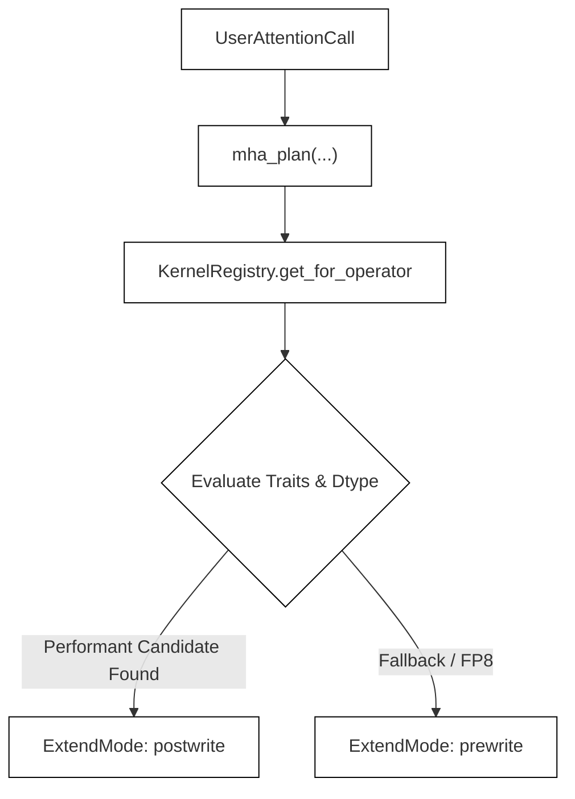
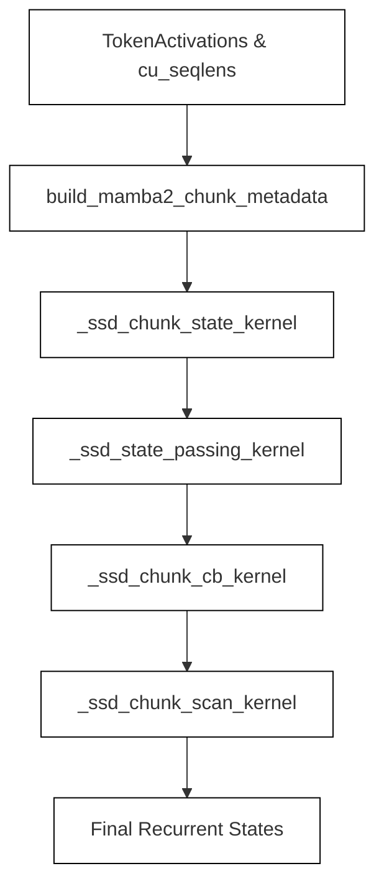
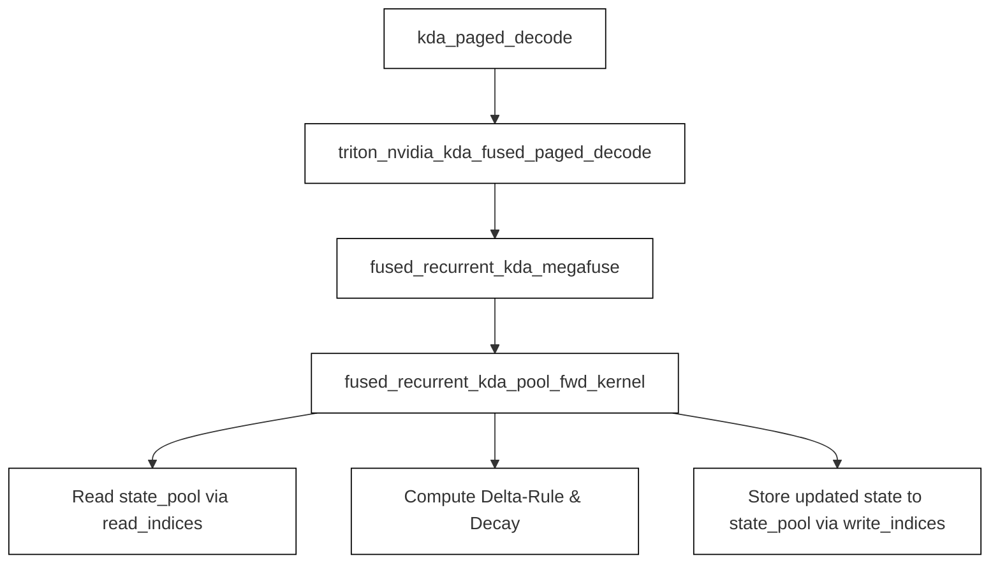

<!-- source: DeepWiki mcp.deepwiki.com · repo lightseekorg/tokenspeed · extra page Attention Kernels · fetched 2026-10-21 -->

# Attention Kernels

Relevant source files

The following files were used as context for generating this wiki page:

- [AGENTS.md](AGENTS.md)
- [python/tokenspeed/runtime/layers/attention/backends/paged/tokenspeed_mla.py](python/tokenspeed/runtime/layers/attention/backends/paged/tokenspeed_mla.py)
- [python/tokenspeed/runtime/layers/attention/dcp/comm.py](python/tokenspeed/runtime/layers/attention/dcp/comm.py)
- [tokenspeed-kernel-amd/python/tokenspeed_kernel_amd/_scheduling.py](tokenspeed-kernel-amd/python/tokenspeed_kernel_amd/_scheduling.py)
- [tokenspeed-kernel-amd/python/tokenspeed_kernel_amd/ops/gfx1250/attention/mha/decode.py](tokenspeed-kernel-amd/python/tokenspeed_kernel_amd/ops/gfx1250/attention/mha/decode.py)
- [tokenspeed-kernel-amd/python/tokenspeed_kernel_amd/ops/gfx1250/attention/mla/_common.py](tokenspeed-kernel-amd/python/tokenspeed_kernel_amd/ops/gfx1250/attention/mla/_common.py)
- [tokenspeed-kernel-amd/python/tokenspeed_kernel_amd/ops/gfx1250/attention/mla/decode.py](tokenspeed-kernel-amd/python/tokenspeed_kernel_amd/ops/gfx1250/attention/mla/decode.py)
- [tokenspeed-kernel-amd/python/tokenspeed_kernel_amd/ops/gfx1250/attention/mla/extend.py](tokenspeed-kernel-amd/python/tokenspeed_kernel_amd/ops/gfx1250/attention/mla/extend.py)
- [tokenspeed-kernel-amd/python/tokenspeed_kernel_amd/ops/gfx1250/attention/mla/normalize_project_query.py](tokenspeed-kernel-amd/python/tokenspeed_kernel_amd/ops/gfx1250/attention/mla/normalize_project_query.py)
- [tokenspeed-kernel-amd/python/tokenspeed_kernel_amd/ops/gfx1250/attention/mla/prefill.py](tokenspeed-kernel-amd/python/tokenspeed_kernel_amd/ops/gfx1250/attention/mla/prefill.py)
- [tokenspeed-kernel-amd/python/tokenspeed_kernel_amd/ops/gfx1250/attention/mla/project_value.py](tokenspeed-kernel-amd/python/tokenspeed_kernel_amd/ops/gfx1250/attention/mla/project_value.py)
- [tokenspeed-kernel-amd/python/tokenspeed_kernel_amd/ops/gfx1250/attention/mla/reduce_project_value.py](tokenspeed-kernel-amd/python/tokenspeed_kernel_amd/ops/gfx1250/attention/mla/reduce_project_value.py)
- [tokenspeed-kernel-amd/python/tokenspeed_kernel_amd/ops/gfx950/attention/mla/decode.py](tokenspeed-kernel-amd/python/tokenspeed_kernel_amd/ops/gfx950/attention/mla/decode.py)
- [tokenspeed-kernel-amd/python/tokenspeed_kernel_amd/ops/gfx950/attention/mla/extend.py](tokenspeed-kernel-amd/python/tokenspeed_kernel_amd/ops/gfx950/attention/mla/extend.py)
- [tokenspeed-kernel-amd/python/tokenspeed_kernel_amd/ops/gfx950/attention/mla/project_value.py](tokenspeed-kernel-amd/python/tokenspeed_kernel_amd/ops/gfx950/attention/mla/project_value.py)
- [tokenspeed-kernel-amd/python/tokenspeed_kernel_amd/ops/gfx950/attention/mla/reduce_project_value.py](tokenspeed-kernel-amd/python/tokenspeed_kernel_amd/ops/gfx950/attention/mla/reduce_project_value.py)
- [tokenspeed-kernel-amd/python/tokenspeed_kernel_amd/sched_barrier.ll](tokenspeed-kernel-amd/python/tokenspeed_kernel_amd/sched_barrier.ll)
- [tokenspeed-kernel/python/tokenspeed_kernel/ops/attention/dsa/cuda.py](tokenspeed-kernel/python/tokenspeed_kernel/ops/attention/dsa/cuda.py)
- [tokenspeed-kernel/python/tokenspeed_kernel/ops/attention/dsv4/__init__.py](tokenspeed-kernel/python/tokenspeed_kernel/ops/attention/dsv4/__init__.py)
- [tokenspeed-kernel/python/tokenspeed_kernel/ops/attention/dsv4/_triton/__init__.py](tokenspeed-kernel/python/tokenspeed_kernel/ops/attention/dsv4/_triton/__init__.py)
- [tokenspeed-kernel/python/tokenspeed_kernel/ops/attention/dsv4/cuda.py](tokenspeed-kernel/python/tokenspeed_kernel/ops/attention/dsv4/cuda.py)
- [tokenspeed-kernel/python/tokenspeed_kernel/ops/attention/dsv4/triton.py](tokenspeed-kernel/python/tokenspeed_kernel/ops/attention/dsv4/triton.py)
- [tokenspeed-kernel/python/tokenspeed_kernel/ops/attention/dsv41/__init__.py](tokenspeed-kernel/python/tokenspeed_kernel/ops/attention/dsv41/__init__.py)
- [tokenspeed-kernel/python/tokenspeed_kernel/ops/attention/dsv41/deep_gemm.py](tokenspeed-kernel/python/tokenspeed_kernel/ops/attention/dsv41/deep_gemm.py)
- [tokenspeed-kernel/python/tokenspeed_kernel/ops/attention/dsv41/triton.py](tokenspeed-kernel/python/tokenspeed_kernel/ops/attention/dsv41/triton.py)
- [tokenspeed-kernel/python/tokenspeed_kernel/ops/attention/mamba2/README.md](tokenspeed-kernel/python/tokenspeed_kernel/ops/attention/mamba2/README.md)
- [tokenspeed-kernel/python/tokenspeed_kernel/ops/attention/mamba2/__init__.py](tokenspeed-kernel/python/tokenspeed_kernel/ops/attention/mamba2/__init__.py)
- [tokenspeed-kernel/python/tokenspeed_kernel/ops/attention/mamba2/triton.py](tokenspeed-kernel/python/tokenspeed_kernel/ops/attention/mamba2/triton.py)
- [tokenspeed-kernel/python/tokenspeed_kernel/ops/attention/mla/__init__.py](tokenspeed-kernel/python/tokenspeed_kernel/ops/attention/mla/__init__.py)
- [tokenspeed-kernel/python/tokenspeed_kernel/ops/attention/mla/_triton/page_table.py](tokenspeed-kernel/python/tokenspeed_kernel/ops/attention/mla/_triton/page_table.py)
- [tokenspeed-kernel/python/tokenspeed_kernel/ops/attention/mla/gluon.py](tokenspeed-kernel/python/tokenspeed_kernel/ops/attention/mla/gluon.py)
- [tokenspeed-kernel/python/tokenspeed_kernel/ops/residual/deep_gemm.py](tokenspeed-kernel/python/tokenspeed_kernel/ops/residual/deep_gemm.py)
- [tokenspeed-kernel/test/amd/ops/attention/test_gluon_mla_extend_gfx950.py](tokenspeed-kernel/test/amd/ops/attention/test_gluon_mla_extend_gfx950.py)
- [tokenspeed-kernel/test/amd/ops/moe/test_mxfp8_contracts.py](tokenspeed-kernel/test/amd/ops/moe/test_mxfp8_contracts.py)
- [tokenspeed-kernel/test/amd/test_scheduling.py](tokenspeed-kernel/test/amd/test_scheduling.py)
- [tokenspeed-kernel/test/amd/test_scheduling_gfx950.py](tokenspeed-kernel/test/amd/test_scheduling_gfx950.py)
- [tokenspeed-kernel/test/nvidia/ops/attention/test_mamba2.py](tokenspeed-kernel/test/nvidia/ops/attention/test_mamba2.py)
- [tokenspeed-kernel/test/ops/test_attention_dsv41.py](tokenspeed-kernel/test/ops/test_attention_dsv41.py)
- [tokenspeed-kernel/test/ops/test_attention_dsv4_dcp.py](tokenspeed-kernel/test/ops/test_attention_dsv4_dcp.py)
- [tokenspeed-kernel/test/ops/test_attention_mla.py](tokenspeed-kernel/test/ops/test_attention_mla.py)
- [tokenspeed-kernel/test/test_rocm_platform.py](tokenspeed-kernel/test/test_rocm_platform.py)

## Purpose and Scope

This page covers the architecture, unified facades, and backend implementations of attention and state-space kernels within `tokenspeed-kernel` (`tokenspeed-kernel/python/tokenspeed_kernel/ops/attention/`) [tokenspeed-kernel/python/tokenspeed_kernel/ops/attention/__init__.py:1-139](). It details the unified MHA, relative MHA (rel-MHA), and Multi-Head Latent Attention (MLA) entry points, planning mechanisms (`mha_plan`), multi-silicon backend shims (`flash_attn`, `flashinfer`, `triton`, `deep_gemm`, `tokenspeed_mla`, AMD `gluon`), Sparse Attention indexing (DSA/QSA/DeepSeek V4.1 top-k), Minimax Sparse Attention (MSA), Mamba2 selective state space (SSD) scans, and linear attention primitives like Kernelized Delta Attention (KDA) and Gated Delta Rule (GDN).

---

## 1. Unified Attention Facade and Planning

The public attention entry point exposes architecture-agnostic Python functions that dynamically select hardware-optimized kernels via TokenSpeed's registry and signature-based selection oracle.

### Planning API (`mha_plan`)
`mha_plan` constructs dense MHA execution plans based on datatype, head dimensions, sliding windows (`window_left`), logit soft-capping (`logit_cap`), and attention sinks (`sinks`) [tokenspeed-kernel/python/tokenspeed_kernel/ops/attention/__init__.py:101-127](). It queries the `KernelRegistry` for `attention` / `mha_prefill` capabilities and determines whether to use a `postwrite` (run prefill before writing to the KV cache) or `prewrite` (write KV cache first, then run cached extend) execution mode [tokenspeed-kernel/python/tokenspeed_kernel/ops/attention/__init__.py:139]().

### Block-Scaled Signatures
For quantized execution paths (e.g., MXFP8 / MXFP4), block-scaled signature builders resolve signature formats and scale factor keyword arguments (`q_scale`, `k_scale`, `v_scale`) [tokenspeed-kernel/python/tokenspeed_kernel/ops/attention/__init__.py:68-90]().

*Figure 1: Natural Language Space to Code Entity Space mapping for `mha_plan` and execution mode resolution.*

**Sources:**
- `tokenspeed-kernel/python/tokenspeed_kernel/ops/attention/__init__.py` [tokenspeed-kernel/python/tokenspeed_kernel/ops/attention/__init__.py:21-139]()

---

## 2. Backend Shims and Multi-Backend Dispatch

Attention execution delegates to specific hardware backends depending on the active platform, kernel signatures, and configuration flags.

### Backend Shims Overview
* **FlashAttention (`flash_attn`)**: Integrates Blackwell FA4 (`flash_attn_func`, `flash_attn_varlen_func`, `flash_attn_with_kvcache`) with automatic fallbacks for relative positional bias (`score_mod` or fused `rel_bias`) [tokenspeed-kernel/python/tokenspeed_kernel/ops/attention/flash_attn/__init__.py:31-140]().
* **FlashInfer (`flashinfer`)**: Provides wrappers for paged KV cache prefill and decode (`BatchPrefillWithPagedKVCacheWrapper`, `BatchDecodeWithPagedKVCacheWrapper`), TensorRT-LLM context shims (`trtllm_batch_context_with_kv_cache`), and MLA paged attention wrappers (`BatchMLAPagedAttentionWrapper`) [tokenspeed-kernel/python/tokenspeed_kernel/ops/attention/flashinfer/__init__.py:40-113]().
* **Triton (`triton`)**: Houses custom Triton implementation modules for MHA, MLA, DSA, KDA, and Gated Delta Rule under `tokenspeed_kernel/ops/attention/triton/` [tokenspeed-kernel/python/tokenspeed_kernel/ops/attention/triton/__init__.py:21-38]().
* **Deep GEMM (`deep_gemm`)**: Integrates Blackwell and Hopper packed FP8/FP4 MQA scoring and index generation paths (`fp8_fp4_paged_mqa_logits`) [tokenspeed-kernel/python/tokenspeed_kernel/ops/attention/dsv41/deep_gemm.py:80-139]().
* **TokenSpeed MLA (`tokenspeed_mla`)**: Shim layer mapping runtime KV access requests to specialized CuTe DSL and Triton MLA decode/prefill pipelines [tokenspeed-kernel/python/tokenspeed_kernel/ops/attention/mla/__init__.py:21-127]().
* **AMD Gluon (`gluon`)**: Registers high-performance GFX950/GFX1250 attention, DSA, Dsv4, Kda, and MLA kernels for AMD CDNA architectures [tokenspeed-kernel/python/tokenspeed_kernel/ops/attention/gluon/__init__.py:21-148]().

| Backend | Primary Target | Key Entrypoints / Wrappers | Supported Quantization / Features |
| :--- | :--- | :--- | :--- |
| `flash_attn` | NVIDIA SM100+ | `flash_attn_varlen_func`, `fa4_mha_prefill` | BF16, FP16, sliding window, relative bias |
| `flashinfer` | NVIDIA Hopper/Blackwell | `BatchDecodeWithPagedKVCacheWrapper`, `trtllm_batch_context_with_kv_cache` | Paged KV, FP8, TRT-LLM graph integration |
| `deep_gemm` | NVIDIA Hopper/Blackwell | `fp8_fp4_paged_mqa_logits`, `index_topk` | FP8 / MXFP4, packed MQA scoring |
| `tokenspeed_mla` | NVIDIA Blackwell / Multi-silicon | `mla_decode_with_kvcache`, `mla_prefill` | Low-rank latent KV caching, FP8 scales |
| `triton` | Multi-silicon / Portable | `mha_prefill`, `mha_decode`, `mla_prefill`, `gated_delta_rule` | Dynamic block sizes, custom score mods |
| `gluon` | AMD GFX950 / GFX1250 | `gluon_mha_prefill_gfx950`, `gluon_mla_decode_gfx1250` | Full CDNA4 feature set, MXFP4/FP8 |

**Sources:**
- `tokenspeed-kernel/python/tokenspeed_kernel/ops/attention/flash_attn/__init__.py` [tokenspeed-kernel/python/tokenspeed_kernel/ops/attention/flash_attn/__init__.py:21-140]()
- `tokenspeed-kernel/python/tokenspeed_kernel/ops/attention/flashinfer/__init__.py` [tokenspeed-kernel/python/tokenspeed_kernel/ops/attention/flashinfer/__init__.py:21-113]()
- `tokenspeed-kernel/python/tokenspeed_kernel/ops/attention/dsv41/deep_gemm.py` [tokenspeed-kernel/python/tokenspeed_kernel/ops/attention/dsv41/deep_gemm.py:80-185]()
- `tokenspeed-kernel/python/tokenspeed_kernel/ops/attention/mla/__init__.py` [tokenspeed-kernel/python/tokenspeed_kernel/ops/attention/mla/__init__.py:21-127]()
- `tokenspeed-kernel/python/tokenspeed_kernel/ops/attention/gluon/__init__.py` [tokenspeed-kernel/python/tokenspeed_kernel/ops/attention/gluon/__init__.py:21-148]()

---

## 3. Sparse Attention Indexing: DSA, QSA, and DeepSeek V4.1

DeepSeek Sparse Attention (DSA), Qwen QSA indexers, and DeepSeek V4.1 indexers identify active KV blocks or key tokens dynamically prior to attention reduction.

### Indexing Workspaces & Top-K Kernels
* **DeepSeek V4.1 / DSA Indexer**: Implemented via Triton and DeepGEMM shims (`deep_gemm_dsv41_index_topk`, `cache_pack`, `cache_unpack`) under `tokenspeed_kernel/ops/attention/dsv41/` [tokenspeed-kernel/python/tokenspeed_kernel/ops/attention/dsv41/deep_gemm.py:157-185](), [tokenspeed-kernel/python/tokenspeed_kernel/ops/attention/dsv41/triton.py:116-169]().
* **Top-K Workspaces**: Index extraction computes score matrices using query-key inner products scaled by head dimension factors, selecting top-k indices to route sparse KV lookups while maintaining aligned layout byte constraints (`_LAYOUTS`) [tokenspeed-kernel/python/tokenspeed_kernel/ops/attention/dsv41/triton.py:38-52]().

**Sources:**
- `tokenspeed-kernel/python/tokenspeed_kernel/ops/attention/dsv41/deep_gemm.py` [tokenspeed-kernel/python/tokenspeed_kernel/ops/attention/dsv41/deep_gemm.py:113-185]()
- `tokenspeed-kernel/python/tokenspeed_kernel/ops/attention/dsv41/triton.py` [tokenspeed-kernel/python/tokenspeed_kernel/ops/attention/triton.py:38-107]()

---

## 4. Multi-Head Latent Attention (MLA) and MSA

Multi-Head Latent Attention (MLA), popularized by DeepSeek V3/V4, compresses key-value representations into low-rank latent vectors to reduce KV cache memory footprints.

### MLA Architecture & Shims
* **Compressed KV**: Key and value states are projected to low-rank latent vectors (`kv_a_proj_with_mqa`) and reconstructed or consumed directly via specialized kernels.
* **Prefill & Decode**: Implemented across FlashInfer (`BatchMLAPagedAttentionWrapper`), Triton (`mla_prefill`, `mla_decode`), and AMD Gluon (`gluon_mla_decode_gfx1250`, `gluon_mla_reduce_project_value_gfx950`) [tokenspeed-kernel/python/tokenspeed_kernel/ops/attention/mla/__init__.py:129-188](), [tokenspeed-kernel-amd/python/tokenspeed_kernel_amd/ops/gfx1250/attention/mla/decode.py:134-166]().
* **Minimax Sparse Attention (MSA)**: Supported via specialized Triton modules (`tokenspeed_kernel.ops.attention.triton.minimax_sparse_attention`) for alternative sparse routing structures [tokenspeed-kernel/python/tokenspeed_kernel/ops/attention/triton/__init__.py:21-38]().

**Sources:**
- `tokenspeed-kernel/python/tokenspeed_kernel/ops/attention/mla/__init__.py` [tokenspeed-kernel/python/tokenspeed_kernel/ops/attention/mla/__init__.py:129-188]()
- `tokenspeed-kernel-amd/python/tokenspeed_kernel_amd/ops/gfx1250/attention/mla/decode.py` [tokenspeed-kernel-amd/python/tokenspeed_kernel_amd/ops/gfx1250/attention/mla/decode.py:134-166]()

---

## 5. Mamba2 Selective State Space (SSD) Scans

Mamba2 selective state space mixer operations are implemented via four primary Triton kernel families under `tokenspeed_kernel/ops/attention/mamba2/` [tokenspeed-kernel/python/tokenspeed_kernel/ops/attention/mamba2/README.md:1-48]().

### Op Families and Execution Flow
1. **Chunk Scan (`mamba2_chunk_scan`)**: Handles multi-token prefill via chunked SSD in four Triton launches (`_ssd_chunk_state_kernel`, `_ssd_state_passing_kernel`, `_ssd_chunk_cb_kernel`, `_ssd_chunk_scan_kernel`) [tokenspeed-kernel/python/tokenspeed_kernel/ops/attention/mamba2/README.md:27-41](). `build_mamba2_chunk_metadata` derives chunk boundaries on the host from `cu_seqlens` without blocking [tokenspeed-kernel/python/tokenspeed_kernel/ops/attention/mamba2/README.md:21-25]().
2. **State Update (`mamba2_state_update`)**: Updates recurrent states token-by-token per request, supporting source and destination index mapping for speculative decoding [tokenspeed-kernel/python/tokenspeed_kernel/ops/attention/mamba2/README.md:62-69]().
3. **Speculative Verify & Replay (`mamba2_verify_scan`, `mamba2_replay_commit`)**: Steps a draft tree or verification window through candidate tokens from read slots, leaving the base pool intact until `mamba2_replay_commit` replays the accepted path [tokenspeed-kernel/python/tokenspeed_kernel/ops/attention/mamba2/README.md:70-105]().

*Figure 2: Natural Language Space to Code Entity Space mapping for Mamba2 chunked SSD prefill execution.*

**Sources:**
- `tokenspeed-kernel/python/tokenspeed_kernel/ops/attention/mamba2/README.md` [tokenspeed-kernel/python/tokenspeed_kernel/ops/attention/mamba2/README.md:1-116]()
- `tokenspeed-kernel/python/tokenspeed_kernel/ops/attention/mamba2/triton.py` [tokenspeed-kernel/python/tokenspeed_kernel/ops/attention/mamba2/triton.py:111-181]()

---

## 6. Linear Attention: KDA and Gated-Delta-Rule (GDN)

Linear attention mechanisms replace quadratic attention with recurrent updates or gated delta rules, enabling constant memory scaling per token during decoding.

### Kernelized Delta Attention (KDA)
KDA (used in Kimi models) performs recurrent state updates over a paged state pool. 
* **State Pool Management**: Instead of separate gather/scatter operations through PyTorch index elements, kernels like `fused_recurrent_kda_pool_fwd_kernel` read from `h_pool[read_indices]` and write to `h_pool[write_indices]` directly within Triton/Gluon instructions [tokenspeed-kernel/python/tokenspeed_kernel/thirdparty/triton/fla_kda_recurrent.py:7-116](), [tokenspeed-kernel-amd/python/tokenspeed_kernel_amd/ops/gfx950/attention/kda/decode.py:108-199]().
* **Megafusion**: Combines depthwise convolution steps, gate decay computations, delta-rule state recurrence, and gated RMSNorm epilogues into single kernel launches (`fused_recurrent_kda_megafuse`, `triton_nvidia_kda_fused_paged_decode`) [tokenspeed-kernel/python/tokenspeed_kernel/ops/attention/triton/kda_dispatch.py:44-90](), [tokenspeed-kernel/python/tokenspeed_kernel/thirdparty/triton/fla_kda_recurrent.py:10-18]().

*Figure 3: Natural Language Space to Code Entity Space mapping for KDA paged decode and recurrent state pool execution.*

### Gated Delta Rule (GDN)
Gated Delta Rule implementations (`gated_delta_rule.py`) provide parallel chunk prefill and recurrent decode routines for linear attention layers with data-dependent gating and forget gates.

**Sources:**
- `tokenspeed-kernel/python/tokenspeed_kernel/ops/attention/triton/kda_dispatch.py` [tokenspeed-kernel/python/tokenspeed_kernel/ops/attention/triton/kda_dispatch.py:29-90]()
- `tokenspeed-kernel/python/tokenspeed_kernel/thirdparty/triton/fla_kda_recurrent.py` [tokenspeed-kernel/python/tokenspeed_kernel/thirdparty/triton/fla_kda_recurrent.py:7-172]()
- `tokenspeed-kernel-amd/python/tokenspeed_kernel_amd/ops/gfx950/attention/kda/decode.py` [tokenspeed-kernel-amd/python/tokenspeed_kernel_amd/ops/gfx950/attention/kda/decode.py:108-199]()

---

