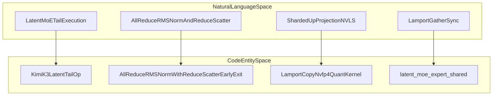
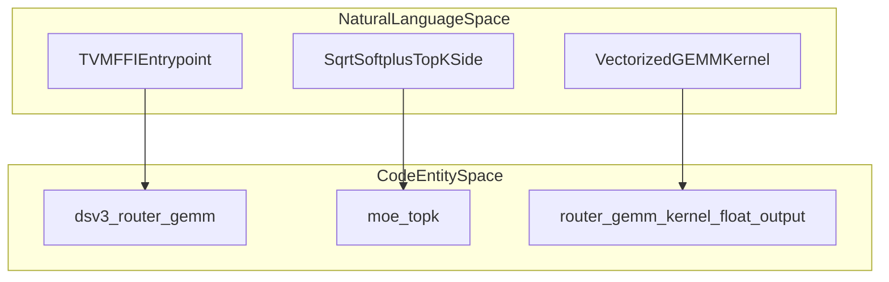

<!-- source: DeepWiki mcp.deepwiki.com · repo lightseekorg/tokenspeed · extra page Fusion and Third-Party CUDA Kernels · fetched 2026-10-21 -->

# Fusion and Third-Party CUDA Kernels

Relevant source files

The following files were used as context for generating this wiki page:

- [test/runtime/layers/test_latent_down_op.py](test/runtime/layers/test_latent_down_op.py)
- [tokenspeed-kernel-amd/python/tokenspeed_kernel_amd/ops/gfx950/gemm/fp16/rmsnorm_linear_add.py](tokenspeed-kernel-amd/python/tokenspeed_kernel_amd/ops/gfx950/gemm/fp16/rmsnorm_linear_add.py)
- [tokenspeed-kernel-amd/python/tokenspeed_kernel_amd/ops/gfx950/moe/mxfp4/decode_common.py](tokenspeed-kernel-amd/python/tokenspeed_kernel_amd/ops/gfx950/moe/mxfp4/decode_common.py)
- [tokenspeed-kernel-amd/python/tokenspeed_kernel_amd/ops/gfx950/moe/mxfp4/decode_stage1.py](tokenspeed-kernel-amd/python/tokenspeed_kernel_amd/ops/gfx950/moe/mxfp4/decode_stage1.py)
- [tokenspeed-kernel-amd/python/tokenspeed_kernel_amd/ops/gfx950/moe/mxfp4/decode_stage2.py](tokenspeed-kernel-amd/python/tokenspeed_kernel_amd/ops/gfx950/moe/mxfp4/decode_stage2.py)
- [tokenspeed-kernel-amd/python/tokenspeed_kernel_amd/ops/gfx950/moe/mxfp4/routing.py](tokenspeed-kernel-amd/python/tokenspeed_kernel_amd/ops/gfx950/moe/mxfp4/routing.py)
- [tokenspeed-kernel-amd/python/tokenspeed_kernel_amd/ops/gfx950/moe/mxfp4/situ_decode.py](tokenspeed-kernel-amd/python/tokenspeed_kernel_amd/ops/gfx950/moe/mxfp4/situ_decode.py)
- [tokenspeed-kernel-amd/python/tokenspeed_kernel_amd/ops/gfx950/moe/mxfp4/situ_grouped.py](tokenspeed-kernel-amd/python/tokenspeed_kernel_amd/ops/gfx950/moe/mxfp4/situ_grouped.py)
- [tokenspeed-kernel/python/tokenspeed_kernel/ops/moe/gluon/latent_decode.py](tokenspeed-kernel/python/tokenspeed_kernel/ops/moe/gluon/latent_decode.py)
- [tokenspeed-kernel/python/tokenspeed_kernel/ops/moe/gluon/mxfp4.py](tokenspeed-kernel/python/tokenspeed_kernel/ops/moe/gluon/mxfp4.py)
- [tokenspeed-kernel/python/tokenspeed_kernel/ops/moe/latent_decode.py](tokenspeed-kernel/python/tokenspeed_kernel/ops/moe/latent_decode.py)
- [tokenspeed-kernel/python/tokenspeed_kernel/ops/moe/latent_down.py](tokenspeed-kernel/python/tokenspeed_kernel/ops/moe/latent_down.py)
- [tokenspeed-kernel/python/tokenspeed_kernel/thirdparty/cuda/csrc/flashinfer_sampling_chain_binding.cu](tokenspeed-kernel/python/tokenspeed_kernel/thirdparty/cuda/csrc/flashinfer_sampling_chain_binding.cu)
- [tokenspeed-kernel/python/tokenspeed_kernel/thirdparty/cuda/csrc/include/flashinfer/sampling.cuh](tokenspeed-kernel/python/tokenspeed_kernel/thirdparty/cuda/csrc/include/flashinfer/sampling.cuh)
- [tokenspeed-kernel/python/tokenspeed_kernel/thirdparty/cuda/csrc/sampling_chain.cu](tokenspeed-kernel/python/tokenspeed_kernel/thirdparty/cuda/csrc/sampling_chain.cu)
- [tokenspeed-kernel/python/tokenspeed_kernel/thirdparty/cuda/sampling_chain.py](tokenspeed-kernel/python/tokenspeed_kernel/thirdparty/cuda/sampling_chain.py)
- [tokenspeed-kernel/python/tokenspeed_kernel/thirdparty/cute_dsl/latent_moe_tail/lamport_copy_nvfp4_quant.py](tokenspeed-kernel/python/tokenspeed_kernel/thirdparty/cute_dsl/latent_moe_tail/lamport_copy_nvfp4_quant.py)
- [tokenspeed-kernel/test/amd/ops/moe/test_gluon_bf16_apply_gfx950.py](tokenspeed-kernel/test/amd/ops/moe/test_gluon_bf16_apply_gfx950.py)
- [tokenspeed-kernel/test/amd/ops/moe/test_gluon_mxfp4_situ_gfx1250.py](tokenspeed-kernel/test/amd/ops/moe/test_gluon_mxfp4_situ_gfx1250.py)
- [tokenspeed-kernel/test/amd/ops/moe/test_gluon_mxfp8_prefill_gfx950.py](tokenspeed-kernel/test/amd/ops/moe/test_gluon_mxfp8_prefill_gfx950.py)
- [tokenspeed-kernel/test/nvidia/ops/moe/test_lamport_copy_nvfp4_quant.py](tokenspeed-kernel/test/nvidia/ops/moe/test_lamport_copy_nvfp4_quant.py)
- [tokenspeed-kernel/test/nvidia/ops/moe/test_marlin_deepep_distributed.py](tokenspeed-kernel/test/nvidia/ops/moe/test_marlin_deepep_distributed.py)
- [tokenspeed-kernel/test/nvidia/ops/moe/test_mxfp4_situ_flashinfer_trtllm.py](tokenspeed-kernel/test/nvidia/ops/moe/test_mxfp4_situ_flashinfer_trtllm.py)
- [tokenspeed-kernel/test/nvidia/ops/moe/test_trtllm_mega_moe.py](tokenspeed-kernel/test/nvidia/ops/moe/test_trtllm_mega_moe.py)
- [tokenspeed-kernel/test/nvidia/thirdparty/test_cuda.py](tokenspeed-kernel/test/nvidia/thirdparty/test_cuda.py)
- [tokenspeed-kernel/test/ops/moe/test_triton_dsv4_router.py](tokenspeed-kernel/test/ops/moe/test_triton_dsv4_router.py)
- [tokenspeed-kernel/test/test_optional_import_releases_frames.py](tokenspeed-kernel/test/test_optional_import_releases_frames.py)

This page documents the native CUDA and CuTe-DSL source implementations located under `tokenspeed-kernel/python/tokenspeed_kernel/thirdparty/` and related integration modules. These primitives provide high-performance, specialized execution paths for advanced architectures including DeepSeek V3/V4, Kimi K3, and multimodal models. Covered subsystems include the latent MoE tail primitives, DSV3/DSV4 router GEMM, online AttnRes forward variants, MNNVL allreduce and reduce-scatter fusions, hyperconnection blocks, and advanced sampling chains.

---

## 1. Latent MoE Tail Primitives and CuTe-DSL Sources

The Kimi-K3 decoder replaces the standard all-reduce and replicated up-projection tail with a fused multi-stage operation. The implementation relies on CuTe-DSL sources vendored under `tokenspeed-kernel/python/tokenspeed_kernel/thirdparty/cute_dsl/latent_moe_tail/` [tokenspeed-kernel/python/tokenspeed_kernel/ops/moe/latent_tail.py:21-36]().

### Architecture and Execution Flow

The tail is orchestrated by `KimiK3LatentTailOp` and consists of three stages:
1. **Fused AR(latent) + RMSNorm + ReduceScatter(shared)**: Executed via `AllReduceRMSNormWithReduceScatterEarlyExit` [tokenspeed-kernel/python/tokenspeed_kernel/thirdparty/cute_dsl/latent_moe_tail/allreduce_rmsnorm_reduce_scatter_early_exit.py:96-104]().
2. **Sharded Up-Projection**: Each rank computes `hidden/tp` rows with NVLS multicast-storing the shard into every peer's mailbox.
3. **Barrier-free Lamport Gather**: Synchronizes intermediate buffers using lightweight memory semantics and NVFP4 quantization via `LamportCopyNvfp4QuantKernel` [tokenspeed-kernel/python/tokenspeed_kernel/thirdparty/cute_dsl/latent_moe_tail/lamport_copy_nvfp4_quant.py:33-37]().

*Sources: `tokenspeed-kernel/python/tokenspeed_kernel/ops/moe/latent_tail.py`, `tokenspeed-kernel/python/tokenspeed_kernel/thirdparty/cute_dsl/latent_moe_tail/allreduce_rmsnorm_reduce_scatter_early_exit.py`, `tokenspeed-kernel/python/tokenspeed_kernel/thirdparty/cute_dsl/latent_moe_tail/lamport_copy_nvfp4_quant.py`, `tokenspeed-kernel/python/tokenspeed_kernel/ops/moe/latent_decode.py`*

### Key Primitives and Functions

- `LamportCopyNvfp4QuantKernel`: Manages live mailbox-row ownership and graph replay for NVFP4 quantized data and block-scales under Blackwell architectures [tokenspeed-kernel/python/tokenspeed_kernel/thirdparty/cute_dsl/latent_moe_tail/lamport_copy_nvfp4_quant.py:33-37]().
- `latent_moe_decode_pipeline_available`: Validates backend, tensor format, and exact-shape constraints for joint routed/shared small-batch decode [tokenspeed-kernel/python/tokenspeed_kernel/ops/moe/latent_decode.py:81-102]().
- `finalize_top16_bf16`: Inlines wide metadata loads and fixed-order `fma` accumulation for top-16 routing configurations.

*Sources: `tokenspeed-kernel/python/tokenspeed_kernel/thirdparty/cute_dsl/latent_moe_tail/lamport_copy_nvfp4_quant.py`, `tokenspeed-kernel/python/tokenspeed_kernel/ops/moe/latent_decode.py`*

---

## 2. DeepSeek V3/V4 Router GEMM Kernels and DSV4 Top-K

The DeepSeek V3/V4 router modules utilize specialized JIT-compiled CUDA kernels under `tokenspeed-kernel/python/tokenspeed_kernel/thirdparty/cuda/csrc/` to compute expert routing logits efficiently [tokenspeed-kernel/python/tokenspeed_kernel/thirdparty/cuda/csrc/dsv3_router_gemm.cu:1-12]().

### Kernel Organization and Dispatch

- `dsv3_router_gemm`: TVM-FFI entrypoint validating tensor dimensions, data types (`mat_a` in `bf16`, `mat_b` in `bf16` or `float32`, `output` in `float32`), and device residency [tokenspeed-kernel/python/tokenspeed_kernel/thirdparty/cuda/csrc/dsv3_router_gemm.cu:146-163]().
- `moe_topk` with `triton_sqrt_softplus_topk`: Implements DSv4's specialized BF16-input, concatenated-weight, clipped SwiGLU routing paths using sqrt-softplus score functions [tokenspeed-kernel/test/ops/moe/test_triton_dsv4_router.py:65-76]().
- `router_gemm_kernel_float_output`: CUDA device kernel utilizing vectorized memory instructions (`uint4`), warp-level shuffles (`__shfl_xor_sync`), and programmatic dependent launch (`griddepcontrol.wait` / `griddepcontrol.launch_dependents`) on SM90+ architectures [tokenspeed-kernel/python/tokenspeed_kernel/thirdparty/cuda/csrc/dsv3_router_gemm_float_out.cu:32-131]().

*Sources: `tokenspeed-kernel/python/tokenspeed_kernel/thirdparty/cuda/csrc/dsv3_router_gemm.cu`, `tokenspeed-kernel/test/ops/moe/test_triton_dsv4_router.py`, `tokenspeed-kernel/python/tokenspeed_kernel/thirdparty/cuda/csrc/dsv3_router_gemm_float_out.cu`*

---

## 3. AttnRes Forward and Split Kernels

Attention residual combination (`AttnRes`) incorporates online softmax candidate mixing across auxiliary blocks and prefix tokens.

### Split Factorization

The split kernels factor the candidate mix into a blocks-side partial (precomputable on an asynchronous auxiliary stream) and a prefix-side combine stage [tokenspeed-kernel/test/ops/activation/test_attnres_split.py:1-6]().

- `attnres_partial`: Computes candidate logits and intermediate statistics across auxiliary blocks.
- `attnres_combine`: Blends prefix tokens with the partial statistics using online softmax reduction and applies output normalization layers.
- `attnres_partial_dual`: Computes dual probe partials in an interleaved schedule to optimize instruction-level parallelism [tokenspeed-kernel/test/ops/activation/test_attnres_split.py:67-82]().

*Sources: `tokenspeed-kernel/test/ops/activation/test_attnres_split.py`, `tokenspeed-kernel/python/tokenspeed_kernel/thirdparty/cuda/csrc/attn_res/attn_res_fwd_online_v2.cu`*

---

## 4. Fused Sampling, Sampling Chains, and Fused Top-K/Top-P

Collective sampling chains and filtering primitives combine multinomial, top-k, and top-p sampling operations within unified CUDA kernels to prevent memory roundtrips between logits processors.

### Sampling Primitives

- `SamplingTempStorage` and `OnlineSoftmaxTempStorage`: Managed block-level template structures in FlashInfer supporting deterministic scan algorithms (`DeterministicInclusiveSum`) and online softmax calculations [tokenspeed-kernel/python/tokenspeed_kernel/thirdparty/cuda/csrc/flashinfer/sampling.cuh:128-162,173-177]().
- `sampling_chain.cu` and `flashinfer_sampling_chain_binding.cu`: PyTorch/C++ extensions binding multi-stage sampling chains (temperature scaling, top-k/top-p filtering, and multinomial draw) into a single kernel execution envelope [tokenspeed-kernel/python/tokenspeed_kernel/thirdparty/cuda/sampling_chain.py:1-25]().

*Sources: `tokenspeed-kernel/python/tokenspeed_kernel/thirdparty/cuda/csrc/flashinfer/sampling.cuh`, `tokenspeed-kernel/python/tokenspeed_kernel/thirdparty/cuda/sampling_chain.py`*

---

## 5. MNNVL Allreduce Fusion and Hyperconnection

Collective communication operations are tightly fused with normalization passes to minimize memory roundtrips.

### Collective and Sampling Primitives

- `AllReduceRMSNormWithReduceScatterEarlyExit`: Manages multi-role execution where routed roles and reduce-scatter roles share cluster bandwidth [tokenspeed-kernel/python/tokenspeed_kernel/thirdparty/cute_dsl/latent_moe_tail/allreduce_rmsnorm_reduce_scatter_early_exit.py:96-104]().
- Programmatic Dependent Launch (PDL): Enabled via `pdl_enabled()` to allow successor kernels to prime input-independent data while protecting active collective output dependencies [tokenspeed-kernel/python/tokenspeed_kernel/thirdparty/cute_dsl/latent_moe_tail/allreduce_rmsnorm_reduce_scatter_early_exit.py:118-125]().

*Sources: `tokenspeed-kernel/python/tokenspeed_kernel/thirdparty/cute_dsl/latent_moe_tail/allreduce_rmsnorm_reduce_scatter_early_exit.py`*

---

