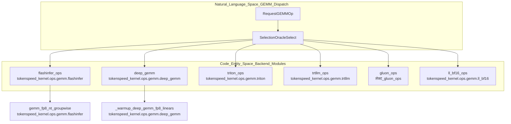
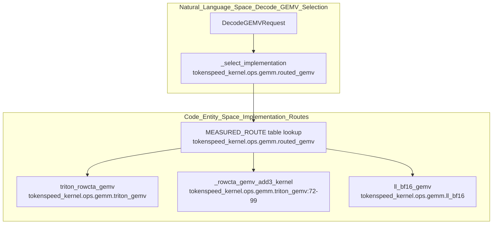

<!-- source: DeepWiki mcp.deepwiki.com · repo lightseekorg/tokenspeed · extra page GEMM and MoE Kernels · fetched 2026-10-21 -->

# GEMM and MoE Kernels

Relevant source files

The following files were used as context for generating this wiki page:

- [test/runtime/layers/test_kimi_moe_topk_gfx950.py](test/runtime/layers/test_kimi_moe_topk_gfx950.py)
- [test/runtime/models/test_generation_models.py](test/runtime/models/test_generation_models.py)
- [test/runtime/test_dispatch_autotune.py](test/runtime/test_dispatch_autotune.py)
- [test/runtime/test_gluon_petit_backend.py](test/runtime/test_gluon_petit_backend.py)
- [test/runtime/test_moe_ispp_padding.py](test/runtime/test_moe_ispp_padding.py)
- [tokenspeed-kernel-amd/python/tokenspeed_kernel_amd/ops/gfx1250/moe/fp16/__init__.py](tokenspeed-kernel-amd/python/tokenspeed_kernel_amd/ops/gfx1250/moe/fp16/__init__.py)
- [tokenspeed-kernel-amd/python/tokenspeed_kernel_amd/ops/gfx1250/moe/fp16/_common.py](tokenspeed-kernel-amd/python/tokenspeed_kernel_amd/ops/gfx1250/moe/fp16/_common.py)
- [tokenspeed-kernel-amd/python/tokenspeed_kernel_amd/ops/gfx1250/moe/fp16/latent_input_decode.py](tokenspeed-kernel-amd/python/tokenspeed_kernel_amd/ops/gfx1250/moe/fp16/latent_input_decode.py)
- [tokenspeed-kernel-amd/python/tokenspeed_kernel_amd/ops/gfx1250/moe/fp16/latent_input_largem.py](tokenspeed-kernel-amd/python/tokenspeed_kernel_amd/ops/gfx1250/moe/fp16/latent_input_largem.py)
- [tokenspeed-kernel-amd/python/tokenspeed_kernel_amd/ops/gfx1250/moe/mxfp4/routing.py](tokenspeed-kernel-amd/python/tokenspeed_kernel_amd/ops/gfx1250/moe/mxfp4/routing.py)
- [tokenspeed-kernel-amd/python/tokenspeed_kernel_amd/ops/gfx950/moe/fp16/__init__.py](tokenspeed-kernel-amd/python/tokenspeed_kernel_amd/ops/gfx950/moe/fp16/__init__.py)
- [tokenspeed-kernel-amd/python/tokenspeed_kernel_amd/ops/gfx950/moe/fp16/latent_input_mediumm.py](tokenspeed-kernel-amd/python/tokenspeed_kernel_amd/ops/gfx950/moe/fp16/latent_input_mediumm.py)
- [tokenspeed-kernel/python/tokenspeed_kernel/ops/gemm/gluon_gemv.py](tokenspeed-kernel/python/tokenspeed_kernel/ops/gemm/gluon_gemv.py)
- [tokenspeed-kernel/python/tokenspeed_kernel/ops/gemm/triton_bf16x3.py](tokenspeed-kernel/python/tokenspeed_kernel/ops/gemm/triton_bf16x3.py)
- [tokenspeed-kernel/python/tokenspeed_kernel/ops/gemm/triton_gemv.py](tokenspeed-kernel/python/tokenspeed_kernel/ops/gemm/triton_gemv.py)
- [tokenspeed-kernel/python/tokenspeed_kernel/ops/moe/flashinfer/README.md](tokenspeed-kernel/python/tokenspeed_kernel/ops/moe/flashinfer/README.md)
- [tokenspeed-kernel/python/tokenspeed_kernel/ops/moe/flashinfer/trtllm_unquant.py](tokenspeed-kernel/python/tokenspeed_kernel/ops/moe/flashinfer/trtllm_unquant.py)
- [tokenspeed-kernel/python/tokenspeed_kernel/ops/moe/gluon/latent_input.py](tokenspeed-kernel/python/tokenspeed_kernel/ops/moe/gluon/latent_input.py)
- [tokenspeed-kernel/python/tokenspeed_kernel/ops/moe/gluon/sigmoid_topk.py](tokenspeed-kernel/python/tokenspeed_kernel/ops/moe/gluon/sigmoid_topk.py)
- [tokenspeed-kernel/python/tokenspeed_kernel/ops/moe/sigmoid_topk.py](tokenspeed-kernel/python/tokenspeed_kernel/ops/moe/sigmoid_topk.py)
- [tokenspeed-kernel/python/tokenspeed_kernel/ops/moe/triton/__init__.py](tokenspeed-kernel/python/tokenspeed_kernel/ops/moe/triton/__init__.py)
- [tokenspeed-kernel/python/tokenspeed_kernel/ops/moe/triton/_common.py](tokenspeed-kernel/python/tokenspeed_kernel/ops/moe/triton/_common.py)
- [tokenspeed-kernel/python/tokenspeed_kernel/ops/moe/triton/bf16.py](tokenspeed-kernel/python/tokenspeed_kernel/ops/moe/triton/bf16.py)
- [tokenspeed-kernel/python/tokenspeed_kernel/ops/moe/triton/decode_sigmoid_topk.py](tokenspeed-kernel/python/tokenspeed_kernel/ops/moe/triton/decode_sigmoid_topk.py)
- [tokenspeed-kernel/python/tokenspeed_kernel/ops/moe/triton/fp8.py](tokenspeed-kernel/python/tokenspeed_kernel/ops/moe/triton/fp8.py)
- [tokenspeed-kernel/python/tokenspeed_kernel/ops/moe/triton/kimi3_sigmoid_topk.py](tokenspeed-kernel/python/tokenspeed_kernel/ops/moe/triton/kimi3_sigmoid_topk.py)
- [tokenspeed-kernel/python/tokenspeed_kernel/ops/moe/triton/mxfp4.py](tokenspeed-kernel/python/tokenspeed_kernel/ops/moe/triton/mxfp4.py)
- [tokenspeed-kernel/python/tokenspeed_kernel/thirdparty/flashinfer/trtllm_bf16_moe.py](tokenspeed-kernel/python/tokenspeed_kernel/thirdparty/flashinfer/trtllm_bf16_moe.py)
- [tokenspeed-kernel/python/tokenspeed_kernel/thirdparty/flashinfer/trtllm_moe.py](tokenspeed-kernel/python/tokenspeed_kernel/thirdparty/flashinfer/trtllm_moe.py)
- [tokenspeed-kernel/test/amd/ops/moe/test_gluon_latent_input_gfx1250.py](tokenspeed-kernel/test/amd/ops/moe/test_gluon_latent_input_gfx1250.py)
- [tokenspeed-kernel/test/amd/ops/moe/test_gluon_latent_input_gfx950.py](tokenspeed-kernel/test/amd/ops/moe/test_gluon_latent_input_gfx950.py)
- [tokenspeed-kernel/test/amd/ops/moe/test_gluon_petit.py](tokenspeed-kernel/test/amd/ops/moe/test_gluon_petit.py)
- [tokenspeed-kernel/test/amd/ops/moe/test_gluon_petit_distributed.py](tokenspeed-kernel/test/amd/ops/moe/test_gluon_petit_distributed.py)
- [tokenspeed-kernel/test/amd/ops/moe/test_gluon_petit_tensor.py](tokenspeed-kernel/test/amd/ops/moe/test_gluon_petit_tensor.py)
- [tokenspeed-kernel/test/amd/ops/test_kimi3_sigmoid_topk_amd.py](tokenspeed-kernel/test/amd/ops/test_kimi3_sigmoid_topk_amd.py)
- [tokenspeed-kernel/test/nvidia/ops/gemm/bench_bf16x3_gemm_fp32.py](tokenspeed-kernel/test/nvidia/ops/gemm/bench_bf16x3_gemm_fp32.py)
- [tokenspeed-kernel/test/nvidia/ops/gemm/test_bf16x3_gemm_fp32.py](tokenspeed-kernel/test/nvidia/ops/gemm/test_bf16x3_gemm_fp32.py)
- [tokenspeed-kernel/test/nvidia/ops/moe/test_nvfp4_situ_flashinfer_trtllm.py](tokenspeed-kernel/test/nvidia/ops/moe/test_nvfp4_situ_flashinfer_trtllm.py)
- [tokenspeed-kernel/test/nvidia/ops/test_kimi3_sigmoid_topk_multitoken.py](tokenspeed-kernel/test/nvidia/ops/test_kimi3_sigmoid_topk_multitoken.py)
- [tokenspeed-kernel/test/nvidia/thirdparty/test_moe_finalize_fuse_shared.py](tokenspeed-kernel/test/nvidia/thirdparty/test_moe_finalize_fuse_shared.py)
- [tokenspeed-kernel/test/nvidia/thirdparty/test_trtllm_bf16_moe.py](tokenspeed-kernel/test/nvidia/thirdparty/test_trtllm_bf16_moe.py)
- [tokenspeed-kernel/test/nvidia/thirdparty/test_trtllm_moe_route_init.py](tokenspeed-kernel/test/nvidia/thirdparty/test_trtllm_moe_route_init.py)
- [tokenspeed-kernel/test/ops/gemm/test_bf16x3_gemm.py](tokenspeed-kernel/test/ops/gemm/test_bf16x3_gemm.py)
- [tokenspeed-kernel/test/ops/gemm/test_decode_gemv.py](tokenspeed-kernel/test/ops/gemm/test_decode_gemv.py)
- [tokenspeed-kernel/test/ops/gemm/test_decode_gemv_fp32_simt.py](tokenspeed-kernel/test/ops/gemm/test_decode_gemv_fp32_simt.py)
- [tokenspeed-kernel/test/ops/moe/test_latent_input.py](tokenspeed-kernel/test/ops/moe/test_latent_input.py)
- [tokenspeed-kernel/test/ops/moe/test_triton_fp8_apply.py](tokenspeed-kernel/test/ops/moe/test_triton_fp8_apply.py)

This page documents the low-level General Matrix Multiplication (GEMM) and Mixture-of-Experts (MoE) kernel orchestration layer within `tokenspeed-kernel`. It covers multi-vendor backend selection, flash attention/GEMM shims, block-scaled FP8/NVFP4/MXFP4 quantization formats, DeepEP collective communication integration, and specialized model projections (such as Kimi3 latent, router, and SiTU primitives).

Sources: [tokenspeed-kernel/python/tokenspeed_kernel/ops/gemm/__init__.py:1-108]()

---

## 1. GEMM Backends and Architecture Dispatch

The `tokenspeed-kernel` GEMM subsystem abstracts various vendor-specific and portable backends under a unified interface (`tokenspeed_kernel.ops.gemm`). Backends are registered via `KernelRegistry` and selected dynamically based on shape, precision, and hardware capabilities.

Sources: [tokenspeed-kernel/python/tokenspeed_kernel/ops/gemm/__init__.py:29-65](), [tokenspeed-kernel/python/tokenspeed_kernel/ops/gemm/flashinfer.py:81-128]()

### Core Backend Implementations
- **FlashInfer (`flashinfer.py`)**: Provides Hopper and Blackwell block-scaled FP8 GEMM (`gemm_fp8_nt_groupwise`), NVFP4, and MXFP8 routines. Handles layout prepacking (`prepare_flashinfer_fp8_blockscale_weight_scales`) and PDL (Programmatic Dependent Launch) defaults (`tinygemm_bf16`).
- **DeepGEMM (`deep_gemm.py`)**: Specialized FP8 block-scale GEMM supporting TMA layouts, custom scale transforms (`transform_sf_into_required_layout`, `ceil_to_ue8m0`), and deep integration with DeepEP all-to-all communication.
- **Triton & GLUON (`triton.py`, `gluon.py`)**: Portable and JIT-compiled GPU kernels optimized for custom activation fusions and small-batch decode.
- **LL-BF16 / CuTe DSL (`ll_bf16.py`)**: Vendored CuTe DSL low-latency FP32-accumulated BF16 kernels (`LLBf16Router`) designed for small-M decode projection shapes.

Sources: [tokenspeed-kernel/python/tokenspeed_kernel/ops/gemm/flashinfer.py:81-168](), [tokenspeed-kernel/python/tokenspeed_kernel/ops/gemm/__init__.py:31-37]()

---

## 2. Specialized GEMV and Skinny GEMM Routing

For decode workloads where batch size $M$ is small (e.g., $M \in [1, 32]$), standard GEMM algorithms suffer from low arithmetic intensity and padding overheads. TokenSpeed implements a measured routing mechanism (`routed_gemv.py`) and Triton row-CTA decode routines (`triton_gemv.py`) that dispatch specialized kernels (`skinny`, `tgv`, `rowcta`, `ll_bf16`).

Sources: [tokenspeed-kernel/python/tokenspeed_kernel/ops/gemm/triton_gemv.py:21-35](), [tokenspeed-kernel/python/tokenspeed_kernel/ops/gemm/routed_gemv.py:21-52]()

### Triton Row-CTA and Add3 Epilogues
The Triton GEMV module (`triton_gemv.py`) supplies row dot-product kernels with specialized support for $M=1$ decodes and fused two-addend epilogues (`_rowcta_gemv_add3_kernel`), which combine residual accumulations directly during the up-projection store step [tokenspeed-kernel/python/tokenspeed_kernel/ops/gemm/triton_gemv.py:72-99]().

| Backend | Typical Shape Range ($M, N, K$) | Role & Optimization |
| :--- | :--- | :--- |
| `skinny` | Small $M$ ($1 \le M \le 16$), large $N, K$ | CuTe DSL kernel optimized for narrow token counts and wide hidden dimensions. |
| `tgv` | Medium $M$, specific projection widths | Triton GEMV/GEMM kernel avoiding split-K reduction penalties. |
| `rowcta` | $M = 1$ | Row-CTA per-token execution. |
| `ll_bf16` | $M \le 32$ (e.g., K3 router) | FP32-accumulated CuTe router GEMM with split-K support. |

Sources: [tokenspeed-kernel/python/tokenspeed_kernel/ops/gemm/triton_gemv.py:72-142](), [tokenspeed-kernel/python/tokenspeed_kernel/ops/gemm/routed_gemv.py:52-165]()

---

## 3. MoE Kernels and Collective Infrastructure

Mixture-of-Experts (MoE) operations involve expert routing, all-to-all communication, and grouped expert GEMMs. TokenSpeed supports multiple MoE backends, including DeepEP integration and low-precision formats (NVFP4, MXFP4, block-scale FP8).

### MoE Backends, Routing, and Padding Policies
- **Sigmoid Top-K Routing (`sigmoid_topk.py`)**: Replaces traditional softmax routing with fused Triton launchers (`triton_minimax_sigmoid_bias_topk`) that compute biased sigmoid expert selection and scaling in a single kernel launch [tokenspeed-kernel/python/tokenspeed_kernel/ops/moe/sigmoid_topk.py:37-175]().
- **NVFP4 Routing-Map Padding (`README.md`)**: FlashInfer routing producers initialize unused rows inside active expert tiles of `permuted_idx_to_token_idx` to `-1`, preventing unnecessary activation loads without launching separate fill-kernels [tokenspeed-kernel/python/tokenspeed_kernel/ops/moe/flashinfer/README.md:1-12]().
- **BF16 Intermediate Size Alignments**: FlashInfer's TRT-LLM launcher (`Bf16MoeLauncher`) is adapted in `trtllm_bf16_moe.py` to accept gated activation intermediate sizes that are multiples of 64 instead of strictly 128 [tokenspeed-kernel/python/tokenspeed_kernel/ops/moe/flashinfer/README.md:24-50]().
- **MXFP4 Quantized MoE (`mxfp4.py`)**: Validates and executes block-scaled 4-bit micro-scaling formats over grouped experts with concatenated or interleaved gate/up layouts [tokenspeed-kernel/python/tokenspeed_kernel/ops/moe/triton/mxfp4.py:39-85]().

Sources: [tokenspeed-kernel/python/tokenspeed_kernel/ops/moe/flashinfer/README.md:1-50](), [tokenspeed-kernel/python/tokenspeed_kernel/ops/moe/sigmoid_topk.py:37-175](), [tokenspeed-kernel/python/tokenspeed_kernel/ops/moe/triton/mxfp4.py:39-85]()

---

## 4. Kimi3-Specific Projections and Specialized Linear Ops

Kimi3 models introduce specific architectural requirements, including replicated dense projections ($7168 \to 3584$ and $3584 \to 7168$), bandwidth-optimized Q/K/V/output-gate projections, and shared-expert SiTU activations [tokenspeed-kernel/python/tokenspeed_kernel/ops/moe/gluon/latent_input.py:21-93]().

### Key Functions and Kernels
- `kimi3_latent_projection`: Executes hidden-to-latent and latent-to-hidden projections using Triton small-M kernels or Gluon/vendor fallbacks [tokenspeed-kernel/test/ops/gemm/test_decode_gemv.py:102-120]().
- `gluon_latent_input_decode_gfx1250` / `gluon_latent_input_largem_gfx1250`: Multi-architecture AMD Gluon registrations for latent-MoE input projections optimized across decode and large batch regimes [tokenspeed-kernel/python/tokenspeed_kernel/ops/moe/gluon/latent_input.py:76-145]().
- `kimi3_shared_situ_projection`: Fuses the local shared-expert gate/up GEMV with SiTU activation ($\beta \cdot \tanh(\text{gate}/\beta) \cdot \text{sigmoid}(\text{gate}) \cdot \text{up}$) [tokenspeed-kernel/test/ops/gemm/test_decode_gemv.py:78-90]().

Sources: [tokenspeed-kernel/python/tokenspeed_kernel/ops/moe/gluon/latent_input.py:21-145](), [tokenspeed-kernel/test/ops/gemm/test_decode_gemv.py:56-97]()

---

