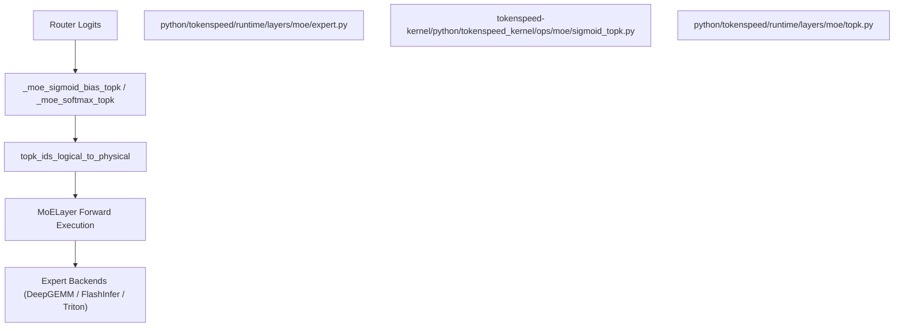
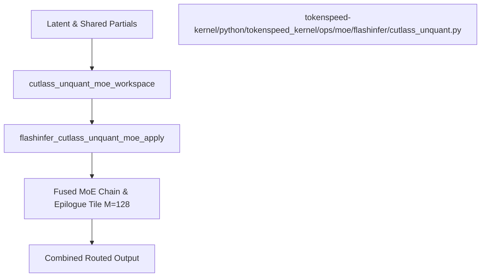
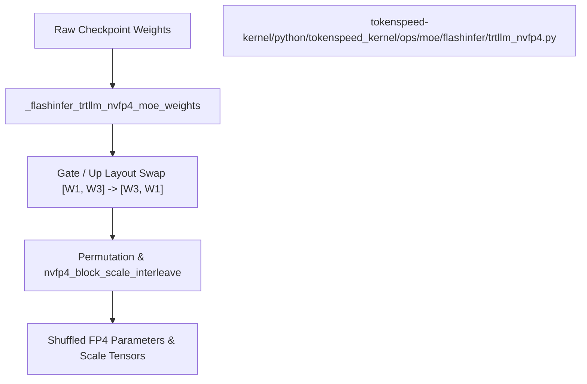
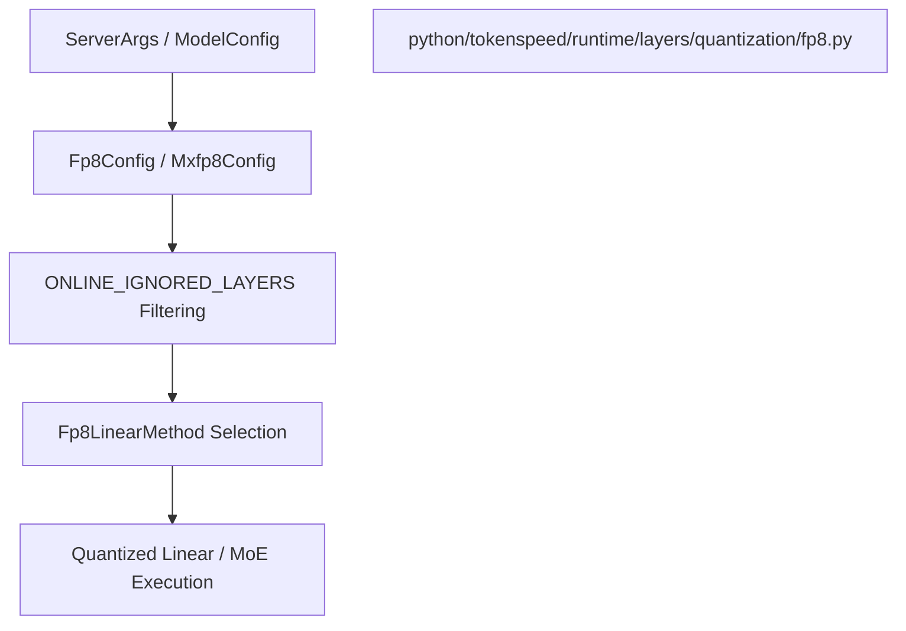

<!-- source: DeepWiki mcp.deepwiki.com · repo lightseekorg/tokenspeed · extra page MoE Layers and Quantization · fetched 2026-10-21 -->

# MoE Layers and Quantization

Relevant source files

The following files were used as context for generating this wiki page:

- [docs/serving/parallelism.md](docs/serving/parallelism.md)
- [python/tokenspeed/runtime/layers/activation.py](python/tokenspeed/runtime/layers/activation.py)
- [python/tokenspeed/runtime/layers/moe/expert.py](python/tokenspeed/runtime/layers/moe/expert.py)
- [python/tokenspeed/runtime/layers/moe/loader.py](python/tokenspeed/runtime/layers/moe/loader.py)
- [python/tokenspeed/runtime/layers/moe/topk.py](python/tokenspeed/runtime/layers/moe/topk.py)
- [python/tokenspeed/runtime/layers/moe/weights/fp8.py](python/tokenspeed/runtime/layers/moe/weights/fp8.py)
- [python/tokenspeed/runtime/layers/moe/weights/nvfp4.py](python/tokenspeed/runtime/layers/moe/weights/nvfp4.py)
- [python/tokenspeed/runtime/layers/quantization/fp8.py](python/tokenspeed/runtime/layers/quantization/fp8.py)
- [python/tokenspeed/runtime/layers/quantization/modelopt_mixed.py](python/tokenspeed/runtime/layers/quantization/modelopt_mixed.py)
- [python/tokenspeed/runtime/layers/vocab_parallel_embedding.py](python/tokenspeed/runtime/layers/vocab_parallel_embedding.py)
- [python/tokenspeed/runtime/models/deepseek_v41_engram.py](python/tokenspeed/runtime/models/deepseek_v41_engram.py)
- [python/tokenspeed/runtime/models/deepseek_v4_dspark_ops/attention.py](python/tokenspeed/runtime/models/deepseek_v4_dspark_ops/attention.py)
- [test/runtime/layers/test_moe_expert.py](test/runtime/layers/test_moe_expert.py)
- [test/runtime/layers/test_moe_loader_ep.py](test/runtime/layers/test_moe_loader_ep.py)
- [test/runtime/layers/test_moe_topk.py](test/runtime/layers/test_moe_topk.py)
- [test/runtime/models/test_qwen3_5_fused_qkvzba.py](test/runtime/models/test_qwen3_5_fused_qkvzba.py)
- [test/runtime/test_deepseek_v41_engram.py](test/runtime/test_deepseek_v41_engram.py)
- [test/runtime/test_fp8_linear_online_block_quant.py](test/runtime/test_fp8_linear_online_block_quant.py)
- [test/runtime/test_linear_method_construction.py](test/runtime/test_linear_method_construction.py)
- [test/runtime/test_modelopt_mixed_config.py](test/runtime/test_modelopt_mixed_config.py)
- [test/runtime/test_moe_global_padded_tp_loader.py](test/runtime/test_moe_global_padded_tp_loader.py)
- [test/runtime/test_moe_online_block_fp8_loader.py](test/runtime/test_moe_online_block_fp8_loader.py)
- [tokenspeed-kernel/python/tokenspeed_kernel/ops/moe/__init__.py](tokenspeed-kernel/python/tokenspeed_kernel/ops/moe/__init__.py)
- [tokenspeed-kernel/python/tokenspeed_kernel/ops/moe/flashinfer/cutedsl_deepep_nvfp4.py](tokenspeed-kernel/python/tokenspeed_kernel/ops/moe/flashinfer/cutedsl_deepep_nvfp4.py)
- [tokenspeed-kernel/python/tokenspeed_kernel/ops/moe/flashinfer/cutlass_fp8.py](tokenspeed-kernel/python/tokenspeed_kernel/ops/moe/flashinfer/cutlass_fp8.py)
- [tokenspeed-kernel/python/tokenspeed_kernel/ops/moe/flashinfer/cutlass_nvfp4.py](tokenspeed-kernel/python/tokenspeed_kernel/ops/moe/flashinfer/cutlass_nvfp4.py)
- [tokenspeed-kernel/python/tokenspeed_kernel/ops/moe/flashinfer/cutlass_unquant.py](tokenspeed-kernel/python/tokenspeed_kernel/ops/moe/flashinfer/cutlass_unquant.py)
- [tokenspeed-kernel/python/tokenspeed_kernel/ops/moe/flashinfer/trtllm_mxfp4.py](tokenspeed-kernel/python/tokenspeed_kernel/ops/moe/flashinfer/trtllm_mxfp4.py)
- [tokenspeed-kernel/python/tokenspeed_kernel/ops/moe/flashinfer/trtllm_nvfp4.py](tokenspeed-kernel/python/tokenspeed_kernel/ops/moe/flashinfer/trtllm_nvfp4.py)
- [tokenspeed-kernel/python/tokenspeed_kernel/ops/moe/softmax_topk.py](tokenspeed-kernel/python/tokenspeed_kernel/ops/moe/softmax_topk.py)
- [tokenspeed-kernel/python/tokenspeed_kernel/ops/moe/triton/softmax_topk.py](tokenspeed-kernel/python/tokenspeed_kernel/ops/moe/triton/softmax_topk.py)
- [tokenspeed-kernel/python/tokenspeed_kernel/ops/quantization/__init__.py](tokenspeed-kernel/python/tokenspeed_kernel/ops/quantization/__init__.py)
- [tokenspeed-kernel/python/tokenspeed_kernel/ops/quantization/triton.py](tokenspeed-kernel/python/tokenspeed_kernel/ops/quantization/triton.py)
- [tokenspeed-kernel/python/tokenspeed_kernel/ops/quantization/trtllm.py](tokenspeed-kernel/python/tokenspeed_kernel/ops/quantization/trtllm.py)
- [tokenspeed-kernel/python/tokenspeed_kernel/ops/tuning.py](tokenspeed-kernel/python/tokenspeed_kernel/ops/tuning.py)
- [tokenspeed-kernel/test/nvidia/ops/moe/test_flashinfer_cutlass_unquant.py](tokenspeed-kernel/test/nvidia/ops/moe/test_flashinfer_cutlass_unquant.py)
- [tokenspeed-kernel/test/ops/moe/test_softmax_topk.py](tokenspeed-kernel/test/ops/moe/test_softmax_topk.py)
- [tokenspeed-kernel/test/ops/test_quantization.py](tokenspeed-kernel/test/ops/test_quantization.py)
- [tokenspeed-kernel/test/test_tuning_cache.py](tokenspeed-kernel/test/test_tuning_cache.py)

## Purpose and Scope
This section covers the technical implementation of Mixture of Experts (MoE) layers, expert routing/top-k selection mechanisms, weight loading pipelines, latent MoE architectures, weight quantization formats (FP8, NVFP4, MXFP4), quantization configuration registries (`Fp8Config`, `Mxfp8Config`), and dense linear backends within TokenSpeed.

---

## 1. MoE Expert, Top-K Routing, and Loader Stack

The MoE execution pipeline orchestrates sparse expert computation through `MoELayer` [python/tokenspeed/runtime/layers/moe/expert.py:68-159](), handling token routing, expert parallelism (EP), tensor parallelism (TP), and weight transformations.

Routing logic processes router logits through specialized top-k strategies including standard softmax top-k, biased sigmoid top-k, and hash-based selection (`moe_topk` in [tokenspeed-kernel/python/tokenspeed_kernel/ops/moe/__init__.py:114-160]()).

Sources: [python/tokenspeed/runtime/layers/moe/expert.py:68-159](), [tokenspeed-kernel/python/tokenspeed_kernel/ops/moe/__init__.py:114-160](), [python/tokenspeed/runtime/layers/moe/topk.py:53-147]()

`MoELayer` initializes routing configurations, activation functions (SiTU, SwiGLU), and parallel coordinates:
- `python/tokenspeed/runtime/layers/moe/expert.py` [python/tokenspeed/runtime/layers/moe/expert.py:68-159]() defines `MoELayer.__init__` with parameters for top-k, number of experts, activation types, and parallelism ranks (`tp_rank`, `ep_rank`).
- `tokenspeed-kernel/python/tokenspeed_kernel/ops/moe/__init__.py` [tokenspeed-kernel/python/tokenspeed_kernel/ops/moe/__init__.py:114-160]() implements `moe_topk` supporting softmax, sigmoid, and sqrt_softplus scoring functions with correction biases or hash tables.
- `python/tokenspeed/runtime/layers/moe/topk.py` [python/tokenspeed/runtime/layers/moe/topk.py:53-147]() defines `ExpertLocationDispatchInfo` for tracking physical expert placement and static/dynamic dispatch algorithms.

Sources: [python/tokenspeed/runtime/layers/moe/expert.py:68-159](), [tokenspeed-kernel/python/tokenspeed_kernel/ops/moe/__init__.py:114-160](), [python/tokenspeed/runtime/layers/moe/topk.py:53-147]()

---

## 2. Latent MoE and Tail Tiers

Latent MoE architectures and specialized tail tiers manage compressed latent representations and expert intermediate caching. Kernels such as FlashInfer Cutlass unquantized MoE (`flashinfer_cutlass_unquant_moe_apply` in [tokenspeed-kernel/python/tokenspeed_kernel/ops/moe/flashinfer/cutlass_unquant.py:130-169]()) and FP4/MXFP4 block-scaled MoE implementations orchestrate state management across devices.

Sources: [tokenspeed-kernel/python/tokenspeed_kernel/ops/moe/flashinfer/cutlass_unquant.py:71-169]()

- `cutlass_unquant_moe_workspace` allocates persistent per-device scratch buffers sized for max row counts to prevent uninitialized read races on SM90 architectures [tokenspeed-kernel/python/tokenspeed_kernel/ops/moe/flashinfer/cutlass_unquant.py:71-129]().
- `flashinfer_cutlass_unquant_moe_apply` executes fused unquantized MoE operations supporting SwiGLU activations and expert parallelism [tokenspeed-kernel/python/tokenspeed_kernel/ops/moe/flashinfer/cutlass_unquant.py:130-169]().

Sources: [tokenspeed-kernel/python/tokenspeed_kernel/ops/moe/flashinfer/cutlass_unquant.py:71-169]()

---

## 3. Weight Formats and Quantization Schemes (FP8, NVFP4, MXFP4)

TokenSpeed supports FP8, NVFP4, and MXFP4 weight formats. Weight preprocessing kernels handle layout reordering (such as swapping gate/up projections from checkpoint layout to `[W3, W1]` for interleaved TRTLLM-Gen/FlashInfer kernels) and block scale interleaving (`nvfp4_block_scale_interleave`).

Sources: [tokenspeed-kernel/python/tokenspeed_kernel/ops/moe/flashinfer/trtllm_nvfp4.py:59-166]()

- NVFP4 weight preparation and block scaling interleaving are implemented in `_flashinfer_trtllm_nvfp4_moe_weights`, handling gated activations (`swiglu`, `situ`) and permutation caching (`maybe_get_cached_w3_w1_permute_indices`) [tokenspeed-kernel/python/tokenspeed_kernel/ops/moe/flashinfer/trtllm_nvfp4.py:59-166]().
- Triton-based FP8 quantization (`fp8_quantize` in [tokenspeed-kernel/python/tokenspeed_kernel/ops/quantization/triton.py:103-179]()) supports scale factors, block-size heuristics, and Programmatic Dependent Launch (PDL) integration [tokenspeed-kernel/python/tokenspeed_kernel/ops/quantization/triton.py:103-179]().

Sources: [tokenspeed-kernel/python/tokenspeed_kernel/ops/moe/flashinfer/trtllm_nvfp4.py:59-166](), [tokenspeed-kernel/python/tokenspeed_kernel/ops/quantization/triton.py:103-179]()

---

## 4. Quantization Configs and Dense Linear Backends

Quantization configurations govern how models instantiate quantized modules and parse checkpoint metadata. Classes like `Fp8Config` and `Mxfp8Config` ([python/tokenspeed/runtime/layers/quantization/fp8.py:40-154]()) determine activation schemes, weight block sizes, and online ignored layers.

Sources: [python/tokenspeed/runtime/layers/quantization/fp8.py:40-98]()

- `Fp8Config` defines quantization parameters, including `is_checkpoint_fp8_serialized`, activation schemes (`dynamic`), weight block sizes, and online ignored layers (`ONLINE_IGNORED_LAYERS`) [python/tokenspeed/runtime/layers/quantization/fp8.py:40-86]().
- `Fp8Config.get_quant_method` instantiates `Fp8LinearMethod` for handling quantized linear operations [python/tokenspeed/runtime/layers/quantization/fp8.py:87-98]().
- `Mxfp8Config` extends `Fp8Config` for MXFP8 with `ue8m0` scale formatting [python/tokenspeed/runtime/layers/quantization/fp8.py:137-154]().

Sources: [python/tokenspeed/runtime/layers/quantization/fp8.py:40-98](), [python/tokenspeed/runtime/layers/quantization/fp8.py:137-154]()

---

