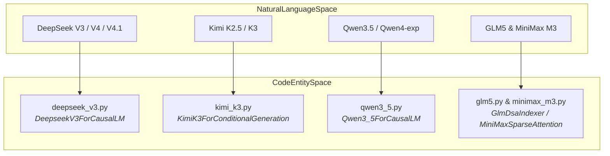
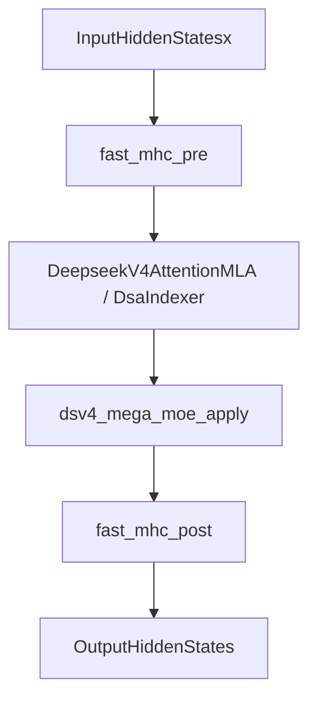

<!-- source: DeepWiki mcp.deepwiki.com · repo lightseekorg/tokenspeed · extra page Supported Model Architectures · fetched 2026-10-21 -->

# Supported Model Architectures

<details>
<summary>Relevant source files</summary>

The following files were used as context for generating this wiki page:

- [docs/design/numerics.md](docs/design/numerics.md)
- [python/tokenspeed/runtime/configs/qwen3_5_config.py](python/tokenspeed/runtime/configs/qwen3_5_config.py)
- [python/tokenspeed/runtime/configs/qwen3_5_text_base_config.py](python/tokenspeed/runtime/configs/qwen3_5_text_base_config.py)
- [python/tokenspeed/runtime/configs/utils.py](python/tokenspeed/runtime/configs/utils.py)
- [python/tokenspeed/runtime/distributed/comm_manager.py](python/tokenspeed/runtime/distributed/comm_manager.py)
- [python/tokenspeed/runtime/engine/batch_log.py](python/tokenspeed/runtime/engine/batch_log.py)
- [python/tokenspeed/runtime/execution/context.py](python/tokenspeed/runtime/execution/context.py)
- [python/tokenspeed/runtime/execution/drafter/eagle.py](python/tokenspeed/runtime/execution/drafter/eagle.py)
- [python/tokenspeed/runtime/layers/attention/backends/specific/deepseek_v41.py](python/tokenspeed/runtime/layers/attention/backends/specific/deepseek_v41.py)
- [python/tokenspeed/runtime/layers/attention/configs/msa.py](python/tokenspeed/runtime/layers/attention/configs/msa.py)
- [python/tokenspeed/runtime/layers/dense/fp8.py](python/tokenspeed/runtime/layers/dense/fp8.py)
- [python/tokenspeed/runtime/layers/dense/nvfp4.py](python/tokenspeed/runtime/layers/dense/nvfp4.py)
- [python/tokenspeed/runtime/layers/hyperconnection.py](python/tokenspeed/runtime/layers/hyperconnection.py)
- [python/tokenspeed/runtime/layers/layernorm.py](python/tokenspeed/runtime/layers/layernorm.py)
- [python/tokenspeed/runtime/layers/linear.py](python/tokenspeed/runtime/layers/linear.py)
- [python/tokenspeed/runtime/layers/logits_processor.py](python/tokenspeed/runtime/layers/logits_processor.py)
- [python/tokenspeed/runtime/layers/moe/latent.py](python/tokenspeed/runtime/layers/moe/latent.py)
- [python/tokenspeed/runtime/layers/quantization/base_config.py](python/tokenspeed/runtime/layers/quantization/base_config.py)
- [python/tokenspeed/runtime/model_loader/utils.py](python/tokenspeed/runtime/model_loader/utils.py)
- [python/tokenspeed/runtime/models/base/causal_lm.py](python/tokenspeed/runtime/models/base/causal_lm.py)
- [python/tokenspeed/runtime/models/base/transformer_model.py](python/tokenspeed/runtime/models/base/transformer_model.py)
- [python/tokenspeed/runtime/models/deepseek_nextn.py](python/tokenspeed/runtime/models/deepseek_nextn.py)
- [python/tokenspeed/runtime/models/deepseek_v3.py](python/tokenspeed/runtime/models/deepseek_v3.py)
- [python/tokenspeed/runtime/models/deepseek_v41.py](python/tokenspeed/runtime/models/deepseek_v41.py)
- [python/tokenspeed/runtime/models/deepseek_v41_dspark.py](python/tokenspeed/runtime/models/deepseek_v41_dspark.py)
- [python/tokenspeed/runtime/models/glm5.py](python/tokenspeed/runtime/models/glm5.py)
- [python/tokenspeed/runtime/models/inkling.py](python/tokenspeed/runtime/models/inkling.py)
- [python/tokenspeed/runtime/models/kimi_k3.py](python/tokenspeed/runtime/models/kimi_k3.py)
- [python/tokenspeed/runtime/models/kimi_k3_deepep.py](python/tokenspeed/runtime/models/kimi_k3_deepep.py)
- [python/tokenspeed/runtime/models/llama_eagle3.py](python/tokenspeed/runtime/models/llama_eagle3.py)
- [python/tokenspeed/runtime/models/longcat_flash.py](python/tokenspeed/runtime/models/longcat_flash.py)
- [python/tokenspeed/runtime/models/minimax_m3.py](python/tokenspeed/runtime/models/minimax_m3.py)
- [python/tokenspeed/runtime/models/nemotron_h.py](python/tokenspeed/runtime/models/nemotron_h.py)
- [python/tokenspeed/runtime/models/qwen3_5.py](python/tokenspeed/runtime/models/qwen3_5.py)
- [python/tokenspeed/runtime/models/qwen3_5_moe.py](python/tokenspeed/runtime/models/qwen3_5_moe.py)
- [python/tokenspeed/runtime/models/qwen3_5_nextn.py](python/tokenspeed/runtime/models/qwen3_5_nextn.py)
- [python/tokenspeed/runtime/models/qwen4_exp.py](python/tokenspeed/runtime/models/qwen4_exp.py)
- [test/runtime/distributed/run_dcp_indexer.py](test/runtime/distributed/run_dcp_indexer.py)
- [test/runtime/layers/test_kimi_k3_addmm_fold.py](test/runtime/layers/test_kimi_k3_addmm_fold.py)
- [test/runtime/layers/test_latent_moe.py](test/runtime/layers/test_latent_moe.py)
- [test/runtime/models/test_inkling_models.py](test/runtime/models/test_inkling_models.py)
- [test/runtime/models/test_llama_eagle3.py](test/runtime/models/test_llama_eagle3.py)
- [test/runtime/models/test_longcat_flash.py](test/runtime/models/test_longcat_flash.py)
- [test/runtime/models/test_minimax_m3.py](test/runtime/models/test_minimax_m3.py)
- [test/runtime/models/test_qwen3_5_fused_norm.py](test/runtime/models/test_qwen3_5_fused_norm.py)
- [test/runtime/test_batch_log.py](test/runtime/test_batch_log.py)
- [test/runtime/test_deepseek_v41_cache.py](test/runtime/test_deepseek_v41_cache.py)
- [test/runtime/test_deepseek_v41_config.py](test/runtime/test_deepseek_v41_config.py)
- [test/runtime/test_deepseek_v41_dspark.py](test/runtime/test_deepseek_v41_dspark.py)
- [test/runtime/test_deepseek_v41_model.py](test/runtime/test_deepseek_v41_model.py)
- [test/runtime/test_event_loop_in_flight.py](test/runtime/test_event_loop_in_flight.py)
- [test/runtime/test_hyperconnection_kernel_boundary.py](test/runtime/test_hyperconnection_kernel_boundary.py)
- [test/runtime/test_inkling_activation_parity.py](test/runtime/test_inkling_activation_parity.py)
- [test/runtime/test_inkling_mtp_conv_state.py](test/runtime/test_inkling_mtp_conv_state.py)
- [test/runtime/test_k3_moe_tail_equivalence.py](test/runtime/test_k3_moe_tail_equivalence.py)
- [test/runtime/test_k3_moe_tail_tier.py](test/runtime/test_k3_moe_tail_tier.py)
- [test/runtime/test_kimi_k3_config.py](test/runtime/test_kimi_k3_config.py)
- [test/runtime/test_kimi_k3_deepep.py](test/runtime/test_kimi_k3_deepep.py)
- [test/runtime/test_kimi_k3_moe_attn_dp.py](test/runtime/test_kimi_k3_moe_attn_dp.py)
- [test/runtime/test_kimi_k3_moe_fork_warmup.py](test/runtime/test_kimi_k3_moe_fork_warmup.py)
- [test/runtime/test_logits_processor.py](test/runtime/test_logits_processor.py)
- [test/runtime/test_resolve_architecture.py](test/runtime/test_resolve_architecture.py)
- [tokenspeed-kernel/python/tokenspeed_kernel/ops/attention/dsa/__init__.py](tokenspeed-kernel/python/tokenspeed_kernel/ops/attention/dsa/__init__.py)
- [tokenspeed-kernel/python/tokenspeed_kernel/ops/attention/msa/triton.py](tokenspeed-kernel/python/tokenspeed_kernel/ops/attention/msa/triton.py)
- [tokenspeed-kernel/python/tokenspeed_kernel/ops/conv/__init__.py](tokenspeed-kernel/python/tokenspeed_kernel/ops/conv/__init__.py)
- [tokenspeed-kernel/python/tokenspeed_kernel/ops/layernorm/__init__.py](tokenspeed-kernel/python/tokenspeed_kernel/ops/layernorm/__init__.py)
- [tokenspeed-kernel/python/tokenspeed_kernel/ops/layernorm/triton.py](tokenspeed-kernel/python/tokenspeed_kernel/ops/layernorm/triton.py)
- [tokenspeed-kernel/python/tokenspeed_kernel/ops/moe/latent_tail.py](tokenspeed-kernel/python/tokenspeed_kernel/ops/moe/latent_tail.py)
- [tokenspeed-kernel/python/tokenspeed_kernel/ops/moe/marlin/mxfp4.py](tokenspeed-kernel/python/tokenspeed_kernel/ops/moe/marlin/mxfp4.py)
- [tokenspeed-kernel/python/tokenspeed_kernel/ops/residual/cute_fused.py](tokenspeed-kernel/python/tokenspeed_kernel/ops/residual/cute_fused.py)
- [tokenspeed-kernel/python/tokenspeed_kernel/thirdparty/cute_dsl/hc_fused.py](tokenspeed-kernel/python/tokenspeed_kernel/thirdparty/cute_dsl/hc_fused.py)
- [tokenspeed-kernel/python/tokenspeed_kernel/thirdparty/cute_dsl/latent_moe_tail/allreduce_rmsnorm_reduce_scatter_early_exit.py](tokenspeed-kernel/python/tokenspeed_kernel/thirdparty/cute_dsl/latent_moe_tail/allreduce_rmsnorm_reduce_scatter_early_exit.py)
- [tokenspeed-kernel/python/tokenspeed_kernel/thirdparty/cute_dsl/latent_moe_tail/primitives.py](tokenspeed-kernel/python/tokenspeed_kernel/thirdparty/cute_dsl/latent_moe_tail/primitives.py)
- [tokenspeed-kernel/test/nvidia/ops/attention/test_flashmla_dsa_dcp.py](tokenspeed-kernel/test/nvidia/ops/attention/test_flashmla_dsa_dcp.py)
- [tokenspeed-kernel/test/nvidia/ops/moe/test_marlin_mxfp4_apply.py](tokenspeed-kernel/test/nvidia/ops/moe/test_marlin_mxfp4_apply.py)
- [tokenspeed-kernel/test/nvidia/ops/test_dsa_topk_batch_invariant.py](tokenspeed-kernel/test/nvidia/ops/test_dsa_topk_batch_invariant.py)
- [tokenspeed-kernel/test/nvidia/ops/test_hyperconnection_batched.py](tokenspeed-kernel/test/nvidia/ops/test_hyperconnection_batched.py)
- [tokenspeed-kernel/test/nvidia/ops/test_hyperconnection_capture.py](tokenspeed-kernel/test/nvidia/ops/test_hyperconnection_capture.py)
- [tokenspeed-kernel/test/ops/attention/test_dsa_facade_traits.py](tokenspeed-kernel/test/ops/attention/test_dsa_facade_traits.py)
- [tokenspeed-kernel/test/ops/moe/test_latent_tail_contract.py](tokenspeed-kernel/test/ops/moe/test_latent_tail_contract.py)
- [tokenspeed-kernel/test/ops/test_attention_dsa.py](tokenspeed-kernel/test/ops/test_attention_dsa.py)
- [tokenspeed-kernel/test/ops/test_attention_msa.py](tokenspeed-kernel/test/ops/test_attention_msa.py)
- [tokenspeed-kernel/test/ops/test_conv.py](tokenspeed-kernel/test/ops/test_conv.py)
- [tokenspeed-kernel/test/ops/test_hyperconnection.py](tokenspeed-kernel/test/ops/test_hyperconnection.py)
- [tokenspeed-kernel/test/ops/test_layernorm.py](tokenspeed-kernel/test/ops/test_layernorm.py)

</details>


## Purpose and Scope

This page provides a deep technical dive into the model implementations supported by TokenSpeed under `python/tokenspeed/runtime/models/`. It covers state-of-the-art sparse mixture-of-experts (MoE), multi-head latent attention (MLA), linear attention hybrids (KDA, Gated DeltaNet), dynamic sparse attention (DSA/QSA/MSA), hyperconnections, and the extensible base causal language model abstractions that unify them.

---

## 1. Extensible Base Causal LM and Transformer Abstractions

TokenSpeed establishes a strict object-oriented hierarchy for all causal language models to ensure uniform weight loading, tensor-parallel slicing, KV-cache population, and execution context plumbing.

```
BaseCausalLM
  └── BaseTransformerModel
        └── BaseDecoderLayer
              ├── SelfAttention / MLA / KDA / GatedDeltaNet
              └── MLP / MoELayer / LatentMoELayer
```

### Key Classes and Roles
* `BaseCausalLM`: Defined in `[python/tokenspeed/runtime/models/base/causal_lm.py:1-120]`, this base class implements top-level inference entrypoints, vocabulary embedding lookups (`VocabParallelEmbedding`), final normalization (`RMSNorm`), and parallel language modeling heads (`ParallelLMHead`).
* `BaseTransformerModel`: Defined in `[python/tokenspeed/runtime/models/base/transformer_model.py:1-150]`, it manages layer stacking via `make_layers`, pipeline-parallel stage boundaries (`PPStageState`), and hidden-state propagation across decoding steps.
* `BaseDecoderLayer`: Manages the residual stream additions, attention/linear-attention block invocation, and MLP/MoE feed-forward transformations.

Sources: `[python/tokenspeed/runtime/models/base/causal_lm.py:1-120]`, `[python/tokenspeed/runtime/models/base/transformer_model.py:1-150]`

---

## 2. Natural Language Space to Code Entity Mapping

The following diagram bridges conceptual transformer architectural families to their concrete Python module implementations and execution pipelines in TokenSpeed.



Sources: `[python/tokenspeed/runtime/models/deepseek_v3.py:1-121]`, `[python/tokenspeed/runtime/models/deepseek_v4.py:1-142]`, `[python/tokenspeed/runtime/models/kimi_k3.py:1-54]`, `[python/tokenspeed/runtime/models/qwen3_5.py:1-89]`, `[python/tokenspeed/runtime/models/glm5.py:21-65]`

---

## 3. DeepSeek V3, V4, and V4.1 Architectures

### DeepSeek V3 (`deepseek_v3.py`)
DeepSeek V3 introduces Multi-head Latent Attention (MLA) to compress KV cache footprints, coupled with a DeepSeekMoE architecture featuring shared and routed experts.
* **MLA Implementation**: Projections are handled via `DeepseekV3AttentionMLA` `[python/tokenspeed/runtime/models/deepseek_v3.py:140-143]`. KV compression splits incoming activations into low-rank latent vectors and rotary-embedded parts using `apply_rope_mla` `[python/tokenspeed/runtime/models/deepseek_v3.py:40-40]`.
* **Router GEMM**: Expert routing uses optimized Triton/CUDA kernels such as `dsv3_router_gemm` `[python/tokenspeed/runtime/models/deepseek_v3.py:42-42]` and fused A-gemm operations (`dsv3_fused_a_gemm`) `[python/tokenspeed/runtime/models/deepseek_v3.py:46-46]`.

### DeepSeek V4 and V4.1 (`deepseek_v4.py`, `deepseek_v41.py`)
DeepSeek V4/V4.1 advance sparse modeling with Dynamic Sparse Attention (DSA / DSV4 indexers), Multi-Head Compression (MHC) hyperconnections, and Mega-MoE pipelines.
* **Indexer & Sparse Routing**: Utilizes `dsa_prefill_topk`, `dsa_decode_topk`, and `dsv4_indexer_cache_format` `[python/tokenspeed/runtime/models/deepseek_v4.py:37-46]` to construct sparse routing indices dynamically.
* **Hyperconnections (MHC)**: Integrates `fast_mhc_pre` and `fast_mhc_post` `[python/tokenspeed/runtime/models/deepseek_v4.py:61-63]` to route residual streams across non-linear feature pathways.
* **Mega-MoE**: Process weights are staged via `dsv4_mega_moe_process_weights` and executed via `dsv4_mega_moe_apply` `[python/tokenspeed/runtime/models/deepseek_v4.py:49-51]`.



Sources: `[python/tokenspeed/runtime/models/deepseek_v3.py:21-183]`, `[python/tokenspeed/runtime/models/deepseek_v4.py:21-155]`, `[python/tokenspeed/runtime/models/deepseek_v41.py:1-120]`

---

## 4. Kimi K2.5 and K3 Architectures (`kimi_k3.py`)

Kimi K3 combines the MoonViT3d vision tower with a `KimiLinear` text backbone containing hybrid KDA linear attention and NoPE-MLA full attention layers governed by AttnRes block residuals.

### Core Component Breakdown
* **KimiLinearKDA**: Per-head gated delta-rule linear attention handling convolution and recurrent state updates via `KdaAttnBackend` `[python/tokenspeed/runtime/models/kimi_k3.py:27-32]`.
* **NoPE-MLA**: No-Position-Embedding Multi-head Latent Attention paired with sigmoid output gating (`KimiLinearMLAAttention`) `[python/tokenspeed/runtime/models/kimi_k3.py:29-29]`.
* **AttnRes Block Residuals**: Inter-layer state combination executed using Triton kernels `attn_res_fwd`, `attnres_combine`, and `attnres_partial` `[python/tokenspeed/runtime/models/kimi_k3.py:63-71]`.
* **Latent MoE Tail Tiers**: Managed via `K3MoETailTier` `[python/tokenspeed/runtime/models/kimi_k3_comm.py:83-96]` and `select_k3_moe_tail_tier` `[python/tokenspeed/runtime/models/kimi_k3_comm.py:112-121]`, supporting tail fusion, multimem AR, and fused-lane one-shot collectives.

Sources: `[python/tokenspeed/runtime/models/kimi_k3.py:21-54]`, `[python/tokenspeed/runtime/models/kimi_k3_comm.py:21-141]`

---

## 5. Qwen3.5, Qwen4-exp, GLM5, and MiniMax M3

| Model Family | Core Innovation | Key Code Modules / Kernels |
| :--- | :--- | :--- |
| **Qwen3.5 / Qwen4-exp** | Gated DeltaNet & Qwen Sparse Attention (QSA) | `[python/tokenspeed/runtime/models/qwen3_5.py:185-188]`, `[python/tokenspeed/runtime/models/qwen4_exp.py:1-50]` |
| **GLM5** | GlmDsaIndexer & DeepSeek-Yarn RoPE scaling | `[python/tokenspeed/runtime/models/glm5.py:71-128]` |
| **MiniMax M3** | MiniMax Sparse Attention (MSA) | `[python/tokenspeed/runtime/models/minimax_m3.py:1-100]` |

* **Qwen3.5 Gated DeltaNet**: Implements recurrent delta projections with fused RMSNorm, RoPE, and gate operations via `fused_qk_rmsnorm_rope_gate` `[python/tokenspeed/runtime/models/qwen3_5.py:33-36]`.
* **GLM5 DSA Indexer**: Encapsulated in `GlmDsaIndexer` `[python/tokenspeed/runtime/models/glm5.py:141-154]`, computing dynamic query/key index projections for sparse attention routing.

Sources: `[python/tokenspeed/runtime/models/qwen3_5.py:21-188]`, `[python/tokenspeed/runtime/models/qwen4_exp.py:1-50]`, `[python/tokenspeed/runtime/models/glm5.py:21-188]`, `[python/tokenspeed/runtime/models/minimax_m3.py:1-100]`

---

## 6. Inkling, LongCat, and GPT-OSS

Inkling, LongCat, and GPT-OSS models validate TokenSpeed's flexible activation and state management paradigms:
* **Inkling Activation Parity**: Integrates custom SiTU/SiLU gating checks to ensure numerical parity during speculative decoding `[python/tokenspeed/runtime/models/inkling.py:1-90]`.
* **LongCat Flash MoE**: Combines DeepSeek-style MLA full attention with optimized MoE routing and expert memory placement via `longcat_flash.py` `[python/tokenspeed/runtime/models/longcat_flash.py:1-120]`.
* **GPT-OSS State Management**: Handles multi-query token projections (`MTP`) and conv-state caches for hybrid architectures `[python/tokenspeed/runtime/models/base/causal_lm.py:1-50]`.

Sources: `[python/tokenspeed/runtime/models/inkling.py:1-90]`, `[python/tokenspeed/runtime/models/longcat_flash.py:1-120]`, `[python/tokenspeed/runtime/models/base/causal_lm.py:1-50]`

---

