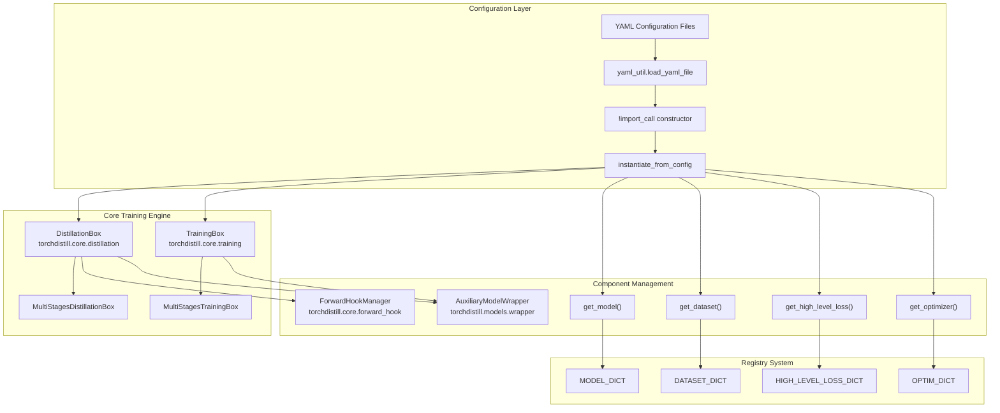
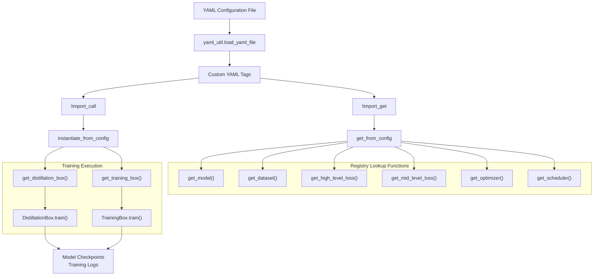
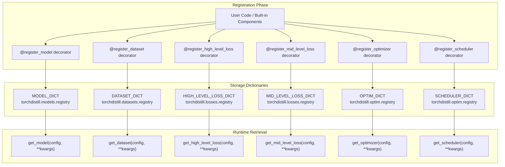
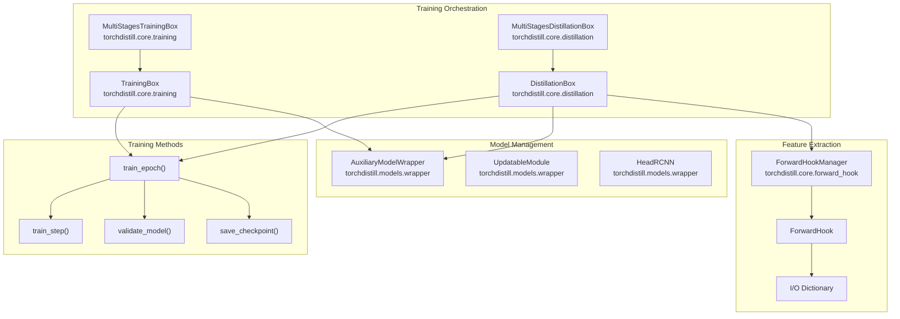
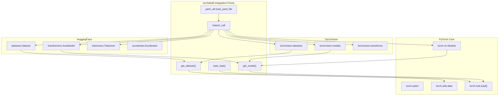

<!-- source: DeepWiki mcp.deepwiki.com · repo yoshitomo-matsubara/torchdistill · page 1 Overview · fetched 2026-10-21 -->

# Overview

<details>
<summary>Relevant source files</summary>

The following files were used as context for generating this wiki page:

- [README.md](README.md)
- [configs/README.md](configs/README.md)
- [demo/extract_intermediate_representations.ipynb](demo/extract_intermediate_representations.ipynb)
- [docs/source/conf.py](docs/source/conf.py)
- [docs/source/index.rst](docs/source/index.rst)
- [docs/source/package.rst](docs/source/package.rst)
- [docs/source/projects.rst](docs/source/projects.rst)
- [docs/source/subpkgs/common.rst](docs/source/subpkgs/common.rst)
- [docs/source/subpkgs/core.rst](docs/source/subpkgs/core.rst)
- [docs/source/subpkgs/datasets.rst](docs/source/subpkgs/datasets.rst)
- [docs/source/subpkgs/losses.rst](docs/source/subpkgs/losses.rst)
- [docs/source/subpkgs/misc.rst](docs/source/subpkgs/misc.rst)
- [docs/source/subpkgs/models.rst](docs/source/subpkgs/models.rst)
- [docs/source/subpkgs/optim.rst](docs/source/subpkgs/optim.rst)

</details>


## Purpose and Scope

This document provides an overview of **torchdistill**, a modular, configuration-driven framework for knowledge distillation and deep learning experiments. The framework enables researchers to design and execute reproducible experiments through declarative YAML configuration files, eliminating the need for extensive Python coding in most cases.

torchdistill supports both knowledge distillation (teacher-student training) and standard deep learning training scenarios. For detailed information about specific components, see [Core Architecture](#2), [Components](#3), and [Examples and Usage](#4).

## Core Philosophy

torchdistill follows a "coding-free" design philosophy where experiments are entirely defined through YAML configuration files. The framework uses dynamic object instantiation to create and orchestrate machine learning components, making experiments highly reproducible and easily configurable.

**Key Design Principles:**
- **Configuration-driven**: One experiment equals one YAML file
- **Non-invasive**: Extract intermediate representations without modifying model code
- **Modular**: Component registry system for easy extensibility
- **Reproducible**: Complete experiment specification in declarative format

Sources: [README.md:10-18](), [README.md:66-71]()

## High-Level Architecture

**torchdistill Core Architecture**


The framework operates through three main layers: configuration processing via `yaml_util`, core training orchestration through `DistillationBox`/`TrainingBox` classes, and component management via registry dictionaries and getter functions.

Sources: [README.md:32-63](), [README.md:178-194](), [torchdistill/core/distillation.py](), [torchdistill/core/training.py](), [torchdistill/core/forward_hook.py]()

## Configuration-Driven Workflow

**Configuration to Execution Pipeline**


The framework processes YAML configurations through custom PyYAML constructors (`!import_call`, `!import_get`) that enable dynamic object instantiation and component retrieval from registry dictionaries.

Sources: [README.md:74-79](), [README.md:82-135](), [torchdistill/common/yaml_util.py](), [torchdistill/common/main_util.py]()

## Key Components

### Forward Hook Manager

The `ForwardHookManager` enables non-invasive extraction of intermediate representations from PyTorch models without modifying their forward methods.

| Component | Purpose | Key Methods |
|-----------|---------|-------------|
| `ForwardHookManager` | Extract intermediate features | `add_hook()`, `pop_io_dict()` |
| Forward hooks | Capture input/output tensors | Automatic during forward pass |
| I/O dictionary | Store extracted representations | Module path → input/output mapping |

**Example Usage:**
```python
# From README.md:48-62
forward_hook_manager = ForwardHookManager(device)
forward_hook_manager.add_hook(model, 'conv1', requires_input=True)
forward_hook_manager.add_hook(model, 'layer1.0.bn2', requires_input=True, requires_output=True)
```

Sources: [README.md:32-63](), [demo/extract_intermediate_representations.ipynb:62-68]()

### Component Registry System

**Registry Pattern Implementation**


The registry system uses decorators to populate component dictionaries during import time, then provides getter functions for runtime component instantiation based on configuration keys.

| Registry Module | Decorator | Dictionary | Getter Function |
|-----------------|-----------|------------|-----------------|
| `torchdistill.models.registry` | `@register_model` | `MODEL_DICT` | `get_model()` |
| `torchdistill.datasets.registry` | `@register_dataset` | `DATASET_DICT` | `get_dataset()` |
| `torchdistill.losses.registry` | `@register_high_level_loss` | `HIGH_LEVEL_LOSS_DICT` | `get_high_level_loss()` |
| `torchdistill.losses.registry` | `@register_mid_level_loss` | `MID_LEVEL_LOSS_DICT` | `get_mid_level_loss()` |
| `torchdistill.optim.registry` | `@register_optimizer` | `OPTIM_DICT` | `get_optimizer()` |
| `torchdistill.optim.registry` | `@register_scheduler` | `SCHEDULER_DICT` | `get_scheduler()` |

Sources: [torchdistill/models/registry.py](), [torchdistill/datasets/registry.py](), [torchdistill/losses/registry.py](), [torchdistill/optim/registry.py]()

### Training and Distillation Framework

**Core Training Classes**


The framework provides specialized training orchestration through "box" classes that encapsulate different training scenarios and handle model management, feature extraction, and training lifecycle.

| Component | Module | Purpose |
|-----------|--------|---------|
| `TrainingBox` | `torchdistill.core.training` | Standard single-model training |
| `DistillationBox` | `torchdistill.core.distillation` | Teacher-student knowledge distillation |
| `MultiStagesTrainingBox` | `torchdistill.core.training` | Sequential training phases |
| `MultiStagesDistillationBox` | `torchdistill.core.distillation` | Multi-stage distillation |
| `AuxiliaryModelWrapper` | `torchdistill.models.wrapper` | Model behavior modification |
| `ForwardHookManager` | `torchdistill.core.forward_hook` | Non-invasive feature extraction |

Sources: [torchdistill/core/training.py](), [torchdistill/core/distillation.py](), [torchdistill/models/wrapper.py](), [torchdistill/core/forward_hook.py]()

## Framework Features

### Domain Support

torchdistill supports multiple machine learning domains through integrated examples and configurations:

| Domain | Tasks | Integration |
|--------|-------|-------------|
| Computer Vision | Image classification, object detection, segmentation | TorchVision models and datasets |
| Natural Language Processing | Text classification, GLUE benchmark | HuggingFace Transformers |
| Custom Domains | User-defined tasks | Extensible registry system |

Sources: [README.md:146-158](), [examples/torchvision/](), [examples/hf_transformers/]()

### Knowledge Distillation Methods

The framework implements state-of-the-art knowledge distillation techniques:

- **Basic KD**: Hinton et al. soft target distillation
- **Feature-based**: FitNet, Attention Transfer, Factor Transfer
- **Relation-based**: Relational KD, Similarity-Preserving KD
- **Advanced methods**: Variational Information Distillation, Contrastive Representation Distillation

Sources: [README.md:265-287]()

### External Integration

**PyTorch Ecosystem Integration**


The framework integrates with the PyTorch ecosystem through direct instantiation via `!import_call` in YAML configs and through PyTorch Hub for model loading. This enables seamless use of external libraries without modification.

**Integration Examples:**
- **TorchVision**: Direct model/dataset instantiation in YAML
- **HuggingFace**: Transformers, datasets, and tokenizers support
- **PyTorch Hub**: Remote model loading via `torch.hub.load()`
- **Custom Libraries**: Any Python class can be instantiated via `!import_call`

Sources: [README.md:178-194](), [examples/torchvision/](), [examples/hf_transformers/](), [torchdistill/common/yaml_util.py]()

## Getting Started

### Installation

```bash
pip3 install torchdistill
```

### Basic Usage Pattern

1. **Define experiment** in YAML configuration file
2. **Run training** using provided examples or custom scripts
3. **Analyze results** through generated logs and checkpoints

The framework requires minimal Python coding - most experiments are fully specified through configuration files.

Sources: [README.md:197-215]()

### Example Configuration Structure

```yaml
# Basic structure from README.md:82-135
datasets:
  train_dataset: !import_call
    key: 'torchvision.datasets.CIFAR10'
    init:
      kwargs:
        root: '~/datasets/cifar10'
        train: True

models:
  student_model:
    key: 'resnet18'
    kwargs:
      num_classes: 10
```

This configuration-first approach enables reproducible research and easy experiment modification without code changes.

Sources: [README.md:82-135](), [configs/sample/]()

---

