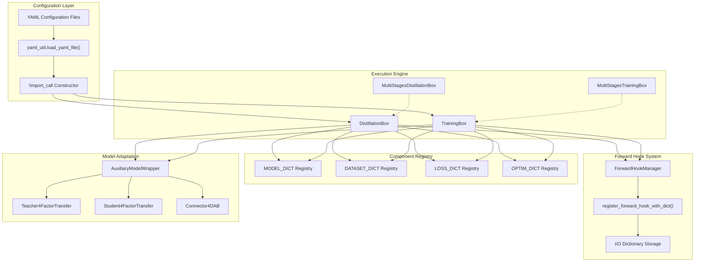
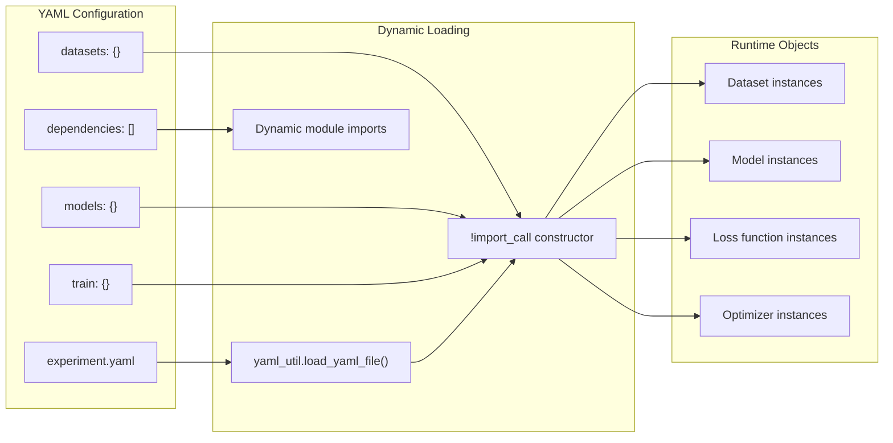
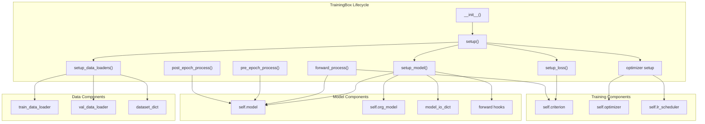
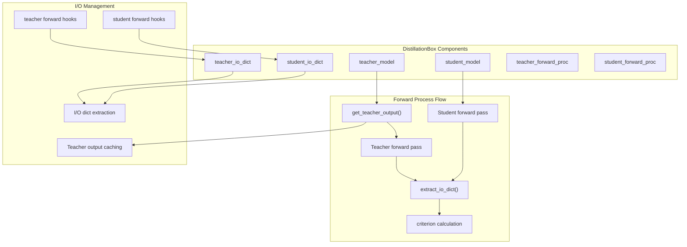
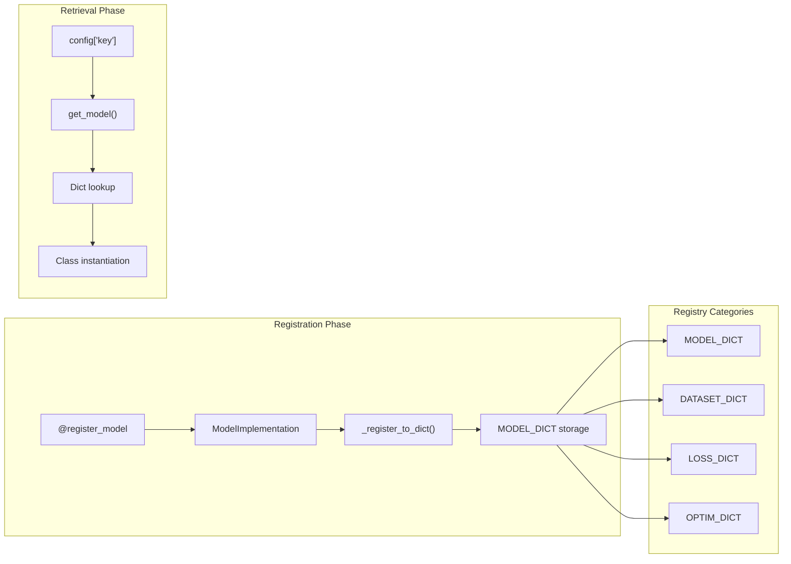
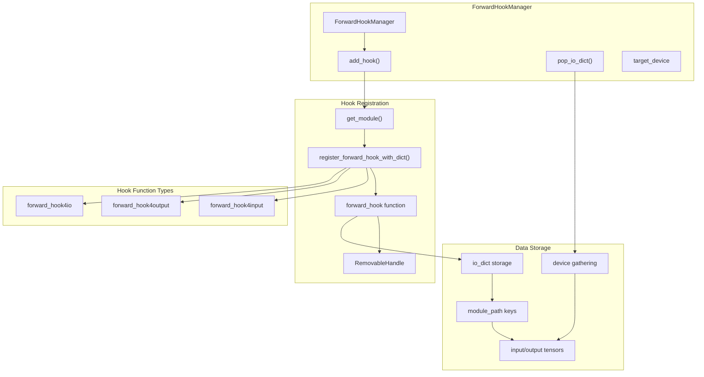
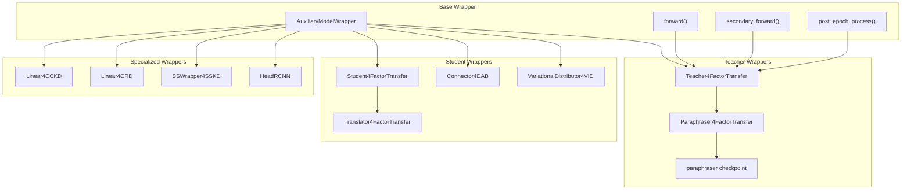
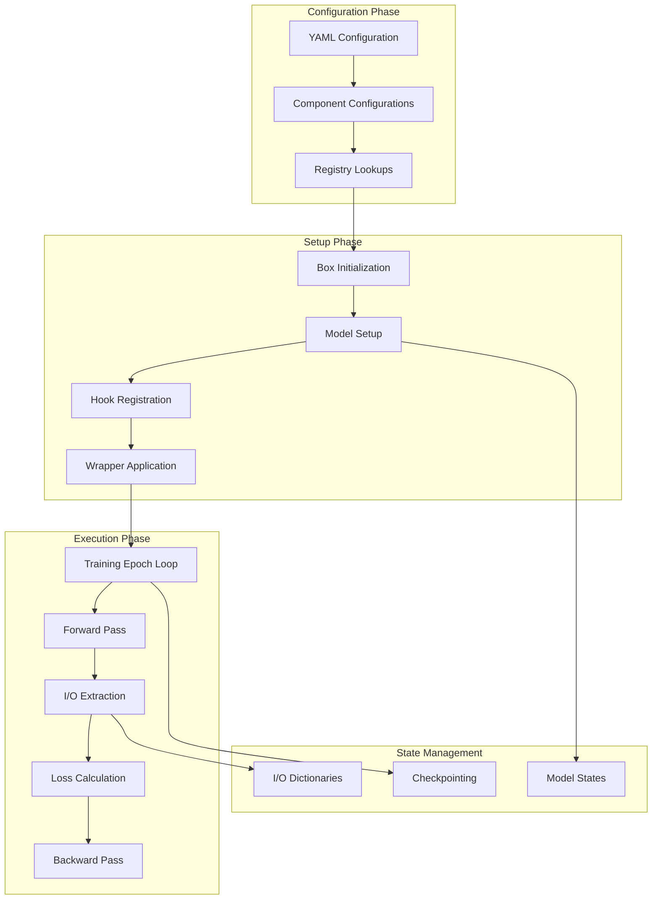

<!-- source: DeepWiki mcp.deepwiki.com · repo yoshitomo-matsubara/torchdistill · page 2 Core Architecture · fetched 2026-10-21 -->

# Core Architecture

Relevant source files

The following files were used as context for generating this wiki page:

- [README.md](README.md)
- [configs/README.md](configs/README.md)
- [demo/extract_intermediate_representations.ipynb](demo/extract_intermediate_representations.ipynb)
- [torchdistill/core/distillation.py](torchdistill/core/distillation.py)
- [torchdistill/core/forward_hook.py](torchdistill/core/forward_hook.py)
- [torchdistill/core/training.py](torchdistill/core/training.py)
- [torchdistill/core/util.py](torchdistill/core/util.py)
- [torchdistill/models/wrapper.py](torchdistill/models/wrapper.py)

This document explains the core architectural components and design patterns that form the foundation of torchdistill. It covers the configuration-driven system, training framework, component registry, and forward hook management that enable modular, declarative knowledge distillation experiments.

For specific component implementations (models, datasets, losses, optimizers), see [Components](#3). For practical usage examples, see [Examples and Usage](#4).

## Architectural Overview

torchdistill follows a configuration-driven architecture where YAML files declaratively define entire experiments. The framework consists of four main architectural pillars that work together to enable flexible knowledge distillation workflows.

### Core Architecture Diagram

Sources: [torchdistill/core/distillation.py:28-567](), [torchdistill/core/training.py:24-416](), [torchdistill/core/forward_hook.py:104-206](), [torchdistill/models/wrapper.py:16-30]()

## Configuration-Driven System

The configuration system enables declarative experiment definition through YAML files. All components are instantiated and configured without requiring Python code changes.

### Configuration Flow

The `!import_call` constructor allows instantiation of any Python class with specified arguments directly from YAML configuration. This eliminates the need to modify framework code when adding new components.

Sources: [README.md:66-140](), [torchdistill/common/yaml_util.py]()

## Training Framework

The training framework provides two main execution engines: `TrainingBox` for standard training and `DistillationBox` for knowledge distillation.

### Training Box Architecture

Sources: [torchdistill/core/training.py:24-416]()

### Distillation Box Architecture

The `DistillationBox` manages both teacher and student models, handles forward hook registration for intermediate feature extraction, and supports teacher output caching for efficiency.

Sources: [torchdistill/core/distillation.py:28-567]()

## Component Registry System

The registry system provides a plugin architecture for models, datasets, losses, and optimizers. Components are registered via decorators and retrieved by string keys.

### Registry Pattern Implementation

Each component category uses the same registration pattern:

| Component Type | Registry Dict | Registration Decorator | Getter Function |
|----------------|--------------|----------------------|-----------------|
| Models | `MODEL_DICT` | `@register_model` | `get_model()` |
| Datasets | `DATASET_DICT` | `@register_dataset` | `get_dataset()` |
| Losses | `LOSS_DICT` | `@register_loss` | `get_loss()` |
| Optimizers | `OPTIM_DICT` | `@register_optimizer` | `get_optimizer()` |

Sources: [torchdistill/models/registry.py](), [torchdistill/datasets/registry.py](), [torchdistill/losses/registry.py](), [torchdistill/optim/registry.py]()

## Forward Hook Management

The `ForwardHookManager` provides a clean API for extracting intermediate representations from PyTorch models without modifying their forward methods.

### Forward Hook System Architecture

The hook system supports three modes:
- Input-only hooks (`requires_input=True, requires_output=False`)
- Output-only hooks (`requires_input=False, requires_output=True`)  
- Input-output hooks (`requires_input=True, requires_output=True`)

Sources: [torchdistill/core/forward_hook.py:39-206]()

## Model Wrapper System

The auxiliary model wrapper system allows modification of model behavior for specific knowledge distillation methods without changing the original model implementations.

### Auxiliary Wrapper Hierarchy

Each wrapper implements:
- `forward()`: Primary model forward pass
- `secondary_forward()`: Additional computations using I/O dict
- `post_epoch_process()`: End-of-epoch operations (e.g., checkpoint saving)

Sources: [torchdistill/models/wrapper.py:16-567]()

## Integration Patterns

The architectural components integrate through well-defined interfaces and data flow patterns.

### Component Integration Flow

This integration enables:
- **Declarative Configuration**: Complete experiment definition in YAML
- **Modular Components**: Pluggable models, datasets, losses, optimizers
- **Feature Extraction**: Non-intrusive intermediate representation access
- **Model Adaptation**: Behavior modification through wrappers
- **Multi-stage Training**: Progressive training configurations

Sources: [torchdistill/core/distillation.py:176-282](), [torchdistill/core/training.py:141-220](), [torchdistill/core/util.py:36-67]()

---

