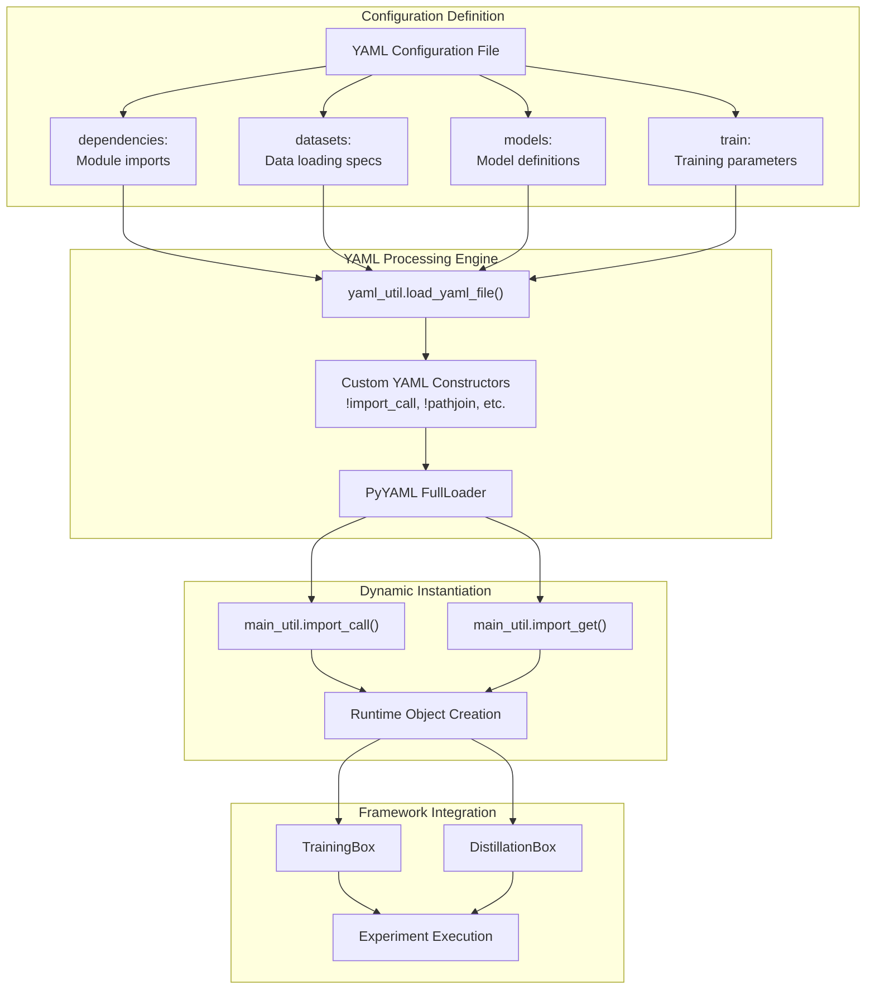
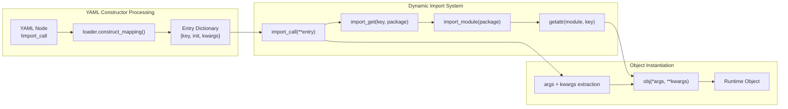
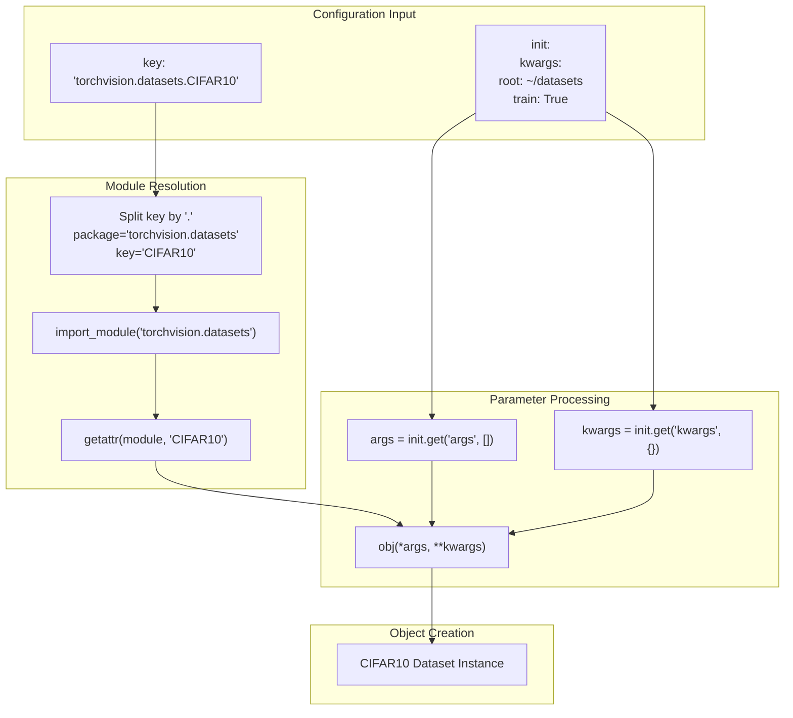
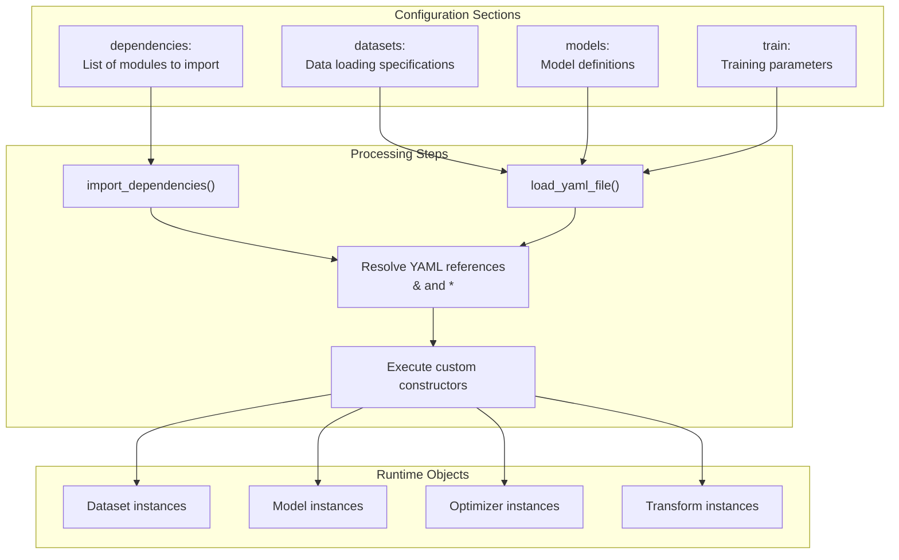
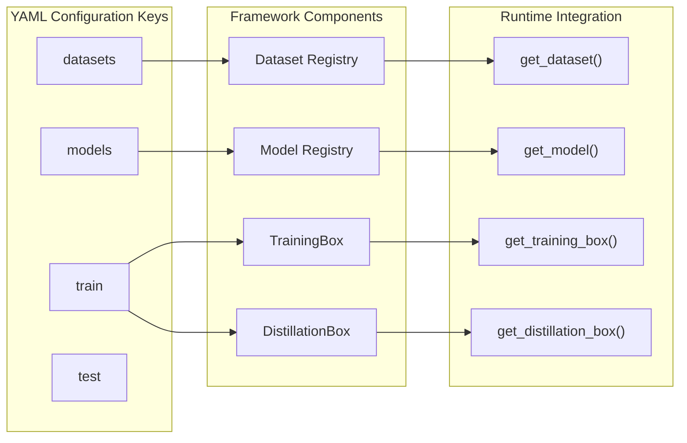
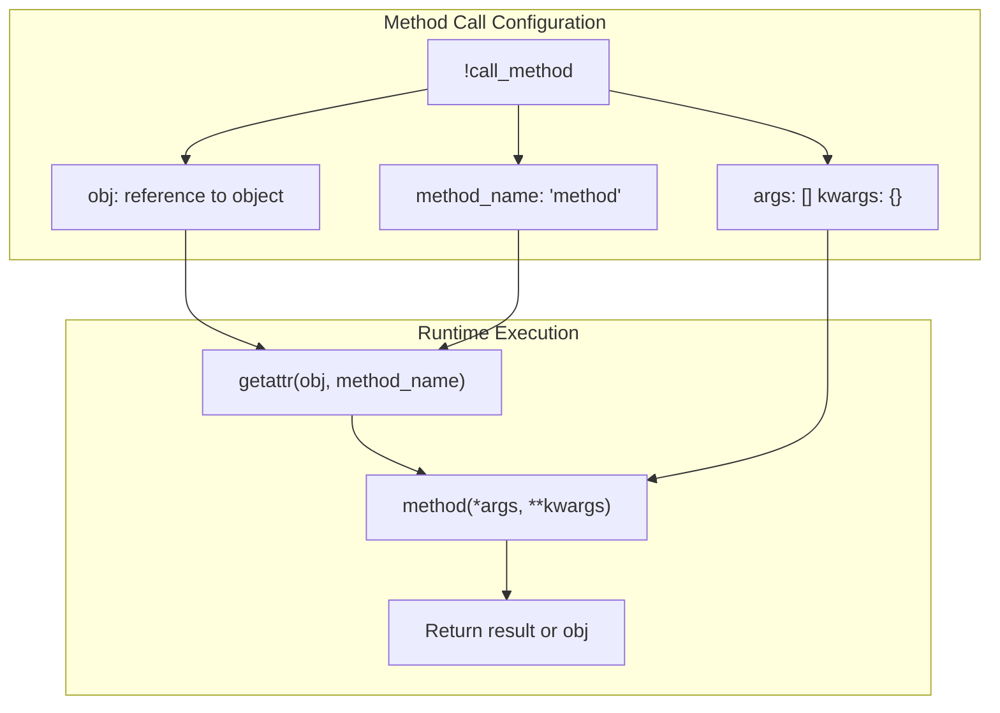
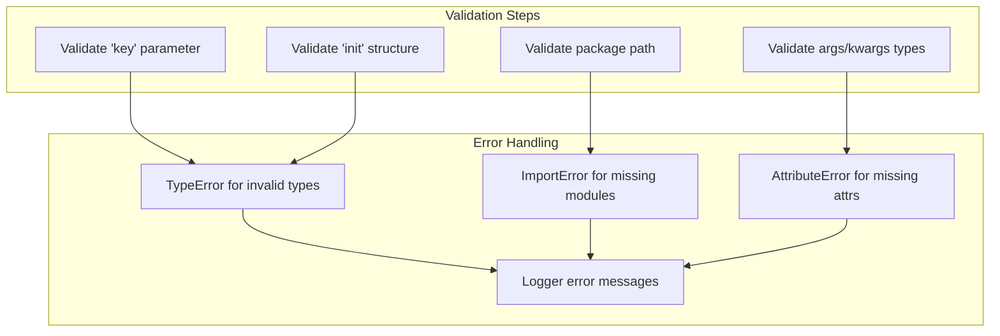

<!-- source: DeepWiki mcp.deepwiki.com · repo yoshitomo-matsubara/torchdistill · page 2.1 Configuration-Driven System · fetched 2026-10-21 -->

# Configuration-Driven System

<details>
<summary>Relevant source files</summary>

The following files were used as context for generating this wiki page:

- [README.md](README.md)
- [configs/README.md](configs/README.md)
- [demo/extract_intermediate_representations.ipynb](demo/extract_intermediate_representations.ipynb)
- [torchdistill/common/file_util.py](torchdistill/common/file_util.py)
- [torchdistill/common/main_util.py](torchdistill/common/main_util.py)
- [torchdistill/common/misc_util.py](torchdistill/common/misc_util.py)
- [torchdistill/common/module_util.py](torchdistill/common/module_util.py)
- [torchdistill/common/yaml_util.py](torchdistill/common/yaml_util.py)

</details>


The Configuration-Driven System is the foundation of torchdistill's declarative approach to machine learning experiments. This system enables users to define complete training and distillation experiments using YAML configuration files instead of writing Python code, making experiments reproducible and easily shareable.

This document covers the YAML-based configuration system, custom constructors, and dynamic object instantiation mechanisms. For information about how configurations are used in training pipelines, see [Training and Distillation Framework](#2.2). For details about component registration that works alongside this system, see [Component Registry System](#2.3).

## Core Configuration Architecture

The configuration system transforms declarative YAML specifications into runtime Python objects through a two-stage process: YAML parsing with custom constructors and dynamic object instantiation.



**Sources:** [README.md:66-139](), [torchdistill/common/yaml_util.py:179-203]()

## YAML Custom Constructors

The system extends PyYAML with custom constructors that enable dynamic object creation directly within YAML files. These constructors bridge the gap between declarative configuration and imperative Python code.

| Constructor | Function | Purpose |
|-------------|----------|---------|
| `!import_call` | `yaml_import_call()` | Import and instantiate objects |
| `!import_get` | `yaml_import_get()` | Import and get attributes |
| `!pathjoin` | `yaml_pathjoin()` | Join file paths |
| `!expanduser` | `yaml_expanduser()` | Expand user home directory |
| `!join` | `yaml_join()` | Join strings |
| `!getattr` | `yaml_getattr()` | Get object attributes |
| `!call_method` | `yaml_call_method()` | Call object methods |



**Sources:** [torchdistill/common/yaml_util.py:86-98](), [torchdistill/common/main_util.py:75-100]()

## Dynamic Object Creation

The `import_call` function serves as the core mechanism for dynamic object instantiation, supporting flexible module loading and parameter passing.

### Import and Instantiation Flow



**Sources:** [torchdistill/common/main_util.py:75-100](), [README.md:82-135]()

## Configuration File Structure

Configuration files follow a hierarchical structure that maps to framework components:

### Example Configuration Breakdown

```yaml
dependencies:
  - torchvision.transforms

datasets:
  cifar10/train: !import_call
    key: 'torchvision.datasets.CIFAR10'
    init:
      kwargs:
        root: &root_dir '~/datasets/cifar10'
        train: True
        transform: !import_call
          key: 'torchvision.transforms.Compose'
          init:
            kwargs:
              transforms:
                - !import_call
                  key: 'torchvision.transforms.ToTensor'
                  init:
```

### Configuration Processing Pipeline



**Sources:** [torchdistill/common/main_util.py:18-51](), [README.md:73-79]()

## Integration with Framework Components

The configuration system integrates with torchdistill's core components through standardized interfaces:

### Configuration to Component Mapping



**Sources:** [README.md:146-158](), [torchdistill/common/yaml_util.py:190-201]()

## Advanced Configuration Features

### Path Handling and File Operations

The system provides specialized constructors for file path operations:

| Constructor | Usage | Example |
|-------------|-------|---------|
| `!pathjoin` | Join path components | `!pathjoin [~, datasets, cifar10]` |
| `!expanduser` | Expand `~` to home directory | `!expanduser ~/datasets` |
| `!abspath` | Convert to absolute path | `!abspath ./configs` |

### Dynamic Method Calls



**Sources:** [torchdistill/common/yaml_util.py:116-128](), [torchdistill/common/main_util.py:135-163]()

## Error Handling and Validation

The configuration system includes robust error handling for common configuration issues:

### Import Resolution Errors

The `import_call` function handles various error conditions:
- Missing modules or packages
- Invalid attribute names
- Incorrect initialization parameters
- Type validation for arguments

### Configuration Validation



**Sources:** [torchdistill/common/main_util.py:75-100](), [torchdistill/common/main_util.py:18-51]()

---

