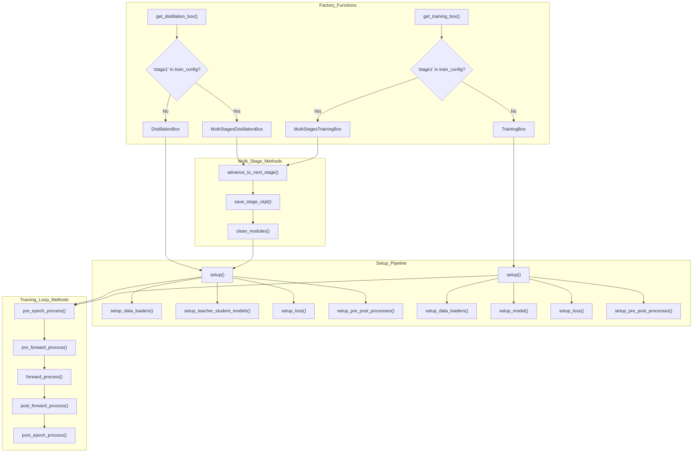
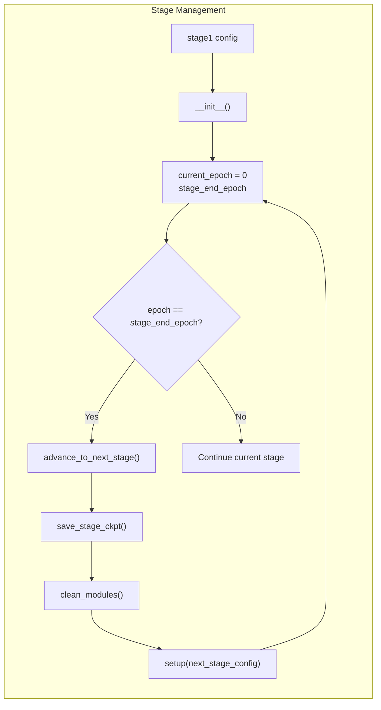
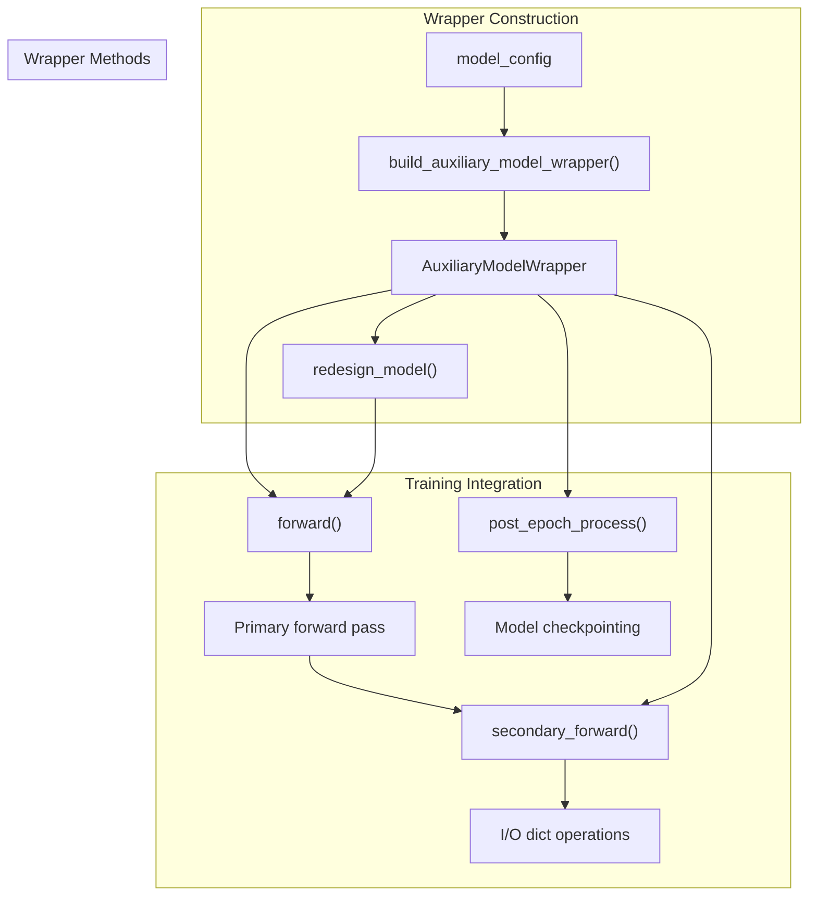
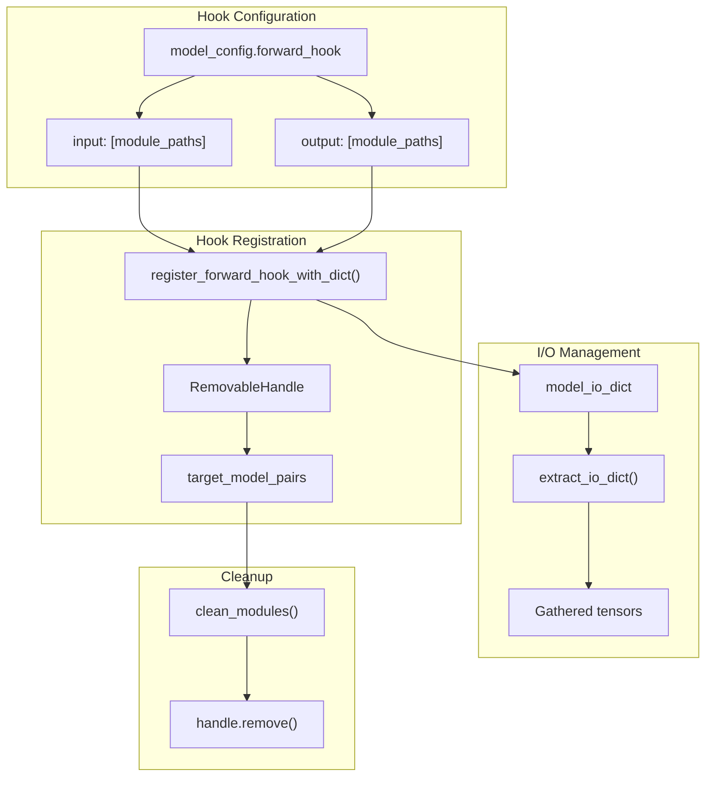
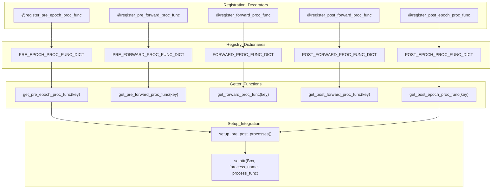
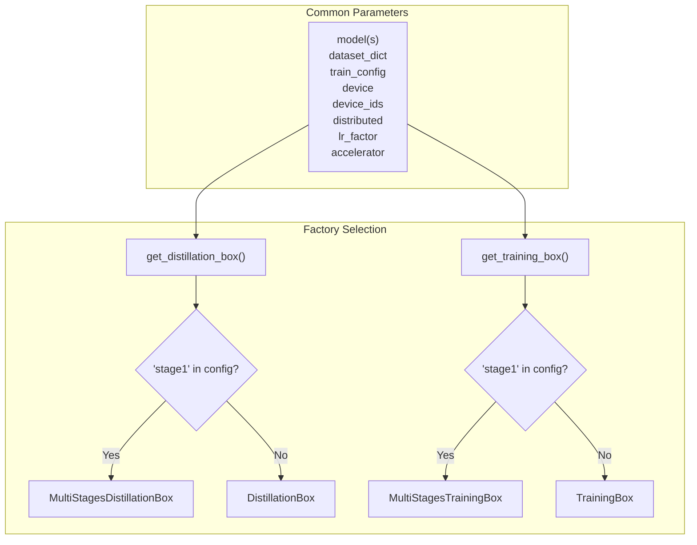

<!-- source: DeepWiki mcp.deepwiki.com · repo yoshitomo-matsubara/torchdistill · page 2.2 Training and Distillation Framework · fetched 2026-10-21 -->

# Training and Distillation Framework

<details>
<summary>Relevant source files</summary>

The following files were used as context for generating this wiki page:

- [torchdistill/core/__init__.py](torchdistill/core/__init__.py)
- [torchdistill/core/distillation.py](torchdistill/core/distillation.py)
- [torchdistill/core/forward_hook.py](torchdistill/core/forward_hook.py)
- [torchdistill/core/interfaces/__init__.py](torchdistill/core/interfaces/__init__.py)
- [torchdistill/core/interfaces/forward_proc.py](torchdistill/core/interfaces/forward_proc.py)
- [torchdistill/core/interfaces/post_epoch_proc.py](torchdistill/core/interfaces/post_epoch_proc.py)
- [torchdistill/core/interfaces/post_forward_proc.py](torchdistill/core/interfaces/post_forward_proc.py)
- [torchdistill/core/interfaces/pre_epoch_proc.py](torchdistill/core/interfaces/pre_epoch_proc.py)
- [torchdistill/core/interfaces/pre_forward_proc.py](torchdistill/core/interfaces/pre_forward_proc.py)
- [torchdistill/core/interfaces/registry.py](torchdistill/core/interfaces/registry.py)
- [torchdistill/core/training.py](torchdistill/core/training.py)
- [torchdistill/core/util.py](torchdistill/core/util.py)
- [torchdistill/models/wrapper.py](torchdistill/models/wrapper.py)

</details>


This document covers the core training and distillation orchestration framework that manages model training workflows, including both standard training and knowledge distillation scenarios. The framework provides unified interfaces for single-stage and multi-stage training with support for auxiliary model wrappers and forward hook management.

For information about the configuration system that drives this framework, see [Configuration-Driven System](#2.1). For details about specific loss functions and model architectures, see [Loss Functions](#3.3) and [Model Architectures](#3.2).

## Core Architecture Overview

The training framework is built around two primary orchestration classes: `DistillationBox` for knowledge distillation and `TrainingBox` for standard training. Both classes follow a similar architecture pattern but differ in their handling of teacher-student relationships.



**Core Training Framework Architecture**

The framework provides factory functions that automatically select the appropriate box type based on configuration structure and provides consistent method interfaces for setup, training loop management, and multi-stage progression.

Sources: [torchdistill/core/distillation.py:28-567](), [torchdistill/core/training.py:24-415]()

## DistillationBox vs TrainingBox

The framework provides two primary orchestration classes that share similar interfaces but handle different training scenarios.

### DistillationBox

The `DistillationBox` class orchestrates knowledge distillation training with both teacher and student models:

| Component | Method/Attribute | Purpose | Line Reference |
|-----------|------------------|---------|----------------|
| Model Setup | `setup_teacher_student_models()` | Configures both teacher and student models with auxiliary wrappers | [torchdistill/core/distillation.py:73-134]() |
| Forward Process | `get_teacher_output()` | Handles teacher inference with caching support | [torchdistill/core/distillation.py:326-398]() |
| I/O Management | `teacher_io_dict`, `student_io_dict` | Separate I/O dictionaries for both models | [torchdistill/core/distillation.py:299]() |
| Hook Management | `target_teacher_pairs`, `target_student_pairs` | Forward hooks for both models | [torchdistill/core/distillation.py:298]() |
| Training Loop | `forward_process()` | Coordinates teacher/student forward passes | [torchdistill/core/distillation.py:400-425]() |

### TrainingBox

The `TrainingBox` class handles standard single-model training:

| Component | Method/Attribute | Purpose | Line Reference |
|-----------|------------------|---------|----------------|
| Model Setup | `setup_model()` | Configures single model with auxiliary wrapper | [torchdistill/core/training.py:67-98]() |
| Forward Process | `forward_process()` | Standard forward computation | [torchdistill/core/training.py:261-284]() |
| I/O Management | `model_io_dict` | Single I/O dictionary | [torchdistill/core/training.py:234]() |
| Hook Management | `target_model_pairs` | Forward hooks for single model | [torchdistill/core/training.py:233]() |

```mermaid
graph TD
    subgraph "DistillationBox_Flow"
        teacher_model["teacher_model"] --> get_teacher_output["get_teacher_output()"]
        student_model["student_model"] --> student_forward_proc["student_forward_proc()"]
        
        get_teacher_output --> teacher_io_dict["teacher_io_dict"]
        student_forward_proc --> student_io_dict["student_io_dict"]
        
        teacher_io_dict --> forward_process_d["forward_process()"]
        student_io_dict --> forward_process_d
        
        forward_process_d --> criterion_d["criterion(io_dict, model_loss_dict, targets)"]
        
        target_teacher_pairs["target_teacher_pairs"] --> clean_modules_d["clean_modules()"]
        target_student_pairs["target_student_pairs"] --> clean_modules_d
    end
    
    subgraph "TrainingBox_Flow"
        model["model"] --> model_forward_proc["model_forward_proc()"]
        model_forward_proc --> model_io_dict["model_io_dict"]
        
        model_io_dict --> forward_process_t["forward_process()"]
        forward_process_t --> criterion_t["criterion(io_dict, model_loss_dict, targets)"]
        
        target_model_pairs["target_model_pairs"] --> clean_modules_t["clean_modules()"]
    end
    
    subgraph "Shared_Setup_Methods"
        setup_data_loaders["setup_data_loaders()"]
        setup_loss["setup_loss()"]
        setup_pre_post_processes["setup_pre_post_processes()"]
        
        setup_data_loaders --> train_data_loader["train_data_loader"]
        setup_data_loaders --> val_data_loader["val_data_loader"]
        setup_loss --> criterion["criterion"]
        setup_pre_post_processes --> setattr_processes["setattr(Box, 'process_name', process_func)"]
    end
```



**Box Architecture and Data Flow Comparison**

Sources: [torchdistill/core/distillation.py:400-425](), [torchdistill/core/training.py:261-284](), [torchdistill/core/distillation.py:443-456]()

## Multi-Stage Training Support

Both `DistillationBox` and `TrainingBox` support multi-stage training through their respective multi-stage subclasses that manage stage progression and checkpoint saving.

### Stage Configuration

Multi-stage training is identified by the presence of `stage1`, `stage2`, etc. keys in the configuration:



**Multi-Stage Training Flow**

### Stage Advancement Process

The `advance_to_next_stage()` method handles the transition between training stages:

1. **Checkpoint Saving**: Models are saved via `save_stage_ckpt()`
2. **Cleanup**: `clean_modules()` unfreezes parameters and clears I/O dictionaries
3. **Reconfiguration**: `setup()` is called with the next stage's configuration
4. **Epoch Tracking**: Stage boundaries are updated

Sources: [torchdistill/core/distillation.py:509-533](), [torchdistill/core/training.py:362-385]()

## AuxiliaryModelWrapper Integration

The framework integrates with specialized knowledge distillation methods through the `AuxiliaryModelWrapper` system, providing extensions for specific distillation techniques.

### Wrapper Types

| Wrapper Class | Purpose | Distillation Method |
|---------------|---------|-------------------|
| `Teacher4FactorTransfer` | Teacher wrapper with paraphraser | Factor Transfer (FT) |
| `Student4FactorTransfer` | Student wrapper with translator | Factor Transfer (FT) |
| `Connector4DAB` | Student wrapper with connectors | Distillation of Activation Boundaries |
| `VariationalDistributor4VID` | Student wrapper with regressors | Variational Information Distillation |
| `Linear4CRD` | Teacher/Student wrapper with normalizer | Contrastive Representation Distillation |
| `SSWrapper4SSKD` | Self-supervision wrapper | Self-Supervised Knowledge Distillation |

### Wrapper Integration Flow



**AuxiliaryModelWrapper Integration**

The framework calls `secondary_forward()` after the primary forward pass to enable auxiliary computations, and `post_epoch_process()` for checkpoint management.

Sources: [torchdistill/models/wrapper.py:16-604](), [torchdistill/core/distillation.py:94-122]()

## Forward Hook Integration

The training framework integrates with the forward hook system to capture intermediate representations from models during training.

### Hook Setup Process

The `set_hooks()` function establishes forward hooks based on model configuration:



**Forward Hook Integration Flow**

### Hook Management

The framework maintains lists of `(module_path, handle)` pairs for cleanup:

- **DistillationBox**: `target_teacher_pairs` and `target_student_pairs`
- **TrainingBox**: `target_model_pairs`

During `clean_modules()`, all registered hooks are removed and I/O dictionaries are cleared.

Sources: [torchdistill/core/util.py:36-66](), [torchdistill/core/distillation.py:443-456](), [torchdistill/core/training.py:302-311]()

## Process Interfaces

The framework provides configurable interfaces for customizing training behavior at key points in the training loop through registered process functions.

### Interface Registry



**Process Interface Registry System**

### Default Process Functions

The framework provides default implementations for each process stage:

| Process Stage | Default Function | Purpose | Line Reference |
|---------------|------------------|---------|----------------|
| Pre-Epoch | `default_pre_epoch_process_with_teacher` | Clear I/O dicts, set training mode | [torchdistill/core/interfaces/pre_epoch_proc.py:11-24]() |
| Pre-Forward | `default_pre_forward_process` | Empty default implementation | [torchdistill/core/interfaces/pre_forward_proc.py:8-9]() |
| Forward | `forward_batch_only` | Standard forward with batch only | [torchdistill/core/interfaces/forward_proc.py:22-37]() |
| Post-Forward | `default_post_forward_process` | Gradient computation and optimizer step | [torchdistill/core/interfaces/post_forward_proc.py:11-48]() |
| Post-Epoch | `default_post_epoch_process_with_teacher` | Learning rate scheduling | [torchdistill/core/interfaces/post_epoch_proc.py:12-35]() |

### Process Function Assignment

During setup, process functions are dynamically assigned to the box classes using `setattr()`:

```python
# Example from setup_pre_post_processes()
pre_epoch_process = get_pre_epoch_proc_func(train_config['pre_epoch_process'])
setattr(DistillationBox, 'pre_epoch_process', pre_epoch_process)
```

The `setup_pre_post_processes()` method assigns process functions to the class itself, allowing runtime customization of training behavior based on configuration.

Sources: [torchdistill/core/interfaces/registry.py:1-280](), [torchdistill/core/distillation.py:149-174](), [torchdistill/core/interfaces/pre_epoch_proc.py:11-40](), [torchdistill/core/interfaces/post_forward_proc.py:11-48]()

## Framework Instantiation

The framework provides factory functions that automatically select the appropriate box type based on configuration structure.

### Factory Functions



**Framework Factory Functions**

### Usage Pattern

The framework is typically instantiated through configuration-driven scripts that:

1. Load models and datasets through the component registry
2. Call the appropriate factory function based on training mode
3. Execute training loops using the box's process interfaces

The unified interface allows the same training loop code to work with both single-stage and multi-stage training, as well as standard training and knowledge distillation scenarios.

Sources: [torchdistill/core/distillation.py:536-566](), [torchdistill/core/training.py:388-415]()

---

