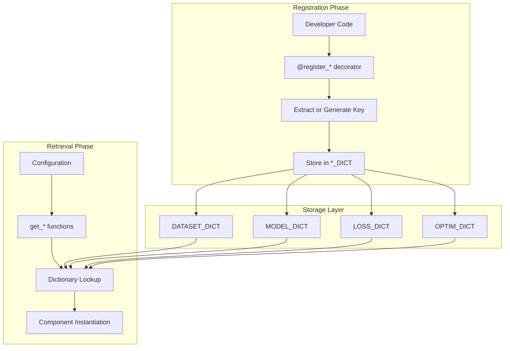
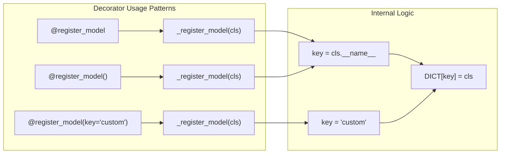
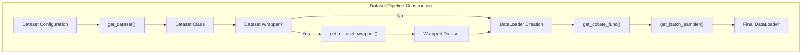
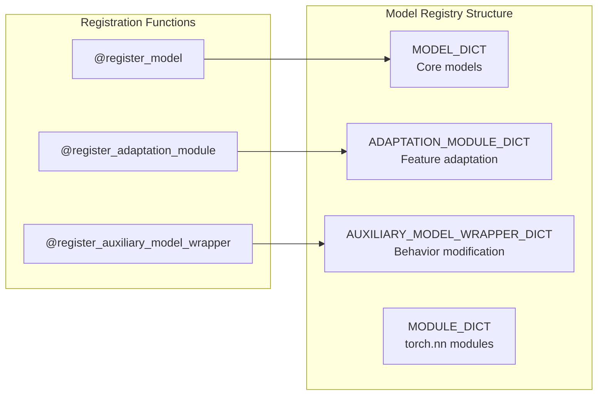
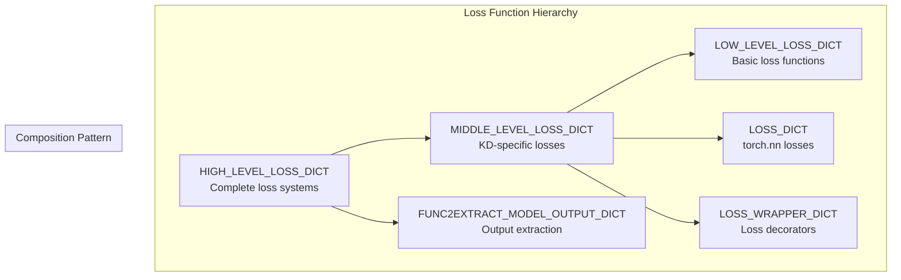
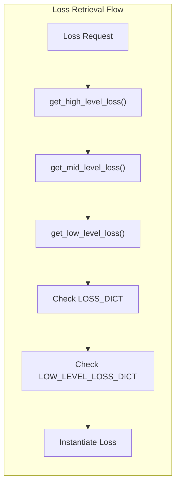
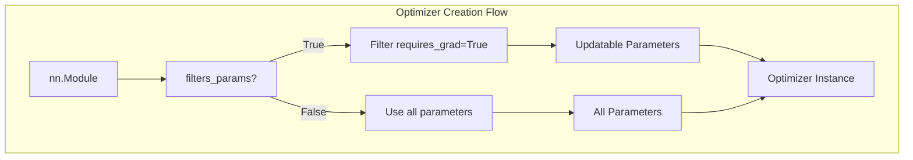
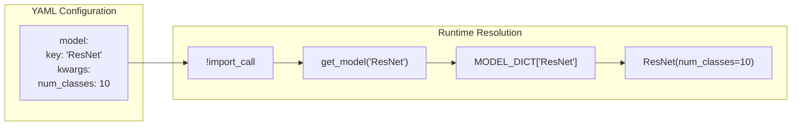

<!-- source: DeepWiki mcp.deepwiki.com · repo yoshitomo-matsubara/torchdistill · page 2.3 Component Registry System · fetched 2026-10-21 -->

# Component Registry System

<details>
<summary>Relevant source files</summary>

The following files were used as context for generating this wiki page:

- [examples/legacy/hf_transformers/custom/loss.py](examples/legacy/hf_transformers/custom/loss.py)
- [tests/registry_test.py](tests/registry_test.py)
- [torchdistill/datasets/__init__.py](torchdistill/datasets/__init__.py)
- [torchdistill/datasets/registry.py](torchdistill/datasets/registry.py)
- [torchdistill/datasets/sample_loader.py](torchdistill/datasets/sample_loader.py)
- [torchdistill/datasets/util.py](torchdistill/datasets/util.py)
- [torchdistill/datasets/wrapper.py](torchdistill/datasets/wrapper.py)
- [torchdistill/losses/__init__.py](torchdistill/losses/__init__.py)
- [torchdistill/losses/high_level.py](torchdistill/losses/high_level.py)
- [torchdistill/losses/registry.py](torchdistill/losses/registry.py)
- [torchdistill/losses/util.py](torchdistill/losses/util.py)
- [torchdistill/models/registry.py](torchdistill/models/registry.py)
- [torchdistill/optim/__init__.py](torchdistill/optim/__init__.py)
- [torchdistill/optim/registry.py](torchdistill/optim/registry.py)
- [torchdistill/optim/scheduler.py](torchdistill/optim/scheduler.py)

</details>


The Component Registry System is torchdistill's central mechanism for managing and instantiating modular components such as models, datasets, loss functions, optimizers, and schedulers. It provides a decorator-based registration pattern that enables dynamic component lookup and instantiation through string-based keys, facilitating the framework's configuration-driven architecture.

This document covers the registry pattern implementation and component-specific registries. For information about how these registries integrate with YAML configuration files, see [Configuration-Driven System](#2.1). For details about the training pipeline that uses these registered components, see [Training and Distillation Framework](#2.2).

## Registry Pattern Architecture

The registry system implements a consistent pattern across all component types: registration through decorators, storage in dictionaries, and retrieval through getter functions.

### Core Registry Pattern



The pattern supports two registration modes:
- **Automatic key generation**: Uses the class or function name as the registry key
- **Custom key specification**: Allows explicit key assignment via the `key` parameter

Sources: [tests/registry_test.py:1-458](), [torchdistill/datasets/registry.py:16-55](), [torchdistill/models/registry.py:11-51]()

### Registration Decorator Implementation

All registry decorators follow a consistent implementation pattern that handles both parameterized and non-parameterized decoration:



Sources: [torchdistill/datasets/registry.py:45-55](), [torchdistill/models/registry.py:41-51](), [torchdistill/losses/registry.py:127-137]()

## Dataset Registry System

The dataset registry manages dataset classes, data loading utilities, and preprocessing components.

### Dataset Registry Components

| Registry Dictionary | Purpose | Registration Decorator |
|---------------------|---------|----------------------|
| `DATASET_DICT` | Dataset classes | `@register_dataset` |
| `COLLATE_FUNC_DICT` | Batch collation functions | `@register_collate_func` |
| `SAMPLE_LOADER_DICT` | Sample loading classes | `@register_sample_loader` |
| `BATCH_SAMPLER_DICT` | Batch sampling strategies | `@register_batch_sampler` |
| `TRANSFORM_DICT` | Data transformation functions | `@register_transform` |
| `DATASET_WRAPPER_DICT` | Dataset wrapper classes | `@register_dataset_wrapper` |

The dataset registry pre-populates with standard PyTorch components:
- `DATASET_DICT` includes all `torchvision.datasets` classes
- `BATCH_SAMPLER_DICT` includes all `torch.utils.data.sampler` classes

Sources: [torchdistill/datasets/registry.py:5-14](), [torchdistill/datasets/registry.py:269-359]()

### Dataset Registry Usage Flow



Sources: [torchdistill/datasets/util.py:69-119](), [torchdistill/datasets/registry.py:269-359]()

## Model Registry System

The model registry manages neural network architectures, adaptation modules, and auxiliary model wrappers for knowledge distillation.

### Model Registry Components



The `get_model()` function supports both registry lookup and PyTorch Hub loading via the optional `repo_or_dir` parameter.

Sources: [torchdistill/models/registry.py:5-8](), [torchdistill/models/registry.py:140-155](), [torchdistill/models/registry.py:158-185]()

## Loss Function Registry System

The loss registry implements a hierarchical structure with three levels of loss abstraction.

### Loss Registry Hierarchy



### Loss Registry Retrieval Chain

The loss retrieval functions implement a fallback chain that searches multiple dictionaries:



Sources: [torchdistill/losses/registry.py:3-8](), [torchdistill/losses/registry.py:225-279](), [torchdistill/losses/registry.py:304-317]()

## Optimizer and Scheduler Registry

The optimization registry manages PyTorch optimizers and learning rate schedulers with automatic parameter filtering.

### Optimizer Registry Features

The `get_optimizer()` function includes built-in parameter filtering:



Both registries pre-populate from PyTorch modules:
- `OPTIM_DICT` from `torch.optim`
- `SCHEDULER_DICT` from `torch.optim.lr_scheduler`

Sources: [torchdistill/optim/registry.py:5-6](), [torchdistill/optim/registry.py:95-116](), [torchdistill/optim/registry.py:119-132]()

## Integration with Configuration System

The registry system integrates seamlessly with torchdistill's YAML-based configuration through the `!import_call` mechanism.

### Configuration-to-Registry Flow



This pattern enables declarative component specification in configuration files while maintaining type safety and IDE support through the registry system.

Sources: [torchdistill/datasets/util.py:93-94](), [torchdistill/datasets/util.py:112-115]()

## Custom Component Registration Examples

### Registering Custom Components

The registry system supports multiple registration patterns for custom components:

```python
# Automatic key (class name)
@register_model
class MyCustomModel(nn.Module):
    pass

# Custom key
@register_dataset(key='my_special_dataset')
class SpecialDataset(Dataset):
    pass

# Function registration
@register_collate_func
def custom_collate_fn(batch):
    return batch
```

### Pre-populated Registries

Several registries automatically include standard PyTorch components:
- **Dataset Registry**: All `torchvision.datasets` classes
- **Model Registry**: All `torch.nn` modules via `MODULE_DICT`
- **Loss Registry**: All `torch.nn.modules.loss` classes
- **Optimizer Registry**: All `torch.optim` classes
- **Scheduler Registry**: All `torch.optim.lr_scheduler` classes

Sources: [torchdistill/datasets/registry.py:12-13](), [torchdistill/models/registry.py:8](), [torchdistill/losses/registry.py:3](), [torchdistill/optim/registry.py:5-6]()

---

