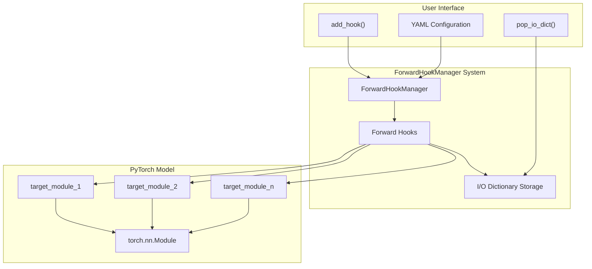
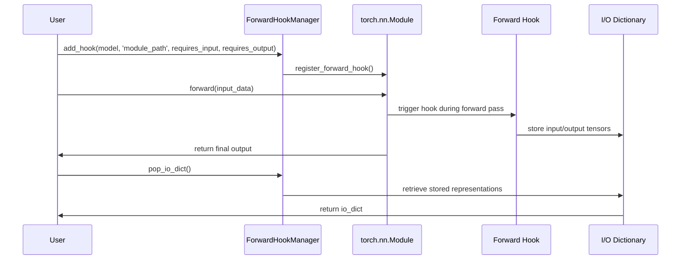
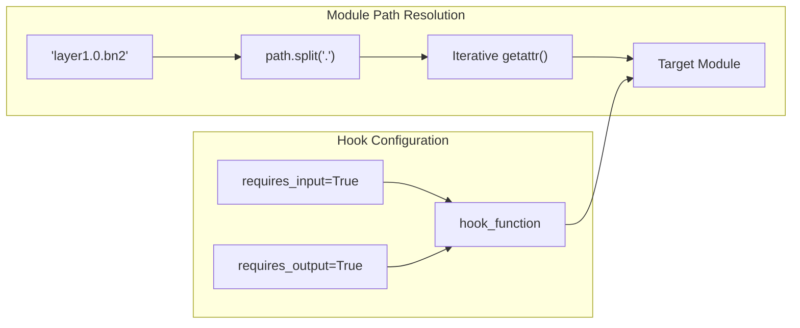
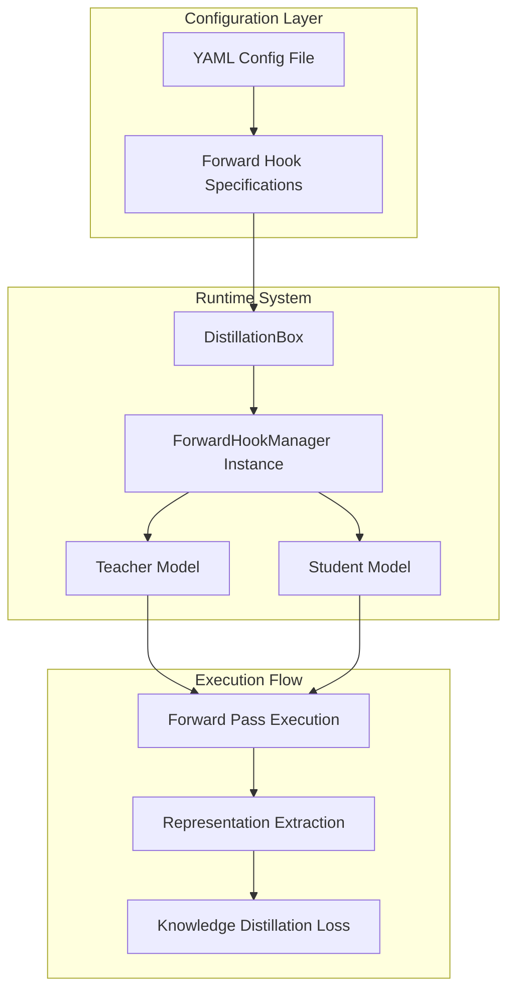
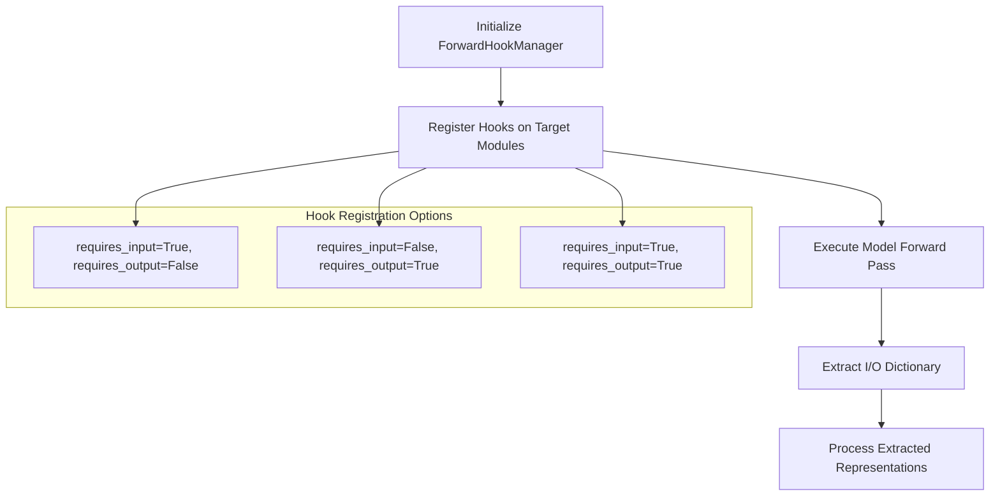
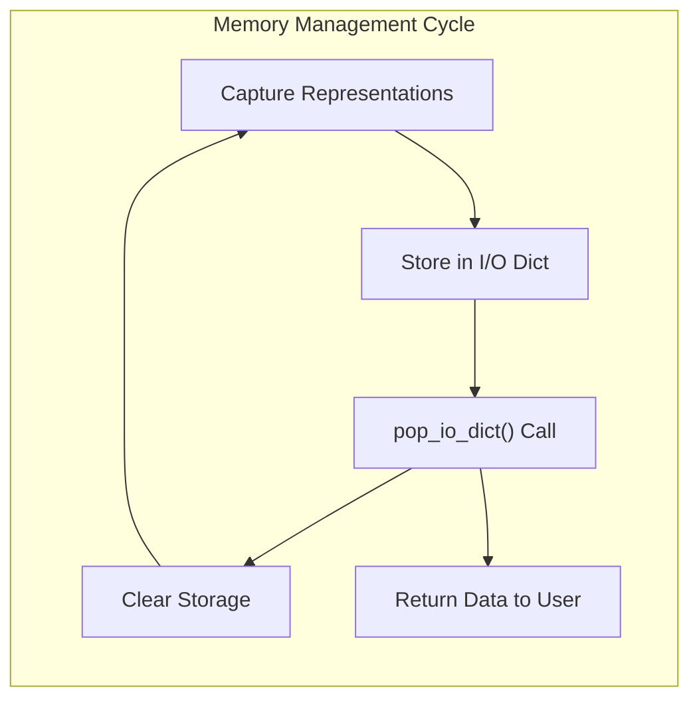

<!-- source: DeepWiki mcp.deepwiki.com · repo yoshitomo-matsubara/torchdistill · page 2.4 Forward Hook Manager · fetched 2026-10-21 -->

# Forward Hook Manager

Relevant source files

The following files were used as context for generating this wiki page:

- [README.md](README.md)
- [configs/README.md](configs/README.md)
- [demo/extract_intermediate_representations.ipynb](demo/extract_intermediate_representations.ipynb)

The Forward Hook Manager is a core component of torchdistill that enables extraction of intermediate representations from neural networks without modifying model implementations. This system provides a clean, non-intrusive way to capture inputs and outputs from specific modules during forward passes, which is essential for knowledge distillation methods that require access to internal model states.

For information about the broader training framework that utilizes these extracted representations, see [Training and Distillation Framework](#2.2). For details on how intermediate representations are used in loss computations, see [Loss Functions](#3.3).

## Architecture Overview

The Forward Hook Manager operates as an intermediary layer between model execution and representation extraction, leveraging PyTorch's built-in forward hook mechanism to capture data at specified module boundaries.

### Core Components

Sources: [README.md:32-63](), [demo/extract_intermediate_representations.ipynb:49-69]()

### Data Flow Architecture

The Forward Hook Manager captures data during model execution through a well-defined pipeline:

Sources: [demo/extract_intermediate_representations.ipynb:88-119]()

## Core API Components

### ForwardHookManager Class

The `ForwardHookManager` class serves as the primary interface for registering hooks and managing captured representations.

| Method | Purpose | Parameters |
|--------|---------|------------|
| `__init__(device)` | Initialize manager with target device | `device`: torch device for tensor storage |
| `add_hook(model, module_path, requires_input, requires_output)` | Register forward hook on specified module | `model`: target model, `module_path`: string path to module, `requires_input`/`requires_output`: boolean flags |
| `pop_io_dict()` | Retrieve and clear stored representations | Returns dictionary of captured inputs/outputs |

Sources: [README.md:48-62](), [demo/extract_intermediate_representations.ipynb:62-68]()

### Hook Registration Patterns

The system supports flexible hook registration through module path specifications:

Sources: [demo/extract_intermediate_representations.ipynb:66-68]()

## Integration with Knowledge Distillation

The Forward Hook Manager is deeply integrated with torchdistill's knowledge distillation pipeline, providing the mechanism for extracting teacher and student representations.

### Configuration-Driven Hook Management

Forward hooks can be specified declaratively in YAML configuration files, eliminating the need for programmatic hook registration in many cases.

Sources: [README.md:10-18]()

## Practical Usage Patterns

### Basic Representation Extraction

The most common usage pattern involves three steps: hook registration, model execution, and representation retrieval.

Sources: [demo/extract_intermediate_representations.ipynb:62-68]()

### Multi-Model Hook Management

For knowledge distillation scenarios, the Forward Hook Manager can simultaneously manage hooks across teacher and student models.

| Use Case | Hook Strategy | Data Captured |
|----------|---------------|---------------|
| Feature Matching | Same module paths in both models | Intermediate feature maps |
| Attention Transfer | Attention layer outputs | Attention weights and maps |
| Logit Distillation | Final classifier outputs | Pre-softmax logits |
| Layer-wise Distillation | Multiple intermediate layers | Progressive feature representations |

Sources: [README.md:32-35]()

## Advanced Features

### Device Management

The Forward Hook Manager handles device placement automatically, ensuring captured representations are moved to the specified device for consistent processing.

### Memory Efficiency

The `pop_io_dict()` method clears stored representations after retrieval, preventing memory accumulation during long training runs.

Sources: [demo/extract_intermediate_representations.ipynb:118-119]()

## Example Usage Validation

The system provides built-in validation capabilities to ensure captured representations match expected model behavior:

- Input validation: Verifying that captured inputs match original model inputs
- Output validation: Confirming that captured outputs match final model outputs  
- Consistency checks: Ensuring intermediate representations maintain expected tensor properties

Sources: [demo/extract_intermediate_representations.ipynb:130-176]()

The Forward Hook Manager eliminates the need to modify model implementations for intermediate representation access, providing a clean separation between model architecture and feature extraction requirements. This design enables torchdistill to work with arbitrary PyTorch models while maintaining the flexibility needed for diverse knowledge distillation methods.

---

