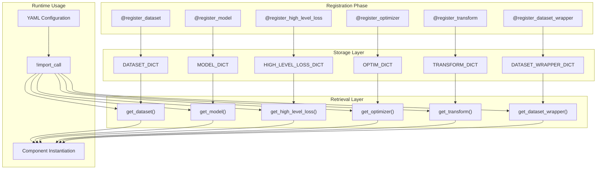
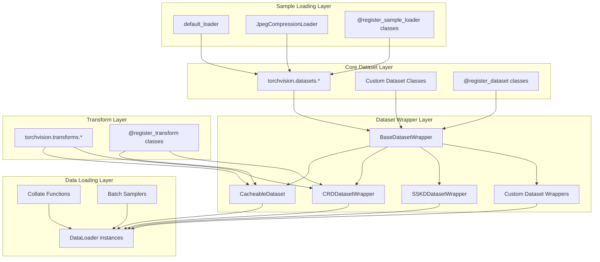
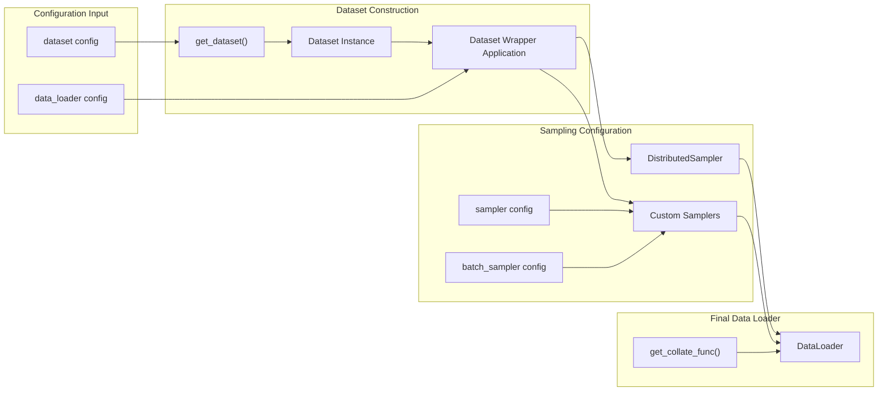
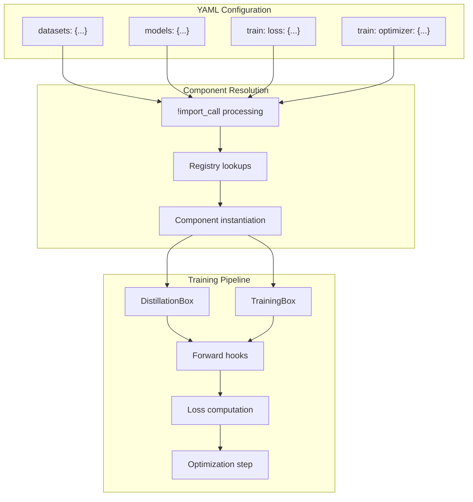

<!-- source: DeepWiki mcp.deepwiki.com · repo yoshitomo-matsubara/torchdistill · page 3 Components · fetched 2026-10-21 -->

# Components

<details>
<summary>Relevant source files</summary>

The following files were used as context for generating this wiki page:

- [tests/registry_test.py](tests/registry_test.py)
- [torchdistill/datasets/__init__.py](torchdistill/datasets/__init__.py)
- [torchdistill/datasets/registry.py](torchdistill/datasets/registry.py)
- [torchdistill/datasets/sample_loader.py](torchdistill/datasets/sample_loader.py)
- [torchdistill/datasets/util.py](torchdistill/datasets/util.py)
- [torchdistill/datasets/wrapper.py](torchdistill/datasets/wrapper.py)

</details>


This document covers the major component categories in torchdistill and their registration system. Components are the building blocks that can be dynamically selected and configured through YAML configuration files. The framework provides registries for datasets, models, loss functions, and optimization components.

For detailed information about the core registry architecture, see [Component Registry System](#2.3). For configuration-driven usage patterns, see [Configuration-Driven System](#2.1).

## Registry Pattern Overview

All components in torchdistill follow a consistent registry pattern that enables dynamic component selection and instantiation through decorators and lookup functions.

### Registry Architecture



Sources: [tests/registry_test.py:1-458](), [torchdistill/datasets/registry.py:1-360]()

### Registration Decorators

The registry system provides decorators for component registration that support both default and custom keys:

| Decorator | Purpose | Registry Dict |
|-----------|---------|---------------|
| `@register_dataset` | Dataset classes | `DATASET_DICT` |
| `@register_collate_func` | Collate functions | `COLLATE_FUNC_DICT` |
| `@register_sample_loader` | Sample loader classes | `SAMPLE_LOADER_DICT` |
| `@register_batch_sampler` | Batch sampler classes | `BATCH_SAMPLER_DICT` |
| `@register_transform` | Transform classes | `TRANSFORM_DICT` |
| `@register_dataset_wrapper` | Dataset wrapper classes | `DATASET_WRAPPER_DICT` |

Sources: [torchdistill/datasets/registry.py:16-267](), [tests/registry_test.py:20-173]()

## Dataset Management Components

Dataset management is handled through a multi-layered system of datasets, transforms, wrappers, and loaders that work together to provide flexible data processing pipelines.

### Dataset Component Hierarchy



Sources: [torchdistill/datasets/wrapper.py:27-159](), [torchdistill/datasets/sample_loader.py:11-32](), [torchdistill/datasets/util.py:69-119]()

### Dataset Wrapper Types

The framework provides several dataset wrapper implementations:

#### BaseDatasetWrapper
The base wrapper class that extends the original dataset to return supplementary data:

```python
# Returns (sample, target, supp_dict) instead of (sample, target)
def __getitem__(self, index):
    sample, target = self.org_dataset.__getitem__(index)
    return sample, target, dict()
```

#### CacheableDataset
Extends `BaseDatasetWrapper` to support cached data loading from disk:

```python
def __getitem__(self, index):
    sample, target, supp_dict = super().__getitem__(index)
    cache_file_path = os.path.join(self.cache_dir_path, self.idx2subath_func(index) + self.ext)
    if file_util.check_if_exists(cache_file_path):
        cached_data = torch.load(cache_file_path)
        supp_dict['cached_data'] = cached_data
    return sample, target, supp_dict
```

#### Specialized Knowledge Distillation Wrappers
- `CRDDatasetWrapper`: Provides contrastive samples for Contrastive Representation Distillation
- `SSKDDatasetWrapper`: Generates rotated samples for Self-Supervised Knowledge Distillation

Sources: [torchdistill/datasets/wrapper.py:27-159]()

### Data Loading Pipeline

The data loading pipeline integrates multiple components through the `build_data_loader` function:



Sources: [torchdistill/datasets/util.py:69-119]()

## Model Architecture Components

Model components are registered through the model registry system and include standard architectures, custom models, and auxiliary wrappers that modify model behavior during training.

### Model Registry Categories

| Registry | Purpose | Usage |
|----------|---------|-------|
| `MODEL_DICT` | Standard model architectures | Teacher/student models |
| `ADAPTATION_MODULE_DICT` | Feature adaptation modules | Dimension matching between teacher/student |
| `AUXILIARY_MODEL_WRAPPER_DICT` | Model behavior wrappers | Modify forward pass behavior |

Sources: [tests/registry_test.py:310-377]()

## Loss Function Components

Loss functions are organized in a hierarchical system with high-level composite losses, mid-level knowledge distillation losses, and low-level loss functions.

### Loss Function Hierarchy

| Level | Registry | Purpose |
|-------|----------|---------|
| High-level | `HIGH_LEVEL_LOSS_DICT` | Composite losses that combine multiple loss terms |
| Mid-level | `MIDDLE_LEVEL_LOSS_DICT` | Knowledge distillation specific losses |
| Low-level | PyTorch built-ins | Basic loss functions (CrossEntropy, MSE, etc.) |

Additional loss-related registries:
- `LOSS_WRAPPER_DICT`: Loss function wrappers
- `FUNC2EXTRACT_MODEL_OUTPUT_DICT`: Functions to extract specific outputs from models

Sources: [tests/registry_test.py:175-262]()

## Optimization Components

Optimization components include optimizers, learning rate schedulers, and related utilities for training configuration.

### Optimization Registry

| Registry | Purpose | Built-in Support |
|----------|---------|------------------|
| `OPTIM_DICT` | Optimizers | PyTorch optimizers |
| `SCHEDULER_DICT` | Learning rate schedulers | PyTorch schedulers |

Sources: [tests/registry_test.py:264-308]()

## Component Integration Flow

Components integrate through the configuration system and training pipeline:



Sources: [torchdistill/datasets/util.py:122-143]()

This component system provides the foundation for torchdistill's modular architecture, enabling researchers to easily swap and configure different components for their knowledge distillation experiments.

---

